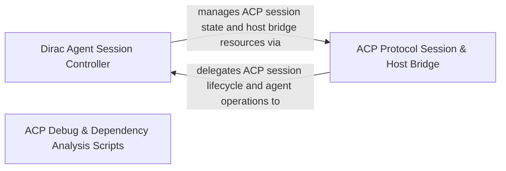

## Details

Runs the Agent Client Protocol (ACP) server mode, manages ACP session state and host bridge clients, and adapts Dirac agent sessions and diffs to ACP protocol streams.

### Dirac Agent Session Controller
Manages DiracAgent session execution, provider and authentication setup, permission handling, and translation of tasks, messages, and browser actions into session events.

**Related Classes/Methods**:

- `cli.src.agent.DiracAgent.DiracAgent`:176-2384
- `cli.src.agent.DiracSessionEmitter.DiracSessionEmitter`:39-139
- `cli.src.agent.AcpAuthenticationManager.AcpAuthenticationManager`:30-115
- `cli.src.agent.AcpProviderSetup.AcpProviderSetup`:124-220

**Source Files:**

- `cli/src/agent/AcpAuthenticationManager.ts`
  - `cli.src.agent.AcpAuthenticationManager.terminalSetupArgs` (L18-L24) - Function
  - `cli.src.agent.AcpAuthenticationManager.supportsLegacyTerminalAuth` (L26-L28) - Function
  - `cli.src.agent.AcpAuthenticationManager.AcpAuthenticationManager` (L30-L115) - Class
  - `cli.src.agent.AcpAuthenticationManager.AcpAuthenticationManager.constructor` (L33-L33) - Constructor
  - `cli.src.agent.AcpAuthenticationManager.AcpAuthenticationManager.listAuthenticationMethods` (L35-L86) - Method
  - `cli.src.agent.AcpAuthenticationManager.AcpAuthenticationManager.authenticate` (L88-L102) - Method
  - `cli.src.agent.AcpAuthenticationManager.AcpAuthenticationManager.logout` (L104-L109) - Method
  - `cli.src.agent.AcpAuthenticationManager.AcpAuthenticationManager.shutdown` (L111-L114) - Method
- `cli/src/agent/AcpProviderSetup.ts`
  - `cli.src.agent.AcpProviderSetup.providerOptions` (L21-L30) - Function
  - `cli.src.agent.AcpProviderSetup.providerOptions.filter() callback` (L23-L23) - Function
  - `cli.src.agent.AcpProviderSetup.providerOptions.map() callback` (L24-L29) - Function
  - `cli.src.agent.AcpProviderSetup.escapeHtml` (L32-L34) - Function
  - `cli.src.agent.AcpProviderSetup.escapeHtml.value.replace() callback` (L33-L33) - Function
  - `cli.src.agent.AcpProviderSetup.setupPage` (L36-L82) - Function
  - `cli.src.agent.AcpProviderSetup.setupPage.selectedProvider` (L42-L42) - Class
  - `cli.src.agent.AcpProviderSetup.setupPage.selectedProvider.providers.find() callback` (L42-L42) - Function
  - `cli.src.agent.AcpProviderSetup.setupPage.options` (L43-L48) - Class
  - `cli.src.agent.AcpProviderSetup.setupPage.options.providers.map() callback` (L45-L46) - Function
  - `cli.src.agent.AcpProviderSetup.resultPage` (L84-L86) - Function
  - `cli.src.agent.AcpProviderSetup.sendHtml` (L88-L97) - Function
  - `cli.src.agent.AcpProviderSetup.readRequestBody` (L99-L106) - Function
  - `cli.src.agent.AcpProviderSetup.listenOnLoopback` (L108-L117) - Function
  - `cli.src.agent.AcpProviderSetup.listenOnLoopback.<function>` (L109-L115) - Function
  - `cli.src.agent.AcpProviderSetup.listenOnLoopback.<function>.server.listen("127.0.0.1") callback` (L111-L114) - Function
  - `cli.src.agent.AcpProviderSetup.closeServer` (L119-L122) - Function
  - `cli.src.agent.AcpProviderSetup.closeServer.<function>` (L121-L121) - Function
  - `cli.src.agent.AcpProviderSetup.closeServer.<function>.server.close() callback` (L121-L121) - Function
  - `cli.src.agent.AcpProviderSetup.AcpProviderSetup` (L124-L220) - Class
  - `cli.src.agent.AcpProviderSetup.AcpProviderSetup.authenticate` (L129-L155) - Method
  - `cli.src.agent.AcpProviderSetup.AcpProviderSetup.authenticate.server` (L135-L137) - Class
  - `cli.src.agent.AcpProviderSetup.AcpProviderSetup.authenticate.server.http.createServer() callback` (L135-L137) - Function
  - `cli.src.agent.AcpProviderSetup.AcpProviderSetup.authenticate.completion` (L139-L141) - Class
  - `cli.src.agent.AcpProviderSetup.AcpProviderSetup.authenticate.completion.<function>` (L139-L141) - Function
  - `cli.src.agent.AcpProviderSetup.AcpProviderSetup.authenticate.timeout` (L142-L142) - Class
  - `cli.src.agent.AcpProviderSetup.AcpProviderSetup.authenticate.timeout.setTimeout() callback` (L142-L142) - Function
  - `cli.src.agent.AcpProviderSetup.AcpProviderSetup.cancel` (L157-L159) - Method
  - `cli.src.agent.AcpProviderSetup.AcpProviderSetup.handleRequest` (L161-L211) - Method
  - `cli.src.agent.AcpProviderSetup.AcpProviderSetup.settleActiveSetup` (L213-L219) - Method
- `cli/src/agent/DiracAgent.ts`
  - `cli.src.agent.DiracAgent.summarizeSessionTitle` (L113-L118) - Function
  - `cli.src.agent.DiracAgent.workspaceCheckpointsFromMessages` (L127-L137) - Function
  - `cli.src.agent.DiracAgent.workspaceCheckpointsFromMessages.messages.filter() callback` (L129-L129) - Function
  - `cli.src.agent.DiracAgent.workspaceCheckpointsFromMessages.map() callback` (L130-L135) - Function
  - `cli.src.agent.DiracAgent.worktreeProvisioningRequest` (L143-L160) - Function
  - `cli.src.agent.DiracAgent.DiracAgent` (L176-L2384) - Class
  - `cli.src.agent.DiracAgent.DiracAgent.shutdown` (L177-L186) - Method
  - `cli.src.agent.DiracAgent.DiracAgent.releaseSessionResources` (L189-L212) - Method
  - `cli.src.agent.DiracAgent.DiracAgent.deleteSessionResources` (L215-L244) - Method
  - `cli.src.agent.DiracAgent.DiracAgent.deleteSessionResources.withTaskHistoryInventoryLock() callback` (L229-L238) - Function
  - `cli.src.agent.DiracAgent.DiracAgent.provisionSessionWorktree` (L247-L282) - Method
  - `cli.src.agent.DiracAgent.DiracAgent.integrateSessionWorktree` (L285-L336) - Method
  - `cli.src.agent.DiracAgent.DiracAgent.unbindPromptTask` (L371-L373) - Method
  - `cli.src.agent.DiracAgent.DiracAgent.releasePromptSteeringOwnership` (L375-L378) - Method
  - `cli.src.agent.DiracAgent.DiracAgent.createTaskMessageBridge` (L380-L392) - Method
  - `cli.src.agent.DiracAgent.DiracAgent.createTaskMessageBridge.getSession` (L382-L382) - Method
  - `cli.src.agent.DiracAgent.DiracAgent.createTaskMessageBridge.getController` (L383-L383) - Method
  - `cli.src.agent.DiracAgent.DiracAgent.createTaskMessageBridge.requestPermission` (L384-L384) - Method
  - `cli.src.agent.DiracAgent.DiracAgent.createTaskMessageBridge.emitSessionUpdate` (L385-L385) - Method
  - `cli.src.agent.DiracAgent.DiracAgent.createTaskMessageBridge.persistPermissionRule` (L386-L386) - Method
  - `cli.src.agent.DiracAgent.DiracAgent.createTaskMessageBridge.getClientCapabilities` (L387-L387) - Method
  - `cli.src.agent.DiracAgent.DiracAgent.createTaskMessageBridge.requestElicitation` (L388-L388) - Method
  - `cli.src.agent.DiracAgent.DiracAgent.createTaskMessageBridge.emitSteeringStatus` (L389-L390) - Method
  - `cli.src.agent.DiracAgent.DiracAgent.bridgeForSession` (L394-L401) - Method
  - `cli.src.agent.DiracAgent.DiracAgent.queueWhisper` (L404-L438) - Method
  - `cli.src.agent.DiracAgent.DiracAgent.bufferWhisper` (L440-L444) - Method
  - `cli.src.agent.DiracAgent.DiracAgent.recordClientAnnotation` (L447-L460) - Method
  - `cli.src.agent.DiracAgent.DiracAgent.pinMessage` (L463-L480) - Method
  - `cli.src.agent.DiracAgent.DiracAgent.unpinMessage` (L482-L492) - Method
  - `cli.src.agent.DiracAgent.DiracAgent.listPinnedMessages` (L494-L497) - Method
  - `cli.src.agent.DiracAgent.DiracAgent.pinnedContentFromMessage` (L498-L502) - Method
  - `cli.src.agent.DiracAgent.DiracAgent.pinnedContextForSession` (L503-L511) - Method
  - `cli.src.agent.DiracAgent.DiracAgent.pinnedContextForSession.pins.map() callback` (L508-L508) - Function
  - `cli.src.agent.DiracAgent.DiracAgent.pinnedContextInitializationOptions` (L513-L521) - Method
  - `cli.src.agent.DiracAgent.DiracAgent.pinnedContextInitializationOptions.onContextCompacted` (L516-L516) - Method
  - `cli.src.agent.DiracAgent.DiracAgent.pinnedContextInitializationOptions.switchToActMode` (L517-L517) - Method
  - `cli.src.agent.DiracAgent.DiracAgent.pinnedContextInitializationOptions.enqueueSteeringMessages` (L518-L518) - Method
  - `cli.src.agent.DiracAgent.DiracAgent.activePromptInitializationOptions` (L523-L527) - Method
  - `cli.src.agent.DiracAgent.DiracAgent.bindPromptTask` (L529-L547) - Method
  - `cli.src.agent.DiracAgent.DiracAgent.emitSteeringStatus` (L549-L551) - Method
  - `cli.src.agent.DiracAgent.DiracAgent.applyPinnedContext` (L553-L565) - Method
  - `cli.src.agent.DiracAgent.DiracAgent.applyPinnedContext.task.setContextCompactionObserver() callback` (L564-L564) - Function
  - `cli.src.agent.DiracAgent.DiracAgent.emitPinnedMessagesUpdate` (L566-L571) - Method
  - `cli.src.agent.DiracAgent.DiracAgent.listWorkspaceCheckpoints` (L574-L594) - Method
  - `cli.src.agent.DiracAgent.DiracAgent.restoreWorkspaceCheckpoint` (L597-L605) - Method
  - `cli.src.agent.DiracAgent.DiracAgent.constructor` (L663-L671) - Constructor
  - `cli.src.agent.DiracAgent.DiracAgent.applyStartupProviderInfrastructure` (L673-L704) - Method
  - `cli.src.agent.DiracAgent.DiracAgent.createStartupSessionOverrides` (L706-L820) - Method
  - `cli.src.agent.DiracAgent.DiracAgent.createStartupSessionOverrides.profile` (L746-L746) - Class
  - `cli.src.agent.DiracAgent.DiracAgent.createStartupSessionOverrides.profile.profiles.find() callback` (L746-L746) - Function
  - `cli.src.agent.DiracAgent.DiracAgent.isStartupProviderConfigured` (L822-L826) - Method
  - `cli.src.agent.DiracAgent.DiracAgent.initializeSessionOverrides` (L828-L832) - Method
  - `cli.src.agent.DiracAgent.DiracAgent.persistSessionOverrides` (L834-L840) - Method
  - `cli.src.agent.DiracAgent.DiracAgent.writeSessionRuntimeConfig` (L842-L849) - Method
  - `cli.src.agent.DiracAgent.DiracAgent.runSessionRuntimeMutation` (L851-L874) - Method
  - `cli.src.agent.DiracAgent.DiracAgent.runSessionRuntimeMutation.mutationTail` (L859-L859) - Class
  - `cli.src.agent.DiracAgent.DiracAgent.runSessionRuntimeMutation.mutationTail.previousMutation.then() callback` (L859-L859) - Function
  - `cli.src.agent.DiracAgent.DiracAgent.resolveSessionTaskRuntime` (L876-L893) - Method
  - `cli.src.agent.DiracAgent.DiracAgent.refreshSessionProviderRuntime` (L895-L907) - Method
  - `cli.src.agent.DiracAgent.DiracAgent.commitClientSessionRuntime` (L909-L925) - Method
  - `cli.src.agent.DiracAgent.DiracAgent.commitClientSessionRuntime.applyActivePromptRuntime() callback` (L922-L922) - Function
  - `cli.src.agent.DiracAgent.DiracAgent.applyActivePromptRuntime` (L927-L939) - Method
  - `cli.src.agent.DiracAgent.DiracAgent.refreshTaskRuntime` (L941-L947) - Method
  - `cli.src.agent.DiracAgent.DiracAgent.replaceSessionRuntimeConfig` (L949-L967) - Method
  - `cli.src.agent.DiracAgent.DiracAgent.setPermissionHandler` (L978-L980) - Method
  - `cli.src.agent.DiracAgent.DiracAgent.setElicitationHandler` (L983-L985) - Method
  - `cli.src.agent.DiracAgent.DiracAgent.requestElicitation` (L987-L1009) - Method
  - `cli.src.agent.DiracAgent.DiracAgent.requestElicitation.<function>` (L993-L1008) - Function
  - `cli.src.agent.DiracAgent.DiracAgent.persistPermissionRule` (L1015-L1035) - Method
  - `cli.src.agent.DiracAgent.DiracAgent.listPermissionRules` (L1038-L1045) - Method
  - `cli.src.agent.DiracAgent.DiracAgent.listPermissionRules.withSessionPermissionController() callback` (L1044-L1044) - Function
  - `cli.src.agent.DiracAgent.DiracAgent.deletePermissionRule` (L1048-L1056) - Method
  - `cli.src.agent.DiracAgent.DiracAgent.deletePermissionRule.withSessionPermissionController() callback` (L1055-L1055) - Function
  - `cli.src.agent.DiracAgent.DiracAgent.activePermissionTaskForSession` (L1058-L1064) - Method
  - `cli.src.agent.DiracAgent.DiracAgent.withSessionPermissionController` (L1066-L1082) - Method
  - `cli.src.agent.DiracAgent.DiracAgent.permissionTaskForSession` (L1084-L1090) - Method
  - `cli.src.agent.DiracAgent.DiracAgent.permissionRuleToolName` (L1092-L1097) - Method
  - `cli.src.agent.DiracAgent.DiracAgent.requestPermission` (L1099-L1117) - Method
  - `cli.src.agent.DiracAgent.DiracAgent.requestPermission.<function>` (L1107-L1116) - Function
  - `cli.src.agent.DiracAgent.DiracAgent.emitterForSession` (L1128-L1135) - Method
  - `cli.src.agent.DiracAgent.DiracAgent.initialize` (L1143-L1215) - Method
  - `cli.src.agent.DiracAgent.DiracAgent.initializeHostProvider` (L1227-L1269) - Method
  - `cli.src.agent.DiracAgent.initializeHostProvider.HostProvider.initialize("cli") callback` (L1243-L1243) - Function
  - `cli.src.agent.DiracAgent.DiracAgent.initializeHostProvider.HostProvider.initialize("cli") callback` (L1267-L1267) - Function
  - `cli.src.agent.DiracAgent.DiracAgent.newSession` (L1277-L1337) - Method
  - `cli.src.agent.DiracAgent.DiracAgent.loadSession` (L1345-L1452) - Method
  - `cli.src.agent.DiracAgent.DiracAgent.loadSession.runSessionRuntimeMutation() callback` (L1349-L1356) - Function
  - `cli.src.agent.DiracAgent.DiracAgent.loadSession.some() callback` (L1382-L1386) - Function
  - `cli.src.agent.DiracAgent.DiracAgent.unstable_resumeSession` (L1460-L1466) - Method
  - `cli.src.agent.DiracAgent.DiracAgent.publishSessionSetupUpdates` (L1472-L1485) - Method
  - `cli.src.agent.DiracAgent.DiracAgent.setSessionConfigOption` (L1487-L1547) - Method
  - `cli.src.agent.DiracAgent.DiracAgent.setSessionConfigOption.runSessionRuntimeMutation() callback` (L1502-L1546) - Function
  - `cli.src.agent.DiracAgent.DiracAgent.prompt` (L1563-L1845) - Method
  - `cli.src.agent.DiracAgent.DiracAgent.prompt.activeOverrides` (L1576-L1590) - Class
  - `cli.src.agent.DiracAgent.DiracAgent.prompt.activeOverrides.runSessionRuntimeMutation() callback` (L1576-L1590) - Function
  - `cli.src.agent.DiracAgent.DiracAgent.prompt.removeTaskReplacementListener` (L1656-L1677) - Class
  - `cli.src.agent.DiracAgent.DiracAgent.prompt.removeTaskReplacementListener.controller.onTaskReplaced() callback` (L1656-L1677) - Function
  - `cli.src.agent.DiracAgent.DiracAgent.prompt.waitingCard` (L1736-L1745) - Class
  - `cli.src.agent.DiracAgent.DiracAgent.prompt.waitingCard.find() callback` (L1740-L1743) - Function
  - `cli.src.agent.DiracAgent.DiracAgent.cancel` (L1853-L1931) - Method
  - `cli.src.agent.DiracAgent.DiracAgent.closeSession` (L1934-L1937) - Method
  - `cli.src.agent.DiracAgent.DiracAgent.deleteSession` (L1939-L1942) - Method
  - `cli.src.agent.DiracAgent.DiracAgent.setSessionMode` (L1944-L1951) - Method
  - `cli.src.agent.DiracAgent.DiracAgent.applySessionMode` (L1953-L1974) - Method
  - `cli.src.agent.DiracAgent.DiracAgent.applySessionMode.runSessionRuntimeMutation() callback` (L1961-L1973) - Function
  - `cli.src.agent.DiracAgent.DiracAgent.switchSessionToActMode` (L1976-L1997) - Method
  - `cli.src.agent.DiracAgent.DiracAgent.switchSessionToActMode.runSessionRuntimeMutation() callback` (L1977-L1996) - Function
  - `cli.src.agent.DiracAgent.DiracAgent.listProviders` (L1999-L2001) - Method
  - `cli.src.agent.DiracAgent.DiracAgent.setProvider` (L2003-L2006) - Method
  - `cli.src.agent.DiracAgent.DiracAgent.disableProvider` (L2008-L2011) - Method
  - `cli.src.agent.DiracAgent.DiracAgent.unstable_listProviders` (L2013-L2016) - Method
  - `cli.src.agent.DiracAgent.DiracAgent.unstable_setProvider` (L2018-L2020) - Method
  - `cli.src.agent.DiracAgent.DiracAgent.unstable_disableProvider` (L2022-L2024) - Method
  - `cli.src.agent.DiracAgent.DiracAgent.publishProviderConfigChanges` (L2026-L2028) - Method
  - `cli.src.agent.DiracAgent.DiracAgent.publishProviderConfigChanges.map() callback` (L2027-L2027) - Function
  - `cli.src.agent.DiracAgent.DiracAgent.authenticate` (L2030-L2034) - Method
  - `cli.src.agent.DiracAgent.DiracAgent.logout` (L2036-L2039) - Method
  - `cli.src.agent.DiracAgent.DiracAgent.emitCurrentModeUpdate` (L2041-L2053) - Method
  - `cli.src.agent.DiracAgent.DiracAgent.persistAndSendSessionUpdate` (L2055-L2062) - Method
  - `cli.src.agent.DiracAgent.DiracAgent.emitSessionUpdate` (L2064-L2074) - Method
  - `cli.src.agent.DiracAgent.DiracAgent.persistSessionUpdate` (L2088-L2108) - Method
  - `cli.src.agent.DiracAgent.DiracAgent.getNormalizedConfigOptions` (L2110-L2117) - Method
  - `cli.src.agent.DiracAgent.DiracAgent.emitConfigOptionsUpdate` (L2119-L2128) - Method
  - `cli.src.agent.DiracAgent.DiracAgent.emitConfigOptionsUpdate.runSessionRuntimeMutation() callback` (L2121-L2127) - Function
  - `cli.src.agent.DiracAgent.DiracAgent.replayLoadedSessionHistory` (L2134-L2207) - Method
  - `cli.src.agent.DiracAgent.DiracAgent.replayLoadedSessionHistory.hasPersistedUsageUpdate` (L2164-L2167) - Class
  - `cli.src.agent.DiracAgent.DiracAgent.replayLoadedSessionHistory.hasPersistedUsageUpdate.persistedUpdates.some() callback` (L2165-L2166) - Function
  - `cli.src.agent.DiracAgent.DiracAgent.emitPlanFromMessage` (L2209-L2214) - Method
  - `cli.src.agent.DiracAgent.DiracAgent.planFromMessage` (L2216-L2240) - Method
  - `cli.src.agent.DiracAgent.DiracAgent.planFromMessage.numberedItems` (L2225-L2230) - Class
  - `cli.src.agent.DiracAgent.planFromMessage.numberedItems.map() callback` (L2227-L2227) - Function
  - `cli.src.agent.DiracAgent.DiracAgent.planFromMessage.numberedItems.filter() callback` (L2228-L2228) - Function
  - `cli.src.agent.DiracAgent.DiracAgent.planFromMessage.numberedItems.map() callback` (L2229-L2229) - Function
  - `cli.src.agent.DiracAgent.DiracAgent.planFromMessage.entries.planItems.map() callback` (L2233-L2237) - Function
  - `cli.src.agent.DiracAgent.planFromMessage.entries` (L2233-L2237) - Class
  - `cli.src.agent.DiracAgent.DiracAgent.planStatusFromCard` (L2242-L2246) - Method
  - `cli.src.agent.DiracAgent.DiracAgent.planTextFromCard` (L2248-L2255) - Method
  - `cli.src.agent.DiracAgent.DiracAgent.sendAvailableCommands` (L2257-L2299) - Method
  - `cli.src.agent.DiracAgent.DiracAgent.sendAvailableCommands.cliOnlyNames` (L2263-L2263) - Class
  - `cli.src.agent.DiracAgent.DiracAgent.sendAvailableCommands.cliOnlyNames.CLI_ONLY_COMMANDS.map() callback` (L2263-L2263) - Function
  - `cli.src.agent.DiracAgent.DiracAgent.sendAvailableCommands.vscodeOnlyNames` (L2264-L2264) - Class
  - `cli.src.agent.DiracAgent.DiracAgent.sendAvailableCommands.vscodeOnlyNames.VSCODE_ONLY_COMMANDS.map() callback` (L2264-L2264) - Function
  - `cli.src.agent.DiracAgent.DiracAgent.sendAvailableCommands.filteredCommands` (L2266-L2268) - Class
  - `cli.src.agent.DiracAgent.DiracAgent.sendAvailableCommands.filteredCommands.response.commands.filter() callback` (L2267-L2267) - Function
  - `cli.src.agent.DiracAgent.DiracAgent.sendAvailableCommands.availableCommands.filteredCommands.map() callback` (L2271-L2277) - Function
  - `cli.src.agent.DiracAgent.sendAvailableCommands.availableCommands` (L2271-L2277) - Class
  - `cli.src.agent.DiracAgent.DiracAgent.sendAvailableCommands.availableCommands.some() callback` (L2280-L2280) - Function
  - `cli.src.agent.DiracAgent.DiracAgent.sendAvailableCommands.commands.availableCommands.map() callback` (L2294-L2294) - Function
  - `cli.src.agent.DiracAgent.DiracAgent.setSessionTitleFromFirstExchange` (L2301-L2308) - Method
  - `cli.src.agent.DiracAgent.DiracAgent.emitSessionInfoUpdate` (L2310-L2316) - Method
  - `cli.src.agent.DiracAgent.DiracAgent.unstable_listSessions` (L2318-L2320) - Method
  - `cli.src.agent.DiracAgent.DiracAgent.unstable_listSessions_internal` (L2322-L2343) - Method
  - `cli.src.agent.DiracAgent.DiracAgent.unstable_listSessions_internal.persistedSessions.map() callback` (L2323-L2324) - Function
  - `cli.src.agent.DiracAgent.DiracAgent.unstable_listSessions_internal.persistedSessions` (L2323-L2325) - Class
  - `cli.src.agent.DiracAgent.DiracAgent.unstable_listSessions_internal.persistedSessionIds` (L2326-L2326) - Class
  - `cli.src.agent.DiracAgent.DiracAgent.unstable_listSessions_internal.persistedSessionIds.persistedSessions.map() callback` (L2326-L2326) - Function
  - `cli.src.agent.DiracAgent.DiracAgent.unstable_listSessions_internal.activeOnlySessions` (L2327-L2336) - Class
  - `cli.src.agent.DiracAgent.unstable_listSessions_internal.activeOnlySessions.filter() callback` (L2328-L2328) - Function
  - `cli.src.agent.DiracAgent.DiracAgent.unstable_listSessions_internal.activeOnlySessions.filter() callback` (L2329-L2329) - Function
  - `cli.src.agent.DiracAgent.DiracAgent.unstable_listSessions_internal.activeOnlySessions.map() callback` (L2330-L2335) - Function
  - `cli.src.agent.DiracAgent.DiracAgent.unstable_listSessions_internal.activeOnlySessions.sort() callback` (L2336-L2336) - Function
  - `cli.src.agent.DiracAgent.DiracAgent.unstable_listSessions_internal.sessions.sort() callback` (L2339-L2340) - Function
  - `cli.src.agent.DiracAgent.DiracAgent.checkpointRestore` (L2351-L2383) - Method
  - `cli.src.agent.DiracAgent.DiracAgent.checkpointRestore.pWaitFor() callback` (L2368-L2368) - Function
  - `cli.src.agent.DiracAgent.DiracAgent.checkpointRestore.catch() callback` (L2370-L2373) - Function
- `cli/src/agent/DiracSessionEmitter.ts`
  - `cli.src.agent.DiracSessionEmitter.DiracSessionEmitter` (L39-L139) - Class
  - `cli.src.agent.DiracSessionEmitter.DiracSessionEmitter.constructor` (L48-L52) - Constructor
  - `cli.src.agent.DiracSessionEmitter.DiracSessionEmitter.on` (L64-L74) - Method
  - `cli.src.agent.DiracSessionEmitter.DiracSessionEmitter.once` (L76-L85) - Method
  - `cli.src.agent.DiracSessionEmitter.DiracSessionEmitter.off` (L94-L97) - Method
  - `cli.src.agent.DiracSessionEmitter.DiracSessionEmitter.emit` (L106-L110) - Method
  - `cli.src.agent.DiracSessionEmitter.DiracSessionEmitter.removeAllListeners` (L121-L128) - Method
  - `cli.src.agent.DiracSessionEmitter.DiracSessionEmitter.listenerCount` (L136-L138) - Method
- `cli/src/agent/browserActionTranslator.ts`
  - `cli.src.agent.browserActionTranslator.getBrowserActionKind` (L38-L43) - Function
- `cli/src/agent/diffUtils.ts`
  - `cli.src.agent.diffUtils.parseUnifiedDiff` (L16-L86) - Function
- `cli/src/agent/messageTranslator.ts`
  - `cli.src.agent.messageTranslator.generateToolCallId` (L58-L60) - Function
  - `cli.src.agent.messageTranslator.parseWebSearchMarkerText` (L72-L78) - Function
  - `cli.src.agent.messageTranslator.toolNameForCard` (L80-L84) - Function
  - `cli.src.agent.messageTranslator.toolKindForCard` (L86-L98) - Function
  - `cli.src.agent.messageTranslator.TranslateMessageOptions` (L103-L114) - Interface
  - `cli.src.agent.messageTranslator.translateMessage` (L124-L154) - Function
  - `cli.src.agent.messageTranslator.translateMarkdownMessage` (L159-L228) - Function
  - `cli.src.agent.messageTranslator.translateWebSearchMarkerMessage` (L236-L269) - Function
  - `cli.src.agent.messageTranslator.translateCardMessage` (L274-L396) - Function
  - `cli.src.agent.messageTranslator.translateCardMessage.locations.card.locations.map() callback` (L311-L314) - Function
  - `cli.src.agent.messageTranslator.content` (L318-L318) - Class
  - `cli.src.agent.messageTranslator.translateCardMessage.content.card.diffs.map() callback` (L318-L318) - Function
  - `cli.src.agent.messageTranslator.translateMessages` (L405-L418) - Function
  - `cli.src.agent.messageTranslator.createSessionState` (L423-L429) - Function
- `cli/src/agent/permissionHandler.ts`
  - `cli.src.agent.permissionHandler.InteractionHandlerResult` (L16-L25) - Interface
  - `cli.src.agent.permissionHandler.handlePermissionResponse` (L34-L87) - Function
- `cli/src/agent/promptContent.ts`
  - `cli.src.agent.promptContent.parsePromptContent` (L9-L24) - Function
  - `cli.src.agent.promptContent.textContent` (L10-L13) - Class
  - `cli.src.agent.promptContent.parsePromptContent.textContent.prompt.filter() callback` (L11-L11) - Function
  - `cli.src.agent.promptContent.parsePromptContent.textContent.map() callback` (L12-L12) - Function
  - `cli.src.agent.promptContent.imageContent` (L15-L17) - Class
  - `cli.src.agent.promptContent.parsePromptContent.imageContent.prompt.filter() callback` (L16-L16) - Function
  - `cli.src.agent.promptContent.parsePromptContent.imageContent.map() callback` (L17-L17) - Function
  - `cli.src.agent.promptContent.fileResources` (L19-L21) - Class
  - `cli.src.agent.promptContent.parsePromptContent.fileResources.prompt.filter() callback` (L20-L20) - Function
  - `cli.src.agent.promptContent.parsePromptContent.fileResources.map() callback` (L21-L21) - Function
- `cli/src/agent/providerConfiguration.ts`
  - `cli.src.agent.providerConfiguration.normalizedBaseUrl` (L20-L26) - Function
  - `cli.src.agent.providerConfiguration.headerValue` (L28-L31) - Function
  - `cli.src.agent.providerConfiguration.headerValue.entry` (L29-L29) - Class
  - `cli.src.agent.providerConfiguration.headerValue.entry.find() callback` (L29-L29) - Function
  - `cli.src.agent.providerConfiguration.bearerToken` (L33-L39) - Function
  - `cli.src.agent.providerConfiguration.headersWithoutAuthentication` (L41-L48) - Function
  - `cli.src.agent.providerConfiguration.headersWithoutAuthentication.filter() callback` (L43-L46) - Function
  - `cli.src.agent.providerConfiguration.ProviderConfigurationManager` (L56-L188) - Class
  - `cli.src.agent.providerConfiguration.ProviderConfigurationManager.listProviders` (L57-L77) - Method
  - `cli.src.agent.providerConfiguration.ProviderConfigurationManager.listProviders.providers.map() callback` (L63-L75) - Function
  - `cli.src.agent.providerConfiguration.ProviderConfigurationManager.setProvider` (L79-L114) - Method
  - `cli.src.agent.providerConfiguration.ProviderConfigurationManager.disableProvider` (L116-L138) - Method
  - `cli.src.agent.providerConfiguration.ProviderConfigurationManager.isProviderEnabled` (L140-L142) - Method
  - `cli.src.agent.providerConfiguration.ProviderConfigurationManager.assertProviderEnabled` (L144-L152) - Method
  - `cli.src.agent.providerConfiguration.ProviderConfigurationManager.currentApiType` (L154-L160) - Method
  - `cli.src.agent.providerConfiguration.ProviderConfigurationManager.currentBaseUrl` (L162-L170) - Method
  - `cli.src.agent.providerConfiguration.ProviderConfigurationManager.disabledProviderIds` (L172-L174) - Method
  - `cli.src.agent.providerConfiguration.ProviderConfigurationManager.setDisabled` (L176-L181) - Method
  - `cli.src.agent.providerConfiguration.ProviderConfigurationManager.setApiType` (L183-L187) - Method
- `cli/src/agent/public-types.ts`
  - `cli.src.agent.public-types.DiracAgentOptions` (L88-L115) - Interface
  - `cli.src.agent.public-types.AcpAgentOptions` (L120-L147) - Interface
  - `cli.src.agent.public-types.DiracAcpSession` (L157-L182) - Interface
  - `cli.src.agent.public-types.AcpSessionStatus` (L191-L198) - Enum
  - `cli.src.agent.public-types.AcpSessionState` (L203-L228) - Interface
  - `cli.src.agent.public-types.DiracAgentCapabilities` (L237-L249) - Interface
  - `cli.src.agent.public-types.DiracAgentInfo` (L254-L258) - Interface
  - `cli.src.agent.public-types.TranslatedMessage` (L268-L277) - Interface
- `cli/src/agent/questionCard.ts`
  - `cli.src.agent.questionCard.isFollowupQuestionCard` (L9-L17) - Function
- `cli/src/agent/review.ts`
  - `cli.src.agent.review.ReviewFinding` (L50-L56) - Interface
  - `cli.src.agent.review.ReviewDiffFile` (L58-L62) - Interface
  - `cli.src.agent.review.ReviewContext` (L64-L69) - Interface
  - `cli.src.agent.review.ReviewCommandHandlerOptions` (L71-L77) - Interface
  - `cli.src.agent.review.ReviewModelInput` (L79-L82) - Interface
  - `cli.src.agent.review.ReviewCommandHandlerDependencies` (L84-L87) - Interface
  - `cli.src.agent.review.DiffFileSpec` (L89-L94) - Interface
  - `cli.src.agent.review.parseReviewCommand` (L96-L130) - Function
  - `cli.src.agent.review.formatReviewFindings` (L132-L155) - Function
  - `cli.src.agent.review.formatReviewFindings.sorted` (L137-L147) - Class
  - `cli.src.agent.review.formatReviewFindings.sorted.sort() callback` (L137-L147) - Function
  - `cli.src.agent.review.formatReviewFindings.sorted.map() callback` (L150-L153) - Function
  - `cli.src.agent.review.handleAcpReviewCommand` (L157-L230) - Function
  - `cli.src.agent.review.handleAcpReviewCommand.content.context.files.map() callback` (L203-L208) - Function
  - `cli.src.agent.review.handleAcpReviewCommand.locations.context.files.map() callback` (L209-L209) - Function
  - `cli.src.agent.review.collectReviewContextFromGit` (L232-L276) - Function
  - `cli.src.agent.review.specs.map() callback` (L250-L255) - Function
  - `cli.src.agent.review.collectReviewContextFromGit.specs.map() callback` (L266-L271) - Function
  - `cli.src.agent.review.runReviewModelOnDiff` (L278-L332) - Function
  - `cli.src.agent.review.runReviewModelOnDiff.changedFiles` (L283-L283) - Class
  - `cli.src.agent.review.runReviewModelOnDiff.changedFiles.input.context.files.map() callback` (L283-L283) - Function
  - `cli.src.agent.review.disableThinking` (L334-L340) - Function
  - `cli.src.agent.review.parseReviewFindings` (L342-L361) - Function
  - `cli.src.agent.review.parseReviewFindings.findings.map() callback` (L356-L356) - Function
  - `cli.src.agent.review.parseReviewFindings.filter() callback` (L357-L357) - Function
  - `cli.src.agent.review.normalizeFinding` (L363-L386) - Function
  - `cli.src.agent.review.stripCodeFence` (L388-L391) - Function
  - `cli.src.agent.review.buildReviewContext` (L393-L423) - Function
  - `cli.src.agent.review.gitText` (L425-L431) - Function
  - `cli.src.agent.review.readBufferForSpec` (L433-L454) - Function
  - `cli.src.agent.review.looksBinary` (L456-L458) - Function
  - `cli.src.agent.review.hasGitRevision` (L460-L467) - Function
  - `cli.src.agent.review.collectWorktreeSpecs` (L469-L498) - Function
  - `cli.src.agent.review.collectWorktreeSpecs.map() callback` (L471-L476) - Function
  - `cli.src.agent.review.collectWorktreeSpecs.specs` (L479-L486) - Class
  - `cli.src.agent.review.collectWorktreeSpecs.specs.map() callback` (L481-L486) - Function
  - `cli.src.agent.review.resolveCommitParent` (L500-L506) - Function
  - `cli.src.agent.review.parseNameStatus` (L508-L531) - Function
  - `cli.src.agent.review.parseNameStatus.parts` (L509-L509) - Class
  - `cli.src.agent.review.parseNameStatus.parts.filter() callback` (L509-L509) - Function
  - `cli.src.agent.review.collectPaths` (L533-L537) - Function
  - `cli.src.agent.review.collectPaths.filter() callback` (L536-L536) - Function
  - `cli.src.agent.review.buildUnifiedDiffText` (L539-L549) - Function
  - `cli.src.agent.review.buildUnifiedDiffText.files.map() callback` (L541-L547) - Function
- `cli/src/agent/sessionConfig.ts`
  - `cli.src.agent.sessionConfig.REASONING_EFFORT_OPTIONS` (L43-L46) - Class
  - `cli.src.agent.sessionConfig.REASONING_EFFORT_OPTIONS.OPENAI_REASONING_EFFORT_OPTIONS.map() callback` (L43-L46) - Function
  - `cli.src.agent.sessionConfig.ACP_INFERENCE_SPEED_OPTIONS` (L48-L51) - Class
  - `cli.src.agent.sessionConfig.ACP_INFERENCE_SPEED_OPTIONS.INFERENCE_SPEED_OPTIONS.map() callback` (L48-L51) - Function
  - `cli.src.agent.sessionConfig.getThinkingBudgetOptions` (L55-L62) - Function
  - `cli.src.agent.sessionConfig.getThinkingBudgetOptions.validTiers` (L57-L57) - Class
  - `cli.src.agent.sessionConfig.getThinkingBudgetOptions.validTiers.STANDARD_THINKING_BUDGET_TIERS.filter() callback` (L57-L57) - Function
  - `cli.src.agent.sessionConfig.getThinkingBudgetOptions.validTiers.map() callback` (L60-L60) - Function
  - `cli.src.agent.sessionConfig.SessionConfigManager` (L64-L617) - Class
  - `cli.src.agent.sessionConfig.SessionConfigManager.constructor` (L65-L65) - Constructor
  - `cli.src.agent.sessionConfig.SessionConfigManager.computeCurrentAcpModeId` (L67-L69) - Method
  - `cli.src.agent.sessionConfig.SessionConfigManager.getSessionMode` (L71-L73) - Method
  - `cli.src.agent.sessionConfig.SessionConfigManager.getSessionModeState` (L75-L84) - Method
  - `cli.src.agent.sessionConfig.SessionConfigManager.getSessionModeState.availableModes.ACP_MODE_OPTIONS.map() callback` (L77-L81) - Function
  - `cli.src.agent.sessionConfig.SessionConfigManager.normalizeSessionConfig` (L86-L123) - Method
  - `cli.src.agent.sessionConfig.SessionConfigManager.normalizeSessionConfig.providers` (L94-L96) - Class
  - `cli.src.agent.sessionConfig.SessionConfigManager.normalizeSessionConfig.providers.filter() callback` (L95-L95) - Function
  - `cli.src.agent.sessionConfig.SessionConfigManager.getSessionConfigOptions` (L125-L253) - Method
  - `cli.src.agent.sessionConfig.SessionConfigManager.getSessionConfigOptions.setModeScopedSessionState() callback` (L156-L159) - Function
  - `cli.src.agent.sessionConfig.SessionConfigManager.getSessionConfigOptions.options.currentCatalog.modelIds.map() callback` (L225-L225) - Function
  - `cli.src.agent.sessionConfig.SessionConfigManager.getSessionConfigOptions.options.ACP_INFERENCE_SPEED_OPTIONS.filter() callback` (L238-L238) - Function
  - `cli.src.agent.sessionConfig.SessionConfigManager.applyProviderConfigOption` (L255-L287) - Method
  - `cli.src.agent.sessionConfig.SessionConfigManager.applyModelConfigOption` (L289-L311) - Method
  - `cli.src.agent.sessionConfig.SessionConfigManager.applyReasoningEffortConfigOption` (L313-L322) - Method
  - `cli.src.agent.sessionConfig.SessionConfigManager.applyReasoningEffortConfigOption.REASONING_EFFORT_OPTIONS.some() callback` (L314-L314) - Function
  - `cli.src.agent.sessionConfig.SessionConfigManager.applyReasoningEffortConfigOption.setModeScopedSessionState() callback` (L318-L321) - Function
  - `cli.src.agent.sessionConfig.SessionConfigManager.applyInferenceSpeedConfigOption` (L324-L351) - Method
  - `cli.src.agent.sessionConfig.SessionConfigManager.applyThinkingBudgetConfigOption` (L353-L363) - Method
  - `cli.src.agent.sessionConfig.SessionConfigManager.applyThinkingBudgetConfigOption.setModeScopedSessionState() callback` (L359-L362) - Function
  - `cli.src.agent.sessionConfig.SessionConfigManager.applyProviderAndModel` (L365-L419) - Method
  - `cli.src.agent.sessionConfig.SessionConfigManager.applyProviderAndModel.setModeScopedSessionState() callback` (L375-L418) - Function
  - `cli.src.agent.sessionConfig.SessionConfigManager.modelSupportsFastMode` (L421-L423) - Method
  - `cli.src.agent.sessionConfig.SessionConfigManager.getCurrentModeModelId` (L425-L429) - Method
  - `cli.src.agent.sessionConfig.SessionConfigManager.assertTaskRuntimeAvailable` (L431-L454) - Method
  - `cli.src.agent.sessionConfig.SessionConfigManager.getProviderOptions` (L456-L482) - Method
  - `cli.src.agent.sessionConfig.SessionConfigManager.getProviderOptions.catalogs` (L463-L478) - Class
  - `cli.src.agent.sessionConfig.SessionConfigManager.getProviderOptions.catalogs.map() callback` (L464-L477) - Function
  - `cli.src.agent.sessionConfig.SessionConfigManager.getProviderOptions.catalogs.filter() callback` (L480-L480) - Function
  - `cli.src.agent.sessionConfig.SessionConfigManager.getProviderOptions.map() callback` (L481-L481) - Function
  - `cli.src.agent.sessionConfig.SessionConfigManager.getProviderModelCatalog` (L484-L517) - Method
  - `cli.src.agent.sessionConfig.SessionConfigManager.getProviderModelCatalog.modelIds.candidates.filter() callback` (L507-L507) - Function
  - `cli.src.agent.sessionConfig.getProviderModelCatalog.modelIds` (L507-L507) - Class
  - `cli.src.agent.sessionConfig.SessionConfigManager.getProviderModelCandidates` (L519-L558) - Method
  - `cli.src.agent.sessionConfig.SessionConfigManager.getProviderModelCandidates.<function>` (L527-L554) - Function
  - `cli.src.agent.sessionConfig.getProviderModelCandidates.<function>.sort() callback` (L532-L532) - Function
  - `cli.src.agent.sessionConfig.SessionConfigManager.getProviderModelCandidates.<function>.sort() callback` (L544-L544) - Function
  - `cli.src.agent.sessionConfig.SessionConfigManager.getInferenceConfiguration` (L560-L562) - Method
  - `cli.src.agent.sessionConfig.SessionConfigManager.isModelAcceptedByInference` (L564-L571) - Method
  - `cli.src.agent.sessionConfig.SessionConfigManager.resolveInferenceModelId` (L573-L584) - Method
  - `cli.src.agent.sessionConfig.SessionConfigManager.isProviderEnabled` (L586-L588) - Method
  - `cli.src.agent.sessionConfig.SessionConfigManager.withCurrentSelectOption` (L590-L597) - Method
  - `cli.src.agent.sessionConfig.SessionConfigManager.withCurrentSelectOption.options.some() callback` (L595-L595) - Function
  - `cli.src.agent.sessionConfig.SessionConfigManager.assertModelAvailable` (L599-L606) - Method
  - `cli.src.agent.sessionConfig.SessionConfigManager.setModeScopedSessionState` (L608-L616) - Method
- `cli/src/agent/sessionHistory.ts`
  - `cli.src.agent.sessionHistory.getHistoryItemSessionId` (L12-L14) - Function
  - `cli.src.agent.sessionHistory.getHistoryItemCwd` (L16-L25) - Function
  - `cli.src.agent.sessionHistory.historyItemToSessionInfo` (L27-L38) - Function
  - `cli.src.agent.sessionHistory.getTaskHistory` (L40-L42) - Function
  - `cli.src.agent.sessionHistory.resolveHistorySession` (L44-L61) - Function
  - `cli.src.agent.sessionHistory.historyItem` (L46-L49) - Class
  - `cli.src.agent.sessionHistory.historyItem.taskHistory.find() callback` (L47-L47) - Function
  - `cli.src.agent.sessionHistory.resolveHistorySession.historyItem.sort() callback` (L48-L48) - Function
  - `cli.src.agent.sessionHistory.resolveHistorySession.historyItem.taskHistory.filter() callback` (L48-L48) - Function
  - `cli.src.agent.sessionHistory.resolveHistorySession.historyItem.taskHistory.find() callback` (L49-L49) - Function
  - `cli.src.agent.sessionHistory.listLatestConversationHistoryItems` (L63-L81) - Function
  - `cli.src.agent.sessionHistory.listLatestConversationHistoryItems.sort() callback` (L80-L80) - Function
  - `cli.src.agent.sessionHistory.getTaskIdsForSession` (L85-L89) - Function
  - `cli.src.agent.sessionHistory.getTaskIdsForSession.filter() callback` (L87-L87) - Function
  - `cli.src.agent.sessionHistory.getTaskIdsForSession.map() callback` (L88-L88) - Function
- `cli/src/agent/taskMessageBridge.ts`
  - `cli.src.agent.taskMessageBridge.TaskMessageBridge` (L68-L1259) - Class
  - `cli.src.agent.taskMessageBridge.TaskMessageBridge.constructor` (L120-L129) - Constructor
  - `cli.src.agent.taskMessageBridge.TaskMessageBridge.queueMessageWork` (L131-L147) - Method
  - `cli.src.agent.taskMessageBridge.queueMessageWork.queued.catch() callback` (L138-L138) - Function
  - `cli.src.agent.taskMessageBridge.TaskMessageBridge.queueMessageWork.queued.catch() callback` (L139-L146) - Function
  - `cli.src.agent.taskMessageBridge.TaskMessageBridge.clearPromptState` (L149-L156) - Method
  - `cli.src.agent.taskMessageBridge.TaskMessageBridge.promptResponse` (L159-L162) - Method
  - `cli.src.agent.taskMessageBridge.TaskMessageBridge.restoreUsage` (L164-L173) - Method
  - `cli.src.agent.taskMessageBridge.TaskMessageBridge.sessionTokenUsage` (L175-L212) - Method
  - `cli.src.agent.taskMessageBridge.TaskMessageBridge.cumulativeCost` (L214-L222) - Method
  - `cli.src.agent.taskMessageBridge.TaskMessageBridge.emitContextUsage` (L224-L233) - Method
  - `cli.src.agent.taskMessageBridge.TaskMessageBridge.usageSnapshotFromMessage` (L235-L287) - Method
  - `cli.src.agent.taskMessageBridge.TaskMessageBridge.recordUsage` (L289-L314) - Method
  - `cli.src.agent.taskMessageBridge.TaskMessageBridge.invalidatePendingInteractions` (L316-L318) - Method
  - `cli.src.agent.taskMessageBridge.TaskMessageBridge.waitForMessageWork` (L320-L322) - Method
  - `cli.src.agent.taskMessageBridge.TaskMessageBridge.cancelInFlightToolCalls` (L325-L349) - Method
  - `cli.src.agent.taskMessageBridge.TaskMessageBridge.subscribeToTaskMessages` (L351-L432) - Method
  - `cli.src.agent.taskMessageBridge.TaskMessageBridge.subscribeToTaskMessages.onDiracMessagesChanged` (L367-L381) - Class
  - `cli.src.agent.taskMessageBridge.TaskMessageBridge.subscribeToTaskMessages.onDiracMessagesChanged.queueMessageWork() callback` (L369-L376) - Function
  - `cli.src.agent.taskMessageBridge.TaskMessageBridge.subscribeToTaskMessages.cleanupFunctions.push() callback` (L393-L400) - Function
  - `cli.src.agent.taskMessageBridge.subscribeToTaskMessages.taskRunPromise.then() callback` (L409-L420) - Function
  - `cli.src.agent.taskMessageBridge.TaskMessageBridge.subscribeToTaskMessages.taskRunPromise.then() callback.queueMessageWork() callback` (L411-L415) - Function
  - `cli.src.agent.taskMessageBridge.TaskMessageBridge.subscribeToTaskMessages.taskRunPromise.then() callback` (L421-L429) - Function
  - `cli.src.agent.taskMessageBridge.TaskMessageBridge.replayTaskMessages` (L434-L470) - Method
  - `cli.src.agent.taskMessageBridge.TaskMessageBridge.replayTaskMessages.queueMessageWork() callback` (L445-L465) - Function
  - `cli.src.agent.taskMessageBridge.TaskMessageBridge.handleUnhandledHandlerError` (L477-L501) - Method
  - `cli.src.agent.taskMessageBridge.TaskMessageBridge.handleUnhandledHandlerError.catch() callback` (L494-L498) - Function
  - `cli.src.agent.taskMessageBridge.TaskMessageBridge.handleUnhandledHandlerError.finally() callback` (L500-L500) - Function
  - `cli.src.agent.taskMessageBridge.TaskMessageBridge.handleDiracMessagesChanged` (L504-L532) - Method
  - `cli.src.agent.taskMessageBridge.TaskMessageBridge.emitAppendedMarkdown` (L534-L548) - Method
  - `cli.src.agent.taskMessageBridge.TaskMessageBridge.formElicitationIsNegotiated` (L550-L552) - Method
  - `cli.src.agent.taskMessageBridge.TaskMessageBridge.freeformTextProperty` (L554-L568) - Method
  - `cli.src.agent.taskMessageBridge.TaskMessageBridge.freeformElicitationRequest` (L570-L588) - Method
  - `cli.src.agent.taskMessageBridge.TaskMessageBridge.elicitationRequestFromCard` (L589-L642) - Method
  - `cli.src.agent.taskMessageBridge.TaskMessageBridge.elicitationRequestFromCard.oneOf.card.actions.map() callback` (L618-L621) - Function
  - `cli.src.agent.taskMessageBridge.TaskMessageBridge.emitInvalidElicitationMessage` (L644-L652) - Method
  - `cli.src.agent.taskMessageBridge.TaskMessageBridge.acceptedElicitationAnswer` (L654-L704) - Method
  - `cli.src.agent.taskMessageBridge.TaskMessageBridge.acceptedElicitationAnswer.unknownKeys` (L674-L676) - Class
  - `cli.src.agent.taskMessageBridge.TaskMessageBridge.acceptedElicitationAnswer.unknownKeys.filter() callback` (L675-L675) - Function
  - `cli.src.agent.taskMessageBridge.TaskMessageBridge.acceptedElicitationAnswer.message.content.card.actions.some() callback` (L698-L698) - Function
  - `cli.src.agent.taskMessageBridge.TaskMessageBridge.cancelQuestionCard` (L706-L720) - Method
  - `cli.src.agent.taskMessageBridge.TaskMessageBridge.isActiveInteraction` (L722-L734) - Method
  - `cli.src.agent.taskMessageBridge.TaskMessageBridge.handleElicitationRequest` (L736-L813) - Method
  - `cli.src.agent.taskMessageBridge.TaskMessageBridge.handlePermissionRequest` (L815-L936) - Method
  - `cli.src.agent.taskMessageBridge.TaskMessageBridge.checkMessageForPromptResolution` (L938-L973) - Method
  - `cli.src.agent.taskMessageBridge.TaskMessageBridge.emitPlanFromMessage` (L975-L1008) - Method
  - `cli.src.agent.taskMessageBridge.TaskMessageBridge.emitPlanFromMessage.numberedItems` (L991-L996) - Class
  - `cli.src.agent.taskMessageBridge.emitPlanFromMessage.numberedItems.map() callback` (L993-L993) - Function
  - `cli.src.agent.taskMessageBridge.TaskMessageBridge.emitPlanFromMessage.numberedItems.filter() callback` (L994-L994) - Function
  - `cli.src.agent.taskMessageBridge.TaskMessageBridge.emitPlanFromMessage.numberedItems.map() callback` (L995-L995) - Function
  - `cli.src.agent.taskMessageBridge.TaskMessageBridge.emitPlanFromMessage.entries.planItems.map() callback` (L1002-L1006) - Function
  - `cli.src.agent.taskMessageBridge.TaskMessageBridge.planTextFromCard` (L1010-L1017) - Method
  - `cli.src.agent.taskMessageBridge.TaskMessageBridge.planStatusFromCard` (L1019-L1024) - Method
  - `cli.src.agent.taskMessageBridge.TaskMessageBridge.getInteractionCardKey` (L1026-L1038) - Method
  - `cli.src.agent.taskMessageBridge.TaskMessageBridge.processMessageWithDelta` (L1040-L1258) - Method

### ACP Protocol Session & Host Bridge
Implements the Agent Client Protocol (ACP) agent interface, detached server, host bridge and terminal/file providers, and per-session state registries for tasks, runtime configs, pins, and worktrees.

**Related Classes/Methods**:

- `cli.src.acp.AcpAgent.AcpAgent`:69-481
- `cli.src.acp.acp-session-runtime-config.copyTaskRuntimeSettings`:109-121
- `cli.src.acp.acp-session-tasks.deleteTasksForSession`:44-48
- `cli.src.acp.acp-session-pins.deletePinnedSessionMessages`:56-60

**Source Files:**

- `cli/src/acp/ACPHostBridgeClientProvider.ts`
  - `cli.src.acp.ACPHostBridgeClientProvider.invalidLegacyDiffOperation` (L27-L31) - Function
  - `cli.src.acp.ACPHostBridgeClientProvider.ACPDiffServiceClient` (L39-L111) - Class
  - `cli.src.acp.ACPHostBridgeClientProvider.ACPDiffServiceClient.constructor` (L40-L43) - Constructor
  - `cli.src.acp.ACPHostBridgeClientProvider.ACPDiffServiceClient.openDiff` (L45-L47) - Method
  - `cli.src.acp.ACPHostBridgeClientProvider.ACPDiffServiceClient.getDocumentText` (L49-L51) - Method
  - `cli.src.acp.ACPHostBridgeClientProvider.ACPDiffServiceClient.replaceText` (L53-L55) - Method
  - `cli.src.acp.ACPHostBridgeClientProvider.ACPDiffServiceClient.scrollDiff` (L57-L59) - Method
  - `cli.src.acp.ACPHostBridgeClientProvider.ACPDiffServiceClient.truncateDocument` (L61-L63) - Method
  - `cli.src.acp.ACPHostBridgeClientProvider.ACPDiffServiceClient.saveDocument` (L65-L67) - Method
  - `cli.src.acp.ACPHostBridgeClientProvider.ACPDiffServiceClient.closeAllDiffs` (L69-L71) - Method
  - `cli.src.acp.ACPHostBridgeClientProvider.ACPDiffServiceClient.openMultiFileDiff` (L73-L110) - Method
  - `cli.src.acp.ACPHostBridgeClientProvider.ACPDiffServiceClient.openMultiFileDiff.diffs` (L82-L92) - Class
  - `cli.src.acp.ACPHostBridgeClientProvider.ACPDiffServiceClient.openMultiFileDiff.diffs.request.diffs.map() callback` (L82-L92) - Function
  - `cli.src.acp.ACPHostBridgeClientProvider.ACPDiffServiceClient.openMultiFileDiff.content.diffs.map() callback` (L101-L101) - Function
  - `cli.src.acp.ACPHostBridgeClientProvider.ACPDiffServiceClient.openMultiFileDiff.locations.diffs.map() callback` (L102-L102) - Function
  - `cli.src.acp.ACPHostBridgeClientProvider.ACPEnvServiceClient` (L119-L196) - Class
  - `cli.src.acp.ACPHostBridgeClientProvider.ACPEnvServiceClient.constructor` (L122-L128) - Constructor
  - `cli.src.acp.ACPHostBridgeClientProvider.ACPEnvServiceClient.debugLog` (L130-L133) - Method
  - `cli.src.acp.ACPHostBridgeClientProvider.ACPEnvServiceClient.clipboardWriteText` (L135-L138) - Method
  - `cli.src.acp.ACPHostBridgeClientProvider.ACPEnvServiceClient.clipboardReadText` (L140-L143) - Method
  - `cli.src.acp.ACPHostBridgeClientProvider.ACPEnvServiceClient.getHostVersion` (L145-L152) - Method
  - `cli.src.acp.ACPHostBridgeClientProvider.ACPEnvServiceClient.getIdeRedirectUri` (L154-L157) - Method
  - `cli.src.acp.ACPHostBridgeClientProvider.ACPEnvServiceClient.getTelemetrySettings` (L159-L164) - Method
  - `cli.src.acp.ACPHostBridgeClientProvider.ACPEnvServiceClient.subscribeToTelemetrySettings` (L166-L178) - Method
  - `cli.src.acp.ACPHostBridgeClientProvider.ACPEnvServiceClient.shutdown` (L180-L185) - Method
  - `cli.src.acp.ACPHostBridgeClientProvider.ACPEnvServiceClient.openExternal` (L187-L195) - Method
  - `cli.src.acp.ACPHostBridgeClientProvider.ACPWindowServiceClient` (L204-L277) - Class
  - `cli.src.acp.ACPHostBridgeClientProvider.ACPWindowServiceClient.constructor` (L205-L205) - Constructor
  - `cli.src.acp.ACPHostBridgeClientProvider.ACPWindowServiceClient.showTextDocument` (L207-L214) - Method
  - `cli.src.acp.ACPHostBridgeClientProvider.ACPWindowServiceClient.showOpenDialogue` (L216-L221) - Method
  - `cli.src.acp.ACPHostBridgeClientProvider.ACPWindowServiceClient.showMessage` (L223-L231) - Method
  - `cli.src.acp.ACPHostBridgeClientProvider.ACPWindowServiceClient.showInputBox` (L233-L238) - Method
  - `cli.src.acp.ACPHostBridgeClientProvider.ACPWindowServiceClient.showSaveDialog` (L240-L245) - Method
  - `cli.src.acp.ACPHostBridgeClientProvider.ACPWindowServiceClient.openFile` (L247-L252) - Method
  - `cli.src.acp.ACPHostBridgeClientProvider.ACPWindowServiceClient.openSettings` (L254-L258) - Method
  - `cli.src.acp.ACPHostBridgeClientProvider.ACPWindowServiceClient.getOpenTabs` (L260-L264) - Method
  - `cli.src.acp.ACPHostBridgeClientProvider.ACPWindowServiceClient.getVisibleTabs` (L266-L270) - Method
  - `cli.src.acp.ACPHostBridgeClientProvider.ACPWindowServiceClient.getActiveEditor` (L272-L276) - Method
  - `cli.src.acp.ACPHostBridgeClientProvider.ACPWorkspaceServiceClient` (L285-L395) - Class
  - `cli.src.acp.ACPHostBridgeClientProvider.ACPWorkspaceServiceClient.constructor` (L289-L296) - Constructor
  - `cli.src.acp.ACPHostBridgeClientProvider.ACPWorkspaceServiceClient.getCwd` (L302-L304) - Method
  - `cli.src.acp.ACPHostBridgeClientProvider.ACPWorkspaceServiceClient.getWorkspacePaths` (L306-L313) - Method
  - `cli.src.acp.ACPHostBridgeClientProvider.ACPWorkspaceServiceClient.saveOpenDocumentIfDirty` (L315-L330) - Method
  - `cli.src.acp.ACPHostBridgeClientProvider.ACPWorkspaceServiceClient.getDiagnostics` (L332-L337) - Method
  - `cli.src.acp.ACPHostBridgeClientProvider.ACPWorkspaceServiceClient.openProblemsPanel` (L339-L344) - Method
  - `cli.src.acp.ACPHostBridgeClientProvider.ACPWorkspaceServiceClient.openInFileExplorerPanel` (L346-L353) - Method
  - `cli.src.acp.ACPHostBridgeClientProvider.ACPWorkspaceServiceClient.openDiracSidebarPanel` (L355-L362) - Method
  - `cli.src.acp.ACPHostBridgeClientProvider.ACPWorkspaceServiceClient.openTerminalPanel` (L364-L369) - Method
  - `cli.src.acp.ACPHostBridgeClientProvider.ACPWorkspaceServiceClient.executeCommandInTerminal` (L371-L383) - Method
  - `cli.src.acp.ACPHostBridgeClientProvider.ACPWorkspaceServiceClient.prepareDiagnostics` (L385-L387) - Method
  - `cli.src.acp.ACPHostBridgeClientProvider.ACPWorkspaceServiceClient.openFolder` (L389-L394) - Method
  - `cli.src.acp.ACPHostBridgeClientProvider.ACPHostBridgeClientProvider` (L404-L438) - Class
  - `cli.src.acp.ACPHostBridgeClientProvider.ACPHostBridgeClientProvider.constructor` (L420-L437) - Constructor
  - `cli.src.acp.ACPHostBridgeClientProvider.ACPHostBridgeClientProvider.constructor.sessionUpdateEmitter` (L428-L432) - Class
  - `cli.src.acp.ACPHostBridgeClientProvider.ACPHostBridgeClientProvider.constructor.sessionUpdateEmitter.<function>` (L431-L431) - Function
- `cli/src/acp/ACPTextFileAccess.ts`
  - `cli.src.acp.ACPTextFileAccess.ACPTextFileAccess` (L5-L42) - Class
  - `cli.src.acp.ACPTextFileAccess.ACPTextFileAccess.constructor` (L6-L11) - Constructor
  - `cli.src.acp.ACPTextFileAccess.ACPTextFileAccess.readText` (L13-L21) - Method
  - `cli.src.acp.ACPTextFileAccess.ACPTextFileAccess.writeText` (L23-L41) - Method
- `cli/src/acp/AcpAgent.ts`
  - `cli.src.acp.AcpAgent.permissionRuleFromParams` (L21-L41) - Function
  - `cli.src.acp.AcpAgent.worktreeIntegrationParams` (L43-L59) - Function
  - `cli.src.acp.AcpAgent.AcpAgent` (L69-L481) - Class
  - `cli.src.acp.AcpAgent.AcpAgent.constructor` (L84-L95) - Constructor
  - `cli.src.acp.AcpAgent.AcpAgent.requestPermission` (L98-L101) - Method
  - `cli.src.acp.AcpAgent.AcpAgent.assertConnected` (L103-L107) - Method
  - `cli.src.acp.AcpAgent.AcpAgent.connectionPermissionHandler` (L109-L118) - Method
  - `cli.src.acp.AcpAgent.AcpAgent.connectionPermissionHandler.<function>` (L110-L117) - Function
  - `cli.src.acp.AcpAgent.AcpAgent.connectionPermissionHandler.<function>.catch() callback` (L113-L116) - Function
  - `cli.src.acp.AcpAgent.AcpAgent.connectionElicitationHandler` (L120-L130) - Method
  - `cli.src.acp.AcpAgent.AcpAgent.connectionElicitationHandler.<function>` (L121-L129) - Function
  - `cli.src.acp.AcpAgent.AcpAgent.connectionElicitationHandler.<function>.catch() callback` (L125-L128) - Function
  - `cli.src.acp.AcpAgent.AcpAgent.subscribeToSessionEvents` (L132-L212) - Method
  - `cli.src.acp.AcpAgent.AcpAgent.subscribeToSessionEvents.subscribe` (L139-L142) - Class
  - `cli.src.acp.AcpAgent.AcpAgent.subscribeToSessionEvents.subscribe.cleanup.push() callback` (L141-L141) - Function
  - `cli.src.acp.AcpAgent.AcpAgent.subscribeToSessionEvents.forwardSessionUpdate` (L143-L153) - Class
  - `cli.src.acp.AcpAgent.AcpAgent.subscribeToSessionEvents.forwardSessionUpdate.subscribe() callback` (L144-L152) - Function
  - `cli.src.acp.AcpAgent.AcpAgent.subscribeToSessionEvents.forwardSessionUpdate.subscribe() callback.catch() callback` (L149-L151) - Function
  - `cli.src.acp.AcpAgent.AcpAgent.subscribeToSessionEvents.clientAnnotationListener` (L168-L177) - Class
  - `cli.src.acp.AcpAgent.AcpAgent.subscribeToSessionEvents.clientAnnotationListener.catch() callback` (L174-L176) - Function
  - `cli.src.acp.AcpAgent.subscribeToSessionEvents.cleanup.push() callback` (L179-L179) - Function
  - `cli.src.acp.AcpAgent.AcpAgent.subscribeToSessionEvents.pinnedMessagesListener` (L181-L190) - Class
  - `cli.src.acp.AcpAgent.AcpAgent.subscribeToSessionEvents.pinnedMessagesListener.catch() callback` (L187-L189) - Function
  - `cli.src.acp.AcpAgent.AcpAgent.subscribeToSessionEvents.steeringStatusListener` (L194-L203) - Class
  - `cli.src.acp.AcpAgent.AcpAgent.subscribeToSessionEvents.steeringStatusListener.catch() callback` (L200-L202) - Function
  - `cli.src.acp.AcpAgent.AcpAgent.subscribeToSessionEvents.cleanup.push() callback` (L208-L208) - Function
  - `cli.src.acp.AcpAgent.AcpAgent.removeSessionSubscription` (L214-L220) - Method
  - `cli.src.acp.AcpAgent.AcpAgent.ensureSessionSetupUpdates` (L229-L251) - Method
  - `cli.src.acp.AcpAgent.AcpAgent.ensureSessionSetupUpdates.publishPromise` (L240-L247) - Class
  - `cli.src.acp.AcpAgent.AcpAgent.ensureSessionSetupUpdates.publishPromise.then() callback` (L242-L244) - Function
  - `cli.src.acp.AcpAgent.AcpAgent.ensureSessionSetupUpdates.publishPromise.finally() callback` (L245-L247) - Function
  - `cli.src.acp.AcpAgent.AcpAgent.scheduleSessionSetupUpdates` (L253-L259) - Method
  - `cli.src.acp.AcpAgent.AcpAgent.scheduleSessionSetupUpdates.setImmediate() callback` (L254-L258) - Function
  - `cli.src.acp.AcpAgent.AcpAgent.scheduleSessionSetupUpdates.setImmediate() callback.catch() callback` (L255-L256) - Function
  - `cli.src.acp.AcpAgent.AcpAgent.initialize` (L265-L268) - Method
  - `cli.src.acp.AcpAgent.AcpAgent.extMethod` (L270-L334) - Method
  - `cli.src.acp.AcpAgent.AcpAgent.extNotification` (L337-L346) - Method
  - `cli.src.acp.AcpAgent.AcpAgent.newSession` (L348-L355) - Method
  - `cli.src.acp.AcpAgent.AcpAgent.loadSession` (L357-L365) - Method
  - `cli.src.acp.AcpAgent.AcpAgent.unstable_resumeSession` (L367-L373) - Method
  - `cli.src.acp.AcpAgent.AcpAgent.unstable_listSessions` (L375-L378) - Method
  - `cli.src.acp.AcpAgent.AcpAgent.listProviders` (L380-L384) - Method
  - `cli.src.acp.AcpAgent.AcpAgent.setProvider` (L386-L389) - Method
  - `cli.src.acp.AcpAgent.AcpAgent.disableProvider` (L391-L394) - Method
  - `cli.src.acp.AcpAgent.AcpAgent.unstable_listProviders` (L396-L398) - Method
  - `cli.src.acp.AcpAgent.AcpAgent.unstable_setProvider` (L400-L402) - Method
  - `cli.src.acp.AcpAgent.AcpAgent.unstable_disableProvider` (L404-L406) - Method
  - `cli.src.acp.AcpAgent.AcpAgent.closeSession` (L408-L416) - Method
  - `cli.src.acp.AcpAgent.AcpAgent.deleteSession` (L418-L426) - Method
  - `cli.src.acp.AcpAgent.AcpAgent.prompt` (L428-L434) - Method
  - `cli.src.acp.AcpAgent.AcpAgent.cancel` (L436-L439) - Method
  - `cli.src.acp.AcpAgent.AcpAgent.setSessionMode` (L441-L444) - Method
  - `cli.src.acp.AcpAgent.AcpAgent.setSessionConfigOption` (L446-L449) - Method
  - `cli.src.acp.AcpAgent.AcpAgent.authenticate` (L451-L454) - Method
  - `cli.src.acp.AcpAgent.AcpAgent.logout` (L456-L460) - Method
  - `cli.src.acp.AcpAgent.AcpAgent.disconnect` (L463-L475) - Method
  - `cli.src.acp.AcpAgent.AcpAgent.shutdown` (L477-L480) - Method
- `cli/src/acp/AcpTerminalManager.ts`
  - `cli.src.acp.AcpTerminalManager.TerminalEnvVariable` (L36-L39) - Interface
  - `cli.src.acp.AcpTerminalManager.CreateTerminalOptions` (L44-L55) - Interface
  - `cli.src.acp.AcpTerminalManager.TerminalOutputResult` (L60-L71) - Interface
  - `cli.src.acp.AcpTerminalManager.TerminalExitStatus` (L76-L81) - Interface
  - `cli.src.acp.AcpTerminalManager.TerminalWaitResult` (L86-L95) - Interface
  - `cli.src.acp.AcpTerminalManager.TerminalOperationResult` (L100-L105) - Interface
  - `cli.src.acp.AcpTerminalManager.ManagedTerminal` (L110-L131) - Interface
  - `cli.src.acp.AcpTerminalManager.AcpTerminalProcess` (L141-L282) - Class
  - `cli.src.acp.AcpTerminalManager.AcpTerminalProcess.constructor` (L154-L158) - Constructor
  - `cli.src.acp.AcpTerminalManager.AcpTerminalProcess.updateTerminalId` (L161-L163) - Method
  - `cli.src.acp.AcpTerminalManager.AcpTerminalProcess.continue` (L165-L169) - Method
  - `cli.src.acp.AcpTerminalManager.AcpTerminalProcess.getUnretrievedOutput` (L171-L175) - Method
  - `cli.src.acp.AcpTerminalManager.AcpTerminalProcess.terminate` (L177-L180) - Method
  - `cli.src.acp.AcpTerminalManager.AcpTerminalProcess.cleanup` (L186-L196) - Method
  - `cli.src.acp.AcpTerminalManager.AcpTerminalProcess.stopPolling` (L198-L203) - Method
  - `cli.src.acp.AcpTerminalManager.AcpTerminalProcess.run` (L209-L271) - Method
  - `cli.src.acp.AcpTerminalManager.AcpTerminalProcess.run.setInterval() callback` (L213-L255) - Function
  - `cli.src.acp.AcpTerminalManager.AcpTerminalProcess.run.then() callback` (L258-L270) - Function
  - `cli.src.acp.AcpTerminalManager.AcpTerminalProcess.run.then() callback.setTimeout() callback` (L262-L268) - Function
  - `cli.src.acp.AcpTerminalManager.AcpTerminalProcess.setHot` (L273-L281) - Method
  - `cli.src.acp.AcpTerminalManager.AcpTerminalProcess.setHot.setTimeout() callback` (L278-L280) - Function
  - `cli.src.acp.AcpTerminalManager.AcpTerminal` (L292-L340) - Class
  - `cli.src.acp.AcpTerminalManager.AcpTerminal.constructor` (L307-L318) - Constructor
  - `cli.src.acp.AcpTerminalManager.AcpTerminal.sendText` (L320-L324) - Method
  - `cli.src.acp.AcpTerminalManager.AcpTerminal.show` (L326-L328) - Method
  - `cli.src.acp.AcpTerminalManager.AcpTerminal.hide` (L330-L332) - Method
  - `cli.src.acp.AcpTerminalManager.AcpTerminal.dispose` (L334-L339) - Method
  - `cli.src.acp.AcpTerminalManager.AcpTerminal.dispose.catch() callback` (L336-L338) - Function
  - `cli.src.acp.AcpTerminalManager.mergePromise` (L350-L375) - Function
  - `cli.src.acp.AcpTerminalManager.mergePromise.descriptors` (L352-L355) - Class
  - `cli.src.acp.AcpTerminalManager.mergePromise.descriptors.map() callback` (L352-L355) - Function
  - `cli.src.acp.AcpTerminalManager.AcpTerminalManager` (L390-L1065) - Class
  - `cli.src.acp.AcpTerminalManager.AcpTerminalManager.constructor` (L421-L429) - Constructor
  - `cli.src.acp.AcpTerminalManager.AcpTerminalManager.runCommand` (L441-L479) - Method
  - `cli.src.acp.AcpTerminalManager.AcpTerminalManager.runCommand.process.once("completed") callback` (L457-L460) - Function
  - `cli.src.acp.AcpTerminalManager.AcpTerminalManager.runCommand.process.once("error") callback` (L462-L465) - Function
  - `cli.src.acp.AcpTerminalManager.AcpTerminalManager.runCommand.promise` (L468-L472) - Class
  - `cli.src.acp.AcpTerminalManager.AcpTerminalManager.runCommand.promise.<function>` (L468-L472) - Function
  - `cli.src.acp.AcpTerminalManager.AcpTerminalManager.runCommand.promise.<function>.process.once("continue") callback` (L469-L469) - Function
  - `cli.src.acp.AcpTerminalManager.AcpTerminalManager.runCommand.promise.<function>.process.once("completed") callback` (L470-L470) - Function
  - `cli.src.acp.AcpTerminalManager.AcpTerminalManager.runCommand.promise.<function>.process.once("error") callback` (L471-L471) - Function
  - `cli.src.acp.AcpTerminalManager.AcpTerminalManager.runCommandInternal` (L484-L520) - Method
  - `cli.src.acp.AcpTerminalManager.AcpTerminalManager.getOrCreateTerminal` (L527-L587) - Method
  - `cli.src.acp.AcpTerminalManager.AcpTerminalManager.getTerminals` (L594-L607) - Method
  - `cli.src.acp.AcpTerminalManager.AcpTerminalManager.getUnretrievedOutput` (L614-L617) - Method
  - `cli.src.acp.AcpTerminalManager.AcpTerminalManager.isProcessHot` (L624-L627) - Method
  - `cli.src.acp.AcpTerminalManager.AcpTerminalManager.disposeAll` (L632-L645) - Method
  - `cli.src.acp.AcpTerminalManager.AcpTerminalManager.disposeAll.catch() callback` (L634-L636) - Function
  - `cli.src.acp.AcpTerminalManager.AcpTerminalManager.setShellIntegrationTimeout` (L651-L653) - Method
  - `cli.src.acp.AcpTerminalManager.AcpTerminalManager.setTerminalReuseEnabled` (L659-L661) - Method
  - `cli.src.acp.AcpTerminalManager.AcpTerminalManager.setTerminalOutputLineLimit` (L667-L669) - Method
  - `cli.src.acp.AcpTerminalManager.AcpTerminalManager.setDefaultTerminalProfile` (L676-L678) - Method
  - `cli.src.acp.AcpTerminalManager.AcpTerminalManager.processOutput` (L686-L696) - Method
  - `cli.src.acp.AcpTerminalManager.AcpTerminalManager.canUseTerminal` (L705-L707) - Method
  - `cli.src.acp.AcpTerminalManager.AcpTerminalManager.createTerminal` (L715-L758) - Method
  - `cli.src.acp.AcpTerminalManager.AcpTerminalManager.createTerminal.options.env.map() callback` (L733-L733) - Function
  - `cli.src.acp.AcpTerminalManager.AcpTerminalManager.getOutput` (L766-L824) - Method
  - `cli.src.acp.AcpTerminalManager.AcpTerminalManager.waitForExit` (L832-L871) - Method
  - `cli.src.acp.AcpTerminalManager.AcpTerminalManager.kill` (L884-L919) - Method
  - `cli.src.acp.AcpTerminalManager.AcpTerminalManager.release` (L931-L965) - Method
  - `cli.src.acp.AcpTerminalManager.AcpTerminalManager.getTerminal` (L973-L975) - Method
  - `cli.src.acp.AcpTerminalManager.AcpTerminalManager.getActiveTerminals` (L980-L982) - Method
  - `cli.src.acp.AcpTerminalManager.AcpTerminalManager.getActiveTerminals.filter() callback` (L981-L981) - Function
  - `cli.src.acp.AcpTerminalManager.AcpTerminalManager.getActiveTerminalCount` (L987-L989) - Method
  - `cli.src.acp.AcpTerminalManager.AcpTerminalManager.releaseAll` (L996-L1005) - Method
  - `cli.src.acp.AcpTerminalManager.AcpTerminalManager.releaseAll.releasePromises` (L1001-L1001) - Class
  - `cli.src.acp.AcpTerminalManager.AcpTerminalManager.releaseAll.releasePromises.activeTerminals.map() callback` (L1001-L1001) - Function
  - `cli.src.acp.AcpTerminalManager.AcpTerminalManager.executeCommand` (L1016-L1056) - Method
  - `cli.src.acp.AcpTerminalManager.AcpTerminalManager.getSessionId` (L1062-L1064) - Method
- `cli/src/acp/acp-session-pins.ts`
  - `cli.src.acp.acp-session-pins.readSessionPinsMap` (L15-L21) - Function
  - `cli.src.acp.acp-session-pins.writeSessionPinsMap` (L23-L26) - Function
  - `cli.src.acp.acp-session-pins.pinSessionMessage` (L29-L34) - Function
  - `cli.src.acp.acp-session-pins.pinSessionMessage.pins.filter() callback` (L32-L32) - Function
  - `cli.src.acp.acp-session-pins.unpinSessionMessage` (L37-L48) - Function
  - `cli.src.acp.acp-session-pins.unpinSessionMessage.updatedPins` (L40-L40) - Class
  - `cli.src.acp.acp-session-pins.unpinSessionMessage.updatedPins.pins.filter() callback` (L40-L40) - Function
  - `cli.src.acp.acp-session-pins.getPinnedSessionMessages` (L51-L53) - Function
  - `cli.src.acp.acp-session-pins.deletePinnedSessionMessages` (L56-L60) - Function
- `cli/src/acp/acp-session-runtime-config.ts`
  - `cli.src.acp.acp-session-runtime-config.isModeScopedApiHandlerKey` (L31-L38) - Function
  - `cli.src.acp.acp-session-runtime-config.legacyRuntimeConfigPath` (L71-L73) - Function
  - `cli.src.acp.acp-session-runtime-config.sessionRuntimeConfigPath` (L75-L77) - Function
  - `cli.src.acp.acp-session-runtime-config.readLegacyRuntimeConfig` (L79-L84) - Function
  - `cli.src.acp.acp-session-runtime-config.readPersistedRuntimeConfig` (L86-L99) - Function
  - `cli.src.acp.acp-session-runtime-config.writePersistedRuntimeConfig` (L101-L107) - Function
  - `cli.src.acp.acp-session-runtime-config.copyTaskRuntimeSettings` (L109-L121) - Function
  - `cli.src.acp.acp-session-runtime-config.getSessionRuntimeConfig` (L123-L146) - Function
  - `cli.src.acp.acp-session-runtime-config.setSessionRuntimeConfig` (L148-L156) - Function
  - `cli.src.acp.acp-session-runtime-config.deleteSessionRuntimeConfig` (L158-L160) - Function
- `cli/src/acp/acp-session-tasks.ts`
  - `cli.src.acp.acp-session-tasks.readSessionTasksMap` (L7-L14) - Function
  - `cli.src.acp.acp-session-tasks.writeSessionTasksMap` (L16-L19) - Function
  - `cli.src.acp.acp-session-tasks.recordTaskForSession` (L26-L31) - Function
  - `cli.src.acp.acp-session-tasks.getLatestTaskIdForSession` (L37-L41) - Function
  - `cli.src.acp.acp-session-tasks.deleteTasksForSession` (L44-L48) - Function
- `cli/src/acp/acp-session-updates.ts`
  - `cli.src.acp.acp-session-updates.maximumJournalBytes` (L52-L61) - Function
  - `cli.src.acp.acp-session-updates.digestFor` (L63-L65) - Function
  - `cli.src.acp.acp-session-updates.journalFilePath` (L67-L69) - Function
  - `cli.src.acp.acp-session-updates.legacyIsolatedJournalPath` (L71-L73) - Function
  - `cli.src.acp.acp-session-updates.sessionLockDirectory` (L75-L77) - Function
  - `cli.src.acp.acp-session-updates.isObject` (L79-L81) - Function
  - `cli.src.acp.acp-session-updates.malformedJournalError` (L83-L89) - Function
  - `cli.src.acp.acp-session-updates.validatePersistedUpdate` (L91-L108) - Function
  - `cli.src.acp.acp-session-updates.validateUpdateArray` (L110-L139) - Function
  - `cli.src.acp.acp-session-updates.validateLegacyUpdates` (L141-L143) - Function
  - `cli.src.acp.acp-session-updates.parseJournalJson` (L145-L151) - Function
  - `cli.src.acp.acp-session-updates.leadingJsonObjectEnd` (L153-L194) - Function
  - `cli.src.acp.acp-session-updates.parseLegacyJournalJson` (L196-L210) - Function
  - `cli.src.acp.acp-session-updates.processIsAlive` (L214-L224) - Function
  - `cli.src.acp.acp-session-updates.removeAbandonedLock` (L226-L250) - Function
  - `cli.src.acp.acp-session-updates.acquireLock` (L252-L278) - Function
  - `cli.src.acp.acp-session-updates.withLock` (L280-L287) - Function
  - `cli.src.acp.acp-session-updates.serializeRow` (L291-L293) - Function
  - `cli.src.acp.acp-session-updates.readJournalEntries` (L300-L330) - Function
  - `cli.src.acp.acp-session-updates.readLastSequence` (L339-L390) - Function
  - `cli.src.acp.acp-session-updates.fsyncDirectory` (L392-L404) - Function
  - `cli.src.acp.acp-session-updates.atomicWriteRows` (L406-L431) - Function
  - `cli.src.acp.acp-session-updates.appendRow` (L438-L448) - Function
  - `cli.src.acp.acp-session-updates.compactIfNeeded` (L460-L482) - Function
  - `cli.src.acp.acp-session-updates.compactIfNeeded.lengths` (L467-L467) - Class
  - `cli.src.acp.acp-session-updates.compactIfNeeded.lengths.entries.map() callback` (L467-L467) - Function
  - `cli.src.acp.acp-session-updates.compactIfNeeded.total` (L468-L468) - Class
  - `cli.src.acp.acp-session-updates.compactIfNeeded.total.lengths.reduce() callback` (L468-L468) - Function
  - `cli.src.acp.acp-session-updates.readLegacySessionUpdatesMap` (L486-L503) - Function
  - `cli.src.acp.acp-session-updates.finalizeLegacyJournalMigration` (L505-L513) - Function
  - `cli.src.acp.acp-session-updates.currentUpdatesFromLegacy` (L515-L517) - Function
  - `cli.src.acp.acp-session-updates.currentUpdatesFromLegacy.updates.filter() callback` (L516-L516) - Function
  - `cli.src.acp.acp-session-updates.migrateLegacyIsolatedJournal` (L527-L552) - Function
  - `cli.src.acp.acp-session-updates.archiveLegacyIsolatedJournal` (L554-L558) - Function
  - `cli.src.acp.acp-session-updates.migrateLegacySession` (L560-L569) - Function
  - `cli.src.acp.acp-session-updates.migrateLegacySession.withLock() callback` (L561-L568) - Function
  - `cli.src.acp.acp-session-updates.migrateLegacyJournal` (L571-L582) - Function
  - `cli.src.acp.acp-session-updates.migrateLegacyJournal.withLock() callback` (L574-L581) - Function
  - `cli.src.acp.acp-session-updates.appendSessionEntry` (L592-L606) - Function
  - `cli.src.acp.acp-session-updates.appendSessionEntry.withLock() callback` (L597-L605) - Function
  - `cli.src.acp.acp-session-updates.recordSessionUpdate` (L612-L626) - Function
  - `cli.src.acp.acp-session-updates.recordSessionUpdate.appendSessionEntry() callback` (L613-L625) - Function
  - `cli.src.acp.acp-session-updates.recordClientAnnotation` (L629-L643) - Function
  - `cli.src.acp.acp-session-updates.recordClientAnnotation.appendSessionEntry() callback` (L630-L642) - Function
  - `cli.src.acp.acp-session-updates.getSessionUpdates` (L646-L653) - Function
  - `cli.src.acp.acp-session-updates.getSessionUpdates.withLock() callback` (L648-L652) - Function
  - `cli.src.acp.acp-session-updates.deleteSessionUpdates` (L656-L669) - Function
  - `cli.src.acp.acp-session-updates.deleteSessionUpdates.withLock() callback` (L658-L668) - Function
- `cli/src/acp/acp-session-worktrees.ts`
  - `cli.src.acp.acp-session-worktrees.readSessionWorktrees` (L17-L23) - Function
  - `cli.src.acp.acp-session-worktrees.writeSessionWorktrees` (L25-L28) - Function
  - `cli.src.acp.acp-session-worktrees.setSessionWorktree` (L31-L35) - Function
  - `cli.src.acp.acp-session-worktrees.getSessionWorktree` (L38-L40) - Function
  - `cli.src.acp.acp-session-worktrees.deleteSessionWorktree` (L43-L47) - Function
- `cli/src/acp/active-session.ts`
  - `cli.src.acp.active-session.requireActiveAcpSessionId` (L3-L9) - Function
- `cli/src/acp/detachedServer.ts`
  - `cli.src.acp.detachedServer.DetachedAcpServer` (L12-L14) - Interface
  - `cli.src.acp.detachedServer.DetachedAcpServer.close` (L13-L13) - Method
  - `cli.src.acp.detachedServer.listenForDetachedAcp` (L20-L147) - Function
  - `cli.src.acp.detachedServer.listenForDetachedAcp.deliverPermission` (L43-L63) - Class
  - `cli.src.acp.detachedServer.listenForDetachedAcp.deliverPermission.then() callback` (L52-L57) - Function
  - `cli.src.acp.detachedServer.listenForDetachedAcp.deliverPermission.catch() callback` (L58-L62) - Function
  - `cli.src.acp.detachedServer.listenForDetachedAcp.server` (L83-L117) - Class
  - `cli.src.acp.detachedServer.listenForDetachedAcp.server.net.createServer() callback` (L83-L117) - Function
  - `cli.src.acp.detachedServer.listenForDetachedAcp.server.net.createServer() callback.<function>` (L90-L100) - Function
  - `cli.src.acp.detachedServer.listenForDetachedAcp.server.net.createServer() callback.queueMicrotask() callback` (L106-L106) - Function
  - `cli.src.acp.detachedServer.listenForDetachedAcp.server.net.createServer() callback.socket.once("close") callback` (L108-L116) - Function
  - `cli.src.acp.detachedServer.listenForDetachedAcp.<function>` (L119-L125) - Function
  - `cli.src.acp.detachedServer.listenForDetachedAcp.<function>.server.listen() callback` (L121-L124) - Function
  - `cli.src.acp.detachedServer.listenForDetachedAcp.close` (L128-L145) - Method
  - `cli.src.acp.detachedServer.listenForDetachedAcp.close.<function>` (L139-L140) - Function
  - `cli.src.acp.detachedServer.listenForDetachedAcp.close.<function>.server.close() callback` (L140-L140) - Function
- `cli/src/acp/index.ts`
  - `cli.src.acp.index.redirectConsoleToStderr` (L55-L61) - Function
  - `cli.src.acp.index.redirectConsoleToStderr.log` (L56-L56) - Function
  - `cli.src.acp.index.redirectConsoleToStderr.info` (L57-L57) - Function
  - `cli.src.acp.index.redirectConsoleToStderr.warn` (L58-L58) - Function
  - `cli.src.acp.index.redirectConsoleToStderr.debug` (L59-L59) - Function
  - `cli.src.acp.index.restoreConsole` (L66-L72) - Function
  - `cli.src.acp.index.AcpModeOptions` (L74-L101) - Interface
  - `cli.src.acp.index.runAcpMode` (L115-L199) - Function
  - `cli.src.acp.index.runAcpMode.unsubscribeDebugLogger` (L121-L123) - Class
  - `cli.src.acp.index.runAcpMode.unsubscribeDebugLogger.Logger.subscribe() callback` (L122-L122) - Function
  - `cli.src.acp.index.runAcpMode.<function>` (L141-L157) - Function
  - `cli.src.acp.index.runAcpMode.process.stdin.on("error") callback` (L193-L196) - Function
  - `cli.src.acp.index.runDetachedAcpMode` (L201-L236) - Function
  - `cli.src.acp.index.disposeAcpModeLogging` (L238-L242) - Function
- `cli/src/acp/streamUtils.ts`
  - `cli.src.acp.streamUtils.nodeToWebWritable` (L22-L36) - Function
  - `cli.src.acp.streamUtils.nodeToWebWritable.write` (L24-L34) - Method
  - `cli.src.acp.streamUtils.nodeToWebWritable.write.<function>` (L25-L33) - Function
  - `cli.src.acp.streamUtils.nodeToWebWritable.write.<function>.nodeStream.write() callback` (L26-L32) - Function
  - `cli.src.acp.streamUtils.nodeToWebReadable` (L46-L56) - Function
  - `cli.src.acp.streamUtils.nodeToWebReadable.start` (L48-L54) - Method
  - `cli.src.acp.streamUtils.nodeToWebReadable.start.nodeStream.on("data") callback` (L49-L51) - Function
  - `cli.src.acp.streamUtils.nodeToWebReadable.start.nodeStream.on("end") callback` (L52-L52) - Function
  - `cli.src.acp.streamUtils.nodeToWebReadable.start.nodeStream.on("error") callback` (L53-L53) - Function
  - `cli.src.acp.streamUtils.createResilientNdJsonStream` (L66-L118) - Function
  - `cli.src.acp.streamUtils.readable` (L73-L104) - Class
  - `cli.src.acp.streamUtils.createResilientNdJsonStream.readable.start` (L74-L103) - Method
  - `cli.src.acp.streamUtils.writable` (L106-L115) - Class
  - `cli.src.acp.streamUtils.createResilientNdJsonStream.writable.write` (L107-L114) - Method
  - `cli.src.acp.streamUtils.parseJsonRpcFrame` (L120-L131) - Function

### ACP Debug & Dependency Analysis Scripts
Provides standalone diagnostic scripts for testing ACP CLI subprocess initialization and analyzing module dependency cycles via Tarjan strongly connected components.

**Related Classes/Methods**:

- `private.plans.scc-prototype.sccLabels`:3-23

**Source Files:**

- `cli/acp-spawn-debug.mjs`
  - `cli.acp-spawn-debug.child.stdout.on("data") callback` (L13-L13) - Function
  - `cli.acp-spawn-debug.child.stderr.on("data") callback` (L14-L14) - Function
  - `cli.acp-spawn-debug.child.on("exit") callback` (L15-L15) - Function
  - `cli.acp-spawn-debug.setTimeout() callback` (L17-L20) - Function
- `private/plans/scc-prototype.mjs`
  - `private.plans.scc-prototype.sccLabels` (L3-L23) - Function
  - `private.plans.scc-prototype.sccLabels.local` (L5-L5) - Class
  - `private.plans.scc-prototype.sccLabels.local.map() callback` (L5-L5) - Function
  - `private.plans.scc-prototype.sccLabels.local.r.modules.filter() callback` (L5-L5) - Function
  - `private.plans.scc-prototype.sccLabels.filter() callback` (L7-L7) - Function
  - `private.plans.scc-prototype.sccLabels.m.dependencies.map() callback` (L7-L7) - Function
  - `private.plans.scc-prototype.newMembers` (L28-L28) - Class
  - `private.plans.scc-prototype.newMembers.filter() callback` (L28-L28) - Function
  - `private.plans.scc-prototype.merges` (L30-L30) - Class
  - `private.plans.scc-prototype.merges.filter() callback` (L30-L30) - Function
  - `private.plans.scc-prototype.forEach() callback` (L32-L32) - Function
  - `private.plans.scc-prototype.sizes` (L33-L33) - Class
  - `private.plans.scc-prototype.sizes.map() callback` (L33-L33) - Function
  - `private.plans.scc-prototype.sizes.map() callback.filter() callback` (L33-L33) - Function
  - `private.plans.scc-prototype.sizes.sort() callback` (L33-L33) - Function
  - `private.plans.scc-prototype.cliAgent` (L35-L35) - Class
  - `private.plans.scc-prototype.cliAgent.filter() callback` (L35-L35) - Function

### [FAQ](https://github.com/CodeBoarding/GeneratedOnBoardings/tree/main?tab=readme-ov-file#faq)