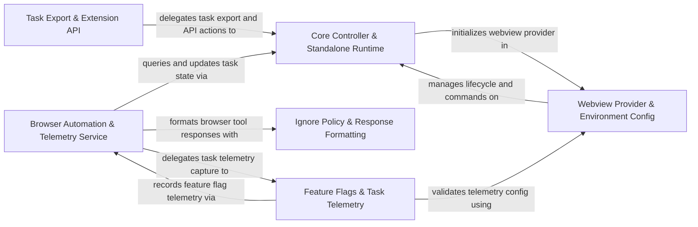

## Details

Coordinates top-level controller state, webview lifecycle, browser automation, ignore rules, feature flags, telemetry orchestration, and standalone runtime setup.

### Browser Automation & Telemetry Service [[Expand]](./Browser_Automation_Telemetry_Service.md)
Manages headless and remote browser sessions, browser action tool execution, URL content fetching, and central telemetry event dispatching.

**Related Classes/Methods**:

- `src.core.controller.browser.getBrowserConnectionInfo.getBrowserConnectionInfo`:12-47
- `src.core.task.tools.modules.browser_action.BrowserActionTool.BrowserActionTool`:47-241
- `src.services.telemetry.TelemetryService.TelemetryService`:48-397
- `src.core.controller.state.updateTaskSettings.updateTaskSettings`:150-166

**Source Files:**

- `src/core/controller/browser/discoverBrowser.ts`
  - `src.core.controller.browser.discoverBrowser.discoverBrowser` (L16-L51) - Function
- `src/core/controller/browser/getBrowserConnectionInfo.ts`
  - `src.core.controller.browser.getBrowserConnectionInfo.getBrowserConnectionInfo` (L12-L47) - Function
- `src/core/controller/browser/getDetectedChromePath.ts`
  - `src.core.controller.browser.getDetectedChromePath.getDetectedChromePath` (L13-L29) - Function
- `src/core/controller/browser/relaunchChromeDebugMode.ts`
  - `src.core.controller.browser.relaunchChromeDebugMode.relaunchChromeDebugMode` (L12-L25) - Function
- `src/core/controller/browser/testBrowserConnection.ts`
  - `src.core.controller.browser.testBrowserConnection.testBrowserConnection` (L14-L61) - Function
- `src/core/controller/state/settingsBrowser.ts`
  - `src.core.controller.state.settingsBrowser.buildBrowserSettingsWebview` (L6-L26) - Function
  - `src.core.controller.state.settingsBrowser.mergeBrowserSettingsWebview` (L29-L32) - Function
  - `src.core.controller.state.settingsBrowser.mergeBrowserSettingsCli` (L35-L51) - Function
- `src/core/controller/state/updateTaskSettings.ts`
  - `src.core.controller.state.updateTaskSettings.convertPlanActMode` (L11-L13) - Function
  - `src.core.controller.state.updateTaskSettings.resolveTaskId` (L16-L20) - Function
  - `src.core.controller.state.updateTaskSettings.mergeAutoApprovalSettings` (L22-L43) - Function
  - `src.core.controller.state.updateTaskSettings.mergeBrowserSettings` (L45-L64) - Function
  - `src.core.controller.state.updateTaskSettings.prepareTaskSettings` (L73-L119) - Function
  - `src.core.controller.state.updateTaskSettings.prepareTaskSettings.simpleSettings.filter() callback` (L96-L96) - Function
  - `src.core.controller.state.updateTaskSettings.persistTaskSettings` (L121-L147) - Function
  - `src.core.controller.state.updateTaskSettings.persistTaskSettings.ownedValues` (L135-L137) - Class
  - `src.core.controller.state.updateTaskSettings.persistTaskSettings.ownedValues.keys.filter() callback` (L136-L136) - Function
  - `src.core.controller.state.updateTaskSettings.persistTaskSettings.ownedValues.map() callback` (L136-L136) - Function
  - `src.core.controller.state.updateTaskSettings.updateTaskSettings` (L150-L166) - Function
- `src/core/controller/web/openInBrowser.ts`
  - `src.core.controller.web.openInBrowser.openInBrowser` (L12-L22) - Function
- `src/core/mentions/url-mention.ts`
  - `src.core.mentions.url-mention.findUrlMention` (L7-L9) - Function
  - `src.core.mentions.url-mention.findUrlMention.find() callback` (L8-L8) - Function
  - `src.core.mentions.url-mention.tryLaunchBrowser` (L11-L22) - Function
  - `src.core.mentions.url-mention.tryCloseBrowser` (L24-L30) - Function
  - `src.core.mentions.url-mention.expandUrlMention` (L32-L40) - Function
  - `src.core.mentions.url-mention.resolveUrlContent` (L42-L59) - Function
- `src/core/task/tools/adapters/traits/BrowserTraitBuilder.ts`
  - `src.core.task.tools.adapters.traits.BrowserTraitBuilder.buildBrowserTrait` (L5-L19) - Function
  - `src.core.task.tools.adapters.traits.BrowserTraitBuilder.buildBrowserTrait.launch` (L8-L12) - Method
  - `src.core.task.tools.adapters.traits.BrowserTraitBuilder.buildBrowserTrait.click` (L13-L13) - Method
  - `src.core.task.tools.adapters.traits.BrowserTraitBuilder.buildBrowserTrait.type` (L14-L14) - Method
  - `src.core.task.tools.adapters.traits.BrowserTraitBuilder.buildBrowserTrait.scroll` (L15-L16) - Method
  - `src.core.task.tools.adapters.traits.BrowserTraitBuilder.buildBrowserTrait.close` (L17-L17) - Method
- `src/core/task/tools/modules/browser_action/BrowserActionTool.ts`
  - `src.core.task.tools.modules.browser_action.BrowserActionTool.BrowserActionTool` (L47-L241) - Class
  - `src.core.task.tools.modules.browser_action.BrowserActionTool.BrowserActionTool.spec` (L48-L50) - Method
  - `src.core.task.tools.modules.browser_action.BrowserActionTool.BrowserActionTool.supportedSurfaces` (L52-L54) - Method
  - `src.core.task.tools.modules.browser_action.BrowserActionTool.BrowserActionTool.processCall` (L56-L149) - Method
  - `src.core.task.tools.modules.browser_action.BrowserActionTool.BrowserActionTool.resolveLaunchPermission` (L151-L158) - Method
  - `src.core.task.tools.modules.browser_action.BrowserActionTool.BrowserActionTool.reportMissingActionParameter` (L160-L165) - Method
  - `src.core.task.tools.modules.browser_action.BrowserActionTool.BrowserActionTool.reportMissingUrlParameter` (L167-L176) - Method
  - `src.core.task.tools.modules.browser_action.BrowserActionTool.BrowserActionTool.reportMissingCoordinateParameter` (L178-L187) - Method
  - `src.core.task.tools.modules.browser_action.BrowserActionTool.BrowserActionTool.reportMissingTextParameter` (L189-L198) - Method
  - `src.core.task.tools.modules.browser_action.BrowserActionTool.BrowserActionTool.formatLaunchDenialResponse` (L200-L208) - Method
  - `src.core.task.tools.modules.browser_action.BrowserActionTool.BrowserActionTool.formatBrowserActionResult` (L210-L231) - Method
  - `src.core.task.tools.modules.browser_action.BrowserActionTool.BrowserActionTool.abortBrowserWithError` (L233-L240) - Method
- `src/core/task/tools/modules/browser_action/tool.ts`
  - `src.core.task.tools.modules.browser_action.tool.create` (L7-L9) - Function
- `src/services/browser/BrowserConnectionManager.ts`
  - `src.services.browser.BrowserConnectionManager.BrowserConnectionInfo` (L18-L22) - Interface
  - `src.services.browser.BrowserConnectionManager.splitArgs` (L27-L32) - Function
  - `src.services.browser.BrowserConnectionManager.splitArgs.map() callback` (L31-L31) - Function
  - `src.services.browser.BrowserConnectionManager.BrowserConnectionManager` (L39-L393) - Class
  - `src.services.browser.BrowserConnectionManager.BrowserConnectionManager.constructor` (L50-L50) - Constructor
  - `src.services.browser.BrowserConnectionManager.BrowserConnectionManager.browserSettings` (L52-L58) - Method
  - `src.services.browser.BrowserConnectionManager.BrowserConnectionManager.getPage` (L62-L64) - Method
  - `src.services.browser.BrowserConnectionManager.BrowserConnectionManager.setPage` (L66-L68) - Method
  - `src.services.browser.BrowserConnectionManager.BrowserConnectionManager.getBrowser` (L70-L72) - Method
  - `src.services.browser.BrowserConnectionManager.BrowserConnectionManager.getIsConnectedToRemote` (L74-L76) - Method
  - `src.services.browser.BrowserConnectionManager.BrowserConnectionManager.getUlid` (L78-L80) - Method
  - `src.services.browser.BrowserConnectionManager.BrowserConnectionManager.setUlid` (L82-L84) - Method
  - `src.services.browser.BrowserConnectionManager.BrowserConnectionManager.trackAction` (L87-L89) - Method
  - `src.services.browser.BrowserConnectionManager.BrowserConnectionManager.getLastAction` (L91-L93) - Method
  - `src.services.browser.BrowserConnectionManager.BrowserConnectionManager.getConnectionInfo` (L97-L105) - Method
  - `src.services.browser.BrowserConnectionManager.BrowserConnectionManager.testConnection` (L109-L111) - Method
  - `src.services.browser.BrowserConnectionManager.BrowserConnectionManager.getDetectedChromePath` (L113-L137) - Method
  - `src.services.browser.BrowserConnectionManager.BrowserConnectionManager.relaunchChromeDebugMode` (L139-L188) - Method
  - `src.services.browser.BrowserConnectionManager.BrowserConnectionManager.launchBrowser` (L192-L233) - Method
  - `src.services.browser.BrowserConnectionManager.BrowserConnectionManager.launchLocalBrowser` (L235-L249) - Method
  - `src.services.browser.BrowserConnectionManager.BrowserConnectionManager.launchRemoteBrowser` (L251-L352) - Method
  - `src.services.browser.BrowserConnectionManager.BrowserConnectionManager.closeBrowser` (L356-L388) - Method
  - `src.services.browser.BrowserConnectionManager.closeBrowser.catch() callback` (L370-L370) - Function
  - `src.services.browser.BrowserConnectionManager.BrowserConnectionManager.closeBrowser.catch() callback` (L376-L376) - Function
  - `src.services.browser.BrowserConnectionManager.BrowserConnectionManager.dispose` (L390-L392) - Method
- `src/services/browser/BrowserDiscovery.ts`
  - `src.services.browser.BrowserDiscovery.isPortOpen` (L9-L41) - Function
  - `src.services.browser.BrowserDiscovery.isPortOpen.<function>` (L10-L40) - Function
  - `src.services.browser.BrowserDiscovery.isPortOpen.<function>.socket.on("connect") callback` (L18-L21) - Function
  - `src.services.browser.BrowserDiscovery.isPortOpen.<function>.socket.on("error") callback` (L24-L26) - Function
  - `src.services.browser.BrowserDiscovery.isPortOpen.<function>.socket.on("timeout") callback` (L29-L31) - Function
  - `src.services.browser.BrowserDiscovery.isPortOpen.<function>.socket.on("close") callback` (L34-L36) - Function
  - `src.services.browser.BrowserDiscovery.tryConnect` (L46-L54) - Function
  - `src.services.browser.BrowserDiscovery.discoverChromeInstances` (L59-L72) - Function
  - `src.services.browser.BrowserDiscovery.testBrowserConnection` (L77-L104) - Function
- `src/services/browser/BrowserSession.ts`
  - `src.services.browser.BrowserSession.BrowserSession` (L21-L270) - Class
  - `src.services.browser.BrowserSession.BrowserSession.constructor` (L26-L29) - Constructor
  - `src.services.browser.BrowserSession.BrowserSession.testConnection` (L33-L35) - Method
  - `src.services.browser.BrowserSession.BrowserSession.getConnectionInfo` (L37-L39) - Method
  - `src.services.browser.BrowserSession.BrowserSession.getDetectedChromePath` (L41-L43) - Method
  - `src.services.browser.BrowserSession.BrowserSession.relaunchChromeDebugMode` (L45-L47) - Method
  - `src.services.browser.BrowserSession.BrowserSession.launchBrowser` (L49-L51) - Method
  - `src.services.browser.BrowserSession.BrowserSession.launchLocalBrowser` (L53-L55) - Method
  - `src.services.browser.BrowserSession.BrowserSession.launchRemoteBrowser` (L57-L59) - Method
  - `src.services.browser.BrowserSession.BrowserSession.closeBrowser` (L61-L68) - Method
  - `src.services.browser.BrowserSession.BrowserSession.dispose` (L70-L72) - Method
  - `src.services.browser.BrowserSession.BrowserSession.setUlid` (L74-L76) - Method
  - `src.services.browser.BrowserSession.BrowserSession.executePageAction` (L80-L167) - Method
  - `src.services.browser.BrowserSession.BrowserSession.executePageAction.pWaitFor() callback` (L129-L129) - Function
  - `src.services.browser.BrowserSession.BrowserSession.executePageAction.catch() callback` (L132-L132) - Function
  - `src.services.browser.BrowserSession.BrowserSession.navigateToUrl` (L169-L179) - Method
  - `src.services.browser.BrowserSession.BrowserSession.navigateToUrl.executePageAction() callback` (L171-L178) - Function
  - `src.services.browser.BrowserSession.BrowserSession.waitTillHTMLStable` (L183-L210) - Method
  - `src.services.browser.BrowserSession.BrowserSession.click` (L212-L242) - Method
  - `src.services.browser.BrowserSession.BrowserSession.click.executePageAction() callback` (L215-L241) - Function
  - `src.services.browser.BrowserSession.BrowserSession.click.executePageAction() callback.catch() callback` (L235-L235) - Function
  - `src.services.browser.BrowserSession.BrowserSession.type` (L244-L249) - Method
  - `src.services.browser.BrowserSession.BrowserSession.type.executePageAction() callback` (L246-L248) - Function
  - `src.services.browser.BrowserSession.BrowserSession.scrollDown` (L251-L259) - Method
  - `src.services.browser.BrowserSession.BrowserSession.scrollDown.executePageAction() callback` (L253-L258) - Function
  - `src.services.browser.BrowserSession.BrowserSession.scrollDown.executePageAction() callback.page.evaluate() callback` (L254-L256) - Function
  - `src.services.browser.BrowserSession.BrowserSession.scrollUp` (L261-L269) - Method
  - `src.services.browser.BrowserSession.BrowserSession.scrollUp.executePageAction() callback` (L263-L268) - Function
  - `src.services.browser.BrowserSession.BrowserSession.scrollUp.executePageAction() callback.page.evaluate() callback` (L264-L266) - Function
- `src/services/browser/UrlContentFetcher.ts`
  - `src.services.browser.UrlContentFetcher.UrlContentFetcher` (L7-L67) - Class
  - `src.services.browser.UrlContentFetcher.UrlContentFetcher.constructor` (L11-L13) - Constructor
  - `src.services.browser.UrlContentFetcher.UrlContentFetcher.launchBrowser` (L15-L33) - Method
  - `src.services.browser.UrlContentFetcher.UrlContentFetcher.closeBrowser` (L35-L39) - Method
  - `src.services.browser.UrlContentFetcher.UrlContentFetcher.urlToMarkdown` (L42-L66) - Method
- `src/services/browser/utils.ts`
  - `src.services.browser.utils.PCRStats` (L9-L12) - Interface
  - `src.services.browser.utils.ensureChromiumExists` (L14-L26) - Function
- `src/services/telemetry/BrowserTelemetry.ts`
  - `src.services.telemetry.BrowserTelemetry.BrowserTelemetry` (L10-L70) - Class
  - `src.services.telemetry.BrowserTelemetry.BrowserTelemetry.constructor` (L13-L16) - Constructor
  - `src.services.telemetry.BrowserTelemetry.BrowserTelemetry.captureBrowserToolStart` (L18-L32) - Method
  - `src.services.telemetry.BrowserTelemetry.BrowserTelemetry.captureBrowserToolEnd` (L34-L48) - Method
  - `src.services.telemetry.BrowserTelemetry.BrowserTelemetry.captureBrowserError` (L50-L69) - Method
- `src/services/telemetry/TelemetryService.ts`
  - `src.services.telemetry.TelemetryService.TelemetryService` (L48-L397) - Class
  - `src.services.telemetry.TelemetryService.TelemetryService.create` (L69-L81) - Method
  - `src.services.telemetry.TelemetryService.TelemetryService.constructor` (L83-L102) - Constructor
  - `src.services.telemetry.TelemetryService.TelemetryService.captureUserOptOut` (L107-L109) - Method
  - `src.services.telemetry.TelemetryService.TelemetryService.captureUserOptIn` (L110-L112) - Method
  - `src.services.telemetry.TelemetryService.TelemetryService.captureExtensionActivated` (L113-L115) - Method
  - `src.services.telemetry.TelemetryService.TelemetryService.captureExtensionStorageError` (L116-L118) - Method
  - `src.services.telemetry.TelemetryService.TelemetryService.captureAuthStarted` (L119-L121) - Method
  - `src.services.telemetry.TelemetryService.TelemetryService.captureAuthSucceeded` (L122-L124) - Method
  - `src.services.telemetry.TelemetryService.TelemetryService.captureAuthFailed` (L125-L127) - Method
  - `src.services.telemetry.TelemetryService.TelemetryService.captureAuthLoggedOut` (L128-L130) - Method
  - `src.services.telemetry.TelemetryService.TelemetryService.captureOnboardingProgress` (L131-L133) - Method
  - `src.services.telemetry.TelemetryService.TelemetryService.identifyAccount` (L134-L136) - Method
  - `src.services.telemetry.TelemetryService.TelemetryService.captureTaskCreated` (L138-L140) - Method
  - `src.services.telemetry.TelemetryService.TelemetryService.captureTaskRestarted` (L141-L143) - Method
  - `src.services.telemetry.TelemetryService.TelemetryService.captureTaskCompleted` (L144-L146) - Method
  - `src.services.telemetry.TelemetryService.TelemetryService.captureConversationTurnEvent` (L147-L149) - Method
  - `src.services.telemetry.TelemetryService.TelemetryService.captureTokenUsage` (L150-L152) - Method
  - `src.services.telemetry.TelemetryService.TelemetryService.captureModeSwitch` (L153-L155) - Method
  - `src.services.telemetry.TelemetryService.TelemetryService.captureCondense` (L156-L158) - Method
  - `src.services.telemetry.TelemetryService.TelemetryService.captureTaskFeedback` (L159-L161) - Method
  - `src.services.telemetry.TelemetryService.TelemetryService.captureTaskInitialization` (L162-L164) - Method
  - `src.services.telemetry.TelemetryService.TelemetryService.captureOptionSelected` (L165-L167) - Method
  - `src.services.telemetry.TelemetryService.TelemetryService.captureOptionsIgnored` (L168-L170) - Method
  - `src.services.telemetry.TelemetryService.TelemetryService.captureSlashCommandUsed` (L171-L173) - Method
  - `src.services.telemetry.TelemetryService.TelemetryService.captureFeatureToggle` (L174-L176) - Method
  - `src.services.telemetry.TelemetryService.TelemetryService.captureDiracRuleToggled` (L177-L179) - Method
  - `src.services.telemetry.TelemetryService.TelemetryService.captureAutoCondenseToggle` (L180-L182) - Method
  - `src.services.telemetry.TelemetryService.TelemetryService.captureYoloModeToggle` (L183-L185) - Method
  - `src.services.telemetry.TelemetryService.TelemetryService.captureDiracWebToolsToggle` (L186-L188) - Method
  - `src.services.telemetry.TelemetryService.TelemetryService.captureToolUsage` (L190-L192) - Method
  - `src.services.telemetry.TelemetryService.TelemetryService.captureSkillUsed` (L193-L195) - Method
  - `src.services.telemetry.TelemetryService.TelemetryService.captureCheckpointUsage` (L196-L198) - Method
  - `src.services.telemetry.TelemetryService.TelemetryService.captureProviderApiError` (L199-L201) - Method
  - `src.services.telemetry.TelemetryService.TelemetryService.captureGeminiApiPerformance` (L202-L204) - Method
  - `src.services.telemetry.TelemetryService.TelemetryService.captureAiOutputAccepted` (L205-L207) - Method
  - `src.services.telemetry.TelemetryService.TelemetryService.captureAiOutputRejected` (L208-L210) - Method
  - `src.services.telemetry.TelemetryService.TelemetryService.captureModelSelected` (L212-L214) - Method
  - `src.services.telemetry.TelemetryService.TelemetryService.captureModelFavoritesUsage` (L215-L217) - Method
  - `src.services.telemetry.TelemetryService.TelemetryService.captureButtonClick` (L218-L220) - Method
  - `src.services.telemetry.TelemetryService.TelemetryService.captureRulesMenuOpened` (L221-L223) - Method
  - `src.services.telemetry.TelemetryService.TelemetryService.captureBrowserToolStart` (L225-L227) - Method
  - `src.services.telemetry.TelemetryService.TelemetryService.captureBrowserToolEnd` (L228-L230) - Method
  - `src.services.telemetry.TelemetryService.TelemetryService.captureBrowserError` (L231-L233) - Method
  - `src.services.telemetry.TelemetryService.TelemetryService.captureMentionUsed` (L235-L237) - Method
  - `src.services.telemetry.TelemetryService.TelemetryService.captureMentionFailed` (L238-L240) - Method
  - `src.services.telemetry.TelemetryService.TelemetryService.captureMentionSearchResults` (L241-L243) - Method
  - `src.services.telemetry.TelemetryService.TelemetryService.captureWorkspaceInitialized` (L245-L247) - Method
  - `src.services.telemetry.TelemetryService.TelemetryService.captureWorkspaceInitError` (L248-L250) - Method
  - `src.services.telemetry.TelemetryService.TelemetryService.captureMultiRootCheckpoint` (L251-L253) - Method
  - `src.services.telemetry.TelemetryService.TelemetryService.captureWorkspacePathResolved` (L254-L256) - Method
  - `src.services.telemetry.TelemetryService.TelemetryService.captureWorkspaceSearchPattern` (L257-L259) - Method
  - `src.services.telemetry.TelemetryService.TelemetryService.captureWorktreeViewOpened` (L260-L262) - Method
  - `src.services.telemetry.TelemetryService.TelemetryService.captureWorktreeCreated` (L263-L265) - Method
  - `src.services.telemetry.TelemetryService.TelemetryService.captureWorktreeMergeAttempted` (L266-L268) - Method
  - `src.services.telemetry.TelemetryService.TelemetryService.captureTerminalOutputFailure` (L270-L272) - Method
  - `src.services.telemetry.TelemetryService.TelemetryService.captureTerminalUserIntervention` (L273-L275) - Method
  - `src.services.telemetry.TelemetryService.TelemetryService.captureTerminalHang` (L276-L278) - Method
  - `src.services.telemetry.TelemetryService.TelemetryService.captureSubagentToggle` (L280-L282) - Method
  - `src.services.telemetry.TelemetryService.TelemetryService.captureSubagentExecution` (L283-L285) - Method
  - `src.services.telemetry.TelemetryService.TelemetryService.captureHookCacheAccess` (L287-L289) - Method
  - `src.services.telemetry.TelemetryService.TelemetryService.captureHookExecution` (L290-L292) - Method
  - `src.services.telemetry.TelemetryService.TelemetryService.captureHookDiscovery` (L293-L295) - Method
  - `src.services.telemetry.TelemetryService.TelemetryService.addProvider` (L299-L301) - Method
  - `src.services.telemetry.TelemetryService.TelemetryService.removeProvider` (L303-L305) - Method
  - `src.services.telemetry.TelemetryService.TelemetryService.updateTelemetryState` (L307-L321) - Method
  - `src.services.telemetry.TelemetryService.TelemetryService.updateTelemetryState.then() callback` (L317-L320) - Function
  - `src.services.telemetry.TelemetryService.TelemetryService.capture` (L323-L325) - Method
  - `src.services.telemetry.TelemetryService.TelemetryService.captureRequired` (L327-L329) - Method
  - `src.services.telemetry.TelemetryService.TelemetryService.isCategoryEnabled` (L331-L333) - Method
  - `src.services.telemetry.TelemetryService.TelemetryService.getProviders` (L335-L337) - Method
  - `src.services.telemetry.TelemetryService.TelemetryService.isEnabled` (L339-L341) - Method
  - `src.services.telemetry.TelemetryService.TelemetryService.getSettings` (L343-L345) - Method
  - `src.services.telemetry.TelemetryService.TelemetryService.captureHostEvent` (L347-L349) - Method
  - `src.services.telemetry.TelemetryService.TelemetryService.captureGrpcResponseSize` (L351-L366) - Method
  - `src.services.telemetry.TelemetryService.TelemetryService.safeCapture` (L368-L374) - Method
  - `src.services.telemetry.TelemetryService.TelemetryService.dispose` (L376-L378) - Method
  - `src.services.telemetry.TelemetryService.captureTerminalExecution` (L382-L382) - Method
  - `src.services.telemetry.TelemetryService.TelemetryService.captureTerminalExecution` (L389-L396) - Method
- `src/shared/BrowserSettings.ts`
  - `src.shared.BrowserSettings.BrowserSettings` (L1-L14) - Interface
- `src/utils/github-url-utils.ts`
  - `src.utils.github-url-utils.isValidHttpUrl` (L19-L26) - Function
  - `src.utils.github-url-utils.createGitHubIssueUrl` (L46-L62) - Function
  - `src.utils.github-url-utils.openUrlInBrowser` (L73-L112) - Function
  - `src.utils.github-url-utils.openUrlInBrowser.then() callback` (L103-L107) - Function
  - `src.utils.github-url-utils.openUrlInBrowser.catch() callback` (L108-L110) - Function
  - `src.utils.github-url-utils.createAndOpenGitHubIssue` (L132-L149) - Function
- `src/utils/open-browser.ts`
  - `src.utils.open-browser.openBrowser` (L2-L29) - Function
  - `src.utils.open-browser.openBrowser.<function>` (L7-L28) - Function
  - `src.utils.open-browser.openBrowser.<function>.onSpawn` (L17-L19) - Class
  - `src.utils.open-browser.openBrowser.<function>.onSpawn.setTimeout() callback` (L18-L18) - Function

### Core Controller & Standalone Runtime [[Expand]](./Core_Controller_Standalone_Runtime.md)
Orchestrates the central application Controller, standalone hostbridge and protobus runtime services, and standalone terminal process execution.

**Related Classes/Methods**:

- `src.core.controller.index.Controller`:55-524
- `src.standalone.dirac-core.setupHostProvider`:104-134

**Source Files:**

- `src/core/commands/repairMissingTaskHistory.ts`
  - `src.core.commands.repairMissingTaskHistory.TaskHistoryRepairResult` (L19-L24) - Interface
  - `src.core.commands.repairMissingTaskHistory.GoalInventory` (L26-L31) - Interface
  - `src.core.commands.repairMissingTaskHistory.repairMissingTaskHistory` (L33-L45) - Function
  - `src.core.commands.repairMissingTaskHistory.repairMissingTaskHistoryWithLease` (L47-L88) - Function
  - `src.core.commands.repairMissingTaskHistory.repairMissingTaskHistoryWithLease.existingIds` (L49-L49) - Class
  - `src.core.commands.repairMissingTaskHistory.repairMissingTaskHistoryWithLease.existingIds.map() callback` (L49-L49) - Function
  - `src.core.commands.repairMissingTaskHistory.repairMissingTaskHistoryWithLease.ordinaryCandidateIds` (L66-L72) - Class
  - `src.core.commands.repairMissingTaskHistory.repairMissingTaskHistoryWithLease.ordinaryCandidateIds.taskIds.filter() callback` (L66-L72) - Function
  - `src.core.commands.repairMissingTaskHistory.readGoalInventory` (L90-L122) - Function
  - `src.core.commands.repairMissingTaskHistory.reconstructOrdinaryTasks` (L124-L146) - Function
  - `src.core.commands.repairMissingTaskHistory.reconstructOrdinaryTasks.workers` (L131-L143) - Class
  - `src.core.commands.repairMissingTaskHistory.reconstructOrdinaryTasks.workers.Array.from() callback` (L131-L143) - Function
  - `src.core.commands.repairMissingTaskHistory.filterExistingRunDirectories` (L148-L153) - Function
  - `src.core.commands.repairMissingTaskHistory.filterExistingRunDirectories.checks` (L149-L151) - Class
  - `src.core.commands.repairMissingTaskHistory.filterExistingRunDirectories.checks.items.map() callback` (L150-L150) - Function
  - `src.core.commands.repairMissingTaskHistory.filterExistingRunDirectories.checks.filter() callback` (L152-L152) - Function
  - `src.core.commands.repairMissingTaskHistory.filterExistingRunDirectories.map() callback` (L152-L152) - Function
  - `src.core.commands.repairMissingTaskHistory.collectChildIds` (L155-L164) - Function
  - `src.core.commands.repairMissingTaskHistory.isSupersededGoalRecord` (L166-L170) - Function
  - `src.core.commands.repairMissingTaskHistory.isStandaloneTaskId` (L172-L174) - Function
- `src/core/controller/index.ts`
  - `src.core.controller.index.OutboundStatePublication` (L44-L48) - Interface
  - `src.core.controller.index.SelectedPresentation` (L50-L53) - Interface
  - `src.core.controller.index.Controller` (L55-L524) - Class
  - `src.core.controller.index.Controller.task` (L77-L79) - Method
  - `src.core.controller.index.Controller.taskRunPromise` (L82-L84) - Method
  - `src.core.controller.index.Controller.onTaskReplaced` (L86-L88) - Method
  - `src.core.controller.index.Controller.ensureWorkspaceManager` (L107-L113) - Method
  - `src.core.controller.index.Controller.getWorkspaceManager` (L116-L122) - Method
  - `src.core.controller.index.Controller.constructor` (L124-L164) - Constructor
  - `src.core.controller.index.Controller.constructor.getStandaloneTask` (L136-L136) - Method
  - `src.core.controller.index.Controller.constructor.clearStandaloneTask` (L137-L137) - Method
  - `src.core.controller.index.Controller.constructor.updateGoalHistory` (L138-L138) - Method
  - `src.core.controller.index.Controller.constructor.postState` (L139-L139) - Method
  - `src.core.controller.index.Controller.constructor.openAiCodexUsageService.subscribe() callback` (L142-L144) - Function
  - `src.core.controller.index.constructor.catch() callback` (L149-L151) - Function
  - `src.core.controller.index.Controller.constructor.then() callback` (L158-L160) - Function
  - `src.core.controller.index.Controller.constructor.catch() callback` (L161-L163) - Function
  - `src.core.controller.index.Controller.dispose` (L171-L178) - Method
  - `src.core.controller.index.Controller.setTaskInitializationDefaults` (L182-L184) - Method
  - `src.core.controller.index.Controller.resolveTaskInitializationOptions` (L186-L189) - Method
  - `src.core.controller.index.Controller.initTask` (L191-L227) - Method
  - `src.core.controller.index.Controller.reinitExistingTaskFromId` (L229-L234) - Method
  - `src.core.controller.index.Controller.prepareTaskForFollowUp` (L236-L238) - Method
  - `src.core.controller.index.Controller.cancelTask` (L240-L246) - Method
  - `src.core.controller.index.Controller.updateBackgroundCommandState` (L248-L250) - Method
  - `src.core.controller.index.Controller.backgroundCommandRunning` (L252-L254) - Method
  - `src.core.controller.index.Controller.backgroundCommandTaskId` (L256-L258) - Method
  - `src.core.controller.index.Controller.cancelBackgroundCommand` (L260-L262) - Method
  - `src.core.controller.index.Controller.clearTask` (L264-L270) - Method
  - `src.core.controller.index.Controller.createTask` (L272-L275) - Method
  - `src.core.controller.index.Controller.completeOpenRouterAuth` (L279-L281) - Method
  - `src.core.controller.index.Controller.completeGithubLogin` (L284-L286) - Method
  - `src.core.controller.index.Controller.completeRequestyAuth` (L290-L292) - Method
  - `src.core.controller.index.Controller.readOpenRouterModels` (L295-L297) - Method
  - `src.core.controller.index.Controller.getTaskWithId` (L301-L311) - Method
  - `src.core.controller.index.Controller.exportTaskWithId` (L313-L315) - Method
  - `src.core.controller.index.Controller.deleteTaskFromState` (L317-L321) - Method
  - `src.core.controller.index.Controller.postStateToWebview` (L323-L325) - Method
  - `src.core.controller.index.Controller.postPresentationToWebview` (L327-L329) - Method
  - `src.core.controller.index.Controller.waitForGoalStartupReconciliation` (L331-L333) - Method
  - `src.core.controller.index.Controller.getStateToPostToWebview` (L335-L338) - Method
  - `src.core.controller.index.Controller.captureSelectedPresentation` (L340-L359) - Method
  - `src.core.controller.index.Controller.getStatePublication` (L361-L387) - Method
  - `src.core.controller.index.Controller.getStatePublication.acknowledge` (L378-L385) - Method
  - `src.core.controller.index.Controller.createPresentationPublication` (L389-L416) - Method
  - `src.core.controller.index.Controller.createPresentationPublication.state.uiActionState.projectUIActionState() callback` (L403-L403) - Function
  - `src.core.controller.index.Controller.createPresentationPublication.acknowledge` (L412-L414) - Method
  - `src.core.controller.index.Controller.assembleStateToPostToWebview` (L418-L445) - Method
  - `src.core.controller.index.Controller.updateTaskHistory` (L447-L449) - Method
  - `src.core.controller.index.Controller.updateGoalHistory` (L451-L453) - Method
  - `src.core.controller.index.Controller.updateTelemetrySetting` (L455-L457) - Method
  - `src.core.controller.index.Controller.toggleActModeForYoloMode` (L459-L462) - Method
  - `src.core.controller.index.Controller.togglePlanActMode` (L464-L467) - Method
  - `src.core.controller.index.Controller.enableInteractiveGoals` (L469-L471) - Method
  - `src.core.controller.index.Controller.selectedGoalId` (L473-L475) - Method
  - `src.core.controller.index.Controller.hasActiveGoal` (L477-L479) - Method
  - `src.core.controller.index.Controller.selectGoal` (L481-L484) - Method
  - `src.core.controller.index.Controller.resumeGoal` (L486-L489) - Method
  - `src.core.controller.index.Controller.pauseGoal` (L491-L494) - Method
  - `src.core.controller.index.Controller.stopGoal` (L496-L499) - Method
  - `src.core.controller.index.Controller.steerGoal` (L501-L504) - Method
  - `src.core.controller.index.Controller.sendGoalMessage` (L506-L513) - Method
  - `src.core.controller.index.Controller.assertGoalSurfaceSupported` (L515-L523) - Method
  - `src.core.controller.index.parseGoalRequest` (L526-L533) - Function
  - `src.core.controller.index.isGoalResumeCommand` (L535-L537) - Function
- `src/core/goal/GoalController.ts`
  - `src.core.goal.GoalController.GoalControllerDependencies` (L21-L28) - Interface
  - `src.core.goal.GoalController.GoalController` (L31-L303) - Class
  - `src.core.goal.GoalController.GoalController.constructor` (L36-L38) - Constructor
  - `src.core.goal.GoalController.GoalController.selectedGoalId` (L40-L42) - Method
  - `src.core.goal.GoalController.GoalController.active` (L44-L46) - Method
  - `src.core.goal.GoalController.GoalController.hasRunningCoordinator` (L48-L50) - Method
  - `src.core.goal.GoalController.GoalController.coordinator` (L52-L54) - Method
  - `src.core.goal.GoalController.GoalController.waitForStartupReconciliation` (L56-L58) - Method
  - `src.core.goal.GoalController.GoalController.start` (L60-L62) - Method
  - `src.core.goal.GoalController.GoalController.start.goalActivationMutex.withLock() callback` (L61-L61) - Function
  - `src.core.goal.GoalController.GoalController.startSerial` (L64-L86) - Method
  - `src.core.goal.GoalController.GoalController.select` (L88-L90) - Method
  - `src.core.goal.GoalController.GoalController.select.goalActivationMutex.withLock() callback` (L89-L89) - Function
  - `src.core.goal.GoalController.GoalController.selectSerial` (L92-L103) - Method
  - `src.core.goal.GoalController.GoalController.resume` (L105-L107) - Method
  - `src.core.goal.GoalController.GoalController.resume.goalActivationMutex.withLock() callback` (L106-L106) - Function
  - `src.core.goal.GoalController.GoalController.resumeSerial` (L109-L125) - Method
  - `src.core.goal.GoalController.GoalController.steer` (L127-L131) - Method
  - `src.core.goal.GoalController.GoalController.sendMessage` (L133-L137) - Method
  - `src.core.goal.GoalController.GoalController.cancelCurrentExecution` (L139-L143) - Method
  - `src.core.goal.GoalController.GoalController.pause` (L145-L147) - Method
  - `src.core.goal.GoalController.GoalController.pause.goalActivationMutex.withLock() callback` (L146-L146) - Function
  - `src.core.goal.GoalController.GoalController.pauseSerial` (L149-L154) - Method
  - `src.core.goal.GoalController.GoalController.stop` (L156-L158) - Method
  - `src.core.goal.GoalController.GoalController.stop.goalActivationMutex.withLock() callback` (L157-L157) - Function
  - `src.core.goal.GoalController.GoalController.stopSerial` (L160-L171) - Method
  - `src.core.goal.GoalController.GoalController.inspect` (L173-L179) - Method
  - `src.core.goal.GoalController.GoalController.selectedPresentationSnapshot` (L181-L192) - Method
  - `src.core.goal.GoalController.GoalController.pauseAndDeselect` (L194-L196) - Method
  - `src.core.goal.GoalController.GoalController.pauseAndDeselect.goalActivationMutex.withLock() callback` (L195-L195) - Function
  - `src.core.goal.GoalController.GoalController.pauseAndDeselectSerial` (L198-L203) - Method
  - `src.core.goal.GoalController.GoalController.dispose` (L205-L207) - Method
  - `src.core.goal.GoalController.GoalController.reconcilePersistedGoals` (L209-L221) - Method
  - `src.core.goal.GoalController.GoalController.reconcilePersistedGoalHistory` (L223-L246) - Method
  - `src.core.goal.GoalController.GoalController.reconcilePersistedGoalHistory.historyItem` (L225-L227) - Class
  - `src.core.goal.GoalController.GoalController.reconcilePersistedGoalHistory.historyItem.find() callback` (L227-L227) - Function
  - `src.core.goal.GoalController.GoalController.createLoop` (L248-L275) - Method
  - `src.core.goal.GoalController.GoalController.createLoop.createTaskFactory` (L259-L266) - Method
  - `src.core.goal.GoalController.GoalController.createLoop.updateHistory` (L268-L271) - Method
  - `src.core.goal.GoalController.GoalController.assertNoActiveGoal` (L277-L283) - Method
  - `src.core.goal.GoalController.GoalController.assertNoActiveGoal.active` (L281-L281) - Class
  - `src.core.goal.GoalController.GoalController.assertNoActiveGoal.active.find() callback` (L281-L281) - Function
  - `src.core.goal.GoalController.GoalController.assertNoActiveStandaloneTask` (L285-L290) - Method
  - `src.core.goal.GoalController.GoalController.requireSelectedLoop` (L292-L296) - Method
  - `src.core.goal.GoalController.GoalController.goalHistoryItem` (L298-L302) - Method
  - `src.core.goal.GoalController.GoalController.goalHistoryItem.item` (L299-L299) - Class
  - `src.core.goal.GoalController.GoalController.goalHistoryItem.item.find() callback` (L299-L299) - Function
- `src/core/locks/FolderLockUtils.ts`
  - `src.core.locks.FolderLockUtils.FolderLockRetryConfig` (L9-L13) - Interface
  - `src.core.locks.FolderLockUtils.getStandaloneLockManager` (L30-L38) - Function
  - `src.core.locks.FolderLockUtils.tryAcquireFolderLockWithRetry` (L48-L71) - Function
  - `src.core.locks.FolderLockUtils.tryAcquireFolderLockWithRetry.retryFolderLockAcquisition() callback` (L52-L70) - Function
  - `src.core.locks.FolderLockUtils.releaseFolderLock` (L79-L93) - Function
  - `src.core.locks.FolderLockUtils.acquireFolderLock` (L100-L124) - Function
  - `src.core.locks.FolderLockUtils.retryFolderLockAcquisition` (L132-L179) - Function
- `src/integrations/terminal/standalone/StandaloneTerminal.ts`
  - `src.integrations.terminal.standalone.StandaloneTerminal.StandaloneTerminal` (L16-L127) - Class
  - `src.integrations.terminal.standalone.StandaloneTerminal.StandaloneTerminal.constructor` (L55-L80) - Constructor
  - `src.integrations.terminal.standalone.StandaloneTerminal.StandaloneTerminal.constructor.executeCommand` (L68-L76) - Method
  - `src.integrations.terminal.standalone.StandaloneTerminal.StandaloneTerminal.constructor.executeCommand.read` (L71-L74) - Method
  - `src.integrations.terminal.standalone.StandaloneTerminal.StandaloneTerminal.sendText` (L87-L101) - Method
  - `src.integrations.terminal.standalone.StandaloneTerminal.StandaloneTerminal.show` (L106-L109) - Method
  - `src.integrations.terminal.standalone.StandaloneTerminal.StandaloneTerminal.hide` (L114-L116) - Method
  - `src.integrations.terminal.standalone.StandaloneTerminal.StandaloneTerminal.dispose` (L121-L126) - Method
- `src/integrations/terminal/standalone/StandaloneTerminalManager.ts`
  - `src.integrations.terminal.standalone.StandaloneTerminalManager.StandaloneTerminalManager` (L29-L302) - Class
  - `src.integrations.terminal.standalone.StandaloneTerminalManager.StandaloneTerminalManager.runCommand` (L57-L59) - Method
  - `src.integrations.terminal.standalone.StandaloneTerminalManager.StandaloneTerminalManager.getOrCreateTerminal` (L64-L103) - Method
  - `src.integrations.terminal.standalone.StandaloneTerminalManager.StandaloneTerminalManager.getOrCreateTerminal.matchingTerminal` (L68-L73) - Class
  - `src.integrations.terminal.standalone.StandaloneTerminalManager.StandaloneTerminalManager.getOrCreateTerminal.matchingTerminal.terminals.find() callback` (L68-L73) - Function
  - `src.integrations.terminal.standalone.StandaloneTerminalManager.StandaloneTerminalManager.getOrCreateTerminal.availableTerminal` (L82-L82) - Class
  - `src.integrations.terminal.standalone.StandaloneTerminalManager.StandaloneTerminalManager.getOrCreateTerminal.availableTerminal.terminals.find() callback` (L82-L82) - Function
  - `src.integrations.terminal.standalone.StandaloneTerminalManager.StandaloneTerminalManager.getTerminals` (L106-L113) - Method
  - `src.integrations.terminal.standalone.StandaloneTerminalManager.StandaloneTerminalManager.getTerminals.allTerminalIds.map() callback` (L110-L110) - Function
  - `src.integrations.terminal.standalone.StandaloneTerminalManager.StandaloneTerminalManager.getTerminals.filter() callback` (L111-L111) - Function
  - `src.integrations.terminal.standalone.StandaloneTerminalManager.StandaloneTerminalManager.getTerminals.map() callback` (L112-L112) - Function
  - `src.integrations.terminal.standalone.StandaloneTerminalManager.StandaloneTerminalManager.getUnretrievedOutput` (L118-L123) - Method
  - `src.integrations.terminal.standalone.StandaloneTerminalManager.StandaloneTerminalManager.isProcessHot` (L126-L128) - Method
  - `src.integrations.terminal.standalone.StandaloneTerminalManager.StandaloneTerminalManager.processOutput` (L133-L142) - Method
  - `src.integrations.terminal.standalone.StandaloneTerminalManager.StandaloneTerminalManager.disposeAll` (L147-L164) - Method
  - `src.integrations.terminal.standalone.StandaloneTerminalManager.StandaloneTerminalManager.setShellIntegrationTimeout` (L169-L171) - Method
  - `src.integrations.terminal.standalone.StandaloneTerminalManager.StandaloneTerminalManager.setTerminalReuseEnabled` (L174-L176) - Method
  - `src.integrations.terminal.standalone.StandaloneTerminalManager.StandaloneTerminalManager.setTerminalOutputLineLimit` (L179-L181) - Method
  - `src.integrations.terminal.standalone.StandaloneTerminalManager.StandaloneTerminalManager.setDefaultTerminalProfile` (L184-L193) - Method
  - `src.integrations.terminal.standalone.StandaloneTerminalManager.StandaloneTerminalManager.findTerminalInfoByTerminal` (L198-L200) - Method
  - `src.integrations.terminal.standalone.StandaloneTerminalManager.StandaloneTerminalManager.findTerminalInfoByTerminal.find() callback` (L199-L199) - Function
  - `src.integrations.terminal.standalone.StandaloneTerminalManager.StandaloneTerminalManager.isCwdMatchingExpected` (L203-L210) - Method
  - `src.integrations.terminal.standalone.StandaloneTerminalManager.StandaloneTerminalManager.filterTerminals` (L213-L215) - Method
  - `src.integrations.terminal.standalone.StandaloneTerminalManager.StandaloneTerminalManager.closeTerminals` (L218-L235) - Method
  - `src.integrations.terminal.standalone.StandaloneTerminalManager.StandaloneTerminalManager.handleTerminalProfileChange` (L238-L242) - Method
  - `src.integrations.terminal.standalone.StandaloneTerminalManager.StandaloneTerminalManager.handleTerminalProfileChange.closedCount.closeTerminals() callback` (L239-L239) - Function
  - `src.integrations.terminal.standalone.StandaloneTerminalManager.handleTerminalProfileChange.closedCount` (L239-L239) - Class
  - `src.integrations.terminal.standalone.StandaloneTerminalManager.StandaloneTerminalManager.handleTerminalProfileChange.busyTerminals.filterTerminals() callback` (L240-L240) - Function
  - `src.integrations.terminal.standalone.StandaloneTerminalManager.handleTerminalProfileChange.busyTerminals` (L240-L240) - Class
  - `src.integrations.terminal.standalone.StandaloneTerminalManager.StandaloneTerminalManager.closeAllTerminals` (L245-L247) - Method
  - `src.integrations.terminal.standalone.StandaloneTerminalManager.StandaloneTerminalManager.closeAllTerminals.closeTerminals() callback` (L246-L246) - Function
  - `src.integrations.terminal.standalone.StandaloneTerminalManager.StandaloneTerminalManager.trackBackgroundCommand` (L252-L266) - Method
  - `src.integrations.terminal.standalone.StandaloneTerminalManager.StandaloneTerminalManager.getBackgroundCommand` (L269-L271) - Method
  - `src.integrations.terminal.standalone.StandaloneTerminalManager.StandaloneTerminalManager.getAllBackgroundCommands` (L274-L276) - Method
  - `src.integrations.terminal.standalone.StandaloneTerminalManager.StandaloneTerminalManager.getRunningBackgroundCommands` (L279-L281) - Method
  - `src.integrations.terminal.standalone.StandaloneTerminalManager.StandaloneTerminalManager.hasActiveBackgroundCommands` (L284-L286) - Method
  - `src.integrations.terminal.standalone.StandaloneTerminalManager.StandaloneTerminalManager.cancelBackgroundCommand` (L289-L291) - Method
  - `src.integrations.terminal.standalone.StandaloneTerminalManager.StandaloneTerminalManager.getBackgroundCommandsSummary` (L294-L296) - Method
  - `src.integrations.terminal.standalone.StandaloneTerminalManager.StandaloneTerminalManager.disposeBackgroundCommands` (L299-L301) - Method
- `src/integrations/terminal/standalone/StandaloneTerminalProcess.ts`
  - `src.integrations.terminal.standalone.StandaloneTerminalProcess.StandaloneTerminalProcess` (L39-L354) - Class
  - `src.integrations.terminal.standalone.StandaloneTerminalProcess.StandaloneTerminalProcess.constructor` (L76-L78) - Constructor
  - `src.integrations.terminal.standalone.StandaloneTerminalProcess.StandaloneTerminalProcess.run` (L85-L188) - Method
  - `src.integrations.terminal.standalone.StandaloneTerminalProcess.StandaloneTerminalProcess.run.childProcess.stdout.on("data") callback` (L134-L141) - Function
  - `src.integrations.terminal.standalone.StandaloneTerminalProcess.StandaloneTerminalProcess.run.childProcess.stderr.on("data") callback` (L144-L151) - Function
  - `src.integrations.terminal.standalone.StandaloneTerminalProcess.StandaloneTerminalProcess.run.childProcess.on("close") callback` (L154-L172) - Function
  - `src.integrations.terminal.standalone.StandaloneTerminalProcess.StandaloneTerminalProcess.run.childProcess.on("error") callback` (L175-L180) - Function
  - `src.integrations.terminal.standalone.StandaloneTerminalProcess.StandaloneTerminalProcess.handleOutput` (L195-L223) - Method
  - `src.integrations.terminal.standalone.StandaloneTerminalProcess.StandaloneTerminalProcess.handleOutput.setTimeout() callback` (L205-L207) - Function
  - `src.integrations.terminal.standalone.StandaloneTerminalProcess.StandaloneTerminalProcess.emitLines` (L229-L237) - Method
  - `src.integrations.terminal.standalone.StandaloneTerminalProcess.StandaloneTerminalProcess.emitRemainingBuffer` (L242-L251) - Method
  - `src.integrations.terminal.standalone.StandaloneTerminalProcess.StandaloneTerminalProcess.continue` (L261-L266) - Method
  - `src.integrations.terminal.standalone.StandaloneTerminalProcess.StandaloneTerminalProcess.getUnretrievedOutput` (L273-L287) - Method
  - `src.integrations.terminal.standalone.StandaloneTerminalProcess.StandaloneTerminalProcess.getCompletionDetails` (L289-L294) - Method
  - `src.integrations.terminal.standalone.StandaloneTerminalProcess.StandaloneTerminalProcess.removeLastLineArtifacts` (L301-L308) - Method
  - `src.integrations.terminal.standalone.StandaloneTerminalProcess.StandaloneTerminalProcess.getDefaultShell` (L314-L316) - Method
  - `src.integrations.terminal.standalone.StandaloneTerminalProcess.StandaloneTerminalProcess.getShellArgs` (L324-L326) - Method
  - `src.integrations.terminal.standalone.StandaloneTerminalProcess.StandaloneTerminalProcess.terminate` (L336-L353) - Method
  - `src.integrations.terminal.standalone.StandaloneTerminalProcess.StandaloneTerminalProcess.terminate.isCompleted` (L351-L351) - Method
- `src/integrations/terminal/standalone/StandaloneTerminalRegistry.ts`
  - `src.integrations.terminal.standalone.StandaloneTerminalRegistry.StandaloneTerminalRegistry` (L16-L109) - Class
  - `src.integrations.terminal.standalone.StandaloneTerminalRegistry.StandaloneTerminalRegistry.createTerminal` (L28-L46) - Method
  - `src.integrations.terminal.standalone.StandaloneTerminalRegistry.StandaloneTerminalRegistry.getTerminal` (L53-L55) - Method
  - `src.integrations.terminal.standalone.StandaloneTerminalRegistry.StandaloneTerminalRegistry.getAllTerminals` (L61-L63) - Method
  - `src.integrations.terminal.standalone.StandaloneTerminalRegistry.StandaloneTerminalRegistry.removeTerminal` (L69-L76) - Method
  - `src.integrations.terminal.standalone.StandaloneTerminalRegistry.StandaloneTerminalRegistry.updateTerminal` (L83-L88) - Method
  - `src.integrations.terminal.standalone.StandaloneTerminalRegistry.StandaloneTerminalRegistry.clear` (L93-L100) - Method
  - `src.integrations.terminal.standalone.StandaloneTerminalRegistry.StandaloneTerminalRegistry.size` (L106-L108) - Method
- `src/integrations/terminal/standalone/TerminalProcessManager.ts`
  - `src.integrations.terminal.standalone.TerminalProcessManager.mergePromise` (L25-L50) - Function
  - `src.integrations.terminal.standalone.TerminalProcessManager.mergePromise.descriptors` (L27-L30) - Class
  - `src.integrations.terminal.standalone.TerminalProcessManager.mergePromise.descriptors.map() callback` (L27-L30) - Function
  - `src.integrations.terminal.standalone.TerminalProcessManager.TerminalProcessManager` (L52-L351) - Class
  - `src.integrations.terminal.standalone.TerminalProcessManager.TerminalProcessManager.runCommand` (L71-L96) - Method
  - `src.integrations.terminal.standalone.TerminalProcessManager.TerminalProcessManager.runCommand.process.once("completed") callback` (L78-L80) - Function
  - `src.integrations.terminal.standalone.TerminalProcessManager.TerminalProcessManager.runCommand.process.once("error") callback` (L82-L84) - Function
  - `src.integrations.terminal.standalone.TerminalProcessManager.TerminalProcessManager.runCommand.promise` (L87-L90) - Class
  - `src.integrations.terminal.standalone.TerminalProcessManager.TerminalProcessManager.runCommand.promise.<function>` (L87-L90) - Function
  - `src.integrations.terminal.standalone.TerminalProcessManager.TerminalProcessManager.runCommand.promise.<function>.process.once("continue") callback` (L88-L88) - Function
  - `src.integrations.terminal.standalone.TerminalProcessManager.TerminalProcessManager.runCommand.promise.<function>.process.once("error") callback` (L89-L89) - Function
  - `src.integrations.terminal.standalone.TerminalProcessManager.TerminalProcessManager.getUnretrievedOutput` (L103-L106) - Method
  - `src.integrations.terminal.standalone.TerminalProcessManager.TerminalProcessManager.isProcessHot` (L109-L112) - Method
  - `src.integrations.terminal.standalone.TerminalProcessManager.TerminalProcessManager.removeProcess` (L119-L121) - Method
  - `src.integrations.terminal.standalone.TerminalProcessManager.TerminalProcessManager.terminateAll` (L124-L130) - Method
  - `src.integrations.terminal.standalone.TerminalProcessManager.TerminalProcessManager.clearProcesses` (L133-L135) - Method
  - `src.integrations.terminal.standalone.TerminalProcessManager.TerminalProcessManager.trackBackgroundCommand` (L137-L272) - Method
  - `src.integrations.terminal.standalone.TerminalProcessManager.trackBackgroundCommand.logReady.then() callback` (L207-L210) - Function
  - `src.integrations.terminal.standalone.TerminalProcessManager.TerminalProcessManager.trackBackgroundCommand.logReady.then() callback.<function>` (L208-L210) - Function
  - `src.integrations.terminal.standalone.TerminalProcessManager.TerminalProcessManager.trackBackgroundCommand.logReady.then() callback.<function>.logStream.write(`${existingOutput.join("\n")}\n`) callback` (L209-L209) - Function
  - `src.integrations.terminal.standalone.TerminalProcessManager.TerminalProcessManager.trackBackgroundCommand.logReady.then() callback` (L213-L213) - Function
  - `src.integrations.terminal.standalone.TerminalProcessManager.TerminalProcessManager.trackBackgroundCommand.logStream.on("error") callback` (L215-L223) - Function
  - `src.integrations.terminal.standalone.TerminalProcessManager.TerminalProcessManager.trackBackgroundCommand.timeoutId` (L225-L231) - Class
  - `src.integrations.terminal.standalone.TerminalProcessManager.TerminalProcessManager.trackBackgroundCommand.timeoutId.setTimeout() callback` (L225-L231) - Function
  - `src.integrations.terminal.standalone.TerminalProcessManager.TerminalProcessManager.trackBackgroundCommand.process.on("completed") callback` (L234-L257) - Function
  - `src.integrations.terminal.standalone.TerminalProcessManager.TerminalProcessManager.trackBackgroundCommand.process.on("error") callback` (L259-L268) - Function
  - `src.integrations.terminal.standalone.TerminalProcessManager.TerminalProcessManager.getBackgroundCommand` (L275-L277) - Method
  - `src.integrations.terminal.standalone.TerminalProcessManager.TerminalProcessManager.getAllBackgroundCommands` (L280-L282) - Method
  - `src.integrations.terminal.standalone.TerminalProcessManager.TerminalProcessManager.getRunningBackgroundCommands` (L285-L287) - Method
  - `src.integrations.terminal.standalone.TerminalProcessManager.TerminalProcessManager.getRunningBackgroundCommands.filter() callback` (L286-L286) - Function
  - `src.integrations.terminal.standalone.TerminalProcessManager.TerminalProcessManager.hasActiveBackgroundCommands` (L290-L292) - Method
  - `src.integrations.terminal.standalone.TerminalProcessManager.TerminalProcessManager.cancelBackgroundCommand` (L295-L319) - Method
  - `src.integrations.terminal.standalone.TerminalProcessManager.TerminalProcessManager.getBackgroundCommandsSummary` (L322-L334) - Method
  - `src.integrations.terminal.standalone.TerminalProcessManager.TerminalProcessManager.disposeBackgroundCommands` (L337-L350) - Method
- `src/integrations/terminal/types.ts`
  - `src.integrations.terminal.types.TerminalCompletionDetails` (L17-L22) - Interface
  - `src.integrations.terminal.types.TerminalProcessEvents` (L24-L30) - Interface
  - `src.integrations.terminal.types.ITerminalProcess` (L43-L81) - Interface
  - `src.integrations.terminal.types.ITerminalProcess.continue` (L60-L60) - Method
  - `src.integrations.terminal.types.ITerminalProcess.getUnretrievedOutput` (L66-L66) - Method
  - `src.integrations.terminal.types.ITerminalProcess.getCompletionDetails` (L71-L71) - Method
  - `src.integrations.terminal.types.ITerminalProcess.terminate` (L80-L80) - Method
  - `src.integrations.terminal.types.TerminalInfo` (L90-L107) - Interface
  - `src.integrations.terminal.types.TerminalProfileChangeResult` (L112-L117) - Interface
  - `src.integrations.terminal.types.ITerminal` (L122-L148) - Interface
  - `src.integrations.terminal.types.ITerminal.sendText` (L135-L135) - Method
  - `src.integrations.terminal.types.ITerminal.show` (L137-L137) - Method
  - `src.integrations.terminal.types.ITerminal.hide` (L139-L139) - Method
  - `src.integrations.terminal.types.ITerminal.dispose` (L141-L141) - Method
  - `src.integrations.terminal.types.ITerminalManager` (L182-L256) - Interface
  - `src.integrations.terminal.types.ITerminalManager.runCommand` (L189-L189) - Method
  - `src.integrations.terminal.types.ITerminalManager.getOrCreateTerminal` (L196-L196) - Method
  - `src.integrations.terminal.types.ITerminalManager.getTerminals` (L203-L203) - Method
  - `src.integrations.terminal.types.ITerminalManager.getUnretrievedOutput` (L210-L210) - Method
  - `src.integrations.terminal.types.ITerminalManager.isProcessHot` (L217-L217) - Method
  - `src.integrations.terminal.types.ITerminalManager.disposeAll` (L222-L222) - Method
  - `src.integrations.terminal.types.ITerminalManager.setShellIntegrationTimeout` (L228-L228) - Method
  - `src.integrations.terminal.types.ITerminalManager.setTerminalReuseEnabled` (L234-L234) - Method
  - `src.integrations.terminal.types.ITerminalManager.setTerminalOutputLineLimit` (L240-L240) - Method
  - `src.integrations.terminal.types.ITerminalManager.setDefaultTerminalProfile` (L247-L247) - Method
  - `src.integrations.terminal.types.ITerminalManager.processOutput` (L255-L255) - Method
  - `src.integrations.terminal.types.StandaloneTerminalOptions` (L261-L270) - Interface
  - `src.integrations.terminal.types.BackgroundCommand` (L280-L297) - Interface
  - `src.integrations.terminal.types.ShellIntegrationWarningTracker` (L307-L312) - Interface
  - `src.integrations.terminal.types.ActiveBackgroundCommand` (L318-L325) - Interface
  - `src.integrations.terminal.types.AskResponse` (L330-L335) - Interface
  - `src.integrations.terminal.types.CommandExecutorCallbacks` (L343-L359) - Interface
  - `src.integrations.terminal.types.CommandExecutionMetadata` (L364-L371) - Interface
  - `src.integrations.terminal.types.CommandExecutionOptions` (L380-L391) - Interface
  - `src.integrations.terminal.types.CommandExecutorConfig` (L396-L407) - Interface
  - `src.integrations.terminal.types.OrchestrationOptions` (L419-L448) - Interface
  - `src.integrations.terminal.types.OrchestrationResult` (L453-L470) - Interface
- `src/standalone/dirac-core.ts`
  - `src.standalone.dirac-core.main` (L24-L102) - Function
  - `src.standalone.dirac-core.setupHostProvider` (L104-L134) - Function
  - `src.standalone.dirac-core.setupGlobalErrorHandlers` (L140-L178) - Function
  - `src.standalone.dirac-core.setupGlobalErrorHandlers.process.on("uncaughtException") callback` (L142-L146) - Function
  - `src.standalone.dirac-core.setupGlobalErrorHandlers.process.on("unhandledRejection") callback` (L149-L155) - Function
  - `src.standalone.dirac-core.setupGlobalErrorHandlers.process.on("warning") callback` (L158-L160) - Function
  - `src.standalone.dirac-core.setupGlobalErrorHandlers.process.on("SIGINT") callback` (L163-L169) - Function
  - `src.standalone.dirac-core.setupGlobalErrorHandlers.process.on("SIGINT") callback.catch() callback` (L165-L168) - Function
  - `src.standalone.dirac-core.setupGlobalErrorHandlers.process.on("SIGTERM") callback` (L171-L177) - Function
  - `src.standalone.dirac-core.setupGlobalErrorHandlers.process.on("SIGTERM") callback.catch() callback` (L173-L176) - Function
  - `src.standalone.dirac-core.requestHostBridgeShutdown` (L184-L194) - Function
  - `src.standalone.dirac-core.requestHostBridgeShutdown.retryOperation() callback` (L186-L188) - Function
  - `src.standalone.dirac-core.shutdownGracefully` (L203-L242) - Function
  - `src.standalone.dirac-core.CliArgs` (L245-L250) - Interface
  - `src.standalone.dirac-core.parseArgs` (L252-L278) - Function
  - `src.standalone.dirac-core.showHelp` (L280-L296) - Function
- `src/standalone/hostbridge-client.ts`
  - `src.standalone.hostbridge-client.waitForHostBridgeReady` (L8-L26) - Function
  - `src.standalone.hostbridge-client.createHealthClient` (L30-L36) - Function
  - `src.standalone.hostbridge-client.checkHealthOnce` (L38-L48) - Function
  - `src.standalone.hostbridge-client.checkHealthOnce.<function>` (L39-L47) - Function
  - `src.standalone.hostbridge-client.checkHealthOnce.<function>.client.check() callback` (L40-L46) - Function
- `src/standalone/lock-manager.ts`
  - `src.standalone.lock-manager.getLockManager` (L13-L15) - Function
  - `src.standalone.lock-manager.setLockManager` (L22-L24) - Function
- `src/standalone/protobus-service.ts`
  - `src.standalone.protobus-service.startProtobusService` (L13-L44) - Function
  - `src.standalone.protobus-service.startProtobusService.<function>` (L14-L43) - Function
  - `src.standalone.protobus-service.startProtobusService.<function>.server.bindAsync() callback` (L33-L42) - Function
  - `src.standalone.protobus-service.getProtobusServiceNames` (L46-L52) - Function
  - `src.standalone.protobus-service.getProtobusServiceNames.protobusServiceNames` (L48-L50) - Class
  - `src.standalone.protobus-service.getProtobusServiceNames.protobusServiceNames.filter() callback` (L49-L49) - Function
  - `src.standalone.protobus-service.wrapHandler` (L65-L82) - Function
  - `src.standalone.protobus-service.wrapHandler.<function>` (L69-L81) - Function
  - `src.standalone.protobus-service.wrapStreamingResponseHandler` (L84-L115) - Function
  - `src.standalone.protobus-service.wrapStreamingResponseHandler.<function>` (L88-L114) - Function
- `src/standalone/utils.ts`
  - `src.standalone.utils.getPackageDefinition` (L22-L30) - Function
  - `src.standalone.utils.asyncIteratorToCallbacks` (L37-L53) - Function
- `src/standalone/vscode-context-utils.ts`
  - `src.standalone.vscode-context-utils.SecretStorageChangeEvent` (L6-L8) - Interface
  - `src.standalone.vscode-context-utils.SecretStore` (L11-L36) - Class
  - `src.standalone.vscode-context-utils.SecretStore.constructor` (L15-L17) - Constructor
  - `src.standalone.vscode-context-utils.SecretStore.get` (L21-L23) - Method
  - `src.standalone.vscode-context-utils.SecretStore.store` (L25-L29) - Method
  - `src.standalone.vscode-context-utils.SecretStore.delete` (L31-L35) - Method
  - `src.standalone.vscode-context-utils.MementoStore` (L39-L58) - Class
  - `src.standalone.vscode-context-utils.MementoStore.constructor` (L42-L44) - Constructor
  - `src.standalone.vscode-context-utils.MementoStore.keys` (L45-L47) - Method
  - `src.standalone.vscode-context-utils.MementoStore.get` (L48-L50) - Method
  - `src.standalone.vscode-context-utils.MementoStore.update` (L51-L54) - Method
  - `src.standalone.vscode-context-utils.MementoStore.setKeysForSync` (L55-L57) - Method
  - `src.standalone.vscode-context-utils.EventEmitter` (L62-L80) - Class
  - `src.standalone.vscode-context-utils.EventEmitter.event` (L65-L75) - Method
  - `src.standalone.vscode-context-utils.EventEmitter.event.dispose` (L68-L73) - Method
  - `src.standalone.vscode-context-utils.EventEmitter.fire` (L77-L79) - Method
  - `src.standalone.vscode-context-utils.EventEmitter.fire.listeners.forEach() callback` (L78-L78) - Function
  - `src.standalone.vscode-context-utils.JsonKeyValueStore` (L83-L120) - Class
  - `src.standalone.vscode-context-utils.JsonKeyValueStore.constructor` (L87-L90) - Constructor
  - `src.standalone.vscode-context-utils.JsonKeyValueStore.get` (L92-L94) - Method
  - `src.standalone.vscode-context-utils.JsonKeyValueStore.put` (L96-L99) - Method
  - `src.standalone.vscode-context-utils.JsonKeyValueStore.delete` (L101-L104) - Method
  - `src.standalone.vscode-context-utils.JsonKeyValueStore.keys` (L105-L107) - Method
  - `src.standalone.vscode-context-utils.JsonKeyValueStore.load` (L108-L115) - Method
  - `src.standalone.vscode-context-utils.JsonKeyValueStore.load.forEach() callback` (L111-L113) - Function
  - `src.standalone.vscode-context-utils.JsonKeyValueStore.save` (L116-L119) - Method
  - `src.standalone.vscode-context-utils.EnvironmentVariableCollection` (L123-L153) - Class
  - `src.standalone.vscode-context-utils.EnvironmentVariableCollection.replace` (L126-L128) - Method
  - `src.standalone.vscode-context-utils.EnvironmentVariableCollection.append` (L129-L131) - Method
  - `src.standalone.vscode-context-utils.EnvironmentVariableCollection.prepend` (L132-L134) - Method
  - `src.standalone.vscode-context-utils.EnvironmentVariableCollection.get` (L135-L137) - Method
  - `src.standalone.vscode-context-utils.EnvironmentVariableCollection.forEach` (L138-L140) - Method
  - `src.standalone.vscode-context-utils.EnvironmentVariableCollection.delete` (L141-L143) - Method
  - `src.standalone.vscode-context-utils.EnvironmentVariableCollection.clear` (L144-L146) - Method
  - `src.standalone.vscode-context-utils.EnvironmentVariableCollection.[Symbol.iterator]` (L147-L149) - Method
  - `src.standalone.vscode-context-utils.EnvironmentVariableCollection.getScoped` (L150-L152) - Method
  - `src.standalone.vscode-context-utils.readJson` (L155-L157) - Function
- `src/standalone/vscode-context.ts`
  - `src.standalone.vscode-context.StandaloneExtensionContext` (L15-L23) - Interface
  - `src.standalone.vscode-context.initializeContext` (L31-L96) - Function
  - `src.standalone.vscode-context.initializeContext.extension` (L44-L53) - Class
  - `src.standalone.vscode-context.initializeContext.extension.activate` (L51-L51) - Method
  - `src.standalone.vscode-context.extensionContext` (L55-L87) - Class
  - `src.standalone.vscode-context.initializeContext.extensionContext.asAbsolutePath` (L75-L75) - Method
  - `src.standalone.vscode-context.initializeContext.extensionContext.languageModelAccessInformation.onDidChange` (L82-L82) - Method
  - `src.standalone.vscode-context.initializeContext.extensionContext.languageModelAccessInformation.onDidChange.dispose` (L82-L82) - Method
  - `src.standalone.vscode-context.initializeContext.extensionContext.languageModelAccessInformation.canSendRequest` (L83-L83) - Method

### Feature Flags & Task Telemetry [[Expand]](./Feature_Flags_Task_Telemetry.md)
Evaluates feature flags across configured providers and records task-level telemetry events.

**Related Classes/Methods**:

- `src.services.feature-flags.FeatureFlagsService.FeatureFlagsService`:21-155
- `src.services.feature-flags.FeatureFlagsProviderFactory.FeatureFlagsProviderFactory`:23-53
- `src.services.telemetry.TaskTelemetry.TaskTelemetry`:16-263

**Source Files:**

- `src/core/controller/models/refreshBasetenModels.ts`
  - `src.core.controller.models.refreshBasetenModels.refreshBasetenModels` (L14-L27) - Function
  - `src.core.controller.models.refreshBasetenModels.parseBasetenResponse` (L29-L51) - Function
  - `src.core.controller.models.refreshBasetenModels.parseBasetenResponse.supportThinking` (L35-L35) - Class
  - `src.core.controller.models.refreshBasetenModels.parseBasetenResponse.supportThinking.rawModel.supported_features.some() callback` (L35-L35) - Function
  - `src.core.controller.models.refreshBasetenModels.getBasetenStaticModels` (L53-L71) - Function
  - `src.core.controller.models.refreshBasetenModels.isValidChatModel` (L74-L77) - Function
  - `src.core.controller.models.refreshBasetenModels.generateModelDescription` (L80-L100) - Function
- `src/services/feature-flags/FeatureFlagsProviderFactory.ts`
  - `src.services.feature-flags.FeatureFlagsProviderFactory.FeatureFlagsProviderConfig` (L15-L17) - Interface
  - `src.services.feature-flags.FeatureFlagsProviderFactory.FeatureFlagsProviderFactory` (L23-L53) - Class
  - `src.services.feature-flags.FeatureFlagsProviderFactory.FeatureFlagsProviderFactory.createProvider` (L29-L37) - Method
  - `src.services.feature-flags.FeatureFlagsProviderFactory.FeatureFlagsProviderFactory.getDefaultConfig` (L43-L52) - Method
  - `src.services.feature-flags.FeatureFlagsProviderFactory.NoOpFeatureFlagsProvider` (L59-L78) - Class
  - `src.services.feature-flags.FeatureFlagsProviderFactory.NoOpFeatureFlagsProvider.getAllFlagsAndPayloads` (L60-L62) - Method
  - `src.services.feature-flags.FeatureFlagsProviderFactory.NoOpFeatureFlagsProvider.isEnabled` (L64-L66) - Method
  - `src.services.feature-flags.FeatureFlagsProviderFactory.NoOpFeatureFlagsProvider.getSettings` (L68-L73) - Method
  - `src.services.feature-flags.FeatureFlagsProviderFactory.NoOpFeatureFlagsProvider.dispose` (L75-L77) - Method
- `src/services/feature-flags/FeatureFlagsService.ts`
  - `src.services.feature-flags.FeatureFlagsService.FeatureFlagsService` (L21-L155) - Class
  - `src.services.feature-flags.FeatureFlagsService.FeatureFlagsService.constructor` (L26-L26) - Constructor
  - `src.services.feature-flags.FeatureFlagsService.FeatureFlagsService.poll` (L37-L65) - Method
  - `src.services.feature-flags.FeatureFlagsService.FeatureFlagsService.poll.payload` (L57-L57) - Class
  - `src.services.feature-flags.FeatureFlagsService.FeatureFlagsService.poll.payload.catch() callback` (L57-L57) - Function
  - `src.services.feature-flags.FeatureFlagsService.FeatureFlagsService.getFeatureFlag` (L67-L88) - Method
  - `src.services.feature-flags.FeatureFlagsService.FeatureFlagsService.getBooleanFlagEnabled` (L97-L99) - Method
  - `src.services.feature-flags.FeatureFlagsService.FeatureFlagsService.getFlagPayload` (L104-L106) - Method
  - `src.services.feature-flags.FeatureFlagsService.FeatureFlagsService.getWebtoolsEnabled` (L108-L110) - Method
  - `src.services.feature-flags.FeatureFlagsService.FeatureFlagsService.getWorktreesEnabled` (L112-L114) - Method
  - `src.services.feature-flags.FeatureFlagsService.FeatureFlagsService.getProvider` (L120-L122) - Method
  - `src.services.feature-flags.FeatureFlagsService.FeatureFlagsService.isEnabled` (L128-L130) - Method
  - `src.services.feature-flags.FeatureFlagsService.FeatureFlagsService.getSettings` (L136-L138) - Method
  - `src.services.feature-flags.FeatureFlagsService.FeatureFlagsService.test` (L143-L147) - Method
  - `src.services.feature-flags.FeatureFlagsService.FeatureFlagsService.dispose` (L152-L154) - Method
- `src/services/feature-flags/index.ts`
  - `src.services.feature-flags.index.getFeatureFlagsService` (L20-L26) - Function
  - `src.services.feature-flags.index.resetFeatureFlagsService` (L31-L33) - Function
  - `src.services.feature-flags.index.featureFlagsService` (L35-L45) - Class
  - `src.services.feature-flags.index.featureFlagsService.get` (L36-L44) - Method
- `src/services/feature-flags/providers/DiracFeatureFlagsProvider.ts`
  - `src.services.feature-flags.providers.DiracFeatureFlagsProvider.DiracFeatureFlagsProvider` (L12-L67) - Class
  - `src.services.feature-flags.providers.DiracFeatureFlagsProvider.DiracFeatureFlagsProvider.constructor` (L15-L21) - Constructor
  - `src.services.feature-flags.providers.DiracFeatureFlagsProvider.DiracFeatureFlagsProvider.distinctId` (L23-L25) - Method
  - `src.services.feature-flags.providers.DiracFeatureFlagsProvider.DiracFeatureFlagsProvider.getAllFlagsAndPayloads` (L27-L54) - Method
  - `src.services.feature-flags.providers.DiracFeatureFlagsProvider.DiracFeatureFlagsProvider.isEnabled` (L56-L58) - Method
  - `src.services.feature-flags.providers.DiracFeatureFlagsProvider.DiracFeatureFlagsProvider.getSettings` (L60-L62) - Method
  - `src.services.feature-flags.providers.DiracFeatureFlagsProvider.DiracFeatureFlagsProvider.dispose` (L64-L66) - Method
- `src/services/feature-flags/providers/IFeatureFlagsProvider.ts`
  - `src.services.feature-flags.providers.IFeatureFlagsProvider.FeatureFlagsSettings` (L9-L14) - Interface
  - `src.services.feature-flags.providers.IFeatureFlagsProvider.IFeatureFlagsProvider` (L36-L55) - Interface
  - `src.services.feature-flags.providers.IFeatureFlagsProvider.IFeatureFlagsProvider.getAllFlagsAndPayloads` (L37-L37) - Method
  - `src.services.feature-flags.providers.IFeatureFlagsProvider.IFeatureFlagsProvider.isEnabled` (L43-L43) - Method
  - `src.services.feature-flags.providers.IFeatureFlagsProvider.IFeatureFlagsProvider.getSettings` (L49-L49) - Method
  - `src.services.feature-flags.providers.IFeatureFlagsProvider.IFeatureFlagsProvider.dispose` (L54-L54) - Method
- `src/services/telemetry/TaskTelemetry.ts`
  - `src.services.telemetry.TaskTelemetry.TaskTelemetry` (L16-L263) - Class
  - `src.services.telemetry.TaskTelemetry.TaskTelemetry.constructor` (L20-L23) - Constructor
  - `src.services.telemetry.TaskTelemetry.TaskTelemetry.captureTaskCreated` (L25-L31) - Method
  - `src.services.telemetry.TaskTelemetry.TaskTelemetry.captureTaskRestarted` (L33-L39) - Method
  - `src.services.telemetry.TaskTelemetry.TaskTelemetry.captureTaskCompleted` (L41-L86) - Method
  - `src.services.telemetry.TaskTelemetry.TaskTelemetry.captureConversationTurnEvent` (L88-L144) - Method
  - `src.services.telemetry.TaskTelemetry.TaskTelemetry.captureTokenUsage` (L146-L185) - Method
  - `src.services.telemetry.TaskTelemetry.TaskTelemetry.captureModeSwitch` (L187-L189) - Method
  - `src.services.telemetry.TaskTelemetry.TaskTelemetry.captureCondense` (L191-L203) - Method
  - `src.services.telemetry.TaskTelemetry.TaskTelemetry.captureTaskFeedback` (L205-L209) - Method
  - `src.services.telemetry.TaskTelemetry.TaskTelemetry.captureTaskInitialization` (L211-L216) - Method
  - `src.services.telemetry.TaskTelemetry.TaskTelemetry.captureOptionSelected` (L218-L220) - Method
  - `src.services.telemetry.TaskTelemetry.TaskTelemetry.captureOptionsIgnored` (L222-L224) - Method
  - `src.services.telemetry.TaskTelemetry.TaskTelemetry.captureSlashCommandUsed` (L226-L231) - Method
  - `src.services.telemetry.TaskTelemetry.TaskTelemetry.captureFeatureToggle` (L233-L238) - Method
  - `src.services.telemetry.TaskTelemetry.TaskTelemetry.captureDiracRuleToggled` (L240-L247) - Method
  - `src.services.telemetry.TaskTelemetry.TaskTelemetry.captureAutoCondenseToggle` (L249-L254) - Method
  - `src.services.telemetry.TaskTelemetry.TaskTelemetry.captureYoloModeToggle` (L256-L258) - Method
  - `src.services.telemetry.TaskTelemetry.TaskTelemetry.captureDiracWebToolsToggle` (L260-L262) - Method
- `src/shared/DiracFeatureSetting.ts`
  - `src.shared.DiracFeatureSetting.DiracFeatureSetting` (L1-L6) - Interface
- `src/shared/services/feature-flags/feature-flags.ts`
  - `src.shared.services.feature-flags.feature-flags.FeatureFlag` (L4-L18) - Enum

### Ignore Policy & Response Formatting [[Expand]](./Ignore_Policy_Response_Formatting.md)
Enforces `.diracignore` file and command access policies, validates tool access, and formats tool execution responses.

**Related Classes/Methods**:

- `src.core.formatResponse.formatResponse`:10-296

**Source Files:**

- `src/core/formatResponse.ts`
  - `src.core.formatResponse.formatResponse` (L10-L296) - Class
  - `src.core.formatResponse.formatResponse.duplicateFileReadNotice` (L11-L12) - Method
  - `src.core.formatResponse.formatResponse.contextTruncationNotice` (L14-L15) - Method
  - `src.core.formatResponse.formatResponse.processFirstUserMessageForTruncation` (L17-L19) - Method
  - `src.core.formatResponse.formatResponse.toolDenied` (L21-L21) - Method
  - `src.core.formatResponse.formatResponse.toolDeniedWithFeedback` (L23-L24) - Method
  - `src.core.formatResponse.formatResponse.toolError` (L26-L26) - Method
  - `src.core.formatResponse.formatResponse.toolTimeout` (L28-L29) - Method
  - `src.core.formatResponse.formatResponse.diracIgnoreError` (L31-L32) - Method
  - `src.core.formatResponse.formatResponse.pathConflictError` (L34-L35) - Method
  - `src.core.formatResponse.formatResponse.filePermissionError` (L37-L38) - Method
  - `src.core.formatResponse.formatResponse.readOnlyError` (L40-L40) - Method
  - `src.core.formatResponse.formatResponse.permissionDeniedError` (L42-L43) - Method
  - `src.core.formatResponse.formatResponse.noToolsUsed` (L45-L52) - Method
  - `src.core.formatResponse.formatResponse.tooManyMistakes` (L54-L55) - Method
  - `src.core.formatResponse.formatResponse.missingToolParameterError` (L57-L58) - Method
  - `src.core.formatResponse.formatResponse.writeToFileMissingContentError` (L65-L105) - Method
  - `src.core.formatResponse.formatResponse.toolResult` (L107-L132) - Method
  - `src.core.formatResponse.formatResponse.imageBlocks` (L134-L136) - Method
  - `src.core.formatResponse.formatResponse.formatFilesList` (L138-L203) - Method
  - `src.core.formatResponse.formatResponse.formatFilesList.pathMap` (L144-L144) - Class
  - `src.core.formatResponse.formatResponse.formatFilesList.pathMap.files.map() callback` (L144-L144) - Function
  - `src.core.formatResponse.formatResponse.formatFilesList.sorted` (L146-L171) - Class
  - `src.core.formatResponse.formatResponse.formatFilesList.sorted.files.sort() callback` (L146-L171) - Function
  - `src.core.formatResponse.formatResponse.formatFilesList.filtered` (L173-L173) - Class
  - `src.core.formatResponse.formatResponse.formatFilesList.filtered.sorted.filter() callback` (L173-L173) - Function
  - `src.core.formatResponse.formatResponse.formatFilesList.formatted` (L175-L183) - Class
  - `src.core.formatResponse.formatResponse.formatFilesList.formatted.filtered.map() callback` (L175-L183) - Function
  - `src.core.formatResponse.formatResponse.createPrettyPatch` (L205-L211) - Method
  - `src.core.formatResponse.formatResponse.taskResumption` (L213-L235) - Method
  - `src.core.formatResponse.formatResponse.planModeInstructions` (L237-L239) - Method
  - `src.core.formatResponse.formatResponse.fileEditWithUserChanges` (L241-L252) - Method
  - `src.core.formatResponse.formatResponse.fileEditWithoutUserChanges` (L254-L263) - Method
  - `src.core.formatResponse.formatResponse.diracIgnoreInstructions` (L265-L266) - Method
  - `src.core.formatResponse.formatResponse.diracRulesGlobalDirectoryInstructions` (L268-L269) - Method
  - `src.core.formatResponse.formatResponse.diracRulesLocalDirectoryInstructions` (L271-L272) - Method
  - `src.core.formatResponse.formatResponse.diracRulesLocalFileInstructions` (L274-L275) - Method
  - `src.core.formatResponse.formatResponse.windsurfRulesLocalFileInstructions` (L277-L278) - Method
  - `src.core.formatResponse.formatResponse.cursorRulesLocalFileInstructions` (L280-L281) - Method
  - `src.core.formatResponse.formatResponse.cursorRulesLocalDirectoryInstructions` (L283-L284) - Method
  - `src.core.formatResponse.formatResponse.agentsRulesLocalFileInstructions` (L286-L287) - Method
  - `src.core.formatResponse.formatResponse.fileContextWarning` (L289-L295) - Method
  - `src.core.formatResponse.formatResponse.fileContextWarning.editedFiles.map() callback` (L292-L292) - Function
  - `src.core.formatResponse.formatImagesIntoBlocks` (L299-L315) - Class
  - `src.core.formatResponse.formatImagesIntoBlocks.images.map() callback` (L301-L313) - Function
- `src/core/ignore/CommandAccessValidator.ts`
  - `src.core.ignore.CommandAccessValidator.findBlockedCommandArgument` (L24-L32) - Function
  - `src.core.ignore.CommandAccessValidator.findBlockedCommandArgument.find() callback` (L31-L31) - Function
  - `src.core.ignore.CommandAccessValidator.isFilePathArgument` (L38-L56) - Function
- `src/core/ignore/DiracIgnoreController.ts`
  - `src.core.ignore.DiracIgnoreController.DiracIgnoreController` (L17-L76) - Class
  - `src.core.ignore.DiracIgnoreController.DiracIgnoreController.constructor` (L24-L28) - Constructor
  - `src.core.ignore.DiracIgnoreController.DiracIgnoreController.initialize` (L31-L34) - Method
  - `src.core.ignore.DiracIgnoreController.DiracIgnoreController.initialize.fileWatcher.start() callback` (L32-L32) - Function
  - `src.core.ignore.DiracIgnoreController.DiracIgnoreController.loadDiracIgnore` (L37-L44) - Method
  - `src.core.ignore.DiracIgnoreController.DiracIgnoreController.validateAccess` (L47-L54) - Method
  - `src.core.ignore.DiracIgnoreController.DiracIgnoreController.validateCommand` (L57-L60) - Method
  - `src.core.ignore.DiracIgnoreController.DiracIgnoreController.validateCommand.findBlockedCommandArgument() callback` (L59-L59) - Function
  - `src.core.ignore.DiracIgnoreController.DiracIgnoreController.filterPaths` (L63-L70) - Method
  - `src.core.ignore.DiracIgnoreController.DiracIgnoreController.filterPaths.paths.filter() callback` (L65-L65) - Function
  - `src.core.ignore.DiracIgnoreController.DiracIgnoreController.dispose` (L72-L75) - Method
- `src/core/ignore/IgnoreFileWatcher.ts`
  - `src.core.ignore.IgnoreFileWatcher.IgnoreFileWatcher` (L10-L69) - Class
  - `src.core.ignore.IgnoreFileWatcher.IgnoreFileWatcher.constructor` (L15-L18) - Constructor
  - `src.core.ignore.IgnoreFileWatcher.IgnoreFileWatcher.start` (L20-L61) - Method
  - `src.core.ignore.IgnoreFileWatcher.IgnoreFileWatcher.start.reload` (L36-L45) - Class
  - `src.core.ignore.IgnoreFileWatcher.IgnoreFileWatcher.start.reload.catch() callback` (L39-L40) - Function
  - `src.core.ignore.IgnoreFileWatcher.IgnoreFileWatcher.start.watcher.on("error") callback` (L46-L53) - Function
  - `src.core.ignore.IgnoreFileWatcher.IgnoreFileWatcher.start.watcher.on("error") callback.catch() callback` (L52-L52) - Function
  - `src.core.ignore.IgnoreFileWatcher.IgnoreFileWatcher.dispose` (L63-L68) - Method
- `src/core/ignore/IgnorePatternParser.ts`
  - `src.core.ignore.IgnorePatternParser.parseIgnoreContent` (L8-L10) - Function
- `src/core/task/tools/ToolValidator.ts`
  - `src.core.task.tools.ToolValidator.ToolValidator` (L10-L50) - Class
  - `src.core.task.tools.ToolValidator.ToolValidator.constructor` (L11-L11) - Constructor
  - `src.core.task.tools.ToolValidator.ToolValidator.assertRequiredParams` (L17-L34) - Method
  - `src.core.task.tools.ToolValidator.ToolValidator.checkDiracIgnorePath` (L40-L49) - Method
- `src/services/glob/list-files.ts`
  - `src.services.glob.list-files.FileInfo` (L31-L36) - Interface
  - `src.services.glob.list-files.isRestrictedPath` (L39-L53) - Function
  - `src.services.glob.list-files.isTargetingHiddenDirectory` (L55-L58) - Function
  - `src.services.glob.list-files.buildIgnorePatterns` (L60-L77) - Function
  - `src.services.glob.list-files.buildIgnorePatterns.patterns.flatMap() callback` (L70-L76) - Function
  - `src.services.glob.list-files.listFiles` (L79-L166) - Function
  - `src.services.glob.list-files.listFiles.fileInfos` (L139-L163) - Class
  - `src.services.glob.list-files.listFiles.fileInfos.map() callback` (L140-L162) - Function
  - `src.services.glob.list-files.globbyLevelByLevel` (L180-L226) - Function
  - `src.services.glob.list-files.globbyLevelByLevel.timeoutPromise` (L216-L218) - Class
  - `src.services.glob.list-files.globbyLevelByLevel.timeoutPromise.<function>` (L216-L218) - Function
  - `src.services.glob.list-files.globbyLevelByLevel.timeoutPromise.<function>.setTimeout() callback` (L217-L217) - Function
- `src/shared/ignore/DiracIgnorePolicy.ts`
  - `src.shared.ignore.DiracIgnorePolicy.ParsedDiracIgnoreContent` (L117-L120) - Interface
  - `src.shared.ignore.DiracIgnorePolicy.ResolvedIgnoreLine` (L122-L125) - Interface
  - `src.shared.ignore.DiracIgnorePolicy.parseDiracIgnoreContent` (L127-L135) - Function
  - `src.shared.ignore.DiracIgnorePolicy.parseDiracIgnoreContent.resolvedLines` (L130-L130) - Class
  - `src.shared.ignore.DiracIgnorePolicy.parseDiracIgnoreContent.resolvedLines.map() callback` (L130-L130) - Function
  - `src.shared.ignore.DiracIgnorePolicy.parseDiracIgnoreContent.content.resolvedLines.map() callback` (L132-L132) - Function
  - `src.shared.ignore.DiracIgnorePolicy.parseDiracIgnoreContent.includedPaths.resolvedLines.flatMap() callback` (L133-L133) - Function
  - `src.shared.ignore.DiracIgnorePolicy.resolveIgnoreLine` (L137-L150) - Function
  - `src.shared.ignore.DiracIgnorePolicy.DiracIgnorePolicy` (L152-L204) - Class
  - `src.shared.ignore.DiracIgnorePolicy.DiracIgnorePolicy.constructor` (L157-L159) - Constructor
  - `src.shared.ignore.DiracIgnorePolicy.DiracIgnorePolicy.content` (L161-L163) - Method
  - `src.shared.ignore.DiracIgnorePolicy.DiracIgnorePolicy.reload` (L165-L184) - Method
  - `src.shared.ignore.DiracIgnorePolicy.DiracIgnorePolicy.allowsRelativePath` (L186-L191) - Method
  - `src.shared.ignore.DiracIgnorePolicy.DiracIgnorePolicy.allowsAbsolutePath` (L193-L195) - Method
  - `src.shared.ignore.DiracIgnorePolicy.DiracIgnorePolicy.isControlPath` (L197-L199) - Method
  - `src.shared.ignore.DiracIgnorePolicy.DiracIgnorePolicy.getControlPaths` (L201-L203) - Method
  - `src.shared.ignore.DiracIgnorePolicy.createMatcher` (L206-L208) - Function
- `src/utils/worktree-include.ts`
  - `src.utils.worktree-include.parseIgnoreFile` (L12-L22) - Function
  - `src.utils.worktree-include.parseIgnoreFile.map() callback` (L17-L17) - Function
  - `src.utils.worktree-include.parseIgnoreFile.filter() callback` (L18-L18) - Function
  - `src.utils.worktree-include.isDirectoryPattern` (L27-L48) - Function
  - `src.utils.worktree-include.copyDirectoryNative` (L53-L59) - Function
  - `src.utils.worktree-include.getAllFiles` (L64-L87) - Function
  - `src.utils.worktree-include.getAllFiles.results` (L68-L80) - Class
  - `src.utils.worktree-include.getAllFiles.results.entries.map() callback` (L69-L79) - Function
  - `src.utils.worktree-include.copyFilesInBatches` (L92-L128) - Function
  - `src.utils.worktree-include.copyFilesInBatches.results` (L104-L116) - Class
  - `src.utils.worktree-include.copyFilesInBatches.results.batch.map() callback` (L105-L115) - Function
  - `src.utils.worktree-include.copyWorktreeIncludeFiles` (L140-L230) - Function
  - `src.utils.worktree-include.copyWorktreeIncludeFiles.filesToCopy` (L211-L220) - Class
  - `src.utils.worktree-include.copyWorktreeIncludeFiles.filesToCopy.allFiles.filter() callback` (L211-L220) - Function
  - `src.utils.worktree-include.hasWorktreeInclude` (L235-L242) - Function

### Task Export & Extension API
Exposes the public Dirac extension API and exports task conversation histories to markdown.

**Related Classes/Methods**:

- `src.core.controller.task.exportTaskWithId.exportTaskWithId`:11-22
- `src.exports.index.createDiracAPI.api.pressPrimaryButton`:26-32

**Source Files:**

- `src/core/controller/task/exportTaskWithId.ts`
  - `src.core.controller.task.exportTaskWithId.exportTaskWithId` (L11-L22) - Function
- `src/exports/dirac.d.ts`
  - `src.exports.dirac.d.DiracAPI` (L1-L25) - Interface
  - `src.exports.dirac.d.DiracAPI.startNewTask` (L7-L7) - Method
  - `src.exports.dirac.d.DiracAPI.sendMessage` (L14-L14) - Method
  - `src.exports.dirac.d.DiracAPI.pressPrimaryButton` (L19-L19) - Method
  - `src.exports.dirac.d.DiracAPI.pressSecondaryButton` (L24-L24) - Method
- `src/exports/index.ts`
  - `src.exports.index.createDiracAPI` (L8-L44) - Function
  - `src.exports.index.createDiracAPI.api` (L9-L41) - Class
  - `src.exports.index.createDiracAPI.api.startNewTask` (L10-L16) - Method
  - `src.exports.index.createDiracAPI.api.sendMessage` (L18-L24) - Method
  - `src.exports.index.createDiracAPI.api.pressPrimaryButton` (L26-L32) - Method
  - `src.exports.index.createDiracAPI.api.pressSecondaryButton` (L34-L40) - Method
- `src/integrations/misc/export-markdown.ts`
  - `src.integrations.misc.export-markdown.formatContentBlockToMarkdown` (L7-L38) - Function
  - `src.integrations.misc.export-markdown.formatContentBlockToMarkdown.map() callback` (L19-L19) - Function
  - `src.integrations.misc.export-markdown.formatContentBlockToMarkdown.block.content.map() callback` (L31-L31) - Function
- `src/services/telemetry/providers/opentelemetry/otel-exporter-diagnostics.ts`
  - `src.services.telemetry.providers.opentelemetry.otel-exporter-diagnostics.wrapMetricsExporterWithDiagnostics` (L14-L53) - Function
  - `src.services.telemetry.providers.opentelemetry.otel-exporter-diagnostics.wrapMetricsExporterWithDiagnostics.export` (L22-L52) - Function
  - `src.services.telemetry.providers.opentelemetry.otel-exporter-diagnostics.wrapLogsExporterWithDiagnostics` (L58-L95) - Function
  - `src.services.telemetry.providers.opentelemetry.otel-exporter-diagnostics.wrapLogsExporterWithDiagnostics.export` (L66-L94) - Function
- `src/utils/AnchorStateManager.ts`
  - `src.utils.AnchorStateManager.TrackedDocument` (L8-L13) - Interface
  - `src.utils.AnchorStateManager.PersistedAnchorDocument` (L15-L21) - Interface
  - `src.utils.AnchorStateManager.PersistedAnchorState` (L23-L26) - Interface
  - `src.utils.AnchorStateManager.AnchorStateManager` (L28-L343) - Class
  - `src.utils.AnchorStateManager.AnchorStateManager.computeHashes` (L34-L45) - Method
  - `src.utils.AnchorStateManager.AnchorStateManager.getDictionary` (L47-L54) - Method
  - `src.utils.AnchorStateManager.AnchorStateManager.refill` (L56-L88) - Method
  - `src.utils.AnchorStateManager.AnchorStateManager.getUniqueWord` (L90-L97) - Method
  - `src.utils.AnchorStateManager.AnchorStateManager.storeTaskState` (L99-L106) - Method
  - `src.utils.AnchorStateManager.AnchorStateManager.getTaskState` (L108-L112) - Method
  - `src.utils.AnchorStateManager.AnchorStateManager.reconcile` (L118-L120) - Method
  - `src.utils.AnchorStateManager.AnchorStateManager.reconcileWithChanges` (L123-L208) - Method
  - `src.utils.AnchorStateManager.AnchorStateManager.reconcileWithChanges.anchors.currentLines.map() callback` (L160-L164) - Function
  - `src.utils.AnchorStateManager.reconcileWithChanges.anchors` (L160-L164) - Class
  - `src.utils.AnchorStateManager.AnchorStateManager.updateState` (L210-L218) - Method
  - `src.utils.AnchorStateManager.AnchorStateManager.fingerprint` (L220-L223) - Method
  - `src.utils.AnchorStateManager.AnchorStateManager.fingerprint.revision` (L221-L221) - Class
  - `src.utils.AnchorStateManager.AnchorStateManager.fingerprint.revision.document.anchors.map() callback` (L221-L221) - Function
  - `src.utils.AnchorStateManager.AnchorStateManager.getDocumentFingerprint` (L226-L229) - Method
  - `src.utils.AnchorStateManager.AnchorStateManager.exportState` (L232-L241) - Method
  - `src.utils.AnchorStateManager.AnchorStateManager.exportState.documents.Array.from() callback` (L233-L239) - Function
  - `src.utils.AnchorStateManager.exportState.documents` (L233-L239) - Class
  - `src.utils.AnchorStateManager.AnchorStateManager.exportDocument` (L244-L254) - Method
  - `src.utils.AnchorStateManager.AnchorStateManager.validatePersistedDocument` (L256-L290) - Method
  - `src.utils.AnchorStateManager.AnchorStateManager.validatePersistedDocument.document.hashes.some() callback` (L268-L268) - Function
  - `src.utils.AnchorStateManager.validatePersistedDocument.document.anchors.some() callback` (L273-L273) - Function
  - `src.utils.AnchorStateManager.AnchorStateManager.validatePersistedDocument.document.usedWords.some() callback` (L276-L276) - Function
  - `src.utils.AnchorStateManager.AnchorStateManager.validatePersistedDocument.document.anchors.some() callback` (L280-L280) - Function
  - `src.utils.AnchorStateManager.validatePersistedDocument.document.availablePool.some() callback` (L283-L283) - Function
  - `src.utils.AnchorStateManager.AnchorStateManager.validatePersistedDocument.document.availablePool.some() callback` (L287-L287) - Function
  - `src.utils.AnchorStateManager.AnchorStateManager.hydrate` (L293-L318) - Method
  - `src.utils.AnchorStateManager.AnchorStateManager.isTracking` (L321-L323) - Method
  - `src.utils.AnchorStateManager.AnchorStateManager.getAnchors` (L326-L328) - Method
  - `src.utils.AnchorStateManager.AnchorStateManager.clearState` (L331-L333) - Method
  - `src.utils.AnchorStateManager.AnchorStateManager.reset` (L336-L342) - Method

### Webview Provider & Environment Config
Manages the Dirac webview lifecycle, developer task commands, and environment and telemetry configuration validation.

**Related Classes/Methods**:

- `src.core.webview.WebviewProvider.DiracWebviewProvider`:12-297
- `src.dev.commands.tasks.registerTaskCommands`:14-112
- `src.shared.services.config.dirac-telemetry-config.isDiracTelemetryConfigValid`:50-61

**Source Files:**

- `src/core/webview/WebviewProvider.ts`
  - `src.core.webview.WebviewProvider.DiracWebviewProvider` (L12-L297) - Class
  - `src.core.webview.WebviewProvider.DiracWebviewProvider.constructor` (L17-L22) - Constructor
  - `src.core.webview.WebviewProvider.DiracWebviewProvider.dispose` (L24-L27) - Method
  - `src.core.webview.WebviewProvider.DiracWebviewProvider.getInstance` (L29-L36) - Method
  - `src.core.webview.WebviewProvider.DiracWebviewProvider.getVisibleInstance` (L38-L40) - Method
  - `src.core.webview.WebviewProvider.DiracWebviewProvider.disposeAllInstances` (L42-L46) - Method
  - `src.core.webview.WebviewProvider.DiracWebviewProvider.getWebviewUrl` (L54-L54) - Method
  - `src.core.webview.WebviewProvider.DiracWebviewProvider.getCspSource` (L61-L61) - Method
  - `src.core.webview.WebviewProvider.DiracWebviewProvider.isVisible` (L68-L68) - Method
  - `src.core.webview.WebviewProvider.DiracWebviewProvider.getInjectedConfig` (L80-L82) - Method
  - `src.core.webview.WebviewProvider.DiracWebviewProvider.getInjectedConfigScript` (L91-L100) - Method
  - `src.core.webview.WebviewProvider.DiracWebviewProvider.getHtmlContent` (L111-L174) - Method
  - `src.core.webview.WebviewProvider.DiracWebviewProvider.getDevServerPort` (L181-L199) - Method
  - `src.core.webview.WebviewProvider.DiracWebviewProvider.getDevServerPort.then() callback` (L187-L192) - Function
  - `src.core.webview.WebviewProvider.DiracWebviewProvider.getDevServerPort.catch() callback` (L193-L198) - Function
  - `src.core.webview.WebviewProvider.DiracWebviewProvider.getHMRHtmlContent` (L208-L283) - Method
  - `src.core.webview.WebviewProvider.DiracWebviewProvider.getExtensionUrl` (L293-L296) - Method
- `src/dev/commands/tasks.ts`
  - `src.dev.commands.tasks.registerTaskCommands` (L14-L112) - Function
  - `src.dev.commands.tasks.registerTaskCommands.vscode.commands.registerCommand("dirac.dev.createTestTasks") callback` (L16-L110) - Function
  - `src.dev.commands.tasks.registerTaskCommands.vscode.commands.registerCommand("dirac.dev.createTestTasks") callback.vscode.window.withProgress() callback` (L39-L108) - Function
  - `src.dev.commands.tasks.createRealisticMessageSequence` (L117-L238) - Function
  - `src.dev.commands.tasks.getRandomTaskName` (L243-L263) - Function
  - `src.dev.commands.tasks.getRandomFileName` (L268-L283) - Function
- `src/shared/services/config/dirac-telemetry-config.ts`
  - `src.shared.services.config.dirac-telemetry-config.DiracTelemetryClientConfig` (L4-L16) - Interface
  - `src.shared.services.config.dirac-telemetry-config.DiracTelemetryClientValidConfig` (L22-L25) - Interface
  - `src.shared.services.config.dirac-telemetry-config.isDiracTelemetryConfigValid` (L50-L61) - Function

### [FAQ](https://github.com/CodeBoarding/GeneratedOnBoardings/tree/main?tab=readme-ov-file#faq)