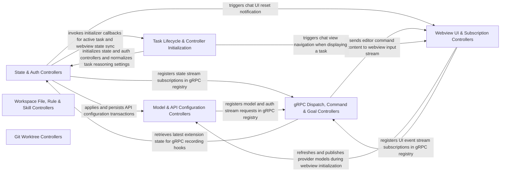

## Details

Handles gRPC requests, UI state synchronization, model configuration endpoints, file and rule management, and workspace commands.

### State & Auth Controllers
Manages extension state persistence, settings updates, state publication queues, and OAuth/provider authentication completion flows.

**Related Classes/Methods**:

- `src.core.controller.state.StateController.StateController`:21-103
- `src.core.controller.auth.AuthController.AuthController`:22-105
- `src.core.controller.state.settingsApiConfig.applyApiConfiguration`:9-28
- `src.core.controller.state.subscribeToState.subscribeToState`:14-38

**Source Files:**

- `src/core/controller/auth/AuthController.ts`
  - `src.core.controller.auth.AuthController.AuthControllerDependencies` (L16-L20) - Interface
  - `src.core.controller.auth.AuthController.AuthControllerDependencies.postStateToWebview` (L18-L18) - Method
  - `src.core.controller.auth.AuthController.AuthController` (L22-L105) - Class
  - `src.core.controller.auth.AuthController.AuthController.constructor` (L23-L23) - Constructor
  - `src.core.controller.auth.AuthController.AuthController.completeOpenRouterAuth` (L25-L53) - Method
  - `src.core.controller.auth.AuthController.AuthController.completeGithubLogin` (L55-L87) - Method
  - `src.core.controller.auth.AuthController.AuthController.completeGithubLogin.then() callback` (L70-L76) - Function
  - `src.core.controller.auth.AuthController.AuthController.completeGithubLogin.catch() callback` (L77-L79) - Function
  - `src.core.controller.auth.AuthController.AuthController.completeRequestyAuth` (L89-L104) - Method
- `src/core/controller/state/StateController.ts`
  - `src.core.controller.state.StateController.StateControllerDependencies` (L12-L19) - Interface
  - `src.core.controller.state.StateController.StateControllerDependencies.task` (L14-L14) - Method
  - `src.core.controller.state.StateController.StateController` (L21-L103) - Class
  - `src.core.controller.state.StateController.StateController.constructor` (L29-L36) - Constructor
  - `src.core.controller.state.StateController.StateController.constructor.getTask` (L31-L31) - Function
  - `src.core.controller.state.StateController.StateController.updateTelemetrySetting` (L38-L55) - Method
  - `src.core.controller.state.StateController.StateController.toggleActModeForYoloMode` (L57-L67) - Method
  - `src.core.controller.state.StateController.StateController.togglePlanActMode` (L69-L98) - Method
  - `src.core.controller.state.StateController.StateController.getTelemetrySetting` (L100-L102) - Method
- `src/core/controller/state/StatePublicationQueue.ts`
  - `src.core.controller.state.StatePublicationQueue.PublicationCompletion` (L3-L7) - Interface
  - `src.core.controller.state.StatePublicationQueue.StatePublicationQueue` (L9-L64) - Class
  - `src.core.controller.state.StatePublicationQueue.StatePublicationQueue.constructor` (L18-L22) - Constructor
  - `src.core.controller.state.StatePublicationQueue.StatePublicationQueue.requestPublication` (L24-L34) - Method
  - `src.core.controller.state.StatePublicationQueue.StatePublicationQueue.drainPublications` (L36-L63) - Method
  - `src.core.controller.state.StatePublicationQueue.createPublicationCompletion` (L66-L74) - Function
- `src/core/controller/state/activateModelProviderPreset.ts`
  - `src.core.controller.state.activateModelProviderPreset.activateModelProviderPreset` (L5-L9) - Function
- `src/core/controller/state/captureOnboardingProgress.ts`
  - `src.core.controller.state.captureOnboardingProgress.captureOnboardingProgress` (L13-L26) - Function
- `src/core/controller/state/dismissBanner.ts`
  - `src.core.controller.state.dismissBanner.dismissBanner` (L13-L26) - Function
- `src/core/controller/state/flushPendingState.ts`
  - `src.core.controller.state.flushPendingState.flushPendingState` (L10-L18) - Function
- `src/core/controller/state/getAvailableTerminalProfiles.ts`
  - `src.core.controller.state.getAvailableTerminalProfiles.getAvailableTerminalProfiles` (L5-L19) - Function
  - `src.core.controller.state.getAvailableTerminalProfiles.getAvailableTerminalProfiles.profiles.profiles.map() callback` (L12-L17) - Function
- `src/core/controller/state/getLatestState.ts`
  - `src.core.controller.state.getLatestState.getLatestState` (L11-L22) - Function
- `src/core/controller/state/getProcessInfo.ts`
  - `src.core.controller.state.getProcessInfo.getProcessInfo` (L11-L20) - Function
- `src/core/controller/state/persistModeSelection.ts`
  - `src.core.controller.state.persistModeSelection.persistModeSelection` (L5-L23) - Function
- `src/core/controller/state/reasoningEffort.ts`
  - `src.core.controller.state.reasoningEffort.normalizeOpenaiReasoningEffort` (L8-L29) - Function
- `src/core/controller/state/resetState.ts`
  - `src.core.controller.state.resetState.resetState` (L17-L55) - Function
- `src/core/controller/state/setWelcomeViewCompleted.ts`
  - `src.core.controller.state.setWelcomeViewCompleted.setWelcomeViewCompleted` (L12-L25) - Function
- `src/core/controller/state/settingsApiConfig.ts`
  - `src.core.controller.state.settingsApiConfig.applyApiConfiguration` (L9-L28) - Function
  - `src.core.controller.state.settingsApiConfig.applyApiConfiguration.commitWorkingConfigurationUpdate() callback` (L15-L15) - Function
  - `src.core.controller.state.settingsApiConfig.applyApiConfiguration.applyApiConfigurationTransaction() callback` (L25-L25) - Function
- `src/core/controller/state/settingsTerminalProfile.ts`
  - `src.core.controller.state.settingsTerminalProfile.notifyTerminalProfileChange` (L6-L17) - Function
  - `src.core.controller.state.settingsTerminalProfile.TerminalProfileChangeResult` (L19-L22) - Interface
  - `src.core.controller.state.settingsTerminalProfile.applyDefaultTerminalProfileToActiveTask` (L25-L33) - Function
  - `src.core.controller.state.settingsTerminalProfile.applyDefaultTerminalProfileWithRollback` (L36-L52) - Function
  - `src.core.controller.state.settingsTerminalProfile.setDefaultTerminalProfile` (L55-L59) - Function
- `src/core/controller/state/settingsWebview.ts`
  - `src.core.controller.state.settingsWebview.buildWebviewSettingsPatch` (L13-L60) - Function
  - `src.core.controller.state.settingsWebview.buildWebviewSettingsPatch.filter() callback` (L36-L37) - Function
  - `src.core.controller.state.settingsWebview.persistWebviewSettingsPatch` (L63-L65) - Function
  - `src.core.controller.state.settingsWebview.applySimpleSettings` (L68-L70) - Function
  - `src.core.controller.state.settingsWebview.normalizeVscodeTerminalExecutionMode` (L73-L77) - Function
- `src/core/controller/state/subscribeToState.ts`
  - `src.core.controller.state.subscribeToState.subscribeToState` (L14-L38) - Function
  - `src.core.controller.state.subscribeToState.subscribeToState.initialDelivery` (L29-L31) - Class
  - `src.core.controller.state.subscribeToState.subscribeToState.initialDelivery.enqueueSubscriptionDelivery() callback` (L29-L31) - Function
  - `src.core.controller.state.subscribeToState.sendStateUpdate` (L40-L70) - Function
  - `src.core.controller.state.subscribeToState.sendStateUpdate.promises` (L58-L67) - Class
  - `src.core.controller.state.subscribeToState.sendStateUpdate.promises.map() callback` (L58-L67) - Function
  - `src.core.controller.state.subscribeToState.sendStateUpdate.promises.map() callback.enqueueSubscriptionDelivery() callback` (L60-L61) - Function
  - `src.core.controller.state.subscribeToState.enqueueSubscriptionDelivery` (L72-L80) - Function
  - `src.core.controller.state.subscribeToState.sendStateToSubscription` (L82-L90) - Function
  - `src.core.controller.state.subscribeToState.recordStateSizeTelemetry` (L92-L94) - Function
- `src/core/controller/state/testOtelConnection.ts`
  - `src.core.controller.state.testOtelConnection.testOtelConnection` (L17-L52) - Function
  - `src.core.controller.state.testOtelConnection.testOtelConnection.otelProvider` (L20-L20) - Class
  - `src.core.controller.state.testOtelConnection.testOtelConnection.otelProvider.providers.find() callback` (L20-L20) - Function
- `src/core/controller/state/testPromptUploading.ts`
  - `src.core.controller.state.testPromptUploading.testPromptUploading` (L14-L45) - Function
- `src/core/controller/state/toggleFavoriteModel.ts`
  - `src.core.controller.state.toggleFavoriteModel.toggleFavoriteModel` (L12-L41) - Function
  - `src.core.controller.state.toggleFavoriteModel.toggleFavoriteModel.updatedFavorites` (L23-L25) - Class
  - `src.core.controller.state.toggleFavoriteModel.toggleFavoriteModel.updatedFavorites.favoritedModelIds.filter() callback` (L24-L24) - Function
- `src/core/controller/state/togglePlanActModeProto.ts`
  - `src.core.controller.state.togglePlanActModeProto.togglePlanActModeProto` (L13-L35) - Function
- `src/core/controller/state/trackBannerEvent.ts`
  - `src.core.controller.state.trackBannerEvent.trackBannerEvent` (L13-L28) - Function
- `src/core/controller/state/updateAutoApprovalSettings.ts`
  - `src.core.controller.state.updateAutoApprovalSettings.mergeAutoApprovalSettings` (L11-L23) - Function
  - `src.core.controller.state.updateAutoApprovalSettings.updateAutoApprovalSettings` (L26-L65) - Function
  - `src.core.controller.state.updateAutoApprovalSettings.updateAutoApprovalSettings.autoApprovalSettingsMutex.withLock() callback` (L27-L64) - Function
  - `src.core.controller.state.updateAutoApprovalSettings.updateAutoApprovalSettings.autoApprovalSettingsMutex.withLock() callback.activeTaskPatch` (L34-L44) - Class
  - `src.core.controller.state.updateAutoApprovalSettings.updateAutoApprovalSettings.autoApprovalSettingsMutex.withLock() callback.activeTaskPatch.<function>` (L35-L43) - Function
  - `src.core.controller.state.updateAutoApprovalSettings.updateAutoApprovalSettings.autoApprovalSettingsMutex.withLock() callback.commitWorkingConfigurationUpdate() callback` (L48-L59) - Function
- `src/core/controller/state/updateInfoBannerVersion.ts`
  - `src.core.controller.state.updateInfoBannerVersion.updateInfoBannerVersion` (L10-L17) - Function
- `src/core/controller/state/updateModelBannerVersion.ts`
  - `src.core.controller.state.updateModelBannerVersion.updateModelBannerVersion` (L10-L17) - Function
- `src/core/controller/state/updateSettings.ts`
  - `src.core.controller.state.updateSettings.capturePersistedSettings` (L25-L39) - Function
  - `src.core.controller.state.updateSettings.capturePersistedSettings.map() callback` (L30-L37) - Function
  - `src.core.controller.state.updateSettings.restoreSettingsPersistence` (L41-L50) - Function
  - `src.core.controller.state.updateSettings.persistCombinedWebviewUpdate` (L52-L84) - Function
  - `src.core.controller.state.updateSettings.persistCombinedWebviewUpdate.persistApiConfigurationAndMode() callback` (L67-L74) - Function
  - `src.core.controller.state.updateSettings.buildCombinedWebviewPatches` (L86-L141) - Function
  - `src.core.controller.state.updateSettings.normalizeRequestedToolToggles` (L143-L155) - Function
  - `src.core.controller.state.updateSettings.normalizeRequestedToolToggles.ToolRegistry.withExclusiveAccess() callback` (L146-L154) - Function
  - `src.core.controller.state.updateSettings.requestAddressesActiveTask` (L157-L172) - Function
  - `src.core.controller.state.updateSettings.commitWebviewSettings` (L174-L219) - Function
  - `src.core.controller.state.updateSettings.commitWebviewSettings.persist` (L195-L215) - Class
  - `src.core.controller.state.updateSettings.commitWebviewSettings.persist.persistUpdate` (L198-L209) - Method
  - `src.core.controller.state.updateSettings.commitWebviewSettings.persist.ToolRegistry.withExclusiveAccess() callback` (L214-L214) - Function
  - `src.core.controller.state.updateSettings.publishSettingTelemetry` (L221-L236) - Function
  - `src.core.controller.state.updateSettings.updateSettings` (L239-L265) - Function
- `src/core/controller/state/updateTelemetrySetting.ts`
  - `src.core.controller.state.updateTelemetrySetting.updateTelemetrySetting` (L12-L16) - Function
- `src/core/controller/state/updateTerminalConnectionTimeout.ts`
  - `src.core.controller.state.updateTerminalConnectionTimeout.updateTerminalConnectionTimeout` (L4-L17) - Function
- `src/core/controller/state/updateTerminalReuseEnabled.ts`
  - `src.core.controller.state.updateTerminalReuseEnabled.updateTerminalReuseEnabled` (L4-L17) - Function

### Model & API Configuration Controllers
Handles model catalog discovery, caching, provider model refresh RPCs, and transactional API configuration persistence.

**Related Classes/Methods**:

- `src.core.controller.models.apiConfigurationTransaction.applyApiConfigurationTransaction`:54-77
- `src.core.controller.models.apiConfigurationPersistence.persistApiConfigurationAndMode`:49-74
- `src.core.controller.models.authenticateOpenAiCodex.authenticateOpenAiCodex`:8-46
- `src.core.controller.models.subscribeToOpenRouterModels.sendOpenRouterModelsEvent`:41-58

**Source Files:**

- `src/core/controller/models/apiConfigurationPersistence.ts`
  - `src.core.controller.models.apiConfigurationPersistence.PersistenceSnapshot` (L6-L11) - Interface
  - `src.core.controller.models.apiConfigurationPersistence.capturePersistenceSnapshot` (L13-L32) - Function
  - `src.core.controller.models.apiConfigurationPersistence.restorePersistenceSnapshot` (L34-L46) - Function
  - `src.core.controller.models.apiConfigurationPersistence.persistApiConfigurationAndMode` (L49-L74) - Function
  - `src.core.controller.models.apiConfigurationPersistence.persistApiConfigurationPatch` (L77-L79) - Function
- `src/core/controller/models/apiConfigurationTransaction.ts`
  - `src.core.controller.models.apiConfigurationTransaction.commitWorkingConfigurationUpdate` (L35-L45) - Function
  - `src.core.controller.models.apiConfigurationTransaction.applyApiConfigurationTransaction` (L54-L77) - Function
- `src/core/controller/models/authenticateOpenAiCodex.ts`
  - `src.core.controller.models.authenticateOpenAiCodex.authenticateOpenAiCodex` (L8-L46) - Function
  - `src.core.controller.models.authenticateOpenAiCodex.authenticateOpenAiCodex.registerRequest() callback` (L18-L18) - Function
  - `src.core.controller.models.authenticateOpenAiCodex.authenticateOpenAiCodex.openAiCodexOAuthManager.authenticate() callback` (L32-L34) - Function
- `src/core/controller/models/fetchAndCacheModels.ts`
  - `src.core.controller.models.fetchAndCacheModels.FetchAndCacheModelsConfig` (L13-L28) - Interface
  - `src.core.controller.models.fetchAndCacheModels.fetchAndCacheModels` (L38-L60) - Function
  - `src.core.controller.models.fetchAndCacheModels.doFetchAndCacheModels` (L62-L134) - Function
  - `src.core.controller.models.fetchAndCacheModels.buildErrorMessage` (L136-L147) - Function
  - `src.core.controller.models.fetchAndCacheModels.readCachedModels` (L149-L157) - Function
- `src/core/controller/models/fetchOpenRouterModelRankings.ts`
  - `src.core.controller.models.fetchOpenRouterModelRankings.OpenRouterRankingBucket` (L12-L15) - Interface
  - `src.core.controller.models.fetchOpenRouterModelRankings.fetchOpenRouterModelRankings` (L17-L33) - Function
  - `src.core.controller.models.fetchOpenRouterModelRankings.parseRankingBucket` (L35-L49) - Function
  - `src.core.controller.models.fetchOpenRouterModelRankings.getRankedCanonicalSlugs` (L51-L57) - Function
  - `src.core.controller.models.fetchOpenRouterModelRankings.getRankedCanonicalSlugs.filter() callback` (L53-L53) - Function
  - `src.core.controller.models.fetchOpenRouterModelRankings.getRankedCanonicalSlugs.sort() callback` (L54-L54) - Function
  - `src.core.controller.models.fetchOpenRouterModelRankings.getRankedCanonicalSlugs.map() callback` (L56-L56) - Function
- `src/core/controller/models/getAihubmixModels.ts`
  - `src.core.controller.models.getAihubmixModels.getAihubmixModels` (L14-L74) - Function
- `src/core/controller/models/getLmStudioModels.ts`
  - `src.core.controller.models.getLmStudioModels.getLmStudioModels` (L12-L29) - Function
  - `src.core.controller.models.getLmStudioModels.getLmStudioModels.models` (L22-L22) - Class
  - `src.core.controller.models.getLmStudioModels.getLmStudioModels.models.data.data.map() callback` (L22-L22) - Function
- `src/core/controller/models/getOpenRouterEndpoints.ts`
  - `src.core.controller.models.getOpenRouterEndpoints.getOpenRouterEndpoints` (L10-L38) - Function
  - `src.core.controller.models.getOpenRouterEndpoints.getOpenRouterEndpoints.endpoints.result.endpoints.map() callback` (L17-L29) - Function
- `src/core/controller/models/getVsCodeLmModels.ts`
  - `src.core.controller.models.getVsCodeLmModels.getVsCodeLmModels` (L14-L26) - Function
- `src/core/controller/models/refreshBasetenModelsRpc.ts`
  - `src.core.controller.models.refreshBasetenModelsRpc.refreshBasetenModelsRpc` (L13-L21) - Function
- `src/core/controller/models/refreshGithubCopilotModels.ts`
  - `src.core.controller.models.refreshGithubCopilotModels.refreshGithubCopilotModels` (L7-L28) - Function
- `src/core/controller/models/refreshGroqModels.ts`
  - `src.core.controller.models.refreshGroqModels.refreshGroqModels` (L15-L40) - Function
  - `src.core.controller.models.refreshGroqModels.refreshGroqModels.validateApiKey` (L25-L27) - Method
  - `src.core.controller.models.refreshGroqModels.refreshGroqModels.onError` (L31-L38) - Method
  - `src.core.controller.models.refreshGroqModels.parseGroqResponse` (L42-L60) - Function
  - `src.core.controller.models.refreshGroqModels.getGroqStaticModels` (L62-L78) - Function
  - `src.core.controller.models.refreshGroqModels.isValidChatModel` (L81-L85) - Function
  - `src.core.controller.models.refreshGroqModels.isValidChatModel.some() callback` (L83-L83) - Function
  - `src.core.controller.models.refreshGroqModels.detectImageSupport` (L88-L92) - Function
  - `src.core.controller.models.refreshGroqModels.generateModelDescription` (L95-L103) - Function
- `src/core/controller/models/refreshGroqModelsRpc.ts`
  - `src.core.controller.models.refreshGroqModelsRpc.refreshGroqModelsRpc` (L13-L21) - Function
- `src/core/controller/models/refreshHuggingFaceModels.ts`
  - `src.core.controller.models.refreshHuggingFaceModels.RouterProvider` (L13-L18) - Interface
  - `src.core.controller.models.refreshHuggingFaceModels.RouterModel` (L20-L24) - Interface
  - `src.core.controller.models.refreshHuggingFaceModels.parseHuggingFaceRouterModels` (L27-L49) - Function
  - `src.core.controller.models.refreshHuggingFaceModels.parseHuggingFaceRouterModels.providers` (L30-L30) - Class
  - `src.core.controller.models.refreshHuggingFaceModels.parseHuggingFaceRouterModels.providers.rawModel.providers.filter() callback` (L30-L30) - Function
  - `src.core.controller.models.refreshHuggingFaceModels.parseHuggingFaceRouterModels.contextLengths` (L33-L35) - Class
  - `src.core.controller.models.refreshHuggingFaceModels.parseHuggingFaceRouterModels.contextLengths.providers.map() callback` (L34-L34) - Function
  - `src.core.controller.models.refreshHuggingFaceModels.parseHuggingFaceRouterModels.contextLengths.filter() callback` (L35-L35) - Function
  - `src.core.controller.models.refreshHuggingFaceModels.parseHuggingFaceRouterModels.description.providers.map() callback` (L45-L45) - Function
  - `src.core.controller.models.refreshHuggingFaceModels.getHuggingFaceModels` (L52-L87) - Function
  - `src.core.controller.models.refreshHuggingFaceModels.getHuggingFaceModels.filter() callback` (L71-L71) - Function
  - `src.core.controller.models.refreshHuggingFaceModels.getHuggingFaceModels.map() callback` (L72-L82) - Function
  - `src.core.controller.models.refreshHuggingFaceModels.refreshHuggingFaceModels` (L90-L110) - Function
  - `src.core.controller.models.refreshHuggingFaceModels.refreshHuggingFaceModels.models.map() callback` (L97-L107) - Function
- `src/core/controller/models/refreshLiteLlmModels.ts`
  - `src.core.controller.models.refreshLiteLlmModels.refreshLiteLlmModels` (L14-L84) - Function
- `src/core/controller/models/refreshLiteLlmModelsRpc.ts`
  - `src.core.controller.models.refreshLiteLlmModelsRpc.refreshLiteLlmModelsRpc` (L13-L21) - Function
- `src/core/controller/models/refreshOpenAiCodexUsage.ts`
  - `src.core.controller.models.refreshOpenAiCodexUsage.refreshOpenAiCodexUsage` (L8-L15) - Function
- `src/core/controller/models/refreshOpenAiModels.ts`
  - `src.core.controller.models.refreshOpenAiModels.refreshOpenAiModels` (L15-L47) - Function
  - `src.core.controller.models.refreshOpenAiModels.refreshOpenAiModels.modelsArray` (L35-L35) - Class
  - `src.core.controller.models.refreshOpenAiModels.refreshOpenAiModels.modelsArray.response.data.data.map() callback` (L35-L35) - Function
- `src/core/controller/models/refreshOpenRouterModels.ts`
  - `src.core.controller.models.refreshOpenRouterModels.OpenRouterRawModelInfo` (L29-L60) - Interface
  - `src.core.controller.models.refreshOpenRouterModels.refreshOpenRouterModels` (L62-L72) - Function
  - `src.core.controller.models.refreshOpenRouterModels.refreshOpenRouterModels.readCacheFromController` (L69-L69) - Method
  - `src.core.controller.models.refreshOpenRouterModels.parseOpenRouterResponse` (L74-L104) - Function
  - `src.core.controller.models.refreshOpenRouterModels.parseOpenRouterPrice` (L106-L111) - Function
  - `src.core.controller.models.refreshOpenRouterModels.supportsImageInput` (L113-L117) - Function
- `src/core/controller/models/refreshOpenRouterModelsRpc.ts`
  - `src.core.controller.models.refreshOpenRouterModelsRpc.refreshOpenRouterModelsRpc` (L13-L21) - Function
- `src/core/controller/models/refreshRequestyModels.ts`
  - `src.core.controller.models.refreshRequestyModels.refreshRequestyModels` (L16-L57) - Function
- `src/core/controller/models/refreshVercelAiGatewayModels.ts`
  - `src.core.controller.models.refreshVercelAiGatewayModels.deriveThinkingConfig` (L12-L20) - Function
  - `src.core.controller.models.refreshVercelAiGatewayModels.deriveTemperature` (L23-L33) - Function
  - `src.core.controller.models.refreshVercelAiGatewayModels.refreshVercelAiGatewayModels` (L40-L47) - Function
  - `src.core.controller.models.refreshVercelAiGatewayModels.parseVercelResponse` (L49-L68) - Function
- `src/core/controller/models/refreshVercelAiGatewayModelsRpc.ts`
  - `src.core.controller.models.refreshVercelAiGatewayModelsRpc.refreshVercelAiGatewayModelsRpc` (L13-L21) - Function
- `src/core/controller/models/signOutOpenAiCodex.ts`
  - `src.core.controller.models.signOutOpenAiCodex.signOutOpenAiCodex` (L13-L27) - Function
- `src/core/controller/models/subscribeToLiteLlmModels.ts`
  - `src.core.controller.models.subscribeToLiteLlmModels.subscribeToLiteLlmModels` (L17-L35) - Function
  - `src.core.controller.models.subscribeToLiteLlmModels.sendLiteLlmModelsEvent` (L41-L57) - Function
  - `src.core.controller.models.subscribeToLiteLlmModels.sendLiteLlmModelsEvent.promises` (L43-L54) - Class
  - `src.core.controller.models.subscribeToLiteLlmModels.sendLiteLlmModelsEvent.promises.map() callback` (L43-L54) - Function
- `src/core/controller/models/subscribeToOpenRouterModels.ts`
  - `src.core.controller.models.subscribeToOpenRouterModels.subscribeToOpenRouterModels` (L17-L35) - Function
  - `src.core.controller.models.subscribeToOpenRouterModels.sendOpenRouterModelsEvent` (L41-L58) - Function
  - `src.core.controller.models.subscribeToOpenRouterModels.sendOpenRouterModelsEvent.promises` (L43-L55) - Class
  - `src.core.controller.models.subscribeToOpenRouterModels.sendOpenRouterModelsEvent.promises.map() callback` (L43-L55) - Function
- `src/core/controller/models/updateApiConfiguration.ts`
  - `src.core.controller.models.updateApiConfiguration.parseFieldMask` (L16-L35) - Function
  - `src.core.controller.models.updateApiConfiguration.getAlternateModeField` (L42-L50) - Function
  - `src.core.controller.models.updateApiConfiguration.updateApiConfiguration` (L58-L166) - Function
  - `src.core.controller.models.updateApiConfiguration.updateApiConfiguration.map() callback` (L119-L122) - Function
  - `src.core.controller.models.updateApiConfiguration.updateApiConfiguration.applyApiConfigurationTransaction() callback` (L153-L153) - Function
- `src/core/controller/models/updateApiConfigurationPartial.ts`
  - `src.core.controller.models.updateApiConfigurationPartial.updateApiConfigurationPartial` (L19-L56) - Function
  - `src.core.controller.models.updateApiConfigurationPartial.updateApiConfigurationPartial.explicitPatch` (L43-L45) - Class
  - `src.core.controller.models.updateApiConfigurationPartial.updateApiConfigurationPartial.explicitPatch.request.updateMask.map() callback` (L44-L44) - Function
- `src/core/controller/models/updateApiConfigurationProto.ts`
  - `src.core.controller.models.updateApiConfigurationProto.updateApiConfigurationProto` (L15-L42) - Function

### Workspace File, Rule & Skill Controllers
Provides workspace file operations, file and commit search, clipboard actions, and lifecycle management for rules, skills, workflows, and hooks.

**Related Classes/Methods**: _None_

**Source Files:**

- `src/core/controller/file/copyToClipboard.ts`
  - `src.core.controller.file.copyToClipboard.copyToClipboard` (L12-L22) - Function
- `src/core/controller/file/createHook.ts`
  - `src.core.controller.file.createHook.createHook` (L10-L56) - Function
- `src/core/controller/file/createRuleFile.ts`
  - `src.core.controller.file.createRuleFile.createRuleFile` (L20-L75) - Function
- `src/core/controller/file/createSkillFile.ts`
  - `src.core.controller.file.createSkillFile.createSkillFile` (L38-L111) - Function
- `src/core/controller/file/deleteHook.ts`
  - `src.core.controller.file.deleteHook.deleteHook` (L8-L33) - Function
- `src/core/controller/file/deleteRuleFile.ts`
  - `src.core.controller.file.deleteRuleFile.deleteRuleFile` (L16-L56) - Function
- `src/core/controller/file/deleteSkillFile.ts`
  - `src.core.controller.file.deleteSkillFile.deleteSkillFile` (L14-L63) - Function
- `src/core/controller/file/getRelativePaths.ts`
  - `src.core.controller.file.getRelativePaths.getRelativePaths` (L15-L25) - Function
  - `src.core.controller.file.getRelativePaths.getRelativePath` (L27-L41) - Function
- `src/core/controller/file/ifFileExistsRelativePath.ts`
  - `src.core.controller.file.ifFileExistsRelativePath.ifFileExistsRelativePath` (L13-L41) - Function
- `src/core/controller/file/openDiskConversationHistory.ts`
  - `src.core.controller.file.openDiskConversationHistory.openDiskConversationHistory` (L11-L17) - Function
- `src/core/controller/file/openFile.ts`
  - `src.core.controller.file.openFile.openFile` (L19-L29) - Function
  - `src.core.controller.file.openFile.openRemoteFile` (L36-L70) - Function
  - `src.core.controller.file.openFile.openRemoteFile.item` (L53-L53) - Class
  - `src.core.controller.file.openFile.openRemoteFile.item.items.find() callback` (L53-L53) - Function
- `src/core/controller/file/openFileRelativePath.ts`
  - `src.core.controller.file.openFileRelativePath.openFileRelativePath` (L14-L36) - Function
- `src/core/controller/file/openImage.ts`
  - `src.core.controller.file.openImage.openImage` (L11-L16) - Function
- `src/core/controller/file/openMention.ts`
  - `src.core.controller.file.openMention.openMention` (L11-L14) - Function
- `src/core/controller/file/refreshHooks.ts`
  - `src.core.controller.file.refreshHooks.refreshHooks` (L9-L69) - Function
  - `src.core.controller.file.refreshHooks.isExecutable` (L71-L85) - Function
- `src/core/controller/file/refreshRules.ts`
  - `src.core.controller.file.refreshRules.refreshRules` (L16-L39) - Function
- `src/core/controller/file/refreshSkills.ts`
  - `src.core.controller.file.refreshSkills.scanSkillsDirectory` (L15-L76) - Function
  - `src.core.controller.file.refreshSkills.scanSkillsDirectory.stats` (L27-L27) - Class
  - `src.core.controller.file.refreshSkills.scanSkillsDirectory.stats.catch() callback` (L27-L27) - Function
  - `src.core.controller.file.refreshSkills.scanSkillsDirectory.resolvedPath` (L32-L32) - Class
  - `src.core.controller.file.refreshSkills.scanSkillsDirectory.resolvedPath.catch() callback` (L32-L32) - Function
  - `src.core.controller.file.refreshSkills.refreshSkills` (L81-L152) - Function
- `src/core/controller/file/searchCommits.ts`
  - `src.core.controller.file.searchCommits.searchCommits` (L14-L28) - Function
- `src/core/controller/file/searchFiles.ts`
  - `src.core.controller.file.searchFiles.searchFiles` (L7-L18) - Function
- `src/core/controller/file/searchFilesHelpers.ts`
  - `src.core.controller.file.searchFilesHelpers.runSearch` (L17-L32) - Function
  - `src.core.controller.file.searchFilesHelpers.toRelativePath` (L34-L42) - Function
  - `src.core.controller.file.searchFilesHelpers.prioritizeActiveFile` (L44-L61) - Function
  - `src.core.controller.file.searchFilesHelpers.prioritizeActiveFile.idx` (L51-L51) - Class
  - `src.core.controller.file.searchFilesHelpers.prioritizeActiveFile.idx.results.findIndex() callback` (L51-L51) - Function
  - `src.core.controller.file.searchFilesHelpers.handleSearchError` (L71-L77) - Function
- `src/core/controller/file/selectFiles.ts`
  - `src.core.controller.file.selectFiles.selectFiles` (L12-L21) - Function
- `src/core/controller/file/toggleAgentsRule.ts`
  - `src.core.controller.file.toggleAgentsRule.toggleAgentsRule` (L12-L34) - Function
- `src/core/controller/file/toggleCursorRule.ts`
  - `src.core.controller.file.toggleCursorRule.toggleCursorRule` (L12-L34) - Function
- `src/core/controller/file/toggleDiracRule.ts`
  - `src.core.controller.file.toggleDiracRule.toggleDiracRule` (L14-L68) - Function
- `src/core/controller/file/toggleHook.ts`
  - `src.core.controller.file.toggleHook.toggleHook` (L8-L41) - Function
- `src/core/controller/file/toggleSkill.ts`
  - `src.core.controller.file.toggleSkill.toggleSkill` (L11-L40) - Function
- `src/core/controller/file/toggleWindsurfRule.ts`
  - `src.core.controller.file.toggleWindsurfRule.toggleWindsurfRule` (L12-L30) - Function
- `src/core/controller/file/toggleWorkflow.ts`
  - `src.core.controller.file.toggleWorkflow.toggleWorkflow` (L11-L53) - Function

### Webview UI & Subscription Controllers
Assembles webview state snapshots, initializes the webview UI, and manages UI event subscriptions and navigation actions.

**Related Classes/Methods**:

- `src.core.controller.ui.initializeWebview.initializeWebview`:42-56
- `src.core.controller.ui.subscribeToChatButtonClicked.sendChatButtonClickedEvent`:39-56
- `src.core.controller.ui.subscribeToAddToInput.subscribeToAddToInput`:16-34
- `src.core.controller.ui.subscribeToAccountButtonClicked.subscribeToAccountButtonClicked`:16-34

**Source Files:**

- `src/core/controller/ui/UiController.ts`
  - `src.core.controller.ui.UiController.getStateToPostToWebview` (L17-L108) - Function
  - `src.core.controller.ui.UiController.currentTaskItem` (L77-L77) - Class
  - `src.core.controller.ui.UiController.getStateToPostToWebview.currentTaskItem.find() callback` (L77-L77) - Function
- `src/core/controller/ui/assembleAuthState.ts`
  - `src.core.controller.ui.assembleAuthState.assembleAuthState` (L7-L36) - Function
- `src/core/controller/ui/assembleModelState.ts`
  - `src.core.controller.ui.assembleModelState.assembleModelState` (L6-L75) - Function
- `src/core/controller/ui/assembleRuntimeState.ts`
  - `src.core.controller.ui.assembleRuntimeState.assembleRuntimeState` (L10-L22) - Function
- `src/core/controller/ui/assembleToolState.ts`
  - `src.core.controller.ui.assembleToolState.assembleToolState` (L7-L25) - Function
  - `src.core.controller.ui.assembleToolState.assembleToolState.ToolRegistry.withExclusiveAccess() callback` (L14-L24) - Function
  - `src.core.controller.ui.assembleToolState.ToolRegistry.withExclusiveAccess() callback.availableTools` (L15-L22) - Class
  - `src.core.controller.ui.assembleToolState.assembleToolState.ToolRegistry.withExclusiveAccess() callback.availableTools.map() callback` (L15-L22) - Function
- `src/core/controller/ui/discoverAvailableSkills.ts`
  - `src.core.controller.ui.discoverAvailableSkills.discoverAvailableSkills` (L5-L22) - Function
  - `src.core.controller.ui.discoverAvailableSkills.discoverAvailableSkills.providerSkills.filter() callback` (L16-L21) - Function
- `src/core/controller/ui/getWebviewHtml.ts`
  - `src.core.controller.ui.getWebviewHtml.getWebviewHtml` (L11-L14) - Function
- `src/core/controller/ui/githubCopilotLogin.ts`
  - `src.core.controller.ui.githubCopilotLogin.githubCopilotLogin` (L10-L13) - Function
- `src/core/controller/ui/initializeWebview.ts`
  - `src.core.controller.ui.initializeWebview.initializeWebview` (L42-L56) - Function
  - `src.core.controller.ui.initializeWebview.then() callback` (L46-L46) - Function
  - `src.core.controller.ui.initializeWebview.initializeWebview.then() callback` (L48-L48) - Function
  - `src.core.controller.ui.initializeWebview.postCachedOpenRouterModels` (L59-L69) - Function
  - `src.core.controller.ui.initializeWebview.refreshLiteLlmIfConfigured` (L72-L76) - Function
  - `src.core.controller.ui.initializeWebview.syncTelemetrySetting` (L78-L82) - Function
  - `src.core.controller.ui.initializeWebview.syncTelemetrySetting.then() callback` (L81-L81) - Function
  - `src.core.controller.ui.initializeWebview.syncProviderModelInfo` (L85-L102) - Function
  - `src.core.controller.ui.initializeWebview.updateCurrentModeModel` (L104-L117) - Function
- `src/core/controller/ui/onDidShowAnnouncement.ts`
  - `src.core.controller.ui.onDidShowAnnouncement.onDidShowAnnouncement` (L14-L27) - Function
- `src/core/controller/ui/openUrl.ts`
  - `src.core.controller.ui.openUrl.openUrl` (L13-L22) - Function
- `src/core/controller/ui/openWalkthrough.ts`
  - `src.core.controller.ui.openWalkthrough.openWalkthrough` (L14-L24) - Function
- `src/core/controller/ui/processTaskHistory.ts`
  - `src.core.controller.ui.processTaskHistory.processTaskHistory` (L5-L10) - Function
  - `src.core.controller.ui.processTaskHistory.processTaskHistory.taskHistory.filter() callback` (L7-L7) - Function
  - `src.core.controller.ui.processTaskHistory.processTaskHistory.sort() callback` (L8-L8) - Function
- `src/core/controller/ui/scrollToSettings.ts`
  - `src.core.controller.ui.scrollToSettings.scrollToSettings` (L10-L15) - Function
- `src/core/controller/ui/setTerminalExecutionMode.ts`
  - `src.core.controller.ui.setTerminalExecutionMode.setTerminalExecutionMode` (L10-L24) - Function
- `src/core/controller/ui/subscribeToAccountButtonClicked.ts`
  - `src.core.controller.ui.subscribeToAccountButtonClicked.subscribeToAccountButtonClicked` (L16-L34) - Function
  - `src.core.controller.ui.subscribeToAccountButtonClicked.sendAccountButtonClickedEvent` (L39-L56) - Function
  - `src.core.controller.ui.subscribeToAccountButtonClicked.sendAccountButtonClickedEvent.promises` (L41-L53) - Class
  - `src.core.controller.ui.subscribeToAccountButtonClicked.sendAccountButtonClickedEvent.promises.map() callback` (L41-L53) - Function
- `src/core/controller/ui/subscribeToAddToInput.ts`
  - `src.core.controller.ui.subscribeToAddToInput.subscribeToAddToInput` (L16-L34) - Function
  - `src.core.controller.ui.subscribeToAddToInput.sendAddToInputEvent` (L40-L59) - Function
  - `src.core.controller.ui.subscribeToAddToInput.sendAddToInputEvent.promises` (L42-L56) - Class
  - `src.core.controller.ui.subscribeToAddToInput.sendAddToInputEvent.promises.map() callback` (L42-L56) - Function
- `src/core/controller/ui/subscribeToChatButtonClicked.ts`
  - `src.core.controller.ui.subscribeToChatButtonClicked.subscribeToChatButtonClicked` (L16-L34) - Function
  - `src.core.controller.ui.subscribeToChatButtonClicked.sendChatButtonClickedEvent` (L39-L56) - Function
  - `src.core.controller.ui.subscribeToChatButtonClicked.sendChatButtonClickedEvent.promises` (L41-L53) - Class
  - `src.core.controller.ui.subscribeToChatButtonClicked.sendChatButtonClickedEvent.promises.map() callback` (L41-L53) - Function
- `src/core/controller/ui/subscribeToHistoryButtonClicked.ts`
  - `src.core.controller.ui.subscribeToHistoryButtonClicked.subscribeToHistoryButtonClicked` (L16-L34) - Function
  - `src.core.controller.ui.subscribeToHistoryButtonClicked.sendHistoryButtonClickedEvent` (L39-L56) - Function
  - `src.core.controller.ui.subscribeToHistoryButtonClicked.sendHistoryButtonClickedEvent.promises` (L41-L53) - Class
  - `src.core.controller.ui.subscribeToHistoryButtonClicked.sendHistoryButtonClickedEvent.promises.map() callback` (L41-L53) - Function
- `src/core/controller/ui/subscribeToRelinquishControl.ts`
  - `src.core.controller.ui.subscribeToRelinquishControl.subscribeToRelinquishControl` (L16-L34) - Function
  - `src.core.controller.ui.subscribeToRelinquishControl.sendRelinquishControlEvent` (L39-L56) - Function
  - `src.core.controller.ui.subscribeToRelinquishControl.sendRelinquishControlEvent.promises` (L41-L53) - Class
  - `src.core.controller.ui.subscribeToRelinquishControl.sendRelinquishControlEvent.promises.map() callback` (L41-L53) - Function
- `src/core/controller/ui/subscribeToSettingsButtonClicked.ts`
  - `src.core.controller.ui.subscribeToSettingsButtonClicked.subscribeToSettingsButtonClicked` (L16-L34) - Function
  - `src.core.controller.ui.subscribeToSettingsButtonClicked.sendSettingsButtonClickedEvent` (L39-L52) - Function
  - `src.core.controller.ui.subscribeToSettingsButtonClicked.sendSettingsButtonClickedEvent.promises` (L41-L49) - Class
  - `src.core.controller.ui.subscribeToSettingsButtonClicked.sendSettingsButtonClickedEvent.promises.map() callback` (L41-L49) - Function
- `src/core/controller/ui/subscribeToShowWebview.ts`
  - `src.core.controller.ui.subscribeToShowWebview.subscribeToShowWebview` (L17-L35) - Function
  - `src.core.controller.ui.subscribeToShowWebview.sendShowWebviewEvent` (L41-L58) - Function
  - `src.core.controller.ui.subscribeToShowWebview.sendShowWebviewEvent.promises` (L43-L55) - Class
  - `src.core.controller.ui.subscribeToShowWebview.sendShowWebviewEvent.promises.map() callback` (L43-L55) - Function
- `src/core/controller/ui/subscribeToWorktreesButtonClicked.ts`
  - `src.core.controller.ui.subscribeToWorktreesButtonClicked.subscribeToWorktreesButtonClicked` (L16-L39) - Function
  - `src.core.controller.ui.subscribeToWorktreesButtonClicked.sendWorktreesButtonClickedEvent` (L44-L61) - Function
  - `src.core.controller.ui.subscribeToWorktreesButtonClicked.sendWorktreesButtonClickedEvent.promises` (L46-L58) - Class
  - `src.core.controller.ui.subscribeToWorktreesButtonClicked.sendWorktreesButtonClickedEvent.promises.map() callback` (L46-L58) - Function

### gRPC Dispatch, Command & Goal Controllers
Dispatches gRPC requests, manages streaming request lifecycles and recording, and handles editor commands, goal controls, slash commands, and web metadata utilities.

**Related Classes/Methods**:

- `src.core.controller.grpc-handler.getRequestRegistry`:185-187
- `src.core.controller.grpc-request-registry.GrpcRequestRegistry`:33-123
- `src.core.controller.commands.addToDirac.addToDirac`:13-51
- `src.core.controller.grpc-recorder.test-hooks.testHooks`:9-38

**Source Files:**

- `src/core/controller/commands/addToDirac.ts`
  - `src.core.controller.commands.addToDirac.addToDirac` (L13-L51) - Function
- `src/core/controller/commands/explainWithDirac.ts`
  - `src.core.controller.commands.explainWithDirac.explainWithDirac` (L9-L37) - Function
- `src/core/controller/commands/fixWithDirac.ts`
  - `src.core.controller.commands.fixWithDirac.fixWithDirac` (L8-L21) - Function
- `src/core/controller/commands/improveWithDirac.ts`
  - `src.core.controller.commands.improveWithDirac.improveWithDirac` (L10-L50) - Function
- `src/core/controller/goal/pauseGoal.ts`
  - `src.core.controller.goal.pauseGoal.pauseGoal` (L5-L8) - Function
- `src/core/controller/goal/resumeGoal.ts`
  - `src.core.controller.goal.resumeGoal.resumeGoal` (L5-L8) - Function
- `src/core/controller/goal/selectGoal.ts`
  - `src.core.controller.goal.selectGoal.selectGoal` (L5-L8) - Function
- `src/core/controller/goal/sendGoalMessage.ts`
  - `src.core.controller.goal.sendGoalMessage.sendGoalMessage` (L5-L8) - Function
- `src/core/controller/goal/steerGoal.ts`
  - `src.core.controller.goal.steerGoal.steerGoal` (L5-L8) - Function
- `src/core/controller/goal/stopGoal.ts`
  - `src.core.controller.goal.stopGoal.stopGoal` (L5-L8) - Function
- `src/core/controller/grpc-handler.ts`
  - `src.core.controller.grpc-handler.withRecordingMiddleware` (L24-L38) - Function
  - `src.core.controller.grpc-handler.withRecordingMiddleware.<function>` (L25-L37) - Function
  - `src.core.controller.grpc-handler.recordRequest` (L43-L49) - Function
  - `src.core.controller.grpc-handler.handleGrpcRequest` (L54-L69) - Function
  - `src.core.controller.grpc-handler.handleUnaryRequest` (L76-L106) - Function
  - `src.core.controller.grpc-handler.handleStreamingRequest` (L114-L153) - Function
  - `src.core.controller.grpc-handler.handleGrpcRequestCancel` (L160-L176) - Function
  - `src.core.controller.grpc-handler.getRequestRegistry` (L185-L187) - Function
  - `src.core.controller.grpc-handler.getHandler` (L189-L200) - Function
- `src/core/controller/grpc-recorder/grpc-recorder.builder.ts`
  - `src.core.controller.grpc-recorder.grpc-recorder.builder.GrpcRecorderBuilder` (L16-L76) - Class
  - `src.core.controller.grpc-recorder.grpc-recorder.builder.GrpcRecorderBuilder.withLogFileHandler` (L22-L25) - Method
  - `src.core.controller.grpc-recorder.grpc-recorder.builder.GrpcRecorderBuilder.enableIf` (L27-L30) - Method
  - `src.core.controller.grpc-recorder.grpc-recorder.builder.GrpcRecorderBuilder.withFilters` (L32-L35) - Method
  - `src.core.controller.grpc-recorder.grpc-recorder.builder.GrpcRecorderBuilder.withPostRecordHooks` (L37-L40) - Method
  - `src.core.controller.grpc-recorder.grpc-recorder.builder.GrpcRecorderBuilder.getRecorder` (L48-L56) - Method
  - `src.core.controller.grpc-recorder.grpc-recorder.builder.GrpcRecorderBuilder.build` (L58-L75) - Method
  - `src.core.controller.grpc-recorder.grpc-recorder.builder.filtersFromEnv` (L78-L86) - Function
  - `src.core.controller.grpc-recorder.grpc-recorder.builder.testFilters` (L88-L106) - Function
  - `src.core.controller.grpc-recorder.grpc-recorder.builder.hooksFromEnv` (L108-L116) - Function
- `src/core/controller/grpc-recorder/grpc-recorder.ts`
  - `src.core.controller.grpc-recorder.grpc-recorder.GrpcRecorderNoops` (L14-L25) - Class
  - `src.core.controller.grpc-recorder.grpc-recorder.GrpcRecorderNoops.recordRequest` (L15-L15) - Method
  - `src.core.controller.grpc-recorder.grpc-recorder.GrpcRecorderNoops.recordResponse` (L16-L16) - Method
  - `src.core.controller.grpc-recorder.grpc-recorder.GrpcRecorderNoops.recordError` (L17-L17) - Method
  - `src.core.controller.grpc-recorder.grpc-recorder.GrpcRecorderNoops.getSessionLog` (L18-L23) - Method
  - `src.core.controller.grpc-recorder.grpc-recorder.GrpcRecorderNoops.cleanupSyntheticEntries` (L24-L24) - Method
  - `src.core.controller.grpc-recorder.grpc-recorder.IRecorder` (L27-L33) - Interface
  - `src.core.controller.grpc-recorder.grpc-recorder.IRecorder.recordRequest` (L28-L28) - Method
  - `src.core.controller.grpc-recorder.grpc-recorder.IRecorder.recordResponse` (L29-L29) - Method
  - `src.core.controller.grpc-recorder.grpc-recorder.IRecorder.recordError` (L30-L30) - Method
  - `src.core.controller.grpc-recorder.grpc-recorder.IRecorder.getSessionLog` (L31-L31) - Method
  - `src.core.controller.grpc-recorder.grpc-recorder.IRecorder.cleanupSyntheticEntries` (L32-L32) - Method
  - `src.core.controller.grpc-recorder.grpc-recorder.GrpcRecorder` (L44-L226) - Class
  - `src.core.controller.grpc-recorder.grpc-recorder.GrpcRecorder.constructor` (L48-L61) - Constructor
  - `src.core.controller.grpc-recorder.grpc-recorder.GrpcRecorder.constructor.catch() callback` (L58-L60) - Function
  - `src.core.controller.grpc-recorder.grpc-recorder.GrpcRecorder.builder` (L63-L65) - Method
  - `src.core.controller.grpc-recorder.grpc-recorder.GrpcRecorder.recordRequest` (L76-L100) - Method
  - `src.core.controller.grpc-recorder.grpc-recorder.GrpcRecorder.getSessionLog` (L102-L104) - Method
  - `src.core.controller.grpc-recorder.grpc-recorder.GrpcRecorder.recordResponse` (L118-L147) - Method
  - `src.core.controller.grpc-recorder.grpc-recorder.GrpcRecorder.recordResponse.catch() callback` (L146-L146) - Function
  - `src.core.controller.grpc-recorder.grpc-recorder.GrpcRecorder.runHooks` (L149-L154) - Method
  - `src.core.controller.grpc-recorder.grpc-recorder.GrpcRecorder.cleanupSyntheticEntries` (L156-L169) - Method
  - `src.core.controller.grpc-recorder.grpc-recorder.GrpcRecorder.cleanupSyntheticEntries.sessionLog.entries.filter() callback` (L158-L158) - Function
  - `src.core.controller.grpc-recorder.grpc-recorder.GrpcRecorder.recordError` (L182-L199) - Method
  - `src.core.controller.grpc-recorder.grpc-recorder.GrpcRecorder.flushLogAsync` (L201-L207) - Method
  - `src.core.controller.grpc-recorder.grpc-recorder.GrpcRecorder.flushLogAsync.setImmediate() callback` (L202-L206) - Function
  - `src.core.controller.grpc-recorder.grpc-recorder.GrpcRecorder.flushLogAsync.setImmediate() callback.catch() callback` (L203-L205) - Function
  - `src.core.controller.grpc-recorder.grpc-recorder.GrpcRecorder.getStats` (L209-L221) - Method
  - `src.core.controller.grpc-recorder.grpc-recorder.GrpcRecorder.getStats.pendingRequests.sessionLog.entries.filter() callback` (L211-L211) - Function
  - `src.core.controller.grpc-recorder.grpc-recorder.getStats.pendingRequests` (L211-L211) - Class
  - `src.core.controller.grpc-recorder.grpc-recorder.GrpcRecorder.getStats.completedRequests.sessionLog.entries.filter() callback` (L212-L212) - Function
  - `src.core.controller.grpc-recorder.grpc-recorder.getStats.completedRequests` (L212-L212) - Class
  - `src.core.controller.grpc-recorder.grpc-recorder.GrpcRecorder.getStats.errorRequests.sessionLog.entries.filter() callback` (L213-L213) - Function
  - `src.core.controller.grpc-recorder.grpc-recorder.getStats.errorRequests` (L213-L213) - Class
  - `src.core.controller.grpc-recorder.grpc-recorder.GrpcRecorder.shouldFilter` (L223-L225) - Method
  - `src.core.controller.grpc-recorder.grpc-recorder.GrpcRecorder.shouldFilter.requestFilters.some() callback` (L224-L224) - Function
- `src/core/controller/grpc-recorder/log-file-handler.ts`
  - `src.core.controller.grpc-recorder.log-file-handler.LogFileHandlerNoops` (L9-L12) - Class
  - `src.core.controller.grpc-recorder.log-file-handler.LogFileHandlerNoops.initialize` (L10-L10) - Method
  - `src.core.controller.grpc-recorder.log-file-handler.LogFileHandlerNoops.write` (L11-L11) - Method
  - `src.core.controller.grpc-recorder.log-file-handler.ILogFileHandler` (L14-L17) - Interface
  - `src.core.controller.grpc-recorder.log-file-handler.ILogFileHandler.initialize` (L15-L15) - Method
  - `src.core.controller.grpc-recorder.log-file-handler.ILogFileHandler.write` (L16-L16) - Method
  - `src.core.controller.grpc-recorder.log-file-handler.LogFileHandler` (L26-L58) - Class
  - `src.core.controller.grpc-recorder.log-file-handler.LogFileHandler.constructor` (L29-L34) - Constructor
  - `src.core.controller.grpc-recorder.log-file-handler.LogFileHandler.getFilePath` (L36-L38) - Method
  - `src.core.controller.grpc-recorder.log-file-handler.LogFileHandler.getFileName` (L40-L48) - Method
  - `src.core.controller.grpc-recorder.log-file-handler.LogFileHandler.initialize` (L50-L53) - Method
  - `src.core.controller.grpc-recorder.log-file-handler.LogFileHandler.write` (L55-L57) - Method
- `src/core/controller/grpc-recorder/test-hooks.ts`
  - `src.core.controller.grpc-recorder.test-hooks.testHooks` (L9-L38) - Function
  - `src.core.controller.grpc-recorder.test-hooks.testHooks.<function>` (L11-L36) - Function
- `src/core/controller/grpc-recorder/types.ts`
  - `src.core.controller.grpc-recorder.types.GrpcLogEntry` (L7-L24) - Interface
  - `src.core.controller.grpc-recorder.types.SessionStats` (L26-L31) - Interface
  - `src.core.controller.grpc-recorder.types.GrpcSessionLog` (L33-L37) - Interface
- `src/core/controller/grpc-request-registry.ts`
  - `src.core.controller.grpc-request-registry.RequestInfo` (L7-L27) - Interface
  - `src.core.controller.grpc-request-registry.GrpcRequestRegistry` (L33-L123) - Class
  - `src.core.controller.grpc-request-registry.GrpcRequestRegistry.registerRequest` (L46-L58) - Method
  - `src.core.controller.grpc-request-registry.GrpcRequestRegistry.cancelRequest` (L65-L77) - Method
  - `src.core.controller.grpc-request-registry.GrpcRequestRegistry.getRequestInfo` (L84-L86) - Method
  - `src.core.controller.grpc-request-registry.GrpcRequestRegistry.hasRequest` (L93-L95) - Method
  - `src.core.controller.grpc-request-registry.GrpcRequestRegistry.getAllRequests` (L101-L103) - Method
  - `src.core.controller.grpc-request-registry.GrpcRequestRegistry.cleanupStaleRequests` (L110-L122) - Method
- `src/core/controller/grpc-service.ts`
  - `src.core.controller.grpc-service.MethodMetadata` (L23-L25) - Interface
  - `src.core.controller.grpc-service.ServiceRegistry` (L30-L127) - Class
  - `src.core.controller.grpc-service.ServiceRegistry.constructor` (L40-L43) - Constructor
  - `src.core.controller.grpc-service.ServiceRegistry.registerMethod` (L51-L61) - Method
  - `src.core.controller.grpc-service.ServiceRegistry.isStreamingMethod` (L68-L70) - Method
  - `src.core.controller.grpc-service.ServiceRegistry.getStreamingHandler` (L77-L79) - Method
  - `src.core.controller.grpc-service.ServiceRegistry.dispatchGrpcMethod` (L88-L99) - Method
  - `src.core.controller.grpc-service.ServiceRegistry.handleStreamingRequest` (L109-L126) - Method
  - `src.core.controller.grpc-service.createServiceRegistry` (L134-L157) - Function
  - `src.core.controller.grpc-service.createServiceRegistry.registerMethod` (L141-L142) - Method
  - `src.core.controller.grpc-service.createServiceRegistry.dispatchGrpcMethod` (L144-L145) - Method
  - `src.core.controller.grpc-service.createServiceRegistry.handleStreamingRequest` (L147-L153) - Method
  - `src.core.controller.grpc-service.createServiceRegistry.isStreamingMethod` (L155-L155) - Method
- `src/core/controller/slash/condense.ts`
  - `src.core.controller.slash.condense.condense` (L8-L14) - Function
- `src/core/controller/slash/getAvailableSlashCommands.ts`
  - `src.core.controller.slash.getAvailableSlashCommands.getAvailableSlashCommands` (L10-L104) - Function
  - `src.core.controller.slash.getAvailableSlashCommands.fullPathToFileName` (L106-L109) - Function
- `src/core/controller/web/checkIsImageUrl.ts`
  - `src.core.controller.web.checkIsImageUrl.checkIsImageUrl` (L13-L30) - Function
- `src/core/controller/web/fetchOpenGraphData.ts`
  - `src.core.controller.web.fetchOpenGraphData.fetchOpenGraphData` (L14-L27) - Function

### Task Lifecycle & Controller Initialization
Initializes controller sub-modules and manages agent task execution, steering, cancellation, user feedback, and task history operations.

**Related Classes/Methods**:

- `src.core.controller.index-initializer.Initializer.createConfig`:39-120
- `src.core.controller.task.newTask.newTask`:16-79
- `src.core.controller.task.showTaskWithId.showTaskWithId`:26-88

**Source Files:**

- `src/core/controller/index-initializer.ts`
  - `src.core.controller.index-initializer.InitializerConfig` (L19-L26) - Interface
  - `src.core.controller.index-initializer.Initializer` (L32-L121) - Class
  - `src.core.controller.index-initializer.Initializer.constructor` (L33-L33) - Constructor
  - `src.core.controller.index-initializer.Initializer.createConfig` (L39-L120) - Method
  - `src.core.controller.index-initializer.createConfig.authController` (L52-L58) - Class
  - `src.core.controller.index-initializer.Initializer.createConfig.authController.postStateToWebview` (L54-L54) - Method
  - `src.core.controller.index-initializer.Initializer.createConfig.authController.task` (L55-L57) - Method
  - `src.core.controller.index-initializer.createConfig.taskController` (L61-L85) - Class
  - `src.core.controller.index-initializer.Initializer.createConfig.taskController.postStateToWebview` (L70-L70) - Method
  - `src.core.controller.index-initializer.Initializer.createConfig.taskController.postPresentationToWebview` (L71-L71) - Method
  - `src.core.controller.index-initializer.Initializer.createConfig.taskController.updateTaskHistory` (L72-L72) - Method
  - `src.core.controller.index-initializer.Initializer.createConfig.taskController.deleteTaskFromState` (L73-L73) - Method
  - `src.core.controller.index-initializer.Initializer.createConfig.taskController.getTaskWithId` (L74-L74) - Method
  - `src.core.controller.index-initializer.Initializer.createConfig.taskController.clearTaskSettings` (L75-L75) - Method
  - `src.core.controller.index-initializer.Initializer.createConfig.taskController.toggleActModeForYoloMode` (L76-L76) - Method
  - `src.core.controller.index-initializer.createConfig.stateController` (L87-L96) - Class
  - `src.core.controller.index-initializer.Initializer.createConfig.stateController.task` (L89-L91) - Method
  - `src.core.controller.index-initializer.Initializer.createConfig.stateController.postStateToWebviewFn` (L93-L93) - Method
  - `src.core.controller.index-initializer.Initializer.createConfig.stateController.cancelTaskFn` (L94-L94) - Method
  - `src.core.controller.index-initializer.Initializer.createConfig.stateController.captureModeSwitchFn` (L95-L95) - Method
  - `src.core.controller.index-initializer.Initializer.createConfig.onPersistenceError` (L99-L104) - Method
  - `src.core.controller.index-initializer.Initializer.createConfig.onSyncExternalChange` (L105-L107) - Method
- `src/core/controller/task/askResponse.ts`
  - `src.core.controller.task.askResponse.askResponse` (L14-L77) - Function
- `src/core/controller/task/cancelBackgroundCommand.ts`
  - `src.core.controller.task.cancelBackgroundCommand.cancelBackgroundCommand` (L4-L10) - Function
- `src/core/controller/task/cancelTask.ts`
  - `src.core.controller.task.cancelTask.cancelTask` (L10-L13) - Function
- `src/core/controller/task/clearTask.ts`
  - `src.core.controller.task.clearTask.clearTask` (L10-L15) - Function
- `src/core/controller/task/deleteAllTaskHistory.ts`
  - `src.core.controller.task.deleteAllTaskHistory.deleteAllTaskHistory` (L20-L109) - Function
  - `src.core.controller.task.deleteAllTaskHistory.deleteAllTaskHistory.initialTaskHistory.some() callback` (L42-L42) - Function
  - `src.core.controller.task.deleteAllTaskHistory.deleteAllTaskHistory.withTaskHistoryInventoryLock() callback` (L49-L104) - Function
  - `src.core.controller.task.deleteAllTaskHistory.deleteAllTaskHistory.withTaskHistoryInventoryLock() callback.favoritedTasks` (L55-L55) - Class
  - `src.core.controller.task.deleteAllTaskHistory.deleteAllTaskHistory.withTaskHistoryInventoryLock() callback.favoritedTasks.currentTaskHistory.filter() callback` (L55-L55) - Function
  - `src.core.controller.task.deleteAllTaskHistory.confirmDeleteAllTasks` (L111-L124) - Function
  - `src.core.controller.task.deleteAllTaskHistory.cleanupRunFiles` (L129-L141) - Function
  - `src.core.controller.task.deleteAllTaskHistory.cleanupRunFiles.preservedDirectoryIds` (L130-L130) - Class
  - `src.core.controller.task.deleteAllTaskHistory.cleanupRunFiles.preservedDirectoryIds.preservedItems.map() callback` (L130-L130) - Function
  - `src.core.controller.task.deleteAllTaskHistory.cleanupRunFiles.map() callback` (L140-L140) - Function
  - `src.core.controller.task.deleteAllTaskHistory.cleanupRunFiles.taskDirectoryIds.filter() callback` (L140-L140) - Function
- `src/core/controller/task/deleteTasksWithIds.ts`
  - `src.core.controller.task.deleteTasksWithIds.deleteTasksWithIds` (L20-L46) - Function
  - `src.core.controller.task.deleteTasksWithIds.deleteTasksWithIds.withTaskHistoryInventoryLock() callback` (L41-L43) - Function
  - `src.core.controller.task.deleteTasksWithIds.deleteTaskWithId` (L53-L82) - Function
  - `src.core.controller.task.deleteTasksWithIds.deleteTaskWithId.historyItem` (L55-L55) - Class
  - `src.core.controller.task.deleteTasksWithIds.deleteTaskWithId.historyItem.find() callback` (L55-L55) - Function
- `src/core/controller/task/executeQuickWin.ts`
  - `src.core.controller.task.executeQuickWin.executeQuickWin` (L26-L36) - Function
- `src/core/controller/task/getTaskHistory.ts`
  - `src.core.controller.task.getTaskHistory.historyItemToTaskItem` (L8-L41) - Function
  - `src.core.controller.task.getTaskHistory.getTaskHistory` (L49-L111) - Function
  - `src.core.controller.task.getTaskHistory.getTaskHistory.filteredTasks` (L60-L65) - Class
  - `src.core.controller.task.getTaskHistory.getTaskHistory.filteredTasks.taskHistory.filter() callback` (L60-L65) - Function
  - `src.core.controller.task.getTaskHistory.getTaskHistory.filteredTasks.filter() callback` (L71-L74) - Function
  - `src.core.controller.task.getTaskHistory.filteredTasks.sort() callback` (L82-L94) - Function
  - `src.core.controller.task.getTaskHistory.getTaskHistory.filteredTasks.sort() callback` (L97-L97) - Function
  - `src.core.controller.task.getTaskHistory.historyCost` (L113-L115) - Function
  - `src.core.controller.task.getTaskHistory.historyTokens` (L117-L120) - Function
- `src/core/controller/task/getTotalTasksSize.ts`
  - `src.core.controller.task.getTotalTasksSize.getTotalTasksSize` (L11-L14) - Function
- `src/core/controller/task/newTask.ts`
  - `src.core.controller.task.newTask.newTask` (L16-L79) - Function
  - `src.core.controller.task.newTask.newTask.filteredTaskSettings` (L21-L75) - Class
  - `src.core.controller.task.newTask.newTask.filteredTaskSettings.filter() callback` (L74-L74) - Function
- `src/core/controller/task/showTaskWithId.ts`
  - `src.core.controller.task.showTaskWithId.goalHistoryItemToTaskResponse` (L8-L18) - Function
  - `src.core.controller.task.showTaskWithId.showTaskWithId` (L26-L88) - Function
  - `src.core.controller.task.showTaskWithId.showTaskWithId.historyItem` (L32-L32) - Class
  - `src.core.controller.task.showTaskWithId.showTaskWithId.historyItem.taskHistory.find() callback` (L32-L32) - Function
- `src/core/controller/task/steerTask.ts`
  - `src.core.controller.task.steerTask.steerTask` (L5-L16) - Function
- `src/core/controller/task/taskCompletionViewChanges.ts`
  - `src.core.controller.task.taskCompletionViewChanges.taskCompletionViewChanges` (L13-L30) - Function
  - `src.core.controller.task.taskCompletionViewChanges.taskCompletionViewChanges.message` (L17-L20) - Class
  - `src.core.controller.task.taskCompletionViewChanges.taskCompletionViewChanges.message.findLast() callback` (L19-L19) - Function
- `src/core/controller/task/taskFeedback.ts`
  - `src.core.controller.task.taskFeedback.taskFeedback` (L12-L29) - Function
- `src/core/controller/task/toggleTaskFavorite.ts`
  - `src.core.controller.task.toggleTaskFavorite.toggleTaskFavorite` (L5-L21) - Function
  - `src.core.controller.task.toggleTaskFavorite.toggleTaskFavorite.taskIndex` (L11-L11) - Class
  - `src.core.controller.task.toggleTaskFavorite.toggleTaskFavorite.taskIndex.history.findIndex() callback` (L11-L11) - Function

### Git Worktree Controllers
Manages Git worktree creation, branch checkout, switching, merging, deletion, and `.worktreeinclude` configuration.

**Related Classes/Methods**: _None_

**Source Files:**

- `src/core/controller/worktree/checkoutBranch.ts`
  - `src.core.controller.worktree.checkoutBranch.checkoutBranch` (L13-L46) - Function
- `src/core/controller/worktree/createWorktree.ts`
  - `src.core.controller.worktree.createWorktree.createWorktree` (L15-L66) - Function
- `src/core/controller/worktree/createWorktreeInclude.ts`
  - `src.core.controller.worktree.createWorktreeInclude.createWorktreeInclude` (L14-L40) - Function
- `src/core/controller/worktree/deleteWorktree.ts`
  - `src.core.controller.worktree.deleteWorktree.deleteWorktree` (L19-L73) - Function
- `src/core/controller/worktree/getAvailableBranches.ts`
  - `src.core.controller.worktree.getAvailableBranches.getAvailableBranches` (L14-L40) - Function
- `src/core/controller/worktree/getWorktreeDefaults.ts`
  - `src.core.controller.worktree.getWorktreeDefaults.generateRandomSuffix` (L12-L19) - Function
  - `src.core.controller.worktree.getWorktreeDefaults.getWorktreeDefaults` (L27-L49) - Function
- `src/core/controller/worktree/getWorktreeIncludeStatus.ts`
  - `src.core.controller.worktree.getWorktreeIncludeStatus.getWorktreeIncludeStatus` (L14-L48) - Function
- `src/core/controller/worktree/listWorktrees.ts`
  - `src.core.controller.worktree.listWorktrees.listWorktrees` (L16-L90) - Function
  - `src.core.controller.worktree.listWorktrees.listWorktrees.worktrees.result.worktrees.map() callback` (L63-L72) - Function
- `src/core/controller/worktree/mergeWorktree.ts`
  - `src.core.controller.worktree.mergeWorktree.mergeWorktree` (L12-L76) - Function
  - `src.core.controller.worktree.mergeWorktree.mergeWorktree.targetPath` (L20-L20) - Class
  - `src.core.controller.worktree.mergeWorktree.mergeWorktree.targetPath.worktrees.find() callback` (L20-L20) - Function
  - `src.core.controller.worktree.mergeWorktree.mergeWorktree.sourceBranch.catch() callback` (L28-L28) - Function
  - `src.core.controller.worktree.mergeWorktree.mergeWorktree.sourceStatus` (L32-L32) - Class
  - `src.core.controller.worktree.mergeWorktree.mergeWorktree.sourceStatus.catch() callback` (L32-L32) - Function
  - `src.core.controller.worktree.mergeWorktree.mergeWorktree.targetStatus` (L35-L35) - Class
  - `src.core.controller.worktree.mergeWorktree.mergeWorktree.targetStatus.catch() callback` (L35-L35) - Function
  - `src.core.controller.worktree.mergeWorktree.mergeWorktree.diffResult` (L47-L47) - Class
  - `src.core.controller.worktree.mergeWorktree.mergeWorktree.diffResult.catch() callback` (L47-L47) - Function
  - `src.core.controller.worktree.mergeWorktree.catch() callback` (L50-L50) - Function
  - `src.core.controller.worktree.mergeWorktree.mergeWorktree.catch() callback` (L66-L66) - Function
- `src/core/controller/worktree/switchWorktree.ts`
  - `src.core.controller.worktree.switchWorktree.switchWorktree` (L13-L47) - Function
- `src/core/controller/worktree/trackWorktreeViewOpened.ts`
  - `src.core.controller.worktree.trackWorktreeViewOpened.trackWorktreeViewOpened` (L12-L16) - Function

### [FAQ](https://github.com/CodeBoarding/GeneratedOnBoardings/tree/main?tab=readme-ov-file#faq)