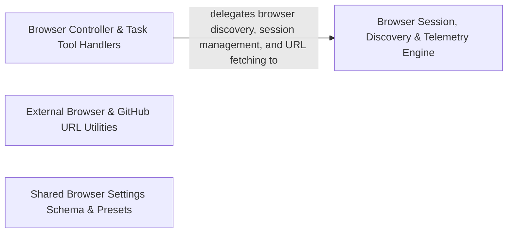

## Details

Manages headless and remote browser sessions, browser action tool execution, URL content fetching, and central telemetry event dispatching.

### Browser Controller & Task Tool Handlers
Provides controller endpoints, task tool adapters, and URL mention handlers that orchestrate browser discovery, connection testing, settings updates, and automated browser actions.

**Related Classes/Methods**:

- `src.core.controller.browser.discoverBrowser.discoverBrowser`:16-51
- `src.core.controller.browser.getBrowserConnectionInfo.getBrowserConnectionInfo`:12-47
- `src.core.controller.web.openInBrowser.openInBrowser`:12-22

**Source Files:**

- `src/core/controller/browser/discoverBrowser.ts`
  - `src.core.controller.browser.discoverBrowser.discoverBrowser` (L16-L51) - Function
- `src/core/controller/browser/getBrowserConnectionInfo.ts`
  - `src.core.controller.browser.getBrowserConnectionInfo.getBrowserConnectionInfo` (L12-L47) - Function
- `src/core/controller/browser/getDetectedChromePath.ts`
  - `src.core.controller.browser.getDetectedChromePath.getDetectedChromePath` (L13-L29) - Function
- `src/core/controller/browser/relaunchChromeDebugMode.ts`
  - `src.core.controller.browser.relaunchChromeDebugMode.relaunchChromeDebugMode` (L12-L25) - Function
- `src/core/controller/browser/testBrowserConnection.ts`
  - `src.core.controller.browser.testBrowserConnection.testBrowserConnection` (L14-L61) - Function
- `src/core/controller/state/settingsBrowser.ts`
  - `src.core.controller.state.settingsBrowser.buildBrowserSettingsWebview` (L6-L26) - Function
  - `src.core.controller.state.settingsBrowser.mergeBrowserSettingsWebview` (L29-L32) - Function
  - `src.core.controller.state.settingsBrowser.mergeBrowserSettingsCli` (L35-L51) - Function
- `src/core/controller/state/updateTaskSettings.ts`
  - `src.core.controller.state.updateTaskSettings.convertPlanActMode` (L11-L13) - Function
  - `src.core.controller.state.updateTaskSettings.resolveTaskId` (L16-L20) - Function
  - `src.core.controller.state.updateTaskSettings.mergeAutoApprovalSettings` (L22-L43) - Function
  - `src.core.controller.state.updateTaskSettings.mergeBrowserSettings` (L45-L64) - Function
  - `src.core.controller.state.updateTaskSettings.prepareTaskSettings` (L73-L119) - Function
  - `src.core.controller.state.updateTaskSettings.prepareTaskSettings.simpleSettings.filter() callback` (L96-L96) - Function
  - `src.core.controller.state.updateTaskSettings.persistTaskSettings` (L121-L147) - Function
  - `src.core.controller.state.updateTaskSettings.persistTaskSettings.ownedValues` (L135-L137) - Class
  - `src.core.controller.state.updateTaskSettings.persistTaskSettings.ownedValues.keys.filter() callback` (L136-L136) - Function
  - `src.core.controller.state.updateTaskSettings.persistTaskSettings.ownedValues.map() callback` (L136-L136) - Function
  - `src.core.controller.state.updateTaskSettings.updateTaskSettings` (L150-L166) - Function
- `src/core/controller/web/openInBrowser.ts`
  - `src.core.controller.web.openInBrowser.openInBrowser` (L12-L22) - Function
- `src/core/mentions/url-mention.ts`
  - `src.core.mentions.url-mention.findUrlMention` (L7-L9) - Function
  - `src.core.mentions.url-mention.findUrlMention.find() callback` (L8-L8) - Function
  - `src.core.mentions.url-mention.tryLaunchBrowser` (L11-L22) - Function
  - `src.core.mentions.url-mention.tryCloseBrowser` (L24-L30) - Function
  - `src.core.mentions.url-mention.expandUrlMention` (L32-L40) - Function
  - `src.core.mentions.url-mention.resolveUrlContent` (L42-L59) - Function
- `src/core/task/tools/adapters/traits/BrowserTraitBuilder.ts`
  - `src.core.task.tools.adapters.traits.BrowserTraitBuilder.buildBrowserTrait` (L5-L19) - Function
  - `src.core.task.tools.adapters.traits.BrowserTraitBuilder.buildBrowserTrait.launch` (L8-L12) - Method
  - `src.core.task.tools.adapters.traits.BrowserTraitBuilder.buildBrowserTrait.click` (L13-L13) - Method
  - `src.core.task.tools.adapters.traits.BrowserTraitBuilder.buildBrowserTrait.type` (L14-L14) - Method
  - `src.core.task.tools.adapters.traits.BrowserTraitBuilder.buildBrowserTrait.scroll` (L15-L16) - Method
  - `src.core.task.tools.adapters.traits.BrowserTraitBuilder.buildBrowserTrait.close` (L17-L17) - Method
- `src/core/task/tools/modules/browser_action/BrowserActionTool.ts`
  - `src.core.task.tools.modules.browser_action.BrowserActionTool.BrowserActionTool` (L47-L241) - Class
  - `src.core.task.tools.modules.browser_action.BrowserActionTool.BrowserActionTool.spec` (L48-L50) - Method
  - `src.core.task.tools.modules.browser_action.BrowserActionTool.BrowserActionTool.supportedSurfaces` (L52-L54) - Method
  - `src.core.task.tools.modules.browser_action.BrowserActionTool.BrowserActionTool.processCall` (L56-L149) - Method
  - `src.core.task.tools.modules.browser_action.BrowserActionTool.BrowserActionTool.resolveLaunchPermission` (L151-L158) - Method
  - `src.core.task.tools.modules.browser_action.BrowserActionTool.BrowserActionTool.reportMissingActionParameter` (L160-L165) - Method
  - `src.core.task.tools.modules.browser_action.BrowserActionTool.BrowserActionTool.reportMissingUrlParameter` (L167-L176) - Method
  - `src.core.task.tools.modules.browser_action.BrowserActionTool.BrowserActionTool.reportMissingCoordinateParameter` (L178-L187) - Method
  - `src.core.task.tools.modules.browser_action.BrowserActionTool.BrowserActionTool.reportMissingTextParameter` (L189-L198) - Method
  - `src.core.task.tools.modules.browser_action.BrowserActionTool.BrowserActionTool.formatLaunchDenialResponse` (L200-L208) - Method
  - `src.core.task.tools.modules.browser_action.BrowserActionTool.BrowserActionTool.formatBrowserActionResult` (L210-L231) - Method
  - `src.core.task.tools.modules.browser_action.BrowserActionTool.BrowserActionTool.abortBrowserWithError` (L233-L240) - Method
- `src/core/task/tools/modules/browser_action/tool.ts`
  - `src.core.task.tools.modules.browser_action.tool.create` (L7-L9) - Function

### Browser Session, Discovery & Telemetry Engine
Manages Chrome instance discovery, remote and local browser sessions, URL content fetching, and associated telemetry reporting.

**Related Classes/Methods**:

- `src.services.browser.BrowserDiscovery.discoverChromeInstances`:59-72
- `src.services.browser.BrowserSession.BrowserSession`:21-270
- `src.services.browser.BrowserSession.BrowserSession.testConnection`:33-35

**Source Files:**

- `src/services/browser/BrowserConnectionManager.ts`
  - `src.services.browser.BrowserConnectionManager.BrowserConnectionInfo` (L18-L22) - Interface
  - `src.services.browser.BrowserConnectionManager.splitArgs` (L27-L32) - Function
  - `src.services.browser.BrowserConnectionManager.splitArgs.map() callback` (L31-L31) - Function
  - `src.services.browser.BrowserConnectionManager.BrowserConnectionManager` (L39-L393) - Class
  - `src.services.browser.BrowserConnectionManager.BrowserConnectionManager.constructor` (L50-L50) - Constructor
  - `src.services.browser.BrowserConnectionManager.BrowserConnectionManager.browserSettings` (L52-L58) - Method
  - `src.services.browser.BrowserConnectionManager.BrowserConnectionManager.getPage` (L62-L64) - Method
  - `src.services.browser.BrowserConnectionManager.BrowserConnectionManager.setPage` (L66-L68) - Method
  - `src.services.browser.BrowserConnectionManager.BrowserConnectionManager.getBrowser` (L70-L72) - Method
  - `src.services.browser.BrowserConnectionManager.BrowserConnectionManager.getIsConnectedToRemote` (L74-L76) - Method
  - `src.services.browser.BrowserConnectionManager.BrowserConnectionManager.getUlid` (L78-L80) - Method
  - `src.services.browser.BrowserConnectionManager.BrowserConnectionManager.setUlid` (L82-L84) - Method
  - `src.services.browser.BrowserConnectionManager.BrowserConnectionManager.trackAction` (L87-L89) - Method
  - `src.services.browser.BrowserConnectionManager.BrowserConnectionManager.getLastAction` (L91-L93) - Method
  - `src.services.browser.BrowserConnectionManager.BrowserConnectionManager.getConnectionInfo` (L97-L105) - Method
  - `src.services.browser.BrowserConnectionManager.BrowserConnectionManager.testConnection` (L109-L111) - Method
  - `src.services.browser.BrowserConnectionManager.BrowserConnectionManager.getDetectedChromePath` (L113-L137) - Method
  - `src.services.browser.BrowserConnectionManager.BrowserConnectionManager.relaunchChromeDebugMode` (L139-L188) - Method
  - `src.services.browser.BrowserConnectionManager.BrowserConnectionManager.launchBrowser` (L192-L233) - Method
  - `src.services.browser.BrowserConnectionManager.BrowserConnectionManager.launchLocalBrowser` (L235-L249) - Method
  - `src.services.browser.BrowserConnectionManager.BrowserConnectionManager.launchRemoteBrowser` (L251-L352) - Method
  - `src.services.browser.BrowserConnectionManager.BrowserConnectionManager.closeBrowser` (L356-L388) - Method
  - `src.services.browser.BrowserConnectionManager.closeBrowser.catch() callback` (L370-L370) - Function
  - `src.services.browser.BrowserConnectionManager.BrowserConnectionManager.closeBrowser.catch() callback` (L376-L376) - Function
  - `src.services.browser.BrowserConnectionManager.BrowserConnectionManager.dispose` (L390-L392) - Method
- `src/services/browser/BrowserDiscovery.ts`
  - `src.services.browser.BrowserDiscovery.isPortOpen` (L9-L41) - Function
  - `src.services.browser.BrowserDiscovery.isPortOpen.<function>` (L10-L40) - Function
  - `src.services.browser.BrowserDiscovery.isPortOpen.<function>.socket.on("connect") callback` (L18-L21) - Function
  - `src.services.browser.BrowserDiscovery.isPortOpen.<function>.socket.on("error") callback` (L24-L26) - Function
  - `src.services.browser.BrowserDiscovery.isPortOpen.<function>.socket.on("timeout") callback` (L29-L31) - Function
  - `src.services.browser.BrowserDiscovery.isPortOpen.<function>.socket.on("close") callback` (L34-L36) - Function
  - `src.services.browser.BrowserDiscovery.tryConnect` (L46-L54) - Function
  - `src.services.browser.BrowserDiscovery.discoverChromeInstances` (L59-L72) - Function
  - `src.services.browser.BrowserDiscovery.testBrowserConnection` (L77-L104) - Function
- `src/services/browser/BrowserSession.ts`
  - `src.services.browser.BrowserSession.BrowserSession` (L21-L270) - Class
  - `src.services.browser.BrowserSession.BrowserSession.constructor` (L26-L29) - Constructor
  - `src.services.browser.BrowserSession.BrowserSession.testConnection` (L33-L35) - Method
  - `src.services.browser.BrowserSession.BrowserSession.getConnectionInfo` (L37-L39) - Method
  - `src.services.browser.BrowserSession.BrowserSession.getDetectedChromePath` (L41-L43) - Method
  - `src.services.browser.BrowserSession.BrowserSession.relaunchChromeDebugMode` (L45-L47) - Method
  - `src.services.browser.BrowserSession.BrowserSession.launchBrowser` (L49-L51) - Method
  - `src.services.browser.BrowserSession.BrowserSession.launchLocalBrowser` (L53-L55) - Method
  - `src.services.browser.BrowserSession.BrowserSession.launchRemoteBrowser` (L57-L59) - Method
  - `src.services.browser.BrowserSession.BrowserSession.closeBrowser` (L61-L68) - Method
  - `src.services.browser.BrowserSession.BrowserSession.dispose` (L70-L72) - Method
  - `src.services.browser.BrowserSession.BrowserSession.setUlid` (L74-L76) - Method
  - `src.services.browser.BrowserSession.BrowserSession.executePageAction` (L80-L167) - Method
  - `src.services.browser.BrowserSession.BrowserSession.executePageAction.pWaitFor() callback` (L129-L129) - Function
  - `src.services.browser.BrowserSession.BrowserSession.executePageAction.catch() callback` (L132-L132) - Function
  - `src.services.browser.BrowserSession.BrowserSession.navigateToUrl` (L169-L179) - Method
  - `src.services.browser.BrowserSession.BrowserSession.navigateToUrl.executePageAction() callback` (L171-L178) - Function
  - `src.services.browser.BrowserSession.BrowserSession.waitTillHTMLStable` (L183-L210) - Method
  - `src.services.browser.BrowserSession.BrowserSession.click` (L212-L242) - Method
  - `src.services.browser.BrowserSession.BrowserSession.click.executePageAction() callback` (L215-L241) - Function
  - `src.services.browser.BrowserSession.BrowserSession.click.executePageAction() callback.catch() callback` (L235-L235) - Function
  - `src.services.browser.BrowserSession.BrowserSession.type` (L244-L249) - Method
  - `src.services.browser.BrowserSession.BrowserSession.type.executePageAction() callback` (L246-L248) - Function
  - `src.services.browser.BrowserSession.BrowserSession.scrollDown` (L251-L259) - Method
  - `src.services.browser.BrowserSession.BrowserSession.scrollDown.executePageAction() callback` (L253-L258) - Function
  - `src.services.browser.BrowserSession.BrowserSession.scrollDown.executePageAction() callback.page.evaluate() callback` (L254-L256) - Function
  - `src.services.browser.BrowserSession.BrowserSession.scrollUp` (L261-L269) - Method
  - `src.services.browser.BrowserSession.BrowserSession.scrollUp.executePageAction() callback` (L263-L268) - Function
  - `src.services.browser.BrowserSession.BrowserSession.scrollUp.executePageAction() callback.page.evaluate() callback` (L264-L266) - Function
- `src/services/browser/UrlContentFetcher.ts`
  - `src.services.browser.UrlContentFetcher.UrlContentFetcher` (L7-L67) - Class
  - `src.services.browser.UrlContentFetcher.UrlContentFetcher.constructor` (L11-L13) - Constructor
  - `src.services.browser.UrlContentFetcher.UrlContentFetcher.launchBrowser` (L15-L33) - Method
  - `src.services.browser.UrlContentFetcher.UrlContentFetcher.closeBrowser` (L35-L39) - Method
  - `src.services.browser.UrlContentFetcher.UrlContentFetcher.urlToMarkdown` (L42-L66) - Method
- `src/services/browser/utils.ts`
  - `src.services.browser.utils.PCRStats` (L9-L12) - Interface
  - `src.services.browser.utils.ensureChromiumExists` (L14-L26) - Function
- `src/services/telemetry/BrowserTelemetry.ts`
  - `src.services.telemetry.BrowserTelemetry.BrowserTelemetry` (L10-L70) - Class
  - `src.services.telemetry.BrowserTelemetry.BrowserTelemetry.constructor` (L13-L16) - Constructor
  - `src.services.telemetry.BrowserTelemetry.BrowserTelemetry.captureBrowserToolStart` (L18-L32) - Method
  - `src.services.telemetry.BrowserTelemetry.BrowserTelemetry.captureBrowserToolEnd` (L34-L48) - Method
  - `src.services.telemetry.BrowserTelemetry.BrowserTelemetry.captureBrowserError` (L50-L69) - Method
- `src/services/telemetry/TelemetryService.ts`
  - `src.services.telemetry.TelemetryService.TelemetryService` (L48-L397) - Class
  - `src.services.telemetry.TelemetryService.TelemetryService.create` (L69-L81) - Method
  - `src.services.telemetry.TelemetryService.TelemetryService.constructor` (L83-L102) - Constructor
  - `src.services.telemetry.TelemetryService.TelemetryService.captureUserOptOut` (L107-L109) - Method
  - `src.services.telemetry.TelemetryService.TelemetryService.captureUserOptIn` (L110-L112) - Method
  - `src.services.telemetry.TelemetryService.TelemetryService.captureExtensionActivated` (L113-L115) - Method
  - `src.services.telemetry.TelemetryService.TelemetryService.captureExtensionStorageError` (L116-L118) - Method
  - `src.services.telemetry.TelemetryService.TelemetryService.captureAuthStarted` (L119-L121) - Method
  - `src.services.telemetry.TelemetryService.TelemetryService.captureAuthSucceeded` (L122-L124) - Method
  - `src.services.telemetry.TelemetryService.TelemetryService.captureAuthFailed` (L125-L127) - Method
  - `src.services.telemetry.TelemetryService.TelemetryService.captureAuthLoggedOut` (L128-L130) - Method
  - `src.services.telemetry.TelemetryService.TelemetryService.captureOnboardingProgress` (L131-L133) - Method
  - `src.services.telemetry.TelemetryService.TelemetryService.identifyAccount` (L134-L136) - Method
  - `src.services.telemetry.TelemetryService.TelemetryService.captureTaskCreated` (L138-L140) - Method
  - `src.services.telemetry.TelemetryService.TelemetryService.captureTaskRestarted` (L141-L143) - Method
  - `src.services.telemetry.TelemetryService.TelemetryService.captureTaskCompleted` (L144-L146) - Method
  - `src.services.telemetry.TelemetryService.TelemetryService.captureConversationTurnEvent` (L147-L149) - Method
  - `src.services.telemetry.TelemetryService.TelemetryService.captureTokenUsage` (L150-L152) - Method
  - `src.services.telemetry.TelemetryService.TelemetryService.captureModeSwitch` (L153-L155) - Method
  - `src.services.telemetry.TelemetryService.TelemetryService.captureCondense` (L156-L158) - Method
  - `src.services.telemetry.TelemetryService.TelemetryService.captureTaskFeedback` (L159-L161) - Method
  - `src.services.telemetry.TelemetryService.TelemetryService.captureTaskInitialization` (L162-L164) - Method
  - `src.services.telemetry.TelemetryService.TelemetryService.captureOptionSelected` (L165-L167) - Method
  - `src.services.telemetry.TelemetryService.TelemetryService.captureOptionsIgnored` (L168-L170) - Method
  - `src.services.telemetry.TelemetryService.TelemetryService.captureSlashCommandUsed` (L171-L173) - Method
  - `src.services.telemetry.TelemetryService.TelemetryService.captureFeatureToggle` (L174-L176) - Method
  - `src.services.telemetry.TelemetryService.TelemetryService.captureDiracRuleToggled` (L177-L179) - Method
  - `src.services.telemetry.TelemetryService.TelemetryService.captureAutoCondenseToggle` (L180-L182) - Method
  - `src.services.telemetry.TelemetryService.TelemetryService.captureYoloModeToggle` (L183-L185) - Method
  - `src.services.telemetry.TelemetryService.TelemetryService.captureDiracWebToolsToggle` (L186-L188) - Method
  - `src.services.telemetry.TelemetryService.TelemetryService.captureToolUsage` (L190-L192) - Method
  - `src.services.telemetry.TelemetryService.TelemetryService.captureSkillUsed` (L193-L195) - Method
  - `src.services.telemetry.TelemetryService.TelemetryService.captureCheckpointUsage` (L196-L198) - Method
  - `src.services.telemetry.TelemetryService.TelemetryService.captureProviderApiError` (L199-L201) - Method
  - `src.services.telemetry.TelemetryService.TelemetryService.captureGeminiApiPerformance` (L202-L204) - Method
  - `src.services.telemetry.TelemetryService.TelemetryService.captureAiOutputAccepted` (L205-L207) - Method
  - `src.services.telemetry.TelemetryService.TelemetryService.captureAiOutputRejected` (L208-L210) - Method
  - `src.services.telemetry.TelemetryService.TelemetryService.captureModelSelected` (L212-L214) - Method
  - `src.services.telemetry.TelemetryService.TelemetryService.captureModelFavoritesUsage` (L215-L217) - Method
  - `src.services.telemetry.TelemetryService.TelemetryService.captureButtonClick` (L218-L220) - Method
  - `src.services.telemetry.TelemetryService.TelemetryService.captureRulesMenuOpened` (L221-L223) - Method
  - `src.services.telemetry.TelemetryService.TelemetryService.captureBrowserToolStart` (L225-L227) - Method
  - `src.services.telemetry.TelemetryService.TelemetryService.captureBrowserToolEnd` (L228-L230) - Method
  - `src.services.telemetry.TelemetryService.TelemetryService.captureBrowserError` (L231-L233) - Method
  - `src.services.telemetry.TelemetryService.TelemetryService.captureMentionUsed` (L235-L237) - Method
  - `src.services.telemetry.TelemetryService.TelemetryService.captureMentionFailed` (L238-L240) - Method
  - `src.services.telemetry.TelemetryService.TelemetryService.captureMentionSearchResults` (L241-L243) - Method
  - `src.services.telemetry.TelemetryService.TelemetryService.captureWorkspaceInitialized` (L245-L247) - Method
  - `src.services.telemetry.TelemetryService.TelemetryService.captureWorkspaceInitError` (L248-L250) - Method
  - `src.services.telemetry.TelemetryService.TelemetryService.captureMultiRootCheckpoint` (L251-L253) - Method
  - `src.services.telemetry.TelemetryService.TelemetryService.captureWorkspacePathResolved` (L254-L256) - Method
  - `src.services.telemetry.TelemetryService.TelemetryService.captureWorkspaceSearchPattern` (L257-L259) - Method
  - `src.services.telemetry.TelemetryService.TelemetryService.captureWorktreeViewOpened` (L260-L262) - Method
  - `src.services.telemetry.TelemetryService.TelemetryService.captureWorktreeCreated` (L263-L265) - Method
  - `src.services.telemetry.TelemetryService.TelemetryService.captureWorktreeMergeAttempted` (L266-L268) - Method
  - `src.services.telemetry.TelemetryService.TelemetryService.captureTerminalOutputFailure` (L270-L272) - Method
  - `src.services.telemetry.TelemetryService.TelemetryService.captureTerminalUserIntervention` (L273-L275) - Method
  - `src.services.telemetry.TelemetryService.TelemetryService.captureTerminalHang` (L276-L278) - Method
  - `src.services.telemetry.TelemetryService.TelemetryService.captureSubagentToggle` (L280-L282) - Method
  - `src.services.telemetry.TelemetryService.TelemetryService.captureSubagentExecution` (L283-L285) - Method
  - `src.services.telemetry.TelemetryService.TelemetryService.captureHookCacheAccess` (L287-L289) - Method
  - `src.services.telemetry.TelemetryService.TelemetryService.captureHookExecution` (L290-L292) - Method
  - `src.services.telemetry.TelemetryService.TelemetryService.captureHookDiscovery` (L293-L295) - Method
  - `src.services.telemetry.TelemetryService.TelemetryService.addProvider` (L299-L301) - Method
  - `src.services.telemetry.TelemetryService.TelemetryService.removeProvider` (L303-L305) - Method
  - `src.services.telemetry.TelemetryService.TelemetryService.updateTelemetryState` (L307-L321) - Method
  - `src.services.telemetry.TelemetryService.TelemetryService.updateTelemetryState.then() callback` (L317-L320) - Function
  - `src.services.telemetry.TelemetryService.TelemetryService.capture` (L323-L325) - Method
  - `src.services.telemetry.TelemetryService.TelemetryService.captureRequired` (L327-L329) - Method
  - `src.services.telemetry.TelemetryService.TelemetryService.isCategoryEnabled` (L331-L333) - Method
  - `src.services.telemetry.TelemetryService.TelemetryService.getProviders` (L335-L337) - Method
  - `src.services.telemetry.TelemetryService.TelemetryService.isEnabled` (L339-L341) - Method
  - `src.services.telemetry.TelemetryService.TelemetryService.getSettings` (L343-L345) - Method
  - `src.services.telemetry.TelemetryService.TelemetryService.captureHostEvent` (L347-L349) - Method
  - `src.services.telemetry.TelemetryService.TelemetryService.captureGrpcResponseSize` (L351-L366) - Method
  - `src.services.telemetry.TelemetryService.TelemetryService.safeCapture` (L368-L374) - Method
  - `src.services.telemetry.TelemetryService.TelemetryService.dispose` (L376-L378) - Method
  - `src.services.telemetry.TelemetryService.captureTerminalExecution` (L382-L382) - Method
  - `src.services.telemetry.TelemetryService.TelemetryService.captureTerminalExecution` (L389-L396) - Method

### External Browser & GitHub URL Utilities
Provides utility functions for launching external browsers and constructing and opening encoded GitHub issue URLs.

**Related Classes/Methods**:

- `src.utils.open-browser.openBrowser`:2-29
- `src.utils.github-url-utils.createGitHubIssueUrl`:46-62
- `src.utils.github-url-utils.openUrlInBrowser`:73-112

**Source Files:**

- `src/utils/github-url-utils.ts`
  - `src.utils.github-url-utils.isValidHttpUrl` (L19-L26) - Function
  - `src.utils.github-url-utils.createGitHubIssueUrl` (L46-L62) - Function
  - `src.utils.github-url-utils.openUrlInBrowser` (L73-L112) - Function
  - `src.utils.github-url-utils.openUrlInBrowser.then() callback` (L103-L107) - Function
  - `src.utils.github-url-utils.openUrlInBrowser.catch() callback` (L108-L110) - Function
  - `src.utils.github-url-utils.createAndOpenGitHubIssue` (L132-L149) - Function
- `src/utils/open-browser.ts`
  - `src.utils.open-browser.openBrowser` (L2-L29) - Function
  - `src.utils.open-browser.openBrowser.<function>` (L7-L28) - Function
  - `src.utils.open-browser.openBrowser.<function>.onSpawn` (L17-L19) - Class
  - `src.utils.open-browser.openBrowser.<function>.onSpawn.setTimeout() callback` (L18-L18) - Function

### Shared Browser Settings Schema & Presets
Defines shared TypeScript interfaces, default configuration values, and viewport presets for browser automation settings.

**Related Classes/Methods**:

- `src.shared.BrowserSettings.BrowserSettings`:1-14

**Source Files:**

- `src/shared/BrowserSettings.ts`
  - `src.shared.BrowserSettings.BrowserSettings` (L1-L14) - Interface

### [FAQ](https://github.com/CodeBoarding/GeneratedOnBoardings/tree/main?tab=readme-ov-file#faq)