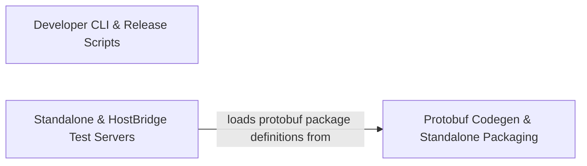

## Details

Contains build, protobuf generation, packaging, prompt inspection, and AST utility scripts for development and CI workflows.

### Developer CLI & Release Scripts
Provides developer CLI utilities, asset downloaders, release automation, and code inspection scripts.

**Related Classes/Methods**: _None_

**Source Files:**

- `scripts/api-secrets-parser.mjs`
  - `scripts.api-secrets-parser.parseApiHandlerSecrets` (L18-L47) - Function
  - `scripts.api-secrets-parser.mapProviderToApiKeys` (L64-L96) - Function
  - `scripts.api-secrets-parser.extractProviderFromFieldName` (L105-L195) - Function
  - `scripts.api-secrets-parser.normalizeProviderName` (L203-L223) - Function
  - `scripts.api-secrets-parser.applySpecialCaseMappings` (L232-L260) - Function
  - `scripts.api-secrets-parser.generateApiKeyDisplayName` (L268-L315) - Function
  - `scripts.api-secrets-parser.generateApiKeyDisplayName.replace() callback` (L313-L313) - Function
  - `scripts.api-secrets-parser.validateApiKeyMappings` (L324-L347) - Function
- `scripts/check-arch-graph.mjs`
  - `scripts.check-arch-graph.sccLabels` (L40-L101) - Function
  - `scripts.check-arch-graph.sccLabels.local` (L41-L45) - Class
  - `scripts.check-arch-graph.sccLabels.local.reportJson.modules.filter() callback` (L43-L43) - Function
  - `scripts.check-arch-graph.sccLabels.local.map() callback` (L44-L44) - Function
  - `scripts.check-arch-graph.sccLabels.filter() callback` (L48-L48) - Function
  - `scripts.check-arch-graph.sccLabels.m.dependencies.map() callback` (L48-L48) - Function
  - `scripts.check-arch-graph.readSccBaseline` (L105-L126) - Function
  - `scripts.check-arch-graph.writeSccBaseline` (L128-L141) - Function
  - `scripts.check-arch-graph.blocks.map() callback` (L134-L134) - Function
  - `scripts.check-arch-graph.writeSccBaseline.blocks` (L134-L134) - Class
  - `scripts.check-arch-graph.writeSccBaseline.blocks.sort() callback` (L134-L134) - Function
  - `scripts.check-arch-graph.writeSccBaseline.blocks.map() callback` (L139-L139) - Function
  - `scripts.check-arch-graph.collectViolations` (L146-L157) - Function
  - `scripts.check-arch-graph.boundaryViolations` (L165-L165) - Class
  - `scripts.check-arch-graph.boundaryViolations.violations.filter() callback` (L165-L165) - Function
  - `scripts.check-arch-graph.newCyclic` (L193-L193) - Class
  - `scripts.check-arch-graph.newCyclic.filter() callback` (L193-L193) - Function
  - `scripts.check-arch-graph.merges` (L207-L207) - Class
  - `scripts.check-arch-graph.merges.filter() callback` (L207-L207) - Function
  - `scripts.check-arch-graph.newViolations` (L215-L215) - Class
  - `scripts.check-arch-graph.newViolations.violations.filter() callback` (L215-L215) - Function
- `scripts/copy-source.mjs`
  - `scripts.copy-source.generateTree` (L84-L100) - Function
  - `scripts.copy-source.generateTree.dirs` (L89-L92) - Class
  - `scripts.copy-source.generateTree.dirs.entries.filter() callback` (L90-L90) - Function
  - `scripts.copy-source.generateTree.dirs.map() callback` (L91-L91) - Function
  - `scripts.copy-source.generateTree.dirs.forEach() callback` (L94-L98) - Function
  - `scripts.copy-source.copySourceCode` (L107-L153) - Function
  - `scripts.copy-source.copySourceCode.SOURCE_COPY_CONFIG.includeFolders.forEach() callback` (L116-L148) - Function
  - `scripts.copy-source.copySourceCode.SOURCE_COPY_CONFIG.includeFolders.forEach() callback.SOURCE_COPY_CONFIG.excludePatterns.some() callback` (L135-L135) - Function
  - `scripts.copy-source.copySourceCode.SOURCE_COPY_CONFIG.includeFolders.forEach() callback.filter` (L141-L144) - Method
  - `scripts.copy-source.copySourceCode.SOURCE_COPY_CONFIG.includeFolders.forEach() callback.filter.SOURCE_COPY_CONFIG.excludePatterns.some() callback` (L143-L143) - Function
- `scripts/download-ripgrep.mjs`
  - `scripts.download-ripgrep.downloadFile` (L66-L100) - Function
  - `scripts.download-ripgrep.downloadFile.<function>` (L67-L99) - Function
  - `scripts.download-ripgrep.downloadFile.<function>.https.get() callback` (L72-L89) - Function
  - `scripts.download-ripgrep.downloadFile.<function>.https.get() callback.file.on("finish") callback` (L85-L88) - Function
  - `scripts.download-ripgrep.downloadFile.<function>.on("error") callback` (L90-L93) - Function
  - `scripts.download-ripgrep.downloadFile.<function>.on("error") callback.fs.unlink() callback` (L91-L91) - Function
  - `scripts.download-ripgrep.downloadFile.<function>.file.on("error") callback` (L95-L98) - Function
  - `scripts.download-ripgrep.downloadFile.<function>.file.on("error") callback.fs.unlink() callback` (L96-L96) - Function
  - `scripts.download-ripgrep.extractTarGz` (L105-L116) - Function
  - `scripts.download-ripgrep.extractZip` (L121-L160) - Function
  - `scripts.download-ripgrep.extractZip.extractedDir` (L130-L130) - Class
  - `scripts.download-ripgrep.extractZip.extractedDir.items.find() callback` (L130-L130) - Function
  - `scripts.download-ripgrep.downloadRipgrepForPlatform` (L165-L208) - Function
  - `scripts.download-ripgrep.main` (L213-L256) - Function
  - `scripts.download-ripgrep.catch() callback` (L259-L262) - Function
- `scripts/extract-definition.ts`
  - `scripts.extract-definition.extractDefinition` (L5-L46) - Function
  - `scripts.extract-definition.extractDefinition.nameCapture` (L26-L26) - Class
  - `scripts.extract-definition.extractDefinition.nameCapture.match.captures.find() callback` (L26-L26) - Function
  - `scripts.extract-definition.extractDefinition.defCapture` (L27-L27) - Class
  - `scripts.extract-definition.extractDefinition.defCapture.match.captures.find() callback` (L27-L27) - Function
  - `scripts.extract-definition.main` (L48-L81) - Function
  - `scripts.extract-definition.catch() callback` (L83-L86) - Function
- `scripts/find-references.ts`
  - `scripts.find-references.findReferencesInFile` (L5-L47) - Function
  - `scripts.find-references.main` (L49-L119) - Function
  - `scripts.find-references.main.entries.filter() callback` (L66-L66) - Function
  - `scripts.find-references.main.map() callback` (L66-L66) - Function
  - `scripts.find-references.main.filesToScan` (L91-L91) - Class
  - `scripts.find-references.main.filesToScan.files.filter() callback` (L91-L91) - Function
  - `scripts.find-references.catch() callback` (L121-L124) - Function
- `scripts/generate-tool-barrel.ts`
  - `scripts.generate-tool-barrel.entries` (L7-L11) - Class
  - `scripts.generate-tool-barrel.entries.filter() callback` (L9-L9) - Function
  - `scripts.generate-tool-barrel.entries.map() callback` (L10-L10) - Function
  - `scripts.generate-tool-barrel.lines` (L13-L19) - Class
  - `scripts.generate-tool-barrel.lines.entries.map() callback` (L17-L17) - Function
- `scripts/interactive-playwright.ts`
  - `scripts.interactive-playwright.main` (L38-L107) - Function
  - `scripts.interactive-playwright.main.teardown` (L78-L88) - Function
  - `scripts.interactive-playwright.main.process.on("SIGINT") callback` (L90-L93) - Function
  - `scripts.interactive-playwright.main.process.on("SIGTERM") callback` (L95-L98) - Function
  - `scripts.interactive-playwright.main.win.on("close") callback` (L101-L105) - Function
  - `scripts.interactive-playwright.catch() callback` (L109-L112) - Function
- `scripts/prepare-extension-ripgrep-binaries.mjs`
  - `scripts.prepare-extension-ripgrep-binaries.main` (L38-L49) - Function
  - `scripts.prepare-extension-ripgrep-binaries.downloadAndExtractRipgrep` (L51-L70) - Function
  - `scripts.prepare-extension-ripgrep-binaries.extractTarBinary` (L72-L82) - Function
  - `scripts.prepare-extension-ripgrep-binaries.extractTarBinary.filter` (L79-L79) - Method
  - `scripts.prepare-extension-ripgrep-binaries.downloadFile` (L84-L90) - Function
  - `scripts.prepare-extension-ripgrep-binaries.catch() callback` (L92-L95) - Function
- `scripts/print-prompt.ts`
  - `scripts.print-prompt.main` (L4-L27) - Function
- `scripts/publish-nightly.mjs`
  - `scripts.publish-nightly.log` (L49-L53) - Class
  - `scripts.publish-nightly.log.info` (L50-L50) - Method
  - `scripts.publish-nightly.log.warn` (L51-L51) - Method
  - `scripts.publish-nightly.log.error` (L52-L52) - Method
  - `scripts.publish-nightly.config` (L56-L83) - Class
  - `scripts.publish-nightly.config.packageJsonPath` (L62-L64) - Method
  - `scripts.publish-nightly.config.packageBackupPath` (L65-L67) - Method
  - `scripts.publish-nightly.config.distDir` (L68-L70) - Method
  - `scripts.publish-nightly.config.vsixPath` (L71-L73) - Method
  - `scripts.publish-nightly.config.nodeModulesPath` (L74-L76) - Method
  - `scripts.publish-nightly.config.originalWorkspaceLinkPath` (L77-L79) - Method
  - `scripts.publish-nightly.config.nightlyWorkspaceLinkPath` (L80-L82) - Method
  - `scripts.publish-nightly.NightlyPublisher` (L86-L466) - Class
  - `scripts.publish-nightly.NightlyPublisher.constructor` (L87-L92) - Constructor
  - `scripts.publish-nightly.NightlyPublisher.resolveSymlinkTarget` (L97-L100) - Method
  - `scripts.publish-nightly.NightlyPublisher.isExpectedWorkspaceSelfLink` (L105-L115) - Method
  - `scripts.publish-nightly.NightlyPublisher.checkDependencies` (L120-L143) - Method
  - `scripts.publish-nightly.NightlyPublisher.commandExists` (L148-L155) - Method
  - `scripts.publish-nightly.NightlyPublisher.backupPackageJson` (L160-L169) - Method
  - `scripts.publish-nightly.NightlyPublisher.restorePackageJson` (L174-L181) - Method
  - `scripts.publish-nightly.NightlyPublisher.reconcileWorkspaceSelfLinkForNightly` (L192-L236) - Method
  - `scripts.publish-nightly.NightlyPublisher.restoreWorkspaceSelfLink` (L241-L273) - Method
  - `scripts.publish-nightly.NightlyPublisher.generateVersion` (L279-L291) - Method
  - `scripts.publish-nightly.NightlyPublisher.updatePackageJson` (L296-L324) - Method
  - `scripts.publish-nightly.NightlyPublisher.packageExtension` (L329-L357) - Method
  - `scripts.publish-nightly.NightlyPublisher.publishToVSCodeMarketplace` (L362-L385) - Method
  - `scripts.publish-nightly.NightlyPublisher.publishToOpenVSX` (L390-L412) - Method
  - `scripts.publish-nightly.NightlyPublisher.run` (L417-L465) - Method
  - `scripts.publish-nightly.process.on("exit") callback` (L471-L474) - Function
  - `scripts.publish-nightly.process.on("SIGINT") callback` (L476-L481) - Function
  - `scripts.publish-nightly.process.on("SIGTERM") callback` (L483-L488) - Function
  - `scripts.publish-nightly.catch() callback` (L519-L522) - Function
- `scripts/read-lines.ts`
  - `scripts.read-lines.readLines` (L5-L27) - Function
  - `scripts.read-lines.main` (L29-L86) - Function
  - `scripts.read-lines.catch() callback` (L88-L91) - Function
- `scripts/release-notes.mjs`
  - `scripts.release-notes.fail` (L11-L14) - Function
  - `scripts.release-notes.parseArgs` (L16-L26) - Function
  - `scripts.release-notes.requireOption` (L28-L32) - Function
  - `scripts.release-notes.git` (L34-L36) - Function
  - `scripts.release-notes.readDocument` (L38-L46) - Function
  - `scripts.release-notes.writeDocument` (L48-L53) - Function
  - `scripts.release-notes.parseConventionalCommit` (L55-L68) - Function
  - `scripts.release-notes.generatePatch` (L70-L97) - Function
  - `scripts.release-notes.generatePatch.ordered` (L79-L79) - Class
  - `scripts.release-notes.generatePatch.ordered.CATEGORY_PRIORITY.flatMap() callback` (L79-L79) - Function
  - `scripts.release-notes.generatePatch.ordered.CATEGORY_PRIORITY.flatMap() callback.commits.filter() callback` (L79-L79) - Function
  - `scripts.release-notes.generatePatch.highlights.map() callback` (L80-L85) - Function
  - `scripts.release-notes.highlights` (L80-L85) - Class
  - `scripts.release-notes.validateCommon` (L99-L145) - Function
  - `scripts.release-notes.validateCommon.document.fixes.some() callback` (L142-L142) - Function
  - `scripts.release-notes.commitBelongsToRange` (L147-L160) - Function
  - `scripts.release-notes.validateCurated` (L162-L215) - Function
  - `scripts.release-notes.validateCurated.unexpectedPaths` (L207-L207) - Class
  - `scripts.release-notes.validateCurated.unexpectedPaths.changedPaths.filter() callback` (L207-L207) - Function
  - `scripts.release-notes.validateCurated.unexpectedPaths.map() callback` (L211-L211) - Function
  - `scripts.release-notes.validatePatch` (L217-L264) - Function
  - `scripts.release-notes.validatePatch.unexpectedPaths` (L256-L256) - Class
  - `scripts.release-notes.validatePatch.unexpectedPaths.changedPaths.filter() callback` (L256-L256) - Function
  - `scripts.release-notes.validatePatch.unexpectedPaths.map() callback` (L260-L260) - Function
  - `scripts.release-notes.renderMarkdown` (L266-L290) - Function
  - `scripts.release-notes.renderMarkdown.document.fixes.map() callback` (L286-L286) - Function
- `scripts/report-issue.js`
  - `scripts.report-issue.collectSystemInfo` (L22-L53) - Class
  - `scripts.report-issue.collectSystemInfo.map() callback` (L41-L41) - Function
  - `scripts.report-issue.main` (L117-L138) - Function
  - `scripts.report-issue.catch() callback` (L140-L143) - Function
- `scripts/unbiased-conformance-adapter.ts`
  - `scripts.unbiased-conformance-adapter.adapter` (L9-L27) - Class
  - `scripts.unbiased-conformance-adapter.adapter.start` (L11-L18) - Method
  - `scripts.unbiased-conformance-adapter.adapter.poll` (L19-L26) - Method
- `scripts/vscode-mock.cjs`
  - `scripts.vscode-mock.Module.constructor` (L2-L2) - Constructor
  - `scripts.vscode-mock.mock.workspace.getConfiguration` (L7-L7) - Method
  - `scripts.vscode-mock.mock.workspace.getConfiguration.get` (L7-L7) - Method
  - `scripts.vscode-mock.mock.workspace.onDidChangeConfiguration` (L8-L8) - Method
  - `scripts.vscode-mock.mock.workspace.onDidChangeConfiguration.dispose` (L8-L8) - Method
  - `scripts.vscode-mock.mock.window.showInformationMessage` (L13-L13) - Method
  - `scripts.vscode-mock.mock.window.showErrorMessage` (L14-L14) - Method
  - `scripts.vscode-mock.mock.Uri.file` (L22-L22) - Method
  - `scripts.vscode-mock.mock.Uri.parse` (L23-L23) - Method
  - `scripts.vscode-mock.mock.EventEmitter.fire` (L26-L26) - Method
  - `scripts.vscode-mock.mock.EventEmitter.event.dispose` (L27-L27) - Method
  - `scripts.vscode-mock.mock.Disposable.from` (L29-L29) - Method
  - `scripts.vscode-mock.mock.Disposable.from.dispose` (L29-L29) - Method
  - `scripts.vscode-mock.mock.extensions.getExtension` (L30-L30) - Method
  - `scripts.vscode-mock.mock.commands.executeCommand` (L31-L31) - Method
  - `scripts.vscode-mock.Module` (L36-L41) - Class
  - `scripts.vscode-mock.Module.require` (L36-L41) - Function

### Protobuf Codegen & Standalone Packaging [[Expand]](./Protobuf_Codegen_Standalone_Packaging.md)
Generates Protocol Buffer definitions, host-bridge and protobus client/setup bindings, and standalone distribution packages.

**Related Classes/Methods**:

- `scripts.proto-utils.getPackageDefinition`:26-30

**Source Files:**

- `scripts/build-proto.mjs`
  - `scripts.build-proto.findProtoc` (L16-L37) - Function
  - `scripts.build-proto.main` (L61-L66) - Function
  - `scripts.build-proto.compileProtos` (L67-L106) - Function
  - `scripts.build-proto.tsProtoc` (L108-L126) - Function
  - `scripts.build-proto.tsProtoc.command` (L110-L117) - Class
  - `scripts.build-proto.tsProtoc.command.protoFiles.map() callback` (L116-L116) - Function
  - `scripts.build-proto.cleanup` (L128-L178) - Function
  - `scripts.build-proto.checkAppleSiliconCompatibility` (L181-L208) - Function
  - `scripts.build-proto.log_verbose` (L210-L214) - Function
  - `scripts.build-proto.catch() callback` (L217-L220) - Function
- `scripts/build-python-proto.mjs`
  - `scripts.build-python-proto.hasCommand` (L16-L27) - Function
  - `scripts.build-python-proto.resolvePython` (L29-L52) - Function
  - `scripts.build-python-proto.checkGrpcTools` (L54-L61) - Function
  - `scripts.build-python-proto.ensureDir` (L63-L65) - Function
  - `scripts.build-python-proto.ensureInitPy` (L67-L73) - Function
  - `scripts.build-python-proto.parseServicesWithFiles` (L80-L107) - Function
  - `scripts.build-python-proto.upperFirst` (L109-L111) - Function
  - `scripts.build-python-proto.generateConnectionPy` (L113-L149) - Function
  - `scripts.build-python-proto.generateDiracClientPy` (L151-L228) - Function
  - `scripts.build-python-proto.generateDiracClientPy.initLines` (L166-L170) - Class
  - `scripts.build-python-proto.generateDiracClientPy.initLines.services.map() callback` (L166-L170) - Function
  - `scripts.build-python-proto.generateDiracClientPy.nilLines` (L173-L176) - Class
  - `scripts.build-python-proto.generateDiracClientPy.nilLines.services.map() callback` (L173-L176) - Function
  - `scripts.build-python-proto.generateDiracClientPy.content` (L178-L224) - Class
  - `scripts.build-python-proto.generateDiracClientPy.content.services.map() callback` (L202-L202) - Function
  - `scripts.build-python-proto.generatePythonClient` (L230-L249) - Function
  - `scripts.build-python-proto.generateServiceClientsPy` (L251-L302) - Function
  - `scripts.build-python-proto.generateServiceClientsPy.methodLines` (L263-L286) - Class
  - `scripts.build-python-proto.generateServiceClientsPy.methodLines.s.methods.map() callback` (L264-L285) - Function
  - `scripts.build-python-proto.generatePyproject` (L304-L324) - Function
  - `scripts.build-python-proto.main` (L326-L418) - Function
  - `scripts.build-python-proto.main.cmd` (L374-L379) - Class
  - `scripts.build-python-proto.main.cmd.protoFiles.map() callback` (L379-L379) - Function
  - `scripts.build-python-proto.then() callback` (L397-L397) - Function
  - `scripts.build-python-proto.main.then() callback` (L401-L401) - Function
  - `scripts.build-python-proto.main.catch() callback` (L402-L402) - Function
  - `scripts.build-python-proto.catch() callback` (L421-L424) - Function
- `scripts/build-tests.js`
  - `scripts.build-tests.esbuildProblemMatcherPlugin` (L10-L25) - Class
  - `scripts.build-tests.esbuildProblemMatcherPlugin.setup` (L13-L24) - Method
  - `scripts.build-tests.esbuildProblemMatcherPlugin.setup.build.onStart() callback` (L14-L16) - Function
  - `scripts.build-tests.esbuildProblemMatcherPlugin.setup.build.onEnd() callback` (L17-L23) - Function
  - `scripts.build-tests.esbuildProblemMatcherPlugin.setup.build.onEnd() callback.result.errors.forEach() callback` (L18-L21) - Function
  - `scripts.build-tests.main` (L44-L54) - Function
  - `scripts.build-tests.catch() callback` (L58-L61) - Function
- `scripts/file-utils.mjs`
  - `scripts.file-utils.writeFileWithMkdirs` (L6-L9) - Function
  - `scripts.file-utils.rmrf` (L11-L13) - Function
  - `scripts.file-utils.rmdir` (L18-L27) - Function
- `scripts/generate-host-bridge-client.mjs`
  - `scripts.generate-host-bridge-client.main` (L18-L29) - Function
  - `scripts.generate-host-bridge-client.generateTypesFile` (L34-L49) - Function
  - `scripts.generate-host-bridge-client.generateClientInterfaceType` (L54-L78) - Function
  - `scripts.generate-host-bridge-client.generateClientInterfaceType.methods` (L56-L68) - Class
  - `scripts.generate-host-bridge-client.generateClientInterfaceType.methods.map() callback` (L57-L67) - Function
  - `scripts.generate-host-bridge-client.generateExternalClientFile` (L83-L110) - Function
  - `scripts.generate-host-bridge-client.generateExternalClientSetup` (L115-L170) - Function
  - `scripts.generate-host-bridge-client.generateExternalClientSetup.methods` (L117-L154) - Class
  - `scripts.generate-host-bridge-client.generateExternalClientSetup.methods.map() callback` (L118-L153) - Function
  - `scripts.generate-host-bridge-client.generateVscodeClientFile` (L175-L212) - Function
  - `scripts.generate-host-bridge-client.generateVscodeClientImplementation` (L214-L233) - Function
  - `scripts.generate-host-bridge-client.generateVscodeClientImplementation.methods` (L218-L227) - Class
  - `scripts.generate-host-bridge-client.generateVscodeClientImplementation.methods.map() callback` (L219-L226) - Function
  - `scripts.generate-host-bridge-client.catch() callback` (L237-L240) - Function
- `scripts/generate-protobus-setup.mjs`
  - `scripts.generate-protobus-setup.main` (L15-L27) - Function
  - `scripts.generate-protobus-setup.generateWebviewProtobusClients` (L29-L68) - Function
  - `scripts.generate-protobus-setup.generateVscodeServiceTypes` (L73-L108) - Function
  - `scripts.generate-protobus-setup.generateVscodeProtobusServers` (L113-L144) - Function
  - `scripts.generate-protobus-setup.generateStandaloneProtobusServiceSetup` (L149-L199) - Function
  - `scripts.generate-protobus-setup.getDomainName` (L201-L203) - Function
  - `scripts.generate-protobus-setup.getDirName` (L204-L207) - Function
  - `scripts.generate-protobus-setup.catch() callback` (L211-L214) - Function
- `scripts/generate-state-proto.mjs`
  - `scripts.generate-state-proto.toProtoFieldName` (L25-L27) - Function
  - `scripts.generate-state-proto.toProtoFieldName.str.replace() callback` (L26-L26) - Function
  - `scripts.generate-state-proto.inferProtoType` (L40-L125) - Function
  - `scripts.generate-state-proto.parseSecretsKeys` (L130-L162) - Function
  - `scripts.generate-state-proto.parseFieldDefinitions` (L167-L237) - Function
  - `scripts.generate-state-proto.snakeToCamel` (L242-L244) - Function
  - `scripts.generate-state-proto.snakeToCamel.str.replace() callback` (L243-L243) - Function
  - `scripts.generate-state-proto.normalizePropertyNameForProtoLookup` (L252-L254) - Function
  - `scripts.generate-state-proto.assertNoNormalizedFieldNameCollisions` (L260-L278) - Function
  - `scripts.generate-state-proto.parseProtoMessageFieldNumbers` (L284-L310) - Function
  - `scripts.generate-state-proto.loadFieldNumbersFromProto` (L315-L329) - Function
  - `scripts.generate-state-proto.assignFieldNumbers` (L334-L375) - Function
  - `scripts.generate-state-proto.generateProtoMessage` (L380-L404) - Function
  - `scripts.generate-state-proto.generateProtoMessage.sortedFields` (L384-L384) - Class
  - `scripts.generate-state-proto.generateProtoMessage.sortedFields.sort() callback` (L384-L384) - Function
  - `scripts.generate-state-proto.generateSecretsMessage` (L409-L416) - Function
  - `scripts.generate-state-proto.generateSecretsMessage.fields` (L410-L413) - Class
  - `scripts.generate-state-proto.generateSecretsMessage.fields.secretsKeys.map() callback` (L410-L413) - Function
  - `scripts.generate-state-proto.replaceMessage` (L421-L431) - Function
  - `scripts.generate-state-proto.main` (L433-L478) - Function
  - `scripts.generate-state-proto.main.secretsFieldNumbers` (L455-L459) - Class
  - `scripts.generate-state-proto.main.secretsFieldNumbers.secretsKeys.map() callback` (L456-L456) - Function
  - `scripts.generate-state-proto.catch() callback` (L480-L483) - Function
- `scripts/package-npm.mjs`
  - `scripts.package-npm.main` (L33-L48) - Function
  - `scripts.package-npm.setupEnvironmentVariables` (L50-L59) - Function
  - `scripts.package-npm.cleanBuildDir` (L64-L69) - Function
  - `scripts.package-npm.buildTypeScriptCli` (L74-L86) - Function
  - `scripts.package-npm.copyCliDist` (L91-L112) - Function
  - `scripts.package-npm.copyPackageJson` (L117-L145) - Function
  - `scripts.package-npm.copyReadme` (L150-L168) - Function
  - `scripts.package-npm.createNpmIgnoreFile` (L173-L189) - Function
  - `scripts.package-npm.cpr` (L192-L199) - Function
  - `scripts.package-npm.rmrf` (L202-L207) - Function
  - `scripts.package-npm.log_verbose` (L209-L213) - Function
- `scripts/package-standalone.mjs`
  - `scripts.package-standalone.main` (L31-L40) - Function
  - `scripts.package-standalone.installNodeDependencies` (L42-L51) - Function
  - `scripts.package-standalone.packageAllBinaryDeps` (L60-L102) - Function
  - `scripts.package-standalone.packageAllBinaryDeps.isAllowed` (L63-L63) - Class
  - `scripts.package-standalone.packageAllBinaryDeps.isAllowed.SUPPORTED_BINARY_MODULES.some() callback` (L63-L63) - Function
  - `scripts.package-standalone.packageAllBinaryDeps.blocked` (L64-L64) - Class
  - `scripts.package-standalone.packageAllBinaryDeps.blocked.allNativeModules.filter() callback` (L64-L64) - Function
  - `scripts.package-standalone.zipDistribution` (L104-L145) - Function
  - `scripts.package-standalone.zipDistribution.output.on("close") callback` (L111-L115) - Function
  - `scripts.package-standalone.zipDistribution.archive.on("warning") callback` (L116-L118) - Function
  - `scripts.package-standalone.zipDistribution.archive.on("error") callback` (L119-L121) - Function
  - `scripts.package-standalone.zipDistribution.archive.directory("extension") callback` (L135-L141) - Function
  - `scripts.package-standalone.createIsIgnored` (L151-L227) - Function
  - `scripts.package-standalone.createIsIgnored.parsedIgnore` (L192-L196) - Class
  - `scripts.package-standalone.createIsIgnored.parsedIgnore.map() callback` (L194-L194) - Function
  - `scripts.package-standalone.filter() callback` (L195-L195) - Function
  - `scripts.package-standalone.createIsIgnored.parsedIgnore.filter() callback` (L196-L196) - Function
  - `scripts.package-standalone.createIsIgnored.expandedIgnore` (L199-L202) - Class
  - `scripts.package-standalone.createIsIgnored.expandedIgnore.map() callback` (L201-L201) - Function
  - `scripts.package-standalone.createIsIgnored.expandedIgnore.parsedIgnore.filter() callback` (L201-L201) - Function
  - `scripts.package-standalone.createIsIgnored.allIgnore.filter() callback` (L210-L210) - Function
  - `scripts.package-standalone.createIsIgnored.ignoreMatchers` (L220-L220) - Class
  - `scripts.package-standalone.createIsIgnored.ignoreMatchers.ignore.map() callback` (L220-L220) - Function
  - `scripts.package-standalone.createIsIgnored.negateMatchers` (L221-L221) - Class
  - `scripts.package-standalone.createIsIgnored.negateMatchers.negate.map() callback` (L221-L221) - Function
  - `scripts.package-standalone.createIsIgnored.isIgnored` (L223-L225) - Function
  - `scripts.package-standalone.createIsIgnored.isIgnored.ignoreMatchers.some() callback` (L224-L224) - Function
  - `scripts.package-standalone.createIsIgnored.isIgnored.negateMatchers.some() callback` (L224-L224) - Function
  - `scripts.package-standalone.cpr` (L230-L237) - Function
  - `scripts.package-standalone.log_verbose` (L239-L243) - Function
- `scripts/proto-shared-utils.mjs`
  - `scripts.proto-shared-utils.parseProtoForServices` (L10-L42) - Function
  - `scripts.proto-shared-utils.createServiceNameMap` (L49-L56) - Function
  - `scripts.proto-shared-utils.logVerbose` (L62-L66) - Function
- `scripts/proto-utils.mjs`
  - `scripts.proto-utils.addTypeNameToFqn` (L12-L17) - Function
  - `scripts.proto-utils.getFqn` (L19-L24) - Function
  - `scripts.proto-utils.getPackageDefinition` (L26-L30) - Function
  - `scripts.proto-utils.loadProtoDescriptorSet` (L32-L35) - Function
  - `scripts.proto-utils.loadServicesFromProtoDescriptor` (L37-L59) - Function

### Standalone & HostBridge Test Servers
Runs mock HostBridge gRPC servers, standalone core API test servers, and testing platform orchestration.

**Related Classes/Methods**:

- `scripts.test-hostbridge-server.startTestHostBridgeServer`:13-48

**Source Files:**

- `scripts/test-hostbridge-server.ts`
  - `scripts.test-hostbridge-server.startTestHostBridgeServer` (L13-L48) - Function
  - `scripts.test-hostbridge-server.startTestHostBridgeServer.hostBridgeServiceNames` (L30-L32) - Class
  - `scripts.test-hostbridge-server.startTestHostBridgeServer.hostBridgeServiceNames.filter() callback` (L31-L31) - Function
  - `scripts.test-hostbridge-server.startTestHostBridgeServer.server.bindAsync() callback` (L40-L47) - Function
  - `scripts.test-hostbridge-server.createMockService` (L55-L144) - Function
  - `scripts.test-hostbridge-server.createMockService.handler` (L56-L141) - Class
  - `scripts.test-hostbridge-server.createMockService.handler.get` (L57-L140) - Method
  - `scripts.test-hostbridge-server.createMockService.handler.get.<function>` (L59-L139) - Function
  - `scripts.test-hostbridge-server.catch() callback` (L147-L150) - Function
- `scripts/test-standalone-core-api-server.ts`
  - `scripts.test-standalone-core-api-server.main` (L53-L176) - Function
  - `scripts.test-standalone-core-api-server.main.coreService.on("exit") callback` (L165-L168) - Function
  - `scripts.test-standalone-core-api-server.main.hostbridge.on("exit") callback` (L169-L172) - Function
  - `scripts.test-standalone-core-api-server.catch() callback` (L179-L182) - Function
- `scripts/testing-platform-orchestrator.ts`
  - `scripts.testing-platform-orchestrator.getAvailablePort` (L50-L70) - Function
  - `scripts.testing-platform-orchestrator.getAvailablePort.<function>` (L51-L69) - Function
  - `scripts.testing-platform-orchestrator.getAvailablePort.<function>.tryPort` (L52-L67) - Class
  - `scripts.testing-platform-orchestrator.getAvailablePort.<function>.tryPort.server.once("error") callback` (L59-L59) - Function
  - `scripts.testing-platform-orchestrator.getAvailablePort.<function>.tryPort.server.once("listening") callback` (L60-L65) - Function
  - `scripts.testing-platform-orchestrator.getAvailablePort.<function>.tryPort.server.once("listening") callback.server.close() callback` (L61-L64) - Function
  - `scripts.testing-platform-orchestrator.waitForPort` (L73-L92) - Function
  - `scripts.testing-platform-orchestrator.waitForPort.<function>` (L79-L85) - Function
  - `scripts.testing-platform-orchestrator.waitForPort.<function>.socket` (L80-L83) - Class
  - `scripts.testing-platform-orchestrator.waitForPort.<function>.socket.net.connect() callback` (L80-L83) - Function
  - `scripts.testing-platform-orchestrator.startServer` (L94-L115) - Function
  - `scripts.testing-platform-orchestrator.stopServer` (L117-L126) - Function
  - `scripts.testing-platform-orchestrator.stopServer.<function>` (L118-L125) - Function
  - `scripts.testing-platform-orchestrator.stopServer.<function>.kill("SIGINT") callback` (L121-L124) - Function
  - `scripts.testing-platform-orchestrator.stopServer.<function>.kill("SIGINT") callback.server.once("exit") callback` (L123-L123) - Function
  - `scripts.testing-platform-orchestrator.runTestingPlatform` (L128-L144) - Function
  - `scripts.testing-platform-orchestrator.runTestingPlatform.<function>` (L129-L143) - Function
  - `scripts.testing-platform-orchestrator.runTestingPlatform.<function>.testProcess.once("exit") callback` (L140-L142) - Function
  - `scripts.testing-platform-orchestrator.runSpec` (L146-L154) - Function
  - `scripts.testing-platform-orchestrator.collectSpecFiles` (L156-L169) - Function
  - `scripts.testing-platform-orchestrator.collectSpecFiles.filter() callback` (L164-L164) - Function
  - `scripts.testing-platform-orchestrator.collectSpecFiles.map() callback` (L165-L165) - Function
  - `scripts.testing-platform-orchestrator.runAll` (L171-L201) - Function
  - `scripts.testing-platform-orchestrator.main` (L203-L219) - Function
  - `scripts.testing-platform-orchestrator.catch() callback` (L222-L225) - Function

### [FAQ](https://github.com/CodeBoarding/GeneratedOnBoardings/tree/main?tab=readme-ov-file#faq)