```mermaid
graph LR
    Terminal_Commands_Ink_UI_Components["Terminal Commands & Ink UI Components"]
    CLI_Runtime_Display_Utilities["CLI Runtime & Display Utilities"]
    ACP_Server_Dirac_Agent_Adapter["ACP Server & Dirac Agent Adapter"]
    CLI_Bootstrap_Core_Service_Integration["CLI Bootstrap & Core Service Integration"]
    Interactive_Terminal_UI_Hooks["Interactive Terminal UI Hooks"]
    CLI_Host_Bridge_Review_Controllers["CLI Host Bridge & Review Controllers"]
    ACP_Diagnostic_Packaging_Scripts["ACP Diagnostic & Packaging Scripts"]
    Terminal_Commands_Ink_UI_Components -- "renders terminal output and manages runtime state via" --> CLI_Runtime_Display_Utilities
    Terminal_Commands_Ink_UI_Components -- "initializes CLI runtime and core services via" --> CLI_Bootstrap_Core_Service_Integration
    Terminal_Commands_Ink_UI_Components -- "manages interactive UI state and layout with" --> Interactive_Terminal_UI_Hooks
    CLI_Runtime_Display_Utilities -- "parses unified diffs via" --> ACP_Server_Dirac_Agent_Adapter
    CLI_Runtime_Display_Utilities -- "reads ANSI theme configuration from" --> Terminal_Commands_Ink_UI_Components
    CLI_Runtime_Display_Utilities -- "disposes CLI logging via" --> CLI_Bootstrap_Core_Service_Integration
    ACP_Server_Dirac_Agent_Adapter -- "initializes CLI extension context via" --> Terminal_Commands_Ink_UI_Components
    ACP_Server_Dirac_Agent_Adapter -- "uses logging, path, and browser utilities from" --> CLI_Runtime_Display_Utilities
    ACP_Server_Dirac_Agent_Adapter -- "initializes core services and validates API handlers via" --> CLI_Bootstrap_Core_Service_Integration
    CLI_Bootstrap_Core_Service_Integration -- "dispatches CLI subcommands to" --> Terminal_Commands_Ink_UI_Components
    CLI_Bootstrap_Core_Service_Integration -- "configures logging paths and terminal output via" --> CLI_Runtime_Display_Utilities
    CLI_Bootstrap_Core_Service_Integration -- "starts ACP server mode in" --> ACP_Server_Dirac_Agent_Adapter
    CLI_Bootstrap_Core_Service_Integration -- "instantiates CLI webview and host bridge controllers in" --> CLI_Host_Bridge_Review_Controllers
    Interactive_Terminal_UI_Hooks -- "queries git, input, and layout utilities in" --> CLI_Runtime_Display_Utilities
    CLI_Host_Bridge_Review_Controllers -- "formats and prints review output via" --> CLI_Runtime_Display_Utilities
    click Terminal_Commands_Ink_UI_Components href "./Terminal_Commands_Ink_UI_Components.md" "Details"
    click CLI_Runtime_Display_Utilities href "./CLI_Runtime_Display_Utilities.md" "Details"
    click ACP_Server_Dirac_Agent_Adapter href "./ACP_Server_Dirac_Agent_Adapter.md" "Details"
    click CLI_Bootstrap_Core_Service_Integration href "./CLI_Bootstrap_Core_Service_Integration.md" "Details"
```

## Details

Provides the terminal-based CLI interface, Agent Client Protocol (ACP) runtime, DiracAgent session management, and Unbiased provider integration.

### Terminal Commands & Ink UI Components [[Expand]](./Terminal_Commands_Ink_UI_Components.md)
Implements CLI subcommands, React Ink terminal views, settings subpages, theme constants, and mocked VS Code extension context for interactive terminal execution.

**Related Classes/Methods**:

- `cli.src.commands.auth.runAuth`:59-163
- `cli.src.commands.resume.continueTask`:97-113
- `cli.src.components.App.InternalApp`:104-251
- `cli.src.components.AuthView.AuthView`:149-787
- `cli.src.constants.theme.shouldUseAnsiColors`:50-54
- `cli.src.vscode-context.initializeCliContext`:157-228

**Source Files:**

- `cli/src/commands/auth.ts`
  - `cli.src.commands.auth.shouldDoQuickAuth` (L11-L30) - Function
  - `cli.src.commands.auth.hasExplicitAuthQuickSetupFlags` (L32-L34) - Function
  - `cli.src.commands.auth.performQuickAuthSetup` (L36-L54) - Function
  - `cli.src.commands.auth.runAuth` (L59-L163) - Function
  - `cli.src.commands.auth.runAuth.onComplete` (L150-L152) - Method
  - `cli.src.commands.auth.runAuth.onError` (L153-L156) - Method
  - `cli.src.commands.auth.runAuth.runInkApp() callback` (L158-L161) - Function
- `cli/src/commands/config.ts`
  - `cli.src.commands.config.showConfig` (L9-L39) - Function
  - `cli.src.commands.config.showConfig.runInkApp() callback` (L34-L37) - Function
- `cli/src/commands/history.ts`
  - `cli.src.commands.history.findTaskInHistory` (L11-L15) - Function
  - `cli.src.commands.history.findTaskInHistory.find() callback` (L14-L14) - Function
  - `cli.src.commands.history.listHistory` (L20-L62) - Function
  - `cli.src.commands.history.listHistory.sortedHistory` (L32-L32) - Class
  - `cli.src.commands.history.listHistory.sortedHistory.sort() callback` (L32-L32) - Function
  - `cli.src.commands.history.listHistory.runInkApp() callback` (L57-L60) - Function
- `cli/src/commands/kanban.ts`
  - `cli.src.commands.kanban.getNpxCommand` (L4-L6) - Function
  - `cli.src.commands.kanban.runKanbanAlias` (L8-L22) - Function
  - `cli.src.commands.kanban.runKanbanAlias.child.on("error") callback` (L14-L17) - Function
  - `cli.src.commands.kanban.runKanbanAlias.child.on("close") callback` (L19-L21) - Function
- `cli/src/commands/resume.ts`
  - `cli.src.commands.resume.resumeTask` (L15-L95) - Function
  - `cli.src.commands.resume.resumeTask.onError` (L86-L88) - Method
  - `cli.src.commands.resume.resumeTask.onWelcomeExit` (L89-L91) - Method
  - `cli.src.commands.resume.resumeTask.createInkCleanup() callback` (L93-L93) - Function
  - `cli.src.commands.resume.continueTask` (L97-L113) - Function
- `cli/src/commands/task.ts`
  - `cli.src.commands.task.runTaskInPlainTextMode` (L16-L76) - Function
  - `cli.src.commands.task.runTaskInPlainTextMode.historyItem` (L30-L34) - Class
  - `cli.src.commands.task.runTaskInPlainTextMode.historyItem.find() callback` (L33-L33) - Function
  - `cli.src.commands.task.runTask` (L81-L152) - Function
  - `cli.src.commands.task.runTask.onError` (L143-L145) - Method
  - `cli.src.commands.task.runTask.onWelcomeExit` (L146-L148) - Method
  - `cli.src.commands.task.runTask.createInkCleanup() callback` (L150-L150) - Function
- `cli/src/commands/tools.ts`
  - `cli.src.commands.tools.ToolConfiguration` (L9-L12) - Interface
  - `cli.src.commands.tools.createToolConfiguration` (L14-L33) - Function
  - `cli.src.commands.tools.createToolConfiguration.enabledIds` (L18-L18) - Class
  - `cli.src.commands.tools.createToolConfiguration.enabledIds.enabledTools.map() callback` (L18-L18) - Function
  - `cli.src.commands.tools.createToolConfiguration.configurableToolIds` (L19-L27) - Class
  - `cli.src.commands.tools.createToolConfiguration.configurableToolIds.allTools.filter() callback` (L21-L24) - Function
  - `cli.src.commands.tools.createToolConfiguration.configurableToolIds.map() callback` (L26-L26) - Function
  - `cli.src.commands.tools.createToolConfiguration.enabledToolIds.configurableToolIds.filter() callback` (L30-L30) - Function
  - `cli.src.commands.tools.createToolConfiguration.disabledToolIds.configurableToolIds.filter() callback` (L31-L31) - Function
  - `cli.src.commands.tools.formatToolConfiguration` (L35-L42) - Function
  - `cli.src.commands.tools.listTools` (L44-L69) - Function
  - `cli.src.commands.tools.listTools.configuration` (L50-L61) - Class
  - `cli.src.commands.tools.listTools.configuration.refreshToolRegistryForWorkspace() callback` (L56-L60) - Function
- `cli/src/commands/welcome.ts`
  - `cli.src.commands.welcome.showWelcome` (L12-L51) - Function
  - `cli.src.commands.welcome.showWelcome.onWelcomeExit` (L39-L41) - Method
  - `cli.src.commands.welcome.showWelcome.onError` (L42-L44) - Method
  - `cli.src.commands.welcome.showWelcome.runInkApp() callback` (L46-L49) - Function
- `cli/src/components/ActionButtons.tsx`
  - `cli.src.components.ActionButtons.ActionButtons` (L14-L87) - Class
  - `cli.src.components.ActionButtons.ActionButtons.renderButton` (L36-L68) - Method
  - `cli.src.components.ActionButtons.ActionButtons.buttons.map() callback` (L77-L83) - Function
- `cli/src/components/AgentPanelContent.tsx`
  - `cli.src.components.AgentPanelContent.AgentPanelContentProps` (L13-L18) - Interface
  - `cli.src.components.AgentPanelContent.AgentListItem` (L20-L27) - Interface
  - `cli.src.components.AgentPanelContent.AgentPanelContent` (L29-L117) - Class
  - `cli.src.components.AgentPanelContent.AgentPanelContent.agents` (L36-L36) - Class
  - `cli.src.components.AgentPanelContent.AgentPanelContent.agents.useMemo() callback` (L36-L36) - Function
  - `cli.src.components.AgentPanelContent.AgentPanelContent.openAgent` (L37-L37) - Class
  - `cli.src.components.AgentPanelContent.AgentPanelContent.openAgent.agents.find() callback` (L37-L37) - Function
  - `cli.src.components.AgentPanelContent.useEffect() callback` (L47-L49) - Function
  - `cli.src.components.AgentPanelContent.AgentPanelContent.useEffect() callback.setSelectedIndex() callback` (L48-L48) - Function
  - `cli.src.components.AgentPanelContent.AgentPanelContent.useEffect() callback` (L51-L53) - Function
  - `cli.src.components.AgentPanelContent.AgentPanelContent.useInput() callback` (L56-L73) - Function
  - `cli.src.components.AgentPanelContent.useInput() callback.setScrollOffset() callback` (L64-L64) - Function
  - `cli.src.components.AgentPanelContent.AgentPanelContent.useInput() callback.setScrollOffset() callback` (L67-L67) - Function
  - `cli.src.components.AgentPanelContent.useInput() callback.setSelectedIndex() callback` (L70-L70) - Function
  - `cli.src.components.AgentPanelContent.AgentPanelContent.useInput() callback.setSelectedIndex() callback` (L71-L71) - Function
  - `cli.src.components.AgentPanelContent.AgentPanelContent.visibleAgents.map() callback` (L90-L109) - Function
  - `cli.src.components.AgentPanelContent.buildAgentList` (L119-L147) - Function
  - `cli.src.components.AgentPanelContent.buildAgentList.mainPrompt` (L121-L123) - Class
  - `cli.src.components.AgentPanelContent.buildAgentList.mainPrompt.messages.find() callback` (L122-L122) - Function
  - `cli.src.components.AgentPanelContent.buildAgentList.subagents` (L124-L128) - Class
  - `cli.src.components.AgentPanelContent.buildAgentList.subagents.messages.filter() callback` (L125-L125) - Function
  - `cli.src.components.AgentPanelContent.subagents.map() callback` (L126-L126) - Function
  - `cli.src.components.AgentPanelContent.buildAgentList.subagents.filter() callback` (L127-L127) - Function
  - `cli.src.components.AgentPanelContent.buildAgentList.subagents.sort() callback` (L128-L128) - Function
  - `cli.src.components.AgentPanelContent.buildAgentList.subagents.map() callback` (L138-L145) - Function
  - `cli.src.components.AgentPanelContent.formatAgentLabel` (L149-L157) - Function
  - `cli.src.components.AgentPanelContent.getAgentListRowLimit` (L159-L161) - Function
  - `cli.src.components.AgentPanelContent.formatMainTranscript` (L163-L182) - Function
  - `cli.src.components.AgentPanelContent.formatMainTranscript.messages.flatMap() callback` (L167-L179) - Function
  - `cli.src.components.AgentPanelContent.mainAgentStatus` (L184-L189) - Function
  - `cli.src.components.AgentPanelContent.oneLinePreview` (L191-L195) - Function
- `cli/src/components/ApiKeyInput.tsx`
  - `cli.src.components.ApiKeyInput.ApiKeyInputProps` (L13-L20) - Interface
  - `cli.src.components.ApiKeyInput.ApiKeyInput` (L22-L75) - Class
  - `cli.src.components.ApiKeyInput.ApiKeyInput.useInput() callback` (L33-L54) - Function
- `cli/src/components/App.tsx`
  - `cli.src.components.App.HistoryPagination` (L20-L25) - Interface
  - `cli.src.components.App.HookInfo` (L27-L31) - Interface
  - `cli.src.components.App.WorkspaceHooks` (L33-L36) - Interface
  - `cli.src.components.App.SkillInfo` (L38-L43) - Interface
  - `cli.src.components.App.AppProps` (L45-L90) - Interface
  - `cli.src.components.App.InternalApp` (L104-L251) - Class
  - `cli.src.components.App.InternalApp.useEffect() callback` (L151-L158) - Function
  - `cli.src.components.App.InternalApp.handleSelectTask` (L160-L163) - Class
  - `cli.src.components.App.InternalApp.handleSelectTask.useCallback() callback` (L160-L163) - Function
  - `cli.src.components.App.InternalApp.handleNavigateToWelcome` (L165-L167) - Class
  - `cli.src.components.App.InternalApp.handleNavigateToWelcome.useCallback() callback` (L165-L167) - Function
- `cli/src/components/AsciiMotionCli.tsx`
  - `cli.src.components.AsciiMotionCli.StaticRobotFrame` (L20-L30) - Class
  - `cli.src.components.AsciiMotionCli.StaticRobotFrame.DIRAC_LOGO.map() callback` (L23-L27) - Function
  - `cli.src.components.AsciiMotionCli.AsciiMotionCli` (L36-L55) - Class
  - `cli.src.components.AsciiMotionCli.AsciiMotionCli.useEffect() callback` (L37-L45) - Function
  - `cli.src.components.AsciiMotionCli.AsciiMotionCli.useEffect() callback.play` (L40-L40) - Method
  - `cli.src.components.AsciiMotionCli.AsciiMotionCli.useEffect() callback.pause` (L41-L41) - Method
  - `cli.src.components.AsciiMotionCli.AsciiMotionCli.useEffect() callback.restart` (L42-L42) - Method
  - `cli.src.components.AsciiMotionCli.AsciiMotionCli.useInput() callback` (L48-L52) - Function
- `cli/src/components/AuthView.tsx`
  - `cli.src.components.AuthView.AuthViewProps` (L49-L54) - Interface
  - `cli.src.components.AuthView.SelectItem` (L56-L59) - Interface
  - `cli.src.components.AuthView.Select` (L64-L103) - Class
  - `cli.src.components.AuthView.Select.useInput() callback` (L73-L81) - Function
  - `cli.src.components.AuthView.useInput() callback.setSelectedIndex() callback` (L75-L75) - Function
  - `cli.src.components.AuthView.Select.useInput() callback.setSelectedIndex() callback` (L77-L77) - Function
  - `cli.src.components.AuthView.Select.items.map() callback` (L92-L99) - Function
  - `cli.src.components.AuthView.TextInput` (L108-L147) - Class
  - `cli.src.components.AuthView.TextInput.useInput() callback` (L118-L131) - Function
  - `cli.src.components.AuthView.AuthView` (L149-L787) - Class
  - `cli.src.components.AuthView.AuthView.quote` (L151-L151) - Class
  - `cli.src.components.AuthView.AuthView.quote.useMemo() callback` (L151-L151) - Function
  - `cli.src.components.AuthView.AuthView.mainMenuItems` (L172-L192) - Class
  - `cli.src.components.AuthView.AuthView.mainMenuItems.useMemo() callback` (L172-L192) - Function
  - `cli.src.components.AuthView.AuthView.providerItems` (L195-L206) - Class
  - `cli.src.components.AuthView.AuthView.providerItems.useMemo() callback` (L195-L206) - Function
  - `cli.src.components.AuthView.AuthView.providerItems.useMemo() callback.filtered` (L197-L201) - Class
  - `cli.src.components.AuthView.AuthView.providerItems.useMemo() callback.filtered.providers.filter() callback` (L199-L199) - Function
  - `cli.src.components.AuthView.AuthView.providerItems.useMemo() callback.filtered.map() callback` (L202-L205) - Function
  - `cli.src.components.AuthView.AuthView.visibleProviderItems` (L217-L219) - Class
  - `cli.src.components.AuthView.AuthView.visibleProviderItems.useMemo() callback` (L217-L219) - Function
  - `cli.src.components.AuthView.useEffect() callback` (L222-L224) - Function
  - `cli.src.components.AuthView.AuthView.handleMainMenuSelect` (L240-L262) - Class
  - `cli.src.components.AuthView.AuthView.handleMainMenuSelect.useCallback() callback` (L241-L260) - Function
  - `cli.src.components.AuthView.AuthView.handleProviderSelect` (L264-L278) - Class
  - `cli.src.components.AuthView.AuthView.handleProviderSelect.useCallback() callback` (L265-L276) - Function
  - `cli.src.components.AuthView.AuthView.handleApiKeySubmit` (L280-L292) - Class
  - `cli.src.components.AuthView.AuthView.handleApiKeySubmit.useCallback() callback` (L281-L290) - Function
  - `cli.src.components.AuthView.AuthView.saveCustomBedrockConfiguration` (L295-L319) - Class
  - `cli.src.components.AuthView.AuthView.saveCustomBedrockConfiguration.useCallback() callback` (L296-L317) - Function
  - `cli.src.components.AuthView.AuthView.saveConfiguration` (L321-L351) - Class
  - `cli.src.components.AuthView.AuthView.saveConfiguration.useCallback() callback` (L322-L349) - Function
  - `cli.src.components.AuthView.AuthView.handleModelIdSubmit` (L353-L373) - Class
  - `cli.src.components.AuthView.AuthView.handleModelIdSubmit.useCallback() callback` (L354-L371) - Function
  - `cli.src.components.AuthView.AuthView.handleBaseUrlSubmit` (L375-L382) - Class
  - `cli.src.components.AuthView.AuthView.handleBaseUrlSubmit.useCallback() callback` (L376-L380) - Function
  - `cli.src.components.AuthView.AuthView.handleBedrockComplete` (L384-L387) - Class
  - `cli.src.components.AuthView.AuthView.handleBedrockComplete.useCallback() callback` (L384-L387) - Function
  - `cli.src.components.AuthView.AuthView.handleImportComplete` (L389-L391) - Class
  - `cli.src.components.AuthView.AuthView.handleImportComplete.useCallback() callback` (L389-L391) - Function
  - `cli.src.components.AuthView.AuthView.handleImportCancel` (L393-L396) - Class
  - `cli.src.components.AuthView.AuthView.handleImportCancel.useCallback() callback` (L393-L396) - Function
  - `cli.src.components.AuthView.AuthView.useEffect() callback` (L400-L410) - Function
  - `cli.src.components.AuthView.AuthView.errorMenuItems` (L413-L420) - Class
  - `cli.src.components.AuthView.AuthView.errorMenuItems.useMemo() callback` (L413-L420) - Function
  - `cli.src.components.AuthView.AuthView.handleErrorMenuSelect` (L422-L440) - Class
  - `cli.src.components.AuthView.AuthView.handleErrorMenuSelect.useCallback() callback` (L423-L438) - Function
  - `cli.src.components.AuthView.AuthView.goBack` (L443-L490) - Class
  - `cli.src.components.AuthView.AuthView.goBack.useCallback() callback` (L443-L490) - Function
  - `cli.src.components.AuthView.AuthView.renderAuthContent` (L494-L690) - Class
  - `cli.src.components.AuthView.AuthView.renderAuthContent.visibleProviderItems.map() callback` (L508-L518) - Function
  - `cli.src.components.AuthView.renderAuthContent.<function>` (L607-L615) - Function
  - `cli.src.components.AuthView.AuthView.renderAuthContent.<function>` (L633-L640) - Function
  - `cli.src.components.AuthView.AuthView.useInput() callback` (L707-L739) - Function
  - `cli.src.components.AuthView.useInput() callback.setMenuIndex() callback` (L717-L717) - Function
  - `cli.src.components.AuthView.AuthView.useInput() callback.setMenuIndex() callback` (L719-L719) - Function
  - `cli.src.components.AuthView.useInput() callback.setProviderIndex() callback` (L725-L725) - Function
  - `cli.src.components.AuthView.AuthView.useInput() callback.setProviderIndex() callback` (L727-L727) - Function
  - `cli.src.components.AuthView.useInput() callback.setProviderSearch() callback` (L733-L733) - Function
  - `cli.src.components.AuthView.AuthView.useInput() callback.setProviderSearch() callback` (L735-L735) - Function
  - `cli.src.components.AuthView.AuthView.mainMenuItems.map() callback` (L768-L777) - Function
- `cli/src/components/BedrockCustomModelFlow.tsx`
  - `cli.src.components.BedrockCustomModelFlow.BedrockCustomModelFlowProps` (L18-L25) - Interface
  - `cli.src.components.BedrockCustomModelFlow.BedrockCustomModelFlow` (L27-L112) - Class
  - `cli.src.components.BedrockCustomModelFlow.BedrockCustomModelFlow.handleArnSubmit` (L32-L36) - Class
  - `cli.src.components.BedrockCustomModelFlow.BedrockCustomModelFlow.handleArnSubmit.useCallback() callback` (L32-L36) - Function
  - `cli.src.components.BedrockCustomModelFlow.BedrockCustomModelFlow.handleBaseModelCancel` (L38-L40) - Class
  - `cli.src.components.BedrockCustomModelFlow.BedrockCustomModelFlow.handleBaseModelCancel.useCallback() callback` (L38-L40) - Function
  - `cli.src.components.BedrockCustomModelFlow.BedrockCustomModelFlow.useInput() callback` (L43-L63) - Function
  - `cli.src.components.BedrockCustomModelFlow.useInput() callback.setCustomArn() callback` (L50-L50) - Function
  - `cli.src.components.BedrockCustomModelFlow.BedrockCustomModelFlow.useInput() callback.setCustomArn() callback` (L52-L52) - Function
  - `cli.src.components.BedrockCustomModelFlow.BedrockCustomModelFlow.map() callback` (L101-L101) - Function
- `cli/src/components/BedrockSetup.tsx`
  - `cli.src.components.BedrockSetup.BedrockConfig` (L14-L22) - Interface
  - `cli.src.components.BedrockSetup.BedrockSetupProps` (L24-L28) - Interface
  - `cli.src.components.BedrockSetup.CredentialInput` (L46-L93) - Class
  - `cli.src.components.BedrockSetup.CredentialInput.useInput() callback` (L60-L71) - Function
  - `cli.src.components.BedrockSetup.BedrockSetup` (L95-L392) - Class
  - `cli.src.components.BedrockSetup.BedrockSetup.filteredRegions` (L117-L123) - Class
  - `cli.src.components.BedrockSetup.BedrockSetup.filteredRegions.useMemo() callback` (L117-L123) - Function
  - `cli.src.components.BedrockSetup.BedrockSetup.filteredRegions.useMemo() callback.AWS_REGIONS.filter() callback` (L122-L122) - Function
  - `cli.src.components.BedrockSetup.BedrockSetup.visibleRegions` (L132-L135) - Class
  - `cli.src.components.BedrockSetup.BedrockSetup.visibleRegions.useMemo() callback` (L133-L133) - Function
  - `cli.src.components.BedrockSetup.BedrockSetup.nextStepAfterAuth` (L137-L147) - Class
  - `cli.src.components.BedrockSetup.BedrockSetup.nextStepAfterAuth.useCallback() callback` (L137-L147) - Function
  - `cli.src.components.BedrockSetup.BedrockSetup.goBack` (L149-L175) - Class
  - `cli.src.components.BedrockSetup.BedrockSetup.goBack.useCallback() callback` (L149-L175) - Function
  - `cli.src.components.BedrockSetup.BedrockSetup.getSelectedRegion` (L177-L183) - Class
  - `cli.src.components.BedrockSetup.BedrockSetup.getSelectedRegion.useCallback() callback` (L177-L183) - Function
  - `cli.src.components.BedrockSetup.BedrockSetup.finish` (L185-L199) - Class
  - `cli.src.components.BedrockSetup.BedrockSetup.finish.useCallback() callback` (L185-L199) - Function
  - `cli.src.components.BedrockSetup.BedrockSetup.useInput() callback` (L203-L248) - Function
  - `cli.src.components.BedrockSetup.useInput() callback.setAuthMethodIndex() callback` (L210-L210) - Function
  - `cli.src.components.BedrockSetup.BedrockSetup.useInput() callback.setAuthMethodIndex() callback` (L212-L212) - Function
  - `cli.src.components.BedrockSetup.useInput() callback.setRegionIndex() callback` (L220-L220) - Function
  - `cli.src.components.BedrockSetup.BedrockSetup.useInput() callback.setRegionIndex() callback` (L222-L222) - Function
  - `cli.src.components.BedrockSetup.useInput() callback.setRegionSearch() callback` (L226-L226) - Function
  - `cli.src.components.BedrockSetup.BedrockSetup.useInput() callback.setRegionSearch() callback` (L229-L229) - Function
  - `cli.src.components.BedrockSetup.BedrockSetup.useInput() callback.setCrossRegion() callback` (L238-L238) - Function
  - `cli.src.components.BedrockSetup.useInput() callback.setOptionIndex() callback` (L243-L243) - Function
  - `cli.src.components.BedrockSetup.BedrockSetup.useInput() callback.setOptionIndex() callback` (L245-L245) - Function
  - `cli.src.components.BedrockSetup.BedrockSetup.AUTH_METHODS.map() callback` (L257-L267) - Function
  - `cli.src.components.BedrockSetup.BedrockSetup.visibleRegions.map() callback` (L351-L361) - Function
- `cli/src/components/ChatFooter.tsx`
  - `cli.src.components.ChatFooter.ChatFooterProps` (L11-L29) - Interface
  - `cli.src.components.ChatFooter.ChatFooter` (L31-L215) - Class
  - `cli.src.components.ChatFooter.<function>` (L126-L141) - Function
  - `cli.src.components.ChatFooter.ChatFooter.<function>` (L142-L150) - Function
- `cli/src/components/ChatHeader.tsx`
  - `cli.src.components.ChatHeader.ChatHeaderProps` (L8-L12) - Interface
- `cli/src/components/ChatInputBar.tsx`
  - `cli.src.components.ChatInputBar.ChatInputBarProps` (L7-L16) - Interface
  - `cli.src.components.ChatInputBar.ChatInputBar.viewport` (L39-L41) - Class
  - `cli.src.components.ChatInputBar.ChatInputBar.viewport.useMemo() callback` (L39-L41) - Function
- `cli/src/components/ChatMessage.tsx`
  - `cli.src.components.ChatMessage.ChatMessageProps` (L33-L46) - Interface
  - `cli.src.components.ChatMessage.clipReasoningText` (L77-L80) - Function
  - `cli.src.components.ChatMessage.padTextToVisualLines` (L82-L86) - Function
  - `cli.src.components.ChatMessage.renderBoundedMarkdownMessage` (L254-L274) - Function
  - `cli.src.components.ChatMessage.renderTimelineTail` (L277-L303) - Function
  - `cli.src.components.ChatMessage.ChatMessageListProps` (L311-L317) - Interface
  - `cli.src.components.ChatMessage.ChatMessageList` (L319-L372) - Class
  - `cli.src.components.ChatMessage.ChatMessageList.displayMessages` (L327-L331) - Class
  - `cli.src.components.ChatMessage.ChatMessageList.displayMessages.messages.filter() callback` (L327-L331) - Function
  - `cli.src.components.ChatMessage.ChatMessageList.messagesToShow.map() callback` (L343-L369) - Function
- `cli/src/components/ChatView.tsx`
  - `cli.src.components.ChatView.ChatViewProps` (L96-L106) - Interface
  - `cli.src.components.ChatView.ChatView` (L108-L1164) - Class
  - `cli.src.components.ChatView.ChatView.quote` (L118-L118) - Class
  - `cli.src.components.ChatView.ChatView.quote.useMemo() callback` (L118-L118) - Function
  - `cli.src.components.ChatView.ChatView.ctrl` (L124-L124) - Class
  - `cli.src.components.ChatView.ChatView.ctrl.useMemo() callback` (L124-L124) - Function
  - `cli.src.components.ChatView.ChatView.resetComposerInputRef` (L126-L126) - Class
  - `cli.src.components.ChatView.ChatView.resetComposerInputRef.useRef() callback` (L126-L126) - Function
  - `cli.src.components.ChatView.ChatView.composerActionsRef` (L127-L137) - Class
  - `cli.src.components.ChatView.ChatView.composerActionsRef.handleAskShortcuts` (L128-L128) - Method
  - `cli.src.components.ChatView.ChatView.composerActionsRef.handleSubmit` (L129-L129) - Method
  - `cli.src.components.ChatView.ChatView.composerActionsRef.handleExit` (L130-L130) - Method
  - `cli.src.components.ChatView.ChatView.composerActionsRef.clearViewAndResetTask` (L131-L131) - Method
  - `cli.src.components.ChatView.ChatView.composerActionsRef.handleButtonAction` (L132-L132) - Method
  - `cli.src.components.ChatView.ChatView.composerActionsRef.toggleMode` (L133-L133) - Method
  - `cli.src.components.ChatView.ChatView.composerActionsRef.toggleAutoApproveAll` (L134-L134) - Method
  - `cli.src.components.ChatView.ChatView.composerActionsRef.enableFastMode` (L135-L135) - Method
  - `cli.src.components.ChatView.ChatView.composerActionsRef.toggleQuietMode` (L136-L136) - Method
  - `cli.src.components.ChatView.ChatView.shouldSuppressCardBody` (L154-L154) - Class
  - `cli.src.components.ChatView.ChatView.shouldSuppressCardBody.useMemo() callback` (L154-L154) - Function
  - `cli.src.components.ChatView.ChatView.shouldSuppressCardBody.useMemo() callback.createCardBodySuppressionPolicy() callback` (L154-L154) - Function
  - `cli.src.components.ChatView.useEffect() callback` (L197-L199) - Function
  - `cli.src.components.ChatView.ChatView.toggleAutoApproveAll.useCallback() callback` (L219-L224) - Function
  - `cli.src.components.ChatView.ChatView.toggleQuietMode.useCallback() callback` (L226-L232) - Function
  - `cli.src.components.ChatView.ChatView.toggleQuietMode.useCallback() callback.setQuietMode() callback` (L227-L231) - Function
  - `cli.src.components.ChatView.ChatView.reportInteractionError` (L240-L248) - Class
  - `cli.src.components.ChatView.ChatView.reportInteractionError.useCallback() callback` (L241-L246) - Function
  - `cli.src.components.ChatView.ChatView.enableFastMode.useCallback() callback` (L250-L282) - Function
  - `cli.src.components.ChatView.ChatView.disarmGoalStopConfirmation` (L305-L310) - Class
  - `cli.src.components.ChatView.ChatView.disarmGoalStopConfirmation.useCallback() callback` (L305-L310) - Function
  - `cli.src.components.ChatView.ChatView.toggleGoalDetails` (L312-L315) - Class
  - `cli.src.components.ChatView.ChatView.toggleGoalDetails.useCallback() callback` (L312-L315) - Function
  - `cli.src.components.ChatView.ChatView.toggleGoalDetails.useCallback() callback.setGoalDetailsExpanded() callback` (L314-L314) - Function
  - `cli.src.components.ChatView.ChatView.handleGoalControl` (L331-L365) - Class
  - `cli.src.components.ChatView.ChatView.handleGoalControl.useCallback() callback` (L332-L363) - Function
  - `cli.src.components.ChatView.ChatView.handleGoalControl.useCallback() callback.setTimeout() callback` (L339-L343) - Function
  - `cli.src.components.ChatView.ChatView.useEffect() callback.timeout` (L382-L387) - Class
  - `cli.src.components.ChatView.ChatView.useEffect() callback.timeout.setTimeout() callback` (L382-L387) - Function
  - `cli.src.components.ChatView.ChatView.useEffect() callback.timeout.setTimeout() callback.catch() callback` (L386-L386) - Function
  - `cli.src.components.ChatView.ChatView.pendingAsk` (L395-L405) - Class
  - `cli.src.components.ChatView.ChatView.pendingAsk.useMemo() callback` (L395-L405) - Function
  - `cli.src.components.ChatView.ChatView.pendingAsk.useMemo() callback.find() callback` (L399-L402) - Function
  - `cli.src.components.ChatView.ChatView.scrollableCardMaxOffset` (L427-L433) - Class
  - `cli.src.components.ChatView.ChatView.scrollableCardMaxOffset.useMemo() callback` (L427-L433) - Function
  - `cli.src.components.ChatView.ChatView.setActiveScrollOffset` (L442-L451) - Class
  - `cli.src.components.ChatView.ChatView.setActiveScrollOffset.useCallback() callback` (L443-L449) - Function
  - `cli.src.components.ChatView.ChatView.toggleMode.useCallback() callback` (L498-L511) - Function
  - `cli.src.components.ChatView.ChatView.sendAskResponse` (L513-L532) - Class
  - `cli.src.components.ChatView.ChatView.sendAskResponse.useCallback() callback` (L514-L530) - Function
  - `cli.src.components.ChatView.ChatView.submitResumeResponse` (L534-L544) - Class
  - `cli.src.components.ChatView.ChatView.submitResumeResponse.useCallback() callback` (L535-L542) - Function
  - `cli.src.components.ChatView.ChatView.hasGlobalAction` (L549-L552) - Class
  - `cli.src.components.ChatView.ChatView.hasGlobalAction.useCallback() callback` (L550-L550) - Function
  - `cli.src.components.ChatView.ChatView.hasGlobalAction.useCallback() callback.uiActionState.globalButtons.some() callback` (L550-L550) - Function
  - `cli.src.components.ChatView.ChatView.submitResumeTextResponse` (L555-L581) - Class
  - `cli.src.components.ChatView.ChatView.submitResumeTextResponse.useCallback() callback` (L556-L572) - Function
  - `cli.src.components.ChatView.ChatView.useEffect() callback` (L583-L592) - Function
  - `cli.src.components.ChatView.ChatView.handleButtonAction.useCallback() callback` (L595-L642) - Function
  - `cli.src.components.ChatView.ChatView.handleAskShortcuts.useCallback() callback` (L664-L697) - Function
  - `cli.src.components.ChatView.ChatView.handleAskShortcuts.useCallback() callback.options` (L681-L681) - Class
  - `cli.src.components.ChatView.ChatView.handleAskShortcuts.useCallback() callback.options.card.actions.map() callback` (L681-L681) - Function
  - `cli.src.components.ChatView.ChatView.handleSubmit.useCallback() callback` (L702-L784) - Function
  - `cli.src.components.ChatView.ChatView.renderTurnBoundary` (L834-L840) - Method
  - `cli.src.components.ChatView.ChatView.renderDynamicItem` (L842-L874) - Method
  - `cli.src.components.ChatView.ChatView.activityContent` (L878-L901) - Class
  - `cli.src.components.ChatView.ChatView.activityContent.<function>` (L886-L895) - Function
  - `cli.src.components.ChatView.ChatView.composerFooterContent` (L939-L1065) - Class
  - `cli.src.components.ChatView.ChatView.composerFooterContent.availableCommands.map() callback` (L1034-L1034) - Function
- `cli/src/components/Checkbox.tsx`
  - `cli.src.components.Checkbox.CheckboxProps` (L9-L13) - Interface
- `cli/src/components/ConfigView.tsx`
  - `cli.src.components.ConfigView.ConfigViewProps` (L56-L92) - Interface
  - `cli.src.components.ConfigView.ConfigView` (L98-L706) - Class
  - `cli.src.components.ConfigView.ConfigView.runConfigAction` (L136-L151) - Class
  - `cli.src.components.ConfigView.ConfigView.runConfigAction.catch() callback` (L143-L146) - Function
  - `cli.src.components.ConfigView.ConfigView.runConfigAction.finally() callback` (L147-L150) - Function
  - `cli.src.components.ConfigView.ConfigView.configEntries` (L154-L157) - Class
  - `cli.src.components.ConfigView.ConfigView.configEntries.useMemo() callback` (L155-L155) - Function
  - `cli.src.components.ConfigView.ConfigView.filteredConfigEntries` (L159-L164) - Class
  - `cli.src.components.ConfigView.ConfigView.filteredConfigEntries.useMemo() callback` (L159-L164) - Function
  - `cli.src.components.ConfigView.ConfigView.filteredConfigEntries.useMemo() callback.fuzzyFilter() callback` (L163-L163) - Function
  - `cli.src.components.ConfigView.ConfigView.ruleEntries.useMemo() callback` (L167-L175) - Function
  - `cli.src.components.ConfigView.ConfigView.ruleEntries` (L167-L181) - Class
  - `cli.src.components.ConfigView.ConfigView.workflowEntries` (L184-L189) - Class
  - `cli.src.components.ConfigView.ConfigView.workflowEntries.useMemo() callback` (L184-L189) - Function
  - `cli.src.components.ConfigView.ConfigView.hookEntries` (L192-L199) - Class
  - `cli.src.components.ConfigView.ConfigView.hookEntries.useMemo() callback` (L192-L199) - Function
  - `cli.src.components.ConfigView.ConfigView.hookEntries.useMemo() callback.globalHooks.forEach() callback` (L194-L194) - Function
  - `cli.src.components.ConfigView.ConfigView.hookEntries.useMemo() callback.workspaceHooks.forEach() callback` (L195-L197) - Function
  - `cli.src.components.ConfigView.ConfigView.hookEntries.useMemo() callback.workspaceHooks.forEach() callback.ws.hooks.forEach() callback` (L196-L196) - Function
  - `cli.src.components.ConfigView.ConfigView.hookEntries.useMemo() callback.entries.sort() callback` (L198-L198) - Function
  - `cli.src.components.ConfigView.ConfigView.skillEntries` (L202-L207) - Class
  - `cli.src.components.ConfigView.ConfigView.skillEntries.useMemo() callback` (L202-L207) - Function
  - `cli.src.components.ConfigView.ConfigView.skillEntries.useMemo() callback.globalSkills.forEach() callback` (L204-L204) - Function
  - `cli.src.components.ConfigView.ConfigView.skillEntries.useMemo() callback.localSkills.forEach() callback` (L205-L205) - Function
  - `cli.src.components.ConfigView.ConfigView.skillEntries.useMemo() callback.entries.sort() callback` (L206-L206) - Function
  - `cli.src.components.ConfigView.ConfigView.currentListLength.useMemo() callback` (L210-L225) - Function
  - `cli.src.components.ConfigView.ConfigView.currentListLength` (L210-L232) - Class
  - `cli.src.components.ConfigView.ConfigView.availableTabs` (L235-L245) - Class
  - `cli.src.components.ConfigView.ConfigView.availableTabs.useMemo() callback` (L235-L245) - Function
  - `cli.src.components.ConfigView.ConfigView.availableTabs.useMemo() callback.TABS.filter() callback` (L236-L244) - Function
  - `cli.src.components.ConfigView.useEffect() callback` (L247-L249) - Function
  - `cli.src.components.ConfigView.ConfigView.useEffect() callback.setSelectedIndex() callback` (L248-L248) - Function
  - `cli.src.components.ConfigView.ConfigView.useEffect() callback` (L251-L258) - Function
  - `cli.src.components.ConfigView.ConfigView.useEffect() callback.availableTabs.some() callback` (L252-L252) - Function
  - `cli.src.components.ConfigView.ConfigView.handleTabChange` (L261-L266) - Method
  - `cli.src.components.ConfigView.ConfigView.handleSettingsSave` (L271-L283) - Method
  - `cli.src.components.ConfigView.ConfigView.persistObjectEditor` (L285-L291) - Method
  - `cli.src.components.ConfigView.ConfigView.handleSettingsReset` (L293-L301) - Method
  - `cli.src.components.ConfigView.ConfigView.handleToggle` (L304-L318) - Method
  - `cli.src.components.ConfigView.ConfigView.useInput() callback` (L322-L410) - Function
  - `cli.src.components.ConfigView.ConfigView.useInput() callback.currentTabIndex` (L333-L333) - Class
  - `cli.src.components.ConfigView.ConfigView.useInput() callback.currentTabIndex.availableTabs.findIndex() callback` (L333-L333) - Function
  - `cli.src.components.ConfigView.useInput() callback.setSelectedIndex() callback` (L349-L349) - Function
  - `cli.src.components.ConfigView.ConfigView.useInput() callback.setSelectedIndex() callback` (L352-L352) - Function
  - `cli.src.components.ConfigView.ConfigView.useInput() callback.runConfigAction("save") callback` (L359-L359) - Function
  - `cli.src.components.ConfigView.useInput() callback.setSearchQuery() callback` (L384-L384) - Function
  - `cli.src.components.ConfigView.ConfigView.useInput() callback.setSearchQuery() callback` (L386-L386) - Function
  - `cli.src.components.ConfigView.ConfigView.useInput() callback.runConfigAction("folder open") callback` (L406-L407) - Function
  - `cli.src.components.ConfigView.<function>` (L438-L438) - Function
  - `cli.src.components.ConfigView.<function>.runConfigAction("save") callback` (L438-L438) - Function
  - `cli.src.components.ConfigView.ConfigView.<function>.runConfigAction("save") callback` (L452-L452) - Function
  - `cli.src.components.ConfigView.ConfigView.<function>` (L470-L473) - Function
  - `cli.src.components.ConfigView.ConfigView.<function>.runConfigAction("object save") callback` (L471-L472) - Function
  - `cli.src.components.ConfigView.ConfigView.renderTabContent` (L484-L653) - Class
  - `cli.src.components.ConfigView.renderTabContent.visibleEntries.map() callback` (L503-L518) - Function
  - `cli.src.components.ConfigView.ConfigView.renderTabContent.visibleEntries.map() callback` (L632-L645) - Function
  - `cli.src.components.ConfigView.ConfigView.getHelpText` (L656-L663) - Method
- `cli/src/components/ConfigViewComponents.tsx`
  - `cli.src.components.ConfigViewComponents.ConfigEntry` (L18-L24) - Interface
  - `cli.src.components.ConfigViewComponents.ToggleEntry` (L26-L31) - Interface
  - `cli.src.components.ConfigViewComponents.HookInfo` (L33-L37) - Interface
  - `cli.src.components.ConfigViewComponents.WorkspaceHooks` (L39-L42) - Interface
  - `cli.src.components.ConfigViewComponents.SkillInfo` (L44-L49) - Interface
  - `cli.src.components.ConfigViewComponents.ObjectEditorState` (L51-L60) - Interface
  - `cli.src.components.ConfigViewComponents.getValueType` (L79-L93) - Function
  - `cli.src.components.ConfigViewComponents.isExcluded` (L95-L118) - Function
  - `cli.src.components.ConfigViewComponents.formatValue` (L120-L136) - Function
  - `cli.src.components.ConfigViewComponents.parseValue` (L138-L155) - Function
  - `cli.src.components.ConfigViewComponents.buildConfigEntries` (L160-L169) - Function
  - `cli.src.components.ConfigViewComponents.buildConfigEntries.filter() callback` (L162-L162) - Function
  - `cli.src.components.ConfigViewComponents.buildConfigEntries.sort() callback` (L163-L163) - Function
  - `cli.src.components.ConfigViewComponents.buildConfigEntries.map() callback` (L164-L168) - Function
  - `cli.src.components.ConfigViewComponents.buildToggleEntries` (L171-L182) - Function
  - `cli.src.components.ConfigViewComponents.buildToggleEntries.sort() callback` (L180-L180) - Function
  - `cli.src.components.ConfigViewComponents.buildToggleEntries.map() callback` (L181-L181) - Function
  - `cli.src.components.ConfigViewComponents.getFileName` (L184-L186) - Function
  - `cli.src.components.ConfigViewComponents.TextInputProps` (L197-L204) - Interface
  - `cli.src.components.ConfigViewComponents.TextInput` (L206-L236) - Class
  - `cli.src.components.ConfigViewComponents.TextInput.useInput() callback` (L210-L220) - Function
  - `cli.src.components.ConfigViewComponents.BooleanSelectProps` (L238-L243) - Interface
  - `cli.src.components.ConfigViewComponents.BooleanSelect` (L245-L274) - Class
  - `cli.src.components.ConfigViewComponents.BooleanSelect.useInput() callback` (L250-L258) - Function
  - `cli.src.components.ConfigViewComponents.BooleanSelect.useInput() callback.setSelected() callback` (L256-L256) - Function
  - `cli.src.components.ConfigViewComponents.TabBar` (L356-L384) - Class
  - `cli.src.components.ConfigViewComponents.TabBar.visibleTabs` (L362-L370) - Class
  - `cli.src.components.ConfigViewComponents.TabBar.visibleTabs.tabs.filter() callback` (L362-L370) - Function
  - `cli.src.components.ConfigViewComponents.TabBar.visibleTabs.map() callback` (L374-L381) - Function
  - `cli.src.components.ConfigViewComponents.ObjectEditorPanelProps` (L394-L401) - Interface
  - `cli.src.components.ConfigViewComponents.ObjectEditorPanel` (L403-L677) - Class
  - `cli.src.components.ConfigViewComponents.ObjectEditorPanel.objectEntries` (L414-L414) - Class
  - `cli.src.components.ConfigViewComponents.ObjectEditorPanel.objectEntries.sort() callback` (L414-L414) - Function
  - `cli.src.components.ConfigViewComponents.ObjectEditorPanel.useEffect() callback` (L418-L424) - Function
  - `cli.src.components.ConfigViewComponents.ObjectEditorPanel.useEffect() callback.setState() callback` (L419-L422) - Function
  - `cli.src.components.ConfigViewComponents.ObjectEditorPanel.useInput() callback` (L427-L608) - Function
  - `cli.src.components.ConfigViewComponents.useInput() callback.setState() callback` (L431-L431) - Function
  - `cli.src.components.ConfigViewComponents.ObjectEditorPanel.useInput() callback.setState() callback` (L602-L605) - Function
  - `cli.src.components.ConfigViewComponents.ObjectEditorPanel.objectEntries.map() callback` (L643-L655) - Function
- `cli/src/components/ConfigViewWrapper.tsx`
  - `cli.src.components.ConfigViewWrapper.HookInfo` (L18-L22) - Interface
  - `cli.src.components.ConfigViewWrapper.WorkspaceHooks` (L24-L27) - Interface
  - `cli.src.components.ConfigViewWrapper.SkillInfo` (L29-L34) - Interface
  - `cli.src.components.ConfigViewWrapper.ConfigViewWrapperProps` (L36-L44) - Interface
  - `cli.src.components.ConfigViewWrapper.ConfigViewWrapper` (L46-L282) - Class
  - `cli.src.components.ConfigViewWrapper.ConfigViewWrapper.useEffect() callback` (L80-L121) - Function
  - `cli.src.components.ConfigViewWrapper.ConfigViewWrapper.handleToggleRule` (L124-L160) - Class
  - `cli.src.components.ConfigViewWrapper.ConfigViewWrapper.handleToggleRule.useCallback() callback` (L125-L158) - Function
  - `cli.src.components.ConfigViewWrapper.ConfigViewWrapper.handleToggleRule.useCallback() callback.setLocalCursorRulesToggles() callback` (L135-L135) - Function
  - `cli.src.components.ConfigViewWrapper.ConfigViewWrapper.handleToggleRule.useCallback() callback.setLocalWindsurfRulesToggles() callback` (L140-L140) - Function
  - `cli.src.components.ConfigViewWrapper.ConfigViewWrapper.handleToggleRule.useCallback() callback.setLocalAgentsRulesToggles() callback` (L144-L144) - Function
  - `cli.src.components.ConfigViewWrapper.ConfigViewWrapper.handleToggleWorkflow` (L162-L172) - Class
  - `cli.src.components.ConfigViewWrapper.ConfigViewWrapper.handleToggleWorkflow.useCallback() callback` (L163-L170) - Function
  - `cli.src.components.ConfigViewWrapper.ConfigViewWrapper.handleToggleHook` (L174-L185) - Class
  - `cli.src.components.ConfigViewWrapper.ConfigViewWrapper.handleToggleHook.useCallback() callback` (L175-L183) - Function
  - `cli.src.components.ConfigViewWrapper.ConfigViewWrapper.handleToggleSkill` (L187-L196) - Class
  - `cli.src.components.ConfigViewWrapper.ConfigViewWrapper.handleToggleSkill.useCallback() callback` (L188-L194) - Function
  - `cli.src.components.ConfigViewWrapper.ConfigViewWrapper.handleToggleSkill.useCallback() callback.setGlobalSkills() callback` (L192-L192) - Function
  - `cli.src.components.ConfigViewWrapper.ConfigViewWrapper.handleToggleSkill.useCallback() callback.setGlobalSkills() callback.prev.map() callback` (L192-L192) - Function
  - `cli.src.components.ConfigViewWrapper.ConfigViewWrapper.handleToggleSkill.useCallback() callback.setLocalSkills() callback` (L193-L193) - Function
  - `cli.src.components.ConfigViewWrapper.ConfigViewWrapper.handleToggleSkill.useCallback() callback.setLocalSkills() callback.prev.map() callback` (L193-L193) - Function
  - `cli.src.components.ConfigViewWrapper.ConfigViewWrapper.handleOpenFolder` (L198-L227) - Class
  - `cli.src.components.ConfigViewWrapper.ConfigViewWrapper.handleOpenFolder.useCallback() callback` (L199-L225) - Function
  - `cli.src.components.ConfigViewWrapper.ConfigViewWrapper.handleOpenFolder.useCallback() callback.child.once("error") callback` (L221-L224) - Function
  - `cli.src.components.ConfigViewWrapper.ConfigViewWrapper.handleUpdateGlobal` (L230-L239) - Class
  - `cli.src.components.ConfigViewWrapper.ConfigViewWrapper.handleUpdateGlobal.useCallback() callback` (L231-L237) - Function
  - `cli.src.components.ConfigViewWrapper.ConfigViewWrapper.handleUpdateGlobal.useCallback() callback.setGlobalStateLocal() callback` (L233-L233) - Function
  - `cli.src.components.ConfigViewWrapper.ConfigViewWrapper.handleUpdateWorkspace` (L241-L250) - Class
  - `cli.src.components.ConfigViewWrapper.ConfigViewWrapper.handleUpdateWorkspace.useCallback() callback` (L242-L248) - Function
  - `cli.src.components.ConfigViewWrapper.ConfigViewWrapper.handleUpdateWorkspace.useCallback() callback.setWorkspaceStateLocal() callback` (L244-L244) - Function
- `cli/src/components/ErrorBoundary.tsx`
  - `cli.src.components.ErrorBoundary.writeErrorToLog` (L9-L18) - Function
  - `cli.src.components.ErrorBoundary.onReactError` (L21-L38) - Function
  - `cli.src.components.ErrorBoundary.ErrorBoundary` (L40-L73) - Class
  - `cli.src.components.ErrorBoundary.ErrorBoundary.constructor` (L43-L45) - Constructor
  - `cli.src.components.ErrorBoundary.ErrorBoundary.componentDidCatch` (L47-L49) - Method
  - `cli.src.components.ErrorBoundary.ErrorBoundary.getDerivedStateFromError` (L51-L53) - Method
  - `cli.src.components.ErrorBoundary.ErrorBoundary.render` (L55-L72) - Method
- `cli/src/components/FileMentionMenu.tsx`
  - `cli.src.components.FileMentionMenu.FileMentionMenuProps` (L14-L21) - Interface
  - `cli.src.components.FileMentionMenu.truncatePath` (L26-L33) - Function
  - `cli.src.components.FileMentionMenu.FileMentionMenu` (L35-L100) - Class
  - `cli.src.components.FileMentionMenu.FileMentionMenu.visibleResults.map() callback` (L84-L95) - Function
- `cli/src/components/GithubAuthView.tsx`
  - `cli.src.components.GithubAuthView.GithubAuthViewProps` (L10-L13) - Interface
  - `cli.src.components.GithubAuthView.GithubAuthView` (L15-L143) - Class
  - `cli.src.components.GithubAuthView.GithubAuthView.startAuth` (L32-L64) - Class
  - `cli.src.components.GithubAuthView.GithubAuthView.startAuth.useCallback() callback` (L32-L64) - Function
  - `cli.src.components.GithubAuthView.GithubAuthView.startAuth.useCallback() callback.setTimeout() callback` (L52-L58) - Function
  - `cli.src.components.GithubAuthView.GithubAuthView.startAuth.useCallback() callback.setTimeout() callback.catch() callback` (L53-L57) - Function
  - `cli.src.components.GithubAuthView.GithubAuthView.useEffect() callback` (L66-L74) - Function
  - `cli.src.components.GithubAuthView.GithubAuthView.useInput() callback` (L77-L84) - Function
- `cli/src/components/GoalSummary.tsx`
  - `cli.src.components.GoalSummary.formatDuration` (L10-L18) - Function
  - `cli.src.components.GoalSummary.statusColor` (L20-L26) - Function
  - `cli.src.components.GoalSummary.statusSymbol` (L28-L34) - Function
  - `cli.src.components.GoalSummary.accountingSummary` (L36-L47) - Function
  - `cli.src.components.GoalSummary.goalControls` (L49-L58) - Function
  - `cli.src.components.GoalSummary.plainTextObjective` (L60-L72) - Function
  - `cli.src.components.GoalSummary.GoalSummary` (L74-L209) - Class
  - `cli.src.components.GoalSummary.GoalSummary.childCounts` (L84-L88) - Class
  - `cli.src.components.GoalSummary.GoalSummary.childCounts.useMemo() callback` (L84-L88) - Function
  - `cli.src.components.GoalSummary.GoalSummary.childCounts.useMemo() callback.map() callback` (L87-L87) - Function
  - `cli.src.components.GoalSummary.GoalSummary.orderedChildren` (L89-L93) - Class
  - `cli.src.components.GoalSummary.GoalSummary.orderedChildren.useMemo() callback` (L89-L93) - Function
  - `cli.src.components.GoalSummary.GoalSummary.orderedChildren.useMemo() callback.activeChildren` (L90-L90) - Class
  - `cli.src.components.GoalSummary.GoalSummary.orderedChildren.useMemo() callback.activeChildren.goal.children.filter() callback` (L90-L90) - Function
  - `cli.src.components.GoalSummary.GoalSummary.orderedChildren.useMemo() callback.terminalChildren` (L91-L91) - Class
  - `cli.src.components.GoalSummary.GoalSummary.orderedChildren.useMemo() callback.terminalChildren.goal.children.filter() callback` (L91-L91) - Function
  - `cli.src.components.GoalSummary.useEffect() callback` (L97-L97) - Function
  - `cli.src.components.GoalSummary.GoalSummary.useEffect() callback` (L98-L100) - Function
  - `cli.src.components.GoalSummary.GoalSummary.useEffect() callback.setChildPageIndex() callback` (L99-L99) - Function
  - `cli.src.components.GoalSummary.GoalSummary.useInput() callback` (L103-L112) - Function
  - `cli.src.components.GoalSummary.useInput() callback.setChildPageIndex() callback` (L106-L106) - Function
  - `cli.src.components.GoalSummary.GoalSummary.useInput() callback.setChildPageIndex() callback` (L110-L110) - Function
  - `cli.src.components.GoalSummary.GoalSummary.visibleChildren.map() callback` (L173-L184) - Function
- `cli/src/components/HelpPanelContent.tsx`
  - `cli.src.components.HelpPanelContent.HelpPanelContentProps` (L15-L17) - Interface
  - `cli.src.components.HelpPanelContent.HelpPanelContent` (L19-L116) - Class
  - `cli.src.components.HelpPanelContent.HelpPanelContent.useInput() callback` (L26-L33) - Function
  - `cli.src.components.HelpPanelContent.map() callback` (L69-L77) - Function
  - `cli.src.components.HelpPanelContent.HelpPanelContent.map() callback` (L97-L105) - Function
- `cli/src/components/HighlightedInput.tsx`
  - `cli.src.components.HighlightedInput.HighlightedInputProps` (L11-L15) - Interface
  - `cli.src.components.HighlightedInput.Segment` (L20-L24) - Interface
  - `cli.src.components.HighlightedInput.parseInput` (L26-L109) - Function
  - `cli.src.components.HighlightedInput.parseInput.highlights.sort() callback` (L61-L61) - Function
  - `cli.src.components.HighlightedInput.HighlightedInput` (L111-L220) - Class
  - `cli.src.components.HighlightedInput.segments.map() callback` (L118-L130) - Function
  - `cli.src.components.HighlightedInput.HighlightedInput.renderSegmentWithCursor` (L140-L209) - Method
  - `cli.src.components.HighlightedInput.HighlightedInput.segments.map() callback` (L216-L216) - Function
- `cli/src/components/HistoryPanelContent.tsx`
  - `cli.src.components.HistoryPanelContent.HistoryPanelContentProps` (L23-L27) - Interface
  - `cli.src.components.HistoryPanelContent.formatRelativeDate` (L29-L40) - Function
  - `cli.src.components.HistoryPanelContent.formatCost` (L42-L45) - Function
  - `cli.src.components.HistoryPanelContent.HistoryPanelContent` (L47-L251) - Class
  - `cli.src.components.HistoryPanelContent.useEffect() callback` (L66-L92) - Function
  - `cli.src.components.HistoryPanelContent.HistoryPanelContent.useEffect() callback.timeout` (L68-L86) - Class
  - `cli.src.components.HistoryPanelContent.HistoryPanelContent.useEffect() callback.timeout.setTimeout() callback` (L68-L86) - Function
  - `cli.src.components.HistoryPanelContent.HistoryPanelContent.useEffect() callback.interval` (L95-L95) - Class
  - `cli.src.components.HistoryPanelContent.HistoryPanelContent.useEffect() callback.interval.setInterval() callback` (L95-L95) - Function
  - `cli.src.components.HistoryPanelContent.HistoryPanelContent.useEffect() callback` (L104-L106) - Function
  - `cli.src.components.HistoryPanelContent.HistoryPanelContent.useEffect() callback.setSelectedIndex() callback` (L105-L105) - Function
  - `cli.src.components.HistoryPanelContent.HistoryPanelContent.handleSelect` (L108-L123) - Class
  - `cli.src.components.HistoryPanelContent.HistoryPanelContent.handleSelect.useCallback() callback` (L109-L121) - Function
  - `cli.src.components.HistoryPanelContent.HistoryPanelContent.scrollOffset` (L126-L134) - Class
  - `cli.src.components.HistoryPanelContent.HistoryPanelContent.scrollOffset.useMemo() callback` (L126-L134) - Function
  - `cli.src.components.HistoryPanelContent.HistoryPanelContent.useInput() callback` (L141-L182) - Function
  - `cli.src.components.HistoryPanelContent.useInput() callback.setSelectedIndex() callback` (L163-L163) - Function
  - `cli.src.components.HistoryPanelContent.HistoryPanelContent.useInput() callback.setSelectedIndex() callback` (L168-L168) - Function
  - `cli.src.components.HistoryPanelContent.useInput() callback.setSearchQuery() callback` (L174-L174) - Function
  - `cli.src.components.HistoryPanelContent.HistoryPanelContent.useInput() callback.setSearchQuery() callback` (L180-L180) - Function
  - `cli.src.components.HistoryPanelContent.HistoryPanelContent.renderContent` (L186-L234) - Class
  - `cli.src.components.HistoryPanelContent.HistoryPanelContent.renderContent.visibleItems.map() callback` (L202-L230) - Function
- `cli/src/components/HistoryView.tsx`
  - `cli.src.components.HistoryView.LegacyHistoryDisplayItem` (L17-L23) - Interface
  - `cli.src.components.HistoryView.isGoalDisplayItem` (L27-L29) - Function
  - `cli.src.components.HistoryView.HistoryPagination` (L31-L36) - Interface
  - `cli.src.components.HistoryView.HistoryViewProps` (L38-L47) - Interface
  - `cli.src.components.HistoryView.formatSeparator` (L52-L54) - Function
  - `cli.src.components.HistoryView.HistoryView` (L56-L252) - Class
  - `cli.src.components.HistoryView.HistoryView.onSelect` (L83-L100) - Class
  - `cli.src.components.HistoryView.HistoryView.onSelect.useCallback() callback` (L84-L98) - Function
  - `cli.src.components.HistoryView.useEffect() callback` (L114-L118) - Function
  - `cli.src.components.HistoryView.HistoryView.useEffect() callback` (L120-L122) - Function
  - `cli.src.components.HistoryView.HistoryView.useEffect() callback.setSelectedIndex() callback` (L121-L121) - Function
  - `cli.src.components.HistoryView.HistoryView.handlePageChange` (L124-L135) - Class
  - `cli.src.components.HistoryView.HistoryView.handlePageChange.useCallback() callback` (L125-L133) - Function
  - `cli.src.components.HistoryView.HistoryView.useInput() callback` (L138-L161) - Function
  - `cli.src.components.HistoryView.useInput() callback.setSelectedIndex() callback` (L145-L145) - Function
  - `cli.src.components.HistoryView.HistoryView.useInput() callback.setSelectedIndex() callback` (L148-L148) - Function
  - `cli.src.components.HistoryView.HistoryView.visibleTasks.map() callback` (L203-L244) - Function
- `cli/src/components/ImportView.tsx`
  - `cli.src.components.ImportView.ImportStep` (L23-L28) - Enum
  - `cli.src.components.ImportView.ImportViewProps` (L30-L34) - Interface
  - `cli.src.components.ImportView.maskApiKey` (L36-L39) - Function
  - `cli.src.components.ImportView.ImportView` (L41-L219) - Class
  - `cli.src.components.ImportView.ImportView.useEffect() callback` (L50-L62) - Function
  - `cli.src.components.ImportView.ImportView.handleConfirm` (L64-L89) - Class
  - `cli.src.components.ImportView.ImportView.handleConfirm.useCallback() callback` (L64-L89) - Function
  - `cli.src.components.ImportView.ImportView.useInput() callback` (L92-L129) - Function
  - `cli.src.components.ImportView.useInput() callback.setSelectedIndex() callback` (L108-L108) - Function
  - `cli.src.components.ImportView.ImportView.useInput() callback.setSelectedIndex() callback` (L110-L110) - Function
  - `cli.src.components.ImportView.ImportView.useInput() callback.setConfirmIndex() callback` (L116-L116) - Function
  - `cli.src.components.ImportView.ImportView.keys.map() callback` (L140-L147) - Function
- `cli/src/components/LanguagePicker.tsx`
  - `cli.src.components.LanguagePicker.LanguagePickerProps` (L30-L33) - Interface
  - `cli.src.components.LanguagePicker.LanguagePicker.items` (L36-L43) - Class
  - `cli.src.components.LanguagePicker.LanguagePicker.items.useMemo() callback` (L37-L41) - Function
  - `cli.src.components.LanguagePicker.LanguagePicker.items.useMemo() callback.LANGUAGES.map() callback` (L38-L41) - Function
- `cli/src/components/ModelPicker.tsx`
  - `cli.src.components.ModelPicker.ModelPickerProps` (L26-L32) - Interface
  - `cli.src.components.ModelPicker.ModelPicker` (L34-L151) - Class
  - `cli.src.components.ModelPicker.ModelPicker.useEffect() callback` (L40-L84) - Function
  - `cli.src.components.ModelPicker.useEffect() callback.loadModels.then() callback` (L62-L72) - Function
  - `cli.src.components.ModelPicker.ModelPicker.useEffect() callback.loadModels.then() callback.modelIds` (L64-L64) - Class
  - `cli.src.components.ModelPicker.ModelPicker.useEffect() callback.loadModels.then() callback.modelIds.sort() callback` (L64-L64) - Function
  - `cli.src.components.ModelPicker.ModelPicker.useEffect() callback.loadModels.then() callback` (L73-L78) - Function
  - `cli.src.components.ModelPicker.ModelPicker.modelList` (L86-L90) - Class
  - `cli.src.components.ModelPicker.ModelPicker.modelList.useMemo() callback` (L86-L90) - Function
  - `cli.src.components.ModelPicker.ModelPicker.items` (L95-L109) - Class
  - `cli.src.components.ModelPicker.ModelPicker.items.useMemo() callback` (L95-L109) - Function
  - `cli.src.components.ModelPicker.ModelPicker.items.useMemo() callback.list` (L96-L99) - Class
  - `cli.src.components.ModelPicker.ModelPicker.items.useMemo() callback.list.modelList.map() callback` (L96-L99) - Function
- `cli/src/components/OpenAiCodexAuthView.tsx`
  - `cli.src.components.OpenAiCodexAuthView.OpenAiCodexAuthViewProps` (L12-L16) - Interface
  - `cli.src.components.OpenAiCodexAuthView.OpenAiCodexAuthView` (L19-L150) - Class
  - `cli.src.components.OpenAiCodexAuthView.OpenAiCodexAuthView.useEffect() callback` (L31-L55) - Function
  - `cli.src.components.OpenAiCodexAuthView.OpenAiCodexAuthView.useEffect() callback.<function>` (L38-L53) - Function
  - `cli.src.components.OpenAiCodexAuthView.OpenAiCodexAuthView.useEffect() callback.<function>.openAiCodexOAuthManager.authenticate() callback` (L42-L44) - Function
  - `cli.src.components.OpenAiCodexAuthView.OpenAiCodexAuthView.useInput() callback` (L58-L92) - Function
  - `cli.src.components.OpenAiCodexAuthView.OpenAiCodexAuthView.useInput() callback.setSelectedMethod() callback` (L65-L65) - Function
  - `cli.src.components.OpenAiCodexAuthView.useInput() callback.setAttempt() callback` (L72-L72) - Function
  - `cli.src.components.OpenAiCodexAuthView.OpenAiCodexAuthView.useInput() callback.setAttempt() callback` (L75-L75) - Function
  - `cli.src.components.OpenAiCodexAuthView.OpenAiCodexAuthView.useInput() callback.catch() callback` (L88-L90) - Function
- `cli/src/components/OpenAiCodexUsagePanel.tsx`
  - `cli.src.components.OpenAiCodexUsagePanel.OpenAiCodexUsagePanelProps` (L20-L25) - Interface
  - `cli.src.components.OpenAiCodexUsagePanel.DisplayWindow` (L27-L31) - Interface
  - `cli.src.components.OpenAiCodexUsagePanel.getOpenAiCodexRemainingPercent` (L33-L35) - Function
  - `cli.src.components.OpenAiCodexUsagePanel.formatRemainingPercent` (L37-L41) - Function
  - `cli.src.components.OpenAiCodexUsagePanel.matchesDuration` (L43-L45) - Function
  - `cli.src.components.OpenAiCodexUsagePanel.formatOpenAiCodexWindowDuration` (L47-L59) - Function
  - `cli.src.components.OpenAiCodexUsagePanel.humanize` (L61-L66) - Function
  - `cli.src.components.OpenAiCodexUsagePanel.humanize.replace() callback` (L64-L64) - Function
  - `cli.src.components.OpenAiCodexUsagePanel.formatOpenAiCodexPlan` (L68-L79) - Function
  - `cli.src.components.OpenAiCodexUsagePanel.formatRelativeDuration` (L81-L88) - Function
  - `cli.src.components.OpenAiCodexUsagePanel.formatOpenAiCodexReset` (L90-L108) - Function
  - `cli.src.components.OpenAiCodexUsagePanel.formatOpenAiCodexFreshness` (L110-L118) - Function
  - `cli.src.components.OpenAiCodexUsagePanel.getDisplayWindows` (L120-L137) - Function
  - `cli.src.components.OpenAiCodexUsagePanel.sort() callback` (L123-L127) - Function
  - `cli.src.components.OpenAiCodexUsagePanel.getDisplayWindows.flatMap() callback` (L128-L131) - Function
  - `cli.src.components.OpenAiCodexUsagePanel.getDisplayWindows.flatMap() callback.map() callback` (L130-L130) - Function
  - `cli.src.components.OpenAiCodexUsagePanel.getDisplayWindows.flatMap() callback.filter() callback` (L131-L131) - Function
  - `cli.src.components.OpenAiCodexUsagePanel.getDisplayWindows.sort() callback` (L133-L136) - Function
  - `cli.src.components.OpenAiCodexUsagePanel.RemainingBar` (L139-L148) - Function
  - `cli.src.components.OpenAiCodexUsagePanel.UsageWindowRow` (L150-L164) - Function
  - `cli.src.components.OpenAiCodexUsagePanel.formatTokenCount` (L166-L168) - Function
  - `cli.src.components.OpenAiCodexUsagePanel.formatActivityDate` (L170-L183) - Function
  - `cli.src.components.OpenAiCodexUsagePanel.getRecentActivityRowLimit` (L185-L189) - Function
  - `cli.src.components.OpenAiCodexUsagePanel.OpenAiCodexUsagePanel` (L191-L394) - Class
  - `cli.src.components.OpenAiCodexUsagePanel.useEffect() callback` (L206-L206) - Function
  - `cli.src.components.OpenAiCodexUsagePanel.OpenAiCodexUsagePanel.useEffect() callback.timer` (L208-L208) - Class
  - `cli.src.components.OpenAiCodexUsagePanel.OpenAiCodexUsagePanel.useEffect() callback.timer.setInterval() callback` (L208-L208) - Function
  - `cli.src.components.OpenAiCodexUsagePanel.OpenAiCodexUsagePanel.refresh` (L212-L224) - Class
  - `cli.src.components.OpenAiCodexUsagePanel.OpenAiCodexUsagePanel.refresh.useCallback() callback` (L212-L224) - Function
  - `cli.src.components.OpenAiCodexUsagePanel.OpenAiCodexUsagePanel.windows` (L244-L244) - Class
  - `cli.src.components.OpenAiCodexUsagePanel.OpenAiCodexUsagePanel.windows.useMemo() callback` (L244-L244) - Function
  - `cli.src.components.OpenAiCodexUsagePanel.OpenAiCodexUsagePanel.useEffect() callback` (L245-L255) - Function
  - `cli.src.components.OpenAiCodexUsagePanel.OpenAiCodexUsagePanel.useEffect() callback.passedReset` (L246-L250) - Class
  - `cli.src.components.OpenAiCodexUsagePanel.OpenAiCodexUsagePanel.useEffect() callback.passedReset.windows.find() callback` (L246-L250) - Function
  - `cli.src.components.OpenAiCodexUsagePanel.OpenAiCodexUsagePanel.useInput() callback` (L258-L262) - Function
  - `cli.src.components.OpenAiCodexUsagePanel.OpenAiCodexUsagePanel.windows.map() callback` (L301-L308) - Function
  - `cli.src.components.OpenAiCodexUsagePanel.OpenAiCodexUsagePanel.recentDays.map() callback` (L372-L376) - Function
- `cli/src/components/Panel.tsx`
  - `cli.src.components.Panel.PanelTab` (L11-L14) - Interface
  - `cli.src.components.Panel.PanelProps` (L16-L29) - Interface
  - `cli.src.components.Panel.Panel` (L31-L85) - Class
  - `cli.src.components.Panel.Panel.currentTabIndex` (L33-L33) - Class
  - `cli.src.components.Panel.Panel.currentTabIndex.tabs.findIndex() callback` (L33-L33) - Function
  - `cli.src.components.Panel.Panel.tabs.map() callback` (L48-L59) - Function
- `cli/src/components/PermissionModal.tsx`
  - `cli.src.components.PermissionModal.PermissionModalProps` (L10-L18) - Interface
  - `cli.src.components.PermissionModal.renderFooter` (L60-L95) - Function
  - `cli.src.components.PermissionModal.renderFooter.card.actions.map() callback` (L79-L87) - Function
- `cli/src/components/ProviderPicker.tsx`
  - `cli.src.components.ProviderPicker.isProviderConfigured` (L18-L102) - Function
  - `cli.src.components.ProviderPicker.ProviderPickerProps` (L104-L107) - Interface
  - `cli.src.components.ProviderPicker.ProviderPicker.items` (L115-L121) - Class
  - `cli.src.components.ProviderPicker.ProviderPicker.items.useMemo() callback` (L115-L121) - Function
  - `cli.src.components.ProviderPicker.ProviderPicker.items.useMemo() callback.sorted.map() callback` (L116-L120) - Function
- `cli/src/components/SearchableList.tsx`
  - `cli.src.components.SearchableList.SearchableListItem` (L15-L19) - Interface
  - `cli.src.components.SearchableList.SearchableListProps` (L21-L27) - Interface
  - `cli.src.components.SearchableList.SearchableList` (L31-L124) - Function
  - `cli.src.components.SearchableList.SearchableList.filteredItems` (L43-L50) - Class
  - `cli.src.components.SearchableList.SearchableList.filteredItems.useMemo() callback` (L43-L50) - Function
  - `cli.src.components.SearchableList.SearchableList.filteredItems.useMemo() callback.items.filter() callback` (L47-L47) - Function
  - `cli.src.components.SearchableList.SearchableList.filteredItems.useMemo() callback.fuzzyFilter() callback` (L49-L49) - Function
  - `cli.src.components.SearchableList.SearchableList.visibleItems` (L59-L61) - Class
  - `cli.src.components.SearchableList.SearchableList.visibleItems.useMemo() callback` (L59-L61) - Function
  - `cli.src.components.SearchableList.useEffect() callback` (L64-L66) - Function
  - `cli.src.components.SearchableList.SearchableList.useEffect() callback` (L68-L70) - Function
  - `cli.src.components.SearchableList.SearchableList.useEffect() callback.setIndex() callback` (L69-L69) - Function
  - `cli.src.components.SearchableList.SearchableList.useInput() callback` (L73-L94) - Function
  - `cli.src.components.SearchableList.useInput() callback.setIndex() callback` (L81-L81) - Function
  - `cli.src.components.SearchableList.SearchableList.useInput() callback.setIndex() callback` (L84-L84) - Function
  - `cli.src.components.SearchableList.useInput() callback.setSearch() callback` (L90-L90) - Function
  - `cli.src.components.SearchableList.SearchableList.useInput() callback.setSearch() callback` (L92-L92) - Function
  - `cli.src.components.SearchableList.SearchableList.visibleItems.map() callback` (L107-L119) - Function
- `cli/src/components/SkillsPanelContent.tsx`
  - `cli.src.components.SkillsPanelContent.SkillInfo` (L21-L26) - Interface
  - `cli.src.components.SkillsPanelContent.SkillsPanelContentProps` (L28-L32) - Interface
  - `cli.src.components.SkillsPanelContent.SkillsPanelContent` (L36-L251) - Class
  - `cli.src.components.SkillsPanelContent.useEffect() callback` (L46-L67) - Function
  - `cli.src.components.SkillsPanelContent.SkillsPanelContent.skillEntries` (L70-L78) - Class
  - `cli.src.components.SkillsPanelContent.SkillsPanelContent.skillEntries.useMemo() callback` (L70-L78) - Function
  - `cli.src.components.SkillsPanelContent.SkillsPanelContent.skillEntries.useMemo() callback.globalSkills.forEach() callback` (L72-L72) - Function
  - `cli.src.components.SkillsPanelContent.SkillsPanelContent.skillEntries.useMemo() callback.localSkills.forEach() callback` (L73-L73) - Function
  - `cli.src.components.SkillsPanelContent.SkillsPanelContent.skillEntries.useMemo() callback.entries.sort() callback` (L74-L77) - Function
  - `cli.src.components.SkillsPanelContent.SkillsPanelContent.handleToggle` (L81-L110) - Class
  - `cli.src.components.SkillsPanelContent.SkillsPanelContent.handleToggle.useCallback() callback` (L81-L110) - Function
  - `cli.src.components.SkillsPanelContent.SkillsPanelContent.handleToggle.useCallback() callback.update` (L87-L88) - Class
  - `cli.src.components.SkillsPanelContent.SkillsPanelContent.handleToggle.useCallback() callback.update.setter() callback` (L88-L88) - Function
  - `cli.src.components.SkillsPanelContent.SkillsPanelContent.handleToggle.useCallback() callback.update.setter() callback.prev.map() callback` (L88-L88) - Function
  - `cli.src.components.SkillsPanelContent.SkillsPanelContent.handleUse` (L113-L117) - Class
  - `cli.src.components.SkillsPanelContent.SkillsPanelContent.handleUse.useCallback() callback` (L113-L117) - Function
  - `cli.src.components.SkillsPanelContent.SkillsPanelContent.openMarketplace` (L120-L128) - Class
  - `cli.src.components.SkillsPanelContent.SkillsPanelContent.openMarketplace.useCallback() callback` (L120-L128) - Function
  - `cli.src.components.SkillsPanelContent.SkillsPanelContent.useEffect() callback` (L134-L136) - Function
  - `cli.src.components.SkillsPanelContent.SkillsPanelContent.useEffect() callback.setSelectedIndex() callback` (L135-L135) - Function
  - `cli.src.components.SkillsPanelContent.SkillsPanelContent.useInput() callback` (L139-L171) - Function
  - `cli.src.components.SkillsPanelContent.useInput() callback.setSelectedIndex() callback` (L150-L150) - Function
  - `cli.src.components.SkillsPanelContent.SkillsPanelContent.useInput() callback.setSelectedIndex() callback` (L154-L154) - Function
  - `cli.src.components.SkillsPanelContent.SkillsPanelContent.map() callback` (L206-L227) - Function
- `cli/src/components/SlashCommandMenu.tsx`
  - `cli.src.components.SlashCommandMenu.SlashCommandMenuProps` (L14-L18) - Interface
  - `cli.src.components.SlashCommandMenu.SlashCommandMenu` (L20-L65) - Class
  - `cli.src.components.SlashCommandMenu.SlashCommandMenu.truncateText` (L24-L29) - Method
  - `cli.src.components.SlashCommandMenu.SlashCommandMenu.visibleCommands.map() callback` (L44-L61) - Function
- `cli/src/components/Spinner.tsx`
  - `cli.src.components.Spinner.LoadingSpinnerProps` (L10-L12) - Interface
- `cli/src/components/ThinkingIndicator.tsx`
  - `cli.src.components.ThinkingIndicator.ThinkingIndicatorProps` (L9-L15) - Interface
  - `cli.src.components.ThinkingIndicator.formatElapsedTime` (L25-L34) - Function
  - `cli.src.components.ThinkingIndicator.ShimmerText` (L39-L54) - Class
  - `cli.src.components.ThinkingIndicator.ShimmerText.chars.map() callback` (L43-L51) - Function
  - `cli.src.components.ThinkingIndicator.ThinkingIndicator` (L56-L146) - Class
  - `cli.src.components.ThinkingIndicator.ThinkingIndicator.useInput() callback` (L67-L71) - Function
  - `cli.src.components.ThinkingIndicator.useEffect() callback` (L88-L94) - Function
  - `cli.src.components.ThinkingIndicator.useEffect() callback.interval` (L89-L91) - Class
  - `cli.src.components.ThinkingIndicator.useEffect() callback.interval.setInterval() callback` (L89-L91) - Function
  - `cli.src.components.ThinkingIndicator.ThinkingIndicator.useEffect() callback.interval.setInterval() callback.setSpinnerFrame() callback` (L90-L90) - Function
  - `cli.src.components.ThinkingIndicator.ThinkingIndicator.useEffect() callback.interval.setInterval() callback` (L98-L106) - Function
  - `cli.src.components.ThinkingIndicator.ThinkingIndicator.useEffect() callback.interval.setInterval() callback.setShimmerPos() callback` (L99-L105) - Function
  - `cli.src.components.ThinkingIndicator.ThinkingIndicator.useEffect() callback` (L112-L123) - Function
  - `cli.src.components.ThinkingIndicator.ThinkingIndicator.elapsedStr` (L125-L128) - Class
  - `cli.src.components.ThinkingIndicator.ThinkingIndicator.elapsedStr.useMemo() callback` (L125-L128) - Function
- `cli/src/components/UnbiasedAuthView.tsx`
  - `cli.src.components.UnbiasedAuthView.UnbiasedAuthViewProps` (L16-L20) - Interface
  - `cli.src.components.UnbiasedAuthView.UnbiasedAuthView` (L22-L136) - Class
  - `cli.src.components.UnbiasedAuthView.UnbiasedAuthView.useEffect() callback` (L34-L70) - Function
  - `cli.src.components.UnbiasedAuthView.UnbiasedAuthView.useEffect() callback.<function>` (L42-L68) - Function
  - `cli.src.components.UnbiasedAuthView.UnbiasedAuthView.useInput() callback` (L73-L97) - Function
  - `cli.src.components.UnbiasedAuthView.UnbiasedAuthView.useInput() callback.setAttempt() callback` (L81-L81) - Function
  - `cli.src.components.UnbiasedAuthView.UnbiasedAuthView.useInput() callback.catch() callback` (L93-L94) - Function
- `cli/src/components/modular-ui/CardBody.tsx`
  - `cli.src.components.modular-ui.CardBody.CardBodyProps` (L11-L17) - Interface
  - `cli.src.components.modular-ui.CardBody.renderContent` (L40-L50) - Function
- `cli/src/components/modular-ui/CardHeader.tsx`
  - `cli.src.components.modular-ui.CardHeader.CardHeaderProps` (L8-L14) - Interface
  - `cli.src.components.modular-ui.CardHeader.getHeaderPresentation` (L16-L29) - Function
- `cli/src/components/modular-ui/CardInteractions.tsx`
  - `cli.src.components.modular-ui.CardInteractions.CardInteractionsProps` (L6-L10) - Interface
  - `cli.src.components.modular-ui.CardInteractions.CardInteractions` (L12-L40) - Class
  - `cli.src.components.modular-ui.CardInteractions.CardInteractions.actions.map() callback` (L24-L35) - Function
- `cli/src/components/modular-ui/Diff.tsx`
  - `cli.src.components.modular-ui.Diff.DiffProps` (L8-L19) - Interface
  - `cli.src.components.modular-ui.Diff.lineNumberForSide` (L32-L35) - Function
  - `cli.src.components.modular-ui.Diff.lineTypeForSide` (L37-L43) - Function
  - `cli.src.components.modular-ui.Diff.prefixForType` (L45-L49) - Function
  - `cli.src.components.modular-ui.Diff.colorsForType` (L51-L59) - Function
  - `cli.src.components.modular-ui.Diff.truncateLine` (L61-L66) - Function
  - `cli.src.components.modular-ui.Diff.collapseContext` (L181-L243) - Function
  - `cli.src.components.modular-ui.Diff.collapseContext.lines.map() callback` (L193-L193) - Function
  - `cli.src.components.modular-ui.Diff.toSplitRows` (L245-L281) - Function
  - `cli.src.components.modular-ui.Diff.shouldRenderSplit` (L283-L287) - Function
  - `cli.src.components.modular-ui.Diff.Diff` (L290-L350) - Class
  - `cli.src.components.modular-ui.Diff.Diff.diff` (L294-L297) - Class
  - `cli.src.components.modular-ui.Diff.Diff.diff.useMemo() callback` (L294-L297) - Function
  - `cli.src.components.modular-ui.Diff.Diff.gutterWidth` (L299-L302) - Class
  - `cli.src.components.modular-ui.Diff.Diff.gutterWidth.useMemo() callback` (L299-L302) - Function
  - `cli.src.components.modular-ui.Diff.Diff.collapsedBlocks` (L304-L307) - Class
  - `cli.src.components.modular-ui.Diff.Diff.collapsedBlocks.useMemo() callback` (L304-L307) - Function
  - `cli.src.components.modular-ui.Diff.Diff.collapsedBlocks.useMemo() callback.diff.blocks.map() callback` (L306-L306) - Function
  - `cli.src.components.modular-ui.Diff.Diff.splitBlocks` (L309-L309) - Class
  - `cli.src.components.modular-ui.Diff.Diff.splitBlocks.useMemo() callback` (L309-L309) - Function
  - `cli.src.components.modular-ui.Diff.Diff.collapsedBlocks.map() callback` (L319-L347) - Function
  - `cli.src.components.modular-ui.Diff.Diff.collapsedBlocks.map() callback.map() callback` (L323-L330) - Function
  - `cli.src.components.modular-ui.Diff.Diff.collapsedBlocks.map() callback.displayLines.map() callback` (L331-L344) - Function
- `cli/src/components/modular-ui/Markdown.tsx`
  - `cli.src.components.modular-ui.Markdown.truncateCell` (L7-L12) - Function
  - `cli.src.components.modular-ui.Markdown.allocateColumnWidths` (L14-L25) - Function
  - `cli.src.components.modular-ui.Markdown.allocateColumnWidths.widths` (L15-L15) - Class
  - `cli.src.components.modular-ui.Markdown.allocateColumnWidths.widths.naturalWidths.map() callback` (L15-L15) - Function
  - `cli.src.components.modular-ui.Markdown.allocateColumnWidths.naturalTotal` (L16-L16) - Class
  - `cli.src.components.modular-ui.Markdown.allocateColumnWidths.naturalTotal.widths.reduce() callback` (L16-L16) - Function
  - `cli.src.components.modular-ui.Markdown.allocateColumnWidths.expandableTotal` (L20-L20) - Class
  - `cli.src.components.modular-ui.Markdown.allocateColumnWidths.expandableTotal.widths.reduce() callback` (L20-L20) - Function
  - `cli.src.components.modular-ui.Markdown.allocateColumnWidths.widths.map() callback` (L21-L24) - Function
  - `cli.src.components.modular-ui.Markdown.renderTokens` (L30-L32) - Function
  - `cli.src.components.modular-ui.Markdown.renderTokens.tokens.map() callback` (L31-L31) - Function
  - `cli.src.components.modular-ui.Markdown.renderToken` (L39-L254) - Function
  - `cli.src.components.modular-ui.Markdown.renderToken.wrappedLines` (L69-L76) - Class
  - `cli.src.components.modular-ui.Markdown.renderToken.wrappedLines.rawLines.flatMap() callback` (L69-L76) - Function
  - `cli.src.components.modular-ui.Markdown.renderToken.padWidth` (L77-L77) - Class
  - `cli.src.components.modular-ui.Markdown.renderToken.padWidth.wrappedLines.map() callback` (L77-L77) - Function
  - `cli.src.components.modular-ui.Markdown.renderToken.wrappedLines.map() callback` (L82-L88) - Function
  - `cli.src.components.modular-ui.Markdown.renderToken.items.map() callback` (L98-L104) - Function
  - `cli.src.components.modular-ui.Markdown.renderToken.rowTexts` (L184-L184) - Class
  - `cli.src.components.modular-ui.Markdown.renderToken.rowTexts.rows.map() callback` (L184-L184) - Function
  - `cli.src.components.modular-ui.Markdown.renderToken.colWidths` (L185-L188) - Class
  - `cli.src.components.modular-ui.Markdown.renderToken.colWidths.headerTexts.map() callback` (L185-L188) - Function
  - `cli.src.components.modular-ui.Markdown.renderToken.colWidths.headerTexts.map() callback.maxRowWidth` (L186-L186) - Class
  - `cli.src.components.modular-ui.Markdown.renderToken.colWidths.headerTexts.map() callback.maxRowWidth.rowTexts.reduce() callback` (L186-L186) - Function
  - `cli.src.components.modular-ui.Markdown.renderToken.fallbackRows.map() callback` (L196-L204) - Function
  - `cli.src.components.modular-ui.Markdown.renderToken.topBorder` (L209-L209) - Class
  - `cli.src.components.modular-ui.Markdown.renderToken.topBorder.colWidths.map() callback` (L209-L209) - Function
  - `cli.src.components.modular-ui.Markdown.renderToken.headerSep` (L210-L210) - Class
  - `cli.src.components.modular-ui.Markdown.renderToken.headerSep.colWidths.map() callback` (L210-L210) - Function
  - `cli.src.components.modular-ui.Markdown.renderToken.bottomBorder` (L211-L211) - Class
  - `cli.src.components.modular-ui.Markdown.renderToken.bottomBorder.colWidths.map() callback` (L211-L211) - Function
  - `cli.src.components.modular-ui.Markdown.renderToken.renderRow` (L212-L213) - Class
  - `cli.src.components.modular-ui.Markdown.renderToken.renderRow.cells.map() callback` (L213-L213) - Function
  - `cli.src.components.modular-ui.Markdown.renderToken.rowTexts.map() callback` (L219-L221) - Function
  - `cli.src.components.modular-ui.Markdown.Markdown.tokens` (L263-L263) - Class
  - `cli.src.components.modular-ui.Markdown.Markdown.tokens.useMemo() callback` (L263-L263) - Function
- `cli/src/components/modular-ui/ModularCard.tsx`
  - `cli.src.components.modular-ui.ModularCard.ModularCardProps` (L9-L14) - Interface
- `cli/src/components/modular-ui/TaskCompletionCard.tsx`
  - `cli.src.components.modular-ui.TaskCompletionCard.TaskCompletionCardProps` (L7-L12) - Interface
- `cli/src/components/modular-ui/TaskStatusIndicator.tsx`
  - `cli.src.components.modular-ui.TaskStatusIndicator.getToneColor` (L11-L22) - Function
  - `cli.src.components.modular-ui.TaskStatusIndicator.TaskStatusIndicatorProps` (L24-L26) - Interface
  - `cli.src.components.modular-ui.TaskStatusIndicator.TaskStatusIndicator` (L28-L60) - Class
  - `cli.src.components.modular-ui.TaskStatusIndicator.TaskStatusIndicator.projection` (L29-L29) - Class
  - `cli.src.components.modular-ui.TaskStatusIndicator.TaskStatusIndicator.projection.useMemo() callback` (L29-L29) - Function
  - `cli.src.components.modular-ui.TaskStatusIndicator.TaskStatusIndicator.useEffect() callback` (L32-L43) - Function
  - `cli.src.components.modular-ui.TaskStatusIndicator.TaskStatusIndicator.useEffect() callback.interval` (L38-L40) - Class
  - `cli.src.components.modular-ui.TaskStatusIndicator.TaskStatusIndicator.useEffect() callback.interval.setInterval() callback` (L38-L40) - Function
  - `cli.src.components.modular-ui.TaskStatusIndicator.TaskStatusIndicator.useEffect() callback.interval.setInterval() callback.setFrameIndex() callback` (L39-L39) - Function
- `cli/src/components/settings/SettingsHomeView.tsx`
  - `cli.src.components.settings.SettingsHomeView.SettingsHomeViewProps` (L8-L12) - Interface
  - `cli.src.components.settings.SettingsHomeView.SettingsHomeView` (L14-L54) - Class
  - `cli.src.components.settings.SettingsHomeView.SettingsHomeView.visible.map() callback` (L27-L48) - Function
- `cli/src/components/settings/SettingsListView.tsx`
  - `cli.src.components.settings.SettingsListView.SettingsListViewProps` (L7-L11) - Interface
  - `cli.src.components.settings.SettingsListView.SettingsListView` (L54-L160) - Class
  - `cli.src.components.settings.SettingsListView.SettingsListView.visibleItems.map() callback` (L63-L156) - Function
- `cli/src/components/settings/SettingsPanelContent.tsx`
  - `cli.src.components.settings.SettingsPanelContent.SettingsPanelContent` (L51-L810) - Class
  - `cli.src.components.settings.SettingsPanelContent.SettingsPanelContent.runSettingsAction` (L94-L110) - Class
  - `cli.src.components.settings.SettingsPanelContent.SettingsPanelContent.runSettingsAction.useCallback() callback` (L94-L110) - Function
  - `cli.src.components.settings.SettingsPanelContent.React.useEffect() callback` (L199-L203) - Function
  - `cli.src.components.settings.SettingsPanelContent.SettingsPanelContent.React.useEffect() callback.then() callback` (L224-L226) - Function
  - `cli.src.components.settings.SettingsPanelContent.SettingsPanelContent.React.useEffect() callback.catch() callback` (L227-L233) - Function
  - `cli.src.components.settings.SettingsPanelContent.SettingsPanelContent.refreshModelIds` (L238-L238) - Class
  - `cli.src.components.settings.SettingsPanelContent.SettingsPanelContent.refreshModelIds.useCallback() callback` (L238-L238) - Function
  - `cli.src.components.settings.SettingsPanelContent.SettingsPanelContent.refreshModelIds.useCallback() callback.setModelRefreshKey() callback` (L238-L238) - Function
  - `cli.src.components.settings.SettingsPanelContent.SettingsPanelContent.rebuildTaskApi` (L255-L260) - Class
  - `cli.src.components.settings.SettingsPanelContent.SettingsPanelContent.rebuildTaskApi.useCallback() callback` (L256-L258) - Function
  - `cli.src.components.settings.SettingsPanelContent.SettingsPanelContent.settingsSearchResults` (L307-L310) - Class
  - `cli.src.components.settings.SettingsPanelContent.SettingsPanelContent.settingsSearchResults.CLI_SETTINGS_DESTINATIONS.map() callback` (L309-L309) - Function
  - `cli.src.components.settings.SettingsPanelContent.SettingsPanelContent.React.useEffect() callback` (L312-L316) - Function
  - `cli.src.components.settings.SettingsPanelContent.SettingsPanelContent.React.useEffect() callback.setSelectedIndex() callback` (L313-L314) - Function
  - `cli.src.components.settings.SettingsPanelContent.SettingsPanelContent.updateUserApprovedCommands` (L399-L419) - Class
  - `cli.src.components.settings.SettingsPanelContent.SettingsPanelContent.updateUserApprovedCommands.useCallback() callback` (L400-L417) - Function
  - `cli.src.components.settings.SettingsPanelContent.SettingsPanelContent.updateUserApprovedCommands.useCallback() callback.runSettingsAction("approved command update") callback` (L401-L417) - Function
  - `cli.src.components.settings.SettingsPanelContent.SettingsPanelContent.updateUserApprovedCommands.useCallback() callback.runSettingsAction("approved command update") callback.commitInteractiveSetting() callback` (L404-L414) - Function
  - `cli.src.components.settings.SettingsPanelContent.updateUserApprovedCommands.useCallback() callback.runSettingsAction("approved command update") callback.commitInteractiveSetting() callback.persistInteractiveSettingWithRollback() callback` (L406-L409) - Function
  - `cli.src.components.settings.SettingsPanelContent.SettingsPanelContent.updateUserApprovedCommands.useCallback() callback.runSettingsAction("approved command update") callback.commitInteractiveSetting() callback.persistInteractiveSettingWithRollback() callback` (L410-L413) - Function
  - `cli.src.components.settings.SettingsPanelContent.SettingsPanelContent.openDestination` (L420-L437) - Class
  - `cli.src.components.settings.SettingsPanelContent.SettingsPanelContent.openDestination.useCallback() callback` (L420-L437) - Function
  - `cli.src.components.settings.SettingsPanelContent.SettingsPanelContent.returnHome` (L439-L446) - Class
  - `cli.src.components.settings.SettingsPanelContent.SettingsPanelContent.returnHome.useCallback() callback` (L439-L446) - Function
  - `cli.src.components.settings.SettingsPanelContent.SettingsPanelContent.returnHome.useCallback() callback.destinationIndex` (L444-L444) - Class
  - `cli.src.components.settings.SettingsPanelContent.SettingsPanelContent.returnHome.useCallback() callback.destinationIndex.CLI_SETTINGS_DESTINATIONS.findIndex() callback` (L444-L444) - Function
  - `cli.src.components.settings.SettingsPanelContent.SettingsPanelContent.activateSettingsItem` (L448-L476) - Class
  - `cli.src.components.settings.SettingsPanelContent.SettingsPanelContent.activateSettingsItem.useCallback() callback` (L448-L476) - Function
  - `cli.src.components.settings.SettingsPanelContent.SettingsPanelContent.activateSettingsItem.useCallback() callback.runSettingsAction("Unbiased sign-out") callback` (L468-L472) - Function
  - `cli.src.components.settings.SettingsPanelContent.SettingsPanelContent.selectSearchResult` (L478-L484) - Class
  - `cli.src.components.settings.SettingsPanelContent.SettingsPanelContent.selectSearchResult.useCallback() callback` (L479-L482) - Function
  - `cli.src.components.settings.SettingsPanelContent.SettingsPanelContent.showSearchResultHelp` (L485-L487) - Class
  - `cli.src.components.settings.SettingsPanelContent.SettingsPanelContent.showSearchResultHelp.useCallback() callback` (L485-L487) - Function
  - `cli.src.components.settings.SettingsPanelContent.SettingsPanelContent.useInput() callback` (L490-L566) - Function
  - `cli.src.components.settings.SettingsPanelContent.SettingsPanelContent.useInput() callback.runSettingsAction("save") callback` (L531-L531) - Function
  - `cli.src.components.settings.SettingsPanelContent.useInput() callback.setEditValue() callback` (L532-L532) - Function
  - `cli.src.components.settings.SettingsPanelContent.SettingsPanelContent.useInput() callback.setEditValue() callback` (L533-L533) - Function
  - `cli.src.components.settings.SettingsPanelContent.useInput() callback.setHomeSelectedIndex() callback` (L547-L547) - Function
  - `cli.src.components.settings.SettingsPanelContent.SettingsPanelContent.useInput() callback.setHomeSelectedIndex() callback` (L549-L549) - Function
  - `cli.src.components.settings.SettingsPanelContent.SettingsPanelContent.renderContent` (L572-L768) - Class
  - `cli.src.components.settings.SettingsPanelContent.renderContent.<function>` (L630-L642) - Function
  - `cli.src.components.settings.SettingsPanelContent.SettingsPanelContent.renderContent.<function>.runSettingsAction("routing update") callback` (L635-L641) - Function
  - `cli.src.components.settings.SettingsPanelContent.SettingsPanelContent.renderContent.<function>.runSettingsAction("routing update") callback.rebuildTaskApi() callback` (L636-L637) - Function
  - `cli.src.components.settings.SettingsPanelContent.SettingsPanelContent.renderContent.<function>.runSettingsAction("provider update") callback` (L651-L651) - Function
  - `cli.src.components.settings.SettingsPanelContent.SettingsPanelContent.renderContent.<function>.runSettingsAction("API key update") callback` (L666-L666) - Function
  - `cli.src.components.settings.SettingsPanelContent.SettingsPanelContent.renderContent.<function>.runSettingsAction("Bedrock setup") callback` (L679-L679) - Function
  - `cli.src.components.settings.SettingsPanelContent.SettingsPanelContent.renderContent.<function>.runSettingsAction("model update") callback` (L705-L705) - Function
  - `cli.src.components.settings.SettingsPanelContent.SettingsPanelContent.renderContent.<function>.runSettingsAction("utility model selection") callback` (L715-L715) - Function
  - `cli.src.components.settings.SettingsPanelContent.SettingsPanelContent.renderContent.<function>.runSettingsAction("language update") callback` (L725-L725) - Function
  - `cli.src.components.settings.SettingsPanelContent.SettingsPanelContent.renderContent.<function>.runSettingsAction("custom Bedrock model update") callback` (L738-L738) - Function
  - `cli.src.components.settings.SettingsPanelContent.SettingsPanelContent.renderContent.<function>` (L751-L761) - Function
  - `cli.src.components.settings.SettingsPanelContent.SettingsPanelContent.renderContent.<function>.runSettingsAction("custom header update") callback` (L754-L759) - Function
  - `cli.src.components.settings.SettingsPanelContent.SettingsPanelContent.renderContent.<function>.runSettingsAction("custom header update") callback.rebuildTaskApi() callback` (L755-L756) - Function
  - `cli.src.components.settings.SettingsPanelContent.SettingsPanelContent.activeDestination` (L787-L787) - Class
  - `cli.src.components.settings.SettingsPanelContent.SettingsPanelContent.activeDestination.CLI_SETTINGS_DESTINATIONS.find() callback` (L787-L787) - Function
- `cli/src/components/settings/SettingsSearchView.tsx`
  - `cli.src.components.settings.SettingsSearchView.SettingsSearchViewProps` (L10-L19) - Interface
  - `cli.src.components.settings.SettingsSearchView.SettingsSearchView` (L21-L120) - Class
  - `cli.src.components.settings.SettingsSearchView.SettingsSearchView.filtered` (L34-L39) - Class
  - `cli.src.components.settings.SettingsSearchView.SettingsSearchView.filtered.useMemo() callback` (L34-L39) - Function
  - `cli.src.components.settings.SettingsSearchView.SettingsSearchView.filtered.useMemo() callback.results.filter() callback` (L38-L38) - Function
  - `cli.src.components.settings.SettingsSearchView.SettingsSearchView.filtered.useMemo() callback.results.filter() callback.terms.every() callback` (L38-L38) - Function
  - `cli.src.components.settings.SettingsSearchView.useEffect() callback` (L46-L46) - Function
  - `cli.src.components.settings.SettingsSearchView.SettingsSearchView.useEffect() callback` (L47-L49) - Function
  - `cli.src.components.settings.SettingsSearchView.SettingsSearchView.useEffect() callback.setSelectedIndex() callback` (L48-L48) - Function
  - `cli.src.components.settings.SettingsSearchView.SettingsSearchView.useInput() callback` (L52-L65) - Function
  - `cli.src.components.settings.SettingsSearchView.useInput() callback.setSelectedIndex() callback` (L59-L59) - Function
  - `cli.src.components.settings.SettingsSearchView.SettingsSearchView.useInput() callback.setSelectedIndex() callback` (L60-L60) - Function
  - `cli.src.components.settings.SettingsSearchView.useInput() callback.setQuery() callback` (L63-L63) - Function
  - `cli.src.components.settings.SettingsSearchView.SettingsSearchView.useInput() callback.setQuery() callback` (L64-L64) - Function
  - `cli.src.components.settings.SettingsSearchView.SettingsSearchView.visible.map() callback` (L96-L110) - Function
- `cli/src/components/settings/UserApprovedCommandsPage.tsx`
  - `cli.src.components.settings.UserApprovedCommandsPage.UserApprovedCommandsPageProps` (L11-L17) - Interface
  - `cli.src.components.settings.UserApprovedCommandsPage.UserApprovedCommandsPage` (L19-L173) - Class
  - `cli.src.components.settings.UserApprovedCommandsPage.UserApprovedCommandsPage.useEffect() callback` (L35-L37) - Function
  - `cli.src.components.settings.UserApprovedCommandsPage.UserApprovedCommandsPage.useEffect() callback.setSelectedIndex() callback` (L36-L36) - Function
  - `cli.src.components.settings.UserApprovedCommandsPage.UserApprovedCommandsPage.startAdd` (L39-L44) - Method
  - `cli.src.components.settings.UserApprovedCommandsPage.UserApprovedCommandsPage.startEdit` (L46-L53) - Method
  - `cli.src.components.settings.UserApprovedCommandsPage.UserApprovedCommandsPage.cancelEdit` (L55-L60) - Method
  - `cli.src.components.settings.UserApprovedCommandsPage.UserApprovedCommandsPage.save` (L62-L83) - Method
  - `cli.src.components.settings.UserApprovedCommandsPage.UserApprovedCommandsPage.save.duplicate` (L72-L74) - Class
  - `cli.src.components.settings.UserApprovedCommandsPage.UserApprovedCommandsPage.save.duplicate.commands.some() callback` (L73-L73) - Function
  - `cli.src.components.settings.UserApprovedCommandsPage.UserApprovedCommandsPage.remove` (L85-L88) - Method
  - `cli.src.components.settings.UserApprovedCommandsPage.UserApprovedCommandsPage.remove.saved` (L86-L86) - Class
  - `cli.src.components.settings.UserApprovedCommandsPage.UserApprovedCommandsPage.remove.saved.commands.filter() callback` (L86-L86) - Function
  - `cli.src.components.settings.UserApprovedCommandsPage.UserApprovedCommandsPage.useInput() callback` (L91-L111) - Function
  - `cli.src.components.settings.UserApprovedCommandsPage.UserApprovedCommandsPage.useInput() callback.setMatch() callback` (L96-L96) - Function
  - `cli.src.components.settings.UserApprovedCommandsPage.useInput() callback.setCommand() callback` (L97-L97) - Function
  - `cli.src.components.settings.UserApprovedCommandsPage.UserApprovedCommandsPage.useInput() callback.setCommand() callback` (L99-L99) - Function
  - `cli.src.components.settings.UserApprovedCommandsPage.useInput() callback.setSelectedIndex() callback` (L106-L106) - Function
  - `cli.src.components.settings.UserApprovedCommandsPage.UserApprovedCommandsPage.useInput() callback.setSelectedIndex() callback` (L107-L107) - Function
  - `cli.src.components.settings.UserApprovedCommandsPage.UserApprovedCommandsPage.visibleCommands.map() callback` (L146-L159) - Function
- `cli/src/components/settings/constants.ts`
  - `cli.src.components.settings.constants.CliSettingsDestination` (L4-L9) - Interface
  - `cli.src.components.settings.constants.CLI_SETTINGS_DESTINATIONS` (L11-L25) - Class
  - `cli.src.components.settings.constants.CLI_SETTINGS_DESTINATIONS.map() callback` (L20-L25) - Function
- `cli/src/components/settings/hooks/useAuthStatus.ts`
  - `cli.src.components.settings.hooks.useAuthStatus.useAuthStatus` (L6-L54) - Function
  - `cli.src.components.settings.hooks.useAuthStatus.useAuthStatus.useEffect() callback` (L13-L41) - Function
- `cli/src/components/settings/hooks/useSettingsActions.ts`
  - `cli.src.components.settings.hooks.useSettingsActions.UseSettingsActionsProps` (L43-L111) - Interface
  - `cli.src.components.settings.hooks.useSettingsActions.useSettingsActions` (L113-L890) - Function
  - `cli.src.components.settings.hooks.useSettingsActions.useSettingsActions.commitSettings` (L182-L201) - Class
  - `cli.src.components.settings.hooks.useSettingsActions.useSettingsActions.commitSettings.useCallback() callback` (L183-L199) - Function
  - `cli.src.components.settings.hooks.useSettingsActions.useSettingsActions.commitSettings.useCallback() callback.previous` (L184-L186) - Class
  - `cli.src.components.settings.hooks.useSettingsActions.useSettingsActions.commitSettings.useCallback() callback.previous.map() callback` (L185-L185) - Function
  - `cli.src.components.settings.hooks.useSettingsActions.useSettingsActions.commitSettings.useCallback() callback.rebuildTaskApi() callback` (L187-L197) - Function
  - `cli.src.components.settings.hooks.useSettingsActions.commitSettings.useCallback() callback.rebuildTaskApi() callback.persistInteractiveSettingWithRollback() callback` (L189-L192) - Function
  - `cli.src.components.settings.hooks.useSettingsActions.useSettingsActions.commitSettings.useCallback() callback.rebuildTaskApi() callback.persistInteractiveSettingWithRollback() callback` (L193-L196) - Function
  - `cli.src.components.settings.hooks.useSettingsActions.toggleFeature` (L203-L211) - Class
  - `cli.src.components.settings.hooks.useSettingsActions.useSettingsActions.toggleFeature.useCallback() callback` (L204-L209) - Function
  - `cli.src.components.settings.hooks.useSettingsActions.useSettingsActions.toggleFeature.useCallback() callback.setFeatures() callback` (L208-L208) - Function
  - `cli.src.components.settings.hooks.useSettingsActions.handleUtilityModelPresetSelect` (L213-L221) - Class
  - `cli.src.components.settings.hooks.useSettingsActions.useSettingsActions.handleUtilityModelPresetSelect.useCallback() callback` (L214-L219) - Function
  - `cli.src.components.settings.hooks.useSettingsActions.setReasoningEffortForMode` (L223-L241) - Class
  - `cli.src.components.settings.hooks.useSettingsActions.useSettingsActions.setReasoningEffortForMode.useCallback() callback` (L224-L239) - Function
  - `cli.src.components.settings.hooks.useSettingsActions.startCodexAuth` (L243-L245) - Class
  - `cli.src.components.settings.hooks.useSettingsActions.useSettingsActions.startCodexAuth.useCallback() callback` (L243-L245) - Function
  - `cli.src.components.settings.hooks.useSettingsActions.completeCodexAuth` (L247-L252) - Class
  - `cli.src.components.settings.hooks.useSettingsActions.useSettingsActions.completeCodexAuth.useCallback() callback` (L247-L252) - Function
  - `cli.src.components.settings.hooks.useSettingsActions.startGithubAuth` (L254-L279) - Class
  - `cli.src.components.settings.hooks.useSettingsActions.useSettingsActions.startGithubAuth.useCallback() callback` (L254-L279) - Function
  - `cli.src.components.settings.hooks.useSettingsActions.cancelGithubAuth` (L281-L286) - Class
  - `cli.src.components.settings.hooks.useSettingsActions.useSettingsActions.cancelGithubAuth.useCallback() callback` (L281-L286) - Function
  - `cli.src.components.settings.hooks.useSettingsActions.useSettingsActions.handleAction.useCallback() callback` (L288-L522) - Function
  - `cli.src.components.settings.hooks.useSettingsActions.handleAction` (L288-L564) - Class
  - `cli.src.components.settings.hooks.useSettingsActions.useSettingsActions.handleAction.useCallback() callback.setUtilityModelUseCases() callback` (L303-L303) - Function
  - `cli.src.components.settings.hooks.useSettingsActions.handleAction.useCallback() callback.rebuildTaskApi() callback` (L322-L328) - Function
  - `cli.src.components.settings.hooks.useSettingsActions.handleAction.useCallback() callback.rebuildTaskApi() callback.persistInteractiveSettingWithRollback() callback` (L324-L324) - Function
  - `cli.src.components.settings.hooks.useSettingsActions.useSettingsActions.handleAction.useCallback() callback.isTool` (L423-L423) - Class
  - `cli.src.components.settings.hooks.useSettingsActions.useSettingsActions.handleAction.useCallback() callback.isTool.availableTools.some() callback` (L423-L423) - Function
  - `cli.src.components.settings.hooks.useSettingsActions.useSettingsActions.handleAction.useCallback() callback.previousToggles` (L426-L426) - Class
  - `cli.src.components.settings.hooks.useSettingsActions.useSettingsActions.handleAction.useCallback() callback.previousToggles.ToolRegistry.withExclusiveAccess() callback` (L426-L426) - Function
  - `cli.src.components.settings.hooks.useSettingsActions.useSettingsActions.handleAction.useCallback() callback.rebuildTaskApi() callback` (L428-L440) - Function
  - `cli.src.components.settings.hooks.useSettingsActions.handleAction.useCallback() callback.rebuildTaskApi() callback.persistInteractiveSettingWithRollback() callback.ToolRegistry.withExclusiveAccess() callback` (L431-L434) - Function
  - `cli.src.components.settings.hooks.useSettingsActions.useSettingsActions.handleAction.useCallback() callback.rebuildTaskApi() callback.persistInteractiveSettingWithRollback() callback` (L435-L439) - Function
  - `cli.src.components.settings.hooks.useSettingsActions.useSettingsActions.handleAction.useCallback() callback.rebuildTaskApi() callback.persistInteractiveSettingWithRollback() callback.ToolRegistry.withExclusiveAccess() callback` (L436-L439) - Function
  - `cli.src.components.settings.hooks.useSettingsActions.useSettingsActions.handleAction.useCallback() callback.setToolToggles() callback` (L442-L442) - Function
  - `cli.src.components.settings.hooks.useSettingsActions.handleSave` (L566-L631) - Class
  - `cli.src.components.settings.hooks.useSettingsActions.useSettingsActions.handleSave.useCallback() callback` (L567-L616) - Function
  - `cli.src.components.settings.hooks.useSettingsActions.useSettingsActions.beginOpenRouterModelSelection` (L633-L638) - Class
  - `cli.src.components.settings.hooks.useSettingsActions.useSettingsActions.beginOpenRouterModelSelection.useCallback() callback` (L633-L638) - Function
  - `cli.src.components.settings.hooks.useSettingsActions.handleProviderSelect` (L640-L731) - Class
  - `cli.src.components.settings.hooks.useSettingsActions.useSettingsActions.handleProviderSelect.useCallback() callback` (L641-L714) - Function
  - `cli.src.components.settings.hooks.useSettingsActions.handleModelSelect` (L733-L778) - Class
  - `cli.src.components.settings.hooks.useSettingsActions.useSettingsActions.handleModelSelect.useCallback() callback` (L734-L760) - Function
  - `cli.src.components.settings.hooks.useSettingsActions.handleApiKeySubmit` (L780-L815) - Class
  - `cli.src.components.settings.hooks.useSettingsActions.useSettingsActions.handleApiKeySubmit.useCallback() callback` (L781-L801) - Function
  - `cli.src.components.settings.hooks.useSettingsActions.handleBedrockComplete` (L817-L827) - Class
  - `cli.src.components.settings.hooks.useSettingsActions.useSettingsActions.handleBedrockComplete.useCallback() callback` (L818-L825) - Function
  - `cli.src.components.settings.hooks.useSettingsActions.handleBedrockCustomFlowComplete` (L829-L854) - Class
  - `cli.src.components.settings.hooks.useSettingsActions.useSettingsActions.handleBedrockCustomFlowComplete.useCallback() callback` (L830-L843) - Function
  - `cli.src.components.settings.hooks.useSettingsActions.handleLanguageSelect` (L856-L863) - Class
  - `cli.src.components.settings.hooks.useSettingsActions.useSettingsActions.handleLanguageSelect.useCallback() callback` (L857-L861) - Function
  - `cli.src.components.settings.hooks.useSettingsActions.navigateItems` (L865-L870) - Class
  - `cli.src.components.settings.hooks.useSettingsActions.useSettingsActions.navigateItems.useCallback() callback` (L866-L868) - Function
  - `cli.src.components.settings.hooks.useSettingsActions.useSettingsActions.navigateItems.useCallback() callback.setSelectedIndex() callback` (L867-L867) - Function
- `cli/src/components/settings/hooks/useSettingsItems.ts`
  - `cli.src.components.settings.hooks.useSettingsItems.UseSettingsItemsProps` (L18-L51) - Interface
  - `cli.src.components.settings.hooks.useSettingsItems.createModelItems` (L76-L334) - Function
  - `cli.src.components.settings.hooks.useSettingsItems.createUtilityItems` (L336-L413) - Function
  - `cli.src.components.settings.hooks.useSettingsItems.createApprovalItems` (L415-L529) - Function
  - `cli.src.components.settings.hooks.useSettingsItems.createResponsesItems` (L531-L554) - Function
  - `cli.src.components.settings.hooks.useSettingsItems.createRunningTaskItems` (L556-L573) - Function
  - `cli.src.components.settings.hooks.useSettingsItems.createToolItems` (L575-L623) - Function
  - `cli.src.components.settings.hooks.useSettingsItems.createToolItems.tools` (L588-L588) - Class
  - `cli.src.components.settings.hooks.useSettingsItems.createToolItems.tools.availableTools.filter() callback` (L588-L588) - Function
  - `cli.src.components.settings.hooks.useSettingsItems.createToolItems.tools.sort() callback` (L588-L588) - Function
  - `cli.src.components.settings.hooks.useSettingsItems.createTerminalItems` (L625-L634) - Function
  - `cli.src.components.settings.hooks.useSettingsItems.createGeneralItems` (L636-L675) - Function
  - `cli.src.components.settings.hooks.useSettingsItems.createSettingsItems` (L677-L698) - Function
  - `cli.src.components.settings.hooks.useSettingsItems.useSettingsItems` (L700-L738) - Function
  - `cli.src.components.settings.hooks.useSettingsItems.useSettingsItems.useMemo() callback` (L702-L702) - Function
  - `cli.src.components.settings.hooks.useSettingsItems.createSettingsSearchResults` (L764-L801) - Function
  - `cli.src.components.settings.hooks.useSettingsItems.createSettingsSearchResults.destinations.flatMap() callback` (L768-L800) - Function
  - `cli.src.components.settings.hooks.useSettingsItems.destinations.flatMap() callback.map() callback` (L771-L771) - Function
  - `cli.src.components.settings.hooks.useSettingsItems.createSettingsSearchResults.destinations.flatMap() callback.filter() callback` (L773-L773) - Function
  - `cli.src.components.settings.hooks.useSettingsItems.createSettingsSearchResults.destinations.flatMap() callback.map() callback` (L775-L799) - Function
- `cli/src/components/settings/navigation.ts`
  - `cli.src.components.settings.navigation.isSelectableSettingsItem` (L13-L15) - Function
  - `cli.src.components.settings.navigation.getFirstSelectableSettingsIndex` (L17-L20) - Function
  - `cli.src.components.settings.navigation.getNextSelectableSettingsIndex` (L22-L36) - Function
- `cli/src/components/settings/settingsTransaction.ts`
  - `cli.src.components.settings.settingsTransaction.commitInteractiveSetting` (L8-L16) - Function
  - `cli.src.components.settings.settingsTransaction.persistInteractiveSettingWithRollback` (L19-L33) - Function
- `cli/src/components/settings/subpages/AuthPages.tsx`
  - `cli.src.components.settings.subpages.AuthPages.GithubAuthPageProps` (L7-L12) - Interface
- `cli/src/components/settings/subpages/EditPages.tsx`
  - `cli.src.components.settings.subpages.EditPages.ApiKeyInputPageProps` (L10-L17) - Interface
  - `cli.src.components.settings.subpages.EditPages.EditValuePageProps` (L37-L40) - Interface
  - `cli.src.components.settings.subpages.EditPages.ObjectEditorPageProps` (L55-L59) - Interface
- `cli/src/components/settings/subpages/OpenRouterRoutingPage.tsx`
  - `cli.src.components.settings.subpages.OpenRouterRoutingPage.OpenRouterRoutingPageProps` (L12-L18) - Interface
  - `cli.src.components.settings.subpages.OpenRouterRoutingPage.EndpointListState` (L20-L24) - Interface
  - `cli.src.components.settings.subpages.OpenRouterRoutingPage.OpenRouterRoutingPage` (L28-L219) - Class
  - `cli.src.components.settings.subpages.OpenRouterRoutingPage.OpenRouterRoutingPage.loadEndpoints` (L42-L64) - Class
  - `cli.src.components.settings.subpages.OpenRouterRoutingPage.OpenRouterRoutingPage.loadEndpoints.useCallback() callback` (L43-L62) - Function
  - `cli.src.components.settings.subpages.OpenRouterRoutingPage.OpenRouterRoutingPage.loadEndpoints.useCallback() callback.setEndpointState() callback` (L45-L45) - Function
  - `cli.src.components.settings.subpages.OpenRouterRoutingPage.useEffect() callback` (L66-L71) - Function
  - `cli.src.components.settings.subpages.OpenRouterRoutingPage.OpenRouterRoutingPage.displayedEndpoints` (L73-L87) - Class
  - `cli.src.components.settings.subpages.OpenRouterRoutingPage.OpenRouterRoutingPage.displayedEndpoints.useMemo() callback` (L73-L87) - Function
  - `cli.src.components.settings.subpages.OpenRouterRoutingPage.OpenRouterRoutingPage.displayedEndpoints.useMemo() callback.endpointsByTag` (L74-L74) - Class
  - `cli.src.components.settings.subpages.OpenRouterRoutingPage.OpenRouterRoutingPage.displayedEndpoints.useMemo() callback.endpointsByTag.endpointState.endpoints.map() callback` (L74-L74) - Function
  - `cli.src.components.settings.subpages.OpenRouterRoutingPage.OpenRouterRoutingPage.filteredEndpoints` (L89-L92) - Class
  - `cli.src.components.settings.subpages.OpenRouterRoutingPage.OpenRouterRoutingPage.filteredEndpoints.useMemo() callback` (L90-L90) - Function
  - `cli.src.components.settings.subpages.OpenRouterRoutingPage.OpenRouterRoutingPage.filteredEndpoints.useMemo() callback.fuzzyFilter() callback` (L90-L90) - Function
  - `cli.src.components.settings.subpages.OpenRouterRoutingPage.OpenRouterRoutingPage.useEffect() callback` (L98-L100) - Function
  - `cli.src.components.settings.subpages.OpenRouterRoutingPage.OpenRouterRoutingPage.useEffect() callback.setSelectedIndex() callback` (L99-L99) - Function
  - `cli.src.components.settings.subpages.OpenRouterRoutingPage.OpenRouterRoutingPage.useInput() callback` (L111-L151) - Function
  - `cli.src.components.settings.subpages.OpenRouterRoutingPage.useInput() callback.setSelectedIndex() callback` (L126-L126) - Function
  - `cli.src.components.settings.subpages.OpenRouterRoutingPage.OpenRouterRoutingPage.useInput() callback.setSelectedIndex() callback` (L130-L130) - Function
  - `cli.src.components.settings.subpages.OpenRouterRoutingPage.OpenRouterRoutingPage.useInput() callback.setSelectedProviders() callback` (L136-L141) - Function
  - `cli.src.components.settings.subpages.OpenRouterRoutingPage.useInput() callback.setSearch() callback` (L145-L145) - Function
  - `cli.src.components.settings.subpages.OpenRouterRoutingPage.OpenRouterRoutingPage.useInput() callback.setSearch() callback` (L149-L149) - Function
  - `cli.src.components.settings.subpages.OpenRouterRoutingPage.OpenRouterRoutingPage.visibleEndpoints.map() callback` (L188-L202) - Function
  - `cli.src.components.settings.subpages.OpenRouterRoutingPage.OpenRouterRoutingPage.visibleEndpoints.map() callback.isUnavailable` (L191-L191) - Class
  - `cli.src.components.settings.subpages.OpenRouterRoutingPage.OpenRouterRoutingPage.visibleEndpoints.map() callback.isUnavailable.endpointState.endpoints.some() callback` (L191-L191) - Function
  - `cli.src.components.settings.subpages.OpenRouterRoutingPage.formatEndpointMetadata` (L221-L229) - Function
- `cli/src/components/settings/subpages/PickerPages.tsx`
  - `cli.src.components.settings.subpages.PickerPages.ProviderPickerPageProps` (L13-L16) - Interface
  - `cli.src.components.settings.subpages.PickerPages.ModelPickerPageProps` (L32-L38) - Interface
  - `cli.src.components.settings.subpages.PickerPages.LanguagePickerPageProps` (L60-L63) - Interface
  - `cli.src.components.settings.subpages.PickerPages.UtilityModelPresetPickerPageProps` (L79-L83) - Interface
  - `cli.src.components.settings.subpages.PickerPages.UtilityModelPresetPickerPage` (L85-L114) - Class
  - `cli.src.components.settings.subpages.PickerPages.UtilityModelPresetPickerPage.presets.map() callback` (L97-L101) - Function
  - `cli.src.components.settings.subpages.PickerPages.UtilityModelPresetPickerPage.<function>` (L102-L105) - Function
  - `cli.src.components.settings.subpages.PickerPages.UtilityModelPresetPickerPage.<function>.preset` (L103-L103) - Class
  - `cli.src.components.settings.subpages.PickerPages.UtilityModelPresetPickerPage.<function>.preset.presets.find() callback` (L103-L103) - Function
- `cli/src/components/settings/subpages/SetupPages.tsx`
  - `cli.src.components.settings.subpages.SetupPages.BedrockSetupPageProps` (L5-L9) - Interface
  - `cli.src.components.settings.subpages.SetupPages.BedrockCustomFlowPageProps` (L15-L19) - Interface
- `cli/src/components/settings/types.ts`
  - `cli.src.components.settings.types.SettingsTab` (L3-L12) - Enum
  - `cli.src.components.settings.types.SettingsItemType` (L14-L24) - Enum
  - `cli.src.components.settings.types.SettingsNavigationDirection` (L26-L29) - Enum
  - `cli.src.components.settings.types.ListItem` (L31-L45) - Interface
  - `cli.src.components.settings.types.SettingsSearchResult` (L47-L54) - Interface
  - `cli.src.components.settings.types.SettingsPanelContentProps` (L56-L61) - Interface
- `cli/src/components/settings/utils.ts`
  - `cli.src.components.settings.utils.normalizeReasoningEffort` (L8-L13) - Function
  - `cli.src.components.settings.utils.nextReasoningEffort` (L15-L21) - Function
- `cli/src/constants/colors.ts`
  - `cli.src.constants.colors.COLORS` (L8-L24) - Class
  - `cli.src.constants.colors.COLORS.primaryBlue` (L9-L9) - Method
  - `cli.src.constants.colors.COLORS.planYellow` (L10-L10) - Method
  - `cli.src.constants.colors.COLORS.text` (L11-L11) - Method
  - `cli.src.constants.colors.COLORS.strongText` (L12-L12) - Method
  - `cli.src.constants.colors.COLORS.muted` (L13-L13) - Method
  - `cli.src.constants.colors.COLORS.subtle` (L14-L14) - Method
  - `cli.src.constants.colors.COLORS.success` (L15-L15) - Method
  - `cli.src.constants.colors.COLORS.error` (L16-L16) - Method
  - `cli.src.constants.colors.COLORS.warning` (L17-L17) - Method
  - `cli.src.constants.colors.COLORS.info` (L18-L18) - Method
  - `cli.src.constants.colors.COLORS.link` (L19-L19) - Method
  - `cli.src.constants.colors.COLORS.magenta` (L20-L20) - Method
  - `cli.src.constants.colors.COLORS.highlightBg` (L21-L21) - Method
  - `cli.src.constants.colors.COLORS.highlightText` (L22-L22) - Method
  - `cli.src.constants.colors.COLORS.buttonText` (L23-L23) - Method
  - `cli.src.constants.colors.getModeColor` (L29-L31) - Function
- `cli/src/constants/logo.ts`
  - `cli.src.constants.logo.LOGO_GRADIENT` (L30-L41) - Class
  - `cli.src.constants.logo.LOGO_GRADIENT.<function>` (L30-L41) - Function
  - `cli.src.constants.logo.LOGO_GRADIENT.<function>.Array.from() callback` (L34-L40) - Function
- `cli/src/constants/theme.ts`
  - `cli.src.constants.theme.TerminalColorMode` (L3-L6) - Enum
  - `cli.src.constants.theme.TerminalColorPreference` (L8-L12) - Enum
  - `cli.src.constants.theme.isLightIndexedColor` (L14-L25) - Function
  - `cli.src.constants.theme.detectColorFgBg` (L27-L31) - Function
  - `cli.src.constants.theme.resolveTerminalColorMode` (L37-L46) - Function
  - `cli.src.constants.theme.shouldUseAnsiColors` (L50-L54) - Function
  - `cli.src.constants.theme.createTheme` (L176-L208) - Function
  - `cli.src.constants.theme.createColors` (L210-L227) - Function
  - `cli.src.constants.theme.ansiForeground` (L261-L267) - Function
  - `cli.src.constants.theme.ansiBackground` (L269-L275) - Function
  - `cli.src.constants.theme.createAnsi` (L277-L308) - Function
  - `cli.src.constants.theme.createStyles` (L310-L355) - Function
  - `cli.src.constants.theme.configureTerminalTheme` (L363-L380) - Function
  - `cli.src.constants.theme.statusAnsi` (L382-L400) - Function
- `cli/src/context/StdinContext.tsx`
  - `cli.src.context.StdinContext.StdinContextValue` (L10-L16) - Interface
  - `cli.src.context.StdinContext.StdinProviderProps` (L22-L25) - Interface
  - `cli.src.context.StdinContext.WindowsSessionRawModeKeeper` (L27-L50) - Class
  - `cli.src.context.StdinContext.WindowsSessionRawModeKeeper.useEffect() callback` (L30-L47) - Function
  - `cli.src.context.StdinContext.checkRawModeSupport` (L65-L67) - Function
- `cli/src/context/TaskContext.tsx`
  - `cli.src.context.TaskContext.TaskContextType` (L16-L24) - Interface
  - `cli.src.context.TaskContext.TaskContextProviderProps` (L28-L31) - Interface
  - `cli.src.context.TaskContext.TaskContextProvider` (L33-L142) - Class
  - `cli.src.context.TaskContext.TaskContextProvider.useEffect() callback` (L50-L118) - Function
  - `cli.src.context.TaskContext.useEffect() callback.then() callback` (L106-L108) - Function
  - `cli.src.context.TaskContext.TaskContextProvider.useEffect() callback.then() callback` (L109-L111) - Function
  - `cli.src.context.TaskContext.TaskContextProvider.clearState` (L121-L129) - Method
- `cli/src/vscode-context.ts`
  - `cli.src.vscode-context.readJson` (L21-L30) - Function
  - `cli.src.vscode-context.EnvironmentVariableCollection` (L33-L73) - Class
  - `cli.src.vscode-context.EnvironmentVariableCollection.entries` (L38-L40) - Method
  - `cli.src.vscode-context.EnvironmentVariableCollection.replace` (L42-L44) - Method
  - `cli.src.vscode-context.EnvironmentVariableCollection.append` (L46-L48) - Method
  - `cli.src.vscode-context.EnvironmentVariableCollection.prepend` (L50-L52) - Method
  - `cli.src.vscode-context.EnvironmentVariableCollection.get` (L54-L56) - Method
  - `cli.src.vscode-context.EnvironmentVariableCollection.forEach` (L58-L60) - Method
  - `cli.src.vscode-context.EnvironmentVariableCollection.forEach.variables.forEach() callback` (L59-L59) - Function
  - `cli.src.vscode-context.EnvironmentVariableCollection.delete` (L62-L64) - Method
  - `cli.src.vscode-context.EnvironmentVariableCollection.clear` (L66-L68) - Method
  - `cli.src.vscode-context.EnvironmentVariableCollection.getScoped` (L70-L72) - Method
  - `cli.src.vscode-context.MementoAdapter` (L95-L134) - Class
  - `cli.src.vscode-context.MementoAdapter.constructor` (L96-L99) - Constructor
  - `cli.src.vscode-context.MementoAdapter.get` (L103-L109) - Method
  - `cli.src.vscode-context.MementoAdapter.update` (L111-L113) - Method
  - `cli.src.vscode-context.MementoAdapter.keys` (L115-L117) - Method
  - `cli.src.vscode-context.MementoAdapter.setBatch` (L119-L129) - Method
  - `cli.src.vscode-context.MementoAdapter.setKeysForSync` (L131-L133) - Method
  - `cli.src.vscode-context.CliContextConfig` (L136-L140) - Interface
  - `cli.src.vscode-context.CliContextResult` (L142-L148) - Interface
  - `cli.src.vscode-context.initializeCliContext` (L157-L228) - Function
  - `cli.src.vscode-context.initializeCliContext.extension` (L189-L198) - Class
  - `cli.src.vscode-context.initializeCliContext.extension.activate` (L196-L196) - Method
  - `cli.src.vscode-context.initializeCliContext.extensionContext.asAbsolutePath` (L215-L215) - Method

### CLI Runtime & Display Utilities [[Expand]](./CLI_Runtime_Display_Utilities.md)
Provides shared terminal utilities for formatted output, Ink app lifecycle, provider configuration, diff computation, file search, and resource cleanup.

**Related Classes/Methods**:

- `cli.src.utils.ink.runInkApp`:4-57
- `cli.src.utils.display.printInfo`:360-362
- `cli.src.utils.provider-config.configureApiKeyProvider`:210-239
- `cli.src.utils.cleanup.disposeCliContext`:18-40
- `cli.src.utils.DiffComputer.computeDiff`:261-307

**Source Files:**

- `cli/src/utils/DiffComputer.ts`
  - `cli.src.utils.DiffComputer.DiffLine` (L9-L16) - Interface
  - `cli.src.utils.DiffComputer.DiffBlock` (L18-L25) - Interface
  - `cli.src.utils.DiffComputer.ComputedDiff` (L27-L34) - Interface
  - `cli.src.utils.DiffComputer.parseSearchReplacePairs` (L49-L95) - Function
  - `cli.src.utils.DiffComputer.parseApplyPatchPairs` (L101-L141) - Function
  - `cli.src.utils.DiffComputer.computeLineDiff` (L147-L200) - Function
  - `cli.src.utils.DiffComputer.parseNewFormat` (L208-L259) - Function
  - `cli.src.utils.DiffComputer.computeDiff` (L261-L307) - Function
  - `cli.src.utils.DiffComputer.computeDiff.blocks.lines.lines.map() callback` (L280-L284) - Function
  - `cli.src.utils.DiffComputer.getGutterWidth` (L312-L327) - Function
- `cli/src/utils/acp-file-logger.ts`
  - `cli.src.utils.acp-file-logger.initAcpFileLogger` (L11-L17) - Function
  - `cli.src.utils.acp-file-logger.initAcpFileLogger.Logger.subscribe() callback` (L16-L16) - Function
  - `cli.src.utils.acp-file-logger.disposeAcpFileLogger` (L19-L28) - Function
- `cli/src/utils/action-buttons.ts`
  - `cli.src.utils.action-buttons.getVisibleGlobalActionButtons` (L5-L7) - Function
  - `cli.src.utils.action-buttons.getVisibleGlobalActionButtons.buttons.filter() callback` (L6-L6) - Function
- `cli/src/utils/auth.ts`
  - `cli.src.utils.auth.isAuthConfigured` (L15-L37) - Function
  - `cli.src.utils.auth.selectedProvider` (L39-L41) - Function
  - `cli.src.utils.auth.isSelectedProviderConfigured` (L44-L96) - Function
  - `cli.src.utils.auth.isSelectedProviderConfigured.profile` (L51-L51) - Class
  - `cli.src.utils.auth.isSelectedProviderConfigured.profile.configuration.openAiCompatibleProfiles.find() callback` (L51-L51) - Function
  - `cli.src.utils.auth.isSelectedProviderConfigured.fields.some() callback` (L95-L95) - Function
  - `cli.src.utils.auth.checkAnyProviderConfigured` (L102-L131) - Function
- `cli/src/utils/browser.ts`
  - `cli.src.utils.browser.openUrlInBrowser` (L9-L11) - Function
- `cli/src/utils/card-body.ts`
  - `cli.src.utils.card-body.cardBodyForDisplay` (L5-L8) - Function
- `cli/src/utils/chat-layout.ts`
  - `cli.src.utils.chat-layout.ChatLayoutInput` (L1-L9) - Interface
  - `cli.src.utils.chat-layout.ChatLayoutRows` (L11-L15) - Interface
  - `cli.src.utils.chat-layout.PermissionModalLayout` (L17-L22) - Interface
  - `cli.src.utils.chat-layout.Bounds` (L24-L28) - Interface
  - `cli.src.utils.chat-layout.shouldShowGoalFooter` (L64-L66) - Function
  - `cli.src.utils.chat-layout.calculateGoalSummaryRows` (L68-L80) - Function
  - `cli.src.utils.chat-layout.calculateChatLayoutRows` (L82-L93) - Function
  - `cli.src.utils.chat-layout.calculateReservedRows` (L95-L104) - Function
  - `cli.src.utils.chat-layout.calculateReservedRows.reduce() callback` (L103-L103) - Function
  - `cli.src.utils.chat-layout.calculateActiveContentRows` (L106-L111) - Function
  - `cli.src.utils.chat-layout.boundedRows` (L113-L120) - Function
  - `cli.src.utils.chat-layout.clamp` (L122-L124) - Function
  - `cli.src.utils.chat-layout.calculatePermissionModalLayout` (L126-L140) - Function
- `cli/src/utils/chat.ts`
  - `cli.src.utils.chat.isYoloSuppressed` (L10-L22) - Function
  - `cli.src.utils.chat.getAskPromptType` (L27-L47) - Function
  - `cli.src.utils.chat.parseAskOptions` (L52-L57) - Function
  - `cli.src.utils.chat.parseAskOptions.message.content.card.actions.map() callback` (L54-L54) - Function
  - `cli.src.utils.chat.expandPastedTexts` (L63-L68) - Function
  - `cli.src.utils.chat.expandPastedTexts.text.replace() callback` (L64-L67) - Function
  - `cli.src.utils.chat.getInputStorageKey` (L70-L73) - Function
- `cli/src/utils/cleanup.ts`
  - `cli.src.utils.cleanup.disposeTelemetryServices` (L8-L16) - Function
  - `cli.src.utils.cleanup.disposeCliContext` (L18-L40) - Function
  - `cli.src.utils.cleanup.disposeInitializedContext` (L42-L65) - Function
  - `cli.src.utils.cleanup.createInkCleanup` (L70-L80) - Function
  - `cli.src.utils.cleanup.createInkCleanup.<function>` (L71-L79) - Function
  - `cli.src.utils.cleanup.drainStdout` (L86-L88) - Function
  - `cli.src.utils.cleanup.drainOutput` (L90-L92) - Function
  - `cli.src.utils.cleanup.drainWritableStream` (L94-L99) - Function
- `cli/src/utils/clipboard-image.ts`
  - `cli.src.utils.clipboard-image.registerClipboardImage` (L10-L14) - Function
  - `cli.src.utils.clipboard-image.writeCommandImage` (L16-L21) - Function
  - `cli.src.utils.clipboard-image.readMacOsClipboardImage` (L23-L53) - Function
  - `cli.src.utils.clipboard-image.readLinuxClipboardImage` (L55-L62) - Function
  - `cli.src.utils.clipboard-image.readWindowsClipboardImage` (L64-L71) - Function
  - `cli.src.utils.clipboard-image.readImageFromClipboard` (L77-L98) - Function
  - `cli.src.utils.clipboard-image.disposeClipboardImages` (L101-L106) - Function
- `cli/src/utils/color.ts`
  - `cli.src.utils.color.hslToHex` (L9-L52) - Function
- `cli/src/utils/command-parsers.ts`
  - `cli.src.utils.command-parsers.parseToolIdentifiers` (L11-L17) - Function
  - `cli.src.utils.command-parsers.parseToolIdentifiers.identifiers` (L12-L12) - Class
  - `cli.src.utils.command-parsers.parseToolIdentifiers.identifiers.map() callback` (L12-L12) - Function
  - `cli.src.utils.command-parsers.parseToolIdentifiers.identifiers.some() callback` (L13-L13) - Function
  - `cli.src.utils.command-parsers.parsePositiveInteger` (L19-L25) - Function
  - `cli.src.utils.command-parsers.parseThinkingBudget` (L27-L33) - Function
  - `cli.src.utils.command-parsers.parseReasoningEffort` (L35-L41) - Function
  - `cli.src.utils.command-parsers.parseInferenceSpeed` (L43-L49) - Function
- `cli/src/utils/console.ts`
  - `cli.src.utils.console.suppressConsoleUnlessVerbose` (L22-L33) - Function
  - `cli.src.utils.console.suppressConsoleUnlessVerbose.log` (L28-L28) - Function
  - `cli.src.utils.console.suppressConsoleUnlessVerbose.warn` (L29-L29) - Function
  - `cli.src.utils.console.suppressConsoleUnlessVerbose.error` (L30-L30) - Function
  - `cli.src.utils.console.suppressConsoleUnlessVerbose.debug` (L31-L31) - Function
  - `cli.src.utils.console.suppressConsoleUnlessVerbose.info` (L32-L32) - Function
  - `cli.src.utils.console.restoreConsole` (L38-L44) - Function
- `cli/src/utils/cursor.ts`
  - `cli.src.utils.cursor.moveCursorUp` (L8-L23) - Function
  - `cli.src.utils.cursor.moveCursorDown` (L28-L45) - Function
- `cli/src/utils/display.ts`
  - `cli.src.utils.display.centerText` (L22-L26) - Function
  - `cli.src.utils.display.colorize` (L28-L31) - Function
  - `cli.src.utils.display.colorizeStderr` (L33-L36) - Function
  - `cli.src.utils.display.style` (L39-L62) - Class
  - `cli.src.utils.display.style.bold` (L40-L40) - Method
  - `cli.src.utils.display.style.dim` (L41-L41) - Method
  - `cli.src.utils.display.style.italic` (L42-L42) - Method
  - `cli.src.utils.display.style.error` (L44-L44) - Method
  - `cli.src.utils.display.style.warning` (L45-L45) - Method
  - `cli.src.utils.display.style.success` (L46-L46) - Method
  - `cli.src.utils.display.style.info` (L47-L47) - Method
  - `cli.src.utils.display.style.task` (L50-L50) - Method
  - `cli.src.utils.display.style.tool` (L51-L51) - Method
  - `cli.src.utils.display.style.toolBody` (L52-L52) - Method
  - `cli.src.utils.display.style.metadata` (L53-L53) - Method
  - `cli.src.utils.display.style.command` (L54-L54) - Method
  - `cli.src.utils.display.style.api` (L55-L55) - Method
  - `cli.src.utils.display.style.user` (L56-L56) - Method
  - `cli.src.utils.display.style.assistant` (L57-L57) - Method
  - `cli.src.utils.display.style.path` (L60-L60) - Method
  - `cli.src.utils.display.style.code` (L61-L61) - Method
  - `cli.src.utils.display.stderrStyle` (L64-L75) - Class
  - `cli.src.utils.display.stderrStyle.dim` (L65-L65) - Method
  - `cli.src.utils.display.stderrStyle.error` (L66-L66) - Method
  - `cli.src.utils.display.stderrStyle.warning` (L67-L67) - Method
  - `cli.src.utils.display.stderrStyle.success` (L68-L68) - Method
  - `cli.src.utils.display.stderrStyle.info` (L69-L69) - Method
  - `cli.src.utils.display.stderrStyle.tool` (L70-L70) - Method
  - `cli.src.utils.display.stderrStyle.toolBody` (L71-L71) - Method
  - `cli.src.utils.display.stderrStyle.metadata` (L72-L72) - Method
  - `cli.src.utils.display.stderrStyle.assistant` (L73-L73) - Method
  - `cli.src.utils.display.stderrStyle.api` (L74-L74) - Method
  - `cli.src.utils.display.formatTimestamp` (L80-L88) - Function
  - `cli.src.utils.display.getMessageIcon` (L90-L110) - Function
  - `cli.src.utils.display.formatMessage` (L112-L129) - Function
  - `cli.src.utils.display.formatMarkdownMessage` (L131-L140) - Function
  - `cli.src.utils.display.formatCardMessage` (L142-L183) - Function
  - `cli.src.utils.display.formatCardMessage.map() callback` (L168-L168) - Function
  - `cli.src.utils.display.formatApiStatusMessage` (L185-L211) - Function
  - `cli.src.utils.display.getToolType` (L213-L218) - Function
  - `cli.src.utils.display.separator` (L227-L229) - Function
  - `cli.src.utils.display.taskHeader` (L234-L242) - Function
  - `cli.src.utils.display.formatState` (L247-L273) - Function
  - `cli.src.utils.display.formatState.messagesToShow` (L256-L262) - Class
  - `cli.src.utils.display.formatState.messagesToShow.state.diracMessages.filter() callback` (L258-L262) - Function
  - `cli.src.utils.display.Spinner` (L278-L318) - Class
  - `cli.src.utils.display.Spinner.start` (L284-L291) - Method
  - `cli.src.utils.display.Spinner.start.setInterval() callback` (L286-L290) - Function
  - `cli.src.utils.display.Spinner.update` (L293-L295) - Method
  - `cli.src.utils.display.Spinner.stop` (L297-L307) - Method
  - `cli.src.utils.display.Spinner.fail` (L309-L317) - Method
  - `cli.src.utils.display.clearLine` (L323-L325) - Function
  - `cli.src.utils.display.cursorUp` (L330-L332) - Function
  - `cli.src.utils.display.print` (L338-L340) - Function
  - `cli.src.utils.display.printError` (L346-L348) - Function
  - `cli.src.utils.display.printSuccess` (L353-L355) - Function
  - `cli.src.utils.display.printInfo` (L360-L362) - Function
  - `cli.src.utils.display.printWarning` (L367-L369) - Function
  - `cli.src.utils.display.promptUser` (L374-L387) - Function
  - `cli.src.utils.display.promptUser.<function>` (L381-L386) - Function
  - `cli.src.utils.display.promptUser.<function>.rl.question() callback` (L382-L385) - Function
  - `cli.src.utils.display.promptConfirmation` (L392-L395) - Function
  - `cli.src.utils.display.createContextBar` (L401-L409) - Function
  - `cli.src.utils.display.setTerminalTitle` (L415-L422) - Function
  - `cli.src.utils.display.sanitizeTerminalTitle` (L424-L426) - Function
- `cli/src/utils/errors.ts`
  - `cli.src.utils.errors.captureUnhandledException` (L5-L30) - Function
  - `cli.src.utils.errors.onUnhandledException` (L33-L55) - Function
  - `cli.src.utils.errors.onUnhandledException.forcedExit` (L42-L42) - Class
  - `cli.src.utils.errors.onUnhandledException.forcedExit.setTimeout() callback` (L42-L42) - Function
  - `cli.src.utils.errors.setupSignalHandlers` (L57-L117) - Function
  - `cli.src.utils.errors.setupSignalHandlers.process.on("unhandledRejection") callback` (L105-L107) - Function
  - `cli.src.utils.errors.setupSignalHandlers.process.on("uncaughtException") callback` (L109-L111) - Function
- `cli/src/utils/file-search.ts`
  - `cli.src.utils.file-search.FileSearchResult` (L12-L16) - Interface
  - `cli.src.utils.file-search.checkRipgrep` (L44-L55) - Function
  - `cli.src.utils.file-search.addParentDirs` (L57-L63) - Function
  - `cli.src.utils.file-search.dirsToResults` (L65-L67) - Function
  - `cli.src.utils.file-search.dirsToResults.Array.from() callback` (L66-L66) - Function
  - `cli.src.utils.file-search.listFilesWithNodeFs` (L69-L108) - Function
  - `cli.src.utils.file-search.listFilesWithNodeFs.walk` (L73-L104) - Function
  - `cli.src.utils.file-search.listFilesWithRipgrep` (L110-L145) - Function
  - `cli.src.utils.file-search.listFilesWithRipgrep.<function>` (L111-L144) - Function
  - `cli.src.utils.file-search.listFilesWithRipgrep.<function>.rl.on("line") callback` (L119-L129) - Function
  - `cli.src.utils.file-search.listFilesWithRipgrep.<function>.rg.stderr.on("data") callback` (L131-L133) - Function
  - `cli.src.utils.file-search.listFilesWithRipgrep.<function>.rl.on("close") callback` (L135-L141) - Function
  - `cli.src.utils.file-search.listFilesWithRipgrep.<function>.rg.on("error") callback` (L143-L143) - Function
  - `cli.src.utils.file-search.checkAndWarnRipgrepMissing` (L147-L153) - Function
  - `cli.src.utils.file-search.getRipgrepInstallInstructions` (L155-L170) - Function
  - `cli.src.utils.file-search.listWorkspaceFiles` (L172-L181) - Function
  - `cli.src.utils.file-search.countGaps` (L183-L193) - Function
  - `cli.src.utils.file-search.searchWorkspaceFiles` (L198-L238) - Function
  - `cli.src.utils.file-search.items.filter() callback` (L208-L208) - Function
  - `cli.src.utils.file-search.searchWorkspaceFiles.items.filter() callback` (L212-L216) - Function
  - `cli.src.utils.file-search.searchWorkspaceFiles.fzf` (L228-L232) - Class
  - `cli.src.utils.file-search.searchWorkspaceFiles.fzf.selector` (L229-L229) - Method
  - `cli.src.utils.file-search.searchWorkspaceFiles.map() callback` (L237-L237) - Function
  - `cli.src.utils.file-search.extractMentionQuery` (L240-L257) - Function
  - `cli.src.utils.file-search.MentionInsertion` (L259-L262) - Interface
  - `cli.src.utils.file-search.insertMention` (L264-L282) - Function
- `cli/src/utils/fuzzy-search.ts`
  - `cli.src.utils.fuzzy-search.fuzzyFilter` (L14-L18) - Function
  - `cli.src.utils.fuzzy-search.fuzzyFilter.map() callback` (L17-L17) - Function
- `cli/src/utils/git.ts`
  - `cli.src.utils.git.getGitBranch` (L6-L17) - Function
  - `cli.src.utils.git.GitDiffStats` (L19-L23) - Interface
  - `cli.src.utils.git.getGitDiffStats` (L28-L51) - Function
- `cli/src/utils/goals.ts`
  - `cli.src.utils.goals.isGoalRequest` (L7-L9) - Function
  - `cli.src.utils.goals.isRunningGoalStatus` (L11-L13) - Function
  - `cli.src.utils.goals.isResumableGoalStatus` (L15-L17) - Function
- `cli/src/utils/icon-mapping.ts`
  - `cli.src.utils.icon-mapping.getIconCategoryColor` (L8-L40) - Function
  - `cli.src.utils.icon-mapping.setIconMode` (L96-L98) - Function
  - `cli.src.utils.icon-mapping.getIcon` (L100-L105) - Function
  - `cli.src.utils.icon-mapping.getStatusIcon` (L107-L127) - Function
  - `cli.src.utils.icon-mapping.getStatusColor` (L129-L150) - Function
- `cli/src/utils/import-configs.ts`
  - `cli.src.utils.import-configs.ImportSource` (L11-L14) - Enum
  - `cli.src.utils.import-configs.ImportedKey` (L17-L22) - Interface
  - `cli.src.utils.import-configs.ImportResult` (L25-L28) - Interface
  - `cli.src.utils.import-configs.DetectedSources` (L31-L34) - Interface
  - `cli.src.utils.import-configs.providerLabels` (L37-L39) - Class
  - `cli.src.utils.import-configs.providerLabels.providersData.list.map() callback` (L38-L38) - Function
  - `cli.src.utils.import-configs.getOpenCodeDataDirs` (L46-L57) - Function
  - `cli.src.utils.import-configs.detectImportSources` (L62-L67) - Function
  - `cli.src.utils.import-configs.hasCodexConfig` (L72-L85) - Function
  - `cli.src.utils.import-configs.hasOpenCodeConfig` (L90-L106) - Function
  - `cli.src.utils.import-configs.findOpenCodeAuthPath` (L111-L119) - Function
  - `cli.src.utils.import-configs.importFromCodex` (L146-L178) - Function
  - `cli.src.utils.import-configs.OpenCodeAuthEntry` (L181-L187) - Interface
  - `cli.src.utils.import-configs.importFromOpenCode` (L192-L229) - Function
  - `cli.src.utils.import-configs.getSourceDisplayName` (L234-L241) - Function
  - `cli.src.utils.import-configs.getProviderDisplayName` (L246-L248) - Function
- `cli/src/utils/ink.ts`
  - `cli.src.utils.ink.runInkApp` (L4-L57) - Function
- `cli/src/utils/input-viewport.ts`
  - `cli.src.utils.input-viewport.InputViewport` (L1-L6) - Interface
  - `cli.src.utils.input-viewport.VisualRow` (L8-L11) - Interface
  - `cli.src.utils.input-viewport.splitIntoVisualRows` (L13-L40) - Function
  - `cli.src.utils.input-viewport.createInputViewport` (L47-L82) - Function
  - `cli.src.utils.input-viewport.createInputViewport.cursorRow` (L66-L66) - Class
  - `cli.src.utils.input-viewport.createInputViewport.cursorRow.rows.findIndex() callback` (L66-L66) - Function
- `cli/src/utils/input.ts`
  - `cli.src.utils.input.isTerminalResponseSequence` (L18-L46) - Function
  - `cli.src.utils.input.isMouseEscapeSequence` (L48-L52) - Function
  - `cli.src.utils.input.shouldIgnoreTerminalInput` (L54-L56) - Function
- `cli/src/utils/mode-selection.ts`
  - `cli.src.utils.mode-selection.ModeSelectionInput` (L13-L24) - Interface
  - `cli.src.utils.mode-selection.ModeSelectionResult` (L26-L31) - Interface
  - `cli.src.utils.mode-selection.selectOutputMode` (L39-L63) - Function
- `cli/src/utils/mode.ts`
  - `cli.src.utils.mode.getModeSelection` (L7-L16) - Function
  - `cli.src.utils.mode.shouldUsePlainTextMode` (L21-L23) - Function
  - `cli.src.utils.mode.getPlainTextModeReason` (L28-L30) - Function
- `cli/src/utils/model-metadata.ts`
  - `cli.src.utils.model-metadata.hasStaticModels` (L100-L102) - Function
  - `cli.src.utils.model-metadata.hasModelPicker` (L104-L106) - Function
  - `cli.src.utils.model-metadata.getDefaultModelId` (L108-L113) - Function
  - `cli.src.utils.model-metadata.getModelList` (L115-L123) - Function
  - `cli.src.utils.model-metadata.getModelList.filter() callback` (L119-L119) - Function
  - `cli.src.utils.model-metadata.getModelList.map() callback` (L120-L120) - Function
- `cli/src/utils/model-selection.ts`
  - `cli.src.utils.model-selection.createModelSelectionPatch` (L8-L45) - Function
- `cli/src/utils/openrouter-models.ts`
  - `cli.src.utils.openrouter-models.fetchOpenRouterModels` (L11-L13) - Function
  - `cli.src.utils.openrouter-models.usesOpenRouterModels` (L18-L20) - Function
- `cli/src/utils/options.ts`
  - `cli.src.utils.options.setModeScopedState` (L8-L18) - Function
  - `cli.src.utils.options.normalizeReasoningEffort` (L20-L32) - Function
  - `cli.src.utils.options.validateProvider` (L34-L43) - Function
  - `cli.src.utils.options.normalizeMaxConsecutiveMistakes` (L45-L56) - Function
  - `cli.src.utils.options.applyTaskOptions` (L58-L263) - Function
  - `cli.src.utils.options.setModeScopedState() callback` (L123-L141) - Function
  - `cli.src.utils.options.applyTaskOptions.setModeScopedState() callback` (L198-L201) - Function
- `cli/src/utils/output-channel.ts`
  - `cli.src.utils.output-channel.getCliLogFilePath` (L10-L12) - Function
  - `cli.src.utils.output-channel.OutputChannelLogger` (L14-L17) - Interface
  - `cli.src.utils.output-channel.getOutputChannelLogger` (L21-L30) - Function
  - `cli.src.utils.output-channel.createCliOutputChannel` (L34-L38) - Function
  - `cli.src.utils.output-channel.disposeCliOutputLoggers` (L40-L44) - Function
- `cli/src/utils/parser.ts`
  - `cli.src.utils.parser.isImagePath` (L10-L13) - Function
  - `cli.src.utils.parser.getMimeType` (L18-L29) - Function
  - `cli.src.utils.parser.imageFileToDataUrl` (L34-L44) - Function
  - `cli.src.utils.parser.expandHome` (L54-L59) - Function
  - `cli.src.utils.parser.unescapePath` (L61-L67) - Function
  - `cli.src.utils.parser.ImagePathCandidate` (L69-L72) - Interface
  - `cli.src.utils.parser.resolveImagePathCandidate` (L74-L85) - Function
  - `cli.src.utils.parser.findExistingImagePath` (L87-L94) - Function
  - `cli.src.utils.parser.removeImageReferences` (L96-L109) - Function
  - `cli.src.utils.parser.removeImageReferences.references.sort() callback` (L98-L98) - Function
  - `cli.src.utils.parser.parseImagesFromInput` (L111-L159) - Function
  - `cli.src.utils.parser.parseHeaders` (L166-L189) - Function
  - `cli.src.utils.parser.processImagePaths` (L195-L212) - Function
- `cli/src/utils/path.ts`
  - `cli.src.utils.path.configureCliLogDirectory` (L20-L27) - Function
  - `cli.src.utils.path.configureCliLogDirectoryFromDiracHome` (L29-L32) - Function
  - `cli.src.utils.path.getCliBinaryPath` (L38-L80) - Function
- `cli/src/utils/piped.ts`
  - `cli.src.utils.piped.combinePromptWithPipedInput` (L3-L6) - Function
  - `cli.src.utils.piped.isEmptyPipedInput` (L8-L10) - Function
  - `cli.src.utils.piped.readStdinIfPiped` (L17-L55) - Function
  - `cli.src.utils.piped.readStdinIfPiped.<function>` (L29-L54) - Function
- `cli/src/utils/plain-text-task.ts`
  - `cli.src.utils.plain-text-task.TerminalStateEvaluation` (L41-L45) - Interface
  - `cli.src.utils.plain-text-task.evaluatePlainTextTaskTerminalState` (L47-L95) - Function
  - `cli.src.utils.plain-text-task.evaluatePlainTextTaskTerminalState.failedCard` (L54-L63) - Class
  - `cli.src.utils.plain-text-task.evaluatePlainTextTaskTerminalState.failedCard.find() callback` (L57-L62) - Function
  - `cli.src.utils.plain-text-task.evaluatePlainTextTaskTerminalState.hasNewTask` (L75-L75) - Class
  - `cli.src.utils.plain-text-task.evaluatePlainTextTaskTerminalState.hasNewTask.globalButtons.some() callback` (L75-L75) - Function
  - `cli.src.utils.plain-text-task.evaluatePlainTextTaskTerminalState.hasProceed` (L76-L76) - Class
  - `cli.src.utils.plain-text-task.evaluatePlainTextTaskTerminalState.hasProceed.globalButtons.some() callback` (L76-L76) - Function
  - `cli.src.utils.plain-text-task.PlainTextTaskOptions` (L97-L109) - Interface
  - `cli.src.utils.plain-text-task.runPlainTextTask` (L111-L489) - Function
  - `cli.src.utils.plain-text-task.runPlainTextTask.completionPromise.catch() callback` (L123-L123) - Function
  - `cli.src.utils.plain-text-task.runPlainTextTask.processMessage` (L174-L286) - Class
  - `cli.src.utils.plain-text-task.runPlainTextTask.processMessage.approvalQueue.then() callback` (L250-L250) - Function
  - `cli.src.utils.plain-text-task.runPlainTextTask.processMessage.then() callback` (L251-L251) - Function
  - `cli.src.utils.plain-text-task.runPlainTextTask.processMessage.catch() callback` (L252-L256) - Function
  - `cli.src.utils.plain-text-task.runPlainTextTask.subscribeToState() callback` (L297-L368) - Function
  - `cli.src.utils.plain-text-task.runPlainTextTask.timeoutPromise` (L410-L415) - Class
  - `cli.src.utils.plain-text-task.runPlainTextTask.timeoutPromise.<function>` (L410-L415) - Function
  - `cli.src.utils.plain-text-task.runPlainTextTask.timeoutPromise.<function>.setTimeout() callback` (L412-L412) - Function
  - `cli.src.utils.plain-text-task.runPlainTextTask.completionCard` (L445-L447) - Class
  - `cli.src.utils.plain-text-task.runPlainTextTask.completionCard.find() callback` (L447-L447) - Function
  - `cli.src.utils.plain-text-task.runPlainTextTask.lastMarkdown` (L454-L456) - Class
  - `cli.src.utils.plain-text-task.runPlainTextTask.lastMarkdown.find() callback` (L456-L456) - Function
  - `cli.src.utils.plain-text-task.handleMessageForPipeMode` (L498-L566) - Function
  - `cli.src.utils.plain-text-task.handleApiReqMessage` (L571-L624) - Function
- `cli/src/utils/provider-config.ts`
  - `cli.src.utils.provider-config.persistProviderConfigurationWithRollback` (L28-L54) - Function
  - `cli.src.utils.provider-config.persistProviderConfigurationWithRollback.rollbackConfiguration` (L33-L40) - Class
  - `cli.src.utils.provider-config.persistProviderConfigurationWithRollback.rollbackConfiguration.map() callback` (L34-L39) - Function
  - `cli.src.utils.provider-config.ApplyProviderConfigOptions` (L55-L62) - Interface
  - `cli.src.utils.provider-config.applyProviderConfig` (L67-L199) - Function
  - `cli.src.utils.provider-config.applyProviderConfig.applyApiConfigurationTransaction() callback` (L190-L190) - Function
  - `cli.src.utils.provider-config.ConfigureApiKeyProviderOptions` (L201-L208) - Interface
  - `cli.src.utils.provider-config.configureApiKeyProvider` (L210-L239) - Function
  - `cli.src.utils.provider-config.configureApiKeyProvider.provider` (L214-L214) - Class
  - `cli.src.utils.provider-config.configureApiKeyProvider.provider.providers.find() callback` (L214-L214) - Function
  - `cli.src.utils.provider-config.ApplyBedrockConfigOptions` (L241-L246) - Interface
  - `cli.src.utils.provider-config.applyBedrockConfig` (L254-L328) - Function
  - `cli.src.utils.provider-config.applyBedrockConfig.applyApiConfigurationTransaction() callback` (L319-L319) - Function
- `cli/src/utils/providers.ts`
  - `cli.src.utils.providers.providerLabels` (L10-L12) - Class
  - `cli.src.utils.providers.providerLabels.providersData.list.map() callback` (L11-L11) - Function
  - `cli.src.utils.providers.providerOrder` (L15-L15) - Class
  - `cli.src.utils.providers.providerOrder.providersData.list.map() callback` (L15-L15) - Function
  - `cli.src.utils.providers.getProviderLabel` (L27-L29) - Function
  - `cli.src.utils.providers.getProviderOrder` (L34-L36) - Function
  - `cli.src.utils.providers.getValidCliProviders` (L41-L43) - Function
  - `cli.src.utils.providers.getValidCliProviders.providerOrder.filter() callback` (L42-L42) - Function
  - `cli.src.utils.providers.isValidCliProvider` (L48-L50) - Function
  - `cli.src.utils.providers.useValidProviders` (L52-L56) - Class
  - `cli.src.utils.providers.useValidProviders.useMemo() callback` (L53-L55) - Function
  - `cli.src.utils.providers.useValidProviders.useMemo() callback.filter() callback` (L54-L54) - Function
- `cli/src/utils/quiet-mode.ts`
  - `cli.src.utils.quiet-mode.createCardBodySuppressionPolicy` (L10-L25) - Function
  - `cli.src.utils.quiet-mode.createCardBodySuppressionPolicy.<function>` (L13-L24) - Function
- `cli/src/utils/shutdown.ts`
  - `cli.src.utils.shutdown.CliEventEmitter` (L6-L28) - Class
  - `cli.src.utils.shutdown.CliEventEmitter.event` (L9-L17) - Method
  - `cli.src.utils.shutdown.CliEventEmitter.event.dispose` (L12-L15) - Method
  - `cli.src.utils.shutdown.CliEventEmitter.fire` (L19-L23) - Method
  - `cli.src.utils.shutdown.CliEventEmitter.dispose` (L25-L27) - Method
- `cli/src/utils/slash-commands.ts`
  - `cli.src.utils.slash-commands.SlashQueryInfo` (L11-L15) - Interface
  - `cli.src.utils.slash-commands.VisibleWindow` (L17-L20) - Interface
  - `cli.src.utils.slash-commands.LocalSlashCommandContext` (L34-L42) - Interface
  - `cli.src.utils.slash-commands.openPanel` (L46-L51) - Function
  - `cli.src.utils.slash-commands.openModelsPanel` (L53-L63) - Function
  - `cli.src.utils.slash-commands.LOCAL_SLASH_COMMANDS` (L65-L85) - Class
  - `cli.src.utils.slash-commands.LOCAL_SLASH_COMMANDS.clear` (L73-L73) - Method
  - `cli.src.utils.slash-commands.LOCAL_SLASH_COMMANDS.exit` (L74-L74) - Method
  - `cli.src.utils.slash-commands.LOCAL_SLASH_COMMANDS.q` (L75-L75) - Method
  - `cli.src.utils.slash-commands.LOCAL_SLASH_COMMANDS.quiet` (L76-L79) - Method
  - `cli.src.utils.slash-commands.LOCAL_SLASH_COMMANDS.fast` (L80-L83) - Method
  - `cli.src.utils.slash-commands.executeLocalSlashCommand` (L87-L92) - Function
  - `cli.src.utils.slash-commands.executeStandaloneLocalSlashCommand` (L94-L98) - Function
  - `cli.src.utils.slash-commands.getVisibleWindow` (L105-L120) - Function
  - `cli.src.utils.slash-commands.sortCommandsWorkflowsFirst` (L125-L127) - Function
  - `cli.src.utils.slash-commands.commands.filter() callback` (L126-L126) - Function
  - `cli.src.utils.slash-commands.sortCommandsWorkflowsFirst.commands.filter() callback` (L126-L126) - Function
  - `cli.src.utils.slash-commands.mergeCliSlashCommands` (L129-L136) - Function
  - `cli.src.utils.slash-commands.mergeCliSlashCommands.localNames` (L133-L133) - Class
  - `cli.src.utils.slash-commands.mergeCliSlashCommands.localNames.localCommands.map() callback` (L133-L133) - Function
  - `cli.src.utils.slash-commands.mergeCliSlashCommands.nonConflictingBackendCommands` (L134-L134) - Class
  - `cli.src.utils.slash-commands.mergeCliSlashCommands.nonConflictingBackendCommands.backendCommands.filter() callback` (L134-L134) - Function
  - `cli.src.utils.slash-commands.extractSlashQuery` (L143-L181) - Function
  - `cli.src.utils.slash-commands.filterCommands` (L186-L191) - Function
  - `cli.src.utils.slash-commands.filterCommands.fuzzyFilter() callback` (L190-L190) - Function
  - `cli.src.utils.slash-commands.SlashCommandInsertion` (L196-L199) - Interface
  - `cli.src.utils.slash-commands.insertSlashCommand` (L201-L216) - Function
- `cli/src/utils/spinner-activity.ts`
  - `cli.src.utils.spinner-activity.SpinnerActivity` (L3-L6) - Interface
  - `cli.src.utils.spinner-activity.getSpinnerActivity` (L8-L45) - Function
- `cli/src/utils/standalone-card-policy.ts`
  - `cli.src.utils.standalone-card-policy.StandaloneCardDisposition` (L4-L9) - Enum
  - `cli.src.utils.standalone-card-policy.CardResponseTask` (L11-L20) - Interface
  - `cli.src.utils.standalone-card-policy.CardResponseController` (L22-L24) - Interface
  - `cli.src.utils.standalone-card-policy.getStandaloneCardDisposition` (L26-L36) - Function
  - `cli.src.utils.standalone-card-policy.approveCardForPlainTextYolo` (L38-L50) - Function
  - `cli.src.utils.standalone-card-policy.approveCardForPlainTextYolo.primaryActionValue` (L41-L41) - Class
  - `cli.src.utils.standalone-card-policy.approveCardForPlainTextYolo.primaryActionValue.card.actions.find() callback` (L41-L41) - Function
- `cli/src/utils/state.ts`
  - `cli.src.utils.state.setActiveContext` (L11-L13) - Function
  - `cli.src.utils.state.setIsShuttingDown` (L15-L17) - Function
  - `cli.src.utils.state.setIsPlainTextMode` (L19-L21) - Function
  - `cli.src.utils.state.setTelemetryDisposed` (L23-L25) - Function
  - `cli.src.utils.state.setShutdownExitCode` (L27-L29) - Function
- `cli/src/utils/task-history.ts`
  - `cli.src.utils.task-history.findMostRecentTaskForWorkspace` (L4-L27) - Function
  - `cli.src.utils.task-history.findMostRecentTaskForWorkspace.filter() callback` (L14-L23) - Function
  - `cli.src.utils.task-history.findMostRecentTaskForWorkspace.sort() callback` (L24-L24) - Function
- `cli/src/utils/task-start-output.ts`
  - `cli.src.utils.task-start-output.emitTaskStartedMessage` (L1-L8) - Function
- `cli/src/utils/task-timeout.ts`
  - `cli.src.utils.task-timeout.parseTimeoutSeconds` (L6-L13) - Function
  - `cli.src.utils.task-timeout.getTaskDeadline` (L15-L21) - Function
  - `cli.src.utils.task-timeout.clearTaskDeadline` (L23-L26) - Function
  - `cli.src.utils.task-timeout.markTaskTimedOut` (L28-L30) - Function
  - `cli.src.utils.task-timeout.hasTaskTimedOut` (L32-L34) - Function
- `cli/src/utils/terminal-link.ts`
  - `cli.src.utils.terminal-link.terminalLink` (L8-L12) - Function
  - `cli.src.utils.terminal-link.linkifyPaths` (L17-L35) - Function
  - `cli.src.utils.terminal-link.linkifyPaths.text.replace() callback` (L20-L34) - Function
  - `cli.src.utils.terminal-link.getPathUrl` (L40-L47) - Function
- `cli/src/utils/text-clipping.ts`
  - `cli.src.utils.text-clipping.splitIntoVisualRows` (L3-L13) - Function
  - `cli.src.utils.text-clipping.splitIntoVisualRows.flatMap() callback` (L5-L12) - Function
  - `cli.src.utils.text-clipping.truncateRow` (L15-L20) - Function
  - `cli.src.utils.text-clipping.prependClippingMarker` (L22-L29) - Function
  - `cli.src.utils.text-clipping.estimateVisualLineCount` (L31-L33) - Function
  - `cli.src.utils.text-clipping.clipTextToLastVisualLines` (L35-L46) - Function
  - `cli.src.utils.text-clipping.summarizeFirstLine` (L48-L64) - Function
  - `cli.src.utils.text-clipping.summarizeFirstLine.line` (L49-L52) - Class
  - `cli.src.utils.text-clipping.summarizeFirstLine.line.map() callback` (L51-L51) - Function
  - `cli.src.utils.text-clipping.clipTextToWindow` (L70-L107) - Function
- `cli/src/utils/timeline-rows.ts`
  - `cli.src.utils.timeline-rows.estimateTimelineMessageRows` (L9-L29) - Function
  - `cli.src.utils.timeline-rows.estimateTimelineMessageBodyRows` (L31-L44) - Function
  - `cli.src.utils.timeline-rows.calculateTimelineBodyLineBudget` (L46-L62) - Function
- `cli/src/utils/tool-options.ts`
  - `cli.src.utils.tool-options.hasToolSelectionOptions` (L9-L11) - Function
  - `cli.src.utils.tool-options.toolIdentifiers` (L13-L15) - Function
  - `cli.src.utils.tool-options.resolveCanonicalToolIds` (L17-L38) - Function
  - `cli.src.utils.tool-options.resolveCanonicalToolIds.configurableTools` (L18-L18) - Class
  - `cli.src.utils.tool-options.resolveCanonicalToolIds.configurableTools.tools.filter() callback` (L18-L18) - Function
  - `cli.src.utils.tool-options.resolveCanonicalToolIds.validIds` (L19-L19) - Class
  - `cli.src.utils.tool-options.resolveCanonicalToolIds.validIds.configurableTools.map() callback` (L19-L19) - Function
  - `cli.src.utils.tool-options.resolveCanonicalToolIds.matches` (L23-L23) - Class
  - `cli.src.utils.tool-options.resolveCanonicalToolIds.matches.tools.filter() callback` (L23-L23) - Function
  - `cli.src.utils.tool-options.resolveToolSelectionPolicy` (L40-L61) - Function
  - `cli.src.utils.tool-options.resolveToolSelectionPolicy.conflictingIds` (L56-L56) - Class
  - `cli.src.utils.tool-options.resolveToolSelectionPolicy.conflictingIds.filter() callback` (L56-L56) - Function
  - `cli.src.utils.tool-options.applyToolSelectionOptions` (L65-L76) - Function
  - `cli.src.utils.tool-options.applyToolSelectionOptions.refreshToolRegistryForWorkspace() callback` (L74-L74) - Function
- `cli/src/utils/update.ts`
  - `cli.src.utils.update.PackageManager` (L8-L15) - Enum
  - `cli.src.utils.update.InstallationInfo` (L17-L20) - Interface
  - `cli.src.utils.update.UpdateInvocation` (L22-L25) - Interface
  - `cli.src.utils.update.formatUpdateInvocation` (L27-L29) - Function
  - `cli.src.utils.update.isNightlyVersion` (L34-L36) - Function
  - `cli.src.utils.update.getNpmTag` (L41-L43) - Function
  - `cli.src.utils.update.getInstallationInfo` (L49-L96) - Function
  - `cli.src.utils.update.getLatestVersion` (L102-L112) - Function
  - `cli.src.utils.update.autoUpdateOnStartup` (L123-L153) - Function
  - `cli.src.utils.update.autoUpdateOnStartup.setImmediate() callback` (L135-L152) - Function
  - `cli.src.utils.update.checkAndUpdate` (L155-L173) - Function
  - `cli.src.utils.update.checkForUpdates` (L178-L258) - Function
  - `cli.src.utils.update.checkForUpdates.updateProcess.on("close") callback` (L238-L246) - Function
  - `cli.src.utils.update.checkForUpdates.updateProcess.on("error") callback` (L248-L252) - Function
  - `cli.src.utils.update.ParsedVersion` (L260-L264) - Interface
  - `cli.src.utils.update.parseVersion` (L270-L284) - Function
  - `cli.src.utils.update.compareVersions` (L292-L317) - Function

### ACP Server & Dirac Agent Adapter [[Expand]](./ACP_Server_Dirac_Agent_Adapter.md)
Runs the Agent Client Protocol (ACP) server mode, manages ACP session state and host bridge clients, and adapts Dirac agent sessions and diffs to ACP protocol streams.

**Related Classes/Methods**:

- `cli.src.acp.index.runAcpMode`:115-199
- `cli.src.agent.DiracAgent.DiracAgent.initialize`:1143-1215
- `cli.src.agent.DiracAgent.DiracAgent.loadSession`:1345-1452
- `cli.src.agent.AcpAuthenticationManager.AcpAuthenticationManager.authenticate`:88-102
- `cli.src.agent.diffUtils.parseUnifiedDiff`:16-86

**Source Files:**

- `cli/acp-spawn-debug.mjs`
  - `cli.acp-spawn-debug.child.stdout.on("data") callback` (L13-L13) - Function
  - `cli.acp-spawn-debug.child.stderr.on("data") callback` (L14-L14) - Function
  - `cli.acp-spawn-debug.child.on("exit") callback` (L15-L15) - Function
  - `cli.acp-spawn-debug.setTimeout() callback` (L17-L20) - Function
- `cli/src/acp/ACPHostBridgeClientProvider.ts`
  - `cli.src.acp.ACPHostBridgeClientProvider.invalidLegacyDiffOperation` (L27-L31) - Function
  - `cli.src.acp.ACPHostBridgeClientProvider.ACPDiffServiceClient` (L39-L111) - Class
  - `cli.src.acp.ACPHostBridgeClientProvider.ACPDiffServiceClient.constructor` (L40-L43) - Constructor
  - `cli.src.acp.ACPHostBridgeClientProvider.ACPDiffServiceClient.openDiff` (L45-L47) - Method
  - `cli.src.acp.ACPHostBridgeClientProvider.ACPDiffServiceClient.getDocumentText` (L49-L51) - Method
  - `cli.src.acp.ACPHostBridgeClientProvider.ACPDiffServiceClient.replaceText` (L53-L55) - Method
  - `cli.src.acp.ACPHostBridgeClientProvider.ACPDiffServiceClient.scrollDiff` (L57-L59) - Method
  - `cli.src.acp.ACPHostBridgeClientProvider.ACPDiffServiceClient.truncateDocument` (L61-L63) - Method
  - `cli.src.acp.ACPHostBridgeClientProvider.ACPDiffServiceClient.saveDocument` (L65-L67) - Method
  - `cli.src.acp.ACPHostBridgeClientProvider.ACPDiffServiceClient.closeAllDiffs` (L69-L71) - Method
  - `cli.src.acp.ACPHostBridgeClientProvider.ACPDiffServiceClient.openMultiFileDiff` (L73-L110) - Method
  - `cli.src.acp.ACPHostBridgeClientProvider.ACPDiffServiceClient.openMultiFileDiff.diffs` (L82-L92) - Class
  - `cli.src.acp.ACPHostBridgeClientProvider.ACPDiffServiceClient.openMultiFileDiff.diffs.request.diffs.map() callback` (L82-L92) - Function
  - `cli.src.acp.ACPHostBridgeClientProvider.ACPDiffServiceClient.openMultiFileDiff.content.diffs.map() callback` (L101-L101) - Function
  - `cli.src.acp.ACPHostBridgeClientProvider.ACPDiffServiceClient.openMultiFileDiff.locations.diffs.map() callback` (L102-L102) - Function
  - `cli.src.acp.ACPHostBridgeClientProvider.ACPEnvServiceClient` (L119-L196) - Class
  - `cli.src.acp.ACPHostBridgeClientProvider.ACPEnvServiceClient.constructor` (L122-L128) - Constructor
  - `cli.src.acp.ACPHostBridgeClientProvider.ACPEnvServiceClient.debugLog` (L130-L133) - Method
  - `cli.src.acp.ACPHostBridgeClientProvider.ACPEnvServiceClient.clipboardWriteText` (L135-L138) - Method
  - `cli.src.acp.ACPHostBridgeClientProvider.ACPEnvServiceClient.clipboardReadText` (L140-L143) - Method
  - `cli.src.acp.ACPHostBridgeClientProvider.ACPEnvServiceClient.getHostVersion` (L145-L152) - Method
  - `cli.src.acp.ACPHostBridgeClientProvider.ACPEnvServiceClient.getIdeRedirectUri` (L154-L157) - Method
  - `cli.src.acp.ACPHostBridgeClientProvider.ACPEnvServiceClient.getTelemetrySettings` (L159-L164) - Method
  - `cli.src.acp.ACPHostBridgeClientProvider.ACPEnvServiceClient.subscribeToTelemetrySettings` (L166-L178) - Method
  - `cli.src.acp.ACPHostBridgeClientProvider.ACPEnvServiceClient.shutdown` (L180-L185) - Method
  - `cli.src.acp.ACPHostBridgeClientProvider.ACPEnvServiceClient.openExternal` (L187-L195) - Method
  - `cli.src.acp.ACPHostBridgeClientProvider.ACPWindowServiceClient` (L204-L277) - Class
  - `cli.src.acp.ACPHostBridgeClientProvider.ACPWindowServiceClient.constructor` (L205-L205) - Constructor
  - `cli.src.acp.ACPHostBridgeClientProvider.ACPWindowServiceClient.showTextDocument` (L207-L214) - Method
  - `cli.src.acp.ACPHostBridgeClientProvider.ACPWindowServiceClient.showOpenDialogue` (L216-L221) - Method
  - `cli.src.acp.ACPHostBridgeClientProvider.ACPWindowServiceClient.showMessage` (L223-L231) - Method
  - `cli.src.acp.ACPHostBridgeClientProvider.ACPWindowServiceClient.showInputBox` (L233-L238) - Method
  - `cli.src.acp.ACPHostBridgeClientProvider.ACPWindowServiceClient.showSaveDialog` (L240-L245) - Method
  - `cli.src.acp.ACPHostBridgeClientProvider.ACPWindowServiceClient.openFile` (L247-L252) - Method
  - `cli.src.acp.ACPHostBridgeClientProvider.ACPWindowServiceClient.openSettings` (L254-L258) - Method
  - `cli.src.acp.ACPHostBridgeClientProvider.ACPWindowServiceClient.getOpenTabs` (L260-L264) - Method
  - `cli.src.acp.ACPHostBridgeClientProvider.ACPWindowServiceClient.getVisibleTabs` (L266-L270) - Method
  - `cli.src.acp.ACPHostBridgeClientProvider.ACPWindowServiceClient.getActiveEditor` (L272-L276) - Method
  - `cli.src.acp.ACPHostBridgeClientProvider.ACPWorkspaceServiceClient` (L285-L395) - Class
  - `cli.src.acp.ACPHostBridgeClientProvider.ACPWorkspaceServiceClient.constructor` (L289-L296) - Constructor
  - `cli.src.acp.ACPHostBridgeClientProvider.ACPWorkspaceServiceClient.getCwd` (L302-L304) - Method
  - `cli.src.acp.ACPHostBridgeClientProvider.ACPWorkspaceServiceClient.getWorkspacePaths` (L306-L313) - Method
  - `cli.src.acp.ACPHostBridgeClientProvider.ACPWorkspaceServiceClient.saveOpenDocumentIfDirty` (L315-L330) - Method
  - `cli.src.acp.ACPHostBridgeClientProvider.ACPWorkspaceServiceClient.getDiagnostics` (L332-L337) - Method
  - `cli.src.acp.ACPHostBridgeClientProvider.ACPWorkspaceServiceClient.openProblemsPanel` (L339-L344) - Method
  - `cli.src.acp.ACPHostBridgeClientProvider.ACPWorkspaceServiceClient.openInFileExplorerPanel` (L346-L353) - Method
  - `cli.src.acp.ACPHostBridgeClientProvider.ACPWorkspaceServiceClient.openDiracSidebarPanel` (L355-L362) - Method
  - `cli.src.acp.ACPHostBridgeClientProvider.ACPWorkspaceServiceClient.openTerminalPanel` (L364-L369) - Method
  - `cli.src.acp.ACPHostBridgeClientProvider.ACPWorkspaceServiceClient.executeCommandInTerminal` (L371-L383) - Method
  - `cli.src.acp.ACPHostBridgeClientProvider.ACPWorkspaceServiceClient.prepareDiagnostics` (L385-L387) - Method
  - `cli.src.acp.ACPHostBridgeClientProvider.ACPWorkspaceServiceClient.openFolder` (L389-L394) - Method
  - `cli.src.acp.ACPHostBridgeClientProvider.ACPHostBridgeClientProvider` (L404-L438) - Class
  - `cli.src.acp.ACPHostBridgeClientProvider.ACPHostBridgeClientProvider.constructor` (L420-L437) - Constructor
  - `cli.src.acp.ACPHostBridgeClientProvider.ACPHostBridgeClientProvider.constructor.sessionUpdateEmitter` (L428-L432) - Class
  - `cli.src.acp.ACPHostBridgeClientProvider.ACPHostBridgeClientProvider.constructor.sessionUpdateEmitter.<function>` (L431-L431) - Function
- `cli/src/acp/ACPTextFileAccess.ts`
  - `cli.src.acp.ACPTextFileAccess.ACPTextFileAccess` (L5-L42) - Class
  - `cli.src.acp.ACPTextFileAccess.ACPTextFileAccess.constructor` (L6-L11) - Constructor
  - `cli.src.acp.ACPTextFileAccess.ACPTextFileAccess.readText` (L13-L21) - Method
  - `cli.src.acp.ACPTextFileAccess.ACPTextFileAccess.writeText` (L23-L41) - Method
- `cli/src/acp/AcpAgent.ts`
  - `cli.src.acp.AcpAgent.permissionRuleFromParams` (L21-L41) - Function
  - `cli.src.acp.AcpAgent.worktreeIntegrationParams` (L43-L59) - Function
  - `cli.src.acp.AcpAgent.AcpAgent` (L69-L481) - Class
  - `cli.src.acp.AcpAgent.AcpAgent.constructor` (L84-L95) - Constructor
  - `cli.src.acp.AcpAgent.AcpAgent.requestPermission` (L98-L101) - Method
  - `cli.src.acp.AcpAgent.AcpAgent.assertConnected` (L103-L107) - Method
  - `cli.src.acp.AcpAgent.AcpAgent.connectionPermissionHandler` (L109-L118) - Method
  - `cli.src.acp.AcpAgent.AcpAgent.connectionPermissionHandler.<function>` (L110-L117) - Function
  - `cli.src.acp.AcpAgent.AcpAgent.connectionPermissionHandler.<function>.catch() callback` (L113-L116) - Function
  - `cli.src.acp.AcpAgent.AcpAgent.connectionElicitationHandler` (L120-L130) - Method
  - `cli.src.acp.AcpAgent.AcpAgent.connectionElicitationHandler.<function>` (L121-L129) - Function
  - `cli.src.acp.AcpAgent.AcpAgent.connectionElicitationHandler.<function>.catch() callback` (L125-L128) - Function
  - `cli.src.acp.AcpAgent.AcpAgent.subscribeToSessionEvents` (L132-L212) - Method
  - `cli.src.acp.AcpAgent.AcpAgent.subscribeToSessionEvents.subscribe` (L139-L142) - Class
  - `cli.src.acp.AcpAgent.AcpAgent.subscribeToSessionEvents.subscribe.cleanup.push() callback` (L141-L141) - Function
  - `cli.src.acp.AcpAgent.AcpAgent.subscribeToSessionEvents.forwardSessionUpdate` (L143-L153) - Class
  - `cli.src.acp.AcpAgent.AcpAgent.subscribeToSessionEvents.forwardSessionUpdate.subscribe() callback` (L144-L152) - Function
  - `cli.src.acp.AcpAgent.AcpAgent.subscribeToSessionEvents.forwardSessionUpdate.subscribe() callback.catch() callback` (L149-L151) - Function
  - `cli.src.acp.AcpAgent.AcpAgent.subscribeToSessionEvents.clientAnnotationListener` (L168-L177) - Class
  - `cli.src.acp.AcpAgent.AcpAgent.subscribeToSessionEvents.clientAnnotationListener.catch() callback` (L174-L176) - Function
  - `cli.src.acp.AcpAgent.subscribeToSessionEvents.cleanup.push() callback` (L179-L179) - Function
  - `cli.src.acp.AcpAgent.AcpAgent.subscribeToSessionEvents.pinnedMessagesListener` (L181-L190) - Class
  - `cli.src.acp.AcpAgent.AcpAgent.subscribeToSessionEvents.pinnedMessagesListener.catch() callback` (L187-L189) - Function
  - `cli.src.acp.AcpAgent.AcpAgent.subscribeToSessionEvents.steeringStatusListener` (L194-L203) - Class
  - `cli.src.acp.AcpAgent.AcpAgent.subscribeToSessionEvents.steeringStatusListener.catch() callback` (L200-L202) - Function
  - `cli.src.acp.AcpAgent.AcpAgent.subscribeToSessionEvents.cleanup.push() callback` (L208-L208) - Function
  - `cli.src.acp.AcpAgent.AcpAgent.removeSessionSubscription` (L214-L220) - Method
  - `cli.src.acp.AcpAgent.AcpAgent.ensureSessionSetupUpdates` (L229-L251) - Method
  - `cli.src.acp.AcpAgent.AcpAgent.ensureSessionSetupUpdates.publishPromise` (L240-L247) - Class
  - `cli.src.acp.AcpAgent.AcpAgent.ensureSessionSetupUpdates.publishPromise.then() callback` (L242-L244) - Function
  - `cli.src.acp.AcpAgent.AcpAgent.ensureSessionSetupUpdates.publishPromise.finally() callback` (L245-L247) - Function
  - `cli.src.acp.AcpAgent.AcpAgent.scheduleSessionSetupUpdates` (L253-L259) - Method
  - `cli.src.acp.AcpAgent.AcpAgent.scheduleSessionSetupUpdates.setImmediate() callback` (L254-L258) - Function
  - `cli.src.acp.AcpAgent.AcpAgent.scheduleSessionSetupUpdates.setImmediate() callback.catch() callback` (L255-L256) - Function
  - `cli.src.acp.AcpAgent.AcpAgent.initialize` (L265-L268) - Method
  - `cli.src.acp.AcpAgent.AcpAgent.extMethod` (L270-L334) - Method
  - `cli.src.acp.AcpAgent.AcpAgent.extNotification` (L337-L346) - Method
  - `cli.src.acp.AcpAgent.AcpAgent.newSession` (L348-L355) - Method
  - `cli.src.acp.AcpAgent.AcpAgent.loadSession` (L357-L365) - Method
  - `cli.src.acp.AcpAgent.AcpAgent.unstable_resumeSession` (L367-L373) - Method
  - `cli.src.acp.AcpAgent.AcpAgent.unstable_listSessions` (L375-L378) - Method
  - `cli.src.acp.AcpAgent.AcpAgent.listProviders` (L380-L384) - Method
  - `cli.src.acp.AcpAgent.AcpAgent.setProvider` (L386-L389) - Method
  - `cli.src.acp.AcpAgent.AcpAgent.disableProvider` (L391-L394) - Method
  - `cli.src.acp.AcpAgent.AcpAgent.unstable_listProviders` (L396-L398) - Method
  - `cli.src.acp.AcpAgent.AcpAgent.unstable_setProvider` (L400-L402) - Method
  - `cli.src.acp.AcpAgent.AcpAgent.unstable_disableProvider` (L404-L406) - Method
  - `cli.src.acp.AcpAgent.AcpAgent.closeSession` (L408-L416) - Method
  - `cli.src.acp.AcpAgent.AcpAgent.deleteSession` (L418-L426) - Method
  - `cli.src.acp.AcpAgent.AcpAgent.prompt` (L428-L434) - Method
  - `cli.src.acp.AcpAgent.AcpAgent.cancel` (L436-L439) - Method
  - `cli.src.acp.AcpAgent.AcpAgent.setSessionMode` (L441-L444) - Method
  - `cli.src.acp.AcpAgent.AcpAgent.setSessionConfigOption` (L446-L449) - Method
  - `cli.src.acp.AcpAgent.AcpAgent.authenticate` (L451-L454) - Method
  - `cli.src.acp.AcpAgent.AcpAgent.logout` (L456-L460) - Method
  - `cli.src.acp.AcpAgent.AcpAgent.disconnect` (L463-L475) - Method
  - `cli.src.acp.AcpAgent.AcpAgent.shutdown` (L477-L480) - Method
- `cli/src/acp/AcpTerminalManager.ts`
  - `cli.src.acp.AcpTerminalManager.TerminalEnvVariable` (L36-L39) - Interface
  - `cli.src.acp.AcpTerminalManager.CreateTerminalOptions` (L44-L55) - Interface
  - `cli.src.acp.AcpTerminalManager.TerminalOutputResult` (L60-L71) - Interface
  - `cli.src.acp.AcpTerminalManager.TerminalExitStatus` (L76-L81) - Interface
  - `cli.src.acp.AcpTerminalManager.TerminalWaitResult` (L86-L95) - Interface
  - `cli.src.acp.AcpTerminalManager.TerminalOperationResult` (L100-L105) - Interface
  - `cli.src.acp.AcpTerminalManager.ManagedTerminal` (L110-L131) - Interface
  - `cli.src.acp.AcpTerminalManager.AcpTerminalProcess` (L141-L282) - Class
  - `cli.src.acp.AcpTerminalManager.AcpTerminalProcess.constructor` (L154-L158) - Constructor
  - `cli.src.acp.AcpTerminalManager.AcpTerminalProcess.updateTerminalId` (L161-L163) - Method
  - `cli.src.acp.AcpTerminalManager.AcpTerminalProcess.continue` (L165-L169) - Method
  - `cli.src.acp.AcpTerminalManager.AcpTerminalProcess.getUnretrievedOutput` (L171-L175) - Method
  - `cli.src.acp.AcpTerminalManager.AcpTerminalProcess.terminate` (L177-L180) - Method
  - `cli.src.acp.AcpTerminalManager.AcpTerminalProcess.cleanup` (L186-L196) - Method
  - `cli.src.acp.AcpTerminalManager.AcpTerminalProcess.stopPolling` (L198-L203) - Method
  - `cli.src.acp.AcpTerminalManager.AcpTerminalProcess.run` (L209-L271) - Method
  - `cli.src.acp.AcpTerminalManager.AcpTerminalProcess.run.setInterval() callback` (L213-L255) - Function
  - `cli.src.acp.AcpTerminalManager.AcpTerminalProcess.run.then() callback` (L258-L270) - Function
  - `cli.src.acp.AcpTerminalManager.AcpTerminalProcess.run.then() callback.setTimeout() callback` (L262-L268) - Function
  - `cli.src.acp.AcpTerminalManager.AcpTerminalProcess.setHot` (L273-L281) - Method
  - `cli.src.acp.AcpTerminalManager.AcpTerminalProcess.setHot.setTimeout() callback` (L278-L280) - Function
  - `cli.src.acp.AcpTerminalManager.AcpTerminal` (L292-L340) - Class
  - `cli.src.acp.AcpTerminalManager.AcpTerminal.constructor` (L307-L318) - Constructor
  - `cli.src.acp.AcpTerminalManager.AcpTerminal.sendText` (L320-L324) - Method
  - `cli.src.acp.AcpTerminalManager.AcpTerminal.show` (L326-L328) - Method
  - `cli.src.acp.AcpTerminalManager.AcpTerminal.hide` (L330-L332) - Method
  - `cli.src.acp.AcpTerminalManager.AcpTerminal.dispose` (L334-L339) - Method
  - `cli.src.acp.AcpTerminalManager.AcpTerminal.dispose.catch() callback` (L336-L338) - Function
  - `cli.src.acp.AcpTerminalManager.mergePromise` (L350-L375) - Function
  - `cli.src.acp.AcpTerminalManager.mergePromise.descriptors` (L352-L355) - Class
  - `cli.src.acp.AcpTerminalManager.mergePromise.descriptors.map() callback` (L352-L355) - Function
  - `cli.src.acp.AcpTerminalManager.AcpTerminalManager` (L390-L1065) - Class
  - `cli.src.acp.AcpTerminalManager.AcpTerminalManager.constructor` (L421-L429) - Constructor
  - `cli.src.acp.AcpTerminalManager.AcpTerminalManager.runCommand` (L441-L479) - Method
  - `cli.src.acp.AcpTerminalManager.AcpTerminalManager.runCommand.process.once("completed") callback` (L457-L460) - Function
  - `cli.src.acp.AcpTerminalManager.AcpTerminalManager.runCommand.process.once("error") callback` (L462-L465) - Function
  - `cli.src.acp.AcpTerminalManager.AcpTerminalManager.runCommand.promise` (L468-L472) - Class
  - `cli.src.acp.AcpTerminalManager.AcpTerminalManager.runCommand.promise.<function>` (L468-L472) - Function
  - `cli.src.acp.AcpTerminalManager.AcpTerminalManager.runCommand.promise.<function>.process.once("continue") callback` (L469-L469) - Function
  - `cli.src.acp.AcpTerminalManager.AcpTerminalManager.runCommand.promise.<function>.process.once("completed") callback` (L470-L470) - Function
  - `cli.src.acp.AcpTerminalManager.AcpTerminalManager.runCommand.promise.<function>.process.once("error") callback` (L471-L471) - Function
  - `cli.src.acp.AcpTerminalManager.AcpTerminalManager.runCommandInternal` (L484-L520) - Method
  - `cli.src.acp.AcpTerminalManager.AcpTerminalManager.getOrCreateTerminal` (L527-L587) - Method
  - `cli.src.acp.AcpTerminalManager.AcpTerminalManager.getTerminals` (L594-L607) - Method
  - `cli.src.acp.AcpTerminalManager.AcpTerminalManager.getUnretrievedOutput` (L614-L617) - Method
  - `cli.src.acp.AcpTerminalManager.AcpTerminalManager.isProcessHot` (L624-L627) - Method
  - `cli.src.acp.AcpTerminalManager.AcpTerminalManager.disposeAll` (L632-L645) - Method
  - `cli.src.acp.AcpTerminalManager.AcpTerminalManager.disposeAll.catch() callback` (L634-L636) - Function
  - `cli.src.acp.AcpTerminalManager.AcpTerminalManager.setShellIntegrationTimeout` (L651-L653) - Method
  - `cli.src.acp.AcpTerminalManager.AcpTerminalManager.setTerminalReuseEnabled` (L659-L661) - Method
  - `cli.src.acp.AcpTerminalManager.AcpTerminalManager.setTerminalOutputLineLimit` (L667-L669) - Method
  - `cli.src.acp.AcpTerminalManager.AcpTerminalManager.setDefaultTerminalProfile` (L676-L678) - Method
  - `cli.src.acp.AcpTerminalManager.AcpTerminalManager.processOutput` (L686-L696) - Method
  - `cli.src.acp.AcpTerminalManager.AcpTerminalManager.canUseTerminal` (L705-L707) - Method
  - `cli.src.acp.AcpTerminalManager.AcpTerminalManager.createTerminal` (L715-L758) - Method
  - `cli.src.acp.AcpTerminalManager.AcpTerminalManager.createTerminal.options.env.map() callback` (L733-L733) - Function
  - `cli.src.acp.AcpTerminalManager.AcpTerminalManager.getOutput` (L766-L824) - Method
  - `cli.src.acp.AcpTerminalManager.AcpTerminalManager.waitForExit` (L832-L871) - Method
  - `cli.src.acp.AcpTerminalManager.AcpTerminalManager.kill` (L884-L919) - Method
  - `cli.src.acp.AcpTerminalManager.AcpTerminalManager.release` (L931-L965) - Method
  - `cli.src.acp.AcpTerminalManager.AcpTerminalManager.getTerminal` (L973-L975) - Method
  - `cli.src.acp.AcpTerminalManager.AcpTerminalManager.getActiveTerminals` (L980-L982) - Method
  - `cli.src.acp.AcpTerminalManager.AcpTerminalManager.getActiveTerminals.filter() callback` (L981-L981) - Function
  - `cli.src.acp.AcpTerminalManager.AcpTerminalManager.getActiveTerminalCount` (L987-L989) - Method
  - `cli.src.acp.AcpTerminalManager.AcpTerminalManager.releaseAll` (L996-L1005) - Method
  - `cli.src.acp.AcpTerminalManager.AcpTerminalManager.releaseAll.releasePromises` (L1001-L1001) - Class
  - `cli.src.acp.AcpTerminalManager.AcpTerminalManager.releaseAll.releasePromises.activeTerminals.map() callback` (L1001-L1001) - Function
  - `cli.src.acp.AcpTerminalManager.AcpTerminalManager.executeCommand` (L1016-L1056) - Method
  - `cli.src.acp.AcpTerminalManager.AcpTerminalManager.getSessionId` (L1062-L1064) - Method
- `cli/src/acp/acp-session-pins.ts`
  - `cli.src.acp.acp-session-pins.readSessionPinsMap` (L15-L21) - Function
  - `cli.src.acp.acp-session-pins.writeSessionPinsMap` (L23-L26) - Function
  - `cli.src.acp.acp-session-pins.pinSessionMessage` (L29-L34) - Function
  - `cli.src.acp.acp-session-pins.pinSessionMessage.pins.filter() callback` (L32-L32) - Function
  - `cli.src.acp.acp-session-pins.unpinSessionMessage` (L37-L48) - Function
  - `cli.src.acp.acp-session-pins.unpinSessionMessage.updatedPins` (L40-L40) - Class
  - `cli.src.acp.acp-session-pins.unpinSessionMessage.updatedPins.pins.filter() callback` (L40-L40) - Function
  - `cli.src.acp.acp-session-pins.getPinnedSessionMessages` (L51-L53) - Function
  - `cli.src.acp.acp-session-pins.deletePinnedSessionMessages` (L56-L60) - Function
- `cli/src/acp/acp-session-runtime-config.ts`
  - `cli.src.acp.acp-session-runtime-config.isModeScopedApiHandlerKey` (L31-L38) - Function
  - `cli.src.acp.acp-session-runtime-config.legacyRuntimeConfigPath` (L71-L73) - Function
  - `cli.src.acp.acp-session-runtime-config.sessionRuntimeConfigPath` (L75-L77) - Function
  - `cli.src.acp.acp-session-runtime-config.readLegacyRuntimeConfig` (L79-L84) - Function
  - `cli.src.acp.acp-session-runtime-config.readPersistedRuntimeConfig` (L86-L99) - Function
  - `cli.src.acp.acp-session-runtime-config.writePersistedRuntimeConfig` (L101-L107) - Function
  - `cli.src.acp.acp-session-runtime-config.copyTaskRuntimeSettings` (L109-L121) - Function
  - `cli.src.acp.acp-session-runtime-config.getSessionRuntimeConfig` (L123-L146) - Function
  - `cli.src.acp.acp-session-runtime-config.setSessionRuntimeConfig` (L148-L156) - Function
  - `cli.src.acp.acp-session-runtime-config.deleteSessionRuntimeConfig` (L158-L160) - Function
- `cli/src/acp/acp-session-tasks.ts`
  - `cli.src.acp.acp-session-tasks.readSessionTasksMap` (L7-L14) - Function
  - `cli.src.acp.acp-session-tasks.writeSessionTasksMap` (L16-L19) - Function
  - `cli.src.acp.acp-session-tasks.recordTaskForSession` (L26-L31) - Function
  - `cli.src.acp.acp-session-tasks.getLatestTaskIdForSession` (L37-L41) - Function
  - `cli.src.acp.acp-session-tasks.deleteTasksForSession` (L44-L48) - Function
- `cli/src/acp/acp-session-updates.ts`
  - `cli.src.acp.acp-session-updates.maximumJournalBytes` (L52-L61) - Function
  - `cli.src.acp.acp-session-updates.digestFor` (L63-L65) - Function
  - `cli.src.acp.acp-session-updates.journalFilePath` (L67-L69) - Function
  - `cli.src.acp.acp-session-updates.legacyIsolatedJournalPath` (L71-L73) - Function
  - `cli.src.acp.acp-session-updates.sessionLockDirectory` (L75-L77) - Function
  - `cli.src.acp.acp-session-updates.isObject` (L79-L81) - Function
  - `cli.src.acp.acp-session-updates.malformedJournalError` (L83-L89) - Function
  - `cli.src.acp.acp-session-updates.validatePersistedUpdate` (L91-L108) - Function
  - `cli.src.acp.acp-session-updates.validateUpdateArray` (L110-L139) - Function
  - `cli.src.acp.acp-session-updates.validateLegacyUpdates` (L141-L143) - Function
  - `cli.src.acp.acp-session-updates.parseJournalJson` (L145-L151) - Function
  - `cli.src.acp.acp-session-updates.leadingJsonObjectEnd` (L153-L194) - Function
  - `cli.src.acp.acp-session-updates.parseLegacyJournalJson` (L196-L210) - Function
  - `cli.src.acp.acp-session-updates.processIsAlive` (L214-L224) - Function
  - `cli.src.acp.acp-session-updates.removeAbandonedLock` (L226-L250) - Function
  - `cli.src.acp.acp-session-updates.acquireLock` (L252-L278) - Function
  - `cli.src.acp.acp-session-updates.withLock` (L280-L287) - Function
  - `cli.src.acp.acp-session-updates.serializeRow` (L291-L293) - Function
  - `cli.src.acp.acp-session-updates.readJournalEntries` (L300-L330) - Function
  - `cli.src.acp.acp-session-updates.readLastSequence` (L339-L390) - Function
  - `cli.src.acp.acp-session-updates.fsyncDirectory` (L392-L404) - Function
  - `cli.src.acp.acp-session-updates.atomicWriteRows` (L406-L431) - Function
  - `cli.src.acp.acp-session-updates.appendRow` (L438-L448) - Function
  - `cli.src.acp.acp-session-updates.compactIfNeeded` (L460-L482) - Function
  - `cli.src.acp.acp-session-updates.compactIfNeeded.lengths` (L467-L467) - Class
  - `cli.src.acp.acp-session-updates.compactIfNeeded.lengths.entries.map() callback` (L467-L467) - Function
  - `cli.src.acp.acp-session-updates.compactIfNeeded.total` (L468-L468) - Class
  - `cli.src.acp.acp-session-updates.compactIfNeeded.total.lengths.reduce() callback` (L468-L468) - Function
  - `cli.src.acp.acp-session-updates.readLegacySessionUpdatesMap` (L486-L503) - Function
  - `cli.src.acp.acp-session-updates.finalizeLegacyJournalMigration` (L505-L513) - Function
  - `cli.src.acp.acp-session-updates.currentUpdatesFromLegacy` (L515-L517) - Function
  - `cli.src.acp.acp-session-updates.currentUpdatesFromLegacy.updates.filter() callback` (L516-L516) - Function
  - `cli.src.acp.acp-session-updates.migrateLegacyIsolatedJournal` (L527-L552) - Function
  - `cli.src.acp.acp-session-updates.archiveLegacyIsolatedJournal` (L554-L558) - Function
  - `cli.src.acp.acp-session-updates.migrateLegacySession` (L560-L569) - Function
  - `cli.src.acp.acp-session-updates.migrateLegacySession.withLock() callback` (L561-L568) - Function
  - `cli.src.acp.acp-session-updates.migrateLegacyJournal` (L571-L582) - Function
  - `cli.src.acp.acp-session-updates.migrateLegacyJournal.withLock() callback` (L574-L581) - Function
  - `cli.src.acp.acp-session-updates.appendSessionEntry` (L592-L606) - Function
  - `cli.src.acp.acp-session-updates.appendSessionEntry.withLock() callback` (L597-L605) - Function
  - `cli.src.acp.acp-session-updates.recordSessionUpdate` (L612-L626) - Function
  - `cli.src.acp.acp-session-updates.recordSessionUpdate.appendSessionEntry() callback` (L613-L625) - Function
  - `cli.src.acp.acp-session-updates.recordClientAnnotation` (L629-L643) - Function
  - `cli.src.acp.acp-session-updates.recordClientAnnotation.appendSessionEntry() callback` (L630-L642) - Function
  - `cli.src.acp.acp-session-updates.getSessionUpdates` (L646-L653) - Function
  - `cli.src.acp.acp-session-updates.getSessionUpdates.withLock() callback` (L648-L652) - Function
  - `cli.src.acp.acp-session-updates.deleteSessionUpdates` (L656-L669) - Function
  - `cli.src.acp.acp-session-updates.deleteSessionUpdates.withLock() callback` (L658-L668) - Function
- `cli/src/acp/acp-session-worktrees.ts`
  - `cli.src.acp.acp-session-worktrees.readSessionWorktrees` (L17-L23) - Function
  - `cli.src.acp.acp-session-worktrees.writeSessionWorktrees` (L25-L28) - Function
  - `cli.src.acp.acp-session-worktrees.setSessionWorktree` (L31-L35) - Function
  - `cli.src.acp.acp-session-worktrees.getSessionWorktree` (L38-L40) - Function
  - `cli.src.acp.acp-session-worktrees.deleteSessionWorktree` (L43-L47) - Function
- `cli/src/acp/active-session.ts`
  - `cli.src.acp.active-session.requireActiveAcpSessionId` (L3-L9) - Function
- `cli/src/acp/detachedServer.ts`
  - `cli.src.acp.detachedServer.DetachedAcpServer` (L12-L14) - Interface
  - `cli.src.acp.detachedServer.DetachedAcpServer.close` (L13-L13) - Method
  - `cli.src.acp.detachedServer.listenForDetachedAcp` (L20-L147) - Function
  - `cli.src.acp.detachedServer.listenForDetachedAcp.deliverPermission` (L43-L63) - Class
  - `cli.src.acp.detachedServer.listenForDetachedAcp.deliverPermission.then() callback` (L52-L57) - Function
  - `cli.src.acp.detachedServer.listenForDetachedAcp.deliverPermission.catch() callback` (L58-L62) - Function
  - `cli.src.acp.detachedServer.listenForDetachedAcp.server` (L83-L117) - Class
  - `cli.src.acp.detachedServer.listenForDetachedAcp.server.net.createServer() callback` (L83-L117) - Function
  - `cli.src.acp.detachedServer.listenForDetachedAcp.server.net.createServer() callback.<function>` (L90-L100) - Function
  - `cli.src.acp.detachedServer.listenForDetachedAcp.server.net.createServer() callback.queueMicrotask() callback` (L106-L106) - Function
  - `cli.src.acp.detachedServer.listenForDetachedAcp.server.net.createServer() callback.socket.once("close") callback` (L108-L116) - Function
  - `cli.src.acp.detachedServer.listenForDetachedAcp.<function>` (L119-L125) - Function
  - `cli.src.acp.detachedServer.listenForDetachedAcp.<function>.server.listen() callback` (L121-L124) - Function
  - `cli.src.acp.detachedServer.listenForDetachedAcp.close` (L128-L145) - Method
  - `cli.src.acp.detachedServer.listenForDetachedAcp.close.<function>` (L139-L140) - Function
  - `cli.src.acp.detachedServer.listenForDetachedAcp.close.<function>.server.close() callback` (L140-L140) - Function
- `cli/src/acp/index.ts`
  - `cli.src.acp.index.redirectConsoleToStderr` (L55-L61) - Function
  - `cli.src.acp.index.redirectConsoleToStderr.log` (L56-L56) - Function
  - `cli.src.acp.index.redirectConsoleToStderr.info` (L57-L57) - Function
  - `cli.src.acp.index.redirectConsoleToStderr.warn` (L58-L58) - Function
  - `cli.src.acp.index.redirectConsoleToStderr.debug` (L59-L59) - Function
  - `cli.src.acp.index.restoreConsole` (L66-L72) - Function
  - `cli.src.acp.index.AcpModeOptions` (L74-L101) - Interface
  - `cli.src.acp.index.runAcpMode` (L115-L199) - Function
  - `cli.src.acp.index.runAcpMode.unsubscribeDebugLogger` (L121-L123) - Class
  - `cli.src.acp.index.runAcpMode.unsubscribeDebugLogger.Logger.subscribe() callback` (L122-L122) - Function
  - `cli.src.acp.index.runAcpMode.<function>` (L141-L157) - Function
  - `cli.src.acp.index.runAcpMode.process.stdin.on("error") callback` (L193-L196) - Function
  - `cli.src.acp.index.runDetachedAcpMode` (L201-L236) - Function
  - `cli.src.acp.index.disposeAcpModeLogging` (L238-L242) - Function
- `cli/src/acp/streamUtils.ts`
  - `cli.src.acp.streamUtils.nodeToWebWritable` (L22-L36) - Function
  - `cli.src.acp.streamUtils.nodeToWebWritable.write` (L24-L34) - Method
  - `cli.src.acp.streamUtils.nodeToWebWritable.write.<function>` (L25-L33) - Function
  - `cli.src.acp.streamUtils.nodeToWebWritable.write.<function>.nodeStream.write() callback` (L26-L32) - Function
  - `cli.src.acp.streamUtils.nodeToWebReadable` (L46-L56) - Function
  - `cli.src.acp.streamUtils.nodeToWebReadable.start` (L48-L54) - Method
  - `cli.src.acp.streamUtils.nodeToWebReadable.start.nodeStream.on("data") callback` (L49-L51) - Function
  - `cli.src.acp.streamUtils.nodeToWebReadable.start.nodeStream.on("end") callback` (L52-L52) - Function
  - `cli.src.acp.streamUtils.nodeToWebReadable.start.nodeStream.on("error") callback` (L53-L53) - Function
  - `cli.src.acp.streamUtils.createResilientNdJsonStream` (L66-L118) - Function
  - `cli.src.acp.streamUtils.readable` (L73-L104) - Class
  - `cli.src.acp.streamUtils.createResilientNdJsonStream.readable.start` (L74-L103) - Method
  - `cli.src.acp.streamUtils.writable` (L106-L115) - Class
  - `cli.src.acp.streamUtils.createResilientNdJsonStream.writable.write` (L107-L114) - Method
  - `cli.src.acp.streamUtils.parseJsonRpcFrame` (L120-L131) - Function
- `cli/src/agent/AcpAuthenticationManager.ts`
  - `cli.src.agent.AcpAuthenticationManager.terminalSetupArgs` (L18-L24) - Function
  - `cli.src.agent.AcpAuthenticationManager.supportsLegacyTerminalAuth` (L26-L28) - Function
  - `cli.src.agent.AcpAuthenticationManager.AcpAuthenticationManager` (L30-L115) - Class
  - `cli.src.agent.AcpAuthenticationManager.AcpAuthenticationManager.constructor` (L33-L33) - Constructor
  - `cli.src.agent.AcpAuthenticationManager.AcpAuthenticationManager.listAuthenticationMethods` (L35-L86) - Method
  - `cli.src.agent.AcpAuthenticationManager.AcpAuthenticationManager.authenticate` (L88-L102) - Method
  - `cli.src.agent.AcpAuthenticationManager.AcpAuthenticationManager.logout` (L104-L109) - Method
  - `cli.src.agent.AcpAuthenticationManager.AcpAuthenticationManager.shutdown` (L111-L114) - Method
- `cli/src/agent/AcpProviderSetup.ts`
  - `cli.src.agent.AcpProviderSetup.providerOptions` (L21-L30) - Function
  - `cli.src.agent.AcpProviderSetup.providerOptions.filter() callback` (L23-L23) - Function
  - `cli.src.agent.AcpProviderSetup.providerOptions.map() callback` (L24-L29) - Function
  - `cli.src.agent.AcpProviderSetup.escapeHtml` (L32-L34) - Function
  - `cli.src.agent.AcpProviderSetup.escapeHtml.value.replace() callback` (L33-L33) - Function
  - `cli.src.agent.AcpProviderSetup.setupPage` (L36-L82) - Function
  - `cli.src.agent.AcpProviderSetup.setupPage.selectedProvider` (L42-L42) - Class
  - `cli.src.agent.AcpProviderSetup.setupPage.selectedProvider.providers.find() callback` (L42-L42) - Function
  - `cli.src.agent.AcpProviderSetup.setupPage.options` (L43-L48) - Class
  - `cli.src.agent.AcpProviderSetup.setupPage.options.providers.map() callback` (L45-L46) - Function
  - `cli.src.agent.AcpProviderSetup.resultPage` (L84-L86) - Function
  - `cli.src.agent.AcpProviderSetup.sendHtml` (L88-L97) - Function
  - `cli.src.agent.AcpProviderSetup.readRequestBody` (L99-L106) - Function
  - `cli.src.agent.AcpProviderSetup.listenOnLoopback` (L108-L117) - Function
  - `cli.src.agent.AcpProviderSetup.listenOnLoopback.<function>` (L109-L115) - Function
  - `cli.src.agent.AcpProviderSetup.listenOnLoopback.<function>.server.listen("127.0.0.1") callback` (L111-L114) - Function
  - `cli.src.agent.AcpProviderSetup.closeServer` (L119-L122) - Function
  - `cli.src.agent.AcpProviderSetup.closeServer.<function>` (L121-L121) - Function
  - `cli.src.agent.AcpProviderSetup.closeServer.<function>.server.close() callback` (L121-L121) - Function
  - `cli.src.agent.AcpProviderSetup.AcpProviderSetup` (L124-L220) - Class
  - `cli.src.agent.AcpProviderSetup.AcpProviderSetup.authenticate` (L129-L155) - Method
  - `cli.src.agent.AcpProviderSetup.AcpProviderSetup.authenticate.server` (L135-L137) - Class
  - `cli.src.agent.AcpProviderSetup.AcpProviderSetup.authenticate.server.http.createServer() callback` (L135-L137) - Function
  - `cli.src.agent.AcpProviderSetup.AcpProviderSetup.authenticate.completion` (L139-L141) - Class
  - `cli.src.agent.AcpProviderSetup.AcpProviderSetup.authenticate.completion.<function>` (L139-L141) - Function
  - `cli.src.agent.AcpProviderSetup.AcpProviderSetup.authenticate.timeout` (L142-L142) - Class
  - `cli.src.agent.AcpProviderSetup.AcpProviderSetup.authenticate.timeout.setTimeout() callback` (L142-L142) - Function
  - `cli.src.agent.AcpProviderSetup.AcpProviderSetup.cancel` (L157-L159) - Method
  - `cli.src.agent.AcpProviderSetup.AcpProviderSetup.handleRequest` (L161-L211) - Method
  - `cli.src.agent.AcpProviderSetup.AcpProviderSetup.settleActiveSetup` (L213-L219) - Method
- `cli/src/agent/DiracAgent.ts`
  - `cli.src.agent.DiracAgent.summarizeSessionTitle` (L113-L118) - Function
  - `cli.src.agent.DiracAgent.workspaceCheckpointsFromMessages` (L127-L137) - Function
  - `cli.src.agent.DiracAgent.workspaceCheckpointsFromMessages.messages.filter() callback` (L129-L129) - Function
  - `cli.src.agent.DiracAgent.workspaceCheckpointsFromMessages.map() callback` (L130-L135) - Function
  - `cli.src.agent.DiracAgent.worktreeProvisioningRequest` (L143-L160) - Function
  - `cli.src.agent.DiracAgent.DiracAgent` (L176-L2384) - Class
  - `cli.src.agent.DiracAgent.DiracAgent.shutdown` (L177-L186) - Method
  - `cli.src.agent.DiracAgent.DiracAgent.releaseSessionResources` (L189-L212) - Method
  - `cli.src.agent.DiracAgent.DiracAgent.deleteSessionResources` (L215-L244) - Method
  - `cli.src.agent.DiracAgent.DiracAgent.deleteSessionResources.withTaskHistoryInventoryLock() callback` (L229-L238) - Function
  - `cli.src.agent.DiracAgent.DiracAgent.provisionSessionWorktree` (L247-L282) - Method
  - `cli.src.agent.DiracAgent.DiracAgent.integrateSessionWorktree` (L285-L336) - Method
  - `cli.src.agent.DiracAgent.DiracAgent.unbindPromptTask` (L371-L373) - Method
  - `cli.src.agent.DiracAgent.DiracAgent.releasePromptSteeringOwnership` (L375-L378) - Method
  - `cli.src.agent.DiracAgent.DiracAgent.createTaskMessageBridge` (L380-L392) - Method
  - `cli.src.agent.DiracAgent.DiracAgent.createTaskMessageBridge.getSession` (L382-L382) - Method
  - `cli.src.agent.DiracAgent.DiracAgent.createTaskMessageBridge.getController` (L383-L383) - Method
  - `cli.src.agent.DiracAgent.DiracAgent.createTaskMessageBridge.requestPermission` (L384-L384) - Method
  - `cli.src.agent.DiracAgent.DiracAgent.createTaskMessageBridge.emitSessionUpdate` (L385-L385) - Method
  - `cli.src.agent.DiracAgent.DiracAgent.createTaskMessageBridge.persistPermissionRule` (L386-L386) - Method
  - `cli.src.agent.DiracAgent.DiracAgent.createTaskMessageBridge.getClientCapabilities` (L387-L387) - Method
  - `cli.src.agent.DiracAgent.DiracAgent.createTaskMessageBridge.requestElicitation` (L388-L388) - Method
  - `cli.src.agent.DiracAgent.DiracAgent.createTaskMessageBridge.emitSteeringStatus` (L389-L390) - Method
  - `cli.src.agent.DiracAgent.DiracAgent.bridgeForSession` (L394-L401) - Method
  - `cli.src.agent.DiracAgent.DiracAgent.queueWhisper` (L404-L438) - Method
  - `cli.src.agent.DiracAgent.DiracAgent.bufferWhisper` (L440-L444) - Method
  - `cli.src.agent.DiracAgent.DiracAgent.recordClientAnnotation` (L447-L460) - Method
  - `cli.src.agent.DiracAgent.DiracAgent.pinMessage` (L463-L480) - Method
  - `cli.src.agent.DiracAgent.DiracAgent.unpinMessage` (L482-L492) - Method
  - `cli.src.agent.DiracAgent.DiracAgent.listPinnedMessages` (L494-L497) - Method
  - `cli.src.agent.DiracAgent.DiracAgent.pinnedContentFromMessage` (L498-L502) - Method
  - `cli.src.agent.DiracAgent.DiracAgent.pinnedContextForSession` (L503-L511) - Method
  - `cli.src.agent.DiracAgent.DiracAgent.pinnedContextForSession.pins.map() callback` (L508-L508) - Function
  - `cli.src.agent.DiracAgent.DiracAgent.pinnedContextInitializationOptions` (L513-L521) - Method
  - `cli.src.agent.DiracAgent.DiracAgent.pinnedContextInitializationOptions.onContextCompacted` (L516-L516) - Method
  - `cli.src.agent.DiracAgent.DiracAgent.pinnedContextInitializationOptions.switchToActMode` (L517-L517) - Method
  - `cli.src.agent.DiracAgent.DiracAgent.pinnedContextInitializationOptions.enqueueSteeringMessages` (L518-L518) - Method
  - `cli.src.agent.DiracAgent.DiracAgent.activePromptInitializationOptions` (L523-L527) - Method
  - `cli.src.agent.DiracAgent.DiracAgent.bindPromptTask` (L529-L547) - Method
  - `cli.src.agent.DiracAgent.DiracAgent.emitSteeringStatus` (L549-L551) - Method
  - `cli.src.agent.DiracAgent.DiracAgent.applyPinnedContext` (L553-L565) - Method
  - `cli.src.agent.DiracAgent.DiracAgent.applyPinnedContext.task.setContextCompactionObserver() callback` (L564-L564) - Function
  - `cli.src.agent.DiracAgent.DiracAgent.emitPinnedMessagesUpdate` (L566-L571) - Method
  - `cli.src.agent.DiracAgent.DiracAgent.listWorkspaceCheckpoints` (L574-L594) - Method
  - `cli.src.agent.DiracAgent.DiracAgent.restoreWorkspaceCheckpoint` (L597-L605) - Method
  - `cli.src.agent.DiracAgent.DiracAgent.constructor` (L663-L671) - Constructor
  - `cli.src.agent.DiracAgent.DiracAgent.applyStartupProviderInfrastructure` (L673-L704) - Method
  - `cli.src.agent.DiracAgent.DiracAgent.createStartupSessionOverrides` (L706-L820) - Method
  - `cli.src.agent.DiracAgent.DiracAgent.createStartupSessionOverrides.profile` (L746-L746) - Class
  - `cli.src.agent.DiracAgent.DiracAgent.createStartupSessionOverrides.profile.profiles.find() callback` (L746-L746) - Function
  - `cli.src.agent.DiracAgent.DiracAgent.isStartupProviderConfigured` (L822-L826) - Method
  - `cli.src.agent.DiracAgent.DiracAgent.initializeSessionOverrides` (L828-L832) - Method
  - `cli.src.agent.DiracAgent.DiracAgent.persistSessionOverrides` (L834-L840) - Method
  - `cli.src.agent.DiracAgent.DiracAgent.writeSessionRuntimeConfig` (L842-L849) - Method
  - `cli.src.agent.DiracAgent.DiracAgent.runSessionRuntimeMutation` (L851-L874) - Method
  - `cli.src.agent.DiracAgent.DiracAgent.runSessionRuntimeMutation.mutationTail` (L859-L859) - Class
  - `cli.src.agent.DiracAgent.DiracAgent.runSessionRuntimeMutation.mutationTail.previousMutation.then() callback` (L859-L859) - Function
  - `cli.src.agent.DiracAgent.DiracAgent.resolveSessionTaskRuntime` (L876-L893) - Method
  - `cli.src.agent.DiracAgent.DiracAgent.refreshSessionProviderRuntime` (L895-L907) - Method
  - `cli.src.agent.DiracAgent.DiracAgent.commitClientSessionRuntime` (L909-L925) - Method
  - `cli.src.agent.DiracAgent.DiracAgent.commitClientSessionRuntime.applyActivePromptRuntime() callback` (L922-L922) - Function
  - `cli.src.agent.DiracAgent.DiracAgent.applyActivePromptRuntime` (L927-L939) - Method
  - `cli.src.agent.DiracAgent.DiracAgent.refreshTaskRuntime` (L941-L947) - Method
  - `cli.src.agent.DiracAgent.DiracAgent.replaceSessionRuntimeConfig` (L949-L967) - Method
  - `cli.src.agent.DiracAgent.DiracAgent.setPermissionHandler` (L978-L980) - Method
  - `cli.src.agent.DiracAgent.DiracAgent.setElicitationHandler` (L983-L985) - Method
  - `cli.src.agent.DiracAgent.DiracAgent.requestElicitation` (L987-L1009) - Method
  - `cli.src.agent.DiracAgent.DiracAgent.requestElicitation.<function>` (L993-L1008) - Function
  - `cli.src.agent.DiracAgent.DiracAgent.persistPermissionRule` (L1015-L1035) - Method
  - `cli.src.agent.DiracAgent.DiracAgent.listPermissionRules` (L1038-L1045) - Method
  - `cli.src.agent.DiracAgent.DiracAgent.listPermissionRules.withSessionPermissionController() callback` (L1044-L1044) - Function
  - `cli.src.agent.DiracAgent.DiracAgent.deletePermissionRule` (L1048-L1056) - Method
  - `cli.src.agent.DiracAgent.DiracAgent.deletePermissionRule.withSessionPermissionController() callback` (L1055-L1055) - Function
  - `cli.src.agent.DiracAgent.DiracAgent.activePermissionTaskForSession` (L1058-L1064) - Method
  - `cli.src.agent.DiracAgent.DiracAgent.withSessionPermissionController` (L1066-L1082) - Method
  - `cli.src.agent.DiracAgent.DiracAgent.permissionTaskForSession` (L1084-L1090) - Method
  - `cli.src.agent.DiracAgent.DiracAgent.permissionRuleToolName` (L1092-L1097) - Method
  - `cli.src.agent.DiracAgent.DiracAgent.requestPermission` (L1099-L1117) - Method
  - `cli.src.agent.DiracAgent.DiracAgent.requestPermission.<function>` (L1107-L1116) - Function
  - `cli.src.agent.DiracAgent.DiracAgent.emitterForSession` (L1128-L1135) - Method
  - `cli.src.agent.DiracAgent.DiracAgent.initialize` (L1143-L1215) - Method
  - `cli.src.agent.DiracAgent.DiracAgent.initializeHostProvider` (L1227-L1269) - Method
  - `cli.src.agent.DiracAgent.initializeHostProvider.HostProvider.initialize("cli") callback` (L1243-L1243) - Function
  - `cli.src.agent.DiracAgent.DiracAgent.initializeHostProvider.HostProvider.initialize("cli") callback` (L1267-L1267) - Function
  - `cli.src.agent.DiracAgent.DiracAgent.newSession` (L1277-L1337) - Method
  - `cli.src.agent.DiracAgent.DiracAgent.loadSession` (L1345-L1452) - Method
  - `cli.src.agent.DiracAgent.DiracAgent.loadSession.runSessionRuntimeMutation() callback` (L1349-L1356) - Function
  - `cli.src.agent.DiracAgent.DiracAgent.loadSession.some() callback` (L1382-L1386) - Function
  - `cli.src.agent.DiracAgent.DiracAgent.unstable_resumeSession` (L1460-L1466) - Method
  - `cli.src.agent.DiracAgent.DiracAgent.publishSessionSetupUpdates` (L1472-L1485) - Method
  - `cli.src.agent.DiracAgent.DiracAgent.setSessionConfigOption` (L1487-L1547) - Method
  - `cli.src.agent.DiracAgent.DiracAgent.setSessionConfigOption.runSessionRuntimeMutation() callback` (L1502-L1546) - Function
  - `cli.src.agent.DiracAgent.DiracAgent.prompt` (L1563-L1845) - Method
  - `cli.src.agent.DiracAgent.DiracAgent.prompt.activeOverrides` (L1576-L1590) - Class
  - `cli.src.agent.DiracAgent.DiracAgent.prompt.activeOverrides.runSessionRuntimeMutation() callback` (L1576-L1590) - Function
  - `cli.src.agent.DiracAgent.DiracAgent.prompt.removeTaskReplacementListener` (L1656-L1677) - Class
  - `cli.src.agent.DiracAgent.DiracAgent.prompt.removeTaskReplacementListener.controller.onTaskReplaced() callback` (L1656-L1677) - Function
  - `cli.src.agent.DiracAgent.DiracAgent.prompt.waitingCard` (L1736-L1745) - Class
  - `cli.src.agent.DiracAgent.DiracAgent.prompt.waitingCard.find() callback` (L1740-L1743) - Function
  - `cli.src.agent.DiracAgent.DiracAgent.cancel` (L1853-L1931) - Method
  - `cli.src.agent.DiracAgent.DiracAgent.closeSession` (L1934-L1937) - Method
  - `cli.src.agent.DiracAgent.DiracAgent.deleteSession` (L1939-L1942) - Method
  - `cli.src.agent.DiracAgent.DiracAgent.setSessionMode` (L1944-L1951) - Method
  - `cli.src.agent.DiracAgent.DiracAgent.applySessionMode` (L1953-L1974) - Method
  - `cli.src.agent.DiracAgent.DiracAgent.applySessionMode.runSessionRuntimeMutation() callback` (L1961-L1973) - Function
  - `cli.src.agent.DiracAgent.DiracAgent.switchSessionToActMode` (L1976-L1997) - Method
  - `cli.src.agent.DiracAgent.DiracAgent.switchSessionToActMode.runSessionRuntimeMutation() callback` (L1977-L1996) - Function
  - `cli.src.agent.DiracAgent.DiracAgent.listProviders` (L1999-L2001) - Method
  - `cli.src.agent.DiracAgent.DiracAgent.setProvider` (L2003-L2006) - Method
  - `cli.src.agent.DiracAgent.DiracAgent.disableProvider` (L2008-L2011) - Method
  - `cli.src.agent.DiracAgent.DiracAgent.unstable_listProviders` (L2013-L2016) - Method
  - `cli.src.agent.DiracAgent.DiracAgent.unstable_setProvider` (L2018-L2020) - Method
  - `cli.src.agent.DiracAgent.DiracAgent.unstable_disableProvider` (L2022-L2024) - Method
  - `cli.src.agent.DiracAgent.DiracAgent.publishProviderConfigChanges` (L2026-L2028) - Method
  - `cli.src.agent.DiracAgent.DiracAgent.publishProviderConfigChanges.map() callback` (L2027-L2027) - Function
  - `cli.src.agent.DiracAgent.DiracAgent.authenticate` (L2030-L2034) - Method
  - `cli.src.agent.DiracAgent.DiracAgent.logout` (L2036-L2039) - Method
  - `cli.src.agent.DiracAgent.DiracAgent.emitCurrentModeUpdate` (L2041-L2053) - Method
  - `cli.src.agent.DiracAgent.DiracAgent.persistAndSendSessionUpdate` (L2055-L2062) - Method
  - `cli.src.agent.DiracAgent.DiracAgent.emitSessionUpdate` (L2064-L2074) - Method
  - `cli.src.agent.DiracAgent.DiracAgent.persistSessionUpdate` (L2088-L2108) - Method
  - `cli.src.agent.DiracAgent.DiracAgent.getNormalizedConfigOptions` (L2110-L2117) - Method
  - `cli.src.agent.DiracAgent.DiracAgent.emitConfigOptionsUpdate` (L2119-L2128) - Method
  - `cli.src.agent.DiracAgent.DiracAgent.emitConfigOptionsUpdate.runSessionRuntimeMutation() callback` (L2121-L2127) - Function
  - `cli.src.agent.DiracAgent.DiracAgent.replayLoadedSessionHistory` (L2134-L2207) - Method
  - `cli.src.agent.DiracAgent.DiracAgent.replayLoadedSessionHistory.hasPersistedUsageUpdate` (L2164-L2167) - Class
  - `cli.src.agent.DiracAgent.DiracAgent.replayLoadedSessionHistory.hasPersistedUsageUpdate.persistedUpdates.some() callback` (L2165-L2166) - Function
  - `cli.src.agent.DiracAgent.DiracAgent.emitPlanFromMessage` (L2209-L2214) - Method
  - `cli.src.agent.DiracAgent.DiracAgent.planFromMessage` (L2216-L2240) - Method
  - `cli.src.agent.DiracAgent.DiracAgent.planFromMessage.numberedItems` (L2225-L2230) - Class
  - `cli.src.agent.DiracAgent.planFromMessage.numberedItems.map() callback` (L2227-L2227) - Function
  - `cli.src.agent.DiracAgent.DiracAgent.planFromMessage.numberedItems.filter() callback` (L2228-L2228) - Function
  - `cli.src.agent.DiracAgent.DiracAgent.planFromMessage.numberedItems.map() callback` (L2229-L2229) - Function
  - `cli.src.agent.DiracAgent.DiracAgent.planFromMessage.entries.planItems.map() callback` (L2233-L2237) - Function
  - `cli.src.agent.DiracAgent.planFromMessage.entries` (L2233-L2237) - Class
  - `cli.src.agent.DiracAgent.DiracAgent.planStatusFromCard` (L2242-L2246) - Method
  - `cli.src.agent.DiracAgent.DiracAgent.planTextFromCard` (L2248-L2255) - Method
  - `cli.src.agent.DiracAgent.DiracAgent.sendAvailableCommands` (L2257-L2299) - Method
  - `cli.src.agent.DiracAgent.DiracAgent.sendAvailableCommands.cliOnlyNames` (L2263-L2263) - Class
  - `cli.src.agent.DiracAgent.DiracAgent.sendAvailableCommands.cliOnlyNames.CLI_ONLY_COMMANDS.map() callback` (L2263-L2263) - Function
  - `cli.src.agent.DiracAgent.DiracAgent.sendAvailableCommands.vscodeOnlyNames` (L2264-L2264) - Class
  - `cli.src.agent.DiracAgent.DiracAgent.sendAvailableCommands.vscodeOnlyNames.VSCODE_ONLY_COMMANDS.map() callback` (L2264-L2264) - Function
  - `cli.src.agent.DiracAgent.DiracAgent.sendAvailableCommands.filteredCommands` (L2266-L2268) - Class
  - `cli.src.agent.DiracAgent.DiracAgent.sendAvailableCommands.filteredCommands.response.commands.filter() callback` (L2267-L2267) - Function
  - `cli.src.agent.DiracAgent.DiracAgent.sendAvailableCommands.availableCommands.filteredCommands.map() callback` (L2271-L2277) - Function
  - `cli.src.agent.DiracAgent.sendAvailableCommands.availableCommands` (L2271-L2277) - Class
  - `cli.src.agent.DiracAgent.DiracAgent.sendAvailableCommands.availableCommands.some() callback` (L2280-L2280) - Function
  - `cli.src.agent.DiracAgent.DiracAgent.sendAvailableCommands.commands.availableCommands.map() callback` (L2294-L2294) - Function
  - `cli.src.agent.DiracAgent.DiracAgent.setSessionTitleFromFirstExchange` (L2301-L2308) - Method
  - `cli.src.agent.DiracAgent.DiracAgent.emitSessionInfoUpdate` (L2310-L2316) - Method
  - `cli.src.agent.DiracAgent.DiracAgent.unstable_listSessions` (L2318-L2320) - Method
  - `cli.src.agent.DiracAgent.DiracAgent.unstable_listSessions_internal` (L2322-L2343) - Method
  - `cli.src.agent.DiracAgent.DiracAgent.unstable_listSessions_internal.persistedSessions.map() callback` (L2323-L2324) - Function
  - `cli.src.agent.DiracAgent.DiracAgent.unstable_listSessions_internal.persistedSessions` (L2323-L2325) - Class
  - `cli.src.agent.DiracAgent.DiracAgent.unstable_listSessions_internal.persistedSessionIds` (L2326-L2326) - Class
  - `cli.src.agent.DiracAgent.DiracAgent.unstable_listSessions_internal.persistedSessionIds.persistedSessions.map() callback` (L2326-L2326) - Function
  - `cli.src.agent.DiracAgent.DiracAgent.unstable_listSessions_internal.activeOnlySessions` (L2327-L2336) - Class
  - `cli.src.agent.DiracAgent.unstable_listSessions_internal.activeOnlySessions.filter() callback` (L2328-L2328) - Function
  - `cli.src.agent.DiracAgent.DiracAgent.unstable_listSessions_internal.activeOnlySessions.filter() callback` (L2329-L2329) - Function
  - `cli.src.agent.DiracAgent.DiracAgent.unstable_listSessions_internal.activeOnlySessions.map() callback` (L2330-L2335) - Function
  - `cli.src.agent.DiracAgent.DiracAgent.unstable_listSessions_internal.activeOnlySessions.sort() callback` (L2336-L2336) - Function
  - `cli.src.agent.DiracAgent.DiracAgent.unstable_listSessions_internal.sessions.sort() callback` (L2339-L2340) - Function
  - `cli.src.agent.DiracAgent.DiracAgent.checkpointRestore` (L2351-L2383) - Method
  - `cli.src.agent.DiracAgent.DiracAgent.checkpointRestore.pWaitFor() callback` (L2368-L2368) - Function
  - `cli.src.agent.DiracAgent.DiracAgent.checkpointRestore.catch() callback` (L2370-L2373) - Function
- `cli/src/agent/DiracSessionEmitter.ts`
  - `cli.src.agent.DiracSessionEmitter.DiracSessionEmitter` (L39-L139) - Class
  - `cli.src.agent.DiracSessionEmitter.DiracSessionEmitter.constructor` (L48-L52) - Constructor
  - `cli.src.agent.DiracSessionEmitter.DiracSessionEmitter.on` (L64-L74) - Method
  - `cli.src.agent.DiracSessionEmitter.DiracSessionEmitter.once` (L76-L85) - Method
  - `cli.src.agent.DiracSessionEmitter.DiracSessionEmitter.off` (L94-L97) - Method
  - `cli.src.agent.DiracSessionEmitter.DiracSessionEmitter.emit` (L106-L110) - Method
  - `cli.src.agent.DiracSessionEmitter.DiracSessionEmitter.removeAllListeners` (L121-L128) - Method
  - `cli.src.agent.DiracSessionEmitter.DiracSessionEmitter.listenerCount` (L136-L138) - Method
- `cli/src/agent/browserActionTranslator.ts`
  - `cli.src.agent.browserActionTranslator.getBrowserActionKind` (L38-L43) - Function
- `cli/src/agent/diffUtils.ts`
  - `cli.src.agent.diffUtils.parseUnifiedDiff` (L16-L86) - Function
- `cli/src/agent/messageTranslator.ts`
  - `cli.src.agent.messageTranslator.generateToolCallId` (L58-L60) - Function
  - `cli.src.agent.messageTranslator.parseWebSearchMarkerText` (L72-L78) - Function
  - `cli.src.agent.messageTranslator.toolNameForCard` (L80-L84) - Function
  - `cli.src.agent.messageTranslator.toolKindForCard` (L86-L98) - Function
  - `cli.src.agent.messageTranslator.TranslateMessageOptions` (L103-L114) - Interface
  - `cli.src.agent.messageTranslator.translateMessage` (L124-L154) - Function
  - `cli.src.agent.messageTranslator.translateMarkdownMessage` (L159-L228) - Function
  - `cli.src.agent.messageTranslator.translateWebSearchMarkerMessage` (L236-L269) - Function
  - `cli.src.agent.messageTranslator.translateCardMessage` (L274-L396) - Function
  - `cli.src.agent.messageTranslator.translateCardMessage.locations.card.locations.map() callback` (L311-L314) - Function
  - `cli.src.agent.messageTranslator.content` (L318-L318) - Class
  - `cli.src.agent.messageTranslator.translateCardMessage.content.card.diffs.map() callback` (L318-L318) - Function
  - `cli.src.agent.messageTranslator.translateMessages` (L405-L418) - Function
  - `cli.src.agent.messageTranslator.createSessionState` (L423-L429) - Function
- `cli/src/agent/permissionHandler.ts`
  - `cli.src.agent.permissionHandler.InteractionHandlerResult` (L16-L25) - Interface
  - `cli.src.agent.permissionHandler.handlePermissionResponse` (L34-L87) - Function
- `cli/src/agent/promptContent.ts`
  - `cli.src.agent.promptContent.parsePromptContent` (L9-L24) - Function
  - `cli.src.agent.promptContent.textContent` (L10-L13) - Class
  - `cli.src.agent.promptContent.parsePromptContent.textContent.prompt.filter() callback` (L11-L11) - Function
  - `cli.src.agent.promptContent.parsePromptContent.textContent.map() callback` (L12-L12) - Function
  - `cli.src.agent.promptContent.imageContent` (L15-L17) - Class
  - `cli.src.agent.promptContent.parsePromptContent.imageContent.prompt.filter() callback` (L16-L16) - Function
  - `cli.src.agent.promptContent.parsePromptContent.imageContent.map() callback` (L17-L17) - Function
  - `cli.src.agent.promptContent.fileResources` (L19-L21) - Class
  - `cli.src.agent.promptContent.parsePromptContent.fileResources.prompt.filter() callback` (L20-L20) - Function
  - `cli.src.agent.promptContent.parsePromptContent.fileResources.map() callback` (L21-L21) - Function
- `cli/src/agent/providerConfiguration.ts`
  - `cli.src.agent.providerConfiguration.normalizedBaseUrl` (L20-L26) - Function
  - `cli.src.agent.providerConfiguration.headerValue` (L28-L31) - Function
  - `cli.src.agent.providerConfiguration.headerValue.entry` (L29-L29) - Class
  - `cli.src.agent.providerConfiguration.headerValue.entry.find() callback` (L29-L29) - Function
  - `cli.src.agent.providerConfiguration.bearerToken` (L33-L39) - Function
  - `cli.src.agent.providerConfiguration.headersWithoutAuthentication` (L41-L48) - Function
  - `cli.src.agent.providerConfiguration.headersWithoutAuthentication.filter() callback` (L43-L46) - Function
  - `cli.src.agent.providerConfiguration.ProviderConfigurationManager` (L56-L188) - Class
  - `cli.src.agent.providerConfiguration.ProviderConfigurationManager.listProviders` (L57-L77) - Method
  - `cli.src.agent.providerConfiguration.ProviderConfigurationManager.listProviders.providers.map() callback` (L63-L75) - Function
  - `cli.src.agent.providerConfiguration.ProviderConfigurationManager.setProvider` (L79-L114) - Method
  - `cli.src.agent.providerConfiguration.ProviderConfigurationManager.disableProvider` (L116-L138) - Method
  - `cli.src.agent.providerConfiguration.ProviderConfigurationManager.isProviderEnabled` (L140-L142) - Method
  - `cli.src.agent.providerConfiguration.ProviderConfigurationManager.assertProviderEnabled` (L144-L152) - Method
  - `cli.src.agent.providerConfiguration.ProviderConfigurationManager.currentApiType` (L154-L160) - Method
  - `cli.src.agent.providerConfiguration.ProviderConfigurationManager.currentBaseUrl` (L162-L170) - Method
  - `cli.src.agent.providerConfiguration.ProviderConfigurationManager.disabledProviderIds` (L172-L174) - Method
  - `cli.src.agent.providerConfiguration.ProviderConfigurationManager.setDisabled` (L176-L181) - Method
  - `cli.src.agent.providerConfiguration.ProviderConfigurationManager.setApiType` (L183-L187) - Method
- `cli/src/agent/public-types.ts`
  - `cli.src.agent.public-types.DiracAgentOptions` (L88-L115) - Interface
  - `cli.src.agent.public-types.AcpAgentOptions` (L120-L147) - Interface
  - `cli.src.agent.public-types.DiracAcpSession` (L157-L182) - Interface
  - `cli.src.agent.public-types.AcpSessionStatus` (L191-L198) - Enum
  - `cli.src.agent.public-types.AcpSessionState` (L203-L228) - Interface
  - `cli.src.agent.public-types.DiracAgentCapabilities` (L237-L249) - Interface
  - `cli.src.agent.public-types.DiracAgentInfo` (L254-L258) - Interface
  - `cli.src.agent.public-types.TranslatedMessage` (L268-L277) - Interface
- `cli/src/agent/questionCard.ts`
  - `cli.src.agent.questionCard.isFollowupQuestionCard` (L9-L17) - Function
- `cli/src/agent/review.ts`
  - `cli.src.agent.review.ReviewFinding` (L50-L56) - Interface
  - `cli.src.agent.review.ReviewDiffFile` (L58-L62) - Interface
  - `cli.src.agent.review.ReviewContext` (L64-L69) - Interface
  - `cli.src.agent.review.ReviewCommandHandlerOptions` (L71-L77) - Interface
  - `cli.src.agent.review.ReviewModelInput` (L79-L82) - Interface
  - `cli.src.agent.review.ReviewCommandHandlerDependencies` (L84-L87) - Interface
  - `cli.src.agent.review.DiffFileSpec` (L89-L94) - Interface
  - `cli.src.agent.review.parseReviewCommand` (L96-L130) - Function
  - `cli.src.agent.review.formatReviewFindings` (L132-L155) - Function
  - `cli.src.agent.review.formatReviewFindings.sorted` (L137-L147) - Class
  - `cli.src.agent.review.formatReviewFindings.sorted.sort() callback` (L137-L147) - Function
  - `cli.src.agent.review.formatReviewFindings.sorted.map() callback` (L150-L153) - Function
  - `cli.src.agent.review.handleAcpReviewCommand` (L157-L230) - Function
  - `cli.src.agent.review.handleAcpReviewCommand.content.context.files.map() callback` (L203-L208) - Function
  - `cli.src.agent.review.handleAcpReviewCommand.locations.context.files.map() callback` (L209-L209) - Function
  - `cli.src.agent.review.collectReviewContextFromGit` (L232-L276) - Function
  - `cli.src.agent.review.specs.map() callback` (L250-L255) - Function
  - `cli.src.agent.review.collectReviewContextFromGit.specs.map() callback` (L266-L271) - Function
  - `cli.src.agent.review.runReviewModelOnDiff` (L278-L332) - Function
  - `cli.src.agent.review.runReviewModelOnDiff.changedFiles` (L283-L283) - Class
  - `cli.src.agent.review.runReviewModelOnDiff.changedFiles.input.context.files.map() callback` (L283-L283) - Function
  - `cli.src.agent.review.disableThinking` (L334-L340) - Function
  - `cli.src.agent.review.parseReviewFindings` (L342-L361) - Function
  - `cli.src.agent.review.parseReviewFindings.findings.map() callback` (L356-L356) - Function
  - `cli.src.agent.review.parseReviewFindings.filter() callback` (L357-L357) - Function
  - `cli.src.agent.review.normalizeFinding` (L363-L386) - Function
  - `cli.src.agent.review.stripCodeFence` (L388-L391) - Function
  - `cli.src.agent.review.buildReviewContext` (L393-L423) - Function
  - `cli.src.agent.review.gitText` (L425-L431) - Function
  - `cli.src.agent.review.readBufferForSpec` (L433-L454) - Function
  - `cli.src.agent.review.looksBinary` (L456-L458) - Function
  - `cli.src.agent.review.hasGitRevision` (L460-L467) - Function
  - `cli.src.agent.review.collectWorktreeSpecs` (L469-L498) - Function
  - `cli.src.agent.review.collectWorktreeSpecs.map() callback` (L471-L476) - Function
  - `cli.src.agent.review.collectWorktreeSpecs.specs` (L479-L486) - Class
  - `cli.src.agent.review.collectWorktreeSpecs.specs.map() callback` (L481-L486) - Function
  - `cli.src.agent.review.resolveCommitParent` (L500-L506) - Function
  - `cli.src.agent.review.parseNameStatus` (L508-L531) - Function
  - `cli.src.agent.review.parseNameStatus.parts` (L509-L509) - Class
  - `cli.src.agent.review.parseNameStatus.parts.filter() callback` (L509-L509) - Function
  - `cli.src.agent.review.collectPaths` (L533-L537) - Function
  - `cli.src.agent.review.collectPaths.filter() callback` (L536-L536) - Function
  - `cli.src.agent.review.buildUnifiedDiffText` (L539-L549) - Function
  - `cli.src.agent.review.buildUnifiedDiffText.files.map() callback` (L541-L547) - Function
- `cli/src/agent/sessionConfig.ts`
  - `cli.src.agent.sessionConfig.REASONING_EFFORT_OPTIONS` (L43-L46) - Class
  - `cli.src.agent.sessionConfig.REASONING_EFFORT_OPTIONS.OPENAI_REASONING_EFFORT_OPTIONS.map() callback` (L43-L46) - Function
  - `cli.src.agent.sessionConfig.ACP_INFERENCE_SPEED_OPTIONS` (L48-L51) - Class
  - `cli.src.agent.sessionConfig.ACP_INFERENCE_SPEED_OPTIONS.INFERENCE_SPEED_OPTIONS.map() callback` (L48-L51) - Function
  - `cli.src.agent.sessionConfig.getThinkingBudgetOptions` (L55-L62) - Function
  - `cli.src.agent.sessionConfig.getThinkingBudgetOptions.validTiers` (L57-L57) - Class
  - `cli.src.agent.sessionConfig.getThinkingBudgetOptions.validTiers.STANDARD_THINKING_BUDGET_TIERS.filter() callback` (L57-L57) - Function
  - `cli.src.agent.sessionConfig.getThinkingBudgetOptions.validTiers.map() callback` (L60-L60) - Function
  - `cli.src.agent.sessionConfig.SessionConfigManager` (L64-L617) - Class
  - `cli.src.agent.sessionConfig.SessionConfigManager.constructor` (L65-L65) - Constructor
  - `cli.src.agent.sessionConfig.SessionConfigManager.computeCurrentAcpModeId` (L67-L69) - Method
  - `cli.src.agent.sessionConfig.SessionConfigManager.getSessionMode` (L71-L73) - Method
  - `cli.src.agent.sessionConfig.SessionConfigManager.getSessionModeState` (L75-L84) - Method
  - `cli.src.agent.sessionConfig.SessionConfigManager.getSessionModeState.availableModes.ACP_MODE_OPTIONS.map() callback` (L77-L81) - Function
  - `cli.src.agent.sessionConfig.SessionConfigManager.normalizeSessionConfig` (L86-L123) - Method
  - `cli.src.agent.sessionConfig.SessionConfigManager.normalizeSessionConfig.providers` (L94-L96) - Class
  - `cli.src.agent.sessionConfig.SessionConfigManager.normalizeSessionConfig.providers.filter() callback` (L95-L95) - Function
  - `cli.src.agent.sessionConfig.SessionConfigManager.getSessionConfigOptions` (L125-L253) - Method
  - `cli.src.agent.sessionConfig.SessionConfigManager.getSessionConfigOptions.setModeScopedSessionState() callback` (L156-L159) - Function
  - `cli.src.agent.sessionConfig.SessionConfigManager.getSessionConfigOptions.options.currentCatalog.modelIds.map() callback` (L225-L225) - Function
  - `cli.src.agent.sessionConfig.SessionConfigManager.getSessionConfigOptions.options.ACP_INFERENCE_SPEED_OPTIONS.filter() callback` (L238-L238) - Function
  - `cli.src.agent.sessionConfig.SessionConfigManager.applyProviderConfigOption` (L255-L287) - Method
  - `cli.src.agent.sessionConfig.SessionConfigManager.applyModelConfigOption` (L289-L311) - Method
  - `cli.src.agent.sessionConfig.SessionConfigManager.applyReasoningEffortConfigOption` (L313-L322) - Method
  - `cli.src.agent.sessionConfig.SessionConfigManager.applyReasoningEffortConfigOption.REASONING_EFFORT_OPTIONS.some() callback` (L314-L314) - Function
  - `cli.src.agent.sessionConfig.SessionConfigManager.applyReasoningEffortConfigOption.setModeScopedSessionState() callback` (L318-L321) - Function
  - `cli.src.agent.sessionConfig.SessionConfigManager.applyInferenceSpeedConfigOption` (L324-L351) - Method
  - `cli.src.agent.sessionConfig.SessionConfigManager.applyThinkingBudgetConfigOption` (L353-L363) - Method
  - `cli.src.agent.sessionConfig.SessionConfigManager.applyThinkingBudgetConfigOption.setModeScopedSessionState() callback` (L359-L362) - Function
  - `cli.src.agent.sessionConfig.SessionConfigManager.applyProviderAndModel` (L365-L419) - Method
  - `cli.src.agent.sessionConfig.SessionConfigManager.applyProviderAndModel.setModeScopedSessionState() callback` (L375-L418) - Function
  - `cli.src.agent.sessionConfig.SessionConfigManager.modelSupportsFastMode` (L421-L423) - Method
  - `cli.src.agent.sessionConfig.SessionConfigManager.getCurrentModeModelId` (L425-L429) - Method
  - `cli.src.agent.sessionConfig.SessionConfigManager.assertTaskRuntimeAvailable` (L431-L454) - Method
  - `cli.src.agent.sessionConfig.SessionConfigManager.getProviderOptions` (L456-L482) - Method
  - `cli.src.agent.sessionConfig.SessionConfigManager.getProviderOptions.catalogs` (L463-L478) - Class
  - `cli.src.agent.sessionConfig.SessionConfigManager.getProviderOptions.catalogs.map() callback` (L464-L477) - Function
  - `cli.src.agent.sessionConfig.SessionConfigManager.getProviderOptions.catalogs.filter() callback` (L480-L480) - Function
  - `cli.src.agent.sessionConfig.SessionConfigManager.getProviderOptions.map() callback` (L481-L481) - Function
  - `cli.src.agent.sessionConfig.SessionConfigManager.getProviderModelCatalog` (L484-L517) - Method
  - `cli.src.agent.sessionConfig.SessionConfigManager.getProviderModelCatalog.modelIds.candidates.filter() callback` (L507-L507) - Function
  - `cli.src.agent.sessionConfig.getProviderModelCatalog.modelIds` (L507-L507) - Class
  - `cli.src.agent.sessionConfig.SessionConfigManager.getProviderModelCandidates` (L519-L558) - Method
  - `cli.src.agent.sessionConfig.SessionConfigManager.getProviderModelCandidates.<function>` (L527-L554) - Function
  - `cli.src.agent.sessionConfig.getProviderModelCandidates.<function>.sort() callback` (L532-L532) - Function
  - `cli.src.agent.sessionConfig.SessionConfigManager.getProviderModelCandidates.<function>.sort() callback` (L544-L544) - Function
  - `cli.src.agent.sessionConfig.SessionConfigManager.getInferenceConfiguration` (L560-L562) - Method
  - `cli.src.agent.sessionConfig.SessionConfigManager.isModelAcceptedByInference` (L564-L571) - Method
  - `cli.src.agent.sessionConfig.SessionConfigManager.resolveInferenceModelId` (L573-L584) - Method
  - `cli.src.agent.sessionConfig.SessionConfigManager.isProviderEnabled` (L586-L588) - Method
  - `cli.src.agent.sessionConfig.SessionConfigManager.withCurrentSelectOption` (L590-L597) - Method
  - `cli.src.agent.sessionConfig.SessionConfigManager.withCurrentSelectOption.options.some() callback` (L595-L595) - Function
  - `cli.src.agent.sessionConfig.SessionConfigManager.assertModelAvailable` (L599-L606) - Method
  - `cli.src.agent.sessionConfig.SessionConfigManager.setModeScopedSessionState` (L608-L616) - Method
- `cli/src/agent/sessionHistory.ts`
  - `cli.src.agent.sessionHistory.getHistoryItemSessionId` (L12-L14) - Function
  - `cli.src.agent.sessionHistory.getHistoryItemCwd` (L16-L25) - Function
  - `cli.src.agent.sessionHistory.historyItemToSessionInfo` (L27-L38) - Function
  - `cli.src.agent.sessionHistory.getTaskHistory` (L40-L42) - Function
  - `cli.src.agent.sessionHistory.resolveHistorySession` (L44-L61) - Function
  - `cli.src.agent.sessionHistory.historyItem` (L46-L49) - Class
  - `cli.src.agent.sessionHistory.historyItem.taskHistory.find() callback` (L47-L47) - Function
  - `cli.src.agent.sessionHistory.resolveHistorySession.historyItem.sort() callback` (L48-L48) - Function
  - `cli.src.agent.sessionHistory.resolveHistorySession.historyItem.taskHistory.filter() callback` (L48-L48) - Function
  - `cli.src.agent.sessionHistory.resolveHistorySession.historyItem.taskHistory.find() callback` (L49-L49) - Function
  - `cli.src.agent.sessionHistory.listLatestConversationHistoryItems` (L63-L81) - Function
  - `cli.src.agent.sessionHistory.listLatestConversationHistoryItems.sort() callback` (L80-L80) - Function
  - `cli.src.agent.sessionHistory.getTaskIdsForSession` (L85-L89) - Function
  - `cli.src.agent.sessionHistory.getTaskIdsForSession.filter() callback` (L87-L87) - Function
  - `cli.src.agent.sessionHistory.getTaskIdsForSession.map() callback` (L88-L88) - Function
- `cli/src/agent/taskMessageBridge.ts`
  - `cli.src.agent.taskMessageBridge.TaskMessageBridge` (L68-L1259) - Class
  - `cli.src.agent.taskMessageBridge.TaskMessageBridge.constructor` (L120-L129) - Constructor
  - `cli.src.agent.taskMessageBridge.TaskMessageBridge.queueMessageWork` (L131-L147) - Method
  - `cli.src.agent.taskMessageBridge.queueMessageWork.queued.catch() callback` (L138-L138) - Function
  - `cli.src.agent.taskMessageBridge.TaskMessageBridge.queueMessageWork.queued.catch() callback` (L139-L146) - Function
  - `cli.src.agent.taskMessageBridge.TaskMessageBridge.clearPromptState` (L149-L156) - Method
  - `cli.src.agent.taskMessageBridge.TaskMessageBridge.promptResponse` (L159-L162) - Method
  - `cli.src.agent.taskMessageBridge.TaskMessageBridge.restoreUsage` (L164-L173) - Method
  - `cli.src.agent.taskMessageBridge.TaskMessageBridge.sessionTokenUsage` (L175-L212) - Method
  - `cli.src.agent.taskMessageBridge.TaskMessageBridge.cumulativeCost` (L214-L222) - Method
  - `cli.src.agent.taskMessageBridge.TaskMessageBridge.emitContextUsage` (L224-L233) - Method
  - `cli.src.agent.taskMessageBridge.TaskMessageBridge.usageSnapshotFromMessage` (L235-L287) - Method
  - `cli.src.agent.taskMessageBridge.TaskMessageBridge.recordUsage` (L289-L314) - Method
  - `cli.src.agent.taskMessageBridge.TaskMessageBridge.invalidatePendingInteractions` (L316-L318) - Method
  - `cli.src.agent.taskMessageBridge.TaskMessageBridge.waitForMessageWork` (L320-L322) - Method
  - `cli.src.agent.taskMessageBridge.TaskMessageBridge.cancelInFlightToolCalls` (L325-L349) - Method
  - `cli.src.agent.taskMessageBridge.TaskMessageBridge.subscribeToTaskMessages` (L351-L432) - Method
  - `cli.src.agent.taskMessageBridge.TaskMessageBridge.subscribeToTaskMessages.onDiracMessagesChanged` (L367-L381) - Class
  - `cli.src.agent.taskMessageBridge.TaskMessageBridge.subscribeToTaskMessages.onDiracMessagesChanged.queueMessageWork() callback` (L369-L376) - Function
  - `cli.src.agent.taskMessageBridge.TaskMessageBridge.subscribeToTaskMessages.cleanupFunctions.push() callback` (L393-L400) - Function
  - `cli.src.agent.taskMessageBridge.subscribeToTaskMessages.taskRunPromise.then() callback` (L409-L420) - Function
  - `cli.src.agent.taskMessageBridge.TaskMessageBridge.subscribeToTaskMessages.taskRunPromise.then() callback.queueMessageWork() callback` (L411-L415) - Function
  - `cli.src.agent.taskMessageBridge.TaskMessageBridge.subscribeToTaskMessages.taskRunPromise.then() callback` (L421-L429) - Function
  - `cli.src.agent.taskMessageBridge.TaskMessageBridge.replayTaskMessages` (L434-L470) - Method
  - `cli.src.agent.taskMessageBridge.TaskMessageBridge.replayTaskMessages.queueMessageWork() callback` (L445-L465) - Function
  - `cli.src.agent.taskMessageBridge.TaskMessageBridge.handleUnhandledHandlerError` (L477-L501) - Method
  - `cli.src.agent.taskMessageBridge.TaskMessageBridge.handleUnhandledHandlerError.catch() callback` (L494-L498) - Function
  - `cli.src.agent.taskMessageBridge.TaskMessageBridge.handleUnhandledHandlerError.finally() callback` (L500-L500) - Function
  - `cli.src.agent.taskMessageBridge.TaskMessageBridge.handleDiracMessagesChanged` (L504-L532) - Method
  - `cli.src.agent.taskMessageBridge.TaskMessageBridge.emitAppendedMarkdown` (L534-L548) - Method
  - `cli.src.agent.taskMessageBridge.TaskMessageBridge.formElicitationIsNegotiated` (L550-L552) - Method
  - `cli.src.agent.taskMessageBridge.TaskMessageBridge.freeformTextProperty` (L554-L568) - Method
  - `cli.src.agent.taskMessageBridge.TaskMessageBridge.freeformElicitationRequest` (L570-L588) - Method
  - `cli.src.agent.taskMessageBridge.TaskMessageBridge.elicitationRequestFromCard` (L589-L642) - Method
  - `cli.src.agent.taskMessageBridge.TaskMessageBridge.elicitationRequestFromCard.oneOf.card.actions.map() callback` (L618-L621) - Function
  - `cli.src.agent.taskMessageBridge.TaskMessageBridge.emitInvalidElicitationMessage` (L644-L652) - Method
  - `cli.src.agent.taskMessageBridge.TaskMessageBridge.acceptedElicitationAnswer` (L654-L704) - Method
  - `cli.src.agent.taskMessageBridge.TaskMessageBridge.acceptedElicitationAnswer.unknownKeys` (L674-L676) - Class
  - `cli.src.agent.taskMessageBridge.TaskMessageBridge.acceptedElicitationAnswer.unknownKeys.filter() callback` (L675-L675) - Function
  - `cli.src.agent.taskMessageBridge.TaskMessageBridge.acceptedElicitationAnswer.message.content.card.actions.some() callback` (L698-L698) - Function
  - `cli.src.agent.taskMessageBridge.TaskMessageBridge.cancelQuestionCard` (L706-L720) - Method
  - `cli.src.agent.taskMessageBridge.TaskMessageBridge.isActiveInteraction` (L722-L734) - Method
  - `cli.src.agent.taskMessageBridge.TaskMessageBridge.handleElicitationRequest` (L736-L813) - Method
  - `cli.src.agent.taskMessageBridge.TaskMessageBridge.handlePermissionRequest` (L815-L936) - Method
  - `cli.src.agent.taskMessageBridge.TaskMessageBridge.checkMessageForPromptResolution` (L938-L973) - Method
  - `cli.src.agent.taskMessageBridge.TaskMessageBridge.emitPlanFromMessage` (L975-L1008) - Method
  - `cli.src.agent.taskMessageBridge.TaskMessageBridge.emitPlanFromMessage.numberedItems` (L991-L996) - Class
  - `cli.src.agent.taskMessageBridge.emitPlanFromMessage.numberedItems.map() callback` (L993-L993) - Function
  - `cli.src.agent.taskMessageBridge.TaskMessageBridge.emitPlanFromMessage.numberedItems.filter() callback` (L994-L994) - Function
  - `cli.src.agent.taskMessageBridge.TaskMessageBridge.emitPlanFromMessage.numberedItems.map() callback` (L995-L995) - Function
  - `cli.src.agent.taskMessageBridge.TaskMessageBridge.emitPlanFromMessage.entries.planItems.map() callback` (L1002-L1006) - Function
  - `cli.src.agent.taskMessageBridge.TaskMessageBridge.planTextFromCard` (L1010-L1017) - Method
  - `cli.src.agent.taskMessageBridge.TaskMessageBridge.planStatusFromCard` (L1019-L1024) - Method
  - `cli.src.agent.taskMessageBridge.TaskMessageBridge.getInteractionCardKey` (L1026-L1038) - Method
  - `cli.src.agent.taskMessageBridge.TaskMessageBridge.processMessageWithDelta` (L1040-L1258) - Method
- `private/plans/scc-prototype.mjs`
  - `private.plans.scc-prototype.sccLabels` (L3-L23) - Function
  - `private.plans.scc-prototype.sccLabels.local` (L5-L5) - Class
  - `private.plans.scc-prototype.sccLabels.local.map() callback` (L5-L5) - Function
  - `private.plans.scc-prototype.sccLabels.local.r.modules.filter() callback` (L5-L5) - Function
  - `private.plans.scc-prototype.sccLabels.filter() callback` (L7-L7) - Function
  - `private.plans.scc-prototype.sccLabels.m.dependencies.map() callback` (L7-L7) - Function
  - `private.plans.scc-prototype.newMembers` (L28-L28) - Class
  - `private.plans.scc-prototype.newMembers.filter() callback` (L28-L28) - Function
  - `private.plans.scc-prototype.merges` (L30-L30) - Class
  - `private.plans.scc-prototype.merges.filter() callback` (L30-L30) - Function
  - `private.plans.scc-prototype.forEach() callback` (L32-L32) - Function
  - `private.plans.scc-prototype.sizes` (L33-L33) - Class
  - `private.plans.scc-prototype.sizes.map() callback` (L33-L33) - Function
  - `private.plans.scc-prototype.sizes.map() callback.filter() callback` (L33-L33) - Function
  - `private.plans.scc-prototype.sizes.sort() callback` (L33-L33) - Function
  - `private.plans.scc-prototype.cliAgent` (L35-L35) - Class
  - `private.plans.scc-prototype.cliAgent.filter() callback` (L35-L35) - Function

### CLI Bootstrap & Core Service Integration [[Expand]](./CLI_Bootstrap_Core_Service_Integration.md)
Bootstraps the CLI process, initializes core services and logging, and integrates core API handlers, Unbiased authentication, and CLI state controllers.

**Related Classes/Methods**:

- `cli.src.index.action() callback`:246-367
- `cli.src.init.initializeCli`:24-143
- `cli.src.init.disposeCliLogging`:8-19
- `cli.src.initCoreServices.initCoreServices`:26-30
- `src.core.api.index.validateApiConfiguration`:536-604
- `src.core.api.index.buildApiHandler`:623-645

**Source Files:**

- `cli/src/index.ts`
  - `cli.src.index.action() callback` (L246-L367) - Function
- `cli/src/init.ts`
  - `cli.src.init.disposeCliLogging` (L8-L19) - Function
  - `cli.src.init.initializeCli` (L24-L143) - Function
  - `cli.src.init.initializeCli.Logger.subscribe() callback` (L66-L66) - Function
  - `cli.src.init.HostProvider.initialize("cli") callback` (L73-L73) - Function
  - `cli.src.init.initializeCli.HostProvider.initialize("cli") callback` (L83-L83) - Function
  - `cli.src.init.initializeCli.setTimeout() callback` (L131-L137) - Function
  - `cli.src.init.initializeCli.setTimeout() callback.catch() callback` (L134-L136) - Function
- `cli/src/initCoreServices.ts`
  - `cli.src.initCoreServices.CoreServicesInitOptions` (L21-L24) - Interface
  - `cli.src.initCoreServices.initCoreServices` (L26-L30) - Function
- `cli/src/types.ts`
  - `cli.src.types.CliPanelType` (L4-L11) - Enum
  - `cli.src.types.TaskOptions` (L16-L49) - Interface
  - `cli.src.types.CliContext` (L51-L57) - Interface
  - `cli.src.types.InitOptions` (L59-L66) - Interface
- `src/core/api/index.ts`
  - `src.core.api.index.resolveModeConfig` (L74-L112) - Function
  - `src.core.api.index.PROVIDER_REGISTRY` (L114-L509) - Class
  - `src.core.api.index.PROVIDER_REGISTRY.anthropic` (L118-L129) - Method
  - `src.core.api.index.PROVIDER_REGISTRY.openrouter` (L130-L143) - Method
  - `src.core.api.index.PROVIDER_REGISTRY.bedrock` (L144-L165) - Method
  - `src.core.api.index.PROVIDER_REGISTRY.vertex` (L166-L178) - Method
  - `src.core.api.index.PROVIDER_REGISTRY.openai` (L179-L235) - Method
  - `src.core.api.index.PROVIDER_REGISTRY.openai.profile` (L180-L180) - Class
  - `src.core.api.index.PROVIDER_REGISTRY.openai.profile.cfg.openAiCompatibleProfiles.find() callback` (L180-L180) - Function
  - `src.core.api.index.PROVIDER_REGISTRY.lmstudio` (L236-L243) - Method
  - `src.core.api.index.PROVIDER_REGISTRY.gemini` (L244-L257) - Method
  - `src.core.api.index.PROVIDER_REGISTRY."openai-native"` (L258-L268) - Method
  - `src.core.api.index.PROVIDER_REGISTRY."openai-codex"` (L269-L277) - Method
  - `src.core.api.index.PROVIDER_REGISTRY.deepseek` (L278-L285) - Method
  - `src.core.api.index.PROVIDER_REGISTRY.unbiased` (L286-L292) - Method
  - `src.core.api.index.PROVIDER_REGISTRY.requesty` (L293-L303) - Method
  - `src.core.api.index.PROVIDER_REGISTRY.fireworks` (L304-L310) - Method
  - `src.core.api.index.PROVIDER_REGISTRY.together` (L311-L317) - Method
  - `src.core.api.index.PROVIDER_REGISTRY.qwen` (L318-L326) - Method
  - `src.core.api.index.PROVIDER_REGISTRY."qwen-code"` (L327-L333) - Method
  - `src.core.api.index.PROVIDER_REGISTRY.doubao` (L334-L340) - Method
  - `src.core.api.index.PROVIDER_REGISTRY.mistral` (L341-L347) - Method
  - `src.core.api.index.PROVIDER_REGISTRY."vscode-lm"` (L349-L363) - Method
  - `src.core.api.index.PROVIDER_REGISTRY."github-copilot"` (L364-L364) - Method
  - `src.core.api.index.PROVIDER_REGISTRY.litellm` (L365-L376) - Method
  - `src.core.api.index.PROVIDER_REGISTRY.moonshot` (L377-L384) - Method
  - `src.core.api.index.PROVIDER_REGISTRY.huggingface` (L385-L392) - Method
  - `src.core.api.index.PROVIDER_REGISTRY.nebius` (L393-L399) - Method
  - `src.core.api.index.PROVIDER_REGISTRY.xai` (L400-L407) - Method
  - `src.core.api.index.PROVIDER_REGISTRY.sambanova` (L408-L414) - Method
  - `src.core.api.index.PROVIDER_REGISTRY.cerebras` (L415-L421) - Method
  - `src.core.api.index.PROVIDER_REGISTRY.groq` (L422-L430) - Method
  - `src.core.api.index.PROVIDER_REGISTRY.baseten` (L431-L439) - Method
  - `src.core.api.index.PROVIDER_REGISTRY."claude-code"` (L440-L447) - Method
  - `src.core.api.index.PROVIDER_REGISTRY."huawei-cloud-maas"` (L448-L455) - Method
  - `src.core.api.index.PROVIDER_REGISTRY.dify` (L456-L456) - Method
  - `src.core.api.index.PROVIDER_REGISTRY."vercel-ai-gateway"` (L457-L466) - Method
  - `src.core.api.index.PROVIDER_REGISTRY.zai` (L467-L475) - Method
  - `src.core.api.index.PROVIDER_REGISTRY.aihubmix` (L476-L485) - Method
  - `src.core.api.index.PROVIDER_REGISTRY.minimax` (L486-L494) - Method
  - `src.core.api.index.PROVIDER_REGISTRY.nousResearch` (L495-L501) - Method
  - `src.core.api.index.PROVIDER_REGISTRY.wandb` (L502-L508) - Method
  - `src.core.api.index.configuredProvider` (L511-L513) - Function
  - `src.core.api.index.assertProviderSupported` (L515-L530) - Function
  - `src.core.api.index.validateApiConfiguration` (L536-L604) - Function
  - `src.core.api.index.validateApiConfiguration.configuration.openAiCompatibleProfiles.some() callback` (L571-L571) - Function
  - `src.core.api.index.createRegistryHandler` (L606-L612) - Function
  - `src.core.api.index.createHandlerForProvider` (L614-L621) - Function
  - `src.core.api.index.buildApiHandler` (L623-L645) - Function
  - `src.core.api.index.ApiHandlerForSelectionOptions` (L647-L649) - Interface
  - `src.core.api.index.createApiConfigurationForModelProviderSelection` (L656-L673) - Function
  - `src.core.api.index.buildApiHandlerForSelection` (L676-L682) - Function
  - `src.core.api.index.resolveModelIdForProvider` (L689-L722) - Function
- `src/core/api/providers/unbiased.ts`
  - `src.core.api.providers.unbiased.UnbiasedHandlerOptions` (L16-L19) - Interface
  - `src.core.api.providers.unbiased.UnbiasedHandler` (L21-L108) - Class
  - `src.core.api.providers.unbiased.UnbiasedHandler.constructor` (L26-L31) - Constructor
  - `src.core.api.providers.unbiased.UnbiasedHandler.ensureClient` (L33-L40) - Method
  - `src.core.api.providers.unbiased.UnbiasedHandler.createMessage` (L42-L50) - Method
  - `src.core.api.providers.unbiased.UnbiasedHandler.createMessageWithRetry` (L53-L84) - Method
  - `src.core.api.providers.unbiased.UnbiasedHandler.abort` (L86-L88) - Method
  - `src.core.api.providers.unbiased.UnbiasedHandler.getModel` (L90-L107) - Method
- `src/core/api/unbiased/unbiased-models.ts`
  - `src.core.api.unbiased.unbiased-models.UnbiasedModelsCache` (L7-L10) - Interface
  - `src.core.api.unbiased.unbiased-models.UnbiasedModelsCache.getModelsCache` (L8-L8) - Method
  - `src.core.api.unbiased.unbiased-models.UnbiasedModelsCache.setModelsCache` (L9-L9) - Method
  - `src.core.api.unbiased.unbiased-models.UnbiasedModelDiscoveryOptions` (L12-L17) - Interface
  - `src.core.api.unbiased.unbiased-models.UnbiasedModelDiscoveryOptions.cacheFilePath` (L14-L14) - Method
  - `src.core.api.unbiased.unbiased-models.UnbiasedModelDiscoveryOptions.fileExists` (L15-L15) - Method
  - `src.core.api.unbiased.unbiased-models.UnbiasedRawModel` (L19-L33) - Interface
  - `src.core.api.unbiased.unbiased-models.modelsCacheKey` (L38-L40) - Function
  - `src.core.api.unbiased.unbiased-models.getCachedUnbiasedModels` (L42-L48) - Function
  - `src.core.api.unbiased.unbiased-models.fetchUnbiasedModels` (L50-L66) - Function
  - `src.core.api.unbiased.unbiased-models.fetchUnbiasedModels.request` (L63-L63) - Class
  - `src.core.api.unbiased.unbiased-models.fetchUnbiasedModels.request.finally() callback` (L63-L63) - Function
  - `src.core.api.unbiased.unbiased-models.fetchAndCacheUnbiasedModels` (L68-L94) - Function
  - `src.core.api.unbiased.unbiased-models.parseUnbiasedModels` (L96-L123) - Function
  - `src.core.api.unbiased.unbiased-models.parseUnbiasedModels.rawModels.map() callback` (L98-L121) - Function
  - `src.core.api.unbiased.unbiased-models.parseUnbiasedPrice` (L125-L130) - Function
- `src/core/controller/models/authenticateUnbiased.ts`
  - `src.core.controller.models.authenticateUnbiased.invalidateUnbiasedSignIns` (L14-L16) - Function
  - `src.core.controller.models.authenticateUnbiased.authenticateUnbiased` (L18-L64) - Function
  - `src.core.controller.models.authenticateUnbiased.authenticateUnbiased.registerRequest() callback` (L27-L27) - Function
  - `src.core.controller.models.authenticateUnbiased.authenticateUnbiased.applyApiConfigurationTransaction() callback` (L50-L50) - Function
- `src/core/controller/models/refreshUnbiasedModelsRpc.ts`
  - `src.core.controller.models.refreshUnbiasedModelsRpc.refreshUnbiasedModelsRpc` (L12-L35) - Function
  - `src.core.controller.models.refreshUnbiasedModelsRpc.models` (L17-L22) - Class
  - `src.core.controller.models.refreshUnbiasedModelsRpc.refreshUnbiasedModelsRpc.models.cacheFilePath` (L19-L19) - Method
  - `src.core.controller.models.refreshUnbiasedModelsRpc.refreshUnbiasedModelsRpc.models.map() callback` (L25-L32) - Function
- `src/core/controller/models/signOutUnbiased.ts`
  - `src.core.controller.models.signOutUnbiased.signOutUnbiasedKey` (L9-L41) - Function
  - `src.core.controller.models.signOutUnbiased.signOutUnbiasedKey.commitWorkingConfigurationUpdate() callback` (L23-L38) - Function
  - `src.core.controller.models.signOutUnbiased.signOutUnbiased` (L43-L47) - Function
- `src/core/controller/state/checkCliInstallation.ts`
  - `src.core.controller.state.checkCliInstallation.checkCliInstallation` (L10-L17) - Function
- `src/core/controller/state/installDiracCli.ts`
  - `src.core.controller.state.installDiracCli.installDiracCli` (L15-L40) - Function
- `src/core/controller/state/settingsCli.ts`
  - `src.core.controller.state.settingsCli.mergeAutoApprovalSettings` (L7-L23) - Function
  - `src.core.controller.state.settingsCli.applyReasoningEffort` (L26-L31) - Function
  - `src.core.controller.state.settingsCli.applyApiProvider` (L34-L37) - Function
  - `src.core.controller.state.settingsCli.filterSimpleSettingsBatch` (L40-L44) - Function
  - `src.core.controller.state.settingsCli.filterSimpleSettingsBatch.filter() callback` (L42-L42) - Function
- `src/core/controller/state/settingsMode.ts`
  - `src.core.controller.state.settingsMode.convertMode` (L7-L10) - Function
  - `src.core.controller.state.settingsMode.applyModeWebview` (L13-L17) - Function
  - `src.core.controller.state.settingsMode.convertPlanActMode` (L20-L22) - Function
  - `src.core.controller.state.settingsMode.applyModeCli` (L25-L28) - Function
- `src/core/controller/state/settingsTelemetry.ts`
  - `src.core.controller.state.settingsTelemetry.applyTelemetrySettingsWebview` (L6-L30) - Function
  - `src.core.controller.state.settingsTelemetry.applyTelemetrySettingsCli` (L33-L50) - Function
- `src/core/controller/state/updateCliBannerVersion.ts`
  - `src.core.controller.state.updateCliBannerVersion.updateCliBannerVersion` (L10-L18) - Function
- `src/core/controller/state/updateSettingsCli.ts`
  - `src.core.controller.state.updateSettingsCli.CliSettingsPersistencePatch` (L25-L28) - Interface
  - `src.core.controller.state.updateSettingsCli.buildCliSettingsPersistencePatch` (L31-L114) - Function
  - `src.core.controller.state.updateSettingsCli.persistCliConfiguration` (L117-L158) - Function
  - `src.core.controller.state.updateSettingsCli.mergeActiveAutoApprovalSettings` (L160-L176) - Function
  - `src.core.controller.state.updateSettingsCli.mergeActiveBrowserSettings` (L178-L194) - Function
  - `src.core.controller.state.updateSettingsCli.buildActiveTaskPatch` (L197-L281) - Function
  - `src.core.controller.state.updateSettingsCli.updateSettingsCli` (L284-L346) - Function
  - `src.core.controller.state.updateSettingsCli.updateSettingsCli.secrets` (L289-L291) - Class
  - `src.core.controller.state.updateSettingsCli.updateSettingsCli.secrets.filter() callback` (L290-L290) - Function
  - `src.core.controller.state.updateSettingsCli.updateSettingsCli.persist` (L314-L326) - Class
  - `src.core.controller.state.updateSettingsCli.updateSettingsCli.persist.persistCliConfiguration() callback` (L318-L325) - Function
- `src/core/task/utils.ts`
  - `src.core.task.utils.detectAvailableCliTools` (L175-L194) - Function
  - `src.core.task.utils.extractProviderDomainFromUrl` (L201-L211) - Function
- `src/integrations/unbiased/device-auth.ts`
  - `src.integrations.unbiased.device-auth.UnbiasedDeviceGrant` (L9-L16) - Interface
  - `src.integrations.unbiased.device-auth.UnbiasedDeviceToken` (L18-L24) - Interface
  - `src.integrations.unbiased.device-auth.UnbiasedAuthError` (L26-L40) - Class
  - `src.integrations.unbiased.device-auth.UnbiasedAuthError.constructor` (L27-L39) - Constructor
  - `src.integrations.unbiased.device-auth.DeviceAuthOptions` (L42-L47) - Interface
  - `src.integrations.unbiased.device-auth.postDeviceAuth` (L49-L65) - Function
  - `src.integrations.unbiased.device-auth.postDeviceAuth.body.catch() callback` (L63-L63) - Function
  - `src.integrations.unbiased.device-auth.startUnbiasedDeviceAuth` (L67-L107) - Function
  - `src.integrations.unbiased.device-auth.pollUnbiasedDeviceAuth` (L109-L165) - Function
- `src/integrations/unbiased/oauth-account.ts`
  - `src.integrations.unbiased.oauth-account.hashApiKey` (L4-L6) - Function
  - `src.integrations.unbiased.oauth-account.isUnbiasedOAuthApiKey` (L9-L11) - Function
  - `src.integrations.unbiased.oauth-account.createUnbiasedOAuthAccount` (L14-L19) - Function
  - `src.integrations.unbiased.oauth-account.getUnbiasedOAuthWorkloadName` (L22-L29) - Function
- `src/utils/cli-detector.ts`
  - `src.utils.cli-detector.isDiracCliInstalled` (L10-L26) - Function

### Interactive Terminal UI Hooks
Supplies custom React hooks for chat message timelines, input handling, terminal dimensions, scrollable lists, and footer git status in the Ink UI.

**Related Classes/Methods**:

- `cli.src.hooks.useTerminalSize.useTerminalSize`:95-97
- `cli.src.hooks.useScrollableList.useScrollableList`:78-80
- `cli.src.hooks.useChatFooterStatus.useChatFooterStatus`:33-141
- `cli.src.hooks.useChatInputHandler.useChatInputHandler`:102-490

**Source Files:**

- `cli/src/hooks/useChatFooterStatus.ts`
  - `cli.src.hooks.useChatFooterStatus.UseChatFooterStatusProps` (L13-L17) - Interface
  - `cli.src.hooks.useChatFooterStatus.ChatFooterStatus` (L19-L31) - Interface
  - `cli.src.hooks.useChatFooterStatus.useChatFooterStatus` (L33-L141) - Function
  - `cli.src.hooks.useChatFooterStatus.useChatFooterStatus.provider.useMemo() callback` (L34-L45) - Function
  - `cli.src.hooks.useChatFooterStatus.useChatFooterStatus.modelId.useMemo() callback` (L47-L63) - Function
  - `cli.src.hooks.useChatFooterStatus.useChatFooterStatus.inferenceSpeed` (L65-L70) - Class
  - `cli.src.hooks.useChatFooterStatus.useChatFooterStatus.inferenceSpeed.useMemo() callback` (L65-L70) - Function
  - `cli.src.hooks.useChatFooterStatus.useChatFooterStatus.workspacePath.useMemo() callback` (L77-L80) - Function
  - `cli.src.hooks.useChatFooterStatus.useEffect() callback` (L85-L88) - Function
  - `cli.src.hooks.useChatFooterStatus.useChatFooterStatus.useEffect() callback` (L91-L94) - Function
  - `cli.src.hooks.useChatFooterStatus.useChatFooterStatus.lastApiReqTotalTokens.useMemo() callback` (L98-L98) - Function
  - `cli.src.hooks.useChatFooterStatus.useChatFooterStatus.contextWindowSize.useMemo() callback` (L101-L126) - Function
- `cli/src/hooks/useChatInputHandler.ts`
  - `cli.src.hooks.useChatInputHandler.getGoalKeyboardShortcut` (L21-L32) - Function
  - `cli.src.hooks.useChatInputHandler.UseChatInputHandlerProps` (L34-L100) - Interface
  - `cli.src.hooks.useChatInputHandler.useChatInputHandler` (L102-L490) - Function
  - `cli.src.hooks.useChatInputHandler.useChatInputHandler.useInput() callback` (L162-L489) - Function
  - `cli.src.hooks.useChatInputHandler.useChatInputHandler.useInput() callback.localSlashCommandContext` (L173-L184) - Class
  - `cli.src.hooks.useChatInputHandler.useChatInputHandler.useInput() callback.localSlashCommandContext.resetInputLine` (L176-L179) - Method
  - `cli.src.hooks.useChatInputHandler.useInput() callback.setSelectedSlashIndex() callback` (L216-L216) - Function
  - `cli.src.hooks.useChatInputHandler.useChatInputHandler.useInput() callback.setSelectedSlashIndex() callback` (L220-L220) - Function
  - `cli.src.hooks.useChatInputHandler.useInput() callback.setSelectedIndex() callback` (L255-L255) - Function
  - `cli.src.hooks.useChatInputHandler.useChatInputHandler.useInput() callback.setSelectedIndex() callback` (L259-L259) - Function
  - `cli.src.hooks.useChatInputHandler.useChatInputHandler.useInput() callback.<function>` (L366-L376) - Function
  - `cli.src.hooks.useChatInputHandler.useInput() callback.setPastedTexts() callback` (L391-L395) - Function
  - `cli.src.hooks.useChatInputHandler.useChatInputHandler.useInput() callback.setTimeout() callback` (L398-L411) - Function
  - `cli.src.hooks.useChatInputHandler.useChatInputHandler.useInput() callback.setTimeout() callback.setTextInput() callback` (L407-L407) - Function
  - `cli.src.hooks.useChatInputHandler.useChatInputHandler.useInput() callback.setPastedTexts() callback` (L422-L426) - Function
  - `cli.src.hooks.useChatInputHandler.useInput() callback.setCursorPos() callback` (L468-L468) - Function
  - `cli.src.hooks.useChatInputHandler.useChatInputHandler.useInput() callback.setCursorPos() callback` (L472-L472) - Function
- `cli/src/hooks/useChatMessages.ts`
  - `cli.src.hooks.useChatMessages.useChatMessages` (L5-L38) - Function
  - `cli.src.hooks.useChatMessages.useChatMessages.timeline` (L11-L29) - Class
  - `cli.src.hooks.useChatMessages.useChatMessages.timeline.shouldSuppressCardBody` (L25-L28) - Method
  - `cli.src.hooks.useChatMessages.useChatMessages.committedMessages.map() callback` (L33-L33) - Function
  - `cli.src.hooks.useChatMessages.useChatMessages.committedMessages.timeline.staticItems.filter() callback` (L33-L33) - Function
  - `cli.src.hooks.useChatMessages.useChatMessages.liveMessages.map() callback` (L34-L34) - Function
  - `cli.src.hooks.useChatMessages.useChatMessages.liveMessages.timeline.dynamicItems.filter() callback` (L34-L34) - Function
- `cli/src/hooks/useChatTask.ts`
  - `cli.src.hooks.useChatTask.UseChatTaskProps` (L12-L23) - Interface
  - `cli.src.hooks.useChatTask.useChatTask` (L25-L159) - Function
  - `cli.src.hooks.useChatTask.useChatTask.reportError` (L44-L54) - Class
  - `cli.src.hooks.useChatTask.useChatTask.reportError.useCallback() callback` (L45-L52) - Function
  - `cli.src.hooks.useChatTask.handleCancel` (L59-L69) - Class
  - `cli.src.hooks.useChatTask.useChatTask.handleCancel.useCallback() callback` (L59-L69) - Function
  - `cli.src.hooks.useChatTask.handleExit` (L72-L78) - Class
  - `cli.src.hooks.useChatTask.useChatTask.handleExit.useCallback() callback` (L72-L78) - Function
  - `cli.src.hooks.useChatTask.clearViewAndResetTask` (L81-L92) - Class
  - `cli.src.hooks.useChatTask.useChatTask.clearViewAndResetTask.useCallback() callback` (L81-L92) - Function
  - `cli.src.hooks.useChatTask.useChatTask.clearViewAndResetTask.useCallback() callback.setTaskSwitchKey() callback` (L86-L86) - Function
  - `cli.src.hooks.useChatTask.useEffect() callback` (L97-L138) - Function
  - `cli.src.hooks.useChatTask.useChatTask.useEffect() callback` (L141-L149) - Function
  - `cli.src.hooks.useChatTask.useChatTask.useEffect() callback.subscription` (L142-L147) - Class
  - `cli.src.hooks.useChatTask.useChatTask.useEffect() callback.subscription.shutdownEvent.event() callback` (L142-L147) - Function
- `cli/src/hooks/useChatTimeline.ts`
  - `cli.src.hooks.useChatTimeline.TimelineMessageItem` (L17-L26) - Interface
  - `cli.src.hooks.useChatTimeline.TimelineNoticeItem` (L28-L32) - Interface
  - `cli.src.hooks.useChatTimeline.TimelineHeaderItem` (L34-L37) - Interface
  - `cli.src.hooks.useChatTimeline.TimelineBoundaryItem` (L39-L42) - Interface
  - `cli.src.hooks.useChatTimeline.ChatTimelineResult` (L47-L55) - Interface
  - `cli.src.hooks.useChatTimeline.ChatTimelineOptions` (L57-L67) - Interface
  - `cli.src.hooks.useChatTimeline.DynamicTimelinePlan` (L69-L73) - Interface
  - `cli.src.hooks.useChatTimeline.useChatTimeline` (L75-L137) - Function
  - `cli.src.hooks.useChatTimeline.useChatTimeline.displayMessages.useMemo() callback` (L87-L87) - Function
  - `cli.src.hooks.useChatTimeline.useChatTimeline.useEffect() callback` (L90-L95) - Function
  - `cli.src.hooks.useChatTimeline.useChatTimeline.useEffect() callback.setTaskSwitchKey() callback` (L92-L92) - Function
  - `cli.src.hooks.useChatTimeline.useChatTimeline.staticItems.useMemo() callback` (L111-L111) - Function
  - `cli.src.hooks.useChatTimeline.useChatTimeline.dynamicPlan` (L115-L126) - Class
  - `cli.src.hooks.useChatTimeline.useChatTimeline.dynamicPlan.useMemo() callback` (L116-L124) - Function
  - `cli.src.hooks.useChatTimeline.prepareTranscriptMessages` (L139-L142) - Function
  - `cli.src.hooks.useChatTimeline.prepareTranscriptMessages.transcriptMessages` (L140-L140) - Class
  - `cli.src.hooks.useChatTimeline.prepareTranscriptMessages.transcriptMessages.messages.filter() callback` (L140-L140) - Function
  - `cli.src.hooks.useChatTimeline.createStaticTimelineItems` (L144-L156) - Function
  - `cli.src.hooks.useChatTimeline.createDynamicTimelineItems` (L158-L192) - Function
  - `cli.src.hooks.useChatTimeline.createDynamicTimelineItems.items.allocations.map() callback` (L187-L188) - Function
  - `cli.src.hooks.useChatTimeline.createExclusiveMessagePlan` (L194-L223) - Function
  - `cli.src.hooks.useChatTimeline.createProjectedMessageItem` (L225-L246) - Function
  - `cli.src.hooks.useChatTimeline.estimateMessageRows` (L248-L254) - Function
  - `cli.src.hooks.useChatTimeline.isMutableTimelineMessage` (L256-L259) - Function
  - `cli.src.hooks.useChatTimeline.createTurnSeparatedMessageItems` (L261-L278) - Function
  - `cli.src.hooks.useChatTimeline.startsNewChatTurn` (L280-L283) - Function
  - `cli.src.hooks.useChatTimeline.createMessageItem` (L285-L292) - Function
  - `cli.src.hooks.useChatTimeline.getMessageKind` (L294-L304) - Function
- `cli/src/hooks/useComposer.ts`
  - `cli.src.hooks.useComposer.PersistedInputState` (L42-L47) - Interface
  - `cli.src.hooks.useComposer.ComposerActions` (L59-L73) - Interface
  - `cli.src.hooks.useComposer.UseComposerProps` (L75-L97) - Interface
  - `cli.src.hooks.useComposer.useComposer` (L99-L473) - Function
  - `cli.src.hooks.useComposer.storageKey` (L137-L137) - Class
  - `cli.src.hooks.useComposer.useComposer.storageKey.useMemo() callback` (L137-L137) - Function
  - `cli.src.hooks.useComposer.textInputRef` (L138-L145) - Class
  - `cli.src.hooks.useComposer.useComposer.textInputRef.useMemo() callback` (L139-L143) - Function
  - `cli.src.hooks.useComposer.useComposer.textInputRef.useMemo() callback.current` (L140-L142) - Method
  - `cli.src.hooks.useComposer.cursorPosRef` (L146-L153) - Class
  - `cli.src.hooks.useComposer.useComposer.cursorPosRef.useMemo() callback` (L147-L151) - Function
  - `cli.src.hooks.useComposer.useComposer.cursorPosRef.useMemo() callback.current` (L148-L150) - Method
  - `cli.src.hooks.useComposer.useComposer.handleHome` (L187-L187) - Class
  - `cli.src.hooks.useComposer.useComposer.handleHome.useCallback() callback` (L187-L187) - Function
  - `cli.src.hooks.useComposer.useComposer.handleEnd` (L188-L188) - Class
  - `cli.src.hooks.useComposer.useComposer.handleEnd.useCallback() callback` (L188-L188) - Function
  - `cli.src.hooks.useComposer.useEffect() callback` (L202-L217) - Function
  - `cli.src.hooks.useComposer.mentionInfo` (L237-L237) - Class
  - `cli.src.hooks.useComposer.useComposer.mentionInfo.useMemo() callback` (L237-L237) - Function
  - `cli.src.hooks.useComposer.slashInfo` (L238-L238) - Class
  - `cli.src.hooks.useComposer.useComposer.slashInfo.useMemo() callback` (L238-L238) - Function
  - `cli.src.hooks.useComposer.filteredCommands` (L239-L242) - Class
  - `cli.src.hooks.useComposer.useComposer.filteredCommands.useMemo() callback` (L240-L240) - Function
  - `cli.src.hooks.useComposer.useComposer.useEffect() callback.cliOnlyCommands` (L253-L258) - Class
  - `cli.src.hooks.useComposer.useComposer.useEffect() callback.cliOnlyCommands.CLI_ONLY_COMMANDS.map() callback` (L253-L258) - Function
  - `cli.src.hooks.useComposer.useEffect() callback.then() callback` (L264-L268) - Function
  - `cli.src.hooks.useComposer.useComposer.useEffect() callback.then() callback.backendCommands` (L266-L266) - Class
  - `cli.src.hooks.useComposer.useComposer.useEffect() callback.then() callback.backendCommands.response.commands.filter() callback` (L266-L266) - Function
  - `cli.src.hooks.useComposer.useComposer.useEffect() callback.then() callback` (L269-L271) - Function
  - `cli.src.hooks.useComposer.getHistoryItems` (L288-L304) - Class
  - `cli.src.hooks.useComposer.useComposer.getHistoryItems.useCallback() callback` (L288-L304) - Function
  - `cli.src.hooks.useComposer.useComposer.getHistoryItems.useCallback() callback.filtered` (L291-L302) - Class
  - `cli.src.hooks.useComposer.useComposer.getHistoryItems.useCallback() callback.filtered.filter() callback` (L292-L297) - Function
  - `cli.src.hooks.useComposer.useComposer.getHistoryItems.useCallback() callback.filtered.map() callback` (L300-L300) - Function
  - `cli.src.hooks.useComposer.useComposer.useEffect() callback` (L306-L374) - Function
  - `cli.src.hooks.useComposer.useEffect() callback.setTimeout() callback` (L325-L325) - Function
  - `cli.src.hooks.useComposer.useComposer.useEffect() callback.setTimeout() callback` (L335-L370) - Function
  - `cli.src.hooks.useComposer.useComposer.handleAskShortcuts` (L385-L385) - Method
  - `cli.src.hooks.useComposer.useComposer.toggleMode` (L389-L389) - Method
  - `cli.src.hooks.useComposer.useComposer.toggleAutoApproveAll` (L390-L390) - Method
  - `cli.src.hooks.useComposer.useComposer.enableFastMode` (L391-L391) - Method
  - `cli.src.hooks.useComposer.useComposer.toggleQuietMode` (L392-L392) - Method
  - `cli.src.hooks.useComposer.useComposer.handleSubmit` (L393-L393) - Method
  - `cli.src.hooks.useComposer.useComposer.handleExit` (L394-L394) - Method
  - `cli.src.hooks.useComposer.useComposer.clearViewAndResetTask` (L395-L395) - Method
  - `cli.src.hooks.useComposer.useComposer.handleButtonAction` (L415-L415) - Method
  - `cli.src.hooks.useComposer.resetInput` (L437-L443) - Class
  - `cli.src.hooks.useComposer.useComposer.resetInput.useCallback() callback` (L437-L443) - Function
  - `cli.src.hooks.useComposer.useComposer.availableCommandNames.availableCommands.map() callback` (L459-L459) - Function
- `cli/src/hooks/useHomeEndKeys.ts`
  - `cli.src.hooks.useHomeEndKeys.UseHomeEndKeysOptions` (L14-L18) - Interface
  - `cli.src.hooks.useHomeEndKeys.useHomeEndKeys` (L24-L54) - Function
  - `cli.src.hooks.useHomeEndKeys.useHomeEndKeys.handleInput` (L34-L42) - Class
  - `cli.src.hooks.useHomeEndKeys.useHomeEndKeys.handleInput.useCallback() callback` (L34-L42) - Function
  - `cli.src.hooks.useHomeEndKeys.useHomeEndKeys.useEffect() callback` (L44-L53) - Function
- `cli/src/hooks/useOcaAuth.ts`
  - `cli.src.hooks.useOcaAuth.UseOcaAuthOptions` (L8-L14) - Interface
  - `cli.src.hooks.useOcaAuth.UseOcaAuthResult` (L16-L27) - Interface
  - `cli.src.hooks.useOcaAuth.useOcaAuth` (L29-L37) - Function
  - `cli.src.hooks.useOcaAuth.useOcaAuth.startAuth` (L32-L32) - Method
  - `cli.src.hooks.useOcaAuth.useOcaAuth.cancelAuth` (L33-L33) - Method
- `cli/src/hooks/useRawBackspaceKeys.ts`
  - `cli.src.hooks.useRawBackspaceKeys.UseRawBackspaceKeysOptions` (L22-L26) - Interface
  - `cli.src.hooks.useRawBackspaceKeys.useRawBackspaceKeys` (L33-L88) - Function
  - `cli.src.hooks.useRawBackspaceKeys.useRawBackspaceKeys.handleInput` (L43-L76) - Class
  - `cli.src.hooks.useRawBackspaceKeys.useRawBackspaceKeys.handleInput.useCallback() callback` (L43-L76) - Function
  - `cli.src.hooks.useRawBackspaceKeys.useRawBackspaceKeys.handleInput.useCallback() callback.sortedBackspaceSeqs` (L49-L49) - Class
  - `cli.src.hooks.useRawBackspaceKeys.useRawBackspaceKeys.handleInput.useCallback() callback.sortedBackspaceSeqs.sort() callback` (L49-L49) - Function
  - `cli.src.hooks.useRawBackspaceKeys.useRawBackspaceKeys.useEffect() callback` (L78-L87) - Function
- `cli/src/hooks/useScrollableList.ts`
  - `cli.src.hooks.useScrollableList.ScrollableListResult` (L8-L13) - Interface
  - `cli.src.hooks.useScrollableList.calculateScrollableList` (L15-L72) - Function
  - `cli.src.hooks.useScrollableList.useScrollableList` (L78-L80) - Function
  - `cli.src.hooks.useScrollableList.useScrollableList.useMemo() callback` (L79-L79) - Function
- `cli/src/hooks/useTerminalSize.ts`
  - `cli.src.hooks.useTerminalSize.TerminalSizeSnapshot` (L3-L7) - Interface
  - `cli.src.hooks.useTerminalSize.readTerminalDimensions` (L22-L27) - Function
  - `cli.src.hooks.useTerminalSize.publish` (L29-L32) - Function
  - `cli.src.hooks.useTerminalSize.remountAfterWidthResize` (L34-L38) - Function
  - `cli.src.hooks.useTerminalSize.remountAfterWidthResize.process.stdout.write() callback` (L35-L37) - Function
  - `cli.src.hooks.useTerminalSize.handleResize` (L40-L55) - Function
  - `cli.src.hooks.useTerminalSize.handleResize.setTimeout() callback` (L51-L54) - Function
  - `cli.src.hooks.useTerminalSize.startListening` (L57-L64) - Function
  - `cli.src.hooks.useTerminalSize.stopListening` (L66-L74) - Function
  - `cli.src.hooks.useTerminalSize.subscribe` (L76-L84) - Function
  - `cli.src.hooks.useTerminalSize.getSnapshot` (L86-L88) - Function
  - `cli.src.hooks.useTerminalSize.useTerminalSize` (L95-L97) - Function
- `cli/src/hooks/useTextInput.ts`
  - `cli.src.hooks.useTextInput.parseKeyboardSequence` (L32-L40) - Function
  - `cli.src.hooks.useTextInput.findWordStart` (L45-L56) - Function
  - `cli.src.hooks.useTextInput.findWordEnd` (L61-L72) - Function
  - `cli.src.hooks.useTextInput.UseTextInputReturn` (L74-L96) - Interface
  - `cli.src.hooks.useTextInput.useTextInput` (L101-L297) - Function
  - `cli.src.hooks.useTextInput.useTextInput.updateState` (L114-L121) - Class
  - `cli.src.hooks.useTextInput.useTextInput.updateState.useCallback() callback` (L115-L119) - Function
  - `cli.src.hooks.useTextInput.setText` (L124-L136) - Class
  - `cli.src.hooks.useTextInput.useTextInput.setText.useCallback() callback` (L125-L134) - Function
  - `cli.src.hooks.useTextInput.useTextInput.setText.useCallback() callback.updateState() callback` (L126-L133) - Function
  - `cli.src.hooks.useTextInput.insertText` (L138-L147) - Class
  - `cli.src.hooks.useTextInput.useTextInput.insertText.useCallback() callback` (L139-L145) - Function
  - `cli.src.hooks.useTextInput.useTextInput.insertText.useCallback() callback.updateState() callback` (L141-L144) - Function
  - `cli.src.hooks.useTextInput.setCursorPos` (L149-L160) - Class
  - `cli.src.hooks.useTextInput.useTextInput.setCursorPos.useCallback() callback` (L150-L158) - Function
  - `cli.src.hooks.useTextInput.useTextInput.setCursorPos.useCallback() callback.updateState() callback` (L151-L157) - Function
  - `cli.src.hooks.useTextInput.deleteCharsBefore` (L163-L175) - Class
  - `cli.src.hooks.useTextInput.useTextInput.deleteCharsBefore.useCallback() callback` (L164-L173) - Function
  - `cli.src.hooks.useTextInput.useTextInput.deleteCharsBefore.useCallback() callback.updateState() callback` (L165-L172) - Function
  - `cli.src.hooks.useTextInput.deleteCharBefore` (L177-L177) - Class
  - `cli.src.hooks.useTextInput.useTextInput.deleteCharBefore.useCallback() callback` (L177-L177) - Function
  - `cli.src.hooks.useTextInput.deleteCharsAfter` (L179-L191) - Class
  - `cli.src.hooks.useTextInput.useTextInput.deleteCharsAfter.useCallback() callback` (L180-L189) - Function
  - `cli.src.hooks.useTextInput.useTextInput.deleteCharsAfter.useCallback() callback.updateState() callback` (L181-L188) - Function
  - `cli.src.hooks.useTextInput.useTextInput.deleteCharAfter` (L193-L193) - Class
  - `cli.src.hooks.useTextInput.useTextInput.deleteCharAfter.useCallback() callback` (L193-L193) - Function
  - `cli.src.hooks.useTextInput.useTextInput.deleteWordBefore` (L195-L206) - Class
  - `cli.src.hooks.useTextInput.useTextInput.deleteWordBefore.useCallback() callback` (L195-L206) - Function
  - `cli.src.hooks.useTextInput.useTextInput.deleteWordBefore.useCallback() callback.updateState() callback` (L196-L205) - Function
  - `cli.src.hooks.useTextInput.useTextInput.deleteToStart` (L208-L218) - Class
  - `cli.src.hooks.useTextInput.useTextInput.deleteToStart.useCallback() callback` (L208-L218) - Function
  - `cli.src.hooks.useTextInput.useTextInput.deleteToStart.useCallback() callback.updateState() callback` (L209-L217) - Function
  - `cli.src.hooks.useTextInput.useTextInput.deleteToEnd` (L220-L230) - Class
  - `cli.src.hooks.useTextInput.useTextInput.deleteToEnd.useCallback() callback` (L220-L230) - Function
  - `cli.src.hooks.useTextInput.useTextInput.deleteToEnd.useCallback() callback.updateState() callback` (L221-L229) - Function
  - `cli.src.hooks.useTextInput.useTextInput.moveToStart` (L233-L233) - Class
  - `cli.src.hooks.useTextInput.useTextInput.moveToStart.useCallback() callback` (L233-L233) - Function
  - `cli.src.hooks.useTextInput.useTextInput.moveToEnd` (L234-L234) - Class
  - `cli.src.hooks.useTextInput.useTextInput.moveToEnd.useCallback() callback` (L234-L234) - Function
  - `cli.src.hooks.useTextInput.useTextInput.moveToEnd.useCallback() callback.setCursorPos() callback` (L234-L234) - Function
  - `cli.src.hooks.useTextInput.useTextInput.moveWordLeft` (L235-L235) - Class
  - `cli.src.hooks.useTextInput.useTextInput.moveWordLeft.useCallback() callback` (L235-L235) - Function
  - `cli.src.hooks.useTextInput.useTextInput.moveWordLeft.useCallback() callback.setCursorPos() callback` (L235-L235) - Function
  - `cli.src.hooks.useTextInput.useTextInput.moveWordRight` (L236-L236) - Class
  - `cli.src.hooks.useTextInput.useTextInput.moveWordRight.useCallback() callback` (L236-L236) - Function
  - `cli.src.hooks.useTextInput.useTextInput.moveWordRight.useCallback() callback.setCursorPos() callback` (L236-L236) - Function
  - `cli.src.hooks.useTextInput.handleKeyboardSequence` (L239-L256) - Class
  - `cli.src.hooks.useTextInput.useTextInput.handleKeyboardSequence.useCallback() callback` (L240-L254) - Function
  - `cli.src.hooks.useTextInput.handleCtrlShortcut` (L258-L281) - Class
  - `cli.src.hooks.useTextInput.useTextInput.handleCtrlShortcut.useCallback() callback` (L259-L279) - Function
  - `cli.src.hooks.useTextInput.useTextInput.getText` (L294-L294) - Method
  - `cli.src.hooks.useTextInput.useTextInput.getCursorPos` (L295-L295) - Method
- `cli/src/hooks/useTranscriptPartition.ts`
  - `cli.src.hooks.useTranscriptPartition.TranscriptPartition` (L12-L17) - Interface
  - `cli.src.hooks.useTranscriptPartition.TranscriptRetention` (L19-L22) - Interface
  - `cli.src.hooks.useTranscriptPartition.useTranscriptPartition` (L24-L57) - Function
  - `cli.src.hooks.useTranscriptPartition.calculateTargetWatermark` (L59-L70) - Function
  - `cli.src.hooks.useTranscriptPartition.calculateVisibleBoundary` (L72-L87) - Function
  - `cli.src.hooks.useTranscriptPartition.sameItems` (L89-L91) - Function
  - `cli.src.hooks.useTranscriptPartition.sameItems.left.every() callback` (L90-L90) - Function

### CLI Host Bridge & Review Controllers
Provides CLI-specific webview, host bridge, and streaming comment review controllers that adapt core extension host interactions to terminal output.

**Related Classes/Methods**:

- `cli.src.controllers.CliWebviewProvider.CliWebviewProvider`:9-27
- `cli.src.controllers.index.createCliHostBridgeProvider`:301-308
- `cli.src.controllers.CliCommentReviewController.CliCommentReviewController.addReviewComment`:21-29

**Source Files:**

- `cli/src/controllers/CliCommentReviewController.ts`
  - `cli.src.controllers.CliCommentReviewController.CliCommentReviewController` (L9-L91) - Class
  - `cli.src.controllers.CliCommentReviewController.CliCommentReviewController.setOnReplyCallback` (L13-L15) - Method
  - `cli.src.controllers.CliCommentReviewController.CliCommentReviewController.ensureCommentsViewDisabled` (L17-L19) - Method
  - `cli.src.controllers.CliCommentReviewController.CliCommentReviewController.addReviewComment` (L21-L29) - Method
  - `cli.src.controllers.CliCommentReviewController.CliCommentReviewController.startStreamingComment` (L31-L41) - Method
  - `cli.src.controllers.CliCommentReviewController.CliCommentReviewController.appendToStreamingComment` (L43-L48) - Method
  - `cli.src.controllers.CliCommentReviewController.CliCommentReviewController.endStreamingComment` (L50-L59) - Method
  - `cli.src.controllers.CliCommentReviewController.CliCommentReviewController.addReviewComments` (L61-L65) - Method
  - `cli.src.controllers.CliCommentReviewController.CliCommentReviewController.clearAllComments` (L67-L69) - Method
  - `cli.src.controllers.CliCommentReviewController.CliCommentReviewController.clearCommentsForFile` (L71-L77) - Method
  - `cli.src.controllers.CliCommentReviewController.CliCommentReviewController.getThreadCount` (L79-L81) - Method
  - `cli.src.controllers.CliCommentReviewController.CliCommentReviewController.closeDiffViews` (L83-L85) - Method
  - `cli.src.controllers.CliCommentReviewController.CliCommentReviewController.dispose` (L87-L90) - Method
- `cli/src/controllers/CliWebviewProvider.ts`
  - `cli.src.controllers.CliWebviewProvider.CliWebviewProvider` (L9-L27) - Class
  - `cli.src.controllers.CliWebviewProvider.CliWebviewProvider.constructor` (L10-L12) - Constructor
  - `cli.src.controllers.CliWebviewProvider.CliWebviewProvider.getWebviewUrl` (L14-L17) - Method
  - `cli.src.controllers.CliWebviewProvider.CliWebviewProvider.getCspSource` (L19-L21) - Method
  - `cli.src.controllers.CliWebviewProvider.CliWebviewProvider.isVisible` (L23-L26) - Method
- `cli/src/controllers/index.ts`
  - `cli.src.controllers.index.CliDiffServiceClient` (L27-L77) - Class
  - `cli.src.controllers.index.CliDiffServiceClient.openDiff` (L28-L32) - Method
  - `cli.src.controllers.index.CliDiffServiceClient.getDocumentText` (L34-L38) - Method
  - `cli.src.controllers.index.CliDiffServiceClient.replaceText` (L40-L43) - Method
  - `cli.src.controllers.index.CliDiffServiceClient.scrollDiff` (L45-L48) - Method
  - `cli.src.controllers.index.CliDiffServiceClient.truncateDocument` (L50-L53) - Method
  - `cli.src.controllers.index.CliDiffServiceClient.saveDocument` (L55-L58) - Method
  - `cli.src.controllers.index.CliDiffServiceClient.closeAllDiffs` (L60-L63) - Method
  - `cli.src.controllers.index.CliDiffServiceClient.openMultiFileDiff` (L65-L76) - Method
  - `cli.src.controllers.index.CliEnvServiceClient` (L82-L151) - Class
  - `cli.src.controllers.index.CliEnvServiceClient.getTelemetrySetting` (L85-L89) - Method
  - `cli.src.controllers.index.CliEnvServiceClient.clipboardWriteText` (L91-L95) - Method
  - `cli.src.controllers.index.CliEnvServiceClient.clipboardReadText` (L97-L99) - Method
  - `cli.src.controllers.index.CliEnvServiceClient.getHostVersion` (L101-L107) - Method
  - `cli.src.controllers.index.CliEnvServiceClient.getIdeRedirectUri` (L109-L112) - Method
  - `cli.src.controllers.index.CliEnvServiceClient.getTelemetrySettings` (L114-L118) - Method
  - `cli.src.controllers.index.CliEnvServiceClient.subscribeToTelemetrySettings` (L120-L132) - Method
  - `cli.src.controllers.index.CliEnvServiceClient.debugLog` (L134-L140) - Method
  - `cli.src.controllers.index.CliEnvServiceClient.shutdown` (L142-L145) - Method
  - `cli.src.controllers.index.CliEnvServiceClient.openExternal` (L147-L150) - Method
  - `cli.src.controllers.index.CliWindowServiceClient` (L156-L222) - Class
  - `cli.src.controllers.index.CliWindowServiceClient.showTextDocument` (L157-L162) - Method
  - `cli.src.controllers.index.CliWindowServiceClient.showOpenDialogue` (L164-L167) - Method
  - `cli.src.controllers.index.CliWindowServiceClient.showMessage` (L169-L187) - Method
  - `cli.src.controllers.index.CliWindowServiceClient.showInputBox` (L189-L193) - Method
  - `cli.src.controllers.index.CliWindowServiceClient.showSaveDialog` (L195-L198) - Method
  - `cli.src.controllers.index.CliWindowServiceClient.openFile` (L200-L203) - Method
  - `cli.src.controllers.index.CliWindowServiceClient.openSettings` (L205-L208) - Method
  - `cli.src.controllers.index.CliWindowServiceClient.getOpenTabs` (L210-L213) - Method
  - `cli.src.controllers.index.CliWindowServiceClient.getVisibleTabs` (L215-L217) - Method
  - `cli.src.controllers.index.CliWindowServiceClient.getActiveEditor` (L219-L221) - Method
  - `cli.src.controllers.index.CliWorkspaceServiceClient` (L227-L296) - Class
  - `cli.src.controllers.index.CliWorkspaceServiceClient.constructor` (L230-L232) - Constructor
  - `cli.src.controllers.index.CliWorkspaceServiceClient.setWorkspacePath` (L234-L236) - Method
  - `cli.src.controllers.index.CliWorkspaceServiceClient.getWorkspacePaths` (L238-L242) - Method
  - `cli.src.controllers.index.CliWorkspaceServiceClient.saveOpenDocumentIfDirty` (L244-L248) - Method
  - `cli.src.controllers.index.CliWorkspaceServiceClient.getDiagnostics` (L250-L253) - Method
  - `cli.src.controllers.index.CliWorkspaceServiceClient.openProblemsPanel` (L255-L258) - Method
  - `cli.src.controllers.index.CliWorkspaceServiceClient.openInFileExplorerPanel` (L260-L265) - Method
  - `cli.src.controllers.index.CliWorkspaceServiceClient.openDiracSidebarPanel` (L267-L272) - Method
  - `cli.src.controllers.index.CliWorkspaceServiceClient.openTerminalPanel` (L274-L277) - Method
  - `cli.src.controllers.index.CliWorkspaceServiceClient.executeCommandInTerminal` (L279-L284) - Method
  - `cli.src.controllers.index.CliWorkspaceServiceClient.prepareDiagnostics` (L286-L288) - Method
  - `cli.src.controllers.index.CliWorkspaceServiceClient.openFolder` (L290-L295) - Method
  - `cli.src.controllers.index.createCliHostBridgeProvider` (L301-L308) - Function

### ACP Diagnostic & Packaging Scripts
Provides standalone developer scripts for probing the ACP server over JSON-RPC streams and updating the Homebrew release formula.

**Related Classes/Methods**:

- `cli.scripts.acp-probe.ProbeClient`:220-319
- `cli.scripts.update-brew-formula.updateFormula`:93-104

**Source Files:**

- `cli/scripts/acp-probe.mts`
  - `cli.scripts.acp-probe.parseArgs` (L60-L144) - Function
  - `cli.scripts.acp-probe.printHelpAndExit` (L146-L151) - Function
  - `cli.scripts.acp-probe.tapStream` (L160-L191) - Function
  - `cli.scripts.acp-probe.tapStream.start` (L168-L189) - Method
  - `cli.scripts.acp-probe.tapWritable` (L196-L218) - Function
  - `cli.scripts.acp-probe.tapWritable.write` (L201-L210) - Method
  - `cli.scripts.acp-probe.tapWritable.close` (L211-L213) - Method
  - `cli.scripts.acp-probe.tapWritable.abort` (L214-L216) - Method
  - `cli.scripts.acp-probe.ProbeClient` (L220-L319) - Class
  - `cli.scripts.acp-probe.ProbeClient.constructor` (L230-L232) - Constructor
  - `cli.scripts.acp-probe.ProbeClient.bump` (L234-L237) - Method
  - `cli.scripts.acp-probe.ProbeClient.summary` (L239-L247) - Method
  - `cli.scripts.acp-probe.ProbeClient.sessionUpdate` (L249-L265) - Method
  - `cli.scripts.acp-probe.ProbeClient.requestPermission` (L267-L290) - Method
  - `cli.scripts.acp-probe.ProbeClient.requestPermission.reject` (L279-L279) - Class
  - `cli.scripts.acp-probe.ProbeClient.requestPermission.reject.params.options.find() callback` (L279-L279) - Function
  - `cli.scripts.acp-probe.ProbeClient.requestPermission.pick` (L284-L287) - Class
  - `cli.scripts.acp-probe.requestPermission.pick.params.options.find() callback` (L285-L285) - Function
  - `cli.scripts.acp-probe.ProbeClient.requestPermission.pick.params.options.find() callback` (L286-L286) - Function
  - `cli.scripts.acp-probe.ProbeClient.readTextFile` (L292-L303) - Method
  - `cli.scripts.acp-probe.ProbeClient.writeTextFile` (L305-L318) - Method
  - `cli.scripts.acp-probe.waitForIdle` (L321-L335) - Function
  - `cli.scripts.acp-probe.main` (L337-L573) - Function
  - `cli.scripts.acp-probe.main.child.on("exit") callback` (L352-L354) - Function
  - `cli.scripts.acp-probe.main.child.on("error") callback` (L355-L357) - Function
  - `cli.scripts.acp-probe.main.timeoutHandle` (L370-L375) - Class
  - `cli.scripts.acp-probe.main.timeoutHandle.setTimeout() callback` (L370-L375) - Function
  - `cli.scripts.acp-probe.main.timeoutHandle.setTimeout() callback.setTimeout() callback` (L373-L373) - Function
  - `cli.scripts.acp-probe.main.initRes.authMethods.map() callback` (L394-L394) - Function
  - `cli.scripts.acp-probe.echoed` (L432-L432) - Class
  - `cli.scripts.acp-probe.main.echoed.r.configOptions.find() callback` (L432-L432) - Function
  - `cli.scripts.acp-probe.echoed.res.configOptions.find() callback` (L473-L473) - Function
  - `cli.scripts.acp-probe.main.echoed` (L520-L520) - Class
  - `cli.scripts.acp-probe.main.echoed.res.configOptions.find() callback` (L520-L520) - Function
  - `cli.scripts.acp-probe.then() callback` (L575-L575) - Function
- `cli/scripts/update-brew-formula.mts`
  - `cli.scripts.update-brew-formula.PackageJson` (L17-L19) - Interface
  - `cli.scripts.update-brew-formula.Args` (L21-L26) - Interface
  - `cli.scripts.update-brew-formula.resolveFromRepoRoot` (L28-L30) - Function
  - `cli.scripts.update-brew-formula.parseArgs` (L32-L61) - Function
  - `cli.scripts.update-brew-formula.getPackageVersion` (L63-L66) - Function
  - `cli.scripts.update-brew-formula.packAndGetSHA256` (L68-L91) - Function
  - `cli.scripts.update-brew-formula.updateFormula` (L93-L104) - Function
  - `cli.scripts.update-brew-formula.main` (L106-L133) - Function

### [FAQ](https://github.com/CodeBoarding/GeneratedOnBoardings/tree/main?tab=readme-ov-file#faq)