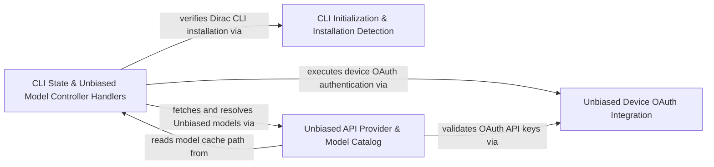

## Details

Bootstraps the CLI process, initializes core services and logging, and integrates core API handlers, Unbiased authentication, and CLI state controllers.

### CLI State & Unbiased Model Controller Handlers
Handles controller RPC commands for Dirac CLI installation/settings state and Unbiased model authentication and refresh.

**Related Classes/Methods**:

- `src.core.controller.models.authenticateUnbiased.authenticateUnbiased`:18-64
- `src.core.controller.models.refreshUnbiasedModelsRpc.refreshUnbiasedModelsRpc`:12-35
- `src.core.controller.state.checkCliInstallation.checkCliInstallation`:10-17
- `src.core.controller.state.settingsTelemetry.applyTelemetrySettingsCli`:33-50

**Source Files:**

- `src/core/controller/models/authenticateUnbiased.ts`
  - `src.core.controller.models.authenticateUnbiased.invalidateUnbiasedSignIns` (L14-L16) - Function
  - `src.core.controller.models.authenticateUnbiased.authenticateUnbiased` (L18-L64) - Function
  - `src.core.controller.models.authenticateUnbiased.authenticateUnbiased.registerRequest() callback` (L27-L27) - Function
  - `src.core.controller.models.authenticateUnbiased.authenticateUnbiased.applyApiConfigurationTransaction() callback` (L50-L50) - Function
- `src/core/controller/models/refreshUnbiasedModelsRpc.ts`
  - `src.core.controller.models.refreshUnbiasedModelsRpc.refreshUnbiasedModelsRpc` (L12-L35) - Function
  - `src.core.controller.models.refreshUnbiasedModelsRpc.models` (L17-L22) - Class
  - `src.core.controller.models.refreshUnbiasedModelsRpc.refreshUnbiasedModelsRpc.models.cacheFilePath` (L19-L19) - Method
  - `src.core.controller.models.refreshUnbiasedModelsRpc.refreshUnbiasedModelsRpc.models.map() callback` (L25-L32) - Function
- `src/core/controller/models/signOutUnbiased.ts`
  - `src.core.controller.models.signOutUnbiased.signOutUnbiasedKey` (L9-L41) - Function
  - `src.core.controller.models.signOutUnbiased.signOutUnbiasedKey.commitWorkingConfigurationUpdate() callback` (L23-L38) - Function
  - `src.core.controller.models.signOutUnbiased.signOutUnbiased` (L43-L47) - Function
- `src/core/controller/state/checkCliInstallation.ts`
  - `src.core.controller.state.checkCliInstallation.checkCliInstallation` (L10-L17) - Function
- `src/core/controller/state/installDiracCli.ts`
  - `src.core.controller.state.installDiracCli.installDiracCli` (L15-L40) - Function
- `src/core/controller/state/settingsCli.ts`
  - `src.core.controller.state.settingsCli.mergeAutoApprovalSettings` (L7-L23) - Function
  - `src.core.controller.state.settingsCli.applyReasoningEffort` (L26-L31) - Function
  - `src.core.controller.state.settingsCli.applyApiProvider` (L34-L37) - Function
  - `src.core.controller.state.settingsCli.filterSimpleSettingsBatch` (L40-L44) - Function
  - `src.core.controller.state.settingsCli.filterSimpleSettingsBatch.filter() callback` (L42-L42) - Function
- `src/core/controller/state/settingsMode.ts`
  - `src.core.controller.state.settingsMode.convertMode` (L7-L10) - Function
  - `src.core.controller.state.settingsMode.applyModeWebview` (L13-L17) - Function
  - `src.core.controller.state.settingsMode.convertPlanActMode` (L20-L22) - Function
  - `src.core.controller.state.settingsMode.applyModeCli` (L25-L28) - Function
- `src/core/controller/state/settingsTelemetry.ts`
  - `src.core.controller.state.settingsTelemetry.applyTelemetrySettingsWebview` (L6-L30) - Function
  - `src.core.controller.state.settingsTelemetry.applyTelemetrySettingsCli` (L33-L50) - Function
- `src/core/controller/state/updateCliBannerVersion.ts`
  - `src.core.controller.state.updateCliBannerVersion.updateCliBannerVersion` (L10-L18) - Function
- `src/core/controller/state/updateSettingsCli.ts`
  - `src.core.controller.state.updateSettingsCli.CliSettingsPersistencePatch` (L25-L28) - Interface
  - `src.core.controller.state.updateSettingsCli.buildCliSettingsPersistencePatch` (L31-L114) - Function
  - `src.core.controller.state.updateSettingsCli.persistCliConfiguration` (L117-L158) - Function
  - `src.core.controller.state.updateSettingsCli.mergeActiveAutoApprovalSettings` (L160-L176) - Function
  - `src.core.controller.state.updateSettingsCli.mergeActiveBrowserSettings` (L178-L194) - Function
  - `src.core.controller.state.updateSettingsCli.buildActiveTaskPatch` (L197-L281) - Function
  - `src.core.controller.state.updateSettingsCli.updateSettingsCli` (L284-L346) - Function
  - `src.core.controller.state.updateSettingsCli.updateSettingsCli.secrets` (L289-L291) - Class
  - `src.core.controller.state.updateSettingsCli.updateSettingsCli.secrets.filter() callback` (L290-L290) - Function
  - `src.core.controller.state.updateSettingsCli.updateSettingsCli.persist` (L314-L326) - Class
  - `src.core.controller.state.updateSettingsCli.updateSettingsCli.persist.persistCliConfiguration() callback` (L318-L325) - Function

### CLI Initialization & Installation Detection
Initializes CLI core services and entrypoints while providing Dirac CLI installation detection and task utilities.

**Related Classes/Methods**:

- `cli.src.initCoreServices.initCoreServices`:26-30
- `src.utils.cli-detector.isDiracCliInstalled`:10-26

**Source Files:**

- `cli/src/index.ts`
  - `cli.src.index.action() callback` (L246-L367) - Function
- `cli/src/init.ts`
  - `cli.src.init.disposeCliLogging` (L8-L19) - Function
  - `cli.src.init.initializeCli` (L24-L143) - Function
  - `cli.src.init.initializeCli.Logger.subscribe() callback` (L66-L66) - Function
  - `cli.src.init.HostProvider.initialize("cli") callback` (L73-L73) - Function
  - `cli.src.init.initializeCli.HostProvider.initialize("cli") callback` (L83-L83) - Function
  - `cli.src.init.initializeCli.setTimeout() callback` (L131-L137) - Function
  - `cli.src.init.initializeCli.setTimeout() callback.catch() callback` (L134-L136) - Function
- `cli/src/initCoreServices.ts`
  - `cli.src.initCoreServices.CoreServicesInitOptions` (L21-L24) - Interface
  - `cli.src.initCoreServices.initCoreServices` (L26-L30) - Function
- `cli/src/types.ts`
  - `cli.src.types.CliPanelType` (L4-L11) - Enum
  - `cli.src.types.TaskOptions` (L16-L49) - Interface
  - `cli.src.types.CliContext` (L51-L57) - Interface
  - `cli.src.types.InitOptions` (L59-L66) - Interface
- `src/core/task/utils.ts`
  - `src.core.task.utils.detectAvailableCliTools` (L175-L194) - Function
  - `src.core.task.utils.extractProviderDomainFromUrl` (L201-L211) - Function
- `src/utils/cli-detector.ts`
  - `src.utils.cli-detector.isDiracCliInstalled` (L10-L26) - Function

### Unbiased API Provider & Model Catalog
Implements the Unbiased API provider handler and fetches and caches available Unbiased models.

**Related Classes/Methods**:

- `src.core.api.providers.unbiased.UnbiasedHandler`:21-108
- `src.core.api.unbiased.unbiased-models.fetchUnbiasedModels`:50-66
- `src.core.api.unbiased.unbiased-models.fetchAndCacheUnbiasedModels`:68-94

**Source Files:**

- `src/core/api/index.ts`
  - `src.core.api.index.resolveModeConfig` (L74-L112) - Function
  - `src.core.api.index.PROVIDER_REGISTRY` (L114-L509) - Class
  - `src.core.api.index.PROVIDER_REGISTRY.anthropic` (L118-L129) - Method
  - `src.core.api.index.PROVIDER_REGISTRY.openrouter` (L130-L143) - Method
  - `src.core.api.index.PROVIDER_REGISTRY.bedrock` (L144-L165) - Method
  - `src.core.api.index.PROVIDER_REGISTRY.vertex` (L166-L178) - Method
  - `src.core.api.index.PROVIDER_REGISTRY.openai` (L179-L235) - Method
  - `src.core.api.index.PROVIDER_REGISTRY.openai.profile` (L180-L180) - Class
  - `src.core.api.index.PROVIDER_REGISTRY.openai.profile.cfg.openAiCompatibleProfiles.find() callback` (L180-L180) - Function
  - `src.core.api.index.PROVIDER_REGISTRY.lmstudio` (L236-L243) - Method
  - `src.core.api.index.PROVIDER_REGISTRY.gemini` (L244-L257) - Method
  - `src.core.api.index.PROVIDER_REGISTRY."openai-native"` (L258-L268) - Method
  - `src.core.api.index.PROVIDER_REGISTRY."openai-codex"` (L269-L277) - Method
  - `src.core.api.index.PROVIDER_REGISTRY.deepseek` (L278-L285) - Method
  - `src.core.api.index.PROVIDER_REGISTRY.unbiased` (L286-L292) - Method
  - `src.core.api.index.PROVIDER_REGISTRY.requesty` (L293-L303) - Method
  - `src.core.api.index.PROVIDER_REGISTRY.fireworks` (L304-L310) - Method
  - `src.core.api.index.PROVIDER_REGISTRY.together` (L311-L317) - Method
  - `src.core.api.index.PROVIDER_REGISTRY.qwen` (L318-L326) - Method
  - `src.core.api.index.PROVIDER_REGISTRY."qwen-code"` (L327-L333) - Method
  - `src.core.api.index.PROVIDER_REGISTRY.doubao` (L334-L340) - Method
  - `src.core.api.index.PROVIDER_REGISTRY.mistral` (L341-L347) - Method
  - `src.core.api.index.PROVIDER_REGISTRY."vscode-lm"` (L349-L363) - Method
  - `src.core.api.index.PROVIDER_REGISTRY."github-copilot"` (L364-L364) - Method
  - `src.core.api.index.PROVIDER_REGISTRY.litellm` (L365-L376) - Method
  - `src.core.api.index.PROVIDER_REGISTRY.moonshot` (L377-L384) - Method
  - `src.core.api.index.PROVIDER_REGISTRY.huggingface` (L385-L392) - Method
  - `src.core.api.index.PROVIDER_REGISTRY.nebius` (L393-L399) - Method
  - `src.core.api.index.PROVIDER_REGISTRY.xai` (L400-L407) - Method
  - `src.core.api.index.PROVIDER_REGISTRY.sambanova` (L408-L414) - Method
  - `src.core.api.index.PROVIDER_REGISTRY.cerebras` (L415-L421) - Method
  - `src.core.api.index.PROVIDER_REGISTRY.groq` (L422-L430) - Method
  - `src.core.api.index.PROVIDER_REGISTRY.baseten` (L431-L439) - Method
  - `src.core.api.index.PROVIDER_REGISTRY."claude-code"` (L440-L447) - Method
  - `src.core.api.index.PROVIDER_REGISTRY."huawei-cloud-maas"` (L448-L455) - Method
  - `src.core.api.index.PROVIDER_REGISTRY.dify` (L456-L456) - Method
  - `src.core.api.index.PROVIDER_REGISTRY."vercel-ai-gateway"` (L457-L466) - Method
  - `src.core.api.index.PROVIDER_REGISTRY.zai` (L467-L475) - Method
  - `src.core.api.index.PROVIDER_REGISTRY.aihubmix` (L476-L485) - Method
  - `src.core.api.index.PROVIDER_REGISTRY.minimax` (L486-L494) - Method
  - `src.core.api.index.PROVIDER_REGISTRY.nousResearch` (L495-L501) - Method
  - `src.core.api.index.PROVIDER_REGISTRY.wandb` (L502-L508) - Method
  - `src.core.api.index.configuredProvider` (L511-L513) - Function
  - `src.core.api.index.assertProviderSupported` (L515-L530) - Function
  - `src.core.api.index.validateApiConfiguration` (L536-L604) - Function
  - `src.core.api.index.validateApiConfiguration.configuration.openAiCompatibleProfiles.some() callback` (L571-L571) - Function
  - `src.core.api.index.createRegistryHandler` (L606-L612) - Function
  - `src.core.api.index.createHandlerForProvider` (L614-L621) - Function
  - `src.core.api.index.buildApiHandler` (L623-L645) - Function
  - `src.core.api.index.ApiHandlerForSelectionOptions` (L647-L649) - Interface
  - `src.core.api.index.createApiConfigurationForModelProviderSelection` (L656-L673) - Function
  - `src.core.api.index.buildApiHandlerForSelection` (L676-L682) - Function
  - `src.core.api.index.resolveModelIdForProvider` (L689-L722) - Function
- `src/core/api/providers/unbiased.ts`
  - `src.core.api.providers.unbiased.UnbiasedHandlerOptions` (L16-L19) - Interface
  - `src.core.api.providers.unbiased.UnbiasedHandler` (L21-L108) - Class
  - `src.core.api.providers.unbiased.UnbiasedHandler.constructor` (L26-L31) - Constructor
  - `src.core.api.providers.unbiased.UnbiasedHandler.ensureClient` (L33-L40) - Method
  - `src.core.api.providers.unbiased.UnbiasedHandler.createMessage` (L42-L50) - Method
  - `src.core.api.providers.unbiased.UnbiasedHandler.createMessageWithRetry` (L53-L84) - Method
  - `src.core.api.providers.unbiased.UnbiasedHandler.abort` (L86-L88) - Method
  - `src.core.api.providers.unbiased.UnbiasedHandler.getModel` (L90-L107) - Method
- `src/core/api/unbiased/unbiased-models.ts`
  - `src.core.api.unbiased.unbiased-models.UnbiasedModelsCache` (L7-L10) - Interface
  - `src.core.api.unbiased.unbiased-models.UnbiasedModelsCache.getModelsCache` (L8-L8) - Method
  - `src.core.api.unbiased.unbiased-models.UnbiasedModelsCache.setModelsCache` (L9-L9) - Method
  - `src.core.api.unbiased.unbiased-models.UnbiasedModelDiscoveryOptions` (L12-L17) - Interface
  - `src.core.api.unbiased.unbiased-models.UnbiasedModelDiscoveryOptions.cacheFilePath` (L14-L14) - Method
  - `src.core.api.unbiased.unbiased-models.UnbiasedModelDiscoveryOptions.fileExists` (L15-L15) - Method
  - `src.core.api.unbiased.unbiased-models.UnbiasedRawModel` (L19-L33) - Interface
  - `src.core.api.unbiased.unbiased-models.modelsCacheKey` (L38-L40) - Function
  - `src.core.api.unbiased.unbiased-models.getCachedUnbiasedModels` (L42-L48) - Function
  - `src.core.api.unbiased.unbiased-models.fetchUnbiasedModels` (L50-L66) - Function
  - `src.core.api.unbiased.unbiased-models.fetchUnbiasedModels.request` (L63-L63) - Class
  - `src.core.api.unbiased.unbiased-models.fetchUnbiasedModels.request.finally() callback` (L63-L63) - Function
  - `src.core.api.unbiased.unbiased-models.fetchAndCacheUnbiasedModels` (L68-L94) - Function
  - `src.core.api.unbiased.unbiased-models.parseUnbiasedModels` (L96-L123) - Function
  - `src.core.api.unbiased.unbiased-models.parseUnbiasedModels.rawModels.map() callback` (L98-L121) - Function
  - `src.core.api.unbiased.unbiased-models.parseUnbiasedPrice` (L125-L130) - Function

### Unbiased Device OAuth Integration
Manages Unbiased device authorization polling and OAuth account credential validation.

**Related Classes/Methods**:

- `src.integrations.unbiased.device-auth.startUnbiasedDeviceAuth`:67-107
- `src.integrations.unbiased.device-auth.pollUnbiasedDeviceAuth`:109-165
- `src.integrations.unbiased.oauth-account.createUnbiasedOAuthAccount`:14-19
- `src.integrations.unbiased.oauth-account.isUnbiasedOAuthApiKey`:9-11

**Source Files:**

- `src/integrations/unbiased/device-auth.ts`
  - `src.integrations.unbiased.device-auth.UnbiasedDeviceGrant` (L9-L16) - Interface
  - `src.integrations.unbiased.device-auth.UnbiasedDeviceToken` (L18-L24) - Interface
  - `src.integrations.unbiased.device-auth.UnbiasedAuthError` (L26-L40) - Class
  - `src.integrations.unbiased.device-auth.UnbiasedAuthError.constructor` (L27-L39) - Constructor
  - `src.integrations.unbiased.device-auth.DeviceAuthOptions` (L42-L47) - Interface
  - `src.integrations.unbiased.device-auth.postDeviceAuth` (L49-L65) - Function
  - `src.integrations.unbiased.device-auth.postDeviceAuth.body.catch() callback` (L63-L63) - Function
  - `src.integrations.unbiased.device-auth.startUnbiasedDeviceAuth` (L67-L107) - Function
  - `src.integrations.unbiased.device-auth.pollUnbiasedDeviceAuth` (L109-L165) - Function
- `src/integrations/unbiased/oauth-account.ts`
  - `src.integrations.unbiased.oauth-account.hashApiKey` (L4-L6) - Function
  - `src.integrations.unbiased.oauth-account.isUnbiasedOAuthApiKey` (L9-L11) - Function
  - `src.integrations.unbiased.oauth-account.createUnbiasedOAuthAccount` (L14-L19) - Function
  - `src.integrations.unbiased.oauth-account.getUnbiasedOAuthWorkloadName` (L22-L29) - Function

### [FAQ](https://github.com/CodeBoarding/GeneratedOnBoardings/tree/main?tab=readme-ov-file#faq)