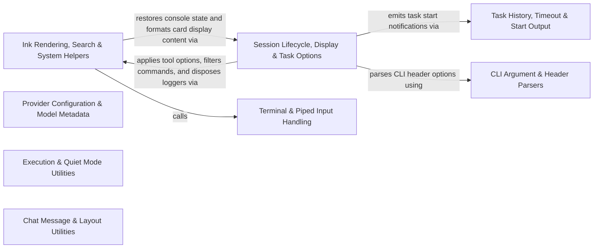

## Details

Provides shared terminal utilities for formatted output, Ink app lifecycle, provider configuration, diff computation, file search, and resource cleanup.

### Ink Rendering, Search & System Helpers
Provides Ink app launching, timeline row estimation, fuzzy and file search, tool selection helpers, diffing, and system environment utilities.

**Related Classes/Methods**:

- `cli.src.utils.ink.runInkApp`:4-57
- `cli.src.utils.timeline-rows.estimateTimelineMessageBodyRows`:32-48
- `cli.src.utils.acp-file-logger.disposeAcpFileLogger`:19-28
- `cli.src.utils.tool-options.applyToolSelectionOptions`:65-76
- `cli.src.utils.fuzzy-search.fuzzyFilter`:14-18

**Source Files:**

- `cli/src/utils/DiffComputer.ts`
  - `cli.src.utils.DiffComputer.DiffLine` (L9-L16) - Interface
  - `cli.src.utils.DiffComputer.DiffBlock` (L18-L25) - Interface
  - `cli.src.utils.DiffComputer.ComputedDiff` (L27-L34) - Interface
  - `cli.src.utils.DiffComputer.parseSearchReplacePairs` (L49-L95) - Function
  - `cli.src.utils.DiffComputer.parseApplyPatchPairs` (L101-L141) - Function
  - `cli.src.utils.DiffComputer.computeLineDiff` (L147-L200) - Function
  - `cli.src.utils.DiffComputer.parseNewFormat` (L208-L259) - Function
  - `cli.src.utils.DiffComputer.computeDiff` (L261-L307) - Function
  - `cli.src.utils.DiffComputer.computeDiff.blocks.lines.lines.map() callback` (L280-L284) - Function
  - `cli.src.utils.DiffComputer.getGutterWidth` (L312-L327) - Function
- `cli/src/utils/acp-file-logger.ts`
  - `cli.src.utils.acp-file-logger.initAcpFileLogger` (L11-L17) - Function
  - `cli.src.utils.acp-file-logger.initAcpFileLogger.Logger.subscribe() callback` (L16-L16) - Function
  - `cli.src.utils.acp-file-logger.disposeAcpFileLogger` (L19-L28) - Function
- `cli/src/utils/action-buttons.ts`
  - `cli.src.utils.action-buttons.getVisibleGlobalActionButtons` (L5-L7) - Function
  - `cli.src.utils.action-buttons.getVisibleGlobalActionButtons.buttons.filter() callback` (L6-L6) - Function
- `cli/src/utils/browser.ts`
  - `cli.src.utils.browser.openUrlInBrowser` (L9-L11) - Function
- `cli/src/utils/color.ts`
  - `cli.src.utils.color.hslToHex` (L9-L52) - Function
- `cli/src/utils/cursor.ts`
  - `cli.src.utils.cursor.moveCursorVertically` (L3-L13) - Function
  - `cli.src.utils.cursor.moveCursorVertically.currentColumn` (L10-L10) - Class
  - `cli.src.utils.cursor.moveCursorVertically.currentColumn.cursorStops.reduce() callback` (L10-L10) - Function
  - `cli.src.utils.cursor.moveCursorVertically.targetRow.cursorStops.reduce() callback` (L12-L12) - Function
  - `cli.src.utils.cursor.moveCursorUp` (L16-L18) - Function
  - `cli.src.utils.cursor.moveCursorDown` (L21-L23) - Function
- `cli/src/utils/diff-layout.ts`
  - `cli.src.utils.diff-layout.DiffLayout` (L10-L14) - Interface
  - `cli.src.utils.diff-layout.createDiffLayout` (L20-L47) - Function
  - `cli.src.utils.diff-layout.createDiffLayout.rows.diff.blocks.flatMap() callback` (L30-L45) - Function
  - `cli.src.utils.diff-layout.createDiffLayout.rows.diff.blocks.flatMap() callback.blockRows` (L32-L43) - Class
  - `cli.src.utils.diff-layout.createDiffLayout.rows.diff.blocks.flatMap() callback.blockRows.collapsed.flatMap() callback` (L34-L43) - Function
  - `cli.src.utils.diff-layout.createDiffLayout.rows.diff.blocks.flatMap() callback.blockRows.collapsed.flatMap() callback.map() callback` (L38-L42) - Function
  - `cli.src.utils.diff-layout.clipDiffRows` (L50-L55) - Function
  - `cli.src.utils.diff-layout.collapseContext` (L57-L82) - Function
  - `cli.src.utils.diff-layout.collapseContext.changeIndices` (L59-L59) - Class
  - `cli.src.utils.diff-layout.collapseContext.changeIndices.lines.flatMap() callback` (L59-L59) - Function
  - `cli.src.utils.diff-layout.collapseContext.lines.map() callback` (L60-L60) - Function
  - `cli.src.utils.diff-layout.toSplitRows` (L84-L119) - Function
- `cli/src/utils/file-search.ts`
  - `cli.src.utils.file-search.FileSearchResult` (L12-L16) - Interface
  - `cli.src.utils.file-search.checkRipgrep` (L44-L55) - Function
  - `cli.src.utils.file-search.addParentDirs` (L57-L63) - Function
  - `cli.src.utils.file-search.dirsToResults` (L65-L67) - Function
  - `cli.src.utils.file-search.dirsToResults.Array.from() callback` (L66-L66) - Function
  - `cli.src.utils.file-search.listFilesWithNodeFs` (L69-L108) - Function
  - `cli.src.utils.file-search.listFilesWithNodeFs.walk` (L73-L104) - Function
  - `cli.src.utils.file-search.listFilesWithRipgrep` (L110-L145) - Function
  - `cli.src.utils.file-search.listFilesWithRipgrep.<function>` (L111-L144) - Function
  - `cli.src.utils.file-search.listFilesWithRipgrep.<function>.rl.on("line") callback` (L119-L129) - Function
  - `cli.src.utils.file-search.listFilesWithRipgrep.<function>.rg.stderr.on("data") callback` (L131-L133) - Function
  - `cli.src.utils.file-search.listFilesWithRipgrep.<function>.rl.on("close") callback` (L135-L141) - Function
  - `cli.src.utils.file-search.listFilesWithRipgrep.<function>.rg.on("error") callback` (L143-L143) - Function
  - `cli.src.utils.file-search.checkAndWarnRipgrepMissing` (L147-L153) - Function
  - `cli.src.utils.file-search.getRipgrepInstallInstructions` (L155-L170) - Function
  - `cli.src.utils.file-search.listWorkspaceFiles` (L172-L181) - Function
  - `cli.src.utils.file-search.countGaps` (L183-L193) - Function
  - `cli.src.utils.file-search.searchWorkspaceFiles` (L198-L238) - Function
  - `cli.src.utils.file-search.items.filter() callback` (L208-L208) - Function
  - `cli.src.utils.file-search.searchWorkspaceFiles.items.filter() callback` (L212-L216) - Function
  - `cli.src.utils.file-search.searchWorkspaceFiles.fzf` (L228-L232) - Class
  - `cli.src.utils.file-search.searchWorkspaceFiles.fzf.selector` (L229-L229) - Method
  - `cli.src.utils.file-search.searchWorkspaceFiles.map() callback` (L237-L237) - Function
  - `cli.src.utils.file-search.extractMentionQuery` (L240-L257) - Function
  - `cli.src.utils.file-search.MentionInsertion` (L259-L262) - Interface
  - `cli.src.utils.file-search.insertMention` (L264-L282) - Function
- `cli/src/utils/fuzzy-search.ts`
  - `cli.src.utils.fuzzy-search.fuzzyFilter` (L14-L18) - Function
  - `cli.src.utils.fuzzy-search.fuzzyFilter.map() callback` (L17-L17) - Function
- `cli/src/utils/git.ts`
  - `cli.src.utils.git.getGitBranch` (L6-L17) - Function
  - `cli.src.utils.git.GitDiffStats` (L19-L23) - Interface
  - `cli.src.utils.git.getGitDiffStats` (L28-L51) - Function
- `cli/src/utils/goals.ts`
  - `cli.src.utils.goals.isGoalRequest` (L7-L9) - Function
  - `cli.src.utils.goals.isRunningGoalStatus` (L11-L13) - Function
  - `cli.src.utils.goals.isResumableGoalStatus` (L15-L17) - Function
- `cli/src/utils/ink.ts`
  - `cli.src.utils.ink.runInkApp` (L4-L57) - Function
- `cli/src/utils/markdown.ts`
  - `cli.src.utils.markdown.styleText` (L13-L21) - Function
  - `cli.src.utils.markdown.truncateCell` (L23-L32) - Function
  - `cli.src.utils.markdown.allocateColumnWidths` (L34-L41) - Function
  - `cli.src.utils.markdown.allocateColumnWidths.widths` (L35-L35) - Class
  - `cli.src.utils.markdown.allocateColumnWidths.widths.naturalWidths.map() callback` (L35-L35) - Function
  - `cli.src.utils.markdown.allocateColumnWidths.naturalTotal` (L36-L36) - Class
  - `cli.src.utils.markdown.allocateColumnWidths.naturalTotal.widths.reduce() callback` (L36-L36) - Function
  - `cli.src.utils.markdown.allocateColumnWidths.expandableTotal` (L39-L39) - Class
  - `cli.src.utils.markdown.allocateColumnWidths.expandableTotal.widths.reduce() callback` (L39-L39) - Function
  - `cli.src.utils.markdown.allocateColumnWidths.widths.map() callback` (L40-L40) - Function
  - `cli.src.utils.markdown.renderTokens` (L43-L45) - Function
  - `cli.src.utils.markdown.renderTokens.tokens.map() callback` (L44-L44) - Function
  - `cli.src.utils.markdown.renderToken` (L47-L157) - Function
  - `cli.src.utils.markdown.renderToken.padWidth` (L64-L64) - Class
  - `cli.src.utils.markdown.renderToken.padWidth.lines.map() callback` (L64-L64) - Function
  - `cli.src.utils.markdown.renderToken.body` (L66-L71) - Class
  - `cli.src.utils.markdown.renderToken.body.lines.map() callback` (L68-L69) - Function
  - `cli.src.utils.markdown.renderToken.items.map() callback` (L78-L79) - Function
  - `cli.src.utils.markdown.renderToken.headerTexts` (L111-L111) - Class
  - `cli.src.utils.markdown.renderToken.headerTexts.header.map() callback` (L111-L111) - Function
  - `cli.src.utils.markdown.renderToken.rowTexts` (L112-L112) - Class
  - `cli.src.utils.markdown.renderToken.rowTexts.rows.map() callback` (L112-L112) - Function
  - `cli.src.utils.markdown.renderToken.rowTexts.rows.map() callback.row.map() callback` (L112-L112) - Function
  - `cli.src.utils.markdown.renderToken.naturalWidths.headerTexts.map() callback` (L113-L114) - Function
  - `cli.src.utils.markdown.renderToken.naturalWidths` (L113-L115) - Class
  - `cli.src.utils.markdown.renderToken.naturalWidths.headerTexts.map() callback.rowTexts.map() callback` (L114-L114) - Function
  - `cli.src.utils.markdown.renderToken.map() callback` (L120-L121) - Function
  - `cli.src.utils.markdown.renderToken.border` (L126-L127) - Class
  - `cli.src.utils.markdown.renderToken.border.widths.map() callback` (L127-L127) - Function
  - `cli.src.utils.markdown.renderToken.row` (L128-L136) - Class
  - `cli.src.utils.markdown.renderToken.row.cells.map() callback` (L131-L134) - Function
  - `cli.src.utils.markdown.renderToken.rowTexts.map() callback` (L142-L142) - Function
  - `cli.src.utils.markdown.renderMarkdownLines` (L160-L164) - Function
  - `cli.src.utils.markdown.clipMarkdownLines` (L166-L176) - Function
- `cli/src/utils/model-selection.ts`
  - `cli.src.utils.model-selection.createModelSelectionPatch` (L8-L45) - Function
- `cli/src/utils/output-channel.ts`
  - `cli.src.utils.output-channel.getCliLogFilePath` (L10-L12) - Function
  - `cli.src.utils.output-channel.OutputChannelLogger` (L14-L17) - Interface
  - `cli.src.utils.output-channel.getOutputChannelLogger` (L21-L30) - Function
  - `cli.src.utils.output-channel.createCliOutputChannel` (L34-L38) - Function
  - `cli.src.utils.output-channel.disposeCliOutputLoggers` (L40-L44) - Function
- `cli/src/utils/path.ts`
  - `cli.src.utils.path.configureCliLogDirectory` (L20-L27) - Function
  - `cli.src.utils.path.configureCliLogDirectoryFromDiracHome` (L29-L32) - Function
  - `cli.src.utils.path.getCliBinaryPath` (L38-L80) - Function
- `cli/src/utils/spinner-activity.ts`
  - `cli.src.utils.spinner-activity.SpinnerActivity` (L3-L6) - Interface
  - `cli.src.utils.spinner-activity.getSpinnerActivity` (L8-L45) - Function
- `cli/src/utils/terminal-link.ts`
  - `cli.src.utils.terminal-link.terminalLink` (L8-L12) - Function
  - `cli.src.utils.terminal-link.linkifyPaths` (L17-L35) - Function
  - `cli.src.utils.terminal-link.linkifyPaths.text.replace() callback` (L20-L34) - Function
  - `cli.src.utils.terminal-link.getPathUrl` (L40-L47) - Function
- `cli/src/utils/text-clipping.ts`
  - `cli.src.utils.text-clipping.splitIntoVisualRows` (L3-L13) - Function
  - `cli.src.utils.text-clipping.splitIntoVisualRows.flatMap() callback` (L5-L12) - Function
  - `cli.src.utils.text-clipping.truncateRow` (L15-L20) - Function
  - `cli.src.utils.text-clipping.prependClippingMarker` (L22-L29) - Function
  - `cli.src.utils.text-clipping.estimateVisualLineCount` (L31-L33) - Function
  - `cli.src.utils.text-clipping.clipTextToLastVisualLines` (L35-L46) - Function
  - `cli.src.utils.text-clipping.summarizeFirstLine` (L48-L64) - Function
  - `cli.src.utils.text-clipping.summarizeFirstLine.line` (L49-L52) - Class
  - `cli.src.utils.text-clipping.summarizeFirstLine.line.map() callback` (L51-L51) - Function
  - `cli.src.utils.text-clipping.clipTextToWindow` (L70-L107) - Function
- `cli/src/utils/timeline-rows.ts`
  - `cli.src.utils.timeline-rows.estimateTimelineMessageRows` (L10-L30) - Function
  - `cli.src.utils.timeline-rows.estimateTimelineMessageBodyRows` (L32-L48) - Function
  - `cli.src.utils.timeline-rows.calculateTimelineBodyLineBudget` (L50-L66) - Function
- `cli/src/utils/tool-options.ts`
  - `cli.src.utils.tool-options.hasToolSelectionOptions` (L9-L11) - Function
  - `cli.src.utils.tool-options.toolIdentifiers` (L13-L15) - Function
  - `cli.src.utils.tool-options.resolveCanonicalToolIds` (L17-L38) - Function
  - `cli.src.utils.tool-options.resolveCanonicalToolIds.configurableTools` (L18-L18) - Class
  - `cli.src.utils.tool-options.resolveCanonicalToolIds.configurableTools.tools.filter() callback` (L18-L18) - Function
  - `cli.src.utils.tool-options.resolveCanonicalToolIds.validIds` (L19-L19) - Class
  - `cli.src.utils.tool-options.resolveCanonicalToolIds.validIds.configurableTools.map() callback` (L19-L19) - Function
  - `cli.src.utils.tool-options.resolveCanonicalToolIds.matches` (L23-L23) - Class
  - `cli.src.utils.tool-options.resolveCanonicalToolIds.matches.tools.filter() callback` (L23-L23) - Function
  - `cli.src.utils.tool-options.resolveToolSelectionPolicy` (L40-L61) - Function
  - `cli.src.utils.tool-options.resolveToolSelectionPolicy.conflictingIds` (L56-L56) - Class
  - `cli.src.utils.tool-options.resolveToolSelectionPolicy.conflictingIds.filter() callback` (L56-L56) - Function
  - `cli.src.utils.tool-options.applyToolSelectionOptions` (L65-L76) - Function
  - `cli.src.utils.tool-options.applyToolSelectionOptions.refreshToolRegistryForWorkspace() callback` (L74-L74) - Function

### Session Lifecycle, Display & Task Options
Manages CLI task option application, plain-text task execution, console and card display formatting, slash command filtering, clipboard access, and process lifecycle cleanup.

**Related Classes/Methods**:

- `cli.src.utils.options.applyTaskOptions`:58-263
- `cli.src.utils.plain-text-task.runPlainTextTask`:111-489
- `cli.src.utils.slash-commands.filterCommands`:186-191
- `cli.src.utils.errors.onUnhandledException`:33-55
- `cli.src.utils.console.restoreConsole`:38-44
- `cli.src.utils.card-body.cardBodyForDisplay`:5-8

**Source Files:**

- `cli/src/utils/card-body.ts`
  - `cli.src.utils.card-body.cardBodyForDisplay` (L5-L8) - Function
- `cli/src/utils/cleanup.ts`
  - `cli.src.utils.cleanup.disposeTelemetryServices` (L8-L16) - Function
  - `cli.src.utils.cleanup.disposeCliContext` (L18-L40) - Function
  - `cli.src.utils.cleanup.disposeInitializedContext` (L42-L65) - Function
  - `cli.src.utils.cleanup.createInkCleanup` (L70-L80) - Function
  - `cli.src.utils.cleanup.createInkCleanup.<function>` (L71-L79) - Function
  - `cli.src.utils.cleanup.drainStdout` (L86-L88) - Function
  - `cli.src.utils.cleanup.drainOutput` (L90-L92) - Function
  - `cli.src.utils.cleanup.drainWritableStream` (L94-L99) - Function
- `cli/src/utils/clipboard-image.ts`
  - `cli.src.utils.clipboard-image.registerClipboardImage` (L10-L14) - Function
  - `cli.src.utils.clipboard-image.writeCommandImage` (L16-L21) - Function
  - `cli.src.utils.clipboard-image.readMacOsClipboardImage` (L23-L53) - Function
  - `cli.src.utils.clipboard-image.readLinuxClipboardImage` (L55-L62) - Function
  - `cli.src.utils.clipboard-image.readWindowsClipboardImage` (L64-L71) - Function
  - `cli.src.utils.clipboard-image.readImageFromClipboard` (L77-L98) - Function
  - `cli.src.utils.clipboard-image.disposeClipboardImages` (L101-L106) - Function
- `cli/src/utils/console.ts`
  - `cli.src.utils.console.suppressConsoleUnlessVerbose` (L22-L33) - Function
  - `cli.src.utils.console.suppressConsoleUnlessVerbose.log` (L28-L28) - Function
  - `cli.src.utils.console.suppressConsoleUnlessVerbose.warn` (L29-L29) - Function
  - `cli.src.utils.console.suppressConsoleUnlessVerbose.error` (L30-L30) - Function
  - `cli.src.utils.console.suppressConsoleUnlessVerbose.debug` (L31-L31) - Function
  - `cli.src.utils.console.suppressConsoleUnlessVerbose.info` (L32-L32) - Function
  - `cli.src.utils.console.restoreConsole` (L38-L44) - Function
- `cli/src/utils/display.ts`
  - `cli.src.utils.display.centerText` (L22-L26) - Function
  - `cli.src.utils.display.colorize` (L28-L31) - Function
  - `cli.src.utils.display.colorizeStderr` (L33-L36) - Function
  - `cli.src.utils.display.style` (L39-L62) - Class
  - `cli.src.utils.display.style.bold` (L40-L40) - Method
  - `cli.src.utils.display.style.dim` (L41-L41) - Method
  - `cli.src.utils.display.style.italic` (L42-L42) - Method
  - `cli.src.utils.display.style.error` (L44-L44) - Method
  - `cli.src.utils.display.style.warning` (L45-L45) - Method
  - `cli.src.utils.display.style.success` (L46-L46) - Method
  - `cli.src.utils.display.style.info` (L47-L47) - Method
  - `cli.src.utils.display.style.task` (L50-L50) - Method
  - `cli.src.utils.display.style.tool` (L51-L51) - Method
  - `cli.src.utils.display.style.toolBody` (L52-L52) - Method
  - `cli.src.utils.display.style.metadata` (L53-L53) - Method
  - `cli.src.utils.display.style.command` (L54-L54) - Method
  - `cli.src.utils.display.style.api` (L55-L55) - Method
  - `cli.src.utils.display.style.user` (L56-L56) - Method
  - `cli.src.utils.display.style.assistant` (L57-L57) - Method
  - `cli.src.utils.display.style.path` (L60-L60) - Method
  - `cli.src.utils.display.style.code` (L61-L61) - Method
  - `cli.src.utils.display.stderrStyle` (L64-L75) - Class
  - `cli.src.utils.display.stderrStyle.dim` (L65-L65) - Method
  - `cli.src.utils.display.stderrStyle.error` (L66-L66) - Method
  - `cli.src.utils.display.stderrStyle.warning` (L67-L67) - Method
  - `cli.src.utils.display.stderrStyle.success` (L68-L68) - Method
  - `cli.src.utils.display.stderrStyle.info` (L69-L69) - Method
  - `cli.src.utils.display.stderrStyle.tool` (L70-L70) - Method
  - `cli.src.utils.display.stderrStyle.toolBody` (L71-L71) - Method
  - `cli.src.utils.display.stderrStyle.metadata` (L72-L72) - Method
  - `cli.src.utils.display.stderrStyle.assistant` (L73-L73) - Method
  - `cli.src.utils.display.stderrStyle.api` (L74-L74) - Method
  - `cli.src.utils.display.formatTimestamp` (L80-L88) - Function
  - `cli.src.utils.display.getMessageIcon` (L90-L110) - Function
  - `cli.src.utils.display.formatMessage` (L112-L129) - Function
  - `cli.src.utils.display.formatMarkdownMessage` (L131-L140) - Function
  - `cli.src.utils.display.formatCardMessage` (L142-L183) - Function
  - `cli.src.utils.display.formatCardMessage.map() callback` (L168-L168) - Function
  - `cli.src.utils.display.formatApiStatusMessage` (L185-L211) - Function
  - `cli.src.utils.display.getToolType` (L213-L218) - Function
  - `cli.src.utils.display.separator` (L227-L229) - Function
  - `cli.src.utils.display.taskHeader` (L234-L242) - Function
  - `cli.src.utils.display.formatState` (L247-L273) - Function
  - `cli.src.utils.display.formatState.messagesToShow` (L256-L262) - Class
  - `cli.src.utils.display.formatState.messagesToShow.state.diracMessages.filter() callback` (L258-L262) - Function
  - `cli.src.utils.display.Spinner` (L278-L318) - Class
  - `cli.src.utils.display.Spinner.start` (L284-L291) - Method
  - `cli.src.utils.display.Spinner.start.setInterval() callback` (L286-L290) - Function
  - `cli.src.utils.display.Spinner.update` (L293-L295) - Method
  - `cli.src.utils.display.Spinner.stop` (L297-L307) - Method
  - `cli.src.utils.display.Spinner.fail` (L309-L317) - Method
  - `cli.src.utils.display.clearLine` (L323-L325) - Function
  - `cli.src.utils.display.cursorUp` (L330-L332) - Function
  - `cli.src.utils.display.print` (L338-L340) - Function
  - `cli.src.utils.display.printError` (L346-L348) - Function
  - `cli.src.utils.display.printSuccess` (L353-L355) - Function
  - `cli.src.utils.display.printInfo` (L360-L362) - Function
  - `cli.src.utils.display.printWarning` (L367-L369) - Function
  - `cli.src.utils.display.promptUser` (L374-L387) - Function
  - `cli.src.utils.display.promptUser.<function>` (L381-L386) - Function
  - `cli.src.utils.display.promptUser.<function>.rl.question() callback` (L382-L385) - Function
  - `cli.src.utils.display.promptConfirmation` (L392-L395) - Function
  - `cli.src.utils.display.createContextBar` (L401-L409) - Function
  - `cli.src.utils.display.setTerminalTitle` (L415-L422) - Function
  - `cli.src.utils.display.sanitizeTerminalTitle` (L424-L426) - Function
- `cli/src/utils/errors.ts`
  - `cli.src.utils.errors.captureUnhandledException` (L5-L30) - Function
  - `cli.src.utils.errors.onUnhandledException` (L33-L55) - Function
  - `cli.src.utils.errors.onUnhandledException.forcedExit` (L42-L42) - Class
  - `cli.src.utils.errors.onUnhandledException.forcedExit.setTimeout() callback` (L42-L42) - Function
  - `cli.src.utils.errors.setupSignalHandlers` (L57-L117) - Function
  - `cli.src.utils.errors.setupSignalHandlers.process.on("unhandledRejection") callback` (L105-L107) - Function
  - `cli.src.utils.errors.setupSignalHandlers.process.on("uncaughtException") callback` (L109-L111) - Function
- `cli/src/utils/icon-mapping.ts`
  - `cli.src.utils.icon-mapping.getIconCategoryColor` (L8-L40) - Function
  - `cli.src.utils.icon-mapping.setIconMode` (L96-L98) - Function
  - `cli.src.utils.icon-mapping.getIcon` (L100-L105) - Function
  - `cli.src.utils.icon-mapping.getStatusIcon` (L107-L127) - Function
  - `cli.src.utils.icon-mapping.getStatusColor` (L129-L150) - Function
- `cli/src/utils/options.ts`
  - `cli.src.utils.options.setModeScopedState` (L8-L18) - Function
  - `cli.src.utils.options.normalizeReasoningEffort` (L20-L32) - Function
  - `cli.src.utils.options.validateProvider` (L34-L43) - Function
  - `cli.src.utils.options.normalizeMaxConsecutiveMistakes` (L45-L56) - Function
  - `cli.src.utils.options.applyTaskOptions` (L58-L263) - Function
  - `cli.src.utils.options.setModeScopedState() callback` (L123-L141) - Function
  - `cli.src.utils.options.applyTaskOptions.setModeScopedState() callback` (L198-L201) - Function
- `cli/src/utils/plain-text-task.ts`
  - `cli.src.utils.plain-text-task.TerminalStateEvaluation` (L41-L45) - Interface
  - `cli.src.utils.plain-text-task.evaluatePlainTextTaskTerminalState` (L47-L95) - Function
  - `cli.src.utils.plain-text-task.evaluatePlainTextTaskTerminalState.failedCard` (L54-L63) - Class
  - `cli.src.utils.plain-text-task.evaluatePlainTextTaskTerminalState.failedCard.find() callback` (L57-L62) - Function
  - `cli.src.utils.plain-text-task.evaluatePlainTextTaskTerminalState.hasNewTask` (L75-L75) - Class
  - `cli.src.utils.plain-text-task.evaluatePlainTextTaskTerminalState.hasNewTask.globalButtons.some() callback` (L75-L75) - Function
  - `cli.src.utils.plain-text-task.evaluatePlainTextTaskTerminalState.hasProceed` (L76-L76) - Class
  - `cli.src.utils.plain-text-task.evaluatePlainTextTaskTerminalState.hasProceed.globalButtons.some() callback` (L76-L76) - Function
  - `cli.src.utils.plain-text-task.PlainTextTaskOptions` (L97-L109) - Interface
  - `cli.src.utils.plain-text-task.runPlainTextTask` (L111-L489) - Function
  - `cli.src.utils.plain-text-task.runPlainTextTask.completionPromise.catch() callback` (L123-L123) - Function
  - `cli.src.utils.plain-text-task.runPlainTextTask.processMessage` (L174-L286) - Class
  - `cli.src.utils.plain-text-task.runPlainTextTask.processMessage.approvalQueue.then() callback` (L250-L250) - Function
  - `cli.src.utils.plain-text-task.runPlainTextTask.processMessage.then() callback` (L251-L251) - Function
  - `cli.src.utils.plain-text-task.runPlainTextTask.processMessage.catch() callback` (L252-L256) - Function
  - `cli.src.utils.plain-text-task.runPlainTextTask.subscribeToState() callback` (L297-L368) - Function
  - `cli.src.utils.plain-text-task.runPlainTextTask.timeoutPromise` (L410-L415) - Class
  - `cli.src.utils.plain-text-task.runPlainTextTask.timeoutPromise.<function>` (L410-L415) - Function
  - `cli.src.utils.plain-text-task.runPlainTextTask.timeoutPromise.<function>.setTimeout() callback` (L412-L412) - Function
  - `cli.src.utils.plain-text-task.runPlainTextTask.completionCard` (L445-L447) - Class
  - `cli.src.utils.plain-text-task.runPlainTextTask.completionCard.find() callback` (L447-L447) - Function
  - `cli.src.utils.plain-text-task.runPlainTextTask.lastMarkdown` (L454-L456) - Class
  - `cli.src.utils.plain-text-task.runPlainTextTask.lastMarkdown.find() callback` (L456-L456) - Function
  - `cli.src.utils.plain-text-task.handleMessageForPipeMode` (L498-L566) - Function
  - `cli.src.utils.plain-text-task.handleApiReqMessage` (L571-L624) - Function
- `cli/src/utils/shutdown.ts`
  - `cli.src.utils.shutdown.CliEventEmitter` (L6-L28) - Class
  - `cli.src.utils.shutdown.CliEventEmitter.event` (L9-L17) - Method
  - `cli.src.utils.shutdown.CliEventEmitter.event.dispose` (L12-L15) - Method
  - `cli.src.utils.shutdown.CliEventEmitter.fire` (L19-L23) - Method
  - `cli.src.utils.shutdown.CliEventEmitter.dispose` (L25-L27) - Method
- `cli/src/utils/slash-commands.ts`
  - `cli.src.utils.slash-commands.SlashQueryInfo` (L11-L15) - Interface
  - `cli.src.utils.slash-commands.VisibleWindow` (L17-L20) - Interface
  - `cli.src.utils.slash-commands.LocalSlashCommandContext` (L34-L42) - Interface
  - `cli.src.utils.slash-commands.openPanel` (L46-L51) - Function
  - `cli.src.utils.slash-commands.openModelsPanel` (L53-L63) - Function
  - `cli.src.utils.slash-commands.LOCAL_SLASH_COMMANDS` (L65-L85) - Class
  - `cli.src.utils.slash-commands.LOCAL_SLASH_COMMANDS.clear` (L73-L73) - Method
  - `cli.src.utils.slash-commands.LOCAL_SLASH_COMMANDS.exit` (L74-L74) - Method
  - `cli.src.utils.slash-commands.LOCAL_SLASH_COMMANDS.q` (L75-L75) - Method
  - `cli.src.utils.slash-commands.LOCAL_SLASH_COMMANDS.quiet` (L76-L79) - Method
  - `cli.src.utils.slash-commands.LOCAL_SLASH_COMMANDS.fast` (L80-L83) - Method
  - `cli.src.utils.slash-commands.executeLocalSlashCommand` (L87-L92) - Function
  - `cli.src.utils.slash-commands.executeStandaloneLocalSlashCommand` (L94-L98) - Function
  - `cli.src.utils.slash-commands.getVisibleWindow` (L105-L120) - Function
  - `cli.src.utils.slash-commands.sortCommandsWorkflowsFirst` (L125-L127) - Function
  - `cli.src.utils.slash-commands.commands.filter() callback` (L126-L126) - Function
  - `cli.src.utils.slash-commands.sortCommandsWorkflowsFirst.commands.filter() callback` (L126-L126) - Function
  - `cli.src.utils.slash-commands.mergeCliSlashCommands` (L129-L136) - Function
  - `cli.src.utils.slash-commands.mergeCliSlashCommands.localNames` (L133-L133) - Class
  - `cli.src.utils.slash-commands.mergeCliSlashCommands.localNames.localCommands.map() callback` (L133-L133) - Function
  - `cli.src.utils.slash-commands.mergeCliSlashCommands.nonConflictingBackendCommands` (L134-L134) - Class
  - `cli.src.utils.slash-commands.mergeCliSlashCommands.nonConflictingBackendCommands.backendCommands.filter() callback` (L134-L134) - Function
  - `cli.src.utils.slash-commands.extractSlashQuery` (L143-L181) - Function
  - `cli.src.utils.slash-commands.filterCommands` (L186-L191) - Function
  - `cli.src.utils.slash-commands.filterCommands.fuzzyFilter() callback` (L190-L190) - Function
  - `cli.src.utils.slash-commands.SlashCommandInsertion` (L196-L199) - Interface
  - `cli.src.utils.slash-commands.insertSlashCommand` (L201-L216) - Function
- `cli/src/utils/standalone-card-policy.ts`
  - `cli.src.utils.standalone-card-policy.StandaloneCardDisposition` (L4-L9) - Enum
  - `cli.src.utils.standalone-card-policy.CardResponseTask` (L11-L20) - Interface
  - `cli.src.utils.standalone-card-policy.CardResponseController` (L22-L24) - Interface
  - `cli.src.utils.standalone-card-policy.getStandaloneCardDisposition` (L26-L36) - Function
  - `cli.src.utils.standalone-card-policy.approveCardForPlainTextYolo` (L38-L50) - Function
  - `cli.src.utils.standalone-card-policy.approveCardForPlainTextYolo.primaryActionValue` (L41-L41) - Class
  - `cli.src.utils.standalone-card-policy.approveCardForPlainTextYolo.primaryActionValue.card.actions.find() callback` (L41-L41) - Function
- `cli/src/utils/state.ts`
  - `cli.src.utils.state.setActiveContext` (L11-L13) - Function
  - `cli.src.utils.state.setIsShuttingDown` (L15-L17) - Function
  - `cli.src.utils.state.setIsPlainTextMode` (L19-L21) - Function
  - `cli.src.utils.state.setTelemetryDisposed` (L23-L25) - Function
  - `cli.src.utils.state.setShutdownExitCode` (L27-L29) - Function
- `cli/src/utils/update.ts`
  - `cli.src.utils.update.PackageManager` (L8-L15) - Enum
  - `cli.src.utils.update.InstallationInfo` (L17-L20) - Interface
  - `cli.src.utils.update.UpdateInvocation` (L22-L25) - Interface
  - `cli.src.utils.update.formatUpdateInvocation` (L27-L29) - Function
  - `cli.src.utils.update.isNightlyVersion` (L34-L36) - Function
  - `cli.src.utils.update.getNpmTag` (L41-L43) - Function
  - `cli.src.utils.update.getInstallationInfo` (L49-L96) - Function
  - `cli.src.utils.update.getLatestVersion` (L102-L112) - Function
  - `cli.src.utils.update.autoUpdateOnStartup` (L123-L153) - Function
  - `cli.src.utils.update.autoUpdateOnStartup.setImmediate() callback` (L135-L152) - Function
  - `cli.src.utils.update.checkAndUpdate` (L155-L173) - Function
  - `cli.src.utils.update.checkForUpdates` (L178-L258) - Function
  - `cli.src.utils.update.checkForUpdates.updateProcess.on("close") callback` (L238-L246) - Function
  - `cli.src.utils.update.checkForUpdates.updateProcess.on("error") callback` (L248-L252) - Function
  - `cli.src.utils.update.ParsedVersion` (L260-L264) - Interface
  - `cli.src.utils.update.parseVersion` (L270-L284) - Function
  - `cli.src.utils.update.compareVersions` (L292-L317) - Function
- `cli/src/utils/vim-editor.ts`
  - `cli.src.utils.vim-editor.VimSnapshot` (L3-L6) - Interface
  - `cli.src.utils.vim-editor.VimEditorState` (L7-L16) - Interface
  - `cli.src.utils.vim-editor.createVimEditor` (L21-L23) - Function
  - `cli.src.utils.vim-editor.VimTextMotions` (L26-L135) - Class
  - `cli.src.utils.vim-editor.VimTextMotions.constructor` (L30-L33) - Constructor
  - `cli.src.utils.vim-editor.VimTextMotions.constructor.map() callback` (L31-L31) - Function
  - `cli.src.utils.vim-editor.VimTextMotions.constructor.offsets.map() callback` (L32-L32) - Function
  - `cli.src.utils.vim-editor.VimTextMotions.previous` (L35-L37) - Method
  - `cli.src.utils.vim-editor.VimTextMotions.next` (L39-L41) - Method
  - `cli.src.utils.vim-editor.VimTextMotions.lineStart` (L43-L45) - Method
  - `cli.src.utils.vim-editor.VimTextMotions.lineEnd` (L47-L50) - Method
  - `cli.src.utils.vim-editor.VimTextMotions.boundary` (L52-L62) - Method
  - `cli.src.utils.vim-editor.VimTextMotions.normalCursor` (L64-L68) - Method
  - `cli.src.utils.vim-editor.VimTextMotions.wordClass` (L70-L74) - Method
  - `cli.src.utils.vim-editor.VimTextMotions.wordMotion` (L76-L93) - Method
  - `cli.src.utils.vim-editor.VimTextMotions.wordEnd` (L95-L99) - Method
  - `cli.src.utils.vim-editor.VimTextMotions.verticalMotion` (L101-L110) - Method
  - `cli.src.utils.vim-editor.VimTextMotions.motion` (L112-L134) - Method
  - `cli.src.utils.vim-editor.normalCursor` (L137-L139) - Function
  - `cli.src.utils.vim-editor.clearCommand` (L141-L143) - Function
  - `cli.src.utils.vim-editor.enterInsert` (L145-L147) - Function
  - `cli.src.utils.vim-editor.deleteRange` (L149-L159) - Function
  - `cli.src.utils.vim-editor.restoreHistory` (L161-L172) - Function
  - `cli.src.utils.vim-editor.applyVimTextEdit` (L175-L184) - Function
  - `cli.src.utils.vim-editor.applyVimKey` (L187-L269) - Function

### Provider Configuration & Model Metadata
Handles provider authentication, configuration importing, and model metadata resolution including OpenRouter models.

**Related Classes/Methods**: _None_

**Source Files:**

- `cli/src/utils/auth.ts`
  - `cli.src.utils.auth.isAuthConfigured` (L15-L37) - Function
  - `cli.src.utils.auth.selectedProvider` (L39-L41) - Function
  - `cli.src.utils.auth.isSelectedProviderConfigured` (L44-L96) - Function
  - `cli.src.utils.auth.isSelectedProviderConfigured.profile` (L51-L51) - Class
  - `cli.src.utils.auth.isSelectedProviderConfigured.profile.configuration.openAiCompatibleProfiles.find() callback` (L51-L51) - Function
  - `cli.src.utils.auth.isSelectedProviderConfigured.fields.some() callback` (L95-L95) - Function
  - `cli.src.utils.auth.checkAnyProviderConfigured` (L102-L131) - Function
- `cli/src/utils/import-configs.ts`
  - `cli.src.utils.import-configs.ImportSource` (L11-L14) - Enum
  - `cli.src.utils.import-configs.ImportedKey` (L17-L22) - Interface
  - `cli.src.utils.import-configs.ImportResult` (L25-L28) - Interface
  - `cli.src.utils.import-configs.DetectedSources` (L31-L34) - Interface
  - `cli.src.utils.import-configs.providerLabels` (L37-L39) - Class
  - `cli.src.utils.import-configs.providerLabels.providersData.list.map() callback` (L38-L38) - Function
  - `cli.src.utils.import-configs.getOpenCodeDataDirs` (L46-L57) - Function
  - `cli.src.utils.import-configs.detectImportSources` (L62-L67) - Function
  - `cli.src.utils.import-configs.hasCodexConfig` (L72-L85) - Function
  - `cli.src.utils.import-configs.hasOpenCodeConfig` (L90-L106) - Function
  - `cli.src.utils.import-configs.findOpenCodeAuthPath` (L111-L119) - Function
  - `cli.src.utils.import-configs.importFromCodex` (L146-L178) - Function
  - `cli.src.utils.import-configs.OpenCodeAuthEntry` (L181-L187) - Interface
  - `cli.src.utils.import-configs.importFromOpenCode` (L192-L229) - Function
  - `cli.src.utils.import-configs.getSourceDisplayName` (L234-L241) - Function
  - `cli.src.utils.import-configs.getProviderDisplayName` (L246-L248) - Function
- `cli/src/utils/model-metadata.ts`
  - `cli.src.utils.model-metadata.hasStaticModels` (L100-L102) - Function
  - `cli.src.utils.model-metadata.hasModelPicker` (L104-L106) - Function
  - `cli.src.utils.model-metadata.getDefaultModelId` (L108-L113) - Function
  - `cli.src.utils.model-metadata.getModelList` (L115-L123) - Function
  - `cli.src.utils.model-metadata.getModelList.filter() callback` (L119-L119) - Function
  - `cli.src.utils.model-metadata.getModelList.map() callback` (L120-L120) - Function
- `cli/src/utils/openrouter-models.ts`
  - `cli.src.utils.openrouter-models.fetchOpenRouterModels` (L11-L13) - Function
  - `cli.src.utils.openrouter-models.usesOpenRouterModels` (L18-L20) - Function
- `cli/src/utils/provider-config.ts`
  - `cli.src.utils.provider-config.persistProviderConfigurationWithRollback` (L28-L54) - Function
  - `cli.src.utils.provider-config.persistProviderConfigurationWithRollback.rollbackConfiguration` (L33-L40) - Class
  - `cli.src.utils.provider-config.persistProviderConfigurationWithRollback.rollbackConfiguration.map() callback` (L34-L39) - Function
  - `cli.src.utils.provider-config.ApplyProviderConfigOptions` (L55-L62) - Interface
  - `cli.src.utils.provider-config.applyProviderConfig` (L67-L199) - Function
  - `cli.src.utils.provider-config.applyProviderConfig.applyApiConfigurationTransaction() callback` (L190-L190) - Function
  - `cli.src.utils.provider-config.ConfigureApiKeyProviderOptions` (L201-L208) - Interface
  - `cli.src.utils.provider-config.configureApiKeyProvider` (L210-L239) - Function
  - `cli.src.utils.provider-config.configureApiKeyProvider.provider` (L214-L214) - Class
  - `cli.src.utils.provider-config.configureApiKeyProvider.provider.providers.find() callback` (L214-L214) - Function
  - `cli.src.utils.provider-config.ApplyBedrockConfigOptions` (L241-L246) - Interface
  - `cli.src.utils.provider-config.applyBedrockConfig` (L254-L328) - Function
  - `cli.src.utils.provider-config.applyBedrockConfig.applyApiConfigurationTransaction() callback` (L319-L319) - Function
- `cli/src/utils/providers.ts`
  - `cli.src.utils.providers.providerLabels` (L10-L12) - Class
  - `cli.src.utils.providers.providerLabels.providersData.list.map() callback` (L11-L11) - Function
  - `cli.src.utils.providers.providerOrder` (L15-L15) - Class
  - `cli.src.utils.providers.providerOrder.providersData.list.map() callback` (L15-L15) - Function
  - `cli.src.utils.providers.getProviderLabel` (L27-L29) - Function
  - `cli.src.utils.providers.getProviderOrder` (L34-L36) - Function
  - `cli.src.utils.providers.getValidCliProviders` (L41-L43) - Function
  - `cli.src.utils.providers.getValidCliProviders.providerOrder.filter() callback` (L42-L42) - Function
  - `cli.src.utils.providers.isValidCliProvider` (L48-L50) - Function
  - `cli.src.utils.providers.useValidProviders` (L52-L56) - Class
  - `cli.src.utils.providers.useValidProviders.useMemo() callback` (L53-L55) - Function
  - `cli.src.utils.providers.useValidProviders.useMemo() callback.filter() callback` (L54-L54) - Function

### Terminal & Piped Input Handling
Manages interactive terminal input state, input viewport calculation, and piped standard input reading.

**Related Classes/Methods**:

- `cli.src.utils.input-layout.getInputCursorRow`:60-65
- `cli.src.utils.input-layout.getInputVisualRows`:27-58

**Source Files:**

- `cli/src/utils/input-layout.ts`
  - `cli.src.utils.input-layout.CursorStop` (L3-L6) - Interface
  - `cli.src.utils.input-layout.InputVisualRow` (L8-L12) - Interface
  - `cli.src.utils.input-layout.getInputContentWidth` (L17-L20) - Function
  - `cli.src.utils.input-layout.getInputVisualRows` (L27-L58) - Function
  - `cli.src.utils.input-layout.getInputCursorRow` (L60-L65) - Function
- `cli/src/utils/input-viewport.ts`
  - `cli.src.utils.input-viewport.InputViewport` (L3-L8) - Interface
  - `cli.src.utils.input-viewport.createInputViewport` (L11-L39) - Function
- `cli/src/utils/input.ts`
  - `cli.src.utils.input.isTerminalResponseSequence` (L18-L46) - Function
  - `cli.src.utils.input.isMouseEscapeSequence` (L48-L52) - Function
  - `cli.src.utils.input.shouldIgnoreTerminalInput` (L54-L56) - Function
- `cli/src/utils/piped.ts`
  - `cli.src.utils.piped.combinePromptWithPipedInput` (L3-L6) - Function
  - `cli.src.utils.piped.isEmptyPipedInput` (L8-L10) - Function
  - `cli.src.utils.piped.readStdinIfPiped` (L17-L55) - Function
  - `cli.src.utils.piped.readStdinIfPiped.<function>` (L29-L54) - Function

### Execution & Quiet Mode Utilities
Resolves agent execution modes, interactive mode selection, and quiet-mode output suppression settings.

**Related Classes/Methods**: _None_

**Source Files:**

- `cli/src/utils/mode-selection.ts`
  - `cli.src.utils.mode-selection.ModeSelectionInput` (L13-L24) - Interface
  - `cli.src.utils.mode-selection.ModeSelectionResult` (L26-L31) - Interface
  - `cli.src.utils.mode-selection.selectOutputMode` (L39-L63) - Function
- `cli/src/utils/mode.ts`
  - `cli.src.utils.mode.getModeSelection` (L7-L16) - Function
  - `cli.src.utils.mode.shouldUsePlainTextMode` (L21-L23) - Function
  - `cli.src.utils.mode.getPlainTextModeReason` (L28-L30) - Function
- `cli/src/utils/quiet-mode.ts`
  - `cli.src.utils.quiet-mode.createCardBodySuppressionPolicy` (L10-L25) - Function
  - `cli.src.utils.quiet-mode.createCardBodySuppressionPolicy.<function>` (L13-L24) - Function

### Task History, Timeout & Start Output
Tracks task execution history, manages task timeouts, and emits task start output notifications.

**Related Classes/Methods**:

- `cli.src.utils.task-start-output.emitTaskStartedMessage`:1-8

**Source Files:**

- `cli/src/utils/task-history.ts`
  - `cli.src.utils.task-history.findMostRecentTaskForWorkspace` (L4-L27) - Function
  - `cli.src.utils.task-history.findMostRecentTaskForWorkspace.filter() callback` (L14-L23) - Function
  - `cli.src.utils.task-history.findMostRecentTaskForWorkspace.sort() callback` (L24-L24) - Function
- `cli/src/utils/task-start-output.ts`
  - `cli.src.utils.task-start-output.emitTaskStartedMessage` (L1-L8) - Function
- `cli/src/utils/task-timeout.ts`
  - `cli.src.utils.task-timeout.parseTimeoutSeconds` (L6-L13) - Function
  - `cli.src.utils.task-timeout.getTaskDeadline` (L15-L21) - Function
  - `cli.src.utils.task-timeout.clearTaskDeadline` (L23-L26) - Function
  - `cli.src.utils.task-timeout.markTaskTimedOut` (L28-L30) - Function
  - `cli.src.utils.task-timeout.hasTaskTimedOut` (L32-L34) - Function

### Chat Message & Layout Utilities
Provides chat message formatting and layout helpers for terminal chat rendering.

**Related Classes/Methods**: _None_

**Source Files:**

- `cli/src/utils/chat-layout.ts`
  - `cli.src.utils.chat-layout.ChatLayoutInput` (L1-L9) - Interface
  - `cli.src.utils.chat-layout.ChatLayoutRows` (L11-L15) - Interface
  - `cli.src.utils.chat-layout.PermissionModalLayout` (L17-L22) - Interface
  - `cli.src.utils.chat-layout.Bounds` (L24-L28) - Interface
  - `cli.src.utils.chat-layout.shouldShowGoalFooter` (L64-L66) - Function
  - `cli.src.utils.chat-layout.calculateGoalSummaryRows` (L68-L80) - Function
  - `cli.src.utils.chat-layout.calculateChatLayoutRows` (L82-L93) - Function
  - `cli.src.utils.chat-layout.calculateReservedRows` (L95-L104) - Function
  - `cli.src.utils.chat-layout.calculateReservedRows.reduce() callback` (L103-L103) - Function
  - `cli.src.utils.chat-layout.calculateActiveContentRows` (L106-L111) - Function
  - `cli.src.utils.chat-layout.boundedRows` (L113-L120) - Function
  - `cli.src.utils.chat-layout.clamp` (L122-L124) - Function
  - `cli.src.utils.chat-layout.calculatePermissionModalLayout` (L126-L140) - Function
- `cli/src/utils/chat.ts`
  - `cli.src.utils.chat.isYoloSuppressed` (L10-L22) - Function
  - `cli.src.utils.chat.getAskPromptType` (L27-L47) - Function
  - `cli.src.utils.chat.parseAskOptions` (L52-L57) - Function
  - `cli.src.utils.chat.parseAskOptions.message.content.card.actions.map() callback` (L54-L54) - Function
  - `cli.src.utils.chat.expandPastedTexts` (L63-L68) - Function
  - `cli.src.utils.chat.expandPastedTexts.text.replace() callback` (L64-L67) - Function
  - `cli.src.utils.chat.getInputStorageKey` (L70-L73) - Function

### CLI Argument & Header Parsers
Parses CLI flags, custom headers, and structured command arguments.

**Related Classes/Methods**:

- `cli.src.utils.parser.parseHeaders`:166-189

**Source Files:**

- `cli/src/utils/command-parsers.ts`
  - `cli.src.utils.command-parsers.parseToolIdentifiers` (L11-L17) - Function
  - `cli.src.utils.command-parsers.parseToolIdentifiers.identifiers` (L12-L12) - Class
  - `cli.src.utils.command-parsers.parseToolIdentifiers.identifiers.map() callback` (L12-L12) - Function
  - `cli.src.utils.command-parsers.parseToolIdentifiers.identifiers.some() callback` (L13-L13) - Function
  - `cli.src.utils.command-parsers.parsePositiveInteger` (L19-L25) - Function
  - `cli.src.utils.command-parsers.parseThinkingBudget` (L27-L33) - Function
  - `cli.src.utils.command-parsers.parseReasoningEffort` (L35-L41) - Function
  - `cli.src.utils.command-parsers.parseInferenceSpeed` (L43-L49) - Function
- `cli/src/utils/parser.ts`
  - `cli.src.utils.parser.isImagePath` (L10-L13) - Function
  - `cli.src.utils.parser.getMimeType` (L18-L29) - Function
  - `cli.src.utils.parser.imageFileToDataUrl` (L34-L44) - Function
  - `cli.src.utils.parser.expandHome` (L54-L59) - Function
  - `cli.src.utils.parser.unescapePath` (L61-L67) - Function
  - `cli.src.utils.parser.ImagePathCandidate` (L69-L72) - Interface
  - `cli.src.utils.parser.resolveImagePathCandidate` (L74-L85) - Function
  - `cli.src.utils.parser.findExistingImagePath` (L87-L94) - Function
  - `cli.src.utils.parser.removeImageReferences` (L96-L109) - Function
  - `cli.src.utils.parser.removeImageReferences.references.sort() callback` (L98-L98) - Function
  - `cli.src.utils.parser.parseImagesFromInput` (L111-L159) - Function
  - `cli.src.utils.parser.parseHeaders` (L166-L189) - Function
  - `cli.src.utils.parser.processImagePaths` (L195-L212) - Function

### [FAQ](https://github.com/CodeBoarding/GeneratedOnBoardings/tree/main?tab=readme-ov-file#faq)