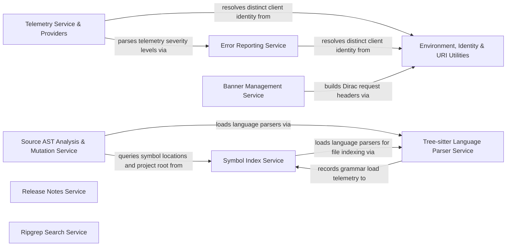

## Details

Provides AST analysis, Tree-sitter parsing, symbol indexing, ripgrep search, error reporting, remote banners, and telemetry provider backends.

### Telemetry Service & Providers [[Expand]](./Telemetry_Service_Providers.md)
Captures and routes domain telemetry events, session metrics, and traces through Dirac and OpenTelemetry telemetry providers.

**Related Classes/Methods**:

- `src.services.telemetry.providers.DiracTelemetryProvider.DiracTelemetryProvider.captureToDirac`:163-186
- `src.services.telemetry.providers.DiracTelemetryProvider.DiracTelemetryProvider.getTelemetryLevel`:269-278
- `src.services.telemetry.providers.opentelemetry.OpenTelemetryTelemetryProvider.OpenTelemetryTelemetryProvider.log`:96-120
- `src.services.telemetry.providers.opentelemetry.OpenTelemetryTelemetryProvider.OpenTelemetryTelemetryProvider.logRequired`:122-136
- `src.services.telemetry.providers.opentelemetry.OpenTelemetryTelemetryProvider.OpenTelemetryTelemetryProvider.getTelemetryLevel`:288-298

**Source Files:**

- `src/services/telemetry/HookTelemetry.ts`
  - `src.services.telemetry.HookTelemetry.HookTelemetry` (L26-L113) - Class
  - `src.services.telemetry.HookTelemetry.HookTelemetry.constructor` (L30-L33) - Constructor
  - `src.services.telemetry.HookTelemetry.HookTelemetry.captureHookCacheAccess` (L35-L43) - Method
  - `src.services.telemetry.HookTelemetry.HookTelemetry.captureHookExecution` (L45-L96) - Method
  - `src.services.telemetry.HookTelemetry.HookTelemetry.captureHookDiscovery` (L98-L112) - Method
- `src/services/telemetry/MentionTelemetry.ts`
  - `src.services.telemetry.MentionTelemetry.MentionTelemetry` (L12-L57) - Class
  - `src.services.telemetry.MentionTelemetry.MentionTelemetry.constructor` (L15-L15) - Constructor
  - `src.services.telemetry.MentionTelemetry.MentionTelemetry.captureMentionUsed` (L17-L22) - Method
  - `src.services.telemetry.MentionTelemetry.MentionTelemetry.captureMentionFailed` (L24-L38) - Method
  - `src.services.telemetry.MentionTelemetry.MentionTelemetry.captureMentionSearchResults` (L40-L56) - Method
- `src/services/telemetry/SubagentTelemetry.ts`
  - `src.services.telemetry.SubagentTelemetry.SubagentTelemetry` (L9-L36) - Class
  - `src.services.telemetry.SubagentTelemetry.SubagentTelemetry.constructor` (L12-L15) - Constructor
  - `src.services.telemetry.SubagentTelemetry.SubagentTelemetry.captureSubagentToggle` (L17-L25) - Method
  - `src.services.telemetry.SubagentTelemetry.SubagentTelemetry.captureSubagentExecution` (L27-L35) - Method
- `src/services/telemetry/TelemetryCategoryGate.ts`
  - `src.services.telemetry.TelemetryCategoryGate.TelemetryCategoryGate` (L7-L24) - Class
  - `src.services.telemetry.TelemetryCategoryGate.TelemetryCategoryGate.isEnabled` (L17-L19) - Method
  - `src.services.telemetry.TelemetryCategoryGate.TelemetryCategoryGate.setEnabled` (L21-L23) - Method
- `src/services/telemetry/TelemetryContextManager.ts`
  - `src.services.telemetry.TelemetryContextManager.UserInfo` (L8-L13) - Interface
  - `src.services.telemetry.TelemetryContextManager.TelemetryContextManager` (L15-L54) - Class
  - `src.services.telemetry.TelemetryContextManager.TelemetryContextManager.constructor` (L23-L23) - Constructor
  - `src.services.telemetry.TelemetryContextManager.TelemetryContextManager.setUserInfo` (L26-L33) - Method
  - `src.services.telemetry.TelemetryContextManager.TelemetryContextManager.getUserId` (L36-L38) - Method
  - `src.services.telemetry.TelemetryContextManager.TelemetryContextManager.getActiveOrg` (L41-L43) - Method
  - `src.services.telemetry.TelemetryContextManager.TelemetryContextManager.getStandardAttributes` (L46-L53) - Method
- `src/services/telemetry/TelemetryEventEmitter.ts`
  - `src.services.telemetry.TelemetryEventEmitter.TelemetryEventEmitter` (L10-L85) - Class
  - `src.services.telemetry.TelemetryEventEmitter.TelemetryEventEmitter.constructor` (L11-L14) - Constructor
  - `src.services.telemetry.TelemetryEventEmitter.TelemetryEventEmitter.capture` (L17-L20) - Method
  - `src.services.telemetry.TelemetryEventEmitter.TelemetryEventEmitter.captureRequired` (L23-L26) - Method
  - `src.services.telemetry.TelemetryEventEmitter.TelemetryEventEmitter.captureToProviders` (L29-L41) - Method
  - `src.services.telemetry.TelemetryEventEmitter.TelemetryEventEmitter.captureToProviders.forEach() callback` (L30-L40) - Function
  - `src.services.telemetry.TelemetryEventEmitter.TelemetryEventEmitter.recordCounter` (L43-L52) - Method
  - `src.services.telemetry.TelemetryEventEmitter.TelemetryEventEmitter.recordCounter.forEach() callback` (L45-L51) - Function
  - `src.services.telemetry.TelemetryEventEmitter.TelemetryEventEmitter.recordHistogram` (L54-L63) - Method
  - `src.services.telemetry.TelemetryEventEmitter.TelemetryEventEmitter.recordHistogram.forEach() callback` (L56-L62) - Function
  - `src.services.telemetry.TelemetryEventEmitter.TelemetryEventEmitter.recordGauge` (L69-L84) - Method
  - `src.services.telemetry.TelemetryEventEmitter.TelemetryEventEmitter.recordGauge.forEach() callback` (L77-L83) - Function
- `src/services/telemetry/TelemetryProviderFactory.ts`
  - `src.services.telemetry.TelemetryProviderFactory.TelemetryProviderFactory` (L38-L131) - Class
  - `src.services.telemetry.TelemetryProviderFactory.TelemetryProviderFactory.createProviders` (L43-L61) - Method
  - `src.services.telemetry.TelemetryProviderFactory.TelemetryProviderFactory.createProvider` (L68-L93) - Method
  - `src.services.telemetry.TelemetryProviderFactory.TelemetryProviderFactory.getDefaultConfigs` (L99-L130) - Method
  - `src.services.telemetry.TelemetryProviderFactory.NoOpTelemetryProvider` (L137-L191) - Class
  - `src.services.telemetry.TelemetryProviderFactory.NoOpTelemetryProvider.log` (L141-L143) - Method
  - `src.services.telemetry.TelemetryProviderFactory.NoOpTelemetryProvider.logRequired` (L144-L146) - Method
  - `src.services.telemetry.TelemetryProviderFactory.NoOpTelemetryProvider.identifyUser` (L147-L149) - Method
  - `src.services.telemetry.TelemetryProviderFactory.NoOpTelemetryProvider.isEnabled` (L150-L152) - Method
  - `src.services.telemetry.TelemetryProviderFactory.NoOpTelemetryProvider.getSettings` (L153-L158) - Method
  - `src.services.telemetry.TelemetryProviderFactory.NoOpTelemetryProvider.recordCounter` (L159-L167) - Method
  - `src.services.telemetry.TelemetryProviderFactory.NoOpTelemetryProvider.recordHistogram` (L168-L176) - Method
  - `src.services.telemetry.TelemetryProviderFactory.NoOpTelemetryProvider.recordGauge` (L177-L185) - Method
  - `src.services.telemetry.TelemetryProviderFactory.NoOpTelemetryProvider.forceFlush` (L187-L187) - Method
  - `src.services.telemetry.TelemetryProviderFactory.NoOpTelemetryProvider.dispose` (L188-L190) - Method
- `src/services/telemetry/TelemetryProviderManager.ts`
  - `src.services.telemetry.TelemetryProviderManager.TelemetryProviderManager` (L8-L55) - Class
  - `src.services.telemetry.TelemetryProviderManager.TelemetryProviderManager.constructor` (L11-L13) - Constructor
  - `src.services.telemetry.TelemetryProviderManager.TelemetryProviderManager.addProvider` (L15-L17) - Method
  - `src.services.telemetry.TelemetryProviderManager.TelemetryProviderManager.removeProvider` (L19-L21) - Method
  - `src.services.telemetry.TelemetryProviderManager.TelemetryProviderManager.removeProvider.providers.filter() callback` (L20-L20) - Function
  - `src.services.telemetry.TelemetryProviderManager.TelemetryProviderManager.getProviders` (L23-L25) - Method
  - `src.services.telemetry.TelemetryProviderManager.TelemetryProviderManager.isEnabled` (L27-L29) - Method
  - `src.services.telemetry.TelemetryProviderManager.TelemetryProviderManager.isEnabled.providers.some() callback` (L28-L28) - Function
  - `src.services.telemetry.TelemetryProviderManager.TelemetryProviderManager.getSettings` (L31-L33) - Method
  - `src.services.telemetry.TelemetryProviderManager.TelemetryProviderManager.identifyUser` (L36-L44) - Method
  - `src.services.telemetry.TelemetryProviderManager.TelemetryProviderManager.identifyUser.providers.forEach() callback` (L37-L43) - Function
  - `src.services.telemetry.TelemetryProviderManager.TelemetryProviderManager.getProviderList` (L47-L49) - Method
  - `src.services.telemetry.TelemetryProviderManager.TelemetryProviderManager.dispose` (L51-L54) - Method
  - `src.services.telemetry.TelemetryProviderManager.TelemetryProviderManager.dispose.disposePromises` (L52-L52) - Class
  - `src.services.telemetry.TelemetryProviderManager.TelemetryProviderManager.dispose.disposePromises.providers.map() callback` (L52-L52) - Function
- `src/services/telemetry/TelemetrySessionTracker.ts`
  - `src.services.telemetry.TelemetrySessionTracker.TelemetrySessionTracker` (L5-L34) - Class
  - `src.services.telemetry.TelemetrySessionTracker.TelemetrySessionTracker.incrementTurnCount` (L10-L12) - Method
  - `src.services.telemetry.TelemetrySessionTracker.TelemetrySessionTracker.incrementToolCallCount` (L14-L16) - Method
  - `src.services.telemetry.TelemetrySessionTracker.TelemetrySessionTracker.incrementErrorCount` (L18-L20) - Method
  - `src.services.telemetry.TelemetrySessionTracker.TelemetrySessionTracker.resetAggregates` (L23-L27) - Method
  - `src.services.telemetry.TelemetrySessionTracker.TelemetrySessionTracker.increment` (L29-L33) - Method
- `src/services/telemetry/TelemetryTypes.ts`
  - `src.services.telemetry.TelemetryTypes.TerminalOutputFailureReason` (L26-L30) - Enum
  - `src.services.telemetry.TelemetryTypes.TerminalUserInterventionAction` (L33-L37) - Enum
  - `src.services.telemetry.TelemetryTypes.TerminalHangStage` (L40-L44) - Enum
  - `src.services.telemetry.TelemetryTypes.TokenUsage` (L75-L81) - Interface
- `src/services/telemetry/TerminalTelemetry.ts`
  - `src.services.telemetry.TerminalTelemetry.TerminalTelemetry` (L16-L59) - Class
  - `src.services.telemetry.TerminalTelemetry.TerminalTelemetry.constructor` (L19-L19) - Constructor
  - `src.services.telemetry.TerminalTelemetry.TerminalTelemetry.captureTerminalExecution` (L21-L37) - Method
  - `src.services.telemetry.TerminalTelemetry.TerminalTelemetry.captureTerminalOutputFailure` (L39-L44) - Method
  - `src.services.telemetry.TerminalTelemetry.TerminalTelemetry.captureTerminalUserIntervention` (L46-L51) - Method
  - `src.services.telemetry.TerminalTelemetry.TerminalTelemetry.captureTerminalHang` (L53-L58) - Method
- `src/services/telemetry/UiTelemetry.ts`
  - `src.services.telemetry.UiTelemetry.UiTelemetry` (L8-L31) - Class
  - `src.services.telemetry.UiTelemetry.UiTelemetry.constructor` (L11-L11) - Constructor
  - `src.services.telemetry.UiTelemetry.UiTelemetry.captureModelSelected` (L13-L15) - Method
  - `src.services.telemetry.UiTelemetry.UiTelemetry.captureModelFavoritesUsage` (L17-L22) - Method
  - `src.services.telemetry.UiTelemetry.UiTelemetry.captureButtonClick` (L24-L26) - Method
  - `src.services.telemetry.UiTelemetry.UiTelemetry.captureRulesMenuOpened` (L28-L30) - Method
- `src/services/telemetry/events/EventHandlerBase.ts`
  - `src.services.telemetry.events.EventHandlerBase.EventHandlerBase` (L8-L45) - Class
  - `src.services.telemetry.events.EventHandlerBase.EventHandlerBase.capture` (L19-L25) - Method
  - `src.services.telemetry.events.EventHandlerBase.EventHandlerBase.captureRequired` (L33-L35) - Method
  - `src.services.telemetry.events.EventHandlerBase.EventHandlerBase.isEnabled` (L42-L44) - Method
  - `src.services.telemetry.events.EventHandlerBase.EventHandlerRegistry` (L50-L91) - Class
  - `src.services.telemetry.events.EventHandlerBase.EventHandlerRegistry.register` (L59-L61) - Method
  - `src.services.telemetry.events.EventHandlerBase.EventHandlerRegistry.getHandler` (L68-L70) - Method
  - `src.services.telemetry.events.EventHandlerBase.EventHandlerRegistry.registerAll` (L76-L82) - Method
  - `src.services.telemetry.events.EventHandlerBase.EventHandlerRegistry.getRegisteredPrefixes` (L88-L90) - Method
- `src/services/telemetry/index.ts`
  - `src.services.telemetry.index.getTelemetryService` (L36-L60) - Function
  - `src.services.telemetry.index.getTelemetryService.then() callback` (L49-L53) - Function
  - `src.services.telemetry.index.getTelemetryService.catch() callback` (L54-L57) - Function
  - `src.services.telemetry.index.resetTelemetryService` (L65-L68) - Function
  - `src.services.telemetry.index.telemetryService` (L70-L82) - Class
  - `src.services.telemetry.index.telemetryService.get` (L71-L81) - Method
  - `src.services.telemetry.index.telemetryService.get.<function>` (L73-L80) - Function
- `src/services/telemetry/providers/DiracTelemetryProvider.ts`
  - `src.services.telemetry.providers.DiracTelemetryProvider.isSensitiveKey` (L60-L62) - Function
  - `src.services.telemetry.providers.DiracTelemetryProvider.scrubTelemetryProperties` (L64-L89) - Function
  - `src.services.telemetry.providers.DiracTelemetryProvider.scrubTelemetryProperties.result` (L66-L69) - Class
  - `src.services.telemetry.providers.DiracTelemetryProvider.scrubTelemetryProperties.result.TELEMETRY_SECRET_PATTERNS.reduce() callback` (L67-L67) - Function
  - `src.services.telemetry.providers.DiracTelemetryProvider.scrubTelemetryProperties.map() callback` (L78-L85) - Function
  - `src.services.telemetry.providers.DiracTelemetryProvider.DiracTelemetryProvider` (L95-L279) - Class
  - `src.services.telemetry.providers.DiracTelemetryProvider.DiracTelemetryProvider.constructor` (L101-L108) - Constructor
  - `src.services.telemetry.providers.DiracTelemetryProvider.DiracTelemetryProvider.initialize` (L110-L134) - Method
  - `src.services.telemetry.providers.DiracTelemetryProvider.DiracTelemetryProvider.initialize.onResponse` (L116-L119) - Method
  - `src.services.telemetry.providers.DiracTelemetryProvider.DiracTelemetryProvider.forceFlush` (L136-L138) - Method
  - `src.services.telemetry.providers.DiracTelemetryProvider.DiracTelemetryProvider.log` (L140-L154) - Method
  - `src.services.telemetry.providers.DiracTelemetryProvider.DiracTelemetryProvider.logRequired` (L156-L161) - Method
  - `src.services.telemetry.providers.DiracTelemetryProvider.DiracTelemetryProvider.captureToDirac` (L163-L186) - Method
  - `src.services.telemetry.providers.DiracTelemetryProvider.DiracTelemetryProvider.identifyUser` (L188-L190) - Method
  - `src.services.telemetry.providers.DiracTelemetryProvider.DiracTelemetryProvider.isEnabled` (L192-L199) - Method
  - `src.services.telemetry.providers.DiracTelemetryProvider.DiracTelemetryProvider.getSettings` (L201-L203) - Method
  - `src.services.telemetry.providers.DiracTelemetryProvider.DiracTelemetryProvider.recordCounter` (L208-L222) - Method
  - `src.services.telemetry.providers.DiracTelemetryProvider.DiracTelemetryProvider.recordHistogram` (L227-L241) - Method
  - `src.services.telemetry.providers.DiracTelemetryProvider.DiracTelemetryProvider.recordGauge` (L246-L260) - Method
  - `src.services.telemetry.providers.DiracTelemetryProvider.DiracTelemetryProvider.dispose` (L262-L264) - Method
  - `src.services.telemetry.providers.DiracTelemetryProvider.DiracTelemetryProvider.getTelemetryLevel` (L269-L278) - Method
- `src/services/telemetry/providers/ITelemetryProvider.ts`
  - `src.services.telemetry.providers.ITelemetryProvider.TelemetrySettings` (L35-L40) - Interface
  - `src.services.telemetry.providers.ITelemetryProvider.ITelemetryProvider` (L46-L123) - Interface
  - `src.services.telemetry.providers.ITelemetryProvider.ITelemetryProvider.log` (L52-L52) - Method
  - `src.services.telemetry.providers.ITelemetryProvider.ITelemetryProvider.logRequired` (L60-L60) - Method
  - `src.services.telemetry.providers.ITelemetryProvider.ITelemetryProvider.identifyUser` (L67-L67) - Method
  - `src.services.telemetry.providers.ITelemetryProvider.ITelemetryProvider.isEnabled` (L72-L72) - Method
  - `src.services.telemetry.providers.ITelemetryProvider.ITelemetryProvider.getSettings` (L77-L77) - Method
  - `src.services.telemetry.providers.ITelemetryProvider.ITelemetryProvider.recordCounter` (L91-L91) - Method
  - `src.services.telemetry.providers.ITelemetryProvider.ITelemetryProvider.recordHistogram` (L100-L100) - Method
  - `src.services.telemetry.providers.ITelemetryProvider.ITelemetryProvider.recordGauge` (L109-L115) - Method
  - `src.services.telemetry.providers.ITelemetryProvider.ITelemetryProvider.forceFlush` (L117-L117) - Method
  - `src.services.telemetry.providers.ITelemetryProvider.ITelemetryProvider.dispose` (L122-L122) - Method
- `src/services/telemetry/providers/opentelemetry/OpenTelemetryClientProvider.ts`
  - `src.services.telemetry.providers.opentelemetry.OpenTelemetryClientProvider.OpenTelemetryClientProvider` (L22-L217) - Class
  - `src.services.telemetry.providers.opentelemetry.OpenTelemetryClientProvider.OpenTelemetryClientProvider.isDebugEnabled` (L31-L33) - Method
  - `src.services.telemetry.providers.opentelemetry.OpenTelemetryClientProvider.OpenTelemetryClientProvider.constructor` (L35-L76) - Constructor
  - `src.services.telemetry.providers.opentelemetry.OpenTelemetryClientProvider.OpenTelemetryClientProvider.createMeterProvider` (L78-L134) - Method
  - `src.services.telemetry.providers.opentelemetry.OpenTelemetryClientProvider.OpenTelemetryClientProvider.createMeterProvider.exporters` (L79-L79) - Class
  - `src.services.telemetry.providers.opentelemetry.OpenTelemetryClientProvider.OpenTelemetryClientProvider.createMeterProvider.exporters.map() callback` (L79-L79) - Function
  - `src.services.telemetry.providers.opentelemetry.OpenTelemetryClientProvider.OpenTelemetryClientProvider.createLoggerProvider` (L136-L194) - Method
  - `src.services.telemetry.providers.opentelemetry.OpenTelemetryClientProvider.OpenTelemetryClientProvider.createLoggerProvider.exporters` (L137-L137) - Class
  - `src.services.telemetry.providers.opentelemetry.OpenTelemetryClientProvider.OpenTelemetryClientProvider.createLoggerProvider.exporters.map() callback` (L137-L137) - Function
  - `src.services.telemetry.providers.opentelemetry.OpenTelemetryClientProvider.OpenTelemetryClientProvider.dispose` (L196-L216) - Method
  - `src.services.telemetry.providers.opentelemetry.OpenTelemetryClientProvider.dispose.catch() callback` (L201-L203) - Function
  - `src.services.telemetry.providers.opentelemetry.OpenTelemetryClientProvider.OpenTelemetryClientProvider.dispose.catch() callback` (L209-L211) - Function
- `src/services/telemetry/providers/opentelemetry/OpenTelemetryExporterFactory.ts`
  - `src.services.telemetry.providers.opentelemetry.OpenTelemetryExporterFactory.isDebugEnabled` (L18-L20) - Function
  - `src.services.telemetry.providers.opentelemetry.OpenTelemetryExporterFactory.createConsoleLogExporter` (L25-L27) - Function
  - `src.services.telemetry.providers.opentelemetry.OpenTelemetryExporterFactory.ensurePathSuffix` (L29-L36) - Function
  - `src.services.telemetry.providers.opentelemetry.OpenTelemetryExporterFactory.sanitizeEndpointForLogging` (L38-L45) - Function
  - `src.services.telemetry.providers.opentelemetry.OpenTelemetryExporterFactory.resolveGrpcCredentials` (L52-L61) - Function
  - `src.services.telemetry.providers.opentelemetry.OpenTelemetryExporterFactory.createOTLPLogExporter` (L66-L115) - Function
  - `src.services.telemetry.providers.opentelemetry.OpenTelemetryExporterFactory.createConsoleMetricReader` (L120-L127) - Function
  - `src.services.telemetry.providers.opentelemetry.OpenTelemetryExporterFactory.createOTLPMetricReader` (L132-L187) - Function
- `src/services/telemetry/providers/opentelemetry/OpenTelemetryTelemetryProvider.ts`
  - `src.services.telemetry.providers.opentelemetry.OpenTelemetryTelemetryProvider.OpenTelemetryTelemetryProvider` (L17-L380) - Class
  - `src.services.telemetry.providers.opentelemetry.OpenTelemetryTelemetryProvider.OpenTelemetryTelemetryProvider.constructor` (L34-L64) - Constructor
  - `src.services.telemetry.providers.opentelemetry.OpenTelemetryTelemetryProvider.OpenTelemetryTelemetryProvider.initialize` (L66-L90) - Method
  - `src.services.telemetry.providers.opentelemetry.OpenTelemetryTelemetryProvider.OpenTelemetryTelemetryProvider.initialize.onResponse` (L75-L78) - Method
  - `src.services.telemetry.providers.opentelemetry.OpenTelemetryTelemetryProvider.OpenTelemetryTelemetryProvider.forceFlush` (L92-L94) - Method
  - `src.services.telemetry.providers.opentelemetry.OpenTelemetryTelemetryProvider.OpenTelemetryTelemetryProvider.log` (L96-L120) - Method
  - `src.services.telemetry.providers.opentelemetry.OpenTelemetryTelemetryProvider.OpenTelemetryTelemetryProvider.logRequired` (L122-L136) - Method
  - `src.services.telemetry.providers.opentelemetry.OpenTelemetryTelemetryProvider.OpenTelemetryTelemetryProvider.identifyUser` (L138-L138) - Method
  - `src.services.telemetry.providers.opentelemetry.OpenTelemetryTelemetryProvider.OpenTelemetryTelemetryProvider.isEnabled` (L145-L150) - Method
  - `src.services.telemetry.providers.opentelemetry.OpenTelemetryTelemetryProvider.OpenTelemetryTelemetryProvider.getSettings` (L152-L154) - Method
  - `src.services.telemetry.providers.opentelemetry.OpenTelemetryTelemetryProvider.OpenTelemetryTelemetryProvider.recordCounter` (L160-L180) - Method
  - `src.services.telemetry.providers.opentelemetry.OpenTelemetryTelemetryProvider.OpenTelemetryTelemetryProvider.recordHistogram` (L186-L206) - Method
  - `src.services.telemetry.providers.opentelemetry.OpenTelemetryTelemetryProvider.OpenTelemetryTelemetryProvider.recordGauge` (L212-L263) - Method
  - `src.services.telemetry.providers.opentelemetry.OpenTelemetryTelemetryProvider.OpenTelemetryTelemetryProvider.recordGauge.gauge.addCallback() callback` (L248-L256) - Function
  - `src.services.telemetry.providers.opentelemetry.OpenTelemetryTelemetryProvider.OpenTelemetryTelemetryProvider.snapshotGaugeSeries` (L265-L278) - Method
  - `src.services.telemetry.providers.opentelemetry.OpenTelemetryTelemetryProvider.OpenTelemetryTelemetryProvider.dispose` (L280-L283) - Method
  - `src.services.telemetry.providers.opentelemetry.OpenTelemetryTelemetryProvider.OpenTelemetryTelemetryProvider.getTelemetryLevel` (L288-L298) - Method
  - `src.services.telemetry.providers.opentelemetry.OpenTelemetryTelemetryProvider.OpenTelemetryTelemetryProvider.flattenProperties` (L306-L379) - Method

### Error Reporting Service
Manages application error representations, severity level parsing, and error reporting through Dirac error providers.

**Related Classes/Methods**:

- `src.services.error.index.getErrorLevelFromString`:9-20
- `src.services.error.providers.DiracErrorProvider.DiracErrorProvider.sendToDirac`:127-151

**Source Files:**

- `src/services/error/DiracError.ts`
  - `src.services.error.DiracError.DiracErrorType` (L6-L13) - Enum
  - `src.services.error.DiracError.ErrorDetails` (L15-L46) - Interface
  - `src.services.error.DiracError.DiracError` (L50-L202) - Class
  - `src.services.error.DiracError.DiracError.constructor` (L57-L89) - Constructor
  - `src.services.error.DiracError.DiracError.serialize` (L95-L105) - Method
  - `src.services.error.DiracError.DiracError.toDisplayMessage` (L114-L127) - Method
  - `src.services.error.DiracError.DiracError.parse` (L132-L137) - Method
  - `src.services.error.DiracError.DiracError.transform` (L143-L153) - Method
  - `src.services.error.DiracError.DiracError.isErrorType` (L155-L157) - Method
  - `src.services.error.DiracError.DiracError.getErrorType` (L163-L201) - Method
  - `src.services.error.DiracError.DiracError.getErrorType.authErrorRegex.some() callback` (L185-L185) - Function
  - `src.services.error.DiracError.DiracError.getErrorType.RATE_LIMIT_PATTERNS.some() callback` (L191-L191) - Function
  - `src.services.error.DiracError.AuthNetworkError` (L204-L212) - Class
  - `src.services.error.DiracError.AuthNetworkError.constructor` (L205-L211) - Constructor
  - `src.services.error.DiracError.AuthInvalidTokenError` (L214-L219) - Class
  - `src.services.error.DiracError.AuthInvalidTokenError.constructor` (L215-L218) - Constructor
- `src/services/error/ErrorProviderFactory.ts`
  - `src.services.error.ErrorProviderFactory.ErrorProviderConfig` (L20-L23) - Interface
  - `src.services.error.ErrorProviderFactory.ErrorProviderFactory` (L29-L72) - Class
  - `src.services.error.ErrorProviderFactory.ErrorProviderFactory.createProvider` (L35-L53) - Method
  - `src.services.error.ErrorProviderFactory.ErrorProviderFactory.getDefaultConfig` (L59-L71) - Method
  - `src.services.error.ErrorProviderFactory.NoOpErrorProvider` (L78-L111) - Class
  - `src.services.error.ErrorProviderFactory.NoOpErrorProvider.captureException` (L79-L81) - Method
  - `src.services.error.ErrorProviderFactory.NoOpErrorProvider.logException` (L83-L86) - Method
  - `src.services.error.ErrorProviderFactory.NoOpErrorProvider.logMessage` (L88-L94) - Method
  - `src.services.error.ErrorProviderFactory.NoOpErrorProvider.isEnabled` (L96-L98) - Method
  - `src.services.error.ErrorProviderFactory.NoOpErrorProvider.getSettings` (L100-L106) - Method
  - `src.services.error.ErrorProviderFactory.NoOpErrorProvider.dispose` (L108-L110) - Method
- `src/services/error/ErrorService.ts`
  - `src.services.error.ErrorService.ErrorService` (L11-L96) - Class
  - `src.services.error.ErrorService.ErrorService.initialize` (L19-L27) - Method
  - `src.services.error.ErrorService.ErrorService.get` (L32-L37) - Method
  - `src.services.error.ErrorService.ErrorService.constructor` (L39-L41) - Constructor
  - `src.services.error.ErrorService.ErrorService.captureException` (L43-L45) - Method
  - `src.services.error.ErrorService.ErrorService.logException` (L47-L50) - Method
  - `src.services.error.ErrorService.ErrorService.logMessage` (L52-L58) - Method
  - `src.services.error.ErrorService.ErrorService.toDiracError` (L60-L64) - Method
  - `src.services.error.ErrorService.ErrorService.isEnabled` (L70-L72) - Method
  - `src.services.error.ErrorService.ErrorService.getSettings` (L78-L80) - Method
  - `src.services.error.ErrorService.ErrorService.getProvider` (L86-L88) - Method
  - `src.services.error.ErrorService.ErrorService.dispose` (L93-L95) - Method
- `src/services/error/index.ts`
  - `src.services.error.index.getErrorLevelFromString` (L9-L20) - Function
- `src/services/error/providers/DiracErrorProvider.ts`
  - `src.services.error.providers.DiracErrorProvider.DiracErrorProvider` (L23-L164) - Class
  - `src.services.error.providers.DiracErrorProvider.DiracErrorProvider.constructor` (L26-L33) - Constructor
  - `src.services.error.providers.DiracErrorProvider.DiracErrorProvider.initialize` (L35-L55) - Method
  - `src.services.error.providers.DiracErrorProvider.DiracErrorProvider.initialize.onResponse` (L40-L43) - Method
  - `src.services.error.providers.DiracErrorProvider.DiracErrorProvider.captureException` (L57-L72) - Method
  - `src.services.error.providers.DiracErrorProvider.DiracErrorProvider.logException` (L74-L102) - Method
  - `src.services.error.providers.DiracErrorProvider.DiracErrorProvider.logMessage` (L104-L125) - Method
  - `src.services.error.providers.DiracErrorProvider.DiracErrorProvider.sendToDirac` (L127-L151) - Method
  - `src.services.error.providers.DiracErrorProvider.DiracErrorProvider.isEnabled` (L153-L155) - Method
  - `src.services.error.providers.DiracErrorProvider.DiracErrorProvider.getSettings` (L157-L159) - Method
  - `src.services.error.providers.DiracErrorProvider.DiracErrorProvider.dispose` (L161-L163) - Method
- `src/services/error/providers/IErrorProvider.ts`
  - `src.services.error.providers.IErrorProvider.ErrorSettings` (L11-L18) - Interface
  - `src.services.error.providers.IErrorProvider.IErrorProvider` (L24-L65) - Interface
  - `src.services.error.providers.IErrorProvider.IErrorProvider.captureException` (L30-L30) - Method
  - `src.services.error.providers.IErrorProvider.IErrorProvider.logException` (L37-L37) - Method
  - `src.services.error.providers.IErrorProvider.IErrorProvider.logMessage` (L45-L49) - Method
  - `src.services.error.providers.IErrorProvider.IErrorProvider.isEnabled` (L54-L54) - Method
  - `src.services.error.providers.IErrorProvider.IErrorProvider.getSettings` (L59-L59) - Method
  - `src.services.error.providers.IErrorProvider.IErrorProvider.dispose` (L64-L64) - Method

### Source AST Analysis & Mutation Service
Catalogs source definitions, resolves symbol occurrences and context, and plans AST-based source mutations.

**Related Classes/Methods**:

- `src.services.source-ast.SourceDefinitionCatalog.SourceDefinitionCatalog.load`:60-128
- `src.services.source-ast.SourceOccurrenceResolver.SourceOccurrenceResolver.constructor`:51-53
- `src.services.source-ast.SourceOccurrenceResolver.SourceOccurrenceResolver.filterQualifiedLocations`:188-347
- `src.services.source-ast.SourceOccurrenceResolver.SourceOccurrenceResolver.absoluteLocationPath`:349-351

**Source Files:**

- `src/services/source-ast/SourceAstService.ts`
  - `src.services.source-ast.SourceAstService.SourceAstService` (L21-L222) - Class
  - `src.services.source-ast.SourceAstService.SourceAstService.constructor` (L26-L43) - Constructor
  - `src.services.source-ast.SourceAstService.SourceAstService.outline` (L45-L101) - Method
  - `src.services.source-ast.SourceAstService.SourceAstService.outline.lines.catalog.definitions.flatMap() callback` (L82-L90) - Function
  - `src.services.source-ast.SourceAstService.outline.lines` (L82-L90) - Class
  - `src.services.source-ast.SourceAstService.SourceAstService.implementations` (L103-L201) - Method
  - `src.services.source-ast.SourceAstService.SourceAstService.implementations.candidates.match.candidates.map() callback` (L163-L167) - Function
  - `src.services.source-ast.SourceAstService.SourceAstService.implementations.lines.implementationLines.map() callback` (L179-L186) - Function
  - `src.services.source-ast.SourceAstService.implementations.lines` (L179-L186) - Class
  - `src.services.source-ast.SourceAstService.SourceAstService.occurrences` (L203-L205) - Method
  - `src.services.source-ast.SourceAstService.SourceAstService.planRename` (L207-L209) - Method
  - `src.services.source-ast.SourceAstService.SourceAstService.planReplacements` (L211-L213) - Method
  - `src.services.source-ast.SourceAstService.SourceAstService.getAnchorFingerprint` (L215-L217) - Method
  - `src.services.source-ast.SourceAstService.SourceAstService.errorMessage` (L219-L221) - Method
- `src/services/source-ast/SourceDefinitionCatalog.ts`
  - `src.services.source-ast.SourceDefinitionCatalog.CatalogOptions` (L21-L26) - Interface
  - `src.services.source-ast.SourceDefinitionCatalog.SourceDefinitionCatalogDependencies` (L28-L31) - Interface
  - `src.services.source-ast.SourceDefinitionCatalog.SourceDefinitionCatalogDependencies.validateAccess` (L29-L29) - Method
  - `src.services.source-ast.SourceDefinitionCatalog.SourceDefinitionCatalogDependencies.reconcileAnchors` (L30-L30) - Method
  - `src.services.source-ast.SourceDefinitionCatalog.SourceDefinitionCatalog` (L57-L366) - Class
  - `src.services.source-ast.SourceDefinitionCatalog.SourceDefinitionCatalog.constructor` (L58-L58) - Constructor
  - `src.services.source-ast.SourceDefinitionCatalog.SourceDefinitionCatalog.load` (L60-L128) - Method
  - `src.services.source-ast.SourceDefinitionCatalog.SourceDefinitionCatalog.match` (L130-L141) - Method
  - `src.services.source-ast.SourceDefinitionCatalog.SourceDefinitionCatalog.match.exact` (L132-L132) - Class
  - `src.services.source-ast.SourceDefinitionCatalog.SourceDefinitionCatalog.match.exact.definitions.filter() callback` (L132-L132) - Function
  - `src.services.source-ast.SourceDefinitionCatalog.match.candidates` (L133-L137) - Class
  - `src.services.source-ast.SourceDefinitionCatalog.SourceDefinitionCatalog.match.candidates.definitions.filter() callback` (L135-L136) - Function
  - `src.services.source-ast.SourceDefinitionCatalog.SourceDefinitionCatalog.collectDefinitions` (L143-L219) - Method
  - `src.services.source-ast.SourceDefinitionCatalog.SourceDefinitionCatalog.collectDefinitions.nameCapture` (L165-L165) - Class
  - `src.services.source-ast.SourceDefinitionCatalog.SourceDefinitionCatalog.collectDefinitions.nameCapture.match.captures.find() callback` (L165-L165) - Function
  - `src.services.source-ast.SourceDefinitionCatalog.SourceDefinitionCatalog.collectDefinitions.definitionCapture` (L166-L168) - Class
  - `src.services.source-ast.SourceDefinitionCatalog.collectDefinitions.definitionCapture.match.captures.find() callback` (L167-L167) - Function
  - `src.services.source-ast.SourceDefinitionCatalog.SourceDefinitionCatalog.collectDefinitions.definitionCapture.match.captures.find() callback` (L168-L168) - Function
  - `src.services.source-ast.SourceDefinitionCatalog.SourceDefinitionCatalog.collectDefinitions.definitions.sort() callback` (L215-L217) - Function
  - `src.services.source-ast.SourceDefinitionCatalog.SourceDefinitionCatalog.definitionMatchMap` (L221-L231) - Method
  - `src.services.source-ast.SourceDefinitionCatalog.SourceDefinitionCatalog.qualifiedName` (L233-L253) - Method
  - `src.services.source-ast.SourceDefinitionCatalog.SourceDefinitionCatalog.qualifiedName.parentName` (L247-L247) - Class
  - `src.services.source-ast.SourceDefinitionCatalog.SourceDefinitionCatalog.qualifiedName.parentName.parentMatch.captures.find() callback` (L247-L247) - Function
  - `src.services.source-ast.SourceDefinitionCatalog.SourceDefinitionCatalog.expandReplacementNode` (L255-L259) - Method
  - `src.services.source-ast.SourceDefinitionCatalog.SourceDefinitionCatalog.expandLeadingMetadata` (L261-L277) - Method
  - `src.services.source-ast.SourceDefinitionCatalog.SourceDefinitionCatalog.rangeForNode` (L279-L288) - Method
  - `src.services.source-ast.SourceDefinitionCatalog.SourceDefinitionCatalog.definitionKind` (L290-L300) - Method
  - `src.services.source-ast.SourceDefinitionCatalog.SourceDefinitionCatalog.localCalls` (L302-L315) - Method
  - `src.services.source-ast.SourceDefinitionCatalog.SourceDefinitionCatalog.isCallNode` (L317-L322) - Method
  - `src.services.source-ast.SourceDefinitionCatalog.SourceDefinitionCatalog.resolveContextLines` (L324-L353) - Method
  - `src.services.source-ast.SourceDefinitionCatalog.SourceDefinitionCatalog.resolveContextLines.wanted` (L343-L343) - Class
  - `src.services.source-ast.SourceDefinitionCatalog.SourceDefinitionCatalog.resolveContextLines.wanted.filter() callback` (L343-L343) - Function
  - `src.services.source-ast.SourceDefinitionCatalog.SourceDefinitionCatalog.normalizeSymbol` (L355-L357) - Method
  - `src.services.source-ast.SourceDefinitionCatalog.SourceDefinitionCatalog.isUnsupportedError` (L359-L361) - Method
  - `src.services.source-ast.SourceDefinitionCatalog.SourceDefinitionCatalog.errorMessage` (L363-L365) - Method
- `src/services/source-ast/SourceMutationPlanner.ts`
  - `src.services.source-ast.SourceMutationPlanner.SourceMutationPlannerDependencies` (L16-L20) - Interface
  - `src.services.source-ast.SourceMutationPlanner.SourceMutationPlannerDependencies.resolvePath` (L17-L17) - Method
  - `src.services.source-ast.SourceMutationPlanner.PendingFileEdits` (L22-L27) - Interface
  - `src.services.source-ast.SourceMutationPlanner.SourceMutationPlanner` (L29-L333) - Class
  - `src.services.source-ast.SourceMutationPlanner.SourceMutationPlanner.constructor` (L30-L30) - Constructor
  - `src.services.source-ast.SourceMutationPlanner.SourceMutationPlanner.planRename` (L32-L119) - Method
  - `src.services.source-ast.SourceMutationPlanner.planRename.failures` (L39-L46) - Class
  - `src.services.source-ast.SourceMutationPlanner.SourceMutationPlanner.planRename.failures.occurrenceResult.targets.filter() callback` (L40-L40) - Function
  - `src.services.source-ast.SourceMutationPlanner.SourceMutationPlanner.planRename.failures.map() callback` (L41-L46) - Function
  - `src.services.source-ast.SourceMutationPlanner.SourceMutationPlanner.planRename.occurrenceResult.targets.filter() callback` (L47-L47) - Function
  - `src.services.source-ast.SourceMutationPlanner.planRename.unchangedTargets` (L57-L59) - Class
  - `src.services.source-ast.SourceMutationPlanner.SourceMutationPlanner.planRename.unchangedTargets.occurrenceResult.targets.filter() callback` (L58-L58) - Function
  - `src.services.source-ast.SourceMutationPlanner.SourceMutationPlanner.planRename.unchangedTargets.map() callback` (L59-L59) - Function
  - `src.services.source-ast.SourceMutationPlanner.SourceMutationPlanner.planRename.blockedOccurrences` (L62-L67) - Class
  - `src.services.source-ast.SourceMutationPlanner.SourceMutationPlanner.planRename.blockedOccurrences.occurrenceResult.targets.filter() callback` (L64-L64) - Function
  - `src.services.source-ast.SourceMutationPlanner.SourceMutationPlanner.planRename.blockedOccurrences.flatMap() callback` (L65-L65) - Function
  - `src.services.source-ast.SourceMutationPlanner.SourceMutationPlanner.planRename.blockedOccurrences.map() callback` (L66-L66) - Function
  - `src.services.source-ast.SourceMutationPlanner.SourceMutationPlanner.planRename.unchangedTargets.request.paths.map() callback` (L74-L78) - Function
  - `src.services.source-ast.SourceMutationPlanner.SourceMutationPlanner.planRename.pending.edits.some() callback` (L107-L107) - Function
  - `src.services.source-ast.SourceMutationPlanner.SourceMutationPlanner.planReplacements` (L121-L224) - Method
  - `src.services.source-ast.SourceMutationPlanner.SourceMutationPlanner.planReplacements.candidates.match.candidates.map() callback` (L189-L193) - Function
  - `src.services.source-ast.SourceMutationPlanner.SourceMutationPlanner.finalizePlan` (L226-L259) - Method
  - `src.services.source-ast.SourceMutationPlanner.SourceMutationPlanner.finalizePlan.sort() callback` (L237-L237) - Function
  - `src.services.source-ast.SourceMutationPlanner.SourceMutationPlanner.finalizePlan.changedSymbols.edits.map() callback` (L246-L246) - Function
  - `src.services.source-ast.SourceMutationPlanner.SourceMutationPlanner.finalizePlan.files.sort() callback` (L251-L251) - Function
  - `src.services.source-ast.SourceMutationPlanner.SourceMutationPlanner.finalizePlan.editCount.files.reduce() callback` (L255-L255) - Function
  - `src.services.source-ast.SourceMutationPlanner.SourceMutationPlanner.validateEdits` (L261-L283) - Method
  - `src.services.source-ast.SourceMutationPlanner.SourceMutationPlanner.validateEdits.edits` (L262-L262) - Class
  - `src.services.source-ast.SourceMutationPlanner.SourceMutationPlanner.validateEdits.edits.sort() callback` (L262-L262) - Function
  - `src.services.source-ast.SourceMutationPlanner.SourceMutationPlanner.offsetAt` (L285-L303) - Method
  - `src.services.source-ast.SourceMutationPlanner.SourceMutationPlanner.simpleSymbol` (L305-L308) - Method
  - `src.services.source-ast.SourceMutationPlanner.SourceMutationPlanner.occurrenceIdentity` (L310-L324) - Method
  - `src.services.source-ast.SourceMutationPlanner.SourceMutationPlanner.readFile` (L326-L328) - Method
  - `src.services.source-ast.SourceMutationPlanner.SourceMutationPlanner.errorMessage` (L330-L332) - Method
- `src/services/source-ast/SourceOccurrenceResolver.ts`
  - `src.services.source-ast.SourceOccurrenceResolver.SourceOccurrenceResolverDependencies` (L15-L22) - Interface
  - `src.services.source-ast.SourceOccurrenceResolver.SourceOccurrenceResolverDependencies.resolvePath` (L17-L17) - Method
  - `src.services.source-ast.SourceOccurrenceResolver.SourceOccurrenceResolverDependencies.validateAccess` (L18-L18) - Method
  - `src.services.source-ast.SourceOccurrenceResolver.SourceOccurrenceResolverDependencies.reconcileAnchors` (L19-L19) - Method
  - `src.services.source-ast.SourceOccurrenceResolver.ResolvedScope` (L24-L27) - Interface
  - `src.services.source-ast.SourceOccurrenceResolver.MaterializedOccurrences` (L29-L32) - Interface
  - `src.services.source-ast.SourceOccurrenceResolver.QualifiedLocationResult` (L34-L41) - Interface
  - `src.services.source-ast.SourceOccurrenceResolver.IndexedDefinition` (L43-L46) - Interface
  - `src.services.source-ast.SourceOccurrenceResolver.SourceOccurrenceResolver` (L48-L453) - Class
  - `src.services.source-ast.SourceOccurrenceResolver.SourceOccurrenceResolver.constructor` (L51-L53) - Constructor
  - `src.services.source-ast.SourceOccurrenceResolver.SourceOccurrenceResolver.resolve` (L55-L160) - Method
  - `src.services.source-ast.SourceOccurrenceResolver.SourceOccurrenceResolver.resolve.scopes` (L56-L56) - Class
  - `src.services.source-ast.SourceOccurrenceResolver.SourceOccurrenceResolver.resolve.scopes.request.paths.map() callback` (L56-L56) - Function
  - `src.services.source-ast.SourceOccurrenceResolver.SourceOccurrenceResolver.resolve.validScopes` (L57-L57) - Class
  - `src.services.source-ast.SourceOccurrenceResolver.SourceOccurrenceResolver.resolve.validScopes.scopes.filter() callback` (L57-L57) - Function
  - `src.services.source-ast.SourceOccurrenceResolver.SourceOccurrenceResolver.resolve.targetFailures` (L58-L69) - Class
  - `src.services.source-ast.SourceOccurrenceResolver.SourceOccurrenceResolver.resolve.targetFailures.request.paths.flatMap() callback` (L58-L69) - Function
  - `src.services.source-ast.SourceOccurrenceResolver.SourceOccurrenceResolver.resolve.targetFailures.request.paths.flatMap() callback.scope` (L59-L59) - Class
  - `src.services.source-ast.SourceOccurrenceResolver.SourceOccurrenceResolver.resolve.targetFailures.request.paths.flatMap() callback.scope.validScopes.find() callback` (L59-L59) - Function
  - `src.services.source-ast.SourceOccurrenceResolver.SourceOccurrenceResolver.resolve.targetFailures.request.paths.flatMap() callback.request.symbols.map() callback` (L62-L68) - Function
  - `src.services.source-ast.SourceOccurrenceResolver.SourceOccurrenceResolver.resolve.scopedLocations.queriedLocations.filter() callback` (L100-L101) - Function
  - `src.services.source-ast.SourceOccurrenceResolver.SourceOccurrenceResolver.resolve.scopedLocations` (L100-L102) - Class
  - `src.services.source-ast.SourceOccurrenceResolver.SourceOccurrenceResolver.resolve.canonicalTargets` (L153-L158) - Class
  - `src.services.source-ast.SourceOccurrenceResolver.SourceOccurrenceResolver.resolve.canonicalTargets.targets.map() callback` (L153-L158) - Function
  - `src.services.source-ast.SourceOccurrenceResolver.SourceOccurrenceResolver.resolve.canonicalTargets.targets.map() callback.occurrences.target.occurrences.filter() callback` (L155-L156) - Function
  - `src.services.source-ast.SourceOccurrenceResolver.SourceOccurrenceResolver.resolve.canonicalTargets.targets.map() callback.occurrences.target.occurrences.filter() callback.allOccurrences.some() callback` (L156-L156) - Function
  - `src.services.source-ast.SourceOccurrenceResolver.SourceOccurrenceResolver.resolveScope` (L162-L171) - Method
  - `src.services.source-ast.SourceOccurrenceResolver.SourceOccurrenceResolver.indexedSymbolName` (L173-L176) - Method
  - `src.services.source-ast.SourceOccurrenceResolver.SourceOccurrenceResolver.isQualifiedSymbol` (L178-L180) - Method
  - `src.services.source-ast.SourceOccurrenceResolver.SourceOccurrenceResolver.query` (L182-L186) - Method
  - `src.services.source-ast.SourceOccurrenceResolver.SourceOccurrenceResolver.filterQualifiedLocations` (L188-L347) - Method
  - `src.services.source-ast.SourceOccurrenceResolver.SourceOccurrenceResolver.filterQualifiedLocations.allDefinitionLocations` (L195-L199) - Class
  - `src.services.source-ast.SourceOccurrenceResolver.SourceOccurrenceResolver.filterQualifiedLocations.allDefinitionLocations.map() callback` (L198-L198) - Function
  - `src.services.source-ast.SourceOccurrenceResolver.SourceOccurrenceResolver.filterQualifiedLocations.scopedDefinitionLocations.allDefinitionLocations.filter() callback` (L200-L201) - Function
  - `src.services.source-ast.SourceOccurrenceResolver.SourceOccurrenceResolver.filterQualifiedLocations.scopedDefinitionLocations` (L200-L202) - Class
  - `src.services.source-ast.SourceOccurrenceResolver.SourceOccurrenceResolver.filterQualifiedLocations.definition.result.catalog.definitions.find() callback` (L258-L262) - Function
  - `src.services.source-ast.SourceOccurrenceResolver.filterQualifiedLocations.definition` (L258-L263) - Class
  - `src.services.source-ast.SourceOccurrenceResolver.filterQualifiedLocations.status.failures.some() callback` (L276-L276) - Function
  - `src.services.source-ast.SourceOccurrenceResolver.filterQualifiedLocations.status` (L276-L280) - Class
  - `src.services.source-ast.SourceOccurrenceResolver.SourceOccurrenceResolver.filterQualifiedLocations.status.failures.some() callback` (L278-L278) - Function
  - `src.services.source-ast.SourceOccurrenceResolver.SourceOccurrenceResolver.filterQualifiedLocations.message.failures.map() callback` (L281-L281) - Function
  - `src.services.source-ast.SourceOccurrenceResolver.SourceOccurrenceResolver.filterQualifiedLocations.qualifiedIdentities` (L284-L284) - Class
  - `src.services.source-ast.SourceOccurrenceResolver.SourceOccurrenceResolver.filterQualifiedLocations.qualifiedIdentities.indexedDefinitions.map() callback` (L284-L284) - Function
  - `src.services.source-ast.SourceOccurrenceResolver.SourceOccurrenceResolver.filterQualifiedLocations.hasDefinitionInRequestedFile.indexedDefinitions.some() callback` (L285-L286) - Function
  - `src.services.source-ast.SourceOccurrenceResolver.SourceOccurrenceResolver.filterQualifiedLocations.hasDefinitionInRequestedFile` (L285-L287) - Class
  - `src.services.source-ast.SourceOccurrenceResolver.SourceOccurrenceResolver.filterQualifiedLocations.match` (L293-L293) - Class
  - `src.services.source-ast.SourceOccurrenceResolver.SourceOccurrenceResolver.filterQualifiedLocations.match.indexedDefinitions.map() callback` (L293-L293) - Function
  - `src.services.source-ast.SourceOccurrenceResolver.SourceOccurrenceResolver.filterQualifiedLocations.message.match.candidates.map() callback` (L306-L306) - Function
  - `src.services.source-ast.SourceOccurrenceResolver.SourceOccurrenceResolver.filterQualifiedLocations.selected` (L311-L311) - Class
  - `src.services.source-ast.SourceOccurrenceResolver.SourceOccurrenceResolver.filterQualifiedLocations.selected.indexedDefinitions.find() callback` (L311-L311) - Function
  - `src.services.source-ast.SourceOccurrenceResolver.SourceOccurrenceResolver.filterQualifiedLocations.selectedDefinitionLocations` (L320-L322) - Class
  - `src.services.source-ast.SourceOccurrenceResolver.SourceOccurrenceResolver.filterQualifiedLocations.selectedDefinitionLocations.locations.filter() callback` (L321-L321) - Function
  - `src.services.source-ast.SourceOccurrenceResolver.filterQualifiedLocations.message` (L325-L327) - Class
  - `src.services.source-ast.SourceOccurrenceResolver.SourceOccurrenceResolver.filterQualifiedLocations.message.indexedDefinitions.map() callback` (L326-L326) - Function
  - `src.services.source-ast.SourceOccurrenceResolver.SourceOccurrenceResolver.filterQualifiedLocations.locations.locations.filter() callback` (L343-L344) - Function
  - `src.services.source-ast.SourceOccurrenceResolver.SourceOccurrenceResolver.absoluteLocationPath` (L349-L351) - Method
  - `src.services.source-ast.SourceOccurrenceResolver.SourceOccurrenceResolver.contains` (L353-L357) - Method
  - `src.services.source-ast.SourceOccurrenceResolver.SourceOccurrenceResolver.materialize` (L359-L409) - Method
  - `src.services.source-ast.SourceOccurrenceResolver.SourceOccurrenceResolver.displayPath` (L411-L413) - Method
  - `src.services.source-ast.SourceOccurrenceResolver.SourceOccurrenceResolver.errorMessage` (L415-L417) - Method
  - `src.services.source-ast.SourceOccurrenceResolver.SourceOccurrenceResolver.locationKey` (L419-L428) - Method
  - `src.services.source-ast.SourceOccurrenceResolver.SourceOccurrenceResolver.occurrenceKey` (L430-L440) - Method
  - `src.services.source-ast.SourceOccurrenceResolver.SourceOccurrenceResolver.deduplicateAndSort` (L442-L452) - Method
  - `src.services.source-ast.SourceOccurrenceResolver.SourceOccurrenceResolver.deduplicateAndSort.sort() callback` (L445-L450) - Function
- `src/services/source-ast/SymbolContextResolver.ts`
  - `src.services.source-ast.SymbolContextResolver.SymbolContextResolverOptions` (L4-L13) - Interface
  - `src.services.source-ast.SymbolContextResolver.SymbolContextResolver` (L15-L314) - Class
  - `src.services.source-ast.SymbolContextResolver.SymbolContextResolver.resolve` (L21-L73) - Method
  - `src.services.source-ast.SymbolContextResolver.SymbolContextResolver.getQueryStrings` (L75-L147) - Method
  - `src.services.source-ast.SymbolContextResolver.SymbolContextResolver.getUsedIdentifiers` (L149-L161) - Method
  - `src.services.source-ast.SymbolContextResolver.SymbolContextResolver.getRelevantImports` (L163-L184) - Method
  - `src.services.source-ast.SymbolContextResolver.SymbolContextResolver.getClassContext` (L186-L245) - Method
  - `src.services.source-ast.SymbolContextResolver.SymbolContextResolver.assembleContext` (L247-L313) - Method
  - `src.services.source-ast.SymbolContextResolver.SymbolContextResolver.assembleContext.sortedLines` (L285-L287) - Class
  - `src.services.source-ast.SymbolContextResolver.SymbolContextResolver.assembleContext.sortedLines.lines.sort() callback` (L286-L286) - Function
  - `src.services.source-ast.SymbolContextResolver.SymbolContextResolver.assembleContext.sortedLines.filter() callback` (L287-L287) - Function
- `src/services/source-ast/types.ts`
  - `src.services.source-ast.types.SourceRange` (L20-L27) - Interface
  - `src.services.source-ast.types.SourceSymbolRange` (L29-L31) - Interface
  - `src.services.source-ast.types.SourceLine` (L33-L37) - Interface
  - `src.services.source-ast.types.SourceDefinition` (L39-L51) - Interface
  - `src.services.source-ast.types.SourceFileCatalog` (L53-L59) - Interface
  - `src.services.source-ast.types.SourceAstFailure` (L61-L67) - Interface
  - `src.services.source-ast.types.AstOutlineRequest` (L78-L82) - Interface
  - `src.services.source-ast.types.AstOutlineFileResult` (L84-L91) - Interface
  - `src.services.source-ast.types.AstOutlineResult` (L93-L95) - Interface
  - `src.services.source-ast.types.AstImplementationRequest` (L97-L101) - Interface
  - `src.services.source-ast.types.AstImplementationTargetResult` (L103-L115) - Interface
  - `src.services.source-ast.types.AstImplementationResult` (L117-L119) - Interface
  - `src.services.source-ast.types.AstOccurrenceRequest` (L121-L127) - Interface
  - `src.services.source-ast.types.SourceOccurrence` (L129-L140) - Interface
  - `src.services.source-ast.types.AstOccurrenceTargetResult` (L142-L151) - Interface
  - `src.services.source-ast.types.AstOccurrenceResult` (L153-L156) - Interface
  - `src.services.source-ast.types.AstRenameRequest` (L158-L162) - Interface
  - `src.services.source-ast.types.AstReplacementTarget` (L164-L168) - Interface
  - `src.services.source-ast.types.AstReplacementRequest` (L170-L172) - Interface
  - `src.services.source-ast.types.SourceTextEdit` (L174-L180) - Interface
  - `src.services.source-ast.types.SourceFileChange` (L182-L190) - Interface
  - `src.services.source-ast.types.SourceUnchangedTarget` (L192-L196) - Interface
  - `src.services.source-ast.types.SourceMutationPlan` (L198-L204) - Interface
  - `src.services.source-ast.types.ResolvedSourcePath` (L206-L209) - Interface
  - `src.services.source-ast.types.SourceAstDependencies` (L211-L217) - Interface
  - `src.services.source-ast.types.SourceAstDependencies.resolvePath` (L213-L213) - Method
  - `src.services.source-ast.types.SourceAstDependencies.validateAccess` (L214-L214) - Method
  - `src.services.source-ast.types.SourceAstDependencies.reconcileAnchors` (L215-L215) - Method
  - `src.services.source-ast.types.SourceAstDependencies.getAnchorFingerprint` (L216-L216) - Method

### Environment, Identity & URI Utilities
Provides shared platform utilities for distinct client identification, Dirac request headers, and shared URI handling.

**Related Classes/Methods**:

- `src.services.EnvUtils.buildBasicDiracHeaders`:24-42
- `src.services.logging.distinctId.getDistinctId`:73-78

**Source Files:**

- `src/services/EnvUtils.ts`
  - `src.services.EnvUtils.buildExternalBasicHeaders` (L18-L22) - Function
  - `src.services.EnvUtils.buildBasicDiracHeaders` (L24-L42) - Function
  - `src.services.EnvUtils.buildDiracExtraHeaders` (L44-L56) - Function
- `src/services/logging/distinctId.ts`
  - `src.services.logging.distinctId.initializeDistinctId` (L18-L39) - Function
  - `src.services.logging.distinctId.getMachineId` (L45-L55) - Function
  - `src.services.logging.distinctId.setDistinctId` (L61-L66) - Function
  - `src.services.logging.distinctId.getDistinctId` (L73-L78) - Function
- `src/services/temp/DiracTempManager.ts`
  - `src.services.temp.DiracTempManager.TempFileInfo` (L22-L26) - Interface
  - `src.services.temp.DiracTempManager.DiracTempManagerImpl` (L31-L203) - Class
  - `src.services.temp.DiracTempManager.DiracTempManagerImpl.constructor` (L35-L39) - Constructor
  - `src.services.temp.DiracTempManager.DiracTempManagerImpl.ensureTempDirExists` (L41-L43) - Method
  - `src.services.temp.DiracTempManager.DiracTempManagerImpl.getTempDir` (L48-L50) - Method
  - `src.services.temp.DiracTempManager.DiracTempManagerImpl.createTempFilePath` (L59-L63) - Method
  - `src.services.temp.DiracTempManager.DiracTempManagerImpl.cleanup` (L74-L152) - Method
  - `src.services.temp.DiracTempManager.DiracTempManagerImpl.cleanup.totalSize` (L124-L124) - Class
  - `src.services.temp.DiracTempManager.DiracTempManagerImpl.cleanup.totalSize.remainingFiles.reduce() callback` (L124-L124) - Function
  - `src.services.temp.DiracTempManager.DiracTempManagerImpl.cleanup.remainingFiles.sort() callback` (L126-L126) - Function
  - `src.services.temp.DiracTempManager.DiracTempManagerImpl.deleteFile` (L159-L167) - Method
  - `src.services.temp.DiracTempManager.DiracTempManagerImpl.startPeriodicCleanup` (L173-L191) - Method
  - `src.services.temp.DiracTempManager.DiracTempManagerImpl.startPeriodicCleanup.catch() callback` (L179-L181) - Function
  - `src.services.temp.DiracTempManager.DiracTempManagerImpl.startPeriodicCleanup.setInterval() callback` (L183-L187) - Function
  - `src.services.temp.DiracTempManager.DiracTempManagerImpl.startPeriodicCleanup.setInterval() callback.catch() callback` (L184-L186) - Function
  - `src.services.temp.DiracTempManager.DiracTempManagerImpl.stopPeriodicCleanup` (L197-L202) - Method
- `src/services/uri/SharedUriHandler.ts`
  - `src.services.uri.SharedUriHandler.SharedUriHandler` (L9-L78) - Class
  - `src.services.uri.SharedUriHandler.SharedUriHandler.handleUri` (L15-L77) - Method

### Banner Management Service
Fetches remote promotional or informational banners, manages welcome banners, and reports banner interaction events.

**Related Classes/Methods**:

- `src.services.banner.RemoteBannerService.RemoteBannerService.sendBannerEvent`:128-155
- `src.services.banner.RemoteBannerService.RemoteBannerService.fetchBanners`:157-209

**Source Files:**

- `src/services/banner/BannerService.ts`
  - `src.services.banner.BannerService.BannerService` (L14-L133) - Class
  - `src.services.banner.BannerService.BannerService.constructor` (L21-L30) - Constructor
  - `src.services.banner.BannerService.BannerService.initialize` (L32-L38) - Method
  - `src.services.banner.BannerService.BannerService.get` (L40-L45) - Method
  - `src.services.banner.BannerService.BannerService.reset` (L47-L54) - Method
  - `src.services.banner.BannerService.BannerService.onAuthUpdate` (L56-L60) - Method
  - `src.services.banner.BannerService.BannerService.getActiveBanners` (L62-L71) - Method
  - `src.services.banner.BannerService.getActiveBanners.filter() callback` (L67-L67) - Function
  - `src.services.banner.BannerService.BannerService.getActiveBanners.map() callback` (L69-L69) - Function
  - `src.services.banner.BannerService.BannerService.getActiveBanners.filter() callback` (L70-L70) - Function
  - `src.services.banner.BannerService.BannerService.getWelcomeBanners` (L74-L76) - Method
  - `src.services.banner.BannerService.BannerService.clearCache` (L78-L80) - Method
  - `src.services.banner.BannerService.BannerService.dismissBanner` (L82-L94) - Method
  - `src.services.banner.BannerService.BannerService.dismissBanner.dismissed.some() callback` (L85-L85) - Function
  - `src.services.banner.BannerService.BannerService.sendBannerEvent` (L96-L98) - Method
  - `src.services.banner.BannerService.BannerService.isBannerDismissed` (L100-L108) - Method
  - `src.services.banner.BannerService.BannerService.isBannerDismissed.dismissed.some() callback` (L103-L103) - Function
  - `src.services.banner.BannerService.BannerService.getBannerActions` (L110-L112) - Method
  - `src.services.banner.BannerService.BannerService.toBannerCardData` (L114-L132) - Method
  - `src.services.banner.BannerService.BannerService.toBannerCardData.actions.actions.map() callback` (L130-L130) - Function
- `src/services/banner/RemoteBannerService.ts`
  - `src.services.banner.RemoteBannerService.RemoteBannerService` (L29-L292) - Class
  - `src.services.banner.RemoteBannerService.RemoteBannerService.constructor` (L41-L46) - Constructor
  - `src.services.banner.RemoteBannerService.RemoteBannerService.getCachedBanners` (L48-L50) - Method
  - `src.services.banner.RemoteBannerService.RemoteBannerService.ensureFreshCache` (L52-L67) - Method
  - `src.services.banner.RemoteBannerService.RemoteBannerService.ensureFreshCache.fetchPromise.finally() callback` (L63-L65) - Function
  - `src.services.banner.RemoteBannerService.RemoteBannerService.getCacheDurationMs` (L69-L74) - Method
  - `src.services.banner.RemoteBannerService.RemoteBannerService.clearCache` (L76-L84) - Method
  - `src.services.banner.RemoteBannerService.RemoteBannerService.onAuthUpdate` (L86-L126) - Method
  - `src.services.banner.RemoteBannerService.RemoteBannerService.onAuthUpdate.<function>` (L109-L125) - Function
  - `src.services.banner.RemoteBannerService.RemoteBannerService.onAuthUpdate.<function>.setTimeout() callback` (L111-L124) - Function
  - `src.services.banner.RemoteBannerService.RemoteBannerService.sendBannerEvent` (L128-L155) - Method
  - `src.services.banner.RemoteBannerService.RemoteBannerService.sendBannerEvent.timeoutId` (L135-L135) - Class
  - `src.services.banner.RemoteBannerService.RemoteBannerService.sendBannerEvent.timeoutId.setTimeout() callback` (L135-L135) - Function
  - `src.services.banner.RemoteBannerService.RemoteBannerService.fetchBanners` (L157-L209) - Method
  - `src.services.banner.RemoteBannerService.RemoteBannerService.fetchBanners.timeoutId` (L163-L163) - Class
  - `src.services.banner.RemoteBannerService.RemoteBannerService.fetchBanners.timeoutId.setTimeout() callback` (L163-L163) - Function
  - `src.services.banner.RemoteBannerService.RemoteBannerService.fetchBanners.banners` (L184-L184) - Class
  - `src.services.banner.RemoteBannerService.RemoteBannerService.fetchBanners.banners.data.data.items.filter() callback` (L184-L184) - Function
  - `src.services.banner.RemoteBannerService.RemoteBannerService.fetchBanners.banners.map() callback` (L191-L191) - Function
  - `src.services.banner.RemoteBannerService.RemoteBannerService.fetchBanners.catch() callback` (L195-L197) - Function
  - `src.services.banner.RemoteBannerService.RemoteBannerService.handleFetchError` (L211-L248) - Method
  - `src.services.banner.RemoteBannerService.RemoteBannerService.buildFetchUrl` (L250-L256) - Method
  - `src.services.banner.RemoteBannerService.RemoteBannerService.getIdeType` (L258-L267) - Method
  - `src.services.banner.RemoteBannerService.RemoteBannerService.matchesProviderRule` (L269-L291) - Method
  - `src.services.banner.RemoteBannerService.RemoteBannerService.matchesProviderRule.rules.providers.some() callback` (L278-L284) - Function
- `src/services/banner/WelcomeBannerService.ts`
  - `src.services.banner.WelcomeBannerService.WelcomeBannerService` (L15-L38) - Class
  - `src.services.banner.WelcomeBannerService.WelcomeBannerService.constructor` (L16-L20) - Constructor
  - `src.services.banner.WelcomeBannerService.WelcomeBannerService.getWelcomeBanners` (L23-L37) - Method
  - `src.services.banner.WelcomeBannerService.WelcomeBannerService.getWelcomeBanners.welcomeCandidates` (L31-L31) - Class
  - `src.services.banner.WelcomeBannerService.getWelcomeBanners.welcomeCandidates.filter() callback` (L31-L31) - Function
  - `src.services.banner.WelcomeBannerService.WelcomeBannerService.getWelcomeBanners.welcomeCandidates.filter() callback` (L34-L34) - Function
  - `src.services.banner.WelcomeBannerService.WelcomeBannerService.getWelcomeBanners.map() callback` (L35-L35) - Function
  - `src.services.banner.WelcomeBannerService.WelcomeBannerService.getWelcomeBanners.filter() callback` (L36-L36) - Function

### Symbol Index Service
Maintains the project symbol index database, stages source files for indexing, and tracks symbol index telemetry.

**Related Classes/Methods**:

- `src.services.symbol-index.SymbolIndexService.SymbolIndexService`:46-611
- `src.services.symbol-index.SymbolIndexService.SymbolIndexService.getInstance`:80-83
- `src.services.symbol-index.SymbolIndexService.SymbolIndexService.getProjectRoot`:85-87
- `src.services.symbol-index.SymbolIndexService.SymbolIndexService.stageFiles`:437-455
- `src.services.symbol-index.SymbolIndexTelemetry.SymbolIndexTelemetry`:33-88
- `src.services.symbol-index.SymbolIndexTelemetry.SymbolIndexTelemetry.recordGrammarLoad`:60-62

**Source Files:**

- `src/services/symbol-index/SymbolIndexDatabase.ts`
  - `src.services.symbol-index.SymbolIndexDatabase.FileMetadata` (L8-L11) - Interface
  - `src.services.symbol-index.SymbolIndexDatabase.FileSymbolReplacement` (L13-L23) - Interface
  - `src.services.symbol-index.SymbolIndexDatabase.SymbolIndexDatabaseMutation` (L25-L28) - Interface
  - `src.services.symbol-index.SymbolIndexDatabase.SymbolIndexDatabaseMutationResult` (L30-L34) - Interface
  - `src.services.symbol-index.SymbolIndexDatabase.SymbolIndexDatabaseAllocation` (L36-L42) - Interface
  - `src.services.symbol-index.SymbolIndexDatabase.SymbolIndexDatabase` (L46-L254) - Class
  - `src.services.symbol-index.SymbolIndexDatabase.SymbolIndexDatabase.constructor` (L47-L52) - Constructor
  - `src.services.symbol-index.SymbolIndexDatabase.SymbolIndexDatabase.create` (L54-L70) - Method
  - `src.services.symbol-index.SymbolIndexDatabase.SymbolIndexDatabase.getAllFilesMetadata` (L72-L78) - Method
  - `src.services.symbol-index.SymbolIndexDatabase.SymbolIndexDatabase.getFileMetadata` (L80-L84) - Method
  - `src.services.symbol-index.SymbolIndexDatabase.SymbolIndexDatabase.updateFileSymbols` (L86-L91) - Method
  - `src.services.symbol-index.SymbolIndexDatabase.SymbolIndexDatabase.applyMutation` (L93-L112) - Method
  - `src.services.symbol-index.SymbolIndexDatabase.SymbolIndexDatabase.removeFile` (L114-L116) - Method
  - `src.services.symbol-index.SymbolIndexDatabase.SymbolIndexDatabase.removeFiles` (L118-L120) - Method
  - `src.services.symbol-index.SymbolIndexDatabase.SymbolIndexDatabase.getSymbolsByName` (L122-L143) - Method
  - `src.services.symbol-index.SymbolIndexDatabase.SymbolIndexDatabase.getSymbolsByName.map() callback` (L134-L142) - Function
  - `src.services.symbol-index.SymbolIndexDatabase.SymbolIndexDatabase.getAllocation` (L145-L156) - Method
  - `src.services.symbol-index.SymbolIndexDatabase.SymbolIndexDatabase.compact` (L158-L161) - Method
  - `src.services.symbol-index.SymbolIndexDatabase.SymbolIndexDatabase.close` (L163-L165) - Method
  - `src.services.symbol-index.SymbolIndexDatabase.SymbolIndexDatabase.open` (L167-L175) - Method
  - `src.services.symbol-index.SymbolIndexDatabase.SymbolIndexDatabase.isCorruptDatabaseError` (L177-L180) - Method
  - `src.services.symbol-index.SymbolIndexDatabase.SymbolIndexDatabase.readPragmaNumber` (L182-L185) - Method
  - `src.services.symbol-index.SymbolIndexDatabase.SymbolIndexDatabase.initializeSchema` (L187-L211) - Method
  - `src.services.symbol-index.SymbolIndexDatabase.SymbolIndexDatabase.deleteFiles` (L213-L223) - Method
  - `src.services.symbol-index.SymbolIndexDatabase.SymbolIndexDatabase.replaceFiles` (L225-L238) - Method
  - `src.services.symbol-index.SymbolIndexDatabase.SymbolIndexDatabase.insertSymbols` (L240-L253) - Method
- `src/services/symbol-index/SymbolIndexService.ts`
  - `src.services.symbol-index.SymbolIndexService.SymbolLocation` (L12-L20) - Interface
  - `src.services.symbol-index.SymbolIndexService.FileIndexEntry` (L22-L31) - Interface
  - `src.services.symbol-index.SymbolIndexService.PersistentIndex` (L33-L36) - Interface
  - `src.services.symbol-index.SymbolIndexService.SymbolIndexService` (L46-L611) - Class
  - `src.services.symbol-index.SymbolIndexService.SymbolIndexService.constructor` (L78-L78) - Constructor
  - `src.services.symbol-index.SymbolIndexService.SymbolIndexService.getInstance` (L80-L83) - Method
  - `src.services.symbol-index.SymbolIndexService.SymbolIndexService.getProjectRoot` (L85-L87) - Method
  - `src.services.symbol-index.SymbolIndexService.SymbolIndexService.isScanning` (L89-L91) - Method
  - `src.services.symbol-index.SymbolIndexService.SymbolIndexService.setSkipRepoCheck` (L93-L95) - Method
  - `src.services.symbol-index.SymbolIndexService.SymbolIndexService.setPersistenceEnabled` (L97-L99) - Method
  - `src.services.symbol-index.SymbolIndexService.SymbolIndexService.setMaxFileSizeBytes` (L101-L103) - Method
  - `src.services.symbol-index.SymbolIndexService.SymbolIndexService.shouldIndexPath` (L105-L108) - Method
  - `src.services.symbol-index.SymbolIndexService.SymbolIndexService.initialize` (L110-L138) - Method
  - `src.services.symbol-index.SymbolIndexService.SymbolIndexService.initialize.admitsPath` (L123-L123) - Method
  - `src.services.symbol-index.SymbolIndexService.SymbolIndexService.initialize.excludesPath` (L124-L124) - Method
  - `src.services.symbol-index.SymbolIndexService.SymbolIndexService.initialize.isControlPath` (L125-L125) - Method
  - `src.services.symbol-index.SymbolIndexService.SymbolIndexService.initialize.applyWatcherEvents` (L126-L126) - Method
  - `src.services.symbol-index.SymbolIndexService.SymbolIndexService.initialize.requestReconciliation` (L127-L127) - Method
  - `src.services.symbol-index.SymbolIndexService.SymbolIndexService.updateFile` (L140-L142) - Method
  - `src.services.symbol-index.SymbolIndexService.SymbolIndexService.removeFile` (L144-L146) - Method
  - `src.services.symbol-index.SymbolIndexService.SymbolIndexService.requestFullRescan` (L148-L150) - Method
  - `src.services.symbol-index.SymbolIndexService.SymbolIndexService.requestReconciliation` (L152-L164) - Method
  - `src.services.symbol-index.SymbolIndexService.SymbolIndexService.requestReconciliation.reconciliation` (L159-L159) - Class
  - `src.services.symbol-index.SymbolIndexService.SymbolIndexService.requestReconciliation.reconciliation.enqueueOperation() callback` (L159-L159) - Function
  - `src.services.symbol-index.SymbolIndexService.SymbolIndexService.requestReconciliation.reconciliation.finally() callback` (L160-L162) - Function
  - `src.services.symbol-index.SymbolIndexService.SymbolIndexService.dispose` (L166-L176) - Method
  - `src.services.symbol-index.SymbolIndexService.SymbolIndexService.getSymbols` (L178-L188) - Method
  - `src.services.symbol-index.SymbolIndexService.SymbolIndexService.getReferences` (L190-L192) - Method
  - `src.services.symbol-index.SymbolIndexService.SymbolIndexService.getDefinitions` (L194-L196) - Method
  - `src.services.symbol-index.SymbolIndexService.SymbolIndexService.runReconciliationQueue` (L198-L210) - Method
  - `src.services.symbol-index.SymbolIndexService.SymbolIndexService.reconcile` (L212-L266) - Method
  - `src.services.symbol-index.SymbolIndexService.SymbolIndexService.reconcile.ineligiblePaths` (L223-L223) - Class
  - `src.services.symbol-index.SymbolIndexService.SymbolIndexService.reconcile.ineligiblePaths.filter() callback` (L223-L223) - Function
  - `src.services.symbol-index.SymbolIndexService.SymbolIndexService.enqueueOperation` (L268-L272) - Method
  - `src.services.symbol-index.SymbolIndexService.SymbolIndexService.enqueueOperation.queuedOperation.catch() callback` (L270-L270) - Function
  - `src.services.symbol-index.SymbolIndexService.SymbolIndexService.applyWatcherEvents` (L274-L277) - Method
  - `src.services.symbol-index.SymbolIndexService.SymbolIndexService.applyWatcherEvents.enqueueOperation() callback` (L276-L276) - Function
  - `src.services.symbol-index.SymbolIndexService.SymbolIndexService.applyWatcherEventsSerially` (L279-L343) - Method
  - `src.services.symbol-index.SymbolIndexService.SymbolIndexService.applyWatcherEventsSerially.eligibleAbsolutePaths` (L325-L327) - Class
  - `src.services.symbol-index.SymbolIndexService.SymbolIndexService.applyWatcherEventsSerially.eligibleAbsolutePaths.map() callback` (L326-L326) - Function
  - `src.services.symbol-index.SymbolIndexService.SymbolIndexService.collectRemovedPaths` (L345-L369) - Method
  - `src.services.symbol-index.SymbolIndexService.SymbolIndexService.compactDatabaseIfNeeded` (L371-L386) - Method
  - `src.services.symbol-index.SymbolIndexService.SymbolIndexService.applyRemovalBatches` (L388-L407) - Method
  - `src.services.symbol-index.SymbolIndexService.SymbolIndexService.applyCandidateBatches` (L409-L431) - Method
  - `src.services.symbol-index.SymbolIndexService.SymbolIndexService.yieldAfterMutationBatch` (L433-L435) - Method
  - `src.services.symbol-index.SymbolIndexService.SymbolIndexService.stageFiles` (L437-L455) - Method
  - `src.services.symbol-index.SymbolIndexService.SymbolIndexService.stageFiles.languageParsers` (L443-L443) - Class
  - `src.services.symbol-index.SymbolIndexService.SymbolIndexService.stageFiles.languageParsers.candidates.map() callback` (L443-L443) - Function
  - `src.services.symbol-index.SymbolIndexService.SymbolIndexService.indexFile` (L457-L516) - Method
  - `src.services.symbol-index.SymbolIndexService.SymbolIndexService.rescheduleChangedDuringRead` (L518-L525) - Method
  - `src.services.symbol-index.SymbolIndexService.SymbolIndexService.rescheduleChangedDuringRead.setTimeout() callback` (L520-L523) - Function
  - `src.services.symbol-index.SymbolIndexService.SymbolIndexService.isLikelyMinifiedOrGenerated` (L527-L532) - Method
  - `src.services.symbol-index.SymbolIndexService.SymbolIndexService.isLikelyMinifiedOrGenerated.totalLength` (L530-L530) - Class
  - `src.services.symbol-index.SymbolIndexService.SymbolIndexService.isLikelyMinifiedOrGenerated.totalLength.lines.reduce() callback` (L530-L530) - Function
  - `src.services.symbol-index.SymbolIndexService.SymbolIndexService.findMissingResultPaths` (L534-L545) - Method
  - `src.services.symbol-index.SymbolIndexService.SymbolIndexService.findMissingResultPaths.locations.map() callback` (L537-L537) - Function
  - `src.services.symbol-index.SymbolIndexService.SymbolIndexService.removeStaleIndexedPaths` (L547-L554) - Method
  - `src.services.symbol-index.SymbolIndexService.SymbolIndexService.resetProjectDatabase` (L556-L572) - Method
  - `src.services.symbol-index.SymbolIndexService.SymbolIndexService.isRepository` (L574-L582) - Method
  - `src.services.symbol-index.SymbolIndexService.SymbolIndexService.ensureIndexDir` (L584-L593) - Method
  - `src.services.symbol-index.SymbolIndexService.SymbolIndexService.migrateLegacyIndexFile` (L595-L601) - Method
  - `src.services.symbol-index.SymbolIndexService.SymbolIndexService.pathExists` (L603-L610) - Method
- `src/services/symbol-index/SymbolIndexTelemetry.ts`
  - `src.services.symbol-index.SymbolIndexTelemetry.SymbolIndexTelemetryCounters` (L3-L16) - Interface
  - `src.services.symbol-index.SymbolIndexTelemetry.SymbolIndexTelemetry` (L33-L88) - Class
  - `src.services.symbol-index.SymbolIndexTelemetry.SymbolIndexTelemetry.recordWatcherEvent` (L36-L38) - Method
  - `src.services.symbol-index.SymbolIndexTelemetry.SymbolIndexTelemetry.recordWatcherRejected` (L40-L42) - Method
  - `src.services.symbol-index.SymbolIndexTelemetry.SymbolIndexTelemetry.recordDirtySetSize` (L44-L46) - Method
  - `src.services.symbol-index.SymbolIndexTelemetry.SymbolIndexTelemetry.recordUpdateRun` (L48-L50) - Method
  - `src.services.symbol-index.SymbolIndexTelemetry.SymbolIndexTelemetry.recordSizeSkip` (L52-L54) - Method
  - `src.services.symbol-index.SymbolIndexTelemetry.SymbolIndexTelemetry.recordMinifiedSkip` (L56-L58) - Method
  - `src.services.symbol-index.SymbolIndexTelemetry.SymbolIndexTelemetry.recordGrammarLoad` (L60-L62) - Method
  - `src.services.symbol-index.SymbolIndexTelemetry.SymbolIndexTelemetry.recordReconciliation` (L64-L69) - Method
  - `src.services.symbol-index.SymbolIndexTelemetry.SymbolIndexTelemetry.recordUpdateFailure` (L71-L73) - Method
  - `src.services.symbol-index.SymbolIndexTelemetry.SymbolIndexTelemetry.recordFailure` (L75-L77) - Method
  - `src.services.symbol-index.SymbolIndexTelemetry.SymbolIndexTelemetry.logSummary` (L79-L87) - Method
  - `src.services.symbol-index.SymbolIndexTelemetry.SymbolIndexTelemetry.logSummary.every() callback` (L81-L81) - Function

### Release Notes Service
Tracks extension version upgrades and manages release notes presentation.

**Related Classes/Methods**: _None_

**Source Files:**

- `src/services/release-notes/ReleaseNotesService.ts`
  - `src.services.release-notes.ReleaseNotesService.compareVersions` (L11-L20) - Function
  - `src.services.release-notes.ReleaseNotesService.isReleaseNotesDocument` (L22-L32) - Function
  - `src.services.release-notes.ReleaseNotesService.readBundledDocuments` (L34-L56) - Function
  - `src.services.release-notes.ReleaseNotesService.map() callback` (L41-L41) - Function
  - `src.services.release-notes.ReleaseNotesService.readBundledDocuments.map() callback` (L42-L54) - Function
  - `src.services.release-notes.ReleaseNotesService.readBundledDocuments.filter() callback` (L55-L55) - Function
  - `src.services.release-notes.ReleaseNotesService.getPendingReleaseNotes` (L58-L74) - Function
  - `src.services.release-notes.ReleaseNotesService.releases` (L63-L67) - Class
  - `src.services.release-notes.ReleaseNotesService.releases.filter() callback` (L64-L64) - Function
  - `src.services.release-notes.ReleaseNotesService.getPendingReleaseNotes.releases.filter() callback` (L66-L66) - Function
  - `src.services.release-notes.ReleaseNotesService.getPendingReleaseNotes.releases.sort() callback` (L67-L67) - Function
- `src/services/release-notes/recordVersionUpgrade.ts`
  - `src.services.release-notes.recordVersionUpgrade.compareVersions` (L7-L16) - Function
  - `src.services.release-notes.recordVersionUpgrade.recordVersionUpgrade` (L18-L38) - Function

### Ripgrep Search Service
Resolves the ripgrep binary path and provides fast text search execution helpers.

**Related Classes/Methods**: _None_

**Source Files:**

- `src/services/ripgrep/index.ts`
  - `src.services.ripgrep.index.SearchResultLine` (L53-L58) - Interface
  - `src.services.ripgrep.index.FileSearchResult` (L60-L63) - Interface
  - `src.services.ripgrep.index.spawnRipgrepProcess` (L67-L69) - Function
  - `src.services.ripgrep.index.execRipgrep` (L72-L161) - Function
  - `src.services.ripgrep.index.execRipgrep.<function>` (L82-L160) - Function
  - `src.services.ripgrep.index.execRipgrep.<function>.rl.on("line") callback` (L116-L127) - Function
  - `src.services.ripgrep.index.execRipgrep.<function>.rgProcess.stderr.on("data") callback` (L138-L140) - Function
  - `src.services.ripgrep.index.execRipgrep.<function>.rgProcess.on("error") callback` (L142-L144) - Function
  - `src.services.ripgrep.index.execRipgrep.<function>.rgProcess.on("close") callback` (L146-L159) - Function
  - `src.services.ripgrep.index.regexSearchFiles` (L163-L237) - Function
  - `src.services.ripgrep.index.regexSearchFiles.forEach() callback` (L196-L221) - Function
  - `src.services.ripgrep.index.regexSearchFiles.sortedLines` (L231-L231) - Class
  - `src.services.ripgrep.index.regexSearchFiles.sortedLines.sort() callback` (L231-L231) - Function
  - `src.services.ripgrep.index.regexSearchFiles.sortedLines.filter() callback` (L233-L233) - Function
  - `src.services.ripgrep.index.formatResults` (L243-L375) - Function
  - `src.services.ripgrep.index.formatResults.changedDuringSearch` (L281-L284) - Class
  - `src.services.ripgrep.index.formatResults.changedDuringSearch.fileResult.lines.some() callback` (L281-L284) - Function
  - `src.services.ripgrep.index.formatResults.matches` (L306-L306) - Class
  - `src.services.ripgrep.index.formatResults.matches.fileResult.lines.filter() callback` (L306-L306) - Function
  - `src.services.ripgrep.index.formatResults.matchLines` (L307-L307) - Class
  - `src.services.ripgrep.index.formatResults.matchLines.matches.map() callback` (L307-L307) - Function
  - `src.services.ripgrep.index.formatResults.matchLines.every() callback` (L308-L308) - Function
  - `src.services.ripgrep.index.formatResults.summary` (L309-L309) - Class
  - `src.services.ripgrep.index.formatResults.summary.matches.map() callback` (L309-L309) - Function
- `src/services/ripgrep/resolve-ripgrep-binary.ts`
  - `src.services.ripgrep.resolve-ripgrep-binary.ResolvedRipgrepBinary` (L16-L19) - Interface
  - `src.services.ripgrep.resolve-ripgrep-binary.resolveWorkingRipgrepBinary` (L21-L42) - Function
  - `src.services.ripgrep.resolve-ripgrep-binary.validateRipgrepBinary` (L44-L58) - Function
  - `src.services.ripgrep.resolve-ripgrep-binary.findSystemRipgrepPaths` (L60-L78) - Function
  - `src.services.ripgrep.resolve-ripgrep-binary.findSystemRipgrepPaths.map() callback` (L73-L73) - Function

### Tree-sitter Language Parser Service
Loads and initializes Tree-sitter language grammars and parsers for source code analysis.

**Related Classes/Methods**:

- `src.services.tree-sitter.languageParser.loadLanguage`:35-57
- `src.services.tree-sitter.languageParser.loadRequiredLanguageParsers`:148-170

**Source Files:**

- `src/services/tree-sitter/index.ts`
  - `src.services.tree-sitter.index.ParsedDefinition` (L8-L14) - Interface
  - `src.services.tree-sitter.index.parseFile` (L16-L87) - Function
  - `src.services.tree-sitter.index.parseFile.captures.sort() callback` (L57-L57) - Function
  - `src.services.tree-sitter.index.findDefinitionNode` (L89-L96) - Function
  - `src.services.tree-sitter.index.addCallGraphMetadata` (L98-L131) - Function
  - `src.services.tree-sitter.index.isCallNode` (L133-L149) - Function
- `src/services/tree-sitter/languageParser.ts`
  - `src.services.tree-sitter.languageParser.LanguageParser` (L23-L28) - Interface
  - `src.services.tree-sitter.languageParser.LanguageDefinition` (L30-L33) - Interface
  - `src.services.tree-sitter.languageParser.loadLanguage` (L35-L57) - Function
  - `src.services.tree-sitter.languageParser.getLanguage` (L68-L79) - Function
  - `src.services.tree-sitter.languageParser.getLanguage.loadChain.then() callback` (L71-L71) - Function
  - `src.services.tree-sitter.languageParser.promise.catch() callback` (L73-L73) - Function
  - `src.services.tree-sitter.languageParser.getLanguage.promise.catch() callback` (L75-L75) - Function
  - `src.services.tree-sitter.languageParser.getParser` (L81-L89) - Function
  - `src.services.tree-sitter.languageParser.initializeParser` (L91-L107) - Function
  - `src.services.tree-sitter.languageParser.initializeParser.locateFile` (L95-L101) - Method
  - `src.services.tree-sitter.languageParser.initializeParser.then() callback` (L102-L104) - Function
  - `src.services.tree-sitter.languageParser.getLanguageDefinition` (L130-L136) - Function
  - `src.services.tree-sitter.languageParser.isLanguageSupported` (L138-L141) - Function
  - `src.services.tree-sitter.languageParser.loadRequiredLanguageParsers` (L148-L170) - Function
  - `src.services.tree-sitter.languageParser.loadRequiredLanguageParsers.extensionsToLoad` (L150-L150) - Class
  - `src.services.tree-sitter.languageParser.loadRequiredLanguageParsers.extensionsToLoad.filesToParse.map() callback` (L150-L150) - Function
  - `src.services.tree-sitter.languageParser.resetLanguageParserCachesForTests` (L173-L181) - Function

### [FAQ](https://github.com/CodeBoarding/GeneratedOnBoardings/tree/main?tab=readme-ov-file#faq)