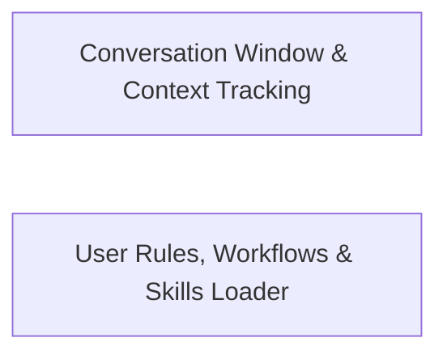

## Details

Manages conversation context windows, message truncation, environment tracking, file mentions, and user instruction rules, skills, and workflows.

### Conversation Window & Context Tracking
Manages conversation history truncation, context window token budgets, @-mention resolution, and task environment and model usage tracking.

**Related Classes/Methods**:

- `src.core.context.context-management.ContextManager.ContextManager`:8-402
- `src.core.context.context-tracking.EnvironmentContextTracker.EnvironmentContextTracker`:4-36

**Source Files:**

- `src/core/context/context-management/ContextManager.ts`
  - `src.core.context.context-management.ContextManager.ContextManager` (L8-L402) - Class
  - `src.core.context.context-management.ContextManager.ContextManager.constructor` (L14-L14) - Constructor
  - `src.core.context.context-management.ContextManager.ContextManager.getTextFromBlock` (L21-L32) - Method
  - `src.core.context.context-management.ContextManager.ContextManager.setTextInBlock` (L39-L52) - Method
  - `src.core.context.context-management.ContextManager.ContextManager.shouldCompactContextWindow` (L57-L81) - Method
  - `src.core.context.context-management.ContextManager.ContextManager.getContextTelemetryData` (L87-L128) - Method
  - `src.core.context.context-management.ContextManager.ContextManager.getContextTelemetryData.apiReqIndices` (L101-L103) - Class
  - `src.core.context.context-management.ContextManager.ContextManager.getContextTelemetryData.apiReqIndices.diracMessages.map() callback` (L102-L102) - Function
  - `src.core.context.context-management.ContextManager.ContextManager.getContextTelemetryData.apiReqIndices.filter() callback` (L103-L103) - Function
  - `src.core.context.context-management.ContextManager.ContextManager.getNewContextMessagesAndMetadata` (L133-L184) - Method
  - `src.core.context.context-management.ContextManager.ContextManager.getNextTruncationRange` (L189-L229) - Method
  - `src.core.context.context-management.ContextManager.ContextManager.getTruncatedMessages` (L234-L239) - Method
  - `src.core.context.context-management.ContextManager.ContextManager.getAndAlterTruncatedMessages` (L244-L258) - Method
  - `src.core.context.context-management.ContextManager.ContextManager.applyContextHistoryUpdates` (L259-L283) - Method
  - `src.core.context.context-management.ContextManager.ContextManager.applyContextHistoryUpdates.hasToolResults` (L271-L271) - Class
  - `src.core.context.context-management.ContextManager.ContextManager.applyContextHistoryUpdates.hasToolResults.firstMessageAfterTruncation.content.some() callback` (L271-L271) - Function
  - `src.core.context.context-management.ContextManager.ContextManager.applyContextHistoryUpdates.filter() callback` (L277-L277) - Function
  - `src.core.context.context-management.ContextManager.ContextManager.ensureToolResultsFollowToolUse` (L289-L401) - Method
  - `src.core.context.context-management.ContextManager.ContextManager.ensureToolResultsFollowToolUse.hasToolResults` (L293-L293) - Class
  - `src.core.context.context-management.ContextManager.ContextManager.ensureToolResultsFollowToolUse.hasToolResults.firstMessage.content.some() callback` (L293-L293) - Function
  - `src.core.context.context-management.ContextManager.ContextManager.ensureToolResultsFollowToolUse.filter() callback` (L297-L297) - Function
- `src/core/context/context-management/context-error-handling.ts`
  - `src.core.context.context-management.context-error-handling.isRecord` (L4-L6) - Function
  - `src.core.context.context-management.context-error-handling.narrow` (L9-L11) - Function
  - `src.core.context.context-management.context-error-handling.checkContextWindowExceededError` (L13-L23) - Function
  - `src.core.context.context-management.context-error-handling.checkIsOpenAIResponsesContextWindowError` (L25-L48) - Function
  - `src.core.context.context-management.context-error-handling.checkIsOpenAIResponsesContextWindowError.codes.some() callback` (L37-L37) - Function
  - `src.core.context.context-management.context-error-handling.checkIsOpenAIResponsesContextWindowError.messages` (L41-L43) - Class
  - `src.core.context.context-management.context-error-handling.checkIsOpenAIResponsesContextWindowError.messages.filter() callback` (L42-L42) - Function
  - `src.core.context.context-management.context-error-handling.checkIsOpenAIResponsesContextWindowError.messages.map() callback` (L43-L43) - Function
  - `src.core.context.context-management.context-error-handling.checkIsOpenAIResponsesContextWindowError.messages.some() callback` (L44-L44) - Function
  - `src.core.context.context-management.context-error-handling.checkIsOpenRouterContextWindowError` (L50-L77) - Function
  - `src.core.context.context-management.context-error-handling.checkIsOpenRouterContextWindowError.CONTEXT_ERROR_PATTERNS.some() callback` (L73-L73) - Function
  - `src.core.context.context-management.context-error-handling.checkIsOpenAIContextWindowError` (L82-L95) - Function
  - `src.core.context.context-management.context-error-handling.checkIsOpenAIContextWindowError.KNOWN_CONTEXT_ERROR_SUBSTRINGS.some() callback` (L90-L90) - Function
  - `src.core.context.context-management.context-error-handling.checkIsAnthropicContextWindowError` (L97-L105) - Function
  - `src.core.context.context-management.context-error-handling.checkIsCerebrasContextWindowError` (L107-L118) - Function
  - `src.core.context.context-management.context-error-handling.checkIsBedrockContextWindowError` (L120-L162) - Function
  - `src.core.context.context-management.context-error-handling.checkIsBedrockContextWindowError.BEDROCK_CONTEXT_PATTERNS.some() callback` (L158-L158) - Function
  - `src.core.context.context-management.context-error-handling.checkIsVercelContextWindowError` (L164-L221) - Function
  - `src.core.context.context-management.context-error-handling.checkIsVercelContextWindowError.messages` (L178-L185) - Class
  - `src.core.context.context-management.context-error-handling.checkIsVercelContextWindowError.messages.filter() callback` (L185-L185) - Function
  - `src.core.context.context-management.context-error-handling.checkIsVercelContextWindowError.messages.map() callback` (L216-L216) - Function
  - `src.core.context.context-management.context-error-handling.checkIsVercelContextWindowError.some() callback` (L217-L217) - Function
  - `src.core.context.context-management.context-error-handling.checkIsVercelContextWindowError.some() callback.CONTEXT_ERROR_PATTERNS.some() callback` (L217-L217) - Function
- `src/core/context/context-management/context-window-utils.ts`
  - `src.core.context.context-management.context-window-utils.getContextWindowInfo` (L9-L17) - Function
- `src/core/context/context-tracking/ContextTrackerTypes.ts`
  - `src.core.context.context-tracking.ContextTrackerTypes.FileMetadataEntry` (L2-L9) - Interface
  - `src.core.context.context-tracking.ContextTrackerTypes.ModelMetadataEntry` (L11-L22) - Interface
  - `src.core.context.context-tracking.ContextTrackerTypes.EnvironmentMetadataEntry` (L24-L32) - Interface
  - `src.core.context.context-tracking.ContextTrackerTypes.TaskMetadata` (L34-L39) - Interface
- `src/core/context/context-tracking/EnvironmentContextTracker.ts`
  - `src.core.context.context-tracking.EnvironmentContextTracker.EnvironmentContextTracker` (L4-L36) - Class
  - `src.core.context.context-tracking.EnvironmentContextTracker.EnvironmentContextTracker.constructor` (L7-L9) - Constructor
  - `src.core.context.context-tracking.EnvironmentContextTracker.EnvironmentContextTracker.recordEnvironment` (L11-L24) - Method
  - `src.core.context.context-tracking.EnvironmentContextTracker.EnvironmentContextTracker.recordEnvironment.updateTaskMetadata() callback` (L18-L23) - Function
  - `src.core.context.context-tracking.EnvironmentContextTracker.EnvironmentContextTracker.isSameEnvironment` (L26-L35) - Method
- `src/core/context/context-tracking/ModelContextTracker.ts`
  - `src.core.context.context-tracking.ModelContextTracker.ModelContextTracker` (L3-L32) - Class
  - `src.core.context.context-tracking.ModelContextTracker.ModelContextTracker.constructor` (L6-L8) - Constructor
  - `src.core.context.context-tracking.ModelContextTracker.ModelContextTracker.recordModelUsage` (L10-L31) - Method
  - `src.core.context.context-tracking.ModelContextTracker.ModelContextTracker.recordModelUsage.updateTaskMetadata() callback` (L11-L30) - Function
- `src/core/mentions/index.ts`
  - `src.core.mentions.index.openMention` (L21-L32) - Function
  - `src.core.mentions.index.getFileMentionFromPath` (L34-L38) - Function
  - `src.core.mentions.index.MentionExpansionContext` (L40-L46) - Interface
  - `src.core.mentions.index.parseMentions` (L48-L63) - Function
  - `src.core.mentions.index.expandMention` (L66-L76) - Function
  - `src.core.mentions.index.toFileContext` (L78-L80) - Function

### User Rules, Workflows & Skills Loader
Loads, filters, and evaluates global and workspace Dirac rules, external instruction files, workflows, and skills based on toggle state and active file path context.

**Related Classes/Methods**:

- `src.core.context.instructions.user-instructions.RuleContextBuilder.RuleContextBuilder`:33-127

**Source Files:**

- `src/core/context/instructions/user-instructions/RuleContextBuilder.ts`
  - `src.core.context.instructions.user-instructions.RuleContextBuilder.RuleContextBuilder` (L33-L127) - Class
  - `src.core.context.instructions.user-instructions.RuleContextBuilder.RuleContextBuilder.buildEvaluationContext` (L40-L44) - Method
  - `src.core.context.instructions.user-instructions.RuleContextBuilder.RuleContextBuilder.getRulePathContext` (L46-L84) - Method
  - `src.core.context.instructions.user-instructions.RuleContextBuilder.RuleContextBuilder.getRulePathContext.lastUserMessage` (L50-L52) - Class
  - `src.core.context.instructions.user-instructions.RuleContextBuilder.RuleContextBuilder.getRulePathContext.lastUserMessage.find() callback` (L52-L52) - Function
  - `src.core.context.instructions.user-instructions.RuleContextBuilder.RuleContextBuilder.getRulePathContext.roots` (L57-L57) - Class
  - `src.core.context.instructions.user-instructions.RuleContextBuilder.RuleContextBuilder.getRulePathContext.roots.map() callback` (L57-L57) - Function
  - `src.core.context.instructions.user-instructions.RuleContextBuilder.RuleContextBuilder.pathsFromToolInput` (L86-L109) - Method
  - `src.core.context.instructions.user-instructions.RuleContextBuilder.RuleContextBuilder.isRecord` (L111-L113) - Method
  - `src.core.context.instructions.user-instructions.RuleContextBuilder.RuleContextBuilder.normalizePaths` (L115-L126) - Method
- `src/core/context/instructions/user-instructions/dirac-rules.ts`
  - `src.core.context.instructions.user-instructions.dirac-rules.refreshDiracRulesToggles` (L169-L197) - Function
- `src/core/context/instructions/user-instructions/external-rules.ts`
  - `src.core.context.instructions.user-instructions.external-rules.refreshExternalRulesToggles` (L20-L67) - Function
  - `src.core.context.instructions.user-instructions.external-rules.findAgentsMdFiles` (L143-L165) - Function
  - `src.core.context.instructions.user-instructions.external-rules.findAgentsMdFiles.allFilePaths` (L156-L156) - Class
  - `src.core.context.instructions.user-instructions.external-rules.findAgentsMdFiles.allFilePaths.allFiles.map() callback` (L156-L156) - Function
  - `src.core.context.instructions.user-instructions.external-rules.findAgentsMdFiles.allFilePaths.filter() callback` (L157-L160) - Function
  - `src.core.context.instructions.user-instructions.external-rules.getLocalAgentsRules.combinedContent` (L186-L201) - Class
  - `src.core.context.instructions.user-instructions.external-rules.getLocalAgentsRules.combinedContent.agentsMdFiles.map() callback` (L187-L200) - Function
  - `src.core.context.instructions.user-instructions.external-rules.getLocalAgentsRules.combinedContent.then() callback` (L201-L201) - Function
- `src/core/context/instructions/user-instructions/rule-helpers.ts`
  - `src.core.context.instructions.user-instructions.rule-helpers.readDirectoryRecursive` (L16-L38) - Function
  - `src.core.context.instructions.user-instructions.rule-helpers.synchronizeRuleToggles` (L43-L107) - Function
  - `src.core.context.instructions.user-instructions.rule-helpers.synchronizeRemoteRuleToggles` (L113-L137) - Function
  - `src.core.context.instructions.user-instructions.rule-helpers.synchronizeRemoteRuleToggles.existingRuleNames` (L120-L120) - Class
  - `src.core.context.instructions.user-instructions.rule-helpers.synchronizeRemoteRuleToggles.existingRuleNames.remoteRules.map() callback` (L120-L120) - Function
  - `src.core.context.instructions.user-instructions.rule-helpers.combineRuleToggles` (L142-L144) - Function
  - `src.core.context.instructions.user-instructions.rule-helpers.getRuleFilesTotalContentWithMetadata.parts` (L197-L236) - Class
  - `src.core.context.instructions.user-instructions.rule-helpers.getRuleFilesTotalContentWithMetadata.parts.rulesFilePaths.map() callback` (L198-L235) - Function
  - `src.core.context.instructions.user-instructions.rule-helpers.getRuleFilesTotalContentWithMetadata.errors.filter() callback` (L238-L238) - Function
  - `src.core.context.instructions.user-instructions.rule-helpers.getRuleFilesTotalContentWithMetadata.errors.parts.map() callback` (L238-L238) - Function
  - `src.core.context.instructions.user-instructions.rule-helpers.getRuleFilesTotalContentWithMetadata.content.parts.map() callback` (L242-L242) - Function
  - `src.core.context.instructions.user-instructions.rule-helpers.getRuleFilesTotalContentWithMetadata.activatedConditionalRules.parts.map() callback` (L246-L246) - Function
  - `src.core.context.instructions.user-instructions.rule-helpers.getRuleFilesTotalContentWithMetadata.activatedConditionalRules.filter() callback` (L247-L247) - Function
  - `src.core.context.instructions.user-instructions.rule-helpers.getRemoteRulesTotalContentWithMetadata` (L252-L295) - Function
  - `src.core.context.instructions.user-instructions.rule-helpers.ensureLocalDiracDirExists` (L303-L348) - Function
  - `src.core.context.instructions.user-instructions.rule-helpers.catch() callback` (L317-L318) - Function
  - `src.core.context.instructions.user-instructions.rule-helpers.ensureLocalDiracDirExists.catch() callback` (L325-L329) - Function
  - `src.core.context.instructions.user-instructions.rule-helpers.deleteRuleFile` (L409-L478) - Function
- `src/core/context/instructions/user-instructions/skills.ts`
  - `src.core.context.instructions.user-instructions.skills.scanSkillsDirectory` (L172-L199) - Function
  - `src.core.context.instructions.user-instructions.skills.scanSkillsDirectory.stats` (L184-L184) - Class
  - `src.core.context.instructions.user-instructions.skills.scanSkillsDirectory.stats.catch() callback` (L184-L184) - Function
  - `src.core.context.instructions.user-instructions.skills.loadSkillMetadata` (L204-L249) - Function
  - `src.core.context.instructions.user-instructions.skills.loadSkillMetadata.resolvedPath` (L211-L211) - Class
  - `src.core.context.instructions.user-instructions.skills.loadSkillMetadata.resolvedPath.catch() callback` (L211-L211) - Function
  - `src.core.context.instructions.user-instructions.skills.discoverSkills` (L256-L270) - Function
  - `src.core.context.instructions.user-instructions.skills.getAvailableSkills` (L275-L289) - Function
  - `src.core.context.instructions.user-instructions.skills.listSupportingFiles` (L297-L324) - Function
  - `src.core.context.instructions.user-instructions.skills.files.filter() callback` (L308-L308) - Function
  - `src.core.context.instructions.user-instructions.skills.listSupportingFiles.files.filter() callback` (L317-L317) - Function
  - `src.core.context.instructions.user-instructions.skills.getSkillContent` (L326-L351) - Function
  - `src.core.context.instructions.user-instructions.skills.getSkillContent.skill` (L327-L327) - Class
  - `src.core.context.instructions.user-instructions.skills.getSkillContent.skill.availableSkills.find() callback` (L327-L327) - Function
  - `src.core.context.instructions.user-instructions.skills.getOrDiscoverSkills` (L357-L369) - Function
- `src/core/context/instructions/user-instructions/workflows.ts`
  - `src.core.context.instructions.user-instructions.workflows.refreshWorkflowToggles` (L10-L33) - Function

### [FAQ](https://github.com/CodeBoarding/GeneratedOnBoardings/tree/main?tab=readme-ov-file#faq)