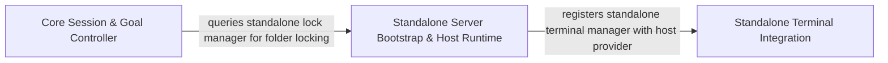

## Details

Orchestrates the central application Controller, standalone hostbridge and protobus runtime services, and standalone terminal process execution.

### Standalone Server Bootstrap & Host Runtime
Bootstraps the standalone Dirac server process, initializes emulated VSCode extension context, starts the ProtoBus gRPC service and HostBridge client, and manages the global SQLite instance lock manager.

**Related Classes/Methods**:

- `src.standalone.dirac-core.main`:24-102
- `src.standalone.dirac-core.setupHostProvider`:104-134
- `src.standalone.protobus-service.startProtobusService`:13-44
- `src.standalone.lock-manager.getLockManager`:13-15
- `src.standalone.vscode-context.initializeContext`:31-96

**Source Files:**

- `src/standalone/dirac-core.ts`
  - `src.standalone.dirac-core.main` (L24-L102) - Function
  - `src.standalone.dirac-core.setupHostProvider` (L104-L134) - Function
  - `src.standalone.dirac-core.setupGlobalErrorHandlers` (L140-L178) - Function
  - `src.standalone.dirac-core.setupGlobalErrorHandlers.process.on("uncaughtException") callback` (L142-L146) - Function
  - `src.standalone.dirac-core.setupGlobalErrorHandlers.process.on("unhandledRejection") callback` (L149-L155) - Function
  - `src.standalone.dirac-core.setupGlobalErrorHandlers.process.on("warning") callback` (L158-L160) - Function
  - `src.standalone.dirac-core.setupGlobalErrorHandlers.process.on("SIGINT") callback` (L163-L169) - Function
  - `src.standalone.dirac-core.setupGlobalErrorHandlers.process.on("SIGINT") callback.catch() callback` (L165-L168) - Function
  - `src.standalone.dirac-core.setupGlobalErrorHandlers.process.on("SIGTERM") callback` (L171-L177) - Function
  - `src.standalone.dirac-core.setupGlobalErrorHandlers.process.on("SIGTERM") callback.catch() callback` (L173-L176) - Function
  - `src.standalone.dirac-core.requestHostBridgeShutdown` (L184-L194) - Function
  - `src.standalone.dirac-core.requestHostBridgeShutdown.retryOperation() callback` (L186-L188) - Function
  - `src.standalone.dirac-core.shutdownGracefully` (L203-L242) - Function
  - `src.standalone.dirac-core.CliArgs` (L245-L250) - Interface
  - `src.standalone.dirac-core.parseArgs` (L252-L278) - Function
  - `src.standalone.dirac-core.showHelp` (L280-L296) - Function
- `src/standalone/hostbridge-client.ts`
  - `src.standalone.hostbridge-client.waitForHostBridgeReady` (L8-L26) - Function
  - `src.standalone.hostbridge-client.createHealthClient` (L30-L36) - Function
  - `src.standalone.hostbridge-client.checkHealthOnce` (L38-L48) - Function
  - `src.standalone.hostbridge-client.checkHealthOnce.<function>` (L39-L47) - Function
  - `src.standalone.hostbridge-client.checkHealthOnce.<function>.client.check() callback` (L40-L46) - Function
- `src/standalone/lock-manager.ts`
  - `src.standalone.lock-manager.getLockManager` (L13-L15) - Function
  - `src.standalone.lock-manager.setLockManager` (L22-L24) - Function
- `src/standalone/protobus-service.ts`
  - `src.standalone.protobus-service.startProtobusService` (L13-L44) - Function
  - `src.standalone.protobus-service.startProtobusService.<function>` (L14-L43) - Function
  - `src.standalone.protobus-service.startProtobusService.<function>.server.bindAsync() callback` (L33-L42) - Function
  - `src.standalone.protobus-service.getProtobusServiceNames` (L46-L52) - Function
  - `src.standalone.protobus-service.getProtobusServiceNames.protobusServiceNames` (L48-L50) - Class
  - `src.standalone.protobus-service.getProtobusServiceNames.protobusServiceNames.filter() callback` (L49-L49) - Function
  - `src.standalone.protobus-service.wrapHandler` (L65-L82) - Function
  - `src.standalone.protobus-service.wrapHandler.<function>` (L69-L81) - Function
  - `src.standalone.protobus-service.wrapStreamingResponseHandler` (L84-L115) - Function
  - `src.standalone.protobus-service.wrapStreamingResponseHandler.<function>` (L88-L114) - Function
- `src/standalone/utils.ts`
  - `src.standalone.utils.getPackageDefinition` (L22-L30) - Function
  - `src.standalone.utils.asyncIteratorToCallbacks` (L37-L53) - Function
- `src/standalone/vscode-context-utils.ts`
  - `src.standalone.vscode-context-utils.SecretStorageChangeEvent` (L6-L8) - Interface
  - `src.standalone.vscode-context-utils.SecretStore` (L11-L36) - Class
  - `src.standalone.vscode-context-utils.SecretStore.constructor` (L15-L17) - Constructor
  - `src.standalone.vscode-context-utils.SecretStore.get` (L21-L23) - Method
  - `src.standalone.vscode-context-utils.SecretStore.store` (L25-L29) - Method
  - `src.standalone.vscode-context-utils.SecretStore.delete` (L31-L35) - Method
  - `src.standalone.vscode-context-utils.MementoStore` (L39-L58) - Class
  - `src.standalone.vscode-context-utils.MementoStore.constructor` (L42-L44) - Constructor
  - `src.standalone.vscode-context-utils.MementoStore.keys` (L45-L47) - Method
  - `src.standalone.vscode-context-utils.MementoStore.get` (L48-L50) - Method
  - `src.standalone.vscode-context-utils.MementoStore.update` (L51-L54) - Method
  - `src.standalone.vscode-context-utils.MementoStore.setKeysForSync` (L55-L57) - Method
  - `src.standalone.vscode-context-utils.EventEmitter` (L62-L80) - Class
  - `src.standalone.vscode-context-utils.EventEmitter.event` (L65-L75) - Method
  - `src.standalone.vscode-context-utils.EventEmitter.event.dispose` (L68-L73) - Method
  - `src.standalone.vscode-context-utils.EventEmitter.fire` (L77-L79) - Method
  - `src.standalone.vscode-context-utils.EventEmitter.fire.listeners.forEach() callback` (L78-L78) - Function
  - `src.standalone.vscode-context-utils.JsonKeyValueStore` (L83-L120) - Class
  - `src.standalone.vscode-context-utils.JsonKeyValueStore.constructor` (L87-L90) - Constructor
  - `src.standalone.vscode-context-utils.JsonKeyValueStore.get` (L92-L94) - Method
  - `src.standalone.vscode-context-utils.JsonKeyValueStore.put` (L96-L99) - Method
  - `src.standalone.vscode-context-utils.JsonKeyValueStore.delete` (L101-L104) - Method
  - `src.standalone.vscode-context-utils.JsonKeyValueStore.keys` (L105-L107) - Method
  - `src.standalone.vscode-context-utils.JsonKeyValueStore.load` (L108-L115) - Method
  - `src.standalone.vscode-context-utils.JsonKeyValueStore.load.forEach() callback` (L111-L113) - Function
  - `src.standalone.vscode-context-utils.JsonKeyValueStore.save` (L116-L119) - Method
  - `src.standalone.vscode-context-utils.EnvironmentVariableCollection` (L123-L153) - Class
  - `src.standalone.vscode-context-utils.EnvironmentVariableCollection.replace` (L126-L128) - Method
  - `src.standalone.vscode-context-utils.EnvironmentVariableCollection.append` (L129-L131) - Method
  - `src.standalone.vscode-context-utils.EnvironmentVariableCollection.prepend` (L132-L134) - Method
  - `src.standalone.vscode-context-utils.EnvironmentVariableCollection.get` (L135-L137) - Method
  - `src.standalone.vscode-context-utils.EnvironmentVariableCollection.forEach` (L138-L140) - Method
  - `src.standalone.vscode-context-utils.EnvironmentVariableCollection.delete` (L141-L143) - Method
  - `src.standalone.vscode-context-utils.EnvironmentVariableCollection.clear` (L144-L146) - Method
  - `src.standalone.vscode-context-utils.EnvironmentVariableCollection.[Symbol.iterator]` (L147-L149) - Method
  - `src.standalone.vscode-context-utils.EnvironmentVariableCollection.getScoped` (L150-L152) - Method
  - `src.standalone.vscode-context-utils.readJson` (L155-L157) - Function
- `src/standalone/vscode-context.ts`
  - `src.standalone.vscode-context.StandaloneExtensionContext` (L15-L23) - Interface
  - `src.standalone.vscode-context.initializeContext` (L31-L96) - Function
  - `src.standalone.vscode-context.initializeContext.extension` (L44-L53) - Class
  - `src.standalone.vscode-context.initializeContext.extension.activate` (L51-L51) - Method
  - `src.standalone.vscode-context.extensionContext` (L55-L87) - Class
  - `src.standalone.vscode-context.initializeContext.extensionContext.asAbsolutePath` (L75-L75) - Method
  - `src.standalone.vscode-context.initializeContext.extensionContext.languageModelAccessInformation.onDidChange` (L82-L82) - Method
  - `src.standalone.vscode-context.initializeContext.extensionContext.languageModelAccessInformation.onDidChange.dispose` (L82-L82) - Method
  - `src.standalone.vscode-context.initializeContext.extensionContext.languageModelAccessInformation.canSendRequest` (L83-L83) - Method

### Standalone Terminal Integration
Implements subprocess-based terminal emulation, terminal instance registration, and background command process tracking for non-VSCode standalone environments.

**Related Classes/Methods**:

- `src.integrations.terminal.standalone.StandaloneTerminalManager.StandaloneTerminalManager`:29-302
- `src.integrations.terminal.standalone.StandaloneTerminalRegistry.StandaloneTerminalRegistry`:16-109
- `src.integrations.terminal.standalone.TerminalProcessManager.TerminalProcessManager`:52-351
- `src.integrations.terminal.standalone.StandaloneTerminalProcess.StandaloneTerminalProcess`:39-354

**Source Files:**

- `src/integrations/terminal/standalone/StandaloneTerminal.ts`
  - `src.integrations.terminal.standalone.StandaloneTerminal.StandaloneTerminal` (L16-L127) - Class
  - `src.integrations.terminal.standalone.StandaloneTerminal.StandaloneTerminal.constructor` (L55-L80) - Constructor
  - `src.integrations.terminal.standalone.StandaloneTerminal.StandaloneTerminal.constructor.executeCommand` (L68-L76) - Method
  - `src.integrations.terminal.standalone.StandaloneTerminal.StandaloneTerminal.constructor.executeCommand.read` (L71-L74) - Method
  - `src.integrations.terminal.standalone.StandaloneTerminal.StandaloneTerminal.sendText` (L87-L101) - Method
  - `src.integrations.terminal.standalone.StandaloneTerminal.StandaloneTerminal.show` (L106-L109) - Method
  - `src.integrations.terminal.standalone.StandaloneTerminal.StandaloneTerminal.hide` (L114-L116) - Method
  - `src.integrations.terminal.standalone.StandaloneTerminal.StandaloneTerminal.dispose` (L121-L126) - Method
- `src/integrations/terminal/standalone/StandaloneTerminalManager.ts`
  - `src.integrations.terminal.standalone.StandaloneTerminalManager.StandaloneTerminalManager` (L29-L302) - Class
  - `src.integrations.terminal.standalone.StandaloneTerminalManager.StandaloneTerminalManager.runCommand` (L57-L59) - Method
  - `src.integrations.terminal.standalone.StandaloneTerminalManager.StandaloneTerminalManager.getOrCreateTerminal` (L64-L103) - Method
  - `src.integrations.terminal.standalone.StandaloneTerminalManager.StandaloneTerminalManager.getOrCreateTerminal.matchingTerminal` (L68-L73) - Class
  - `src.integrations.terminal.standalone.StandaloneTerminalManager.StandaloneTerminalManager.getOrCreateTerminal.matchingTerminal.terminals.find() callback` (L68-L73) - Function
  - `src.integrations.terminal.standalone.StandaloneTerminalManager.StandaloneTerminalManager.getOrCreateTerminal.availableTerminal` (L82-L82) - Class
  - `src.integrations.terminal.standalone.StandaloneTerminalManager.StandaloneTerminalManager.getOrCreateTerminal.availableTerminal.terminals.find() callback` (L82-L82) - Function
  - `src.integrations.terminal.standalone.StandaloneTerminalManager.StandaloneTerminalManager.getTerminals` (L106-L113) - Method
  - `src.integrations.terminal.standalone.StandaloneTerminalManager.StandaloneTerminalManager.getTerminals.allTerminalIds.map() callback` (L110-L110) - Function
  - `src.integrations.terminal.standalone.StandaloneTerminalManager.StandaloneTerminalManager.getTerminals.filter() callback` (L111-L111) - Function
  - `src.integrations.terminal.standalone.StandaloneTerminalManager.StandaloneTerminalManager.getTerminals.map() callback` (L112-L112) - Function
  - `src.integrations.terminal.standalone.StandaloneTerminalManager.StandaloneTerminalManager.getUnretrievedOutput` (L118-L123) - Method
  - `src.integrations.terminal.standalone.StandaloneTerminalManager.StandaloneTerminalManager.isProcessHot` (L126-L128) - Method
  - `src.integrations.terminal.standalone.StandaloneTerminalManager.StandaloneTerminalManager.processOutput` (L133-L142) - Method
  - `src.integrations.terminal.standalone.StandaloneTerminalManager.StandaloneTerminalManager.disposeAll` (L147-L164) - Method
  - `src.integrations.terminal.standalone.StandaloneTerminalManager.StandaloneTerminalManager.setShellIntegrationTimeout` (L169-L171) - Method
  - `src.integrations.terminal.standalone.StandaloneTerminalManager.StandaloneTerminalManager.setTerminalReuseEnabled` (L174-L176) - Method
  - `src.integrations.terminal.standalone.StandaloneTerminalManager.StandaloneTerminalManager.setTerminalOutputLineLimit` (L179-L181) - Method
  - `src.integrations.terminal.standalone.StandaloneTerminalManager.StandaloneTerminalManager.setDefaultTerminalProfile` (L184-L193) - Method
  - `src.integrations.terminal.standalone.StandaloneTerminalManager.StandaloneTerminalManager.findTerminalInfoByTerminal` (L198-L200) - Method
  - `src.integrations.terminal.standalone.StandaloneTerminalManager.StandaloneTerminalManager.findTerminalInfoByTerminal.find() callback` (L199-L199) - Function
  - `src.integrations.terminal.standalone.StandaloneTerminalManager.StandaloneTerminalManager.isCwdMatchingExpected` (L203-L210) - Method
  - `src.integrations.terminal.standalone.StandaloneTerminalManager.StandaloneTerminalManager.filterTerminals` (L213-L215) - Method
  - `src.integrations.terminal.standalone.StandaloneTerminalManager.StandaloneTerminalManager.closeTerminals` (L218-L235) - Method
  - `src.integrations.terminal.standalone.StandaloneTerminalManager.StandaloneTerminalManager.handleTerminalProfileChange` (L238-L242) - Method
  - `src.integrations.terminal.standalone.StandaloneTerminalManager.StandaloneTerminalManager.handleTerminalProfileChange.closedCount.closeTerminals() callback` (L239-L239) - Function
  - `src.integrations.terminal.standalone.StandaloneTerminalManager.handleTerminalProfileChange.closedCount` (L239-L239) - Class
  - `src.integrations.terminal.standalone.StandaloneTerminalManager.StandaloneTerminalManager.handleTerminalProfileChange.busyTerminals.filterTerminals() callback` (L240-L240) - Function
  - `src.integrations.terminal.standalone.StandaloneTerminalManager.handleTerminalProfileChange.busyTerminals` (L240-L240) - Class
  - `src.integrations.terminal.standalone.StandaloneTerminalManager.StandaloneTerminalManager.closeAllTerminals` (L245-L247) - Method
  - `src.integrations.terminal.standalone.StandaloneTerminalManager.StandaloneTerminalManager.closeAllTerminals.closeTerminals() callback` (L246-L246) - Function
  - `src.integrations.terminal.standalone.StandaloneTerminalManager.StandaloneTerminalManager.trackBackgroundCommand` (L252-L266) - Method
  - `src.integrations.terminal.standalone.StandaloneTerminalManager.StandaloneTerminalManager.getBackgroundCommand` (L269-L271) - Method
  - `src.integrations.terminal.standalone.StandaloneTerminalManager.StandaloneTerminalManager.getAllBackgroundCommands` (L274-L276) - Method
  - `src.integrations.terminal.standalone.StandaloneTerminalManager.StandaloneTerminalManager.getRunningBackgroundCommands` (L279-L281) - Method
  - `src.integrations.terminal.standalone.StandaloneTerminalManager.StandaloneTerminalManager.hasActiveBackgroundCommands` (L284-L286) - Method
  - `src.integrations.terminal.standalone.StandaloneTerminalManager.StandaloneTerminalManager.cancelBackgroundCommand` (L289-L291) - Method
  - `src.integrations.terminal.standalone.StandaloneTerminalManager.StandaloneTerminalManager.getBackgroundCommandsSummary` (L294-L296) - Method
  - `src.integrations.terminal.standalone.StandaloneTerminalManager.StandaloneTerminalManager.disposeBackgroundCommands` (L299-L301) - Method
- `src/integrations/terminal/standalone/StandaloneTerminalProcess.ts`
  - `src.integrations.terminal.standalone.StandaloneTerminalProcess.StandaloneTerminalProcess` (L39-L354) - Class
  - `src.integrations.terminal.standalone.StandaloneTerminalProcess.StandaloneTerminalProcess.constructor` (L76-L78) - Constructor
  - `src.integrations.terminal.standalone.StandaloneTerminalProcess.StandaloneTerminalProcess.run` (L85-L188) - Method
  - `src.integrations.terminal.standalone.StandaloneTerminalProcess.StandaloneTerminalProcess.run.childProcess.stdout.on("data") callback` (L134-L141) - Function
  - `src.integrations.terminal.standalone.StandaloneTerminalProcess.StandaloneTerminalProcess.run.childProcess.stderr.on("data") callback` (L144-L151) - Function
  - `src.integrations.terminal.standalone.StandaloneTerminalProcess.StandaloneTerminalProcess.run.childProcess.on("close") callback` (L154-L172) - Function
  - `src.integrations.terminal.standalone.StandaloneTerminalProcess.StandaloneTerminalProcess.run.childProcess.on("error") callback` (L175-L180) - Function
  - `src.integrations.terminal.standalone.StandaloneTerminalProcess.StandaloneTerminalProcess.handleOutput` (L195-L223) - Method
  - `src.integrations.terminal.standalone.StandaloneTerminalProcess.StandaloneTerminalProcess.handleOutput.setTimeout() callback` (L205-L207) - Function
  - `src.integrations.terminal.standalone.StandaloneTerminalProcess.StandaloneTerminalProcess.emitLines` (L229-L237) - Method
  - `src.integrations.terminal.standalone.StandaloneTerminalProcess.StandaloneTerminalProcess.emitRemainingBuffer` (L242-L251) - Method
  - `src.integrations.terminal.standalone.StandaloneTerminalProcess.StandaloneTerminalProcess.continue` (L261-L266) - Method
  - `src.integrations.terminal.standalone.StandaloneTerminalProcess.StandaloneTerminalProcess.getUnretrievedOutput` (L273-L287) - Method
  - `src.integrations.terminal.standalone.StandaloneTerminalProcess.StandaloneTerminalProcess.getCompletionDetails` (L289-L294) - Method
  - `src.integrations.terminal.standalone.StandaloneTerminalProcess.StandaloneTerminalProcess.removeLastLineArtifacts` (L301-L308) - Method
  - `src.integrations.terminal.standalone.StandaloneTerminalProcess.StandaloneTerminalProcess.getDefaultShell` (L314-L316) - Method
  - `src.integrations.terminal.standalone.StandaloneTerminalProcess.StandaloneTerminalProcess.getShellArgs` (L324-L326) - Method
  - `src.integrations.terminal.standalone.StandaloneTerminalProcess.StandaloneTerminalProcess.terminate` (L336-L353) - Method
  - `src.integrations.terminal.standalone.StandaloneTerminalProcess.StandaloneTerminalProcess.terminate.isCompleted` (L351-L351) - Method
- `src/integrations/terminal/standalone/StandaloneTerminalRegistry.ts`
  - `src.integrations.terminal.standalone.StandaloneTerminalRegistry.StandaloneTerminalRegistry` (L16-L109) - Class
  - `src.integrations.terminal.standalone.StandaloneTerminalRegistry.StandaloneTerminalRegistry.createTerminal` (L28-L46) - Method
  - `src.integrations.terminal.standalone.StandaloneTerminalRegistry.StandaloneTerminalRegistry.getTerminal` (L53-L55) - Method
  - `src.integrations.terminal.standalone.StandaloneTerminalRegistry.StandaloneTerminalRegistry.getAllTerminals` (L61-L63) - Method
  - `src.integrations.terminal.standalone.StandaloneTerminalRegistry.StandaloneTerminalRegistry.removeTerminal` (L69-L76) - Method
  - `src.integrations.terminal.standalone.StandaloneTerminalRegistry.StandaloneTerminalRegistry.updateTerminal` (L83-L88) - Method
  - `src.integrations.terminal.standalone.StandaloneTerminalRegistry.StandaloneTerminalRegistry.clear` (L93-L100) - Method
  - `src.integrations.terminal.standalone.StandaloneTerminalRegistry.StandaloneTerminalRegistry.size` (L106-L108) - Method
- `src/integrations/terminal/standalone/TerminalProcessManager.ts`
  - `src.integrations.terminal.standalone.TerminalProcessManager.mergePromise` (L25-L50) - Function
  - `src.integrations.terminal.standalone.TerminalProcessManager.mergePromise.descriptors` (L27-L30) - Class
  - `src.integrations.terminal.standalone.TerminalProcessManager.mergePromise.descriptors.map() callback` (L27-L30) - Function
  - `src.integrations.terminal.standalone.TerminalProcessManager.TerminalProcessManager` (L52-L351) - Class
  - `src.integrations.terminal.standalone.TerminalProcessManager.TerminalProcessManager.runCommand` (L71-L96) - Method
  - `src.integrations.terminal.standalone.TerminalProcessManager.TerminalProcessManager.runCommand.process.once("completed") callback` (L78-L80) - Function
  - `src.integrations.terminal.standalone.TerminalProcessManager.TerminalProcessManager.runCommand.process.once("error") callback` (L82-L84) - Function
  - `src.integrations.terminal.standalone.TerminalProcessManager.TerminalProcessManager.runCommand.promise` (L87-L90) - Class
  - `src.integrations.terminal.standalone.TerminalProcessManager.TerminalProcessManager.runCommand.promise.<function>` (L87-L90) - Function
  - `src.integrations.terminal.standalone.TerminalProcessManager.TerminalProcessManager.runCommand.promise.<function>.process.once("continue") callback` (L88-L88) - Function
  - `src.integrations.terminal.standalone.TerminalProcessManager.TerminalProcessManager.runCommand.promise.<function>.process.once("error") callback` (L89-L89) - Function
  - `src.integrations.terminal.standalone.TerminalProcessManager.TerminalProcessManager.getUnretrievedOutput` (L103-L106) - Method
  - `src.integrations.terminal.standalone.TerminalProcessManager.TerminalProcessManager.isProcessHot` (L109-L112) - Method
  - `src.integrations.terminal.standalone.TerminalProcessManager.TerminalProcessManager.removeProcess` (L119-L121) - Method
  - `src.integrations.terminal.standalone.TerminalProcessManager.TerminalProcessManager.terminateAll` (L124-L130) - Method
  - `src.integrations.terminal.standalone.TerminalProcessManager.TerminalProcessManager.clearProcesses` (L133-L135) - Method
  - `src.integrations.terminal.standalone.TerminalProcessManager.TerminalProcessManager.trackBackgroundCommand` (L137-L272) - Method
  - `src.integrations.terminal.standalone.TerminalProcessManager.trackBackgroundCommand.logReady.then() callback` (L207-L210) - Function
  - `src.integrations.terminal.standalone.TerminalProcessManager.TerminalProcessManager.trackBackgroundCommand.logReady.then() callback.<function>` (L208-L210) - Function
  - `src.integrations.terminal.standalone.TerminalProcessManager.TerminalProcessManager.trackBackgroundCommand.logReady.then() callback.<function>.logStream.write(`${existingOutput.join("\n")}\n`) callback` (L209-L209) - Function
  - `src.integrations.terminal.standalone.TerminalProcessManager.TerminalProcessManager.trackBackgroundCommand.logReady.then() callback` (L213-L213) - Function
  - `src.integrations.terminal.standalone.TerminalProcessManager.TerminalProcessManager.trackBackgroundCommand.logStream.on("error") callback` (L215-L223) - Function
  - `src.integrations.terminal.standalone.TerminalProcessManager.TerminalProcessManager.trackBackgroundCommand.timeoutId` (L225-L231) - Class
  - `src.integrations.terminal.standalone.TerminalProcessManager.TerminalProcessManager.trackBackgroundCommand.timeoutId.setTimeout() callback` (L225-L231) - Function
  - `src.integrations.terminal.standalone.TerminalProcessManager.TerminalProcessManager.trackBackgroundCommand.process.on("completed") callback` (L234-L257) - Function
  - `src.integrations.terminal.standalone.TerminalProcessManager.TerminalProcessManager.trackBackgroundCommand.process.on("error") callback` (L259-L268) - Function
  - `src.integrations.terminal.standalone.TerminalProcessManager.TerminalProcessManager.getBackgroundCommand` (L275-L277) - Method
  - `src.integrations.terminal.standalone.TerminalProcessManager.TerminalProcessManager.getAllBackgroundCommands` (L280-L282) - Method
  - `src.integrations.terminal.standalone.TerminalProcessManager.TerminalProcessManager.getRunningBackgroundCommands` (L285-L287) - Method
  - `src.integrations.terminal.standalone.TerminalProcessManager.TerminalProcessManager.getRunningBackgroundCommands.filter() callback` (L286-L286) - Function
  - `src.integrations.terminal.standalone.TerminalProcessManager.TerminalProcessManager.hasActiveBackgroundCommands` (L290-L292) - Method
  - `src.integrations.terminal.standalone.TerminalProcessManager.TerminalProcessManager.cancelBackgroundCommand` (L295-L319) - Method
  - `src.integrations.terminal.standalone.TerminalProcessManager.TerminalProcessManager.getBackgroundCommandsSummary` (L322-L334) - Method
  - `src.integrations.terminal.standalone.TerminalProcessManager.TerminalProcessManager.disposeBackgroundCommands` (L337-L350) - Method
- `src/integrations/terminal/types.ts`
  - `src.integrations.terminal.types.TerminalCompletionDetails` (L17-L22) - Interface
  - `src.integrations.terminal.types.TerminalProcessEvents` (L24-L30) - Interface
  - `src.integrations.terminal.types.ITerminalProcess` (L43-L81) - Interface
  - `src.integrations.terminal.types.ITerminalProcess.continue` (L60-L60) - Method
  - `src.integrations.terminal.types.ITerminalProcess.getUnretrievedOutput` (L66-L66) - Method
  - `src.integrations.terminal.types.ITerminalProcess.getCompletionDetails` (L71-L71) - Method
  - `src.integrations.terminal.types.ITerminalProcess.terminate` (L80-L80) - Method
  - `src.integrations.terminal.types.TerminalInfo` (L90-L107) - Interface
  - `src.integrations.terminal.types.TerminalProfileChangeResult` (L112-L117) - Interface
  - `src.integrations.terminal.types.ITerminal` (L122-L148) - Interface
  - `src.integrations.terminal.types.ITerminal.sendText` (L135-L135) - Method
  - `src.integrations.terminal.types.ITerminal.show` (L137-L137) - Method
  - `src.integrations.terminal.types.ITerminal.hide` (L139-L139) - Method
  - `src.integrations.terminal.types.ITerminal.dispose` (L141-L141) - Method
  - `src.integrations.terminal.types.ITerminalManager` (L182-L256) - Interface
  - `src.integrations.terminal.types.ITerminalManager.runCommand` (L189-L189) - Method
  - `src.integrations.terminal.types.ITerminalManager.getOrCreateTerminal` (L196-L196) - Method
  - `src.integrations.terminal.types.ITerminalManager.getTerminals` (L203-L203) - Method
  - `src.integrations.terminal.types.ITerminalManager.getUnretrievedOutput` (L210-L210) - Method
  - `src.integrations.terminal.types.ITerminalManager.isProcessHot` (L217-L217) - Method
  - `src.integrations.terminal.types.ITerminalManager.disposeAll` (L222-L222) - Method
  - `src.integrations.terminal.types.ITerminalManager.setShellIntegrationTimeout` (L228-L228) - Method
  - `src.integrations.terminal.types.ITerminalManager.setTerminalReuseEnabled` (L234-L234) - Method
  - `src.integrations.terminal.types.ITerminalManager.setTerminalOutputLineLimit` (L240-L240) - Method
  - `src.integrations.terminal.types.ITerminalManager.setDefaultTerminalProfile` (L247-L247) - Method
  - `src.integrations.terminal.types.ITerminalManager.processOutput` (L255-L255) - Method
  - `src.integrations.terminal.types.StandaloneTerminalOptions` (L261-L270) - Interface
  - `src.integrations.terminal.types.BackgroundCommand` (L280-L297) - Interface
  - `src.integrations.terminal.types.ShellIntegrationWarningTracker` (L307-L312) - Interface
  - `src.integrations.terminal.types.ActiveBackgroundCommand` (L318-L325) - Interface
  - `src.integrations.terminal.types.AskResponse` (L330-L335) - Interface
  - `src.integrations.terminal.types.CommandExecutorCallbacks` (L343-L359) - Interface
  - `src.integrations.terminal.types.CommandExecutionMetadata` (L364-L371) - Interface
  - `src.integrations.terminal.types.CommandExecutionOptions` (L380-L391) - Interface
  - `src.integrations.terminal.types.CommandExecutorConfig` (L396-L407) - Interface
  - `src.integrations.terminal.types.OrchestrationOptions` (L419-L448) - Interface
  - `src.integrations.terminal.types.OrchestrationResult` (L453-L470) - Interface

### Core Session & Goal Controller
Coordinates core application controller state, Goal execution lifecycles, task history repair, and folder lock acquisition utilities.

**Related Classes/Methods**:

- `src.core.controller.index.Controller`:55-528
- `src.core.goal.GoalController.GoalController`:31-303
- `src.core.locks.FolderLockUtils.getStandaloneLockManager`:30-38
- `src.core.locks.FolderLockUtils.tryAcquireFolderLockWithRetry`:48-71

**Source Files:**

- `src/core/commands/repairMissingTaskHistory.ts`
  - `src.core.commands.repairMissingTaskHistory.TaskHistoryRepairResult` (L19-L24) - Interface
  - `src.core.commands.repairMissingTaskHistory.GoalInventory` (L26-L31) - Interface
  - `src.core.commands.repairMissingTaskHistory.repairMissingTaskHistory` (L33-L45) - Function
  - `src.core.commands.repairMissingTaskHistory.repairMissingTaskHistoryWithLease` (L47-L88) - Function
  - `src.core.commands.repairMissingTaskHistory.repairMissingTaskHistoryWithLease.existingIds` (L49-L49) - Class
  - `src.core.commands.repairMissingTaskHistory.repairMissingTaskHistoryWithLease.existingIds.map() callback` (L49-L49) - Function
  - `src.core.commands.repairMissingTaskHistory.repairMissingTaskHistoryWithLease.ordinaryCandidateIds` (L66-L72) - Class
  - `src.core.commands.repairMissingTaskHistory.repairMissingTaskHistoryWithLease.ordinaryCandidateIds.taskIds.filter() callback` (L66-L72) - Function
  - `src.core.commands.repairMissingTaskHistory.readGoalInventory` (L90-L122) - Function
  - `src.core.commands.repairMissingTaskHistory.reconstructOrdinaryTasks` (L124-L146) - Function
  - `src.core.commands.repairMissingTaskHistory.reconstructOrdinaryTasks.workers` (L131-L143) - Class
  - `src.core.commands.repairMissingTaskHistory.reconstructOrdinaryTasks.workers.Array.from() callback` (L131-L143) - Function
  - `src.core.commands.repairMissingTaskHistory.filterExistingRunDirectories` (L148-L153) - Function
  - `src.core.commands.repairMissingTaskHistory.filterExistingRunDirectories.checks` (L149-L151) - Class
  - `src.core.commands.repairMissingTaskHistory.filterExistingRunDirectories.checks.items.map() callback` (L150-L150) - Function
  - `src.core.commands.repairMissingTaskHistory.filterExistingRunDirectories.checks.filter() callback` (L152-L152) - Function
  - `src.core.commands.repairMissingTaskHistory.filterExistingRunDirectories.map() callback` (L152-L152) - Function
  - `src.core.commands.repairMissingTaskHistory.collectChildIds` (L155-L164) - Function
  - `src.core.commands.repairMissingTaskHistory.isSupersededGoalRecord` (L166-L170) - Function
  - `src.core.commands.repairMissingTaskHistory.isStandaloneTaskId` (L172-L174) - Function
- `src/core/controller/index.ts`
  - `src.core.controller.index.OutboundStatePublication` (L44-L48) - Interface
  - `src.core.controller.index.SelectedPresentation` (L50-L53) - Interface
  - `src.core.controller.index.Controller` (L55-L528) - Class
  - `src.core.controller.index.Controller.task` (L77-L79) - Method
  - `src.core.controller.index.Controller.taskRunPromise` (L82-L84) - Method
  - `src.core.controller.index.Controller.onTaskReplaced` (L86-L88) - Method
  - `src.core.controller.index.Controller.ensureWorkspaceManager` (L107-L113) - Method
  - `src.core.controller.index.Controller.getWorkspaceManager` (L116-L122) - Method
  - `src.core.controller.index.Controller.constructor` (L124-L164) - Constructor
  - `src.core.controller.index.Controller.constructor.getStandaloneTask` (L136-L136) - Method
  - `src.core.controller.index.Controller.constructor.clearStandaloneTask` (L137-L137) - Method
  - `src.core.controller.index.Controller.constructor.updateGoalHistory` (L138-L138) - Method
  - `src.core.controller.index.Controller.constructor.postState` (L139-L139) - Method
  - `src.core.controller.index.Controller.constructor.openAiCodexUsageService.subscribe() callback` (L142-L144) - Function
  - `src.core.controller.index.constructor.catch() callback` (L149-L151) - Function
  - `src.core.controller.index.Controller.constructor.then() callback` (L158-L160) - Function
  - `src.core.controller.index.Controller.constructor.catch() callback` (L161-L163) - Function
  - `src.core.controller.index.Controller.dispose` (L171-L178) - Method
  - `src.core.controller.index.Controller.setTaskInitializationDefaults` (L182-L184) - Method
  - `src.core.controller.index.Controller.resolveTaskInitializationOptions` (L186-L189) - Method
  - `src.core.controller.index.Controller.initTask` (L191-L227) - Method
  - `src.core.controller.index.Controller.reinitExistingTaskFromId` (L229-L234) - Method
  - `src.core.controller.index.Controller.prepareTaskForFollowUp` (L236-L238) - Method
  - `src.core.controller.index.Controller.cancelTask` (L240-L246) - Method
  - `src.core.controller.index.Controller.updateBackgroundCommandState` (L248-L250) - Method
  - `src.core.controller.index.Controller.backgroundCommandRunning` (L252-L254) - Method
  - `src.core.controller.index.Controller.backgroundCommandTaskId` (L256-L258) - Method
  - `src.core.controller.index.Controller.cancelBackgroundCommand` (L260-L262) - Method
  - `src.core.controller.index.Controller.clearTask` (L264-L270) - Method
  - `src.core.controller.index.Controller.createTask` (L272-L275) - Method
  - `src.core.controller.index.Controller.completeOpenRouterAuth` (L279-L281) - Method
  - `src.core.controller.index.Controller.completeGithubLogin` (L284-L286) - Method
  - `src.core.controller.index.Controller.completeRequestyAuth` (L290-L292) - Method
  - `src.core.controller.index.Controller.readOpenRouterModels` (L295-L297) - Method
  - `src.core.controller.index.Controller.getTaskWithId` (L301-L311) - Method
  - `src.core.controller.index.Controller.getPromptHistory` (L313-L315) - Method
  - `src.core.controller.index.Controller.exportTaskWithId` (L317-L319) - Method
  - `src.core.controller.index.Controller.deleteTaskFromState` (L321-L325) - Method
  - `src.core.controller.index.Controller.postStateToWebview` (L327-L329) - Method
  - `src.core.controller.index.Controller.postPresentationToWebview` (L331-L333) - Method
  - `src.core.controller.index.Controller.waitForGoalStartupReconciliation` (L335-L337) - Method
  - `src.core.controller.index.Controller.getStateToPostToWebview` (L339-L342) - Method
  - `src.core.controller.index.Controller.captureSelectedPresentation` (L344-L363) - Method
  - `src.core.controller.index.Controller.getStatePublication` (L365-L391) - Method
  - `src.core.controller.index.Controller.getStatePublication.acknowledge` (L382-L389) - Method
  - `src.core.controller.index.Controller.createPresentationPublication` (L393-L420) - Method
  - `src.core.controller.index.Controller.createPresentationPublication.state.uiActionState.projectUIActionState() callback` (L407-L407) - Function
  - `src.core.controller.index.Controller.createPresentationPublication.acknowledge` (L416-L418) - Method
  - `src.core.controller.index.Controller.assembleStateToPostToWebview` (L422-L449) - Method
  - `src.core.controller.index.Controller.updateTaskHistory` (L451-L453) - Method
  - `src.core.controller.index.Controller.updateGoalHistory` (L455-L457) - Method
  - `src.core.controller.index.Controller.updateTelemetrySetting` (L459-L461) - Method
  - `src.core.controller.index.Controller.toggleActModeForYoloMode` (L463-L466) - Method
  - `src.core.controller.index.Controller.togglePlanActMode` (L468-L471) - Method
  - `src.core.controller.index.Controller.enableInteractiveGoals` (L473-L475) - Method
  - `src.core.controller.index.Controller.selectedGoalId` (L477-L479) - Method
  - `src.core.controller.index.Controller.hasActiveGoal` (L481-L483) - Method
  - `src.core.controller.index.Controller.selectGoal` (L485-L488) - Method
  - `src.core.controller.index.Controller.resumeGoal` (L490-L493) - Method
  - `src.core.controller.index.Controller.pauseGoal` (L495-L498) - Method
  - `src.core.controller.index.Controller.stopGoal` (L500-L503) - Method
  - `src.core.controller.index.Controller.steerGoal` (L505-L508) - Method
  - `src.core.controller.index.Controller.sendGoalMessage` (L510-L517) - Method
  - `src.core.controller.index.Controller.assertGoalSurfaceSupported` (L519-L527) - Method
  - `src.core.controller.index.parseGoalRequest` (L530-L537) - Function
  - `src.core.controller.index.isGoalResumeCommand` (L539-L541) - Function
- `src/core/goal/GoalController.ts`
  - `src.core.goal.GoalController.GoalControllerDependencies` (L21-L28) - Interface
  - `src.core.goal.GoalController.GoalController` (L31-L303) - Class
  - `src.core.goal.GoalController.GoalController.constructor` (L36-L38) - Constructor
  - `src.core.goal.GoalController.GoalController.selectedGoalId` (L40-L42) - Method
  - `src.core.goal.GoalController.GoalController.active` (L44-L46) - Method
  - `src.core.goal.GoalController.GoalController.hasRunningCoordinator` (L48-L50) - Method
  - `src.core.goal.GoalController.GoalController.coordinator` (L52-L54) - Method
  - `src.core.goal.GoalController.GoalController.waitForStartupReconciliation` (L56-L58) - Method
  - `src.core.goal.GoalController.GoalController.start` (L60-L62) - Method
  - `src.core.goal.GoalController.GoalController.start.goalActivationMutex.withLock() callback` (L61-L61) - Function
  - `src.core.goal.GoalController.GoalController.startSerial` (L64-L86) - Method
  - `src.core.goal.GoalController.GoalController.select` (L88-L90) - Method
  - `src.core.goal.GoalController.GoalController.select.goalActivationMutex.withLock() callback` (L89-L89) - Function
  - `src.core.goal.GoalController.GoalController.selectSerial` (L92-L103) - Method
  - `src.core.goal.GoalController.GoalController.resume` (L105-L107) - Method
  - `src.core.goal.GoalController.GoalController.resume.goalActivationMutex.withLock() callback` (L106-L106) - Function
  - `src.core.goal.GoalController.GoalController.resumeSerial` (L109-L125) - Method
  - `src.core.goal.GoalController.GoalController.steer` (L127-L131) - Method
  - `src.core.goal.GoalController.GoalController.sendMessage` (L133-L137) - Method
  - `src.core.goal.GoalController.GoalController.cancelCurrentExecution` (L139-L143) - Method
  - `src.core.goal.GoalController.GoalController.pause` (L145-L147) - Method
  - `src.core.goal.GoalController.GoalController.pause.goalActivationMutex.withLock() callback` (L146-L146) - Function
  - `src.core.goal.GoalController.GoalController.pauseSerial` (L149-L154) - Method
  - `src.core.goal.GoalController.GoalController.stop` (L156-L158) - Method
  - `src.core.goal.GoalController.GoalController.stop.goalActivationMutex.withLock() callback` (L157-L157) - Function
  - `src.core.goal.GoalController.GoalController.stopSerial` (L160-L171) - Method
  - `src.core.goal.GoalController.GoalController.inspect` (L173-L179) - Method
  - `src.core.goal.GoalController.GoalController.selectedPresentationSnapshot` (L181-L192) - Method
  - `src.core.goal.GoalController.GoalController.pauseAndDeselect` (L194-L196) - Method
  - `src.core.goal.GoalController.GoalController.pauseAndDeselect.goalActivationMutex.withLock() callback` (L195-L195) - Function
  - `src.core.goal.GoalController.GoalController.pauseAndDeselectSerial` (L198-L203) - Method
  - `src.core.goal.GoalController.GoalController.dispose` (L205-L207) - Method
  - `src.core.goal.GoalController.GoalController.reconcilePersistedGoals` (L209-L221) - Method
  - `src.core.goal.GoalController.GoalController.reconcilePersistedGoalHistory` (L223-L246) - Method
  - `src.core.goal.GoalController.GoalController.reconcilePersistedGoalHistory.historyItem` (L225-L227) - Class
  - `src.core.goal.GoalController.GoalController.reconcilePersistedGoalHistory.historyItem.find() callback` (L227-L227) - Function
  - `src.core.goal.GoalController.GoalController.createLoop` (L248-L275) - Method
  - `src.core.goal.GoalController.GoalController.createLoop.createTaskFactory` (L259-L266) - Method
  - `src.core.goal.GoalController.GoalController.createLoop.updateHistory` (L268-L271) - Method
  - `src.core.goal.GoalController.GoalController.assertNoActiveGoal` (L277-L283) - Method
  - `src.core.goal.GoalController.GoalController.assertNoActiveGoal.active` (L281-L281) - Class
  - `src.core.goal.GoalController.GoalController.assertNoActiveGoal.active.find() callback` (L281-L281) - Function
  - `src.core.goal.GoalController.GoalController.assertNoActiveStandaloneTask` (L285-L290) - Method
  - `src.core.goal.GoalController.GoalController.requireSelectedLoop` (L292-L296) - Method
  - `src.core.goal.GoalController.GoalController.goalHistoryItem` (L298-L302) - Method
  - `src.core.goal.GoalController.GoalController.goalHistoryItem.item` (L299-L299) - Class
  - `src.core.goal.GoalController.GoalController.goalHistoryItem.item.find() callback` (L299-L299) - Function
- `src/core/locks/FolderLockUtils.ts`
  - `src.core.locks.FolderLockUtils.FolderLockRetryConfig` (L9-L13) - Interface
  - `src.core.locks.FolderLockUtils.getStandaloneLockManager` (L30-L38) - Function
  - `src.core.locks.FolderLockUtils.tryAcquireFolderLockWithRetry` (L48-L71) - Function
  - `src.core.locks.FolderLockUtils.tryAcquireFolderLockWithRetry.retryFolderLockAcquisition() callback` (L52-L70) - Function
  - `src.core.locks.FolderLockUtils.releaseFolderLock` (L79-L93) - Function
  - `src.core.locks.FolderLockUtils.acquireFolderLock` (L100-L124) - Function
  - `src.core.locks.FolderLockUtils.retryFolderLockAcquisition` (L132-L179) - Function

### [FAQ](https://github.com/CodeBoarding/GeneratedOnBoardings/tree/main?tab=readme-ov-file#faq)