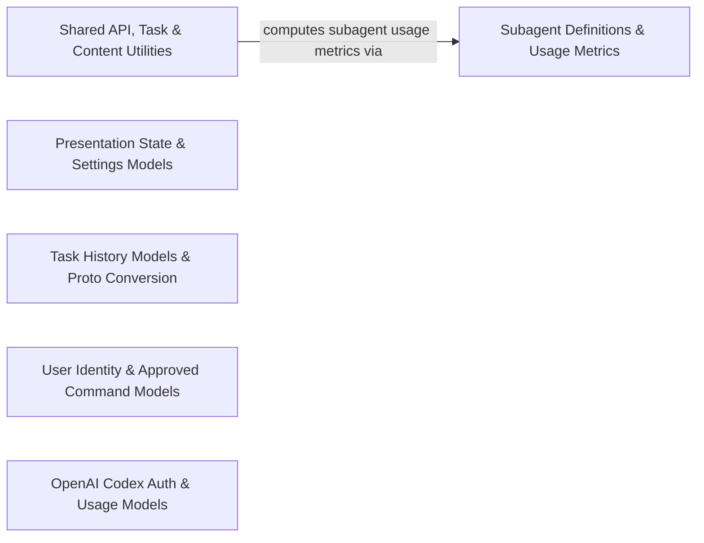

## Details

Defines core domain models, presentation state, API metrics, configuration types, and common error and data manipulation helpers shared across the extension and webview.

### Shared API, Task & Content Utilities
Provides shared API configuration types, chat content and card sequence helpers, task status projections, API metrics aggregation, and common runtime utilities.

**Related Classes/Methods**:

- `src.shared.getApiMetrics.getApiMetrics`:35-94

**Source Files:**

- `src/shared/AutoApprovalSettings.ts`
  - `src.shared.AutoApprovalSettings.AutoApprovalSettings` (L1-L25) - Interface
- `src/shared/ChatContent.ts`
  - `src.shared.ChatContent.ChatContent` (L1-L5) - Interface
- `src/shared/Languages.ts`
  - `src.shared.Languages.getLanguageKey` (L64-L73) - Function
  - `src.shared.Languages.getLanguageKey.languageOption` (L68-L68) - Class
  - `src.shared.Languages.getLanguageKey.languageOption.languageOptions.find() callback` (L68-L68) - Function
- `src/shared/Patch.ts`
  - `src.shared.Patch.PatchActionType` (L23-L27) - Enum
  - `src.shared.Patch.PatchChunk` (L29-L33) - Interface
  - `src.shared.Patch.PatchAction` (L35-L40) - Interface
  - `src.shared.Patch.PatchWarning` (L45-L50) - Interface
  - `src.shared.Patch.Patch` (L55-L58) - Interface
  - `src.shared.Patch.DiffError` (L60-L65) - Class
  - `src.shared.Patch.DiffError.constructor` (L61-L64) - Constructor
- `src/shared/anchor-limits.ts`
  - `src.shared.anchor-limits.anchorLimitMessage` (L4-L6) - Function
  - `src.shared.anchor-limits.anchorByteLimitMessage` (L8-L10) - Function
- `src/shared/api.ts`
  - `src.shared.api.stripOpenRouterPreset` (L12-L18) - Function
  - `src.shared.api.ApiHandlerOptions` (L105-L113) - Interface
  - `src.shared.api.getProviderForModel` (L193-L201) - Function
  - `src.shared.api.getModelInfo` (L206-L214) - Function
  - `src.shared.api.getModelInfoForProvider` (L218-L224) - Function
  - `src.shared.api.providerSupportsInferenceSpeed` (L226-L228) - Function
  - `src.shared.api.modelSupportsInferenceSpeed` (L230-L232) - Function
  - `src.shared.api.clampThinkingBudget` (L238-L246) - Function
- `src/shared/array.ts`
  - `src.shared.array.findLastIndex` (L9-L17) - Function
  - `src.shared.array.findLast` (L19-L22) - Function
  - `src.shared.array.parsePartialArrayString` (L31-L56) - Function
  - `src.shared.array.parsePartialArrayString.map() callback` (L53-L53) - Function
- `src/shared/cardIdentity.ts`
  - `src.shared.cardIdentity.CardHeader` (L3-L8) - Enum
  - `src.shared.cardIdentity.inferLegacyCardKind` (L10-L22) - Function
  - `src.shared.cardIdentity.getCardKind` (L24-L26) - Function
  - `src.shared.cardIdentity.isTaskCompletionCard` (L28-L30) - Function
  - `src.shared.cardIdentity.isSuccessfulTaskCompletionCard` (L32-L34) - Function
  - `src.shared.cardIdentity.isResumePromptCard` (L36-L39) - Function
- `src/shared/combineCardSequences.ts`
  - `src.shared.combineCardSequences.combineCardSequences` (L8-L29) - Function
- `src/shared/config-types.ts`
  - `src.shared.config-types.Environment` (L6-L11) - Enum
  - `src.shared.config-types.EnvironmentConfig` (L13-L17) - Interface
- `src/shared/content-limits.ts`
  - `src.shared.content-limits.formatBytes` (L12-L20) - Function
  - `src.shared.content-limits.truncateHeadTail` (L38-L64) - Function
  - `src.shared.content-limits.truncateContent` (L66-L80) - Function
- `src/shared/context-management.ts`
  - `src.shared.context-management.isValidAutoCondenseContextLimit` (L6-L8) - Function
  - `src.shared.context-management.getAutoCondenseContextLimit` (L10-L16) - Function
- `src/shared/errors.ts`
  - `src.shared.errors.getErrorMessage` (L6-L8) - Function
  - `src.shared.errors.toError` (L14-L16) - Function
- `src/shared/getApiMetrics.ts`
  - `src.shared.getApiMetrics.ApiMetrics` (L4-L13) - Interface
  - `src.shared.getApiMetrics.getApiMetrics` (L35-L94) - Function
  - `src.shared.getApiMetrics.getApiMetrics.messages.forEach() callback` (L46-L87) - Function
  - `src.shared.getApiMetrics.getLastApiReqTotalTokens` (L105-L117) - Function
  - `src.shared.getApiMetrics.getLastApiReqInfo` (L128-L140) - Function
- `src/shared/goal.ts`
  - `src.shared.goal.GoalPendingInteraction` (L11-L16) - Interface
  - `src.shared.goal.GoalChildRecord` (L18-L30) - Interface
  - `src.shared.goal.GoalAccounting` (L32-L40) - Interface
  - `src.shared.goal.GoalObjectiveRevision` (L42-L46) - Interface
  - `src.shared.goal.GoalRecord` (L67-L86) - Interface
  - `src.shared.goal.GoalStatusTransition` (L88-L91) - Interface
  - `src.shared.goal.GoalTaskSummary` (L93-L96) - Interface
  - `src.shared.goal.GoalViewState` (L98-L115) - Interface
  - `src.shared.goal.isSettledGoalStatus` (L119-L121) - Function
  - `src.shared.goal.isActiveGoalStatus` (L123-L125) - Function
  - `src.shared.goal.isResumableGoalStatus` (L127-L129) - Function
  - `src.shared.goal.isTerminalGoalChildStatus` (L131-L133) - Function
- `src/shared/net.ts`
  - `src.shared.net.fetch` (L113-L129) - Class
  - `src.shared.net.fetch.<function>` (L113-L129) - Function
  - `src.shared.net.mockFetchForTesting` (L139-L157) - Function
  - `src.shared.net.mockFetchForTesting.result.finally() callback` (L147-L149) - Function
  - `src.shared.net.getAxiosSettings` (L175-L180) - Function
  - `src.shared.net.jsonHeaders` (L196-L198) - Function
  - `src.shared.net.createOpenAIClient` (L205-L215) - Function
- `src/shared/release-notes.ts`
  - `src.shared.release-notes.ReleaseNoteAction` (L3-L6) - Interface
  - `src.shared.release-notes.ReleaseNoteHighlight` (L8-L15) - Interface
  - `src.shared.release-notes.ReleaseNotesDocument` (L17-L28) - Interface
  - `src.shared.release-notes.ReleaseNotesView` (L30-L34) - Interface
- `src/shared/responseTool.ts`
  - `src.shared.responseTool.ResponseParameter` (L5-L9) - Enum
  - `src.shared.responseTool.LegacyResponseParameter` (L11-L17) - Enum
  - `src.shared.responseTool.ResponseToolCall` (L19-L31) - Interface
  - `src.shared.responseTool.ResponseOperation` (L33-L38) - Enum
  - `src.shared.responseTool.LegacyResponseTool` (L42-L47) - Enum
  - `src.shared.responseTool.ResponseCardHeader` (L49-L55) - Enum
  - `src.shared.responseTool.PlanInteractionResponse` (L57-L59) - Enum
  - `src.shared.responseTool.ResponseArguments` (L77-L81) - Interface
  - `src.shared.responseTool.ResponseShapeError` (L83-L83) - Class
  - `src.shared.responseTool.validateResponseShape` (L85-L111) - Function
  - `src.shared.responseTool.validateResponseShape.unsupportedParameter` (L98-L98) - Class
  - `src.shared.responseTool.validateResponseShape.unsupportedParameter.find() callback` (L98-L98) - Function
  - `src.shared.responseTool.normalizeResponseOptions` (L113-L116) - Function
  - `src.shared.responseTool.validateQuestionOptions` (L118-L133) - Function
  - `src.shared.responseTool.options.some() callback` (L123-L123) - Function
  - `src.shared.responseTool.validateQuestionOptions.normalized` (L126-L126) - Class
  - `src.shared.responseTool.validateQuestionOptions.normalized.options.map() callback` (L126-L126) - Function
  - `src.shared.responseTool.validateQuestionOptions.options.some() callback` (L130-L130) - Function
  - `src.shared.responseTool.ResponseCardInput` (L135-L139) - Interface
  - `src.shared.responseTool.responseOperationFromToolCall` (L141-L147) - Function
  - `src.shared.responseTool.isCompletionResponseCall` (L149-L151) - Function
  - `src.shared.responseTool.canonicalizeResponseToolCall` (L153-L173) - Function
  - `src.shared.responseTool.responseOperationFromCard` (L175-L189) - Function
  - `src.shared.responseTool.isQuestionResponseCard` (L191-L193) - Function
  - `src.shared.responseTool.isPlanResponseCard` (L195-L197) - Function
  - `src.shared.responseTool.responseCardInput` (L199-L205) - Function
- `src/shared/safe-json-parse.ts`
  - `src.shared.safe-json-parse.payloadExcerpt` (L6-L12) - Function
  - `src.shared.safe-json-parse.JsonParseError` (L15-L23) - Class
  - `src.shared.safe-json-parse.JsonParseError.constructor` (L18-L22) - Constructor
  - `src.shared.safe-json-parse.safeParseJson` (L32-L53) - Function
- `src/shared/skills.ts`
  - `src.shared.skills.SkillMetadata` (L10-L20) - Interface
  - `src.shared.skills.SkillContent` (L25-L27) - Interface
  - `src.shared.skills.filterSkillsByProviderCapabilities` (L29-L34) - Function
  - `src.shared.skills.filterSkillsByProviderCapabilities.skills.filter() callback` (L33-L33) - Function
- `src/shared/slashCommands.ts`
  - `src.shared.slashCommands.SlashCommand` (L1-L6) - Interface
- `src/shared/sqlJsModule.ts`
  - `src.shared.sqlJsModule.ensureSqlModule` (L10-L22) - Function
  - `src.shared.sqlJsModule.ensureSqlModule.locateFile` (L13-L18) - Method
- `src/shared/string.ts`
  - `src.shared.string.canonicalize` (L34-L48) - Function
  - `src.shared.string.canonicalize.normalized` (L36-L36) - Class
  - `src.shared.string.canonicalize.normalized.replace() callback` (L36-L36) - Function
  - `src.shared.string.preserveEscaping` (L54-L77) - Function
  - `src.shared.string.extractFirstPath` (L93-L111) - Function
- `src/shared/taskStatusProjection.ts`
  - `src.shared.taskStatusProjection.TaskStatusProjection` (L5-L11) - Interface
  - `src.shared.taskStatusProjection.projectTaskStatus` (L87-L98) - Function
  - `src.shared.taskStatusProjection.isBusyTaskStatus` (L100-L102) - Function
- `src/shared/text-file-window.ts`
  - `src.shared.text-file-window.TextFileWindowOptions` (L1-L8) - Interface
  - `src.shared.text-file-window.TextFileWindow` (L10-L16) - Interface
- `src/shared/vsCodeSelectorUtils.ts`
  - `src.shared.vsCodeSelectorUtils.LanguageModelChatSelector` (L5-L10) - Interface
  - `src.shared.vsCodeSelectorUtils.stringifyVsCodeLmModelSelector` (L14-L16) - Function

### Presentation State & Settings Models
Defines presentation operations, presentation state structures, and settings presentation models.

**Related Classes/Methods**: _None_

**Source Files:**

- `src/shared/PresentationOperation.ts`
  - `src.shared.PresentationOperation.PresentationBatch` (L26-L29) - Interface
- `src/shared/presentationState.ts`
  - `src.shared.presentationState.MutablePresentationState` (L4-L9) - Interface
  - `src.shared.presentationState.createPresentationState` (L13-L24) - Function
  - `src.shared.presentationState.applyPresentationBatch` (L26-L47) - Function
  - `src.shared.presentationState.materializePresentationAppend` (L49-L68) - Function
  - `src.shared.presentationState.materializeAllPresentationAppends` (L70-L72) - Function
  - `src.shared.presentationState.applyOperation` (L74-L141) - Function
  - `src.shared.presentationState.indexMessages` (L143-L147) - Function
- `src/shared/settings-presentation.ts`
  - `src.shared.settings-presentation.SettingsDestinationPresentation` (L15-L23) - Interface

### Task History Models & Proto Conversion
Defines task history item data structures and conversion helpers from protocol buffer messages.

**Related Classes/Methods**: _None_

**Source Files:**

- `src/shared/HistoryItem.ts`
  - `src.shared.HistoryItem.RunHistoryItemBase` (L3-L23) - Interface
  - `src.shared.HistoryItem.TaskHistoryItem` (L29-L36) - Interface
  - `src.shared.HistoryItem.GoalHistoryItem` (L39-L51) - Interface
  - `src.shared.HistoryItem.isGoalHistoryItem` (L61-L63) - Function
  - `src.shared.HistoryItem.isTaskHistoryItem` (L65-L67) - Function
- `src/shared/historyItemFromProto.ts`
  - `src.shared.historyItemFromProto.historyItemFromProto` (L8-L37) - Function
  - `src.shared.historyItemFromProto.historyBaseFromProto` (L39-L48) - Function
  - `src.shared.historyItemFromProto.accountingFromProto` (L50-L61) - Function
  - `src.shared.historyItemFromProto.optionalMetric` (L63-L67) - Function
  - `src.shared.historyItemFromProto.requiredString` (L69-L72) - Function
  - `src.shared.historyItemFromProto.requiredNonnegativeNumber` (L74-L82) - Function
  - `src.shared.historyItemFromProto.requiredGoalStatus` (L84-L89) - Function

### User Identity & Approved Command Models
Defines user profile information and user-approved command schemas.

**Related Classes/Methods**: _None_

**Source Files:**

- `src/shared/UserApprovedCommand.ts`
  - `src.shared.UserApprovedCommand.UserApprovedCommand` (L3-L6) - Interface
  - `src.shared.UserApprovedCommand.normalizeUserApprovedCommand` (L8-L15) - Function
  - `src.shared.UserApprovedCommand.normalizeUserApprovedCommands` (L17-L34) - Function
- `src/shared/UserInfo.ts`
  - `src.shared.UserInfo.UserInfo` (L1-L6) - Interface

### OpenAI Codex Auth & Usage Models
Provides shared types and helpers for OpenAI Codex authentication and usage tracking.

**Related Classes/Methods**: _None_

**Source Files:**

- `src/shared/openai-codex-auth.ts`
  - `src.shared.openai-codex-auth.OpenAiCodexAuthInstructions` (L4-L7) - Interface
- `src/shared/openai-codex-usage.ts`
  - `src.shared.openai-codex-usage.OpenAiCodexRateLimitWindow` (L6-L10) - Interface
  - `src.shared.openai-codex-usage.OpenAiCodexRateLimitBucket` (L12-L17) - Interface
  - `src.shared.openai-codex-usage.OpenAiCodexCredits` (L19-L23) - Interface
  - `src.shared.openai-codex-usage.OpenAiCodexIndividualSpendLimit` (L25-L33) - Interface
  - `src.shared.openai-codex-usage.OpenAiCodexSpendControl` (L35-L38) - Interface
  - `src.shared.openai-codex-usage.OpenAiCodexDailyActivity` (L40-L43) - Interface
  - `src.shared.openai-codex-usage.OpenAiCodexActivity` (L45-L52) - Interface
  - `src.shared.openai-codex-usage.OpenAiCodexUsageSnapshot` (L54-L66) - Interface
  - `src.shared.openai-codex-usage.OpenAiCodexRollingRateLimitWindow` (L68-L72) - Interface
  - `src.shared.openai-codex-usage.OpenAiCodexRollingRateLimitBucket` (L74-L79) - Interface
  - `src.shared.openai-codex-usage.OpenAiCodexRollingUsageUpdate` (L81-L89) - Interface
  - `src.shared.openai-codex-usage.OpenAiCodexDisplayWindow` (L91-L95) - Interface
  - `src.shared.openai-codex-usage.valueOrUndefined` (L198-L200) - Function
  - `src.shared.openai-codex-usage.deriveResetAt` (L202-L206) - Function
  - `src.shared.openai-codex-usage.normalizeFullWindow` (L208-L221) - Function
  - `src.shared.openai-codex-usage.normalizeRateLimitBucket` (L223-L235) - Function
  - `src.shared.openai-codex-usage.normalizeOpenAiCodexUsagePayload` (L238-L292) - Function
  - `src.shared.openai-codex-usage.normalizeOpenAiCodexActivityPayload` (L295-L317) - Function
  - `src.shared.openai-codex-usage.normalizeOpenAiCodexActivityPayload.activity.dailyUsageBuckets.stats.daily_usage_buckets.map() callback` (L310-L313) - Function
  - `src.shared.openai-codex-usage.collectHeaders` (L321-L335) - Function
  - `src.shared.openai-codex-usage.collectHeaders.forEach() callback` (L324-L324) - Function
  - `src.shared.openai-codex-usage.parseFiniteHeaderNumber` (L337-L341) - Function
  - `src.shared.openai-codex-usage.parseHeaderBoolean` (L343-L348) - Function
  - `src.shared.openai-codex-usage.parseOpenAiCodexRateLimitHeaders` (L351-L396) - Function
  - `src.shared.openai-codex-usage.normalizeRollingEventWindow` (L398-L407) - Function
  - `src.shared.openai-codex-usage.parseOpenAiCodexRateLimitEvent` (L410-L442) - Function
  - `src.shared.openai-codex-usage.mergeRollingWindow` (L444-L456) - Function
  - `src.shared.openai-codex-usage.mergeOpenAiCodexRollingUsage` (L459-L494) - Function
  - `src.shared.openai-codex-usage.mergeOpenAiCodexRollingUsage.byId` (L464-L464) - Class
  - `src.shared.openai-codex-usage.mergeOpenAiCodexRollingUsage.byId.previousSnapshot.rateLimits.map() callback` (L464-L464) - Function
  - `src.shared.openai-codex-usage.selectOpenAiCodexDisplayWindows` (L497-L518) - Function
  - `src.shared.openai-codex-usage.selectOpenAiCodexDisplayWindows.buckets` (L499-L503) - Class
  - `src.shared.openai-codex-usage.selectOpenAiCodexDisplayWindows.buckets.sort() callback` (L499-L503) - Function
  - `src.shared.openai-codex-usage.selectOpenAiCodexDisplayWindows.buckets.flatMap() callback` (L505-L517) - Function
  - `src.shared.openai-codex-usage.selectOpenAiCodexDisplayWindows.buckets.flatMap() callback.windows.sort() callback` (L509-L516) - Function

### Subagent Definitions & Usage Metrics
Defines subagent configuration schemas and computes token and cost usage across subagent executions.

**Related Classes/Methods**:

- `src.shared.subagentUsage.getSubagentUsage`:4-15

**Source Files:**

- `src/shared/subagentUsage.ts`
  - `src.shared.subagentUsage.getSubagentUsage` (L4-L15) - Function
  - `src.shared.subagentUsage.parseUsage` (L17-L36) - Function
  - `src.shared.subagentUsage.parseUsage.fields.every() callback` (L23-L23) - Function
- `src/shared/subagents.ts`
  - `src.shared.subagents.SubagentIdentity` (L41-L44) - Interface
  - `src.shared.subagents.SubagentTrajectoryEventType` (L46-L52) - Enum
  - `src.shared.subagents.SubagentTrajectoryEvent` (L54-L57) - Interface
  - `src.shared.subagents.SubagentCardUsage` (L60-L66) - Interface
  - `src.shared.subagents.SubagentCardData` (L68-L74) - Interface
  - `src.shared.subagents.SubagentProgressEvent` (L76-L81) - Interface
  - `src.shared.subagents.allocateSubagentIdentity` (L83-L93) - Function
  - `src.shared.subagents.allocateSubagentIdentity.existing` (L84-L87) - Class
  - `src.shared.subagents.allocateSubagentIdentity.existing.messages.filter() callback` (L85-L85) - Function
  - `src.shared.subagents.allocateSubagentIdentity.existing.map() callback` (L86-L86) - Function
  - `src.shared.subagents.allocateSubagentIdentity.existing.filter() callback` (L87-L87) - Function
  - `src.shared.subagents.allocateSubagentIdentity.usedNames` (L89-L89) - Class
  - `src.shared.subagents.allocateSubagentIdentity.usedNames.identities.map() callback` (L89-L89) - Function
  - `src.shared.subagents.allocateSubagentIdentity.id.identities.reduce() callback` (L91-L91) - Function
  - `src.shared.subagents.id` (L91-L91) - Class
  - `src.shared.subagents.allocateUniqueSubagentName` (L95-L107) - Function
  - `src.shared.subagents.allocateUniqueSubagentName.availableNames` (L96-L96) - Class
  - `src.shared.subagents.allocateUniqueSubagentName.availableNames.SUBAGENT_NAMES.filter() callback` (L96-L96) - Function
  - `src.shared.subagents.createSubagentCardInput` (L109-L117) - Function
  - `src.shared.subagents.createSubagentCardOutput` (L122-L144) - Function
  - `src.shared.subagents.createSubagentCardOutput.trajectory.map() callback` (L131-L131) - Function
  - `src.shared.subagents.createSubagentTrajectoryEvent` (L146-L148) - Function
  - `src.shared.subagents.appendSubagentTrajectoryEvent` (L150-L154) - Function
  - `src.shared.subagents.recordSubagentProgress` (L156-L171) - Function
  - `src.shared.subagents.appendUniqueTerminalEvent` (L173-L181) - Function
  - `src.shared.subagents.subagentCardStatus` (L183-L189) - Function
  - `src.shared.subagents.isTerminalSubagentStatus` (L191-L197) - Function
  - `src.shared.subagents.readSubagentCardData` (L199-L212) - Function
  - `src.shared.subagents.SubagentTrajectoryFormatOptions` (L214-L217) - Interface
  - `src.shared.subagents.formatSubagentTrajectory` (L219-L252) - Function
  - `src.shared.subagents.formatSubagentTrajectory.activity` (L223-L236) - Class
  - `src.shared.subagents.formatSubagentTrajectory.activity.data.trajectory.flatMap() callback` (L223-L236) - Function
  - `src.shared.subagents.formatSubagentTrajectory.map() callback` (L249-L249) - Function
  - `src.shared.subagents.formatSubagentUsage` (L254-L262) - Function
  - `src.shared.subagents.isTrajectoryEvent` (L264-L275) - Function
  - `src.shared.subagents.readStatus` (L277-L286) - Function
  - `src.shared.subagents.truncateTrajectoryText` (L288-L291) - Function
  - `src.shared.subagents.truncateLine` (L293-L296) - Function

### [FAQ](https://github.com/CodeBoarding/GeneratedOnBoardings/tree/main?tab=readme-ov-file#faq)