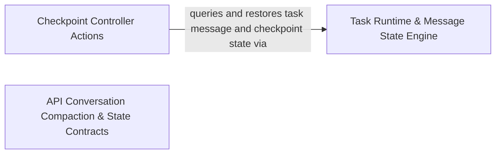

## Details

Orchestrates core task execution, API conversation loops, message state persistence, and checkpoint controller commands.

### Task Runtime & Message State Engine
Manages task execution request loops, tool execution, API conversation compaction, and persisted message state for active tasks.

**Related Classes/Methods**:

- `src.core.task.index.Task`:143-1342
- `src.core.task.index.Task.stateView`:160-162
- `src.core.task.message-state.MessageStateHandler`:76-1005
- `src.core.task.message-state.MessageStateHandler.getDiracMessages`:413-416
- `src.core.task.ApiConversationManager.ApiConversationManager`:17-508

**Source Files:**

- `src/core/task/ApiConversationManager.ts`
  - `src.core.task.ApiConversationManager.ApiConversationManager` (L17-L508) - Class
  - `src.core.task.ApiConversationManager.ApiConversationManager.constructor` (L18-L18) - Constructor
  - `src.core.task.ApiConversationManager.ApiConversationManager.setApi` (L20-L22) - Method
  - `src.core.task.ApiConversationManager.ApiConversationManager.getOperationalApi` (L24-L26) - Method
  - `src.core.task.ApiConversationManager.ApiConversationManager.scheduleProviderConversationCompaction` (L28-L39) - Method
  - `src.core.task.ApiConversationManager.ApiConversationManager.calculatePreCompactDeletedRange` (L41-L49) - Method
  - `src.core.task.ApiConversationManager.ApiConversationManager.handleContextWindowExceededError` (L51-L110) - Method
  - `src.core.task.ApiConversationManager.ApiConversationManager.determineContextCompaction` (L112-L143) - Method
  - `src.core.task.ApiConversationManager.ApiConversationManager.isCompatibleCheckpoint` (L144-L156) - Method
  - `src.core.task.ApiConversationManager.ApiConversationManager.hasCompatibleAssistantAfterBoundary` (L158-L173) - Method
  - `src.core.task.ApiConversationManager.ApiConversationManager.hasCompatibleAssistantAfterBoundary.some() callback` (L167-L171) - Function
  - `src.core.task.ApiConversationManager.ApiConversationManager.prepareProviderConversationDispatch` (L175-L322) - Method
  - `src.core.task.ApiConversationManager.ApiConversationManager.prepareApiRequest` (L324-L507) - Method
  - `src.core.task.ApiConversationManager.ApiConversationManager.prepareApiRequest.skillIds` (L394-L398) - Class
  - `src.core.task.ApiConversationManager.ApiConversationManager.prepareApiRequest.skillIds.flatMap() callback` (L396-L396) - Function
  - `src.core.task.ApiConversationManager.ApiConversationManager.prepareApiRequest.directActions.some() callback` (L403-L403) - Function
  - `src.core.task.ApiConversationManager.prepareApiRequest.request.userContent.map() callback` (L458-L458) - Function
  - `src.core.task.ApiConversationManager.ApiConversationManager.prepareApiRequest.request.userContent.map() callback` (L486-L486) - Function
- `src/core/task/LifecycleManager.ts`
  - `src.core.task.LifecycleManager.ResumeTaskOptions` (L37-L46) - Interface
  - `src.core.task.LifecycleManager.LifecycleManager` (L48-L729) - Class
  - `src.core.task.LifecycleManager.LifecycleManager.constructor` (L52-L52) - Constructor
  - `src.core.task.LifecycleManager.LifecycleManager.setApi` (L54-L56) - Method
  - `src.core.task.LifecycleManager.LifecycleManager.setBrowserSession` (L58-L60) - Method
  - `src.core.task.LifecycleManager.LifecycleManager.getOperationalApi` (L62-L64) - Method
  - `src.core.task.LifecycleManager.LifecycleManager.initializeCheckpoints` (L66-L121) - Method
  - `src.core.task.LifecycleManager.LifecycleManager.initializeCheckpoints.lastCheckpointMessageIndex` (L94-L94) - Class
  - `src.core.task.LifecycleManager.LifecycleManager.initializeCheckpoints.lastCheckpointMessageIndex.findLastIndex() callback` (L94-L94) - Function
  - `src.core.task.LifecycleManager.LifecycleManager.initializeCheckpoints.commitPromise.then() callback` (L106-L112) - Function
  - `src.core.task.LifecycleManager.LifecycleManager.initializeCheckpoints.catch() callback` (L113-L118) - Function
  - `src.core.task.LifecycleManager.LifecycleManager.startTask` (L123-L239) - Method
  - `src.core.task.LifecycleManager.LifecycleManager.resumeTaskFromHistory` (L241-L542) - Method
  - `src.core.task.LifecycleManager.LifecycleManager.resumeTaskFromHistory.lastRelevantMessageIndex` (L258-L261) - Class
  - `src.core.task.LifecycleManager.LifecycleManager.resumeTaskFromHistory.lastRelevantMessageIndex.findLastIndex() callback` (L260-L260) - Function
  - `src.core.task.LifecycleManager.LifecycleManager.resumeTaskFromHistory.lastApiReqStartedIndex` (L266-L266) - Class
  - `src.core.task.LifecycleManager.LifecycleManager.resumeTaskFromHistory.lastApiReqStartedIndex.findLastIndex() callback` (L266-L266) - Function
  - `src.core.task.LifecycleManager.LifecycleManager.resumeTaskFromHistory.lastDiracMessage` (L309-L317) - Class
  - `src.core.task.LifecycleManager.LifecycleManager.resumeTaskFromHistory.lastDiracMessage.find() callback` (L314-L316) - Function
  - `src.core.task.LifecycleManager.LifecycleManager.resumeTaskFromHistory.pWaitFor() callback` (L334-L334) - Function
  - `src.core.task.LifecycleManager.LifecycleManager.resumeTaskFromHistory.agoText` (L452-L463) - Class
  - `src.core.task.LifecycleManager.LifecycleManager.resumeTaskFromHistory.agoText.<function>` (L452-L463) - Function
  - `src.core.task.LifecycleManager.LifecycleManager.abortTask` (L544-L551) - Method
  - `src.core.task.LifecycleManager.LifecycleManager.finalizeTaskRun` (L554-L561) - Method
  - `src.core.task.LifecycleManager.LifecycleManager.performAbortTask` (L563-L673) - Method
  - `src.core.task.LifecycleManager.LifecycleManager.releaseOwnedTaskResources` (L675-L678) - Method
  - `src.core.task.LifecycleManager.LifecycleManager.performOwnedResourceCleanup` (L680-L706) - Method
  - `src.core.task.LifecycleManager.LifecycleManager.performOwnedResourceCleanup.ToolRegistry.withExclusiveAccess() callback` (L684-L686) - Function
  - `src.core.task.LifecycleManager.LifecycleManager.disposeTaskResources` (L708-L728) - Method
  - `src.core.task.LifecycleManager.disposeTaskResources.attempt() callback` (L718-L718) - Function
  - `src.core.task.LifecycleManager.LifecycleManager.disposeTaskResources.attempt() callback` (L725-L725) - Function
- `src/core/task/TaskMessenger.ts`
  - `src.core.task.TaskMessenger.TaskCardParams` (L26-L28) - Interface
  - `src.core.task.TaskMessenger.TaskCardHandle` (L30-L32) - Interface
  - `src.core.task.TaskMessenger.TaskCardHandle.getCard` (L31-L31) - Method
  - `src.core.task.TaskMessenger.TaskMessenger` (L34-L500) - Class
  - `src.core.task.TaskMessenger.TaskMessenger.constructor` (L38-L38) - Constructor
  - `src.core.task.TaskMessenger.TaskMessenger.postPresentationToWebview` (L40-L42) - Method
  - `src.core.task.TaskMessenger.TaskMessenger.setApi` (L44-L46) - Method
  - `src.core.task.TaskMessenger.TaskMessenger.generateId` (L48-L50) - Method
  - `src.core.task.TaskMessenger.TaskMessenger.streamText` (L52-L114) - Method
  - `src.core.task.TaskMessenger.TaskMessenger.streamText.handle` (L76-L110) - Class
  - `src.core.task.TaskMessenger.TaskMessenger.streamText.handle.append` (L78-L81) - Method
  - `src.core.task.TaskMessenger.TaskMessenger.streamText.handle.setImages` (L82-L87) - Method
  - `src.core.task.TaskMessenger.TaskMessenger.streamText.handle.setFiles` (L88-L93) - Method
  - `src.core.task.TaskMessenger.TaskMessenger.streamText.handle.close` (L94-L109) - Method
  - `src.core.task.TaskMessenger.TaskMessenger.scheduleStatePublication` (L116-L120) - Method
  - `src.core.task.TaskMessenger.TaskMessenger.scheduleStatePublication.catch() callback` (L117-L119) - Function
  - `src.core.task.TaskMessenger.TaskMessenger.createCard` (L122-L357) - Method
  - `src.core.task.TaskMessenger.TaskMessenger.createCard.removeWaitingCard` (L188-L192) - Class
  - `src.core.task.TaskMessenger.TaskMessenger.createCard.removeWaitingCard.dependencies.taskState.waitingCardIds.filter() callback` (L190-L190) - Function
  - `src.core.task.TaskMessenger.TaskMessenger.createCard.handle` (L212-L354) - Class
  - `src.core.task.TaskMessenger.TaskMessenger.createCard.handle.update` (L215-L218) - Method
  - `src.core.task.TaskMessenger.TaskMessenger.createCard.handle.appendBody` (L219-L222) - Method
  - `src.core.task.TaskMessenger.TaskMessenger.createCard.handle.finalize` (L223-L227) - Method
  - `src.core.task.TaskMessenger.TaskMessenger.createCard.handle.waitForInteraction` (L228-L353) - Method
  - `src.core.task.TaskMessenger.createCard.handle.waitForInteraction.pWaitFor() callback` (L244-L248) - Function
  - `src.core.task.TaskMessenger.TaskMessenger.createCard.handle.waitForInteraction.pWaitFor() callback` (L282-L291) - Function
  - `src.core.task.TaskMessenger.TaskMessenger.createCheckpoint` (L359-L393) - Method
  - `src.core.task.TaskMessenger.TaskMessenger.createCheckpoint.handle` (L376-L390) - Class
  - `src.core.task.TaskMessenger.TaskMessenger.createCheckpoint.handle.update` (L378-L380) - Method
  - `src.core.task.TaskMessenger.TaskMessenger.createCheckpoint.handle.appendBody` (L381-L383) - Method
  - `src.core.task.TaskMessenger.TaskMessenger.createCheckpoint.handle.finalize` (L384-L386) - Method
  - `src.core.task.TaskMessenger.TaskMessenger.createCheckpoint.handle.waitForInteraction` (L387-L389) - Method
  - `src.core.task.TaskMessenger.TaskMessenger.upsertApiStatus` (L395-L411) - Method
  - `src.core.task.TaskMessenger.TaskMessenger.upsertText` (L413-L466) - Method
  - `src.core.task.TaskMessenger.TaskMessenger.runNotificationHook` (L468-L499) - Method
- `src/core/task/TaskRequestLoop.ts`
  - `src.core.task.TaskRequestLoop.TaskRequestLoopContext` (L30-L45) - Interface
  - `src.core.task.TaskRequestLoop.recursivelyMakeDiracRequests` (L47-L447) - Function
  - `src.core.task.TaskRequestLoop.recursivelyMakeDiracRequests.afterUserContentPersisted` (L127-L132) - Method
  - `src.core.task.TaskRequestLoop.recursivelyMakeDiracRequests.afterUserContentPersisted.conversationPersistence.persist() callback` (L128-L128) - Function
  - `src.core.task.TaskRequestLoop.recursivelyMakeDiracRequests.queueUsageChunkSideEffects` (L169-L190) - Class
  - `src.core.task.TaskRequestLoop.recursivelyMakeDiracRequests.queueUsageChunkSideEffects.usageChunkSideEffectsQueue.then() callback` (L174-L189) - Function
  - `src.core.task.TaskRequestLoop.recursivelyMakeDiracRequests.onUsageChunk` (L317-L328) - Method
  - `src.core.task.TaskRequestLoop.recursivelyMakeDiracRequests.streamResult` (L331-L335) - Class
  - `src.core.task.TaskRequestLoop.recursivelyMakeDiracRequests.streamResult.apiAbort` (L334-L334) - Method
- `src/core/task/ToolExecutor.ts`
  - `src.core.task.ToolExecutor.ToolExecutor` (L51-L555) - Class
  - `src.core.task.ToolExecutor.ToolExecutor.constructor` (L66-L147) - Constructor
  - `src.core.task.ToolExecutor.ToolExecutor.constructor.createTaskConfig` (L125-L125) - Method
  - `src.core.task.ToolExecutor.ToolExecutor.constructor.getTaskId` (L126-L126) - Method
  - `src.core.task.ToolExecutor.ToolExecutor.constructor.getWorkspaceRoot` (L127-L127) - Method
  - `src.core.task.ToolExecutor.ToolExecutor.constructor.getToggles` (L128-L128) - Method
  - `src.core.task.ToolExecutor.ToolExecutor.constructor.getSelectionPolicy` (L129-L129) - Method
  - `src.core.task.ToolExecutor.ToolExecutor.constructor.getActiveSkills` (L130-L133) - Method
  - `src.core.task.ToolExecutor.ToolExecutor.constructor.getActiveSkills.taskState.availableSkills.filter() callback` (L132-L132) - Function
  - `src.core.task.ToolExecutor.ToolExecutor.constructor.isToolAvailable` (L134-L134) - Method
  - `src.core.task.ToolExecutor.ToolExecutor.setApi` (L149-L151) - Method
  - `src.core.task.ToolExecutor.ToolExecutor.requestAutoApprover` (L153-L159) - Method
  - `src.core.task.ToolExecutor.ToolExecutor.shouldAutoApproveTool` (L161-L163) - Method
  - `src.core.task.ToolExecutor.ToolExecutor.assertMutationAuthorized` (L165-L167) - Method
  - `src.core.task.ToolExecutor.ToolExecutor.withMutationAuthorization` (L169-L171) - Method
  - `src.core.task.ToolExecutor.ToolExecutor.shouldAutoApproveToolWithPath` (L173-L184) - Method
  - `src.core.task.ToolExecutor.ToolExecutor.resolveToolPathPermission` (L186-L197) - Method
  - `src.core.task.ToolExecutor.ToolExecutor.requestRuntime` (L199-L206) - Method
  - `src.core.task.ToolExecutor.ToolExecutor.requestProviderId` (L208-L214) - Method
  - `src.core.task.ToolExecutor.ToolExecutor.createUtilityRunner` (L216-L230) - Method
  - `src.core.task.ToolExecutor.ToolExecutor.createUtilityRunner.onUsage` (L225-L228) - Method
  - `src.core.task.ToolExecutor.ToolExecutor.createPermissionDecisionBinding` (L233-L253) - Method
  - `src.core.task.ToolExecutor.ToolExecutor.createSubagentRuntime` (L255-L286) - Method
  - `src.core.task.ToolExecutor.ToolExecutor.createSubagentRuntime.abort` (L284-L284) - Method
  - `src.core.task.ToolExecutor.ToolExecutor.asToolConfig` (L288-L388) - Method
  - `src.core.task.ToolExecutor.ToolExecutor.asToolConfig.config` (L295-L384) - Class
  - `src.core.task.ToolExecutor.ToolExecutor.asToolConfig.config.yoloModeToggled` (L301-L303) - Method
  - `src.core.task.ToolExecutor.ToolExecutor.asToolConfig.config.autoApprovalSettings` (L331-L333) - Method
  - `src.core.task.ToolExecutor.ToolExecutor.asToolConfig.config.permissionDecisionBinding` (L336-L338) - Method
  - `src.core.task.ToolExecutor.ToolExecutor.asToolConfig.config.callbacks.assertMutationAuthorized` (L349-L349) - Method
  - `src.core.task.ToolExecutor.ToolExecutor.asToolConfig.config.callbacks.withMutationAuthorization` (L350-L350) - Method
  - `src.core.task.ToolExecutor.ToolExecutor.asToolConfig.config.callbacks.transitionFromMutation` (L351-L351) - Method
  - `src.core.task.ToolExecutor.ToolExecutor.asToolConfig.config.callbacks.retainMutationUntil` (L352-L352) - Method
  - `src.core.task.ToolExecutor.ToolExecutor.asToolConfig.config.callbacks.commitEnabledToolToggles` (L353-L353) - Method
  - `src.core.task.ToolExecutor.ToolExecutor.asToolConfig.config.callbacks.saveCheckpoint` (L354-L356) - Method
  - `src.core.task.ToolExecutor.ToolExecutor.asToolConfig.config.callbacks.commitAttemptCompletion` (L357-L357) - Method
  - `src.core.task.ToolExecutor.ToolExecutor.asToolConfig.config.callbacks.getDiracMessages` (L363-L363) - Method
  - `src.core.task.ToolExecutor.ToolExecutor.asToolConfig.config.callbacks.updateDiracMessage` (L364-L367) - Method
  - `src.core.task.ToolExecutor.ToolExecutor.asToolConfig.config.callbacks.createUtilityModelRunner` (L379-L379) - Method
  - `src.core.task.ToolExecutor.ToolExecutor.asToolConfig.config.callbacks.createSubagentRuntime` (L380-L380) - Method
  - `src.core.task.ToolExecutor.ToolExecutor.refreshToolsForTask` (L390-L392) - Method
  - `src.core.task.ToolExecutor.ToolExecutor.markToolsDirty` (L393-L395) - Method
  - `src.core.task.ToolExecutor.ToolExecutor.getSnapshotForRequest` (L396-L409) - Method
  - `src.core.task.ToolExecutor.ToolExecutor.getActiveSnapshot` (L410-L412) - Method
  - `src.core.task.ToolExecutor.ToolExecutor.activateSnapshot` (L413-L425) - Method
  - `src.core.task.ToolExecutor.ToolExecutor.executeTool` (L426-L428) - Method
  - `src.core.task.ToolExecutor.ToolExecutor.applyLatestBrowserSettings` (L430-L438) - Method
  - `src.core.task.ToolExecutor.ToolExecutor.isPlanModeToolRestricted` (L440-L442) - Method
  - `src.core.task.ToolExecutor.ToolExecutor.createToolRejectionMessage` (L444-L449) - Method
  - `src.core.task.ToolExecutor.ToolExecutor.execute` (L451-L480) - Method
  - `src.core.task.ToolExecutor.ToolExecutor.isPlanModeRestricted` (L483-L495) - Method
  - `src.core.task.ToolExecutor.ToolExecutor.handleCompleteBlock` (L497-L554) - Method
- `src/core/task/index.ts`
  - `src.core.task.index.Task` (L143-L1342) - Class
  - `src.core.task.index.Task.stateView` (L160-L162) - Method
  - `src.core.task.index.Task.withStateLock` (L174-L176) - Method
  - `src.core.task.index.Task.steeringContext` (L178-L188) - Method
  - `src.core.task.index.Task.steeringContext.postStateToWebview` (L185-L185) - Method
  - `src.core.task.index.Task.steeringContext.withStateLock` (L186-L186) - Method
  - `src.core.task.index.Task.promptArtifactsContext` (L190-L201) - Method
  - `src.core.task.index.Task.requestBuilderContext` (L203-L231) - Method
  - `src.core.task.index.Task.requestBuilderContext.writePromptMetadataArtifacts` (L219-L229) - Method
  - `src.core.task.index.Task.requestOutcomeContext` (L233-L253) - Method
  - `src.core.task.index.Task.requestOutcomeContext.postStateToWebview` (L243-L243) - Method
  - `src.core.task.index.Task.requestOutcomeContext.abortTask` (L244-L244) - Method
  - `src.core.task.index.Task.requestOutcomeContext.handleContextWindowExceededError` (L245-L245) - Method
  - `src.core.task.index.Task.requestOutcomeContext.reinitExistingTaskFromId` (L246-L246) - Method
  - `src.core.task.index.Task.requestOutcomeContext.attemptApiRequest` (L247-L248) - Method
  - `src.core.task.index.Task.requestOutcomeContext.recursivelyMakeDiracRequests` (L249-L250) - Method
  - `src.core.task.index.Task.requestOutcomeContext.handleEmptyAssistantResponse` (L251-L251) - Method
  - `src.core.task.index.Task.requestLoopContext` (L255-L274) - Method
  - `src.core.task.index.Task.requestLoopContext.handleMistakeLimitReached` (L261-L261) - Method
  - `src.core.task.index.Task.requestLoopContext.enqueuePreRequestSteeringMessages` (L262-L262) - Method
  - `src.core.task.index.Task.requestLoopContext.resetStreamingState` (L263-L263) - Method
  - `src.core.task.index.Task.requestLoopContext.initializeCheckpoints` (L264-L264) - Method
  - `src.core.task.index.Task.requestLoopContext.determineContextCompaction` (L265-L265) - Method
  - `src.core.task.index.Task.canAcceptSteeringMessage` (L276-L278) - Method
  - `src.core.task.index.Task.enqueueSteeringMessage` (L280-L282) - Method
  - `src.core.task.index.Task.claimSteeringMessages` (L284-L286) - Method
  - `src.core.task.index.Task.commitSteeringClaim` (L288-L290) - Method
  - `src.core.task.index.Task.settleConsumedSteeringClaim` (L292-L294) - Method
  - `src.core.task.index.Task.rollbackSteeringClaim` (L296-L298) - Method
  - `src.core.task.index.Task.appendQueuedSteeringToUserContent` (L300-L302) - Method
  - `src.core.task.index.Task.appendQueuedSteeringToNextApiRequest` (L304-L306) - Method
  - `src.core.task.index.Task.commitAttemptCompletion` (L308-L312) - Method
  - `src.core.task.index.Task.setActiveHookExecution` (L314-L316) - Method
  - `src.core.task.index.Task.clearActiveHookExecution` (L318-L320) - Method
  - `src.core.task.index.Task.setContextCompactionObserver` (L323-L325) - Method
  - `src.core.task.index.Task.notifyContextCompacted` (L327-L333) - Method
  - `src.core.task.index.Task.getActiveHookExecution` (L335-L337) - Method
  - `src.core.task.index.Task.constructor` (L406-L873) - Constructor
  - `src.core.task.index.constructor.getWorkingConfiguration` (L490-L490) - Method
  - `src.core.task.index.constructor.getRequestRuntime` (L491-L491) - Method
  - `src.core.task.index.Task.constructor.shouldRunBackgroundCheck` (L508-L508) - Method
  - `src.core.task.index.Task.constructor.catch() callback` (L595-L598) - Function
  - `src.core.task.index.Task.constructor.effectiveApiConfiguration` (L614-L627) - Class
  - `src.core.task.index.Task.constructor.effectiveApiConfiguration.onRetryAttempt` (L617-L626) - Method
  - `src.core.task.index.Task.constructor.commandExecutorCallbacks` (L666-L683) - Class
  - `src.core.task.index.Task.constructor.commandExecutorCallbacks.updateBackgroundCommandState` (L668-L672) - Method
  - `src.core.task.index.Task.constructor.commandExecutorCallbacks.updateDiracMessage` (L673-L676) - Method
  - `src.core.task.index.Task.constructor.commandExecutorCallbacks.getDiracMessages` (L677-L677) - Method
  - `src.core.task.index.Task.constructor.commandExecutorCallbacks.addToUserMessageContent` (L678-L681) - Method
  - `src.core.task.index.Task.constructor.commandExecutorCallbacks.getEnvironmentVariables` (L682-L682) - Method
  - `src.core.task.index.Task.constructor.isTextCondensationAvailable` (L765-L775) - Method
  - `src.core.task.index.Task.constructor.time` (L806-L806) - Method
  - `src.core.task.index.Task.constructor.getApi` (L817-L817) - Method
  - `src.core.task.index.Task.constructor.getWorkingConfiguration` (L830-L830) - Method
  - `src.core.task.index.Task.constructor.getRequestRuntime` (L831-L831) - Method
  - `src.core.task.index.Task.constructor.activateSkill` (L842-L842) - Method
  - `src.core.task.index.Task.constructor.getPinnedContext` (L845-L845) - Method
  - `src.core.task.index.Task.constructor.writePromptMetadataArtifacts` (L846-L846) - Method
  - `src.core.task.index.Task.constructor.runLocalConversationCompaction` (L854-L854) - Method
  - `src.core.task.index.Task.getWorkingConfiguration` (L876-L878) - Method
  - `src.core.task.index.Task.applyWorkingConfigurationUpdate` (L886-L917) - Method
  - `src.core.task.index.Task.applyWorkingConfigurationUpdate.mutationGate.withTransition() callback` (L890-L915) - Function
  - `src.core.task.index.Task.applyWorkingConfigurationUpdate.mutationGate.withTransition() callback.withStateLock() callback` (L891-L915) - Function
  - `src.core.task.index.Task.commitEnabledToolToggles` (L919-L936) - Method
  - `src.core.task.index.commitEnabledToolToggles.applyWorkingConfigurationUpdate() callback` (L926-L930) - Function
  - `src.core.task.index.Task.commitEnabledToolToggles.applyWorkingConfigurationUpdate() callback` (L931-L934) - Function
  - `src.core.task.index.Task.withMutationAuthorization` (L938-L947) - Method
  - `src.core.task.index.Task.withMutationAuthorization.mutationGate.withMutation() callback` (L944-L944) - Function
  - `src.core.task.index.Task.createApiHandlerForRuntime` (L950-L968) - Method
  - `src.core.task.index.Task.createApiHandlerForRuntime.onRetryAttempt` (L955-L964) - Method
  - `src.core.task.index.Task.installApiHandler` (L971-L980) - Method
  - `src.core.task.index.Task.applyCommittedModeEffects` (L982-L988) - Method
  - `src.core.task.index.Task.getEnvironmentDetails` (L990-L992) - Method
  - `src.core.task.index.Task.persistApiStopReason` (L994-L997) - Method
  - `src.core.task.index.Task.handleMistakeLimitReached` (L999-L1011) - Method
  - `src.core.task.index.Task.handleMistakeLimitReached.postStateToWebview` (L1007-L1007) - Method
  - `src.core.task.index.Task.loadContext` (L1013-L1019) - Method
  - `src.core.task.index.Task.resetTransientState` (L1023-L1031) - Method
  - `src.core.task.index.Task.waitForFollowUp` (L1033-L1035) - Method
  - `src.core.task.index.Task.addPermissionRule` (L1038-L1040) - Method
  - `src.core.task.index.Task.listPermissionRules` (L1043-L1045) - Method
  - `src.core.task.index.Task.deletePermissionRule` (L1048-L1050) - Method
  - `src.core.task.index.Task.submitCardResponse` (L1052-L1063) - Method
  - `src.core.task.index.Task.submitCardResponse.withStateLock() callback` (L1060-L1062) - Function
  - `src.core.task.index.Task.saveCheckpointCallback` (L1065-L1070) - Method
  - `src.core.task.index.Task.switchToActModeCallback` (L1072-L1074) - Method
  - `src.core.task.index.Task.runUserPromptSubmitHook` (L1076-L1081) - Method
  - `src.core.task.index.Task.startTask` (L1083-L1088) - Method
  - `src.core.task.index.Task.startTask.runTaskLifecycle() callback` (L1084-L1087) - Function
  - `src.core.task.index.Task.restoreQueuedSteeringFromTranscript` (L1090-L1092) - Method
  - `src.core.task.index.Task.resumeTaskFromHistory` (L1094-L1099) - Method
  - `src.core.task.index.Task.resumeTaskFromHistory.runTaskLifecycle() callback` (L1095-L1098) - Function
  - `src.core.task.index.Task.markToolsDirty` (L1101-L1103) - Method
  - `src.core.task.index.Task.initiateTaskLoop` (L1105-L1151) - Method
  - `src.core.task.index.Task.runTaskLifecycle` (L1153-L1161) - Method
  - `src.core.task.index.Task.taskRunOutcomeFromState` (L1163-L1186) - Method
  - `src.core.task.index.Task.settleTaskRun` (L1188-L1211) - Method
  - `src.core.task.index.Task.settleTaskRun.withStateLock() callback` (L1206-L1210) - Function
  - `src.core.task.index.Task.shouldRunTaskCancelHook` (L1213-L1215) - Method
  - `src.core.task.index.Task.abortTask` (L1217-L1224) - Method
  - `src.core.task.index.Task.abortTask.withStateLock() callback` (L1218-L1218) - Function
  - `src.core.task.index.Task.retirePersistence` (L1226-L1228) - Method
  - `src.core.task.index.Task.executeCommandTool` (L1231-L1237) - Method
  - `src.core.task.index.Task.cancelBackgroundCommand` (L1243-L1245) - Method
  - `src.core.task.index.Task.cancelHookExecution` (L1247-L1249) - Method
  - `src.core.task.index.Task.getCurrentProviderInfo` (L1251-L1265) - Method
  - `src.core.task.index.Task.writePromptMetadataArtifacts` (L1267-L1275) - Method
  - `src.core.task.index.Task.getApiRequestIdSafe` (L1277-L1283) - Method
  - `src.core.task.index.Task.handleContextWindowExceededError` (L1285-L1287) - Method
  - `src.core.task.index.Task.handleApiRequestError` (L1289-L1300) - Method
  - `src.core.task.index.Task.resetStreamingState` (L1302-L1314) - Method
  - `src.core.task.index.Task.attemptApiRequest` (L1316-L1319) - Method
  - `src.core.task.index.Task.presentAssistantMessage` (L1321-L1323) - Method
  - `src.core.task.index.Task.recursivelyMakeDiracRequests` (L1325-L1333) - Method
  - `src.core.task.index.Task.initializeCheckpoints` (L1335-L1337) - Method
  - `src.core.task.index.Task.determineContextCompaction` (L1339-L1341) - Method
- `src/core/task/message-state.ts`
  - `src.core.task.message-state.DiracMessageChange` (L34-L48) - Interface
  - `src.core.task.message-state.PresentationSnapshot` (L50-L54) - Interface
  - `src.core.task.message-state.MessageStateHandlerEvents` (L57-L60) - Interface
  - `src.core.task.message-state.MessageStateHandlerParams` (L62-L70) - Interface
  - `src.core.task.message-state.MessageStateHandler` (L76-L1005) - Class
  - `src.core.task.message-state.MessageStateHandler.recordPresentationOperation` (L118-L130) - Method
  - `src.core.task.message-state.MessageStateHandler.recordApiConversationOperation` (L132-L137) - Method
  - `src.core.task.message-state.MessageStateHandler.bufferPresentationAppend` (L139-L143) - Method
  - `src.core.task.message-state.MessageStateHandler.materializePresentationAppends` (L145-L158) - Method
  - `src.core.task.message-state.MessageStateHandler.materializeAllPresentationAppends` (L160-L165) - Method
  - `src.core.task.message-state.MessageStateHandler.flushIfPersistenceBatchIsFull` (L167-L174) - Method
  - `src.core.task.message-state.MessageStateHandler.getPendingPresentationOperations` (L176-L178) - Method
  - `src.core.task.message-state.MessageStateHandler.hasPresentationPublicationGap` (L180-L182) - Method
  - `src.core.task.message-state.MessageStateHandler.acknowledgePresentationOperations` (L184-L198) - Method
  - `src.core.task.message-state.MessageStateHandler.acknowledgePresentationOperations.pendingPresentationPublications.filter() callback` (L186-L186) - Function
  - `src.core.task.message-state.MessageStateHandler.acknowledgePresentationOperations.pendingPresentationPublications.reduce() callback` (L189-L189) - Function
  - `src.core.task.message-state.MessageStateHandler.hasPendingPresentationOperations` (L200-L202) - Method
  - `src.core.task.message-state.MessageStateHandler.constructor` (L203-L211) - Constructor
  - `src.core.task.message-state.MessageStateHandler.emitDiracMessagesChanged` (L216-L218) - Method
  - `src.core.task.message-state.MessageStateHandler.publishCardInteractionReady` (L221-L224) - Method
  - `src.core.task.message-state.MessageStateHandler.setCheckpointTracker` (L226-L228) - Method
  - `src.core.task.message-state.MessageStateHandler.withStateLock` (L235-L237) - Method
  - `src.core.task.message-state.MessageStateHandler.capturePresentationSnapshot` (L239-L248) - Method
  - `src.core.task.message-state.MessageStateHandler.capturePresentationSnapshot.withStateLock() callback` (L240-L247) - Function
  - `src.core.task.message-state.MessageStateHandler.scheduleUiFlush` (L251-L262) - Method
  - `src.core.task.message-state.MessageStateHandler.scheduleUiFlush.setTimeout() callback` (L257-L261) - Function
  - `src.core.task.message-state.MessageStateHandler.scheduleUiFlush.setTimeout() callback.catch() callback` (L260-L260) - Function
  - `src.core.task.message-state.MessageStateHandler.scheduleApiHistoryFlush` (L265-L272) - Method
  - `src.core.task.message-state.MessageStateHandler.scheduleApiHistoryFlush.queueMicrotask() callback` (L268-L271) - Function
  - `src.core.task.message-state.MessageStateHandler.scheduleApiHistoryFlush.queueMicrotask() callback.catch() callback` (L270-L270) - Function
  - `src.core.task.message-state.MessageStateHandler.cancelScheduledUiFlush` (L274-L278) - Method
  - `src.core.task.message-state.MessageStateHandler.retirePersistence` (L281-L296) - Method
  - `src.core.task.message-state.MessageStateHandler.retirePersistence.persistenceMutex.withLock() callback` (L285-L294) - Function
  - `src.core.task.message-state.MessageStateHandler.retirePersistence.persistenceMutex.withLock() callback.withStateLock() callback` (L286-L294) - Function
  - `src.core.task.message-state.MessageStateHandler.persistPendingOperations` (L299-L336) - Method
  - `src.core.task.message-state.MessageStateHandler.persistPendingOperations.pending` (L301-L313) - Class
  - `src.core.task.message-state.MessageStateHandler.persistPendingOperations.pending.withStateLock() callback` (L301-L313) - Function
  - `src.core.task.message-state.persistPendingOperations.withStateLock() callback` (L320-L323) - Function
  - `src.core.task.message-state.MessageStateHandler.persistPendingOperations.withStateLock() callback` (L329-L332) - Function
  - `src.core.task.message-state.MessageStateHandler.createBaselinesWhenTailIsLarge` (L338-L359) - Method
  - `src.core.task.message-state.MessageStateHandler.createBaselinesWhenTailIsLarge.withStateLock() callback` (L349-L358) - Function
  - `src.core.task.message-state.MessageStateHandler.flushPendingWrites` (L365-L369) - Method
  - `src.core.task.message-state.MessageStateHandler.flushPendingWrites.persistenceMutex.withLock() callback` (L368-L368) - Function
  - `src.core.task.message-state.MessageStateHandler.flushTaskHistory` (L375-L379) - Method
  - `src.core.task.message-state.MessageStateHandler.flushTaskHistory.persistenceMutex.withLock() callback` (L378-L378) - Function
  - `src.core.task.message-state.MessageStateHandler.getApiConversationHistory` (L381-L383) - Method
  - `src.core.task.message-state.MessageStateHandler.setApiConversationHistory` (L385-L391) - Method
  - `src.core.task.message-state.MessageStateHandler.getApiConversationProviderState` (L393-L395) - Method
  - `src.core.task.message-state.MessageStateHandler.setApiConversationProviderState` (L397-L399) - Method
  - `src.core.task.message-state.MessageStateHandler.overwriteApiConversationProviderState` (L401-L411) - Method
  - `src.core.task.message-state.MessageStateHandler.overwriteApiConversationProviderState.persistenceMutex.withLock() callback` (L404-L410) - Function
  - `src.core.task.message-state.MessageStateHandler.overwriteApiConversationProviderState.persistenceMutex.withLock() callback.withStateLock() callback` (L406-L409) - Function
  - `src.core.task.message-state.MessageStateHandler.getDiracMessages` (L413-L416) - Method
  - `src.core.task.message-state.MessageStateHandler.setDiracMessages` (L418-L436) - Method
  - `src.core.task.message-state.MessageStateHandler.rebuildMessageIndexes` (L438-L450) - Method
  - `src.core.task.message-state.MessageStateHandler.updateLatestApiStatusAfterMutation` (L452-L460) - Method
  - `src.core.task.message-state.MessageStateHandler.findLastApiStatusMessageId` (L462-L470) - Method
  - `src.core.task.message-state.MessageStateHandler.rebuildHistoryProjection` (L472-L480) - Method
  - `src.core.task.message-state.MessageStateHandler.updateHistoryProjection` (L482-L511) - Method
  - `src.core.task.message-state.MessageStateHandler.historyProjectionBeforeMutation` (L513-L523) - Method
  - `src.core.task.message-state.MessageStateHandler.findLastRelevantMessageId` (L525-L532) - Method
  - `src.core.task.message-state.MessageStateHandler.updateTaskHistoryInternal` (L539-L583) - Method
  - `src.core.task.message-state.MessageStateHandler.saveDiracMessagesAndUpdateHistory` (L589-L593) - Method
  - `src.core.task.message-state.MessageStateHandler.saveDiracMessagesAndUpdateHistory.persistenceMutex.withLock() callback` (L592-L592) - Function
  - `src.core.task.message-state.MessageStateHandler.addToApiConversationHistory` (L595-L608) - Method
  - `src.core.task.message-state.MessageStateHandler.addToApiConversationHistory.withStateLock() callback` (L596-L605) - Function
  - `src.core.task.message-state.MessageStateHandler.appendToLastApiConversationUserMessage` (L610-L632) - Method
  - `src.core.task.message-state.MessageStateHandler.appendToLastApiConversationUserMessage.message` (L612-L628) - Class
  - `src.core.task.message-state.MessageStateHandler.appendToLastApiConversationUserMessage.message.withStateLock() callback` (L612-L628) - Function
  - `src.core.task.message-state.MessageStateHandler.overwriteApiConversationHistory` (L634-L646) - Method
  - `src.core.task.message-state.MessageStateHandler.overwriteApiConversationHistory.withStateLock() callback` (L636-L644) - Function
  - `src.core.task.message-state.MessageStateHandler.recordDeliveredSteeringMessageIds` (L648-L663) - Method
  - `src.core.task.message-state.MessageStateHandler.recordDeliveredSteeringMessageIds.persistenceMutex.withLock() callback` (L651-L662) - Function
  - `src.core.task.message-state.MessageStateHandler.recordDeliveredSteeringMessageIds.persistenceMutex.withLock() callback.withStateLock() callback` (L653-L661) - Function
  - `src.core.task.message-state.MessageStateHandler.addToDiracMessages` (L671-L701) - Method
  - `src.core.task.message-state.MessageStateHandler.addToDiracMessages.withStateLock() callback` (L672-L698) - Function
  - `src.core.task.message-state.MessageStateHandler.overwriteDiracMessages` (L707-L727) - Method
  - `src.core.task.message-state.MessageStateHandler.overwriteDiracMessages.withStateLock() callback` (L709-L725) - Function
  - `src.core.task.message-state.MessageStateHandler.findMessageIndexById` (L732-L734) - Method
  - `src.core.task.message-state.MessageStateHandler.getMessageById` (L736-L742) - Method
  - `src.core.task.message-state.MessageStateHandler.getLatestApiStatusMessage` (L744-L746) - Method
  - `src.core.task.message-state.MessageStateHandler.getPresentationOffset` (L748-L750) - Method
  - `src.core.task.message-state.MessageStateHandler.getPresentationStateGeneration` (L752-L754) - Method
  - `src.core.task.message-state.MessageStateHandler.findMessageIndexByCardId` (L759-L761) - Method
  - `src.core.task.message-state.MessageStateHandler.patchCardById` (L763-L789) - Method
  - `src.core.task.message-state.MessageStateHandler.patchCardById.updatedCard` (L764-L785) - Class
  - `src.core.task.message-state.MessageStateHandler.patchCardById.updatedCard.withStateLock() callback` (L764-L785) - Function
  - `src.core.task.message-state.MessageStateHandler.appendCardBodyById` (L791-L812) - Method
  - `src.core.task.message-state.MessageStateHandler.appendCardBodyById.withStateLock() callback` (L792-L809) - Function
  - `src.core.task.message-state.MessageStateHandler.appendMarkdownById` (L814-L836) - Method
  - `src.core.task.message-state.MessageStateHandler.appendMarkdownById.withStateLock() callback` (L815-L833) - Function
  - `src.core.task.message-state.MessageStateHandler.patchMarkdownById` (L838-L865) - Method
  - `src.core.task.message-state.MessageStateHandler.patchMarkdownById.withStateLock() callback` (L842-L862) - Function
  - `src.core.task.message-state.MessageStateHandler.patchApiStatusById` (L867-L897) - Method
  - `src.core.task.message-state.MessageStateHandler.patchApiStatusById.withStateLock() callback` (L872-L894) - Function
  - `src.core.task.message-state.MessageStateHandler.requireMessageIndex` (L899-L903) - Method
  - `src.core.task.message-state.MessageStateHandler.requireCardMessageIndex` (L905-L909) - Method
  - `src.core.task.message-state.MessageStateHandler.updateDiracMessage` (L914-L943) - Method
  - `src.core.task.message-state.MessageStateHandler.updateDiracMessage.withStateLock() callback` (L915-L940) - Function
  - `src.core.task.message-state.MessageStateHandler.patchMessageById` (L945-L970) - Method
  - `src.core.task.message-state.MessageStateHandler.patchMessageById.withStateLock() callback` (L946-L967) - Function
  - `src.core.task.message-state.MessageStateHandler.deleteDiracMessage` (L976-L1004) - Method
  - `src.core.task.message-state.MessageStateHandler.deleteDiracMessage.withStateLock() callback` (L977-L1001) - Function
  - `src.core.task.message-state.isTaskHistoryRelevantMessage` (L1007-L1012) - Function
  - `src.core.task.message-state.addApiMetrics` (L1014-L1031) - Function
  - `src.core.task.message-state.findLastModelInfo` (L1033-L1038) - Function
- `src/core/task/multifile-diff.ts`
  - `src.core.task.multifile-diff.showChangedFilesDiff` (L11-L48) - Function
  - `src.core.task.multifile-diff.diffs` (L42-L46) - Class
  - `src.core.task.multifile-diff.showChangedFilesDiff.diffs.changedFiles.map() callback` (L42-L46) - Function
  - `src.core.task.multifile-diff.getChangedFiles` (L57-L92) - Function
  - `src.core.task.multifile-diff.getChangesSinceLastTaskCompletion` (L94-L129) - Function
  - `src.core.task.multifile-diff.getChangesSinceLastTaskCompletion.lastTaskCompletedMessageCheckpointHash` (L101-L104) - Class
  - `src.core.task.multifile-diff.getChangesSinceLastTaskCompletion.lastTaskCompletedMessageCheckpointHash.findLast() callback` (L103-L103) - Function
  - `src.core.task.multifile-diff.getChangesSinceLastTaskCompletion.firstCheckpointMessageCheckpointHash` (L107-L113) - Class
  - `src.core.task.multifile-diff.getChangesSinceLastTaskCompletion.firstCheckpointMessageCheckpointHash.find() callback` (L110-L112) - Function
- `src/core/task/response/AssistantMessagePresenter.ts`
  - `src.core.task.response.AssistantMessagePresenter.AssistantMessagePresenter` (L12-L151) - Class
  - `src.core.task.response.AssistantMessagePresenter.AssistantMessagePresenter.constructor` (L21-L21) - Constructor
  - `src.core.task.response.AssistantMessagePresenter.pendingPresentationError` (L23-L25) - Method
  - `src.core.task.response.AssistantMessagePresenter.AssistantMessagePresenter.pendingPresentationError` (L26-L28) - Method
  - `src.core.task.response.AssistantMessagePresenter.AssistantMessagePresenter.resetState` (L30-L36) - Method
  - `src.core.task.response.AssistantMessagePresenter.AssistantMessagePresenter.sanitizeModelQuirks` (L39-L41) - Method
  - `src.core.task.response.AssistantMessagePresenter.AssistantMessagePresenter.present` (L43-L50) - Method
  - `src.core.task.response.AssistantMessagePresenter.AssistantMessagePresenter.runPresentationLoop` (L53-L64) - Method
  - `src.core.task.response.AssistantMessagePresenter.AssistantMessagePresenter.processPendingBlocks` (L67-L79) - Method
  - `src.core.task.response.AssistantMessagePresenter.AssistantMessagePresenter.computeBlockComplete` (L82-L88) - Method
  - `src.core.task.response.AssistantMessagePresenter.AssistantMessagePresenter.processBlock` (L91-L100) - Method
  - `src.core.task.response.AssistantMessagePresenter.AssistantMessagePresenter.processTextBlock` (L102-L113) - Method
  - `src.core.task.response.AssistantMessagePresenter.AssistantMessagePresenter.processReasoningBlock` (L115-L122) - Method
  - `src.core.task.response.AssistantMessagePresenter.AssistantMessagePresenter.processToolUseBlock` (L124-L131) - Method
  - `src.core.task.response.AssistantMessagePresenter.AssistantMessagePresenter.awaitCheckpointIfNeeded` (L134-L142) - Method
  - `src.core.task.response.AssistantMessagePresenter.AssistantMessagePresenter.checkAllBlocksProcessed` (L145-L150) - Method
- `src/core/task/tools/adapters/traits/OrchestrationTraitBuilder.ts`
  - `src.core.task.tools.adapters.traits.OrchestrationTraitBuilder.buildOrchestrationTrait` (L13-L114) - Function
  - `src.core.task.tools.adapters.traits.OrchestrationTraitBuilder.buildOrchestrationTrait.runSubagent` (L15-L69) - Method
  - `src.core.task.tools.adapters.traits.OrchestrationTraitBuilder.buildOrchestrationTrait.runSubagent.result` (L60-L63) - Class
  - `src.core.task.tools.adapters.traits.OrchestrationTraitBuilder.buildOrchestrationTrait.runSubagent.result.runner.run() callback` (L60-L63) - Function
  - `src.core.task.tools.adapters.traits.OrchestrationTraitBuilder.buildOrchestrationTrait.runHook` (L70-L84) - Method
  - `src.core.task.tools.adapters.traits.OrchestrationTraitBuilder.buildOrchestrationTrait.switchToActMode` (L85-L85) - Method
  - `src.core.task.tools.adapters.traits.OrchestrationTraitBuilder.buildOrchestrationTrait.saveCheckpoint` (L86-L86) - Method
  - `src.core.task.tools.adapters.traits.OrchestrationTraitBuilder.buildOrchestrationTrait.commitAttemptCompletion` (L87-L87) - Method
  - `src.core.task.tools.adapters.traits.OrchestrationTraitBuilder.buildOrchestrationTrait.getHistory` (L88-L88) - Method
  - `src.core.task.tools.adapters.traits.OrchestrationTraitBuilder.buildOrchestrationTrait.getCurrentTurnUserRequests` (L89-L89) - Method
  - `src.core.task.tools.adapters.traits.OrchestrationTraitBuilder.buildOrchestrationTrait.setTruncationRange` (L90-L92) - Method
  - `src.core.task.tools.adapters.traits.OrchestrationTraitBuilder.buildOrchestrationTrait.getNextTruncationRange` (L93-L98) - Method
  - `src.core.task.tools.adapters.traits.OrchestrationTraitBuilder.buildOrchestrationTrait.getTaskState` (L99-L99) - Method
  - `src.core.task.tools.adapters.traits.OrchestrationTraitBuilder.buildOrchestrationTrait.setTaskState` (L100-L102) - Method
  - `src.core.task.tools.adapters.traits.OrchestrationTraitBuilder.buildOrchestrationTrait.commitCompletionResponse` (L103-L103) - Method
  - `src.core.task.tools.adapters.traits.OrchestrationTraitBuilder.buildOrchestrationTrait.requestTaskReplacement` (L104-L107) - Method
  - `src.core.task.tools.adapters.traits.OrchestrationTraitBuilder.buildOrchestrationTrait.activateSkill` (L108-L108) - Method
  - `src.core.task.tools.adapters.traits.OrchestrationTraitBuilder.buildOrchestrationTrait.doesLatestTaskCompletionHaveNewChanges` (L109-L109) - Method
  - `src.core.task.tools.adapters.traits.OrchestrationTraitBuilder.buildOrchestrationTrait.updateMessage` (L110-L110) - Method
  - `src.core.task.tools.adapters.traits.OrchestrationTraitBuilder.buildOrchestrationTrait.resetTransientState` (L111-L111) - Method
  - `src.core.task.tools.adapters.traits.OrchestrationTraitBuilder.buildOrchestrationTrait.notifyContextCompacted` (L112-L112) - Method
- `src/core/task/tools/types/TaskConfig.ts`
  - `src.core.task.tools.types.TaskConfig.TaskConfig` (L37-L99) - Interface
  - `src.core.task.tools.types.TaskConfig.TaskServices` (L104-L112) - Interface
  - `src.core.task.tools.types.TaskConfig.SubagentRuntime` (L113-L124) - Interface
  - `src.core.task.tools.types.TaskConfig.SubagentRuntime.createMessage` (L117-L122) - Method
  - `src.core.task.tools.types.TaskConfig.SubagentRuntime.abort` (L123-L123) - Method
  - `src.core.task.tools.types.TaskConfig.TaskCallbacks` (L131-L188) - Interface
  - `src.core.task.tools.types.TaskConfig.validateTaskConfig` (L194-L228) - Function

### Checkpoint Controller Actions
Handles controller-level checkpoint operations including computing checkpoint diffs, restoring task state to checkpoints, hashing working directories, and streaming checkpoint subscriptions.

**Related Classes/Methods**:

- `src.core.controller.checkpoints.checkpointDiff.checkpointDiff`:4-12
- `src.core.controller.checkpoints.checkpointRestore.checkpointRestore`:10-37

**Source Files:**

- `src/core/controller/checkpoints/checkpointDiff.ts`
  - `src.core.controller.checkpoints.checkpointDiff.checkpointDiff` (L4-L12) - Function
  - `src.core.controller.checkpoints.checkpointDiff.checkpointDiff.message` (L6-L6) - Class
  - `src.core.controller.checkpoints.checkpointDiff.checkpointDiff.message.find() callback` (L6-L6) - Function
- `src/core/controller/checkpoints/checkpointRestore.ts`
  - `src.core.controller.checkpoints.checkpointRestore.checkpointRestore` (L10-L37) - Function
  - `src.core.controller.checkpoints.checkpointRestore.checkpointRestore.pWaitFor() callback` (L15-L15) - Function
  - `src.core.controller.checkpoints.checkpointRestore.checkpointRestore.catch() callback` (L17-L24) - Function
  - `src.core.controller.checkpoints.checkpointRestore.checkpointRestore.message` (L27-L27) - Class
  - `src.core.controller.checkpoints.checkpointRestore.checkpointRestore.message.find() callback` (L27-L27) - Function
- `src/core/controller/checkpoints/getCwdHash.ts`
  - `src.core.controller.checkpoints.getCwdHash.getCwdHash` (L6-L18) - Function
- `src/core/controller/checkpoints/subscribeToCheckpoints.ts`
  - `src.core.controller.checkpoints.subscribeToCheckpoints.CheckpointEventData` (L10-L16) - Interface
  - `src.core.controller.checkpoints.subscribeToCheckpoints.subscribeToCheckpoints` (L39-L74) - Function
  - `src.core.controller.checkpoints.subscribeToCheckpoints.sendCheckpointEvent` (L81-L118) - Function
  - `src.core.controller.checkpoints.subscribeToCheckpoints.sendCheckpointEvent.promises` (L105-L115) - Class
  - `src.core.controller.checkpoints.subscribeToCheckpoints.sendCheckpointEvent.promises.map() callback` (L105-L115) - Function

### API Conversation Compaction & State Contracts
Defines TypeScript data contracts for provider-level API conversation checkpoints, continuation resets, pending history compaction ranges, and compaction request/response payloads.

**Related Classes/Methods**:

- `src.core.api.conversation.ApiConversationCheckpoint`:4-9
- `src.core.api.conversation.ApiConversationProviderState`:17-22
- `src.core.api.conversation.ApiConversationRequestOptions`:29-33
- `src.core.api.conversation.ApiConversationCompactionRequest`:35-40

**Source Files:**

- `src/core/api/conversation.ts`
  - `src.core.api.conversation.ApiConversationCheckpoint` (L4-L9) - Interface
  - `src.core.api.conversation.ApiConversationContinuationReset` (L11-L15) - Interface
  - `src.core.api.conversation.ApiConversationProviderState` (L17-L22) - Interface
  - `src.core.api.conversation.PendingApiConversationCompaction` (L24-L27) - Interface
  - `src.core.api.conversation.ApiConversationRequestOptions` (L29-L33) - Interface
  - `src.core.api.conversation.ApiConversationCompactionRequest` (L35-L40) - Interface
  - `src.core.api.conversation.ApiConversationCompactionResult` (L42-L44) - Interface

### [FAQ](https://github.com/CodeBoarding/GeneratedOnBoardings/tree/main?tab=readme-ov-file#faq)