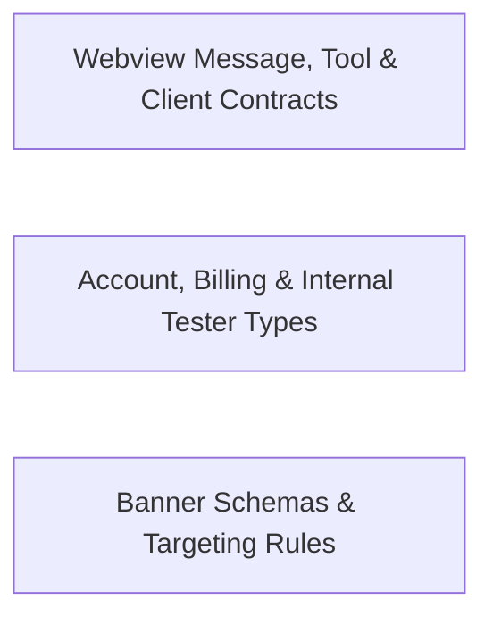

## Details

Defines Dirac-specific account, banner, webview message, tool, metric, and context schemas and constants.

### Webview Message, Tool & Client Contracts
Defines shared webview gRPC message envelopes, Dirac client/API/context contracts, tool definitions, icon identifiers, and message metrics types.

**Related Classes/Methods**:

- `src.shared.WebviewMessage.WebviewMessage`:1-5
- `src.shared.WebviewMessage.DiracAskResponse`:19-26
- `src.shared.dirac.index.DiracClient`:4-8

**Source Files:**

- `src/shared/WebviewMessage.ts`
  - `src.shared.WebviewMessage.WebviewMessage` (L1-L5) - Interface
  - `src.shared.WebviewMessage.DiracAskResponse` (L19-L26) - Enum
- `src/shared/dirac/api.ts`
  - `src.shared.dirac.api.CLINE_API_AUTH_ENDPOINTS` (L1-L4) - Enum
  - `src.shared.dirac.api.CLINE_API_ENDPOINT_V1` (L6-L12) - Enum
- `src/shared/dirac/context.ts`
  - `src.shared.dirac.context.ExtensionMode` (L8-L26) - Enum
  - `src.shared.dirac.context.DiracExtensionContext` (L28-L148) - Interface
  - `src.shared.dirac.context.DiracExtensionContext.asAbsolutePath` (L68-L68) - Method
  - `src.shared.dirac.context.ExtensionKind` (L150-L160) - Enum
  - `src.shared.dirac.context.Extension` (L162-L210) - Interface
  - `src.shared.dirac.context.Extension.activate` (L209-L209) - Method
- `src/shared/dirac/index.ts`
  - `src.shared.dirac.index.DiracClient` (L4-L8) - Enum
- `src/shared/icons.ts`
  - `src.shared.icons.DiracIcon` (L3-L26) - Enum
- `src/shared/messages/metrics.ts`
  - `src.shared.messages.metrics.DiracMessageModelInfo` (L3-L7) - Interface
  - `src.shared.messages.metrics.DiracTokensInfo` (L9-L14) - Interface
  - `src.shared.messages.metrics.DiracMessageMetricsInfo` (L16-L19) - Interface
- `src/shared/tools.ts`
  - `src.shared.tools.DiracToolSpecParameter` (L7-L31) - Interface
  - `src.shared.tools.DiracToolSpec` (L33-L42) - Interface
  - `src.shared.tools.DiracDefaultTool` (L45-L65) - Enum
  - `src.shared.tools.setDynamicToolUseNames` (L73-L75) - Function
  - `src.shared.tools.setDynamicToolUseNames.names.map() callback` (L74-L74) - Function
  - `src.shared.tools.getToolUseNames` (L77-L81) - Function
  - `src.shared.tools.getToolUseNames.dynamic` (L79-L79) - Class
  - `src.shared.tools.getToolUseNames.dynamic.flatMap() callback` (L79-L79) - Function
  - `src.shared.tools.isMutatingTool` (L107-L109) - Function

### Account, Billing & Internal Tester Types
Defines Dirac account, organization, balance, and usage transaction schemas alongside internal tester and bot account classification helpers.

**Related Classes/Methods**:

- `src.shared.DiracAccount.UserResponse`:1-17
- `src.shared.DiracAccount.BalanceResponse`:19-22
- `src.shared.DiracAccount.UsageTransaction`:24-44
- `src.shared.internal.account.isDiracInternalTester`:14-16

**Source Files:**

- `src/shared/DiracAccount.ts`
  - `src.shared.DiracAccount.UserResponse` (L1-L17) - Interface
  - `src.shared.DiracAccount.BalanceResponse` (L19-L22) - Interface
  - `src.shared.DiracAccount.UsageTransaction` (L24-L44) - Interface
  - `src.shared.DiracAccount.PaymentTransaction` (L46-L51) - Interface
  - `src.shared.DiracAccount.OrganizationBalanceResponse` (L53-L56) - Interface
  - `src.shared.DiracAccount.OrganizationUsageTransaction` (L58-L80) - Interface
- `src/shared/internal/account.ts`
  - `src.shared.internal.account.isDiracBotUser` (L10-L12) - Function
  - `src.shared.internal.account.isDiracInternalTester` (L14-L16) - Function
  - `src.shared.internal.account.isDiracInternalTester.DIRAC_TRUSTED_TESTER_DOMAINS.some() callback` (L15-L15) - Function

### Banner Schemas & Targeting Rules
Defines promotional and informational banner data structures, audience targeting rules, dismissal telemetry payloads, and default banner configurations.

**Related Classes/Methods**:

- `src.shared.DiracBanner.Banner`:8-21
- `src.shared.DiracBanner.BannerRules`:45-62
- `src.shared.dirac.banner.BannerCardData`:24-55
- `src.shared.dirac.banner.BannerActionType`:5-18

**Source Files:**

- `src/shared/DiracBanner.ts`
  - `src.shared.DiracBanner.Banner` (L8-L21) - Interface
  - `src.shared.DiracBanner.BannerAction` (L23-L27) - Interface
  - `src.shared.DiracBanner.BannersResponse` (L29-L35) - Interface
  - `src.shared.DiracBanner.BannerRules` (L45-L62) - Interface
  - `src.shared.DiracBanner.BannerEventPayload` (L72-L77) - Interface
  - `src.shared.DiracBanner.BannerDismissal` (L82-L85) - Interface
- `src/shared/dirac/banner.ts`
  - `src.shared.dirac.banner.BannerActionType` (L5-L18) - Enum
  - `src.shared.dirac.banner.BannerCardData` (L24-L55) - Interface
  - `src.shared.dirac.banner.BannerAction` (L60-L82) - Interface

### [FAQ](https://github.com/CodeBoarding/GeneratedOnBoardings/tree/main?tab=readme-ov-file#faq)