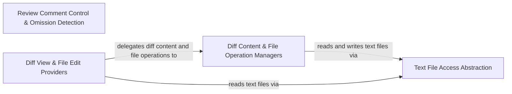

## Details

Manages editor diff views, file edit operations, comment reviews, and text file access for applying and inspecting code changes.

### Text File Access Abstraction
Defines the text file read/write abstraction (`TextFileAccess`) and its Node.js filesystem implementation (`NodeTextFileAccess`).

**Related Classes/Methods**:

- `src.integrations.editor.TextFileAccess.TextFileAccess`:10-13
- `src.integrations.editor.NodeTextFileAccess.NodeTextFileAccess`:8-24

**Source Files:**

- `src/integrations/editor/NodeTextFileAccess.ts`
  - `src.integrations.editor.NodeTextFileAccess.NodeTextFileAccess` (L8-L24) - Class
  - `src.integrations.editor.NodeTextFileAccess.NodeTextFileAccess.readText` (L9-L18) - Method
  - `src.integrations.editor.NodeTextFileAccess.NodeTextFileAccess.writeText` (L20-L23) - Method
- `src/integrations/editor/TextFileAccess.ts`
  - `src.integrations.editor.TextFileAccess.TextFileReadResult` (L1-L4) - Interface
  - `src.integrations.editor.TextFileAccess.TextFileWriteResult` (L6-L8) - Interface
  - `src.integrations.editor.TextFileAccess.TextFileAccess` (L10-L13) - Interface
  - `src.integrations.editor.TextFileAccess.TextFileAccess.readText` (L11-L11) - Method
  - `src.integrations.editor.TextFileAccess.TextFileAccess.writeText` (L12-L12) - Method

### Review Comment Control & Omission Detection
Provides the abstract `CommentReviewController` for inline AI code review comment threads and `showOmissionWarning` for detecting truncated AI code edits.

**Related Classes/Methods**:

- `src.integrations.editor.CommentReviewController.CommentReviewController`:45-113
- `src.integrations.editor.detect-omission.showOmissionWarning`:44-65

**Source Files:**

- `src/integrations/editor/CommentReviewController.ts`
  - `src.integrations.editor.CommentReviewController.ReviewComment` (L4-L19) - Interface
  - `src.integrations.editor.CommentReviewController.CommentReviewController` (L45-L113) - Class
  - `src.integrations.editor.CommentReviewController.CommentReviewController.setOnReplyCallback` (L49-L49) - Method
  - `src.integrations.editor.CommentReviewController.CommentReviewController.ensureCommentsViewDisabled` (L54-L54) - Method
  - `src.integrations.editor.CommentReviewController.CommentReviewController.addReviewComment` (L59-L59) - Method
  - `src.integrations.editor.CommentReviewController.CommentReviewController.startStreamingComment` (L65-L72) - Method
  - `src.integrations.editor.CommentReviewController.CommentReviewController.appendToStreamingComment` (L77-L77) - Method
  - `src.integrations.editor.CommentReviewController.CommentReviewController.endStreamingComment` (L82-L82) - Method
  - `src.integrations.editor.CommentReviewController.CommentReviewController.addReviewComments` (L87-L87) - Method
  - `src.integrations.editor.CommentReviewController.CommentReviewController.clearAllComments` (L92-L92) - Method
  - `src.integrations.editor.CommentReviewController.CommentReviewController.clearCommentsForFile` (L97-L97) - Method
  - `src.integrations.editor.CommentReviewController.CommentReviewController.getThreadCount` (L102-L102) - Method
  - `src.integrations.editor.CommentReviewController.CommentReviewController.closeDiffViews` (L107-L107) - Method
  - `src.integrations.editor.CommentReviewController.CommentReviewController.dispose` (L112-L112) - Method
- `src/integrations/editor/detect-omission.ts`
  - `src.integrations.editor.detect-omission.detectCodeOmission` (L12-L37) - Function
  - `src.integrations.editor.detect-omission.detectCodeOmission.commentPatterns.some() callback` (L26-L26) - Function
  - `src.integrations.editor.detect-omission.detectCodeOmission.omissionKeywords.some() callback` (L28-L28) - Function
  - `src.integrations.editor.detect-omission.showOmissionWarning` (L44-L65) - Function
  - `src.integrations.editor.detect-omission.showOmissionWarning.then() callback` (L54-L60) - Function
  - `src.integrations.editor.detect-omission.showOmissionWarning.catch() callback` (L61-L63) - Function

### Diff Content & File Operation Managers
Manages streaming diff buffer edits via `DiffContentManager` and workspace file creation, backup, and deletion via `FileOperationManager`.

**Related Classes/Methods**:

- `src.integrations.editor.DiffContentManager.DiffContentManager`:9-148
- `src.integrations.editor.FileOperationManager.FileOperationManager`:7-89

**Source Files:**

- `src/integrations/editor/DiffContentManager.ts`
  - `src.integrations.editor.DiffContentManager.DiffContentManager` (L9-L148) - Class
  - `src.integrations.editor.DiffContentManager.DiffContentManager.constructor` (L14-L14) - Constructor
  - `src.integrations.editor.DiffContentManager.DiffContentManager.update` (L16-L75) - Method
  - `src.integrations.editor.DiffContentManager.DiffContentManager.finalize` (L77-L79) - Method
  - `src.integrations.editor.DiffContentManager.DiffContentManager.reset` (L81-L85) - Method
  - `src.integrations.editor.DiffContentManager.DiffContentManager.getAccumulatedContent` (L87-L89) - Method
  - `src.integrations.editor.DiffContentManager.DiffContentManager.scrollToFirstDiff` (L91-L109) - Method
  - `src.integrations.editor.DiffContentManager.DiffContentManager.computeDiffLines` (L112-L114) - Method
  - `src.integrations.editor.DiffContentManager.DiffContentManager.normalizeEol` (L116-L120) - Method
  - `src.integrations.editor.DiffContentManager.DiffContentManager.detectUserEdits` (L122-L129) - Method
  - `src.integrations.editor.DiffContentManager.DiffContentManager.detectAutoFormattingEdits` (L131-L138) - Method
  - `src.integrations.editor.DiffContentManager.DiffContentManager.getFinalContent` (L140-L143) - Method
  - `src.integrations.editor.DiffContentManager.DiffContentManager.setRelPath` (L145-L147) - Method
- `src/integrations/editor/FileOperationManager.ts`
  - `src.integrations.editor.FileOperationManager.FileOperationManager` (L7-L89) - Class
  - `src.integrations.editor.FileOperationManager.FileOperationManager.constructor` (L12-L18) - Constructor
  - `src.integrations.editor.FileOperationManager.FileOperationManager.setup` (L20-L35) - Method
  - `src.integrations.editor.FileOperationManager.FileOperationManager.ensureFileExists` (L37-L47) - Method
  - `src.integrations.editor.FileOperationManager.FileOperationManager.ensureFileExists.exists` (L39-L42) - Class
  - `src.integrations.editor.FileOperationManager.FileOperationManager.ensureFileExists.exists.then() callback` (L41-L41) - Function
  - `src.integrations.editor.FileOperationManager.FileOperationManager.ensureFileExists.exists.catch() callback` (L42-L42) - Function
  - `src.integrations.editor.FileOperationManager.FileOperationManager.writeFile` (L49-L51) - Method
  - `src.integrations.editor.FileOperationManager.FileOperationManager.readFile` (L53-L55) - Method
  - `src.integrations.editor.FileOperationManager.FileOperationManager.deleteFile` (L57-L59) - Method
  - `src.integrations.editor.FileOperationManager.FileOperationManager.deleteCreatedDirs` (L61-L73) - Method
  - `src.integrations.editor.FileOperationManager.FileOperationManager.getCreatedDirs` (L75-L77) - Method
  - `src.integrations.editor.FileOperationManager.FileOperationManager.getOriginalContentForLLM` (L79-L82) - Method
  - `src.integrations.editor.FileOperationManager.FileOperationManager.reset` (L84-L88) - Method

### Diff View & File Edit Providers
Coordinates interactive editor diff views (`DiffViewProvider`) and headless background file edits (`FileEditProvider`).

**Related Classes/Methods**:

- `src.integrations.editor.DiffViewProvider.DiffViewProvider`:15-347
- `src.integrations.editor.FileEditProvider.FileEditProvider`:16-202

**Source Files:**

- `src/integrations/editor/DiffViewProvider.ts`
  - `src.integrations.editor.DiffViewProvider.DiffViewProvider` (L15-L347) - Class
  - `src.integrations.editor.DiffViewProvider.DiffViewProvider.constructor` (L28-L33) - Constructor
  - `src.integrations.editor.DiffViewProvider.DiffViewProvider.readText` (L35-L38) - Method
  - `src.integrations.editor.DiffViewProvider.DiffViewProvider.saveOpenDocumentBeforeTextRead` (L40-L43) - Method
  - `src.integrations.editor.DiffViewProvider.DiffViewProvider.open` (L45-L78) - Method
  - `src.integrations.editor.DiffViewProvider.DiffViewProvider.open.providers.map() callback` (L70-L70) - Function
  - `src.integrations.editor.DiffViewProvider.originalContent` (L80-L82) - Method
  - `src.integrations.editor.DiffViewProvider.DiffViewProvider.originalContent` (L84-L88) - Method
  - `src.integrations.editor.DiffViewProvider.DiffViewProvider.openDiffEditor` (L90-L90) - Method
  - `src.integrations.editor.DiffViewProvider.DiffViewProvider.scrollEditorToLine` (L91-L91) - Method
  - `src.integrations.editor.DiffViewProvider.DiffViewProvider.scrollAnimation` (L92-L92) - Method
  - `src.integrations.editor.DiffViewProvider.DiffViewProvider.truncateDocument` (L93-L93) - Method
  - `src.integrations.editor.DiffViewProvider.DiffViewProvider.getDocumentLineCount` (L94-L94) - Method
  - `src.integrations.editor.DiffViewProvider.DiffViewProvider.safelyTruncateDocument` (L96-L101) - Method
  - `src.integrations.editor.DiffViewProvider.DiffViewProvider.getDocumentText` (L103-L103) - Method
  - `src.integrations.editor.DiffViewProvider.DiffViewProvider.getNewDiagnosticProblems` (L105-L121) - Method
  - `src.integrations.editor.DiffViewProvider.DiffViewProvider.saveDocument` (L123-L123) - Method
  - `src.integrations.editor.DiffViewProvider.DiffViewProvider.closeAllDiffViews` (L124-L124) - Method
  - `src.integrations.editor.DiffViewProvider.DiffViewProvider.resetDiffView` (L125-L125) - Method
  - `src.integrations.editor.DiffViewProvider.DiffViewProvider.switchToSpecializedEditor` (L127-L127) - Method
  - `src.integrations.editor.DiffViewProvider.DiffViewProvider.update` (L129-L153) - Method
  - `src.integrations.editor.DiffViewProvider.DiffViewProvider.update.result` (L139-L146) - Class
  - `src.integrations.editor.DiffViewProvider.update.result.contentManager.update() callback` (L142-L142) - Function
  - `src.integrations.editor.DiffViewProvider.DiffViewProvider.update.result.contentManager.update() callback` (L145-L145) - Function
  - `src.integrations.editor.DiffViewProvider.DiffViewProvider.onFinalUpdate` (L155-L155) - Method
  - `src.integrations.editor.DiffViewProvider.DiffViewProvider.showFile` (L157-L159) - Method
  - `src.integrations.editor.DiffViewProvider.DiffViewProvider.replaceText` (L161-L165) - Method
  - `src.integrations.editor.DiffViewProvider.DiffViewProvider.isNotebookFile` (L167-L169) - Method
  - `src.integrations.editor.DiffViewProvider.DiffViewProvider.getOriginalContentForLLM` (L171-L176) - Method
  - `src.integrations.editor.DiffViewProvider.DiffViewProvider.saveChanges` (L178-L227) - Method
  - `src.integrations.editor.DiffViewProvider.DiffViewProvider.revertChanges` (L229-L266) - Method
  - `src.integrations.editor.DiffViewProvider.DiffViewProvider.scrollToFirstDiff` (L268-L277) - Method
  - `src.integrations.editor.DiffViewProvider.scrollToFirstDiff.contentManager.scrollToFirstDiff() callback` (L274-L274) - Function
  - `src.integrations.editor.DiffViewProvider.DiffViewProvider.scrollToFirstDiff.contentManager.scrollToFirstDiff() callback` (L275-L275) - Function
  - `src.integrations.editor.DiffViewProvider.DiffViewProvider.deleteFile` (L279-L297) - Method
  - `src.integrations.editor.DiffViewProvider.DiffViewProvider.reset` (L299-L313) - Method
  - `src.integrations.editor.DiffViewProvider.DiffViewProvider.applyAndSaveSilently` (L315-L323) - Method
  - `src.integrations.editor.DiffViewProvider.DiffViewProvider.applyAndSaveBatchSilently` (L325-L334) - Method
  - `src.integrations.editor.DiffViewProvider.DiffViewProvider.showReview` (L336-L338) - Method
  - `src.integrations.editor.DiffViewProvider.DiffViewProvider.undoUserEdits` (L339-L343) - Method
  - `src.integrations.editor.DiffViewProvider.DiffViewProvider.hideReview` (L345-L345) - Method
  - `src.integrations.editor.DiffViewProvider.DiffViewProvider.format` (L346-L346) - Method
- `src/integrations/editor/FileEditProvider.ts`
  - `src.integrations.editor.FileEditProvider.FileEditProvider` (L16-L202) - Class
  - `src.integrations.editor.FileEditProvider.FileEditProvider.constructor` (L19-L25) - Constructor
  - `src.integrations.editor.FileEditProvider.FileEditProvider.showFile` (L27-L30) - Method
  - `src.integrations.editor.FileEditProvider.FileEditProvider.openDiffEditor` (L32-L36) - Method
  - `src.integrations.editor.FileEditProvider.FileEditProvider.replaceText` (L38-L70) - Method
  - `src.integrations.editor.FileEditProvider.FileEditProvider.scrollEditorToLine` (L72-L74) - Method
  - `src.integrations.editor.FileEditProvider.FileEditProvider.scrollAnimation` (L76-L78) - Method
  - `src.integrations.editor.FileEditProvider.FileEditProvider.truncateDocument` (L80-L90) - Method
  - `src.integrations.editor.FileEditProvider.FileEditProvider.getDocumentLineCount` (L92-L97) - Method
  - `src.integrations.editor.FileEditProvider.FileEditProvider.getDocumentText` (L99-L101) - Method
  - `src.integrations.editor.FileEditProvider.FileEditProvider.getContent` (L107-L109) - Method
  - `src.integrations.editor.FileEditProvider.FileEditProvider.saveDocument` (L111-L119) - Method
  - `src.integrations.editor.FileEditProvider.FileEditProvider.closeAllDiffViews` (L121-L123) - Method
  - `src.integrations.editor.FileEditProvider.FileEditProvider.resetDiffView` (L125-L128) - Method
  - `src.integrations.editor.FileEditProvider.FileEditProvider.applyAndSaveSilently` (L129-L150) - Method
  - `src.integrations.editor.FileEditProvider.FileEditProvider.applyAndSaveBatchSilently` (L152-L167) - Method
  - `src.integrations.editor.FileEditProvider.FileEditProvider.format` (L169-L201) - Method

### [FAQ](https://github.com/CodeBoarding/GeneratedOnBoardings/tree/main?tab=readme-ov-file#faq)