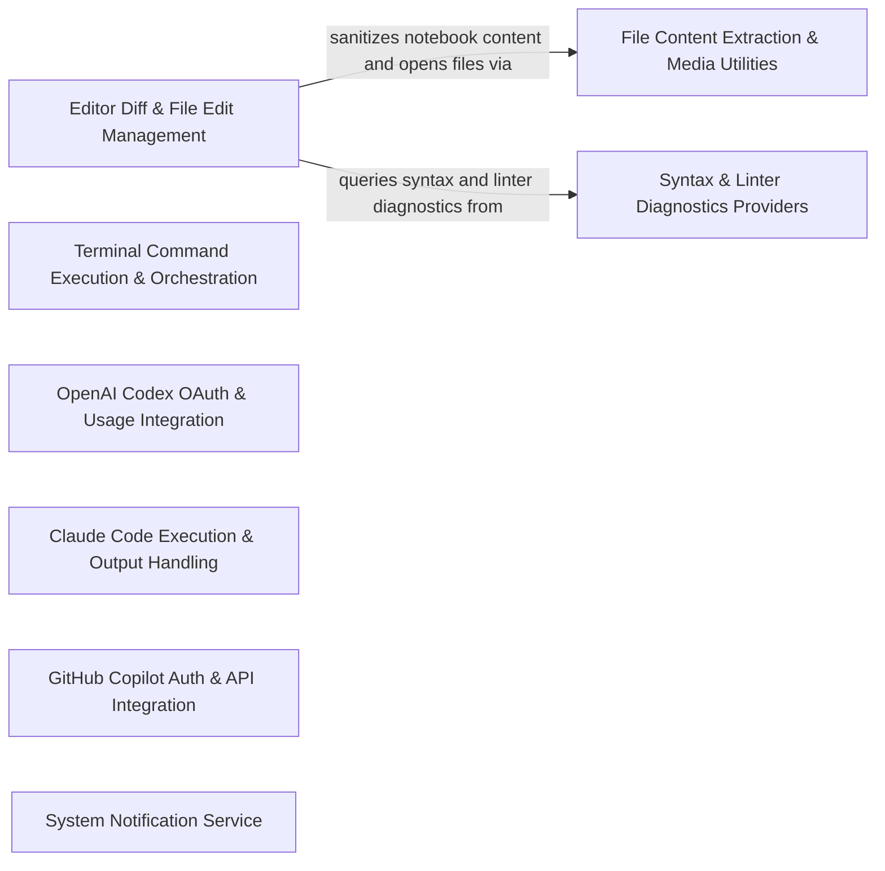

## Details

Integrates editor diff views, file editing, terminal command execution, diagnostics feedback, and external coding assistants such as Claude Code, GitHub Copilot, and OpenAI Codex.

### Editor Diff & File Edit Management [[Expand]](./Editor_Diff_File_Edit_Management.md)
Manages editor diff views, file edit operations, comment reviews, and text file access for applying and inspecting code changes.

**Related Classes/Methods**:

- `src.integrations.editor.DiffViewProvider.DiffViewProvider`:15-347
- `src.integrations.editor.DiffContentManager.DiffContentManager`:9-148
- `src.integrations.editor.FileOperationManager.FileOperationManager`:7-89

**Source Files:**

- `src/integrations/editor/CommentReviewController.ts`
  - `src.integrations.editor.CommentReviewController.ReviewComment` (L4-L19) - Interface
  - `src.integrations.editor.CommentReviewController.CommentReviewController` (L45-L113) - Class
  - `src.integrations.editor.CommentReviewController.CommentReviewController.setOnReplyCallback` (L49-L49) - Method
  - `src.integrations.editor.CommentReviewController.CommentReviewController.ensureCommentsViewDisabled` (L54-L54) - Method
  - `src.integrations.editor.CommentReviewController.CommentReviewController.addReviewComment` (L59-L59) - Method
  - `src.integrations.editor.CommentReviewController.CommentReviewController.startStreamingComment` (L65-L72) - Method
  - `src.integrations.editor.CommentReviewController.CommentReviewController.appendToStreamingComment` (L77-L77) - Method
  - `src.integrations.editor.CommentReviewController.CommentReviewController.endStreamingComment` (L82-L82) - Method
  - `src.integrations.editor.CommentReviewController.CommentReviewController.addReviewComments` (L87-L87) - Method
  - `src.integrations.editor.CommentReviewController.CommentReviewController.clearAllComments` (L92-L92) - Method
  - `src.integrations.editor.CommentReviewController.CommentReviewController.clearCommentsForFile` (L97-L97) - Method
  - `src.integrations.editor.CommentReviewController.CommentReviewController.getThreadCount` (L102-L102) - Method
  - `src.integrations.editor.CommentReviewController.CommentReviewController.closeDiffViews` (L107-L107) - Method
  - `src.integrations.editor.CommentReviewController.CommentReviewController.dispose` (L112-L112) - Method
- `src/integrations/editor/DiffContentManager.ts`
  - `src.integrations.editor.DiffContentManager.DiffContentManager` (L9-L148) - Class
  - `src.integrations.editor.DiffContentManager.DiffContentManager.constructor` (L14-L14) - Constructor
  - `src.integrations.editor.DiffContentManager.DiffContentManager.update` (L16-L75) - Method
  - `src.integrations.editor.DiffContentManager.DiffContentManager.finalize` (L77-L79) - Method
  - `src.integrations.editor.DiffContentManager.DiffContentManager.reset` (L81-L85) - Method
  - `src.integrations.editor.DiffContentManager.DiffContentManager.getAccumulatedContent` (L87-L89) - Method
  - `src.integrations.editor.DiffContentManager.DiffContentManager.scrollToFirstDiff` (L91-L109) - Method
  - `src.integrations.editor.DiffContentManager.DiffContentManager.computeDiffLines` (L112-L114) - Method
  - `src.integrations.editor.DiffContentManager.DiffContentManager.normalizeEol` (L116-L120) - Method
  - `src.integrations.editor.DiffContentManager.DiffContentManager.detectUserEdits` (L122-L129) - Method
  - `src.integrations.editor.DiffContentManager.DiffContentManager.detectAutoFormattingEdits` (L131-L138) - Method
  - `src.integrations.editor.DiffContentManager.DiffContentManager.getFinalContent` (L140-L143) - Method
  - `src.integrations.editor.DiffContentManager.DiffContentManager.setRelPath` (L145-L147) - Method
- `src/integrations/editor/DiffViewProvider.ts`
  - `src.integrations.editor.DiffViewProvider.DiffViewProvider` (L15-L347) - Class
  - `src.integrations.editor.DiffViewProvider.DiffViewProvider.constructor` (L28-L33) - Constructor
  - `src.integrations.editor.DiffViewProvider.DiffViewProvider.readText` (L35-L38) - Method
  - `src.integrations.editor.DiffViewProvider.DiffViewProvider.saveOpenDocumentBeforeTextRead` (L40-L43) - Method
  - `src.integrations.editor.DiffViewProvider.DiffViewProvider.open` (L45-L78) - Method
  - `src.integrations.editor.DiffViewProvider.DiffViewProvider.open.providers.map() callback` (L70-L70) - Function
  - `src.integrations.editor.DiffViewProvider.originalContent` (L80-L82) - Method
  - `src.integrations.editor.DiffViewProvider.DiffViewProvider.originalContent` (L84-L88) - Method
  - `src.integrations.editor.DiffViewProvider.DiffViewProvider.openDiffEditor` (L90-L90) - Method
  - `src.integrations.editor.DiffViewProvider.DiffViewProvider.scrollEditorToLine` (L91-L91) - Method
  - `src.integrations.editor.DiffViewProvider.DiffViewProvider.scrollAnimation` (L92-L92) - Method
  - `src.integrations.editor.DiffViewProvider.DiffViewProvider.truncateDocument` (L93-L93) - Method
  - `src.integrations.editor.DiffViewProvider.DiffViewProvider.getDocumentLineCount` (L94-L94) - Method
  - `src.integrations.editor.DiffViewProvider.DiffViewProvider.safelyTruncateDocument` (L96-L101) - Method
  - `src.integrations.editor.DiffViewProvider.DiffViewProvider.getDocumentText` (L103-L103) - Method
  - `src.integrations.editor.DiffViewProvider.DiffViewProvider.getNewDiagnosticProblems` (L105-L121) - Method
  - `src.integrations.editor.DiffViewProvider.DiffViewProvider.saveDocument` (L123-L123) - Method
  - `src.integrations.editor.DiffViewProvider.DiffViewProvider.closeAllDiffViews` (L124-L124) - Method
  - `src.integrations.editor.DiffViewProvider.DiffViewProvider.resetDiffView` (L125-L125) - Method
  - `src.integrations.editor.DiffViewProvider.DiffViewProvider.switchToSpecializedEditor` (L127-L127) - Method
  - `src.integrations.editor.DiffViewProvider.DiffViewProvider.update` (L129-L153) - Method
  - `src.integrations.editor.DiffViewProvider.DiffViewProvider.update.result` (L139-L146) - Class
  - `src.integrations.editor.DiffViewProvider.update.result.contentManager.update() callback` (L142-L142) - Function
  - `src.integrations.editor.DiffViewProvider.DiffViewProvider.update.result.contentManager.update() callback` (L145-L145) - Function
  - `src.integrations.editor.DiffViewProvider.DiffViewProvider.onFinalUpdate` (L155-L155) - Method
  - `src.integrations.editor.DiffViewProvider.DiffViewProvider.showFile` (L157-L159) - Method
  - `src.integrations.editor.DiffViewProvider.DiffViewProvider.replaceText` (L161-L165) - Method
  - `src.integrations.editor.DiffViewProvider.DiffViewProvider.isNotebookFile` (L167-L169) - Method
  - `src.integrations.editor.DiffViewProvider.DiffViewProvider.getOriginalContentForLLM` (L171-L176) - Method
  - `src.integrations.editor.DiffViewProvider.DiffViewProvider.saveChanges` (L178-L227) - Method
  - `src.integrations.editor.DiffViewProvider.DiffViewProvider.revertChanges` (L229-L266) - Method
  - `src.integrations.editor.DiffViewProvider.DiffViewProvider.scrollToFirstDiff` (L268-L277) - Method
  - `src.integrations.editor.DiffViewProvider.scrollToFirstDiff.contentManager.scrollToFirstDiff() callback` (L274-L274) - Function
  - `src.integrations.editor.DiffViewProvider.DiffViewProvider.scrollToFirstDiff.contentManager.scrollToFirstDiff() callback` (L275-L275) - Function
  - `src.integrations.editor.DiffViewProvider.DiffViewProvider.deleteFile` (L279-L297) - Method
  - `src.integrations.editor.DiffViewProvider.DiffViewProvider.reset` (L299-L313) - Method
  - `src.integrations.editor.DiffViewProvider.DiffViewProvider.applyAndSaveSilently` (L315-L323) - Method
  - `src.integrations.editor.DiffViewProvider.DiffViewProvider.applyAndSaveBatchSilently` (L325-L334) - Method
  - `src.integrations.editor.DiffViewProvider.DiffViewProvider.showReview` (L336-L338) - Method
  - `src.integrations.editor.DiffViewProvider.DiffViewProvider.undoUserEdits` (L339-L343) - Method
  - `src.integrations.editor.DiffViewProvider.DiffViewProvider.hideReview` (L345-L345) - Method
  - `src.integrations.editor.DiffViewProvider.DiffViewProvider.format` (L346-L346) - Method
- `src/integrations/editor/FileEditProvider.ts`
  - `src.integrations.editor.FileEditProvider.FileEditProvider` (L16-L202) - Class
  - `src.integrations.editor.FileEditProvider.FileEditProvider.constructor` (L19-L25) - Constructor
  - `src.integrations.editor.FileEditProvider.FileEditProvider.showFile` (L27-L30) - Method
  - `src.integrations.editor.FileEditProvider.FileEditProvider.openDiffEditor` (L32-L36) - Method
  - `src.integrations.editor.FileEditProvider.FileEditProvider.replaceText` (L38-L70) - Method
  - `src.integrations.editor.FileEditProvider.FileEditProvider.scrollEditorToLine` (L72-L74) - Method
  - `src.integrations.editor.FileEditProvider.FileEditProvider.scrollAnimation` (L76-L78) - Method
  - `src.integrations.editor.FileEditProvider.FileEditProvider.truncateDocument` (L80-L90) - Method
  - `src.integrations.editor.FileEditProvider.FileEditProvider.getDocumentLineCount` (L92-L97) - Method
  - `src.integrations.editor.FileEditProvider.FileEditProvider.getDocumentText` (L99-L101) - Method
  - `src.integrations.editor.FileEditProvider.FileEditProvider.getContent` (L107-L109) - Method
  - `src.integrations.editor.FileEditProvider.FileEditProvider.saveDocument` (L111-L119) - Method
  - `src.integrations.editor.FileEditProvider.FileEditProvider.closeAllDiffViews` (L121-L123) - Method
  - `src.integrations.editor.FileEditProvider.FileEditProvider.resetDiffView` (L125-L128) - Method
  - `src.integrations.editor.FileEditProvider.FileEditProvider.applyAndSaveSilently` (L129-L150) - Method
  - `src.integrations.editor.FileEditProvider.FileEditProvider.applyAndSaveBatchSilently` (L152-L167) - Method
  - `src.integrations.editor.FileEditProvider.FileEditProvider.format` (L169-L201) - Method
- `src/integrations/editor/FileOperationManager.ts`
  - `src.integrations.editor.FileOperationManager.FileOperationManager` (L7-L89) - Class
  - `src.integrations.editor.FileOperationManager.FileOperationManager.constructor` (L12-L18) - Constructor
  - `src.integrations.editor.FileOperationManager.FileOperationManager.setup` (L20-L35) - Method
  - `src.integrations.editor.FileOperationManager.FileOperationManager.ensureFileExists` (L37-L47) - Method
  - `src.integrations.editor.FileOperationManager.FileOperationManager.ensureFileExists.exists` (L39-L42) - Class
  - `src.integrations.editor.FileOperationManager.FileOperationManager.ensureFileExists.exists.then() callback` (L41-L41) - Function
  - `src.integrations.editor.FileOperationManager.FileOperationManager.ensureFileExists.exists.catch() callback` (L42-L42) - Function
  - `src.integrations.editor.FileOperationManager.FileOperationManager.writeFile` (L49-L51) - Method
  - `src.integrations.editor.FileOperationManager.FileOperationManager.readFile` (L53-L55) - Method
  - `src.integrations.editor.FileOperationManager.FileOperationManager.deleteFile` (L57-L59) - Method
  - `src.integrations.editor.FileOperationManager.FileOperationManager.deleteCreatedDirs` (L61-L73) - Method
  - `src.integrations.editor.FileOperationManager.FileOperationManager.getCreatedDirs` (L75-L77) - Method
  - `src.integrations.editor.FileOperationManager.FileOperationManager.getOriginalContentForLLM` (L79-L82) - Method
  - `src.integrations.editor.FileOperationManager.FileOperationManager.reset` (L84-L88) - Method
- `src/integrations/editor/NodeTextFileAccess.ts`
  - `src.integrations.editor.NodeTextFileAccess.NodeTextFileAccess` (L8-L24) - Class
  - `src.integrations.editor.NodeTextFileAccess.NodeTextFileAccess.readText` (L9-L18) - Method
  - `src.integrations.editor.NodeTextFileAccess.NodeTextFileAccess.writeText` (L20-L23) - Method
- `src/integrations/editor/TextFileAccess.ts`
  - `src.integrations.editor.TextFileAccess.TextFileReadResult` (L1-L4) - Interface
  - `src.integrations.editor.TextFileAccess.TextFileWriteResult` (L6-L8) - Interface
  - `src.integrations.editor.TextFileAccess.TextFileAccess` (L10-L13) - Interface
  - `src.integrations.editor.TextFileAccess.TextFileAccess.readText` (L11-L11) - Method
  - `src.integrations.editor.TextFileAccess.TextFileAccess.writeText` (L12-L12) - Method
- `src/integrations/editor/detect-omission.ts`
  - `src.integrations.editor.detect-omission.detectCodeOmission` (L12-L37) - Function
  - `src.integrations.editor.detect-omission.detectCodeOmission.commentPatterns.some() callback` (L26-L26) - Function
  - `src.integrations.editor.detect-omission.detectCodeOmission.omissionKeywords.some() callback` (L28-L28) - Function
  - `src.integrations.editor.detect-omission.showOmissionWarning` (L44-L65) - Function
  - `src.integrations.editor.detect-omission.showOmissionWarning.then() callback` (L54-L60) - Function
  - `src.integrations.editor.detect-omission.showOmissionWarning.catch() callback` (L61-L63) - Function

### File Content Extraction & Media Utilities
Provides file content extraction, notebook sanitization, image and text extraction, link previews, and editor file-opening utilities.

**Related Classes/Methods**:

- `src.integrations.misc.notebook-utils.sanitizeNotebookForLLM`:53-75
- `src.integrations.misc.open-file.openFile`:32-44

**Source Files:**

- `src/integrations/misc/extract-file-content.ts`
  - `src.integrations.misc.extract-file-content.extractFileContent` (L17-L53) - Function
- `src/integrations/misc/extract-images.ts`
  - `src.integrations.misc.extract-images.extractImageContent` (L11-L54) - Function
- `src/integrations/misc/extract-text.ts`
  - `src.integrations.misc.extract-text.detectEncoding` (L15-L30) - Function
  - `src.integrations.misc.extract-text.detectEncoding.isBinary` (L24-L24) - Class
  - `src.integrations.misc.extract-text.detectEncoding.isBinary.catch() callback` (L24-L24) - Function
  - `src.integrations.misc.extract-text.FileResourceUnavailableError` (L32-L37) - Class
  - `src.integrations.misc.extract-text.FileResourceUnavailableError.constructor` (L33-L36) - Constructor
  - `src.integrations.misc.extract-text.resolveFileUri` (L39-L59) - Function
  - `src.integrations.misc.extract-text.extractTextFromFile` (L61-L69) - Function
  - `src.integrations.misc.extract-text.callTextExtractionFunctions` (L75-L107) - Function
  - `src.integrations.misc.extract-text.extractTextFromPDF` (L109-L113) - Function
  - `src.integrations.misc.extract-text.extractTextFromDOCX` (L115-L118) - Function
  - `src.integrations.misc.extract-text.extractTextFromIPYNB` (L120-L129) - Function
  - `src.integrations.misc.extract-text.formatCellValue` (L134-L169) - Function
  - `src.integrations.misc.extract-text.formatCellValue.value.richText.map() callback` (L152-L152) - Function
  - `src.integrations.misc.extract-text.extractTextFromExcel` (L174-L223) - Function
  - `src.integrations.misc.extract-text.extractTextFromExcel.workbook.eachSheet() callback` (L181-L216) - Function
  - `src.integrations.misc.extract-text.extractTextFromExcel.workbook.eachSheet() callback.worksheet.eachRow() callback` (L189-L213) - Function
  - `src.integrations.misc.extract-text.extractTextFromExcel.workbook.eachSheet() callback.worksheet.eachRow() callback.row.eachCell() callback` (L199-L205) - Function
  - `src.integrations.misc.extract-text.processFilesIntoText` (L228-L254) - Function
  - `src.integrations.misc.extract-text.processFilesIntoText.fileContentsPromises` (L229-L242) - Class
  - `src.integrations.misc.extract-text.processFilesIntoText.fileContentsPromises.files.map() callback` (L229-L242) - Function
  - `src.integrations.misc.extract-text.processFilesIntoText.validFileContents` (L246-L246) - Class
  - `src.integrations.misc.extract-text.processFilesIntoText.validFileContents.fileContents.filter() callback` (L246-L246) - Function
- `src/integrations/misc/link-preview.ts`
  - `src.integrations.misc.link-preview.OpenGraphData` (L19-L26) - Interface
  - `src.integrations.misc.link-preview.fetchOpenGraphData` (L33-L91) - Function
  - `src.integrations.misc.link-preview.detectImageUrl` (L98-L114) - Function
- `src/integrations/misc/notebook-utils.ts`
  - `src.integrations.misc.notebook-utils.sanitizeCellOutputs` (L18-L41) - Function
  - `src.integrations.misc.notebook-utils.sanitizeCellOutputs.sanitizedOutputs` (L23-L38) - Class
  - `src.integrations.misc.notebook-utils.sanitizeCellOutputs.sanitizedOutputs.cell.outputs.map() callback` (L23-L38) - Function
  - `src.integrations.misc.notebook-utils.sanitizeNotebookForLLM` (L53-L75) - Function
  - `src.integrations.misc.notebook-utils.notebook.cells.map() callback` (L62-L65) - Function
  - `src.integrations.misc.notebook-utils.sanitizeNotebookForLLM.notebook.cells.map() callback` (L67-L67) - Function
  - `src.integrations.misc.notebook-utils.sanitizeCellForLLM` (L84-L87) - Function
- `src/integrations/misc/open-file.ts`
  - `src.integrations.misc.open-file.openImage` (L7-L30) - Function
  - `src.integrations.misc.open-file.openFile` (L32-L44) - Function
- `src/integrations/misc/process-files.ts`
  - `src.integrations.misc.process-files.selectFiles` (L12-L103) - Function
  - `src.integrations.misc.process-files.selectFiles.processFilesPromises` (L30-L86) - Class
  - `src.integrations.misc.process-files.selectFiles.processFilesPromises.filePaths.map() callback` (L30-L86) - Function
  - `src.integrations.misc.process-files.selectFiles.dataUrlsWithoutNulls` (L89-L89) - Class
  - `src.integrations.misc.process-files.selectFiles.dataUrlsWithoutNulls.dataUrlsWithNulls.filter() callback` (L89-L89) - Function
  - `src.integrations.misc.process-files.getMimeType` (L105-L118) - Function
- `src/integrations/misc/read-text-file-window.ts`
  - `src.integrations.misc.read-text-file-window.assertTextSample` (L8-L16) - Function
  - `src.integrations.misc.read-text-file-window.readTextFileWindow` (L20-L165) - Function
  - `src.integrations.misc.read-text-file-window.readTextFileWindow.isPlainAsciiText` (L139-L141) - Class
  - `src.integrations.misc.read-text-file-window.readTextFileWindow.isPlainAsciiText.bytes.every() callback` (L140-L140) - Function
  - `src.integrations.misc.read-text-file-window.countTextFileLines` (L168-L177) - Function

### Terminal Command Execution & Orchestration
Orchestrates terminal command execution, process listener attachment, output logging, and execution result construction.

**Related Classes/Methods**: _None_

**Source Files:**

- `src/integrations/terminal/CommandExecutor.ts`
  - `src.integrations.terminal.CommandExecutor.waitForTerminalProcessCompletion` (L31-L42) - Function
  - `src.integrations.terminal.CommandExecutor.waitForTerminalProcessCompletion.<function>` (L32-L41) - Function
  - `src.integrations.terminal.CommandExecutor.CommandExecutor` (L45-L288) - Class
  - `src.integrations.terminal.CommandExecutor.CommandExecutor.constructor` (L66-L94) - Constructor
  - `src.integrations.terminal.CommandExecutor.CommandExecutor.execute` (L96-L165) - Method
  - `src.integrations.terminal.CommandExecutor.CommandExecutor.execute.result.onProceedWhileRunning.<function>` (L129-L142) - Function
  - `src.integrations.terminal.CommandExecutor.CommandExecutor.cancelBackgroundCommand` (L176-L235) - Method
  - `src.integrations.terminal.CommandExecutor.CommandExecutor.cancelBackgroundCommand.lastCommandOutputIndex` (L211-L214) - Class
  - `src.integrations.terminal.CommandExecutor.CommandExecutor.cancelBackgroundCommand.lastCommandOutputIndex.findLastIndex() callback` (L213-L213) - Function
  - `src.integrations.terminal.CommandExecutor.CommandExecutor.hasActiveBackgroundCommand` (L241-L243) - Method
  - `src.integrations.terminal.CommandExecutor.CommandExecutor.getBackgroundCommandSummary` (L249-L252) - Method
  - `src.integrations.terminal.CommandExecutor.CommandExecutor.shouldShowBackgroundTerminalSuggestion` (L261-L287) - Method
  - `src.integrations.terminal.CommandExecutor.CommandExecutor.shouldShowBackgroundTerminalSuggestion.shellIntegrationWarningTracker.timestamps.filter() callback` (L266-L266) - Function
- `src/integrations/terminal/CommandOrchestrator.ts`
  - `src.integrations.terminal.CommandOrchestrator.orchestrateCommandExecution` (L34-L236) - Function
  - `src.integrations.terminal.CommandOrchestrator.orchestrateCommandExecution.process.catch() callback` (L54-L54) - Function
  - `src.integrations.terminal.CommandOrchestrator.orchestrateCommandExecution.onLine` (L65-L100) - Class
  - `src.integrations.terminal.CommandOrchestrator.orchestrateCommandExecution.onLine.catch() callback` (L88-L88) - Function
  - `src.integrations.terminal.CommandOrchestrator.orchestrateCommandExecution.timeoutPromise` (L130-L132) - Class
  - `src.integrations.terminal.CommandOrchestrator.orchestrateCommandExecution.timeoutPromise.<function>` (L130-L132) - Function
  - `src.integrations.terminal.CommandOrchestrator.orchestrateCommandExecution.timeoutPromise.<function>.setTimeout() callback` (L131-L131) - Function
  - `src.integrations.terminal.CommandOrchestrator.findLastIndex` (L238-L243) - Function
- `src/integrations/terminal/buildResult.ts`
  - `src.integrations.terminal.buildResult.BuildResultInput` (L11-L22) - Interface
  - `src.integrations.terminal.buildResult.buildResult` (L24-L91) - Function
- `src/integrations/terminal/constants.ts`
  - `src.integrations.terminal.constants.isCompilingOutput` (L94-L99) - Function
  - `src.integrations.terminal.constants.isCompilingOutput.hasMarker` (L96-L96) - Class
  - `src.integrations.terminal.constants.isCompilingOutput.hasMarker.COMPILING_MARKERS.some() callback` (L96-L96) - Function
  - `src.integrations.terminal.constants.isCompilingOutput.hasNullifier` (L97-L97) - Class
  - `src.integrations.terminal.constants.isCompilingOutput.hasNullifier.COMPILING_NULLIFIERS.some() callback` (L97-L97) - Function
- `src/integrations/terminal/file-logging.ts`
  - `src.integrations.terminal.file-logging.FileLogState` (L9-L19) - Interface
  - `src.integrations.terminal.file-logging.QueuedFileWriter` (L24-L64) - Class
  - `src.integrations.terminal.file-logging.QueuedFileWriter.constructor` (L30-L37) - Constructor
  - `src.integrations.terminal.file-logging.QueuedFileWriter.constructor.then() callback` (L32-L32) - Function
  - `src.integrations.terminal.file-logging.QueuedFileWriter.constructor.catch() callback` (L33-L36) - Function
  - `src.integrations.terminal.file-logging.QueuedFileWriter.write` (L39-L51) - Method
  - `src.integrations.terminal.file-logging.QueuedFileWriter.write.pendingWrites.then() callback` (L43-L47) - Function
  - `src.integrations.terminal.file-logging.QueuedFileWriter.write.catch() callback` (L48-L50) - Function
  - `src.integrations.terminal.file-logging.QueuedFileWriter.close` (L53-L56) - Method
  - `src.integrations.terminal.file-logging.QueuedFileWriter.closeAfterPendingWrites` (L58-L63) - Method
  - `src.integrations.terminal.file-logging.takeUtf8Prefix` (L66-L68) - Function
  - `src.integrations.terminal.file-logging.takeUtf8Suffix` (L70-L76) - Function
  - `src.integrations.terminal.file-logging.takeSummaryFromStart` (L79-L95) - Function
  - `src.integrations.terminal.file-logging.takeSummaryFromEnd` (L97-L114) - Function
  - `src.integrations.terminal.file-logging.appendOutput` (L116-L125) - Function
  - `src.integrations.terminal.file-logging.createFileLogState` (L127-L139) - Function
  - `src.integrations.terminal.file-logging.shouldSwitchToFile` (L141-L143) - Function
  - `src.integrations.terminal.file-logging.createFileLog` (L145-L155) - Function
  - `src.integrations.terminal.file-logging.writeInitialLinesToFile` (L157-L160) - Function
  - `src.integrations.terminal.file-logging.writeLineToFile` (L162-L169) - Function
  - `src.integrations.terminal.file-logging.updateFirstLines` (L171-L177) - Function
  - `src.integrations.terminal.file-logging.cleanupFileLog` (L179-L184) - Function
  - `src.integrations.terminal.file-logging.buildFileSummary` (L188-L212) - Function
- `src/integrations/terminal/process-listeners.ts`
  - `src.integrations.terminal.process-listeners.ListenerConfig` (L12-L18) - Interface
  - `src.integrations.terminal.process-listeners.attachProcessListeners` (L24-L75) - Function
  - `src.integrations.terminal.process-listeners.attachProcessListeners.setTimeout() callback` (L55-L60) - Function
  - `src.integrations.terminal.process-listeners.attachProcessListeners.getCompletionState` (L73-L73) - Method

### Syntax & Linter Diagnostics Providers
Collects syntax and linter diagnostic feedback from workspace files to report new problems introduced by edits.

**Related Classes/Methods**:

- `src.integrations.diagnostics.IDiagnosticsProvider.IDiagnosticsProvider`:8-37
- `src.integrations.diagnostics.LinterFeedbackProvider.LinterFeedbackProvider`:8-111
- `src.integrations.diagnostics.SyntaxFeedbackProvider.SyntaxFeedbackProvider`:9-116
- `src.integrations.diagnostics.getDiagnosticsProviders.getDiagnosticsProviders`:5-14

**Source Files:**

- `src/integrations/diagnostics/IDiagnosticsProvider.ts`
  - `src.integrations.diagnostics.IDiagnosticsProvider.DiagnosticsFeedbackResult` (L3-L6) - Interface
  - `src.integrations.diagnostics.IDiagnosticsProvider.IDiagnosticsProvider` (L8-L37) - Interface
  - `src.integrations.diagnostics.IDiagnosticsProvider.IDiagnosticsProvider.capturePreSaveState` (L12-L12) - Method
  - `src.integrations.diagnostics.IDiagnosticsProvider.IDiagnosticsProvider.getDiagnosticsFeedback` (L21-L26) - Method
  - `src.integrations.diagnostics.IDiagnosticsProvider.IDiagnosticsProvider.getDiagnosticsFeedbackForFiles` (L33-L36) - Method
- `src/integrations/diagnostics/LinterFeedbackProvider.ts`
  - `src.integrations.diagnostics.LinterFeedbackProvider.LinterFeedbackProvider` (L8-L111) - Class
  - `src.integrations.diagnostics.LinterFeedbackProvider.LinterFeedbackProvider.constructor` (L9-L12) - Constructor
  - `src.integrations.diagnostics.LinterFeedbackProvider.LinterFeedbackProvider.capturePreSaveState` (L14-L16) - Method
  - `src.integrations.diagnostics.LinterFeedbackProvider.LinterFeedbackProvider.getDiagnosticsFeedback` (L18-L56) - Method
  - `src.integrations.diagnostics.LinterFeedbackProvider.LinterFeedbackProvider.getDiagnosticsFeedback.postDiagnostics` (L24-L31) - Class
  - `src.integrations.diagnostics.LinterFeedbackProvider.LinterFeedbackProvider.getDiagnosticsFeedback.postDiagnostics.pollForNewDiagnostics() callback` (L25-L25) - Function
  - `src.integrations.diagnostics.LinterFeedbackProvider.LinterFeedbackProvider.getDiagnosticsFeedback.postFileDiags` (L34-L34) - Class
  - `src.integrations.diagnostics.LinterFeedbackProvider.LinterFeedbackProvider.getDiagnosticsFeedback.postFileDiags.postDiagnostics.find() callback` (L34-L34) - Function
  - `src.integrations.diagnostics.LinterFeedbackProvider.LinterFeedbackProvider.getDiagnosticsFeedback.preFileDiags` (L35-L35) - Class
  - `src.integrations.diagnostics.LinterFeedbackProvider.LinterFeedbackProvider.getDiagnosticsFeedback.preFileDiags.preSaveDiagnostics.find() callback` (L35-L35) - Function
  - `src.integrations.diagnostics.LinterFeedbackProvider.LinterFeedbackProvider.getDiagnosticsFeedback.preErrors` (L37-L37) - Class
  - `src.integrations.diagnostics.LinterFeedbackProvider.LinterFeedbackProvider.getDiagnosticsFeedback.preErrors.preFileDiags.filter() callback` (L37-L37) - Function
  - `src.integrations.diagnostics.LinterFeedbackProvider.LinterFeedbackProvider.getDiagnosticsFeedback.postErrors` (L38-L38) - Class
  - `src.integrations.diagnostics.LinterFeedbackProvider.LinterFeedbackProvider.getDiagnosticsFeedback.postErrors.postFileDiags.filter() callback` (L38-L38) - Function
  - `src.integrations.diagnostics.LinterFeedbackProvider.LinterFeedbackProvider.getDiagnosticsFeedbackForFiles` (L58-L99) - Method
  - `src.integrations.diagnostics.LinterFeedbackProvider.LinterFeedbackProvider.getDiagnosticsFeedbackForFiles.postDiagnostics` (L62-L69) - Class
  - `src.integrations.diagnostics.LinterFeedbackProvider.LinterFeedbackProvider.getDiagnosticsFeedbackForFiles.postDiagnostics.pollForNewDiagnostics() callback` (L63-L63) - Function
  - `src.integrations.diagnostics.LinterFeedbackProvider.LinterFeedbackProvider.getDiagnosticsFeedbackForFiles.postDiagnostics.pollForNewDiagnostics() callback.files.map() callback` (L63-L63) - Function
  - `src.integrations.diagnostics.LinterFeedbackProvider.LinterFeedbackProvider.getDiagnosticsFeedbackForFiles.postDiagnostics.files.map() callback` (L65-L65) - Function
  - `src.integrations.diagnostics.LinterFeedbackProvider.LinterFeedbackProvider.getDiagnosticsFeedbackForFiles.files.map() callback` (L74-L97) - Function
  - `src.integrations.diagnostics.LinterFeedbackProvider.LinterFeedbackProvider.getDiagnosticsFeedbackForFiles.files.map() callback.postFileDiags` (L75-L75) - Class
  - `src.integrations.diagnostics.LinterFeedbackProvider.LinterFeedbackProvider.getDiagnosticsFeedbackForFiles.files.map() callback.postFileDiags.postDiagnostics.find() callback` (L75-L75) - Function
  - `src.integrations.diagnostics.LinterFeedbackProvider.LinterFeedbackProvider.getDiagnosticsFeedbackForFiles.files.map() callback.preFileDiags` (L76-L76) - Class
  - `src.integrations.diagnostics.LinterFeedbackProvider.LinterFeedbackProvider.getDiagnosticsFeedbackForFiles.files.map() callback.preFileDiags.preSaveDiagnostics.find() callback` (L76-L76) - Function
  - `src.integrations.diagnostics.LinterFeedbackProvider.LinterFeedbackProvider.getDiagnosticsFeedbackForFiles.files.map() callback.preErrors` (L78-L78) - Class
  - `src.integrations.diagnostics.LinterFeedbackProvider.LinterFeedbackProvider.getDiagnosticsFeedbackForFiles.files.map() callback.preErrors.preFileDiags.filter() callback` (L78-L78) - Function
  - `src.integrations.diagnostics.LinterFeedbackProvider.LinterFeedbackProvider.getDiagnosticsFeedbackForFiles.files.map() callback.postErrors` (L79-L79) - Class
  - `src.integrations.diagnostics.LinterFeedbackProvider.LinterFeedbackProvider.getDiagnosticsFeedbackForFiles.files.map() callback.postErrors.postFileDiags.filter() callback` (L79-L79) - Function
  - `src.integrations.diagnostics.LinterFeedbackProvider.getDiagnosticsFeedbackForFiles.files.map() callback.newProblemsMessage` (L86-L91) - Class
  - `src.integrations.diagnostics.LinterFeedbackProvider.LinterFeedbackProvider.getDiagnosticsFeedbackForFiles.files.map() callback.newProblemsMessage.newDiagnostics.filter() callback` (L87-L87) - Function
  - `src.integrations.diagnostics.LinterFeedbackProvider.LinterFeedbackProvider.getDiagnosticsSafe` (L101-L110) - Method
- `src/integrations/diagnostics/SyntaxFeedbackProvider.ts`
  - `src.integrations.diagnostics.SyntaxFeedbackProvider.SyntaxFeedbackProvider` (L9-L116) - Class
  - `src.integrations.diagnostics.SyntaxFeedbackProvider.SyntaxFeedbackProvider.capturePreSaveState` (L10-L12) - Method
  - `src.integrations.diagnostics.SyntaxFeedbackProvider.SyntaxFeedbackProvider.getDiagnosticsFeedback` (L14-L61) - Method
  - `src.integrations.diagnostics.SyntaxFeedbackProvider.SyntaxFeedbackProvider.getDiagnosticsFeedbackForFiles` (L63-L73) - Method
  - `src.integrations.diagnostics.SyntaxFeedbackProvider.SyntaxFeedbackProvider.findErrors` (L75-L115) - Method
- `src/integrations/diagnostics/getDiagnosticsProviders.ts`
  - `src.integrations.diagnostics.getDiagnosticsProviders.getDiagnosticsProviders` (L5-L14) - Function
- `src/integrations/diagnostics/index.ts`
  - `src.integrations.diagnostics.index.getNewDiagnostics` (L7-L26) - Function
  - `src.integrations.diagnostics.index.getNewDiagnostics.newProblemsForFile` (L16-L18) - Class
  - `src.integrations.diagnostics.index.getNewDiagnostics.newProblemsForFile.newDiags.diagnostics.filter() callback` (L17-L17) - Function
  - `src.integrations.diagnostics.index.getNewDiagnostics.newProblemsForFile.newDiags.diagnostics.filter() callback.oldDiags.some() callback` (L17-L17) - Function
  - `src.integrations.diagnostics.index.diagnosticsToProblemsString` (L29-L62) - Function
  - `src.integrations.diagnostics.index.diagnosticsToProblemsString.problems` (L39-L41) - Class
  - `src.integrations.diagnostics.index.diagnosticsToProblemsString.problems.fileDiagnostics.diagnostics.filter() callback` (L40-L40) - Function
  - `src.integrations.diagnostics.index.diagnosticsToProblemsString.entry` (L45-L45) - Class
  - `src.integrations.diagnostics.index.diagnosticsToProblemsString.entry.find() callback` (L45-L45) - Function
  - `src.integrations.diagnostics.index.singleFileDiagnosticsToProblemsString` (L64-L104) - Function
  - `src.integrations.diagnostics.index.singleFileDiagnosticsToProblemsString.context` (L89-L99) - Class
  - `src.integrations.diagnostics.index.singleFileDiagnosticsToProblemsString.context.map() callback` (L91-L98) - Function
  - `src.integrations.diagnostics.index.severityToString` (L106-L120) - Function
  - `src.integrations.diagnostics.index.pollForNewDiagnostics` (L122-L169) - Function
  - `src.integrations.diagnostics.index.pollForNewDiagnostics.preFileDiags` (L142-L142) - Class
  - `src.integrations.diagnostics.index.pollForNewDiagnostics.preFileDiags.preDiagnostics.find() callback` (L142-L142) - Function
  - `src.integrations.diagnostics.index.pollForNewDiagnostics.currentFileDiags` (L143-L143) - Class
  - `src.integrations.diagnostics.index.pollForNewDiagnostics.currentFileDiags.currentDiagnostics.find() callback` (L143-L143) - Function

### OpenAI Codex OAuth & Usage Integration
Handles OAuth authentication flows, token lifecycle management, and usage tracking for OpenAI Codex integration.

**Related Classes/Methods**: _None_

**Source Files:**

- `src/integrations/openai-codex/OAuthFlowHandler.ts`
  - `src.integrations.openai-codex.OAuthFlowHandler.OAuthFlowHandler` (L26-L315) - Class
  - `src.integrations.openai-codex.OAuthFlowHandler.OAuthFlowHandler.constructor` (L34-L34) - Constructor
  - `src.integrations.openai-codex.OAuthFlowHandler.OAuthFlowHandler.initiateDeviceFlow` (L39-L76) - Method
  - `src.integrations.openai-codex.OAuthFlowHandler.OAuthFlowHandler.pollForDeviceToken` (L81-L170) - Method
  - `src.integrations.openai-codex.OAuthFlowHandler.OAuthFlowHandler.startAuthorizationFlow` (L176-L191) - Method
  - `src.integrations.openai-codex.OAuthFlowHandler.OAuthFlowHandler.waitForCallback` (L194-L308) - Method
  - `src.integrations.openai-codex.OAuthFlowHandler.OAuthFlowHandler.waitForCallback.<function>` (L200-L307) - Function
  - `src.integrations.openai-codex.OAuthFlowHandler.OAuthFlowHandler.waitForCallback.<function>.server` (L215-L288) - Class
  - `src.integrations.openai-codex.OAuthFlowHandler.OAuthFlowHandler.waitForCallback.<function>.server.http.createServer() callback` (L215-L288) - Function
  - `src.integrations.openai-codex.OAuthFlowHandler.OAuthFlowHandler.waitForCallback.<function>.timeout` (L289-L294) - Class
  - `src.integrations.openai-codex.OAuthFlowHandler.OAuthFlowHandler.waitForCallback.<function>.timeout.setTimeout() callback` (L290-L292) - Function
  - `src.integrations.openai-codex.OAuthFlowHandler.OAuthFlowHandler.waitForCallback.<function>.server.on("error") callback` (L295-L303) - Function
  - `src.integrations.openai-codex.OAuthFlowHandler.OAuthFlowHandler.cancelAuthorizationFlow` (L311-L314) - Method
- `src/integrations/openai-codex/OAuthTokenManager.ts`
  - `src.integrations.openai-codex.OAuthTokenManager.OAuthTokenManager` (L17-L176) - Class
  - `src.integrations.openai-codex.OAuthTokenManager.OAuthTokenManager.forceRefreshAccessToken` (L25-L53) - Method
  - `src.integrations.openai-codex.OAuthTokenManager.OAuthTokenManager.loadCredentials` (L58-L74) - Method
  - `src.integrations.openai-codex.OAuthTokenManager.OAuthTokenManager.saveCredentials` (L79-L84) - Method
  - `src.integrations.openai-codex.OAuthTokenManager.OAuthTokenManager.clearCredentials` (L89-L94) - Method
  - `src.integrations.openai-codex.OAuthTokenManager.OAuthTokenManager.getAccessToken` (L99-L134) - Method
  - `src.integrations.openai-codex.OAuthTokenManager.OAuthTokenManager.getEmail` (L139-L144) - Method
  - `src.integrations.openai-codex.OAuthTokenManager.OAuthTokenManager.getAccountId` (L150-L155) - Method
  - `src.integrations.openai-codex.OAuthTokenManager.OAuthTokenManager.isAuthenticated` (L163-L168) - Method
  - `src.integrations.openai-codex.OAuthTokenManager.OAuthTokenManager.getCredentials` (L173-L175) - Method
- `src/integrations/openai-codex/OpenAiCodexUsageService.ts`
  - `src.integrations.openai-codex.OpenAiCodexUsageService.OpenAiCodexUsageOAuthManager` (L18-L22) - Interface
  - `src.integrations.openai-codex.OpenAiCodexUsageService.OpenAiCodexUsageOAuthManager.getAccessToken` (L19-L19) - Method
  - `src.integrations.openai-codex.OpenAiCodexUsageService.OpenAiCodexUsageOAuthManager.forceRefreshAccessToken` (L20-L20) - Method
  - `src.integrations.openai-codex.OpenAiCodexUsageService.OpenAiCodexUsageOAuthManager.getAccountId` (L21-L21) - Method
  - `src.integrations.openai-codex.OpenAiCodexUsageService.OpenAiCodexUsageServiceDependencies` (L24-L29) - Interface
  - `src.integrations.openai-codex.OpenAiCodexUsageService.OpenAiCodexUsageService` (L40-L260) - Class
  - `src.integrations.openai-codex.OpenAiCodexUsageService.OpenAiCodexUsageService.constructor` (L48-L55) - Constructor
  - `src.integrations.openai-codex.OpenAiCodexUsageService.OpenAiCodexUsageService.getSnapshot` (L57-L59) - Method
  - `src.integrations.openai-codex.OpenAiCodexUsageService.OpenAiCodexUsageService.refresh` (L61-L85) - Method
  - `src.integrations.openai-codex.OpenAiCodexUsageService.OpenAiCodexUsageService.refresh.refreshPromise` (L78-L82) - Class
  - `src.integrations.openai-codex.OpenAiCodexUsageService.OpenAiCodexUsageService.refresh.refreshPromise.finally() callback` (L78-L82) - Function
  - `src.integrations.openai-codex.OpenAiCodexUsageService.OpenAiCodexUsageService.applyRollingUpdate` (L87-L95) - Method
  - `src.integrations.openai-codex.OpenAiCodexUsageService.OpenAiCodexUsageService.applyResponseHeaders` (L97-L102) - Method
  - `src.integrations.openai-codex.OpenAiCodexUsageService.OpenAiCodexUsageService.applyRateLimitEvent` (L104-L109) - Method
  - `src.integrations.openai-codex.OpenAiCodexUsageService.OpenAiCodexUsageService.clear` (L111-L117) - Method
  - `src.integrations.openai-codex.OpenAiCodexUsageService.OpenAiCodexUsageService.subscribe` (L119-L124) - Method
  - `src.integrations.openai-codex.OpenAiCodexUsageService.OpenAiCodexUsageService.performRefresh` (L126-L177) - Method
  - `src.integrations.openai-codex.OpenAiCodexUsageService.OpenAiCodexUsageService.fetchSectionsWithAuthRetry` (L179-L206) - Method
  - `src.integrations.openai-codex.OpenAiCodexUsageService.OpenAiCodexUsageService.fetchSectionsWithAuthRetry.initialResults` (L184-L184) - Class
  - `src.integrations.openai-codex.OpenAiCodexUsageService.OpenAiCodexUsageService.fetchSectionsWithAuthRetry.initialResults.urls.map() callback` (L184-L184) - Function
  - `src.integrations.openai-codex.OpenAiCodexUsageService.OpenAiCodexUsageService.fetchSectionsWithAuthRetry.unauthorizedIndexes.initialResults.flatMap() callback` (L185-L186) - Function
  - `src.integrations.openai-codex.OpenAiCodexUsageService.OpenAiCodexUsageService.fetchSectionsWithAuthRetry.unauthorizedIndexes` (L185-L187) - Class
  - `src.integrations.openai-codex.OpenAiCodexUsageService.OpenAiCodexUsageService.fetchSectionsWithAuthRetry.retriedResults` (L198-L200) - Class
  - `src.integrations.openai-codex.OpenAiCodexUsageService.OpenAiCodexUsageService.fetchSectionsWithAuthRetry.retriedResults.unauthorizedIndexes.map() callback` (L199-L199) - Function
  - `src.integrations.openai-codex.OpenAiCodexUsageService.OpenAiCodexUsageService.fetchSectionsWithAuthRetry.unauthorizedIndexes.forEach() callback` (L202-L204) - Function
  - `src.integrations.openai-codex.OpenAiCodexUsageService.OpenAiCodexUsageService.fetchSection` (L208-L217) - Method
  - `src.integrations.openai-codex.OpenAiCodexUsageService.OpenAiCodexUsageService.normalizeQuotaResponse` (L219-L226) - Method
  - `src.integrations.openai-codex.OpenAiCodexUsageService.OpenAiCodexUsageService.normalizeActivityResponse` (L228-L235) - Method
  - `src.integrations.openai-codex.OpenAiCodexUsageService.OpenAiCodexUsageService.unwrapResponse` (L237-L246) - Method
  - `src.integrations.openai-codex.OpenAiCodexUsageService.OpenAiCodexUsageService.describeFailure` (L248-L253) - Method
  - `src.integrations.openai-codex.OpenAiCodexUsageService.OpenAiCodexUsageService.notifyListeners` (L255-L259) - Method
- `src/integrations/openai-codex/oauth-shared.ts`
  - `src.integrations.openai-codex.oauth-shared.OpenAiCodexDeviceAuthorization` (L60-L65) - Interface
  - `src.integrations.openai-codex.oauth-shared.IdTokenClaims` (L76-L83) - Interface
  - `src.integrations.openai-codex.oauth-shared.parseJwtClaims` (L89-L99) - Function
  - `src.integrations.openai-codex.oauth-shared.extractAccountIdFromClaims` (L108-L110) - Function
  - `src.integrations.openai-codex.oauth-shared.extractAccountId` (L116-L129) - Function
  - `src.integrations.openai-codex.oauth-shared.OpenAiCodexOAuthTokenError` (L131-L151) - Class
  - `src.integrations.openai-codex.oauth-shared.OpenAiCodexOAuthTokenError.constructor` (L135-L140) - Constructor
  - `src.integrations.openai-codex.oauth-shared.OpenAiCodexOAuthTokenError.isLikelyInvalidGrant` (L142-L150) - Method
  - `src.integrations.openai-codex.oauth-shared.parseOAuthErrorDetails` (L153-L187) - Function
  - `src.integrations.openai-codex.oauth-shared.buildDeviceAuthUnavailableError` (L189-L193) - Function
  - `src.integrations.openai-codex.oauth-shared.createCredentialsFromTokenResponse` (L195-L214) - Function
  - `src.integrations.openai-codex.oauth-shared.exchangeCodeForTokensWithRedirectUri` (L216-L248) - Function
  - `src.integrations.openai-codex.oauth-shared.waitForDevicePollInterval` (L250-L269) - Function
  - `src.integrations.openai-codex.oauth-shared.waitForDevicePollInterval.<function>` (L255-L268) - Function
  - `src.integrations.openai-codex.oauth-shared.waitForDevicePollInterval.<function>.setTimeout() callback` (L262-L265) - Function
  - `src.integrations.openai-codex.oauth-shared.generateCodeVerifier` (L275-L278) - Function
  - `src.integrations.openai-codex.oauth-shared.generateCodeChallenge` (L283-L286) - Function
  - `src.integrations.openai-codex.oauth-shared.generateState` (L291-L293) - Function
  - `src.integrations.openai-codex.oauth-shared.buildAuthorizationUrl` (L299-L314) - Function
  - `src.integrations.openai-codex.oauth-shared.exchangeCodeForTokens` (L321-L323) - Function
  - `src.integrations.openai-codex.oauth-shared.refreshAccessToken` (L329-L376) - Function
  - `src.integrations.openai-codex.oauth-shared.isTokenExpired` (L382-L385) - Function
- `src/integrations/openai-codex/oauth.ts`
  - `src.integrations.openai-codex.oauth.OpenAiCodexOAuthManager` (L22-L119) - Class
  - `src.integrations.openai-codex.oauth.OpenAiCodexOAuthManager.constructor` (L26-L29) - Constructor
  - `src.integrations.openai-codex.oauth.OpenAiCodexOAuthManager.authenticate` (L32-L56) - Method
  - `src.integrations.openai-codex.oauth.OpenAiCodexOAuthManager.authenticate.then() callback` (L51-L51) - Function
  - `src.integrations.openai-codex.oauth.OpenAiCodexOAuthManager.forceRefreshAccessToken` (L58-L60) - Method
  - `src.integrations.openai-codex.oauth.OpenAiCodexOAuthManager.loadCredentials` (L62-L64) - Method
  - `src.integrations.openai-codex.oauth.OpenAiCodexOAuthManager.saveCredentials` (L66-L68) - Method
  - `src.integrations.openai-codex.oauth.OpenAiCodexOAuthManager.clearCredentials` (L70-L72) - Method
  - `src.integrations.openai-codex.oauth.OpenAiCodexOAuthManager.getAccessToken` (L74-L76) - Method
  - `src.integrations.openai-codex.oauth.OpenAiCodexOAuthManager.getEmail` (L78-L80) - Method
  - `src.integrations.openai-codex.oauth.OpenAiCodexOAuthManager.getAccountId` (L82-L84) - Method
  - `src.integrations.openai-codex.oauth.OpenAiCodexOAuthManager.isAuthenticated` (L86-L88) - Method
  - `src.integrations.openai-codex.oauth.OpenAiCodexOAuthManager.initiateDeviceFlow` (L90-L92) - Method
  - `src.integrations.openai-codex.oauth.OpenAiCodexOAuthManager.pollForDeviceToken` (L94-L102) - Method
  - `src.integrations.openai-codex.oauth.OpenAiCodexOAuthManager.startAuthorizationFlow` (L104-L106) - Method
  - `src.integrations.openai-codex.oauth.OpenAiCodexOAuthManager.waitForCallback` (L108-L110) - Method
  - `src.integrations.openai-codex.oauth.OpenAiCodexOAuthManager.cancelAuthorizationFlow` (L112-L114) - Method
  - `src.integrations.openai-codex.oauth.OpenAiCodexOAuthManager.getCredentials` (L116-L118) - Method

### Claude Code Execution & Output Handling
Executes Claude Code CLI runs, filters streaming messages, and parses structured output responses.

**Related Classes/Methods**: _None_

**Source Files:**

- `src/integrations/claude-code/message-filter.ts`
  - `src.integrations.claude-code.message-filter.replaceUnsupportedImages` (L4-L32) - Function
  - `src.integrations.claude-code.message-filter.replaceUnsupportedImages.content.block.content.map() callback` (L17-L17) - Function
  - `src.integrations.claude-code.message-filter.replaceUnsupportedImages.source.content.block.source.content.map() callback` (L26-L26) - Function
  - `src.integrations.claude-code.message-filter.filterMessagesForClaudeCode` (L38-L49) - Function
  - `src.integrations.claude-code.message-filter.filterMessagesForClaudeCode.map() callback` (L39-L48) - Function
  - `src.integrations.claude-code.message-filter.filterMessagesForClaudeCode.map() callback.content.message.content.map() callback` (L46-L46) - Function
- `src/integrations/claude-code/run.ts`
  - `src.integrations.claude-code.run.runClaudeCode` (L35-L174) - Function
  - `src.integrations.claude-code.run.runClaudeCode.cProcess.stderr.on("data") callback` (L62-L64) - Function
  - `src.integrations.claude-code.run.runClaudeCode.cProcess.on("close") callback` (L66-L68) - Function
  - `src.integrations.claude-code.run.runClaudeCode.cProcess.on("error") callback` (L70-L72) - Function
  - `src.integrations.claude-code.run.runProcess` (L183-L256) - Function
  - `src.integrations.claude-code.run.parseChunk` (L258-L279) - Function
  - `src.integrations.claude-code.run.attemptParseChunk` (L281-L288) - Function
- `src/integrations/claude-code/structured-output.ts`
  - `src.integrations.claude-code.structured-output.StructuredToolCall` (L10-L13) - Interface
  - `src.integrations.claude-code.structured-output.readToolDefinition` (L20-L43) - Function
  - `src.integrations.claude-code.structured-output.buildStructuredToolSchema` (L51-L78) - Function
  - `src.integrations.claude-code.structured-output.buildStructuredToolSchema.items` (L52-L64) - Class
  - `src.integrations.claude-code.structured-output.buildStructuredToolSchema.items.filter() callback` (L54-L54) - Function
  - `src.integrations.claude-code.structured-output.buildStructuredToolSchema.items.map() callback` (L55-L64) - Function
  - `src.integrations.claude-code.structured-output.extractStructuredToolCalls` (L86-L103) - Function
  - `src.integrations.claude-code.structured-output.extractStructuredToolCalls.obj.tool_calls.filter() callback` (L94-L94) - Function
  - `src.integrations.claude-code.structured-output.extractStructuredToolCalls.map() callback` (L95-L95) - Function

### GitHub Copilot Auth & API Integration
Provides authentication and API client integration for GitHub Copilot services.

**Related Classes/Methods**: _None_

**Source Files:**

- `src/integrations/github-copilot/api.ts`
  - `src.integrations.github-copilot.api.CopilotTokenResponse` (L8-L11) - Interface
  - `src.integrations.github-copilot.api.getCopilotToken` (L65-L86) - Function
  - `src.integrations.github-copilot.api.fetchCopilotModels` (L88-L112) - Function
  - `src.integrations.github-copilot.api.fetchCopilotModels.validModels` (L101-L101) - Class
  - `src.integrations.github-copilot.api.fetchCopilotModels.validModels.data.data.filter() callback` (L101-L101) - Function
  - `src.integrations.github-copilot.api.transformCopilotModelToModelInfo` (L114-L129) - Function
- `src/integrations/github-copilot/auth.ts`
  - `src.integrations.github-copilot.auth.GithubCopilotAuthManager` (L21-L173) - Class
  - `src.integrations.github-copilot.auth.GithubCopilotAuthManager.loadCredentials` (L24-L38) - Method
  - `src.integrations.github-copilot.auth.GithubCopilotAuthManager.saveCredentials` (L40-L45) - Method
  - `src.integrations.github-copilot.auth.GithubCopilotAuthManager.clearCredentials` (L47-L52) - Method
  - `src.integrations.github-copilot.auth.GithubCopilotAuthManager.getEmail` (L54-L59) - Method
  - `src.integrations.github-copilot.auth.GithubCopilotAuthManager.getAccessToken` (L61-L66) - Method
  - `src.integrations.github-copilot.auth.GithubCopilotAuthManager.isAuthenticated` (L68-L73) - Method
  - `src.integrations.github-copilot.auth.GithubCopilotAuthManager.initiateDeviceFlow` (L75-L99) - Method
  - `src.integrations.github-copilot.auth.GithubCopilotAuthManager.pollForToken` (L101-L172) - Method

### System Notification Service
Delivers system and IDE notifications for user alerts and task events.

**Related Classes/Methods**: _None_

**Source Files:**

- `src/integrations/notifications/index.ts`
  - `src.integrations.notifications.index.NotificationOptions` (L6-L10) - Interface
  - `src.integrations.notifications.index.showMacOSNotification` (L12-L22) - Function
  - `src.integrations.notifications.index.showWindowsNotification` (L24-L53) - Function
  - `src.integrations.notifications.index.showLinuxNotification` (L55-L75) - Function
  - `src.integrations.notifications.index.showSystemNotification` (L77-L108) - Function

### [FAQ](https://github.com/CodeBoarding/GeneratedOnBoardings/tree/main?tab=readme-ov-file#faq)