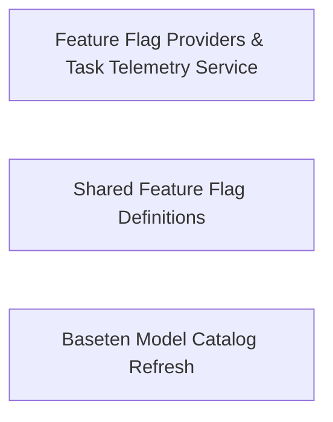

## Details

Evaluates feature flags across configured providers and records task-level telemetry events.

### Feature Flag Providers & Task Telemetry Service
Polls and caches remote feature flags via pluggable providers while recording task lifecycle, token usage, and feature-toggle telemetry events.

**Related Classes/Methods**:

- `src.services.feature-flags.providers.DiracFeatureFlagsProvider.DiracFeatureFlagsProvider`:12-67
- `src.services.telemetry.TaskTelemetry.TaskTelemetry`:16-263

**Source Files:**

- `src/services/feature-flags/FeatureFlagsProviderFactory.ts`
  - `src.services.feature-flags.FeatureFlagsProviderFactory.FeatureFlagsProviderConfig` (L15-L17) - Interface
  - `src.services.feature-flags.FeatureFlagsProviderFactory.FeatureFlagsProviderFactory` (L23-L53) - Class
  - `src.services.feature-flags.FeatureFlagsProviderFactory.FeatureFlagsProviderFactory.createProvider` (L29-L37) - Method
  - `src.services.feature-flags.FeatureFlagsProviderFactory.FeatureFlagsProviderFactory.getDefaultConfig` (L43-L52) - Method
  - `src.services.feature-flags.FeatureFlagsProviderFactory.NoOpFeatureFlagsProvider` (L59-L78) - Class
  - `src.services.feature-flags.FeatureFlagsProviderFactory.NoOpFeatureFlagsProvider.getAllFlagsAndPayloads` (L60-L62) - Method
  - `src.services.feature-flags.FeatureFlagsProviderFactory.NoOpFeatureFlagsProvider.isEnabled` (L64-L66) - Method
  - `src.services.feature-flags.FeatureFlagsProviderFactory.NoOpFeatureFlagsProvider.getSettings` (L68-L73) - Method
  - `src.services.feature-flags.FeatureFlagsProviderFactory.NoOpFeatureFlagsProvider.dispose` (L75-L77) - Method
- `src/services/feature-flags/FeatureFlagsService.ts`
  - `src.services.feature-flags.FeatureFlagsService.FeatureFlagsService` (L21-L155) - Class
  - `src.services.feature-flags.FeatureFlagsService.FeatureFlagsService.constructor` (L26-L26) - Constructor
  - `src.services.feature-flags.FeatureFlagsService.FeatureFlagsService.poll` (L37-L65) - Method
  - `src.services.feature-flags.FeatureFlagsService.FeatureFlagsService.poll.payload` (L57-L57) - Class
  - `src.services.feature-flags.FeatureFlagsService.FeatureFlagsService.poll.payload.catch() callback` (L57-L57) - Function
  - `src.services.feature-flags.FeatureFlagsService.FeatureFlagsService.getFeatureFlag` (L67-L88) - Method
  - `src.services.feature-flags.FeatureFlagsService.FeatureFlagsService.getBooleanFlagEnabled` (L97-L99) - Method
  - `src.services.feature-flags.FeatureFlagsService.FeatureFlagsService.getFlagPayload` (L104-L106) - Method
  - `src.services.feature-flags.FeatureFlagsService.FeatureFlagsService.getWebtoolsEnabled` (L108-L110) - Method
  - `src.services.feature-flags.FeatureFlagsService.FeatureFlagsService.getWorktreesEnabled` (L112-L114) - Method
  - `src.services.feature-flags.FeatureFlagsService.FeatureFlagsService.getProvider` (L120-L122) - Method
  - `src.services.feature-flags.FeatureFlagsService.FeatureFlagsService.isEnabled` (L128-L130) - Method
  - `src.services.feature-flags.FeatureFlagsService.FeatureFlagsService.getSettings` (L136-L138) - Method
  - `src.services.feature-flags.FeatureFlagsService.FeatureFlagsService.test` (L143-L147) - Method
  - `src.services.feature-flags.FeatureFlagsService.FeatureFlagsService.dispose` (L152-L154) - Method
- `src/services/feature-flags/index.ts`
  - `src.services.feature-flags.index.getFeatureFlagsService` (L20-L26) - Function
  - `src.services.feature-flags.index.resetFeatureFlagsService` (L31-L33) - Function
  - `src.services.feature-flags.index.featureFlagsService` (L35-L45) - Class
  - `src.services.feature-flags.index.featureFlagsService.get` (L36-L44) - Method
- `src/services/feature-flags/providers/DiracFeatureFlagsProvider.ts`
  - `src.services.feature-flags.providers.DiracFeatureFlagsProvider.DiracFeatureFlagsProvider` (L12-L67) - Class
  - `src.services.feature-flags.providers.DiracFeatureFlagsProvider.DiracFeatureFlagsProvider.constructor` (L15-L21) - Constructor
  - `src.services.feature-flags.providers.DiracFeatureFlagsProvider.DiracFeatureFlagsProvider.distinctId` (L23-L25) - Method
  - `src.services.feature-flags.providers.DiracFeatureFlagsProvider.DiracFeatureFlagsProvider.getAllFlagsAndPayloads` (L27-L54) - Method
  - `src.services.feature-flags.providers.DiracFeatureFlagsProvider.DiracFeatureFlagsProvider.isEnabled` (L56-L58) - Method
  - `src.services.feature-flags.providers.DiracFeatureFlagsProvider.DiracFeatureFlagsProvider.getSettings` (L60-L62) - Method
  - `src.services.feature-flags.providers.DiracFeatureFlagsProvider.DiracFeatureFlagsProvider.dispose` (L64-L66) - Method
- `src/services/feature-flags/providers/IFeatureFlagsProvider.ts`
  - `src.services.feature-flags.providers.IFeatureFlagsProvider.FeatureFlagsSettings` (L9-L14) - Interface
  - `src.services.feature-flags.providers.IFeatureFlagsProvider.IFeatureFlagsProvider` (L36-L55) - Interface
  - `src.services.feature-flags.providers.IFeatureFlagsProvider.IFeatureFlagsProvider.getAllFlagsAndPayloads` (L37-L37) - Method
  - `src.services.feature-flags.providers.IFeatureFlagsProvider.IFeatureFlagsProvider.isEnabled` (L43-L43) - Method
  - `src.services.feature-flags.providers.IFeatureFlagsProvider.IFeatureFlagsProvider.getSettings` (L49-L49) - Method
  - `src.services.feature-flags.providers.IFeatureFlagsProvider.IFeatureFlagsProvider.dispose` (L54-L54) - Method
- `src/services/telemetry/TaskTelemetry.ts`
  - `src.services.telemetry.TaskTelemetry.TaskTelemetry` (L16-L263) - Class
  - `src.services.telemetry.TaskTelemetry.TaskTelemetry.constructor` (L20-L23) - Constructor
  - `src.services.telemetry.TaskTelemetry.TaskTelemetry.captureTaskCreated` (L25-L31) - Method
  - `src.services.telemetry.TaskTelemetry.TaskTelemetry.captureTaskRestarted` (L33-L39) - Method
  - `src.services.telemetry.TaskTelemetry.TaskTelemetry.captureTaskCompleted` (L41-L86) - Method
  - `src.services.telemetry.TaskTelemetry.TaskTelemetry.captureConversationTurnEvent` (L88-L144) - Method
  - `src.services.telemetry.TaskTelemetry.TaskTelemetry.captureTokenUsage` (L146-L185) - Method
  - `src.services.telemetry.TaskTelemetry.TaskTelemetry.captureModeSwitch` (L187-L189) - Method
  - `src.services.telemetry.TaskTelemetry.TaskTelemetry.captureCondense` (L191-L203) - Method
  - `src.services.telemetry.TaskTelemetry.TaskTelemetry.captureTaskFeedback` (L205-L209) - Method
  - `src.services.telemetry.TaskTelemetry.TaskTelemetry.captureTaskInitialization` (L211-L216) - Method
  - `src.services.telemetry.TaskTelemetry.TaskTelemetry.captureOptionSelected` (L218-L220) - Method
  - `src.services.telemetry.TaskTelemetry.TaskTelemetry.captureOptionsIgnored` (L222-L224) - Method
  - `src.services.telemetry.TaskTelemetry.TaskTelemetry.captureSlashCommandUsed` (L226-L231) - Method
  - `src.services.telemetry.TaskTelemetry.TaskTelemetry.captureFeatureToggle` (L233-L238) - Method
  - `src.services.telemetry.TaskTelemetry.TaskTelemetry.captureDiracRuleToggled` (L240-L247) - Method
  - `src.services.telemetry.TaskTelemetry.TaskTelemetry.captureAutoCondenseToggle` (L249-L254) - Method
  - `src.services.telemetry.TaskTelemetry.TaskTelemetry.captureYoloModeToggle` (L256-L258) - Method
  - `src.services.telemetry.TaskTelemetry.TaskTelemetry.captureDiracWebToolsToggle` (L260-L262) - Method

### Shared Feature Flag Definitions
Defines shared feature flag identifiers, default fallback payloads, and user-versus-flag feature setting structures.

**Related Classes/Methods**:

- `src.shared.services.feature-flags.feature-flags.FeatureFlag`:4-18
- `src.shared.DiracFeatureSetting.DiracFeatureSetting`:1-6

**Source Files:**

- `src/shared/DiracFeatureSetting.ts`
  - `src.shared.DiracFeatureSetting.DiracFeatureSetting` (L1-L6) - Interface
- `src/shared/services/feature-flags/feature-flags.ts`
  - `src.shared.services.feature-flags.feature-flags.FeatureFlag` (L4-L18) - Enum

### Baseten Model Catalog Refresh
Fetches, validates, and caches Baseten chat model metadata and pricing with static model fallbacks.

**Related Classes/Methods**:

- `src.core.controller.models.refreshBasetenModels.refreshBasetenModels`:14-27

**Source Files:**

- `src/core/controller/models/refreshBasetenModels.ts`
  - `src.core.controller.models.refreshBasetenModels.refreshBasetenModels` (L14-L27) - Function
  - `src.core.controller.models.refreshBasetenModels.parseBasetenResponse` (L29-L51) - Function
  - `src.core.controller.models.refreshBasetenModels.parseBasetenResponse.supportThinking` (L35-L35) - Class
  - `src.core.controller.models.refreshBasetenModels.parseBasetenResponse.supportThinking.rawModel.supported_features.some() callback` (L35-L35) - Function
  - `src.core.controller.models.refreshBasetenModels.getBasetenStaticModels` (L53-L71) - Function
  - `src.core.controller.models.refreshBasetenModels.isValidChatModel` (L74-L77) - Function
  - `src.core.controller.models.refreshBasetenModels.generateModelDescription` (L80-L100) - Function

### [FAQ](https://github.com/CodeBoarding/GeneratedOnBoardings/tree/main?tab=readme-ov-file#faq)