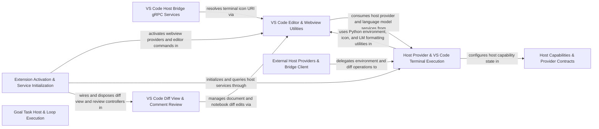

## Details

Abstracts host environment capabilities, implements VS Code extension activation, hostbridge gRPC services, diff views, terminals, and goal loops.

### VS Code Host Bridge gRPC Services [[Expand]](./VS_Code_Host_Bridge_gRPC_Services.md)
Implements VS Code gRPC host-bridge services and handlers for workspace, window, and diff operations.

**Related Classes/Methods**:

- `src.hosts.vscode.hostbridge-grpc-service.ServiceRegistry`:23-116
- `src.hosts.vscode.hostbridge.workspace.executeCommandInTerminal.executeCommandInTerminal`:11-42

**Source Files:**

- `src/hosts/vscode/hostbridge-grpc-handler.ts`
  - `src.hosts.vscode.hostbridge-grpc-handler.GrpcHandler` (L18-L165) - Class
  - `src.hosts.vscode.hostbridge-grpc-handler.GrpcHandler.constructor` (L19-L19) - Constructor
  - `src.hosts.vscode.hostbridge-grpc-handler.GrpcHandler.dispatchGrpcMethod` (L30-L93) - Method
  - `src.hosts.vscode.hostbridge-grpc-handler.GrpcHandler.dispatchGrpcMethod.requestRegistry.registerRequest() callback` (L68-L74) - Function
  - `src.hosts.vscode.hostbridge-grpc-handler.GrpcHandler.handleUnaryRequest` (L95-L99) - Method
  - `src.hosts.vscode.hostbridge-grpc-handler.GrpcHandler.cancelRequest` (L106-L126) - Method
  - `src.hosts.vscode.hostbridge-grpc-handler.GrpcHandler.handleStreamingRequest` (L135-L157) - Method
  - `src.hosts.vscode.hostbridge-grpc-handler.GrpcHandler.getServiceHandlerConfig` (L159-L164) - Method
  - `src.hosts.vscode.hostbridge-grpc-handler.HostServiceHandlerConfig` (L170-L178) - Interface
  - `src.hosts.vscode.hostbridge-grpc-handler.getRequestRegistry` (L184-L186) - Function
- `src/hosts/vscode/hostbridge-grpc-service.ts`
  - `src.hosts.vscode.hostbridge-grpc-service.MethodMetadata` (L16-L18) - Interface
  - `src.hosts.vscode.hostbridge-grpc-service.ServiceRegistry` (L23-L116) - Class
  - `src.hosts.vscode.hostbridge-grpc-service.ServiceRegistry.constructor` (L33-L35) - Constructor
  - `src.hosts.vscode.hostbridge-grpc-service.ServiceRegistry.registerMethod` (L43-L53) - Method
  - `src.hosts.vscode.hostbridge-grpc-service.ServiceRegistry.isStreamingMethod` (L60-L62) - Method
  - `src.hosts.vscode.hostbridge-grpc-service.ServiceRegistry.getStreamingHandler` (L69-L71) - Method
  - `src.hosts.vscode.hostbridge-grpc-service.ServiceRegistry.dispatchGrpcMethod` (L79-L90) - Method
  - `src.hosts.vscode.hostbridge-grpc-service.ServiceRegistry.handleStreamingRequest` (L99-L115) - Method
  - `src.hosts.vscode.hostbridge-grpc-service.createServiceRegistry` (L123-L140) - Function
  - `src.hosts.vscode.hostbridge-grpc-service.createServiceRegistry.registerMethod` (L130-L131) - Method
  - `src.hosts.vscode.hostbridge-grpc-service.createServiceRegistry.dispatchGrpcMethod` (L133-L133) - Method
  - `src.hosts.vscode.hostbridge-grpc-service.createServiceRegistry.handleStreamingRequest` (L135-L136) - Method
  - `src.hosts.vscode.hostbridge-grpc-service.createServiceRegistry.isStreamingMethod` (L138-L138) - Method
- `src/hosts/vscode/hostbridge/client/host-grpc-client-base.ts`
  - `src.hosts.vscode.hostbridge.client.host-grpc-client-base.createGrpcClient` (L34-L96) - Function
  - `src.hosts.vscode.hostbridge.client.host-grpc-client-base.createGrpcClient.forEach() callback` (L38-L94) - Function
  - `src.hosts.vscode.hostbridge.client.host-grpc-client-base.forEach() callback.[methodKey]` (L44-L74) - Function
  - `src.hosts.vscode.hostbridge.client.host-grpc-client-base.createGrpcClient.forEach() callback.[methodKey].<function>` (L49-L73) - Function
  - `src.hosts.vscode.hostbridge.client.host-grpc-client-base.createGrpcClient.forEach() callback.[methodKey]` (L77-L92) - Function
- `src/hosts/vscode/hostbridge/diff/closeAllDiffs.ts`
  - `src.hosts.vscode.hostbridge.diff.closeAllDiffs.closeAllDiffs` (L3-L5) - Function
- `src/hosts/vscode/hostbridge/diff/getDocumentText.ts`
  - `src.hosts.vscode.hostbridge.diff.getDocumentText.getDocumentText` (L3-L5) - Function
- `src/hosts/vscode/hostbridge/diff/openDiff.ts`
  - `src.hosts.vscode.hostbridge.diff.openDiff.openDiff` (L3-L5) - Function
- `src/hosts/vscode/hostbridge/diff/openMultiFileDiff.ts`
  - `src.hosts.vscode.hostbridge.diff.openMultiFileDiff.openMultiFileDiff` (L7-L33) - Function
  - `src.hosts.vscode.hostbridge.diff.openMultiFileDiff.openMultiFileDiff.request.diffs.map() callback` (L12-L26) - Function
- `src/hosts/vscode/hostbridge/diff/replaceText.ts`
  - `src.hosts.vscode.hostbridge.diff.replaceText.replaceText` (L3-L5) - Function
- `src/hosts/vscode/hostbridge/diff/saveDocument.ts`
  - `src.hosts.vscode.hostbridge.diff.saveDocument.saveDocument` (L3-L5) - Function
- `src/hosts/vscode/hostbridge/diff/scrollDiff.ts`
  - `src.hosts.vscode.hostbridge.diff.scrollDiff.scrollDiff` (L3-L5) - Function
- `src/hosts/vscode/hostbridge/diff/truncateDocument.ts`
  - `src.hosts.vscode.hostbridge.diff.truncateDocument.truncateDocument` (L3-L5) - Function
- `src/hosts/vscode/hostbridge/testing/getWebviewHtml.ts`
  - `src.hosts.vscode.hostbridge.testing.getWebviewHtml.getWebviewHtml` (L3-L5) - Function
- `src/hosts/vscode/hostbridge/window/getActiveEditor.ts`
  - `src.hosts.vscode.hostbridge.window.getActiveEditor.getActiveEditor` (L5-L8) - Function
- `src/hosts/vscode/hostbridge/window/getOpenTabs.ts`
  - `src.hosts.vscode.hostbridge.window.getOpenTabs.getOpenTabs` (L4-L11) - Function
  - `src.hosts.vscode.hostbridge.window.getOpenTabs.getOpenTabs.openTabPaths` (L5-L8) - Class
  - `src.hosts.vscode.hostbridge.window.getOpenTabs.getOpenTabs.openTabPaths.window.tabGroups.all.flatMap() callback` (L6-L6) - Function
  - `src.hosts.vscode.hostbridge.window.getOpenTabs.getOpenTabs.openTabPaths.map() callback` (L7-L7) - Function
- `src/hosts/vscode/hostbridge/window/getVisibleTabs.ts`
  - `src.hosts.vscode.hostbridge.window.getVisibleTabs.getVisibleTabs` (L4-L8) - Function
  - `src.hosts.vscode.hostbridge.window.getVisibleTabs.getVisibleTabs.visibleTabPaths` (L5-L5) - Class
  - `src.hosts.vscode.hostbridge.window.getVisibleTabs.getVisibleTabs.visibleTabPaths.window.visibleTextEditors.map() callback` (L5-L5) - Function
- `src/hosts/vscode/hostbridge/window/openFile.ts`
  - `src.hosts.vscode.hostbridge.window.openFile.openFile` (L4-L7) - Function
- `src/hosts/vscode/hostbridge/window/openSettings.ts`
  - `src.hosts.vscode.hostbridge.window.openSettings.openSettings` (L4-L8) - Function
- `src/hosts/vscode/hostbridge/window/showInputBox.ts`
  - `src.hosts.vscode.hostbridge.window.showInputBox.showInputBox` (L4-L11) - Function
- `src/hosts/vscode/hostbridge/window/showMessage.ts`
  - `src.hosts.vscode.hostbridge.window.showMessage.showMessage` (L6-L26) - Function
- `src/hosts/vscode/hostbridge/window/showOpenDialogue.ts`
  - `src.hosts.vscode.hostbridge.window.showOpenDialogue.showOpenDialogue` (L4-L27) - Function
  - `src.hosts.vscode.hostbridge.window.showOpenDialogue.showOpenDialogue.paths.selectedResources.map() callback` (L25-L25) - Function
- `src/hosts/vscode/hostbridge/window/showSaveDialog.ts`
  - `src.hosts.vscode.hostbridge.window.showSaveDialog.showSaveDialog` (L4-L25) - Function
  - `src.hosts.vscode.hostbridge.window.showSaveDialog.showSaveDialog.forEach() callback` (L15-L17) - Function
- `src/hosts/vscode/hostbridge/window/showTextDocument.ts`
  - `src.hosts.vscode.hostbridge.window.showTextDocument.showTextDocument` (L5-L46) - Function
  - `src.hosts.vscode.hostbridge.window.showTextDocument.showTextDocument.existingTab` (L13-L15) - Class
  - `src.hosts.vscode.hostbridge.window.showTextDocument.showTextDocument.existingTab.group.tabs.find() callback` (L14-L14) - Function
  - `src.hosts.vscode.hostbridge.window.showTextDocument.showTextDocument.tabColumn` (L18-L18) - Class
  - `src.hosts.vscode.hostbridge.window.showTextDocument.showTextDocument.tabColumn.vscode.window.tabGroups.all.find() callback` (L18-L18) - Function
- `src/hosts/vscode/hostbridge/workspace/executeCommandInTerminal.ts`
  - `src.hosts.vscode.hostbridge.workspace.executeCommandInTerminal.executeCommandInTerminal` (L11-L42) - Function
- `src/hosts/vscode/hostbridge/workspace/openDiracSidebarPanel.ts`
  - `src.hosts.vscode.hostbridge.workspace.openDiracSidebarPanel.openDiracSidebarPanel` (L5-L8) - Function
- `src/hosts/vscode/hostbridge/workspace/openFolder.ts`
  - `src.hosts.vscode.hostbridge.workspace.openFolder.openFolder` (L5-L16) - Function
- `src/hosts/vscode/hostbridge/workspace/openInFileExplorerPanel.ts`
  - `src.hosts.vscode.hostbridge.workspace.openInFileExplorerPanel.openInFileExplorerPanel` (L5-L8) - Function
- `src/hosts/vscode/hostbridge/workspace/openProblemsPanel.ts`
  - `src.hosts.vscode.hostbridge.workspace.openProblemsPanel.openProblemsPanel` (L4-L7) - Function
- `src/hosts/vscode/hostbridge/workspace/openTerminalPanel.ts`
  - `src.hosts.vscode.hostbridge.workspace.openTerminalPanel.openTerminalPanel` (L4-L7) - Function
- `src/hosts/vscode/hostbridge/workspace/prepareDiagnostics.ts`
  - `src.hosts.vscode.hostbridge.workspace.prepareDiagnostics.prepareDiagnostics` (L4-L19) - Function
  - `src.hosts.vscode.hostbridge.workspace.prepareDiagnostics.prepareDiagnostics.request.filePaths.map() callback` (L7-L13) - Function

### VS Code Editor & Webview Utilities [[Expand]](./VS_Code_Editor_Webview_Utilities.md)
Provides VS Code editor managers, webview providers, document and notebook diff utilities, and commit message generation helpers.

**Related Classes/Methods**:

- `src.hosts.vscode.VscodeWebviewProvider.VscodeDiracWebviewProvider`:16-221
- `src.hosts.vscode.DocumentOperationManager.DocumentOperationManager`:8-181
- `src.hosts.vscode.NotebookDiffManager.NotebookDiffManager`:5-42
- `src.hosts.vscode.commit-message-generator.generateCommitMsg`:51-83
- `src.hosts.vscode.commandUtils.showWebview`:106-110
- `src.hosts.vscode.iconUtils.getDiracIconUri`:4-6

**Source Files:**

- `src/hosts/vscode/DecorationController.ts`
  - `src.hosts.vscode.DecorationController.DecorationController` (L18-L78) - Class
  - `src.hosts.vscode.DecorationController.DecorationController.constructor` (L23-L26) - Constructor
  - `src.hosts.vscode.DecorationController.DecorationController.getDecoration` (L28-L35) - Method
  - `src.hosts.vscode.DecorationController.DecorationController.addLines` (L37-L52) - Method
  - `src.hosts.vscode.DecorationController.DecorationController.clear` (L54-L57) - Method
  - `src.hosts.vscode.DecorationController.DecorationController.updateOverlayAfterLine` (L59-L72) - Method
  - `src.hosts.vscode.DecorationController.DecorationController.updateOverlayAfterLine.ranges.filter() callback` (L61-L61) - Function
  - `src.hosts.vscode.DecorationController.DecorationController.setActiveLine` (L74-L77) - Method
- `src/hosts/vscode/DecorationControllerManager.ts`
  - `src.hosts.vscode.DecorationControllerManager.DecorationControllerManager` (L4-L38) - Class
  - `src.hosts.vscode.DecorationControllerManager.DecorationControllerManager.constructor` (L8-L8) - Constructor
  - `src.hosts.vscode.DecorationControllerManager.DecorationControllerManager.initialize` (L10-L14) - Method
  - `src.hosts.vscode.DecorationControllerManager.DecorationControllerManager.fadedOverlayController` (L16-L18) - Method
  - `src.hosts.vscode.DecorationControllerManager.DecorationControllerManager.activeLineController` (L20-L22) - Method
  - `src.hosts.vscode.DecorationControllerManager.DecorationControllerManager.updateAfterReplace` (L24-L27) - Method
  - `src.hosts.vscode.DecorationControllerManager.DecorationControllerManager.clearAll` (L29-L32) - Method
  - `src.hosts.vscode.DecorationControllerManager.DecorationControllerManager.reset` (L34-L37) - Method
- `src/hosts/vscode/DocumentOperationManager.ts`
  - `src.hosts.vscode.DocumentOperationManager.DocumentOperationManager` (L8-L181) - Class
  - `src.hosts.vscode.DocumentOperationManager.DocumentOperationManager.saveDocument` (L9-L25) - Method
  - `src.hosts.vscode.DocumentOperationManager.DocumentOperationManager.applyAndSaveSilently` (L27-L64) - Method
  - `src.hosts.vscode.DocumentOperationManager.DocumentOperationManager.applyAndSaveBatchSilently` (L66-L137) - Method
  - `src.hosts.vscode.DocumentOperationManager.DocumentOperationManager.applyAndSaveBatchSilently.documents.map() callback` (L100-L108) - Function
  - `src.hosts.vscode.DocumentOperationManager.DocumentOperationManager.computeResults` (L139-L150) - Method
  - `src.hosts.vscode.DocumentOperationManager.DocumentOperationManager.format` (L152-L180) - Method
  - `src.hosts.vscode.DocumentOperationManager.DocumentOperationManager.format.editor` (L167-L167) - Class
  - `src.hosts.vscode.DocumentOperationManager.DocumentOperationManager.format.editor.vscode.window.visibleTextEditors.find() callback` (L167-L167) - Function
- `src/hosts/vscode/NotebookDiffManager.ts`
  - `src.hosts.vscode.NotebookDiffManager.NotebookDiffManager` (L5-L42) - Class
  - `src.hosts.vscode.NotebookDiffManager.NotebookDiffManager.isNotebookFile` (L8-L10) - Method
  - `src.hosts.vscode.NotebookDiffManager.NotebookDiffManager.switchToSpecializedEditor` (L12-L21) - Method
  - `src.hosts.vscode.NotebookDiffManager.NotebookDiffManager.showFileForNotebook` (L23-L30) - Method
  - `src.hosts.vscode.NotebookDiffManager.NotebookDiffManager.cleanup` (L32-L37) - Method
  - `src.hosts.vscode.NotebookDiffManager.NotebookDiffManager.reset` (L39-L41) - Method
- `src/hosts/vscode/NotebookDiffView.ts`
  - `src.hosts.vscode.NotebookDiffView.NotebookDiffView` (L13-L119) - Class
  - `src.hosts.vscode.NotebookDiffView.NotebookDiffView.open` (L23-L39) - Method
  - `src.hosts.vscode.NotebookDiffView.NotebookDiffView.createDiffView` (L41-L70) - Method
  - `src.hosts.vscode.NotebookDiffView.NotebookDiffView.setupFileWatcher` (L72-L84) - Method
  - `src.hosts.vscode.NotebookDiffView.NotebookDiffView.setupFileWatcher.tempFileWatcher.onDidChange() callback` (L81-L83) - Function
  - `src.hosts.vscode.NotebookDiffView.NotebookDiffView.syncToEditor` (L86-L102) - Method
  - `src.hosts.vscode.NotebookDiffView.NotebookDiffView.cleanup` (L104-L118) - Method
- `src/hosts/vscode/StreamingTextUpdater.ts`
  - `src.hosts.vscode.StreamingTextUpdater.countTrailingNewlines` (L3-L9) - Function
  - `src.hosts.vscode.StreamingTextUpdater.StreamingTextUpdater` (L11-L87) - Class
  - `src.hosts.vscode.StreamingTextUpdater.StreamingTextUpdater.constructor` (L12-L12) - Constructor
  - `src.hosts.vscode.StreamingTextUpdater.StreamingTextUpdater.replaceText` (L14-L40) - Method
  - `src.hosts.vscode.StreamingTextUpdater.StreamingTextUpdater.fixTrailingNewlines` (L42-L57) - Method
  - `src.hosts.vscode.StreamingTextUpdater.StreamingTextUpdater.scrollEditorToLine` (L59-L62) - Method
  - `src.hosts.vscode.StreamingTextUpdater.StreamingTextUpdater.scrollAnimation` (L64-L73) - Method
  - `src.hosts.vscode.StreamingTextUpdater.StreamingTextUpdater.truncateDocument` (L75-L82) - Method
  - `src.hosts.vscode.StreamingTextUpdater.StreamingTextUpdater.lineCount` (L84-L86) - Method
- `src/hosts/vscode/TabManager.ts`
  - `src.hosts.vscode.TabManager.TabManagerOptions` (L8-L10) - Interface
  - `src.hosts.vscode.TabManager.TabManager` (L12-L137) - Class
  - `src.hosts.vscode.TabManager.TabManager.closeTab` (L13-L21) - Method
  - `src.hosts.vscode.TabManager.TabManager.openDiffEditor` (L23-L37) - Method
  - `src.hosts.vscode.TabManager.TabManager.closeExistingTabsForPath` (L39-L53) - Method
  - `src.hosts.vscode.TabManager.TabManager.closeExistingTabsForPath.tabs` (L41-L43) - Class
  - `src.hosts.vscode.TabManager.TabManager.closeExistingTabsForPath.tabs.vscode.window.tabGroups.all.flatMap() callback` (L42-L42) - Function
  - `src.hosts.vscode.TabManager.TabManager.closeExistingTabsForPath.tabs.filter() callback` (L43-L43) - Function
  - `src.hosts.vscode.TabManager.TabManager.closeExistingDiffTab` (L55-L72) - Method
  - `src.hosts.vscode.TabManager.TabManager.closeExistingDiffTab.diffTab` (L56-L63) - Class
  - `src.hosts.vscode.TabManager.TabManager.closeExistingDiffTab.diffTab.vscode.window.tabGroups.all.flatMap() callback` (L57-L57) - Function
  - `src.hosts.vscode.TabManager.TabManager.closeExistingDiffTab.diffTab.find() callback` (L59-L62) - Function
  - `src.hosts.vscode.TabManager.TabManager.waitForActiveEditor` (L74-L106) - Method
  - `src.hosts.vscode.TabManager.TabManager.waitForActiveEditor.<function>` (L80-L105) - Function
  - `src.hosts.vscode.TabManager.TabManager.waitForActiveEditor.<function>.disposable` (L83-L88) - Class
  - `src.hosts.vscode.TabManager.TabManager.waitForActiveEditor.<function>.disposable.vscode.window.onDidChangeActiveTextEditor() callback` (L83-L88) - Function
  - `src.hosts.vscode.TabManager.TabManager.waitForActiveEditor.<function>.setTimeout() callback` (L101-L104) - Function
  - `src.hosts.vscode.TabManager.TabManager.closeAllDiffViews` (L108-L118) - Method
  - `src.hosts.vscode.TabManager.TabManager.closeAllDiffViews.tabs` (L109-L111) - Class
  - `src.hosts.vscode.TabManager.TabManager.closeAllDiffViews.tabs.vscode.window.tabGroups.all.flatMap() callback` (L110-L110) - Function
  - `src.hosts.vscode.TabManager.TabManager.closeAllDiffViews.tabs.filter() callback` (L111-L111) - Function
  - `src.hosts.vscode.TabManager.TabManager.closeTabsByScheme` (L120-L136) - Method
  - `src.hosts.vscode.TabManager.TabManager.closeTabsByScheme.allTabs` (L121-L127) - Class
  - `src.hosts.vscode.TabManager.TabManager.closeTabsByScheme.allTabs.vscode.window.tabGroups.all.flatMap() callback` (L122-L122) - Function
  - `src.hosts.vscode.TabManager.TabManager.closeTabsByScheme.allTabs.filter() callback` (L124-L126) - Function
- `src/hosts/vscode/VscodeWebviewProvider.ts`
  - `src.hosts.vscode.VscodeWebviewProvider.VscodeDiracWebviewProvider` (L16-L221) - Class
  - `src.hosts.vscode.VscodeWebviewProvider.VscodeDiracWebviewProvider.getWebviewUrl` (L24-L30) - Method
  - `src.hosts.vscode.VscodeWebviewProvider.VscodeDiracWebviewProvider.getCspSource` (L32-L37) - Method
  - `src.hosts.vscode.VscodeWebviewProvider.VscodeDiracWebviewProvider.getInjectedConfig` (L45-L49) - Method
  - `src.hosts.vscode.VscodeWebviewProvider.VscodeDiracWebviewProvider.isVisible` (L51-L53) - Method
  - `src.hosts.vscode.VscodeWebviewProvider.VscodeDiracWebviewProvider.getWebview` (L55-L57) - Method
  - `src.hosts.vscode.VscodeWebviewProvider.VscodeDiracWebviewProvider.resolveWebviewView` (L65-L136) - Method
  - `src.hosts.vscode.VscodeWebviewProvider.VscodeDiracWebviewProvider.resolveWebviewView.webviewView.onDidChangeVisibility() callback` (L93-L98) - Function
  - `src.hosts.vscode.VscodeWebviewProvider.VscodeDiracWebviewProvider.resolveWebviewView.webviewView.onDidDispose() callback` (L106-L108) - Function
  - `src.hosts.vscode.VscodeWebviewProvider.VscodeDiracWebviewProvider.resolveWebviewView.vscode.workspace.onDidChangeConfiguration() callback` (L115-L125) - Function
  - `src.hosts.vscode.VscodeWebviewProvider.VscodeDiracWebviewProvider.setWebviewMessageListener` (L162-L170) - Method
  - `src.hosts.vscode.VscodeWebviewProvider.VscodeDiracWebviewProvider.setWebviewMessageListener.webview.onDidReceiveMessage() callback` (L164-L166) - Function
  - `src.hosts.vscode.VscodeWebviewProvider.VscodeDiracWebviewProvider.handleWebviewMessage` (L178-L198) - Method
  - `src.hosts.vscode.VscodeWebviewProvider.VscodeDiracWebviewProvider.postMessageToWebview` (L206-L208) - Method
  - `src.hosts.vscode.VscodeWebviewProvider.VscodeDiracWebviewProvider.dispose` (L210-L220) - Method
- `src/hosts/vscode/commandUtils.ts`
  - `src.hosts.vscode.commandUtils.findMatchingNotebookCell` (L17-L45) - Function
  - `src.hosts.vscode.commandUtils.getContextForCommand` (L53-L104) - Function
  - `src.hosts.vscode.commandUtils.showWebview` (L106-L110) - Function
- `src/hosts/vscode/commit-message-generator.ts`
  - `src.hosts.vscode.commit-message-generator.getGitDiffStagedFirst` (L22-L28) - Function
  - `src.hosts.vscode.commit-message-generator.generateCommitMsg` (L51-L83) - Function
  - `src.hosts.vscode.commit-message-generator.orchestrateWorkspaceCommitMsgGeneration` (L85-L123) - Function
  - `src.hosts.vscode.commit-message-generator.filterForReposWithChanges` (L125-L140) - Function
  - `src.hosts.vscode.commit-message-generator.promptRepoSelection` (L142-L159) - Function
  - `src.hosts.vscode.commit-message-generator.promptRepoSelection.repoItems` (L144-L148) - Class
  - `src.hosts.vscode.commit-message-generator.promptRepoSelection.repoItems.repos.map() callback` (L144-L148) - Function
  - `src.hosts.vscode.commit-message-generator.generateCommitMsgForRepository` (L161-L178) - Function
  - `src.hosts.vscode.commit-message-generator.generateCommitMsgForRepository.vscode.window.withProgress() callback` (L176-L176) - Function
  - `src.hosts.vscode.commit-message-generator.createConfiguredCommitMessageStream` (L180-L203) - Function
  - `src.hosts.vscode.commit-message-generator.performCommitMsgGeneration` (L205-L262) - Function
  - `src.hosts.vscode.commit-message-generator.abortCommitGeneration` (L264-L267) - Function
  - `src.hosts.vscode.commit-message-generator.extractCommitMessage` (L274-L280) - Function
- `src/hosts/vscode/host-capabilities.ts`
  - `src.hosts.vscode.host-capabilities.vscodeHostCapabilities` (L12-L24) - Class
  - `src.hosts.vscode.host-capabilities.vscodeHostCapabilities.openWalkthrough` (L13-L18) - Method
  - `src.hosts.vscode.host-capabilities.vscodeHostCapabilities.listVsCodeLmModels` (L20-L20) - Method
  - `src.hosts.vscode.host-capabilities.vscodeHostCapabilities.createVsCodeLmHandler` (L21-L21) - Method
  - `src.hosts.vscode.host-capabilities.vscodeHostCapabilities.getWorkspaceConfig` (L22-L22) - Method
- `src/hosts/vscode/iconUtils.ts`
  - `src.hosts.vscode.iconUtils.getDiracIconUri` (L4-L6) - Function
- `src/hosts/vscode/python.ts`
  - `src.hosts.vscode.python.PythonApi` (L6-L11) - Interface
  - `src.hosts.vscode.python.getPythonApi` (L16-L27) - Function
  - `src.hosts.vscode.python.getPythonEnvironmentVariables` (L34-L84) - Function
- `src/hosts/vscode/vscode-lm-format.ts`
  - `src.hosts.vscode.vscode-lm-format.asObjectSafe` (L10-L32) - Function
  - `src.hosts.vscode.vscode-lm-format.imagePlaceholder` (L37-L41) - Function
  - `src.hosts.vscode.vscode-lm-format.convertToolResultContent` (L44-L54) - Function
  - `src.hosts.vscode.vscode-lm-format.convertToolResultContent.content.map() callback` (L49-L52) - Function
  - `src.hosts.vscode.vscode-lm-format.convertVsCodeLmUserMessage` (L57-L80) - Function
  - `src.hosts.vscode.vscode-lm-format.convertVsCodeLmUserMessage.contentParts` (L71-L78) - Class
  - `src.hosts.vscode.vscode-lm-format.convertVsCodeLmUserMessage.contentParts.toolMessages.map() callback` (L72-L72) - Function
  - `src.hosts.vscode.vscode-lm-format.convertVsCodeLmUserMessage.contentParts.nonToolMessages.map() callback` (L73-L76) - Function
  - `src.hosts.vscode.vscode-lm-format.convertVsCodeLmAssistantMessage` (L83-L106) - Function
  - `src.hosts.vscode.vscode-lm-format.convertVsCodeLmAssistantMessage.contentParts` (L97-L104) - Class
  - `src.hosts.vscode.vscode-lm-format.convertVsCodeLmAssistantMessage.contentParts.toolMessages.map() callback` (L98-L98) - Function
  - `src.hosts.vscode.vscode-lm-format.convertVsCodeLmAssistantMessage.contentParts.nonToolMessages.map() callback` (L99-L102) - Function
  - `src.hosts.vscode.vscode-lm-format.convertToVsCodeLmMessages` (L108-L130) - Function
  - `src.hosts.vscode.vscode-lm-format.convertToAnthropicRole` (L132-L143) - Function
  - `src.hosts.vscode.vscode-lm-format.convertToAnthropicMessage` (L145-L195) - Function
  - `src.hosts.vscode.vscode-lm-format.convertToAnthropicMessage.content.vsCodeLmMessage.content.map() callback` (L157-L177) - Function
  - `src.hosts.vscode.vscode-lm-format.convertToAnthropicMessage.content.filter() callback` (L178-L178) - Function
- `src/hosts/vscode/vscode-to-file-migration.ts`
  - `src.hosts.vscode.vscode-to-file-migration.MigrationResult` (L56-L62) - Interface
  - `src.hosts.vscode.vscode-to-file-migration.exportVSCodeStorageToSharedFiles` (L78-L205) - Function
  - `src.hosts.vscode.vscode-to-file-migration.migrateGlobalStorageFolders` (L210-L264) - Function
  - `src.hosts.vscode.vscode-to-file-migration.migrateGlobalStorageFolders.filter` (L239-L239) - Method
  - `src.hosts.vscode.vscode-to-file-migration.mergeTaskHistory` (L266-L271) - Function

### Host Provider & VS Code Terminal Execution
Manages the singleton HostProvider facade, VS Code terminal lifecycle and command execution, and native VS Code language model integration.

**Related Classes/Methods**:

- `src.hosts.host-provider.HostProvider`:20-169
- `src.hosts.vscode.terminal.VscodeTerminalLifecycleManager.TerminalLifecycleManager.getOrCreateTerminal`:22-51
- `src.hosts.vscode.terminal.VscodeTerminalRegistry.TerminalRegistry.createTerminal`:24-56
- `src.hosts.vscode.vscode-lm.VsCodeLmHandler.createMessage`:284-431

**Source Files:**

- `src/hosts/host-provider.ts`
  - `src.hosts.host-provider.HostProvider` (L20-L169) - Class
  - `src.hosts.host-provider.HostProvider.constructor` (L60-L91) - Constructor
  - `src.hosts.host-provider.HostProvider.initialize` (L93-L129) - Method
  - `src.hosts.host-provider.HostProvider.get` (L134-L139) - Method
  - `src.hosts.host-provider.HostProvider.isInitialized` (L141-L143) - Method
  - `src.hosts.host-provider.HostProvider.reset` (L149-L152) - Method
  - `src.hosts.host-provider.HostProvider.workspace` (L154-L156) - Method
  - `src.hosts.host-provider.HostProvider.env` (L158-L160) - Method
  - `src.hosts.host-provider.HostProvider.window` (L162-L164) - Method
  - `src.hosts.host-provider.HostProvider.diff` (L166-L168) - Method
- `src/hosts/vscode/terminal/VscodeCommandExecutor.ts`
  - `src.hosts.vscode.terminal.VscodeCommandExecutor.CommandExecutorOptions` (L6-L8) - Interface
  - `src.hosts.vscode.terminal.VscodeCommandExecutor.CommandExecutor` (L10-L77) - Class
  - `src.hosts.vscode.terminal.VscodeCommandExecutor.CommandExecutor.constructor` (L11-L11) - Constructor
  - `src.hosts.vscode.terminal.VscodeCommandExecutor.CommandExecutor.runCommand` (L13-L48) - Method
  - `src.hosts.vscode.terminal.VscodeCommandExecutor.CommandExecutor.runCommand.process.once("completed") callback` (L22-L25) - Function
  - `src.hosts.vscode.terminal.VscodeCommandExecutor.CommandExecutor.runCommand.process.once("no_shell_integration") callback` (L27-L30) - Function
  - `src.hosts.vscode.terminal.VscodeCommandExecutor.CommandExecutor.runCommand.promise` (L32-L38) - Class
  - `src.hosts.vscode.terminal.VscodeCommandExecutor.CommandExecutor.runCommand.promise.<function>` (L32-L38) - Function
  - `src.hosts.vscode.terminal.VscodeCommandExecutor.CommandExecutor.runCommand.promise.<function>.process.once("continue") callback` (L33-L33) - Function
  - `src.hosts.vscode.terminal.VscodeCommandExecutor.CommandExecutor.runCommand.promise.<function>.process.once("error") callback` (L34-L37) - Function
  - `src.hosts.vscode.terminal.VscodeCommandExecutor.CommandExecutor.waitForAndRunCommand` (L50-L72) - Method
  - `src.hosts.vscode.terminal.VscodeCommandExecutor.CommandExecutor.waitForAndRunCommand.pWaitFor() callback` (L61-L61) - Function
  - `src.hosts.vscode.terminal.VscodeCommandExecutor.CommandExecutor.setShellIntegrationTimeout` (L74-L76) - Method
- `src/hosts/vscode/terminal/VscodeShellIntegrationManager.ts`
  - `src.hosts.vscode.terminal.VscodeShellIntegrationManager.TerminalShellExecutionStartEvent` (L6-L8) - Interface
  - `src.hosts.vscode.terminal.VscodeShellIntegrationManager.DiracTerminalExt` (L11-L14) - Interface
  - `src.hosts.vscode.terminal.VscodeShellIntegrationManager.ShellIntegrationManager` (L18-L120) - Class
  - `src.hosts.vscode.terminal.VscodeShellIntegrationManager.ShellIntegrationManager.constructor` (L22-L22) - Constructor
  - `src.hosts.vscode.terminal.VscodeShellIntegrationManager.ShellIntegrationManager.setupListeners` (L24-L64) - Method
  - `src.hosts.vscode.terminal.VscodeShellIntegrationManager.ShellIntegrationManager.setupListeners.windowWithProposed` (L27-L31) - Class
  - `src.hosts.vscode.terminal.VscodeShellIntegrationManager.ShellIntegrationManager.setupListeners.windowWithProposed.onDidStartTerminalShellExecution` (L28-L30) - Method
  - `src.hosts.vscode.terminal.VscodeShellIntegrationManager.ShellIntegrationManager.setupListeners.disposable` (L32-L34) - Class
  - `src.hosts.vscode.terminal.VscodeShellIntegrationManager.ShellIntegrationManager.setupListeners.disposable.windowWithProposed.onDidStartTerminalShellExecution() callback` (L32-L34) - Function
  - `src.hosts.vscode.terminal.VscodeShellIntegrationManager.ShellIntegrationManager.setupListeners.stateChangeDisposable` (L43-L59) - Class
  - `src.hosts.vscode.terminal.VscodeShellIntegrationManager.ShellIntegrationManager.setupListeners.stateChangeDisposable.vscode.window.onDidChangeTerminalState() callback` (L43-L59) - Function
  - `src.hosts.vscode.terminal.VscodeShellIntegrationManager.ShellIntegrationManager.waitForShellIntegration` (L66-L81) - Method
  - `src.hosts.vscode.terminal.VscodeShellIntegrationManager.ShellIntegrationManager.waitForShellIntegration.<function>` (L67-L80) - Function
  - `src.hosts.vscode.terminal.VscodeShellIntegrationManager.ShellIntegrationManager.waitForShellIntegration.<function>.checkInterval` (L71-L79) - Class
  - `src.hosts.vscode.terminal.VscodeShellIntegrationManager.ShellIntegrationManager.waitForShellIntegration.<function>.checkInterval.setInterval() callback` (L71-L79) - Function
  - `src.hosts.vscode.terminal.VscodeShellIntegrationManager.ShellIntegrationManager.setCwd` (L83-L85) - Method
  - `src.hosts.vscode.terminal.VscodeShellIntegrationManager.ShellIntegrationManager.waitForCwdResolve` (L87-L108) - Method
  - `src.hosts.vscode.terminal.VscodeShellIntegrationManager.ShellIntegrationManager.waitForCwdResolve.<function>` (L88-L107) - Function
  - `src.hosts.vscode.terminal.VscodeShellIntegrationManager.ShellIntegrationManager.waitForCwdResolve.<function>.timeout` (L89-L91) - Class
  - `src.hosts.vscode.terminal.VscodeShellIntegrationManager.ShellIntegrationManager.waitForCwdResolve.<function>.timeout.setTimeout() callback` (L89-L91) - Function
  - `src.hosts.vscode.terminal.VscodeShellIntegrationManager.ShellIntegrationManager.waitForCwdResolve.<function>.checkInterval` (L93-L106) - Class
  - `src.hosts.vscode.terminal.VscodeShellIntegrationManager.ShellIntegrationManager.waitForCwdResolve.<function>.checkInterval.setInterval() callback` (L93-L106) - Function
  - `src.hosts.vscode.terminal.VscodeShellIntegrationManager.ShellIntegrationManager.setShellIntegrationTimeout` (L110-L112) - Method
  - `src.hosts.vscode.terminal.VscodeShellIntegrationManager.ShellIntegrationManager.dispose` (L114-L119) - Method
- `src/hosts/vscode/terminal/VscodeTerminalLifecycleManager.ts`
  - `src.hosts.vscode.terminal.VscodeTerminalLifecycleManager.TerminalPoolOptions` (L8-L11) - Interface
  - `src.hosts.vscode.terminal.VscodeTerminalLifecycleManager.TerminalLifecycleManager` (L13-L148) - Class
  - `src.hosts.vscode.terminal.VscodeTerminalLifecycleManager.TerminalLifecycleManager.constructor` (L16-L16) - Constructor
  - `src.hosts.vscode.terminal.VscodeTerminalLifecycleManager.TerminalLifecycleManager.setTerminalReuseEnabled` (L18-L20) - Method
  - `src.hosts.vscode.terminal.VscodeTerminalLifecycleManager.TerminalLifecycleManager.getOrCreateTerminal` (L22-L51) - Method
  - `src.hosts.vscode.terminal.VscodeTerminalLifecycleManager.TerminalLifecycleManager.findMatchingTerminal` (L53-L75) - Method
  - `src.hosts.vscode.terminal.VscodeTerminalLifecycleManager.TerminalLifecycleManager.findMatchingTerminal.terminals.find() callback` (L58-L74) - Function
  - `src.hosts.vscode.terminal.VscodeTerminalLifecycleManager.TerminalLifecycleManager.findAvailableTerminal` (L77-L82) - Method
  - `src.hosts.vscode.terminal.VscodeTerminalLifecycleManager.TerminalLifecycleManager.findAvailableTerminal.terminals.find() callback` (L81-L81) - Function
  - `src.hosts.vscode.terminal.VscodeTerminalLifecycleManager.TerminalLifecycleManager.reuseTerminalWithCwd` (L84-L114) - Method
  - `src.hosts.vscode.terminal.VscodeTerminalLifecycleManager.TerminalLifecycleManager.reuseTerminalWithCwd.cwdPromise` (L85-L88) - Class
  - `src.hosts.vscode.terminal.VscodeTerminalLifecycleManager.TerminalLifecycleManager.reuseTerminalWithCwd.cwdPromise.<function>` (L85-L88) - Function
  - `src.hosts.vscode.terminal.VscodeTerminalLifecycleManager.TerminalLifecycleManager.reuseTerminalWithCwd.<function>` (L103-L104) - Function
  - `src.hosts.vscode.terminal.VscodeTerminalLifecycleManager.TerminalLifecycleManager.reuseTerminalWithCwd.<function>.setTimeout() callback` (L104-L104) - Function
  - `src.hosts.vscode.terminal.VscodeTerminalLifecycleManager.TerminalLifecycleManager.cdToDirectory` (L116-L128) - Method
  - `src.hosts.vscode.terminal.VscodeTerminalLifecycleManager.TerminalLifecycleManager.cdToDirectory.<function>` (L124-L127) - Function
  - `src.hosts.vscode.terminal.VscodeTerminalLifecycleManager.TerminalLifecycleManager.cdToDirectory.<function>.process.once("completed") callback` (L125-L125) - Function
  - `src.hosts.vscode.terminal.VscodeTerminalLifecycleManager.TerminalLifecycleManager.cdToDirectory.<function>.process.once("error") callback` (L126-L126) - Function
  - `src.hosts.vscode.terminal.VscodeTerminalLifecycleManager.TerminalLifecycleManager.isCwdMatchingExpected` (L130-L136) - Method
  - `src.hosts.vscode.terminal.VscodeTerminalLifecycleManager.TerminalLifecycleManager.getTerminals` (L138-L143) - Method
  - `src.hosts.vscode.terminal.VscodeTerminalLifecycleManager.TerminalLifecycleManager.getTerminals.terminals.filter() callback` (L141-L141) - Function
  - `src.hosts.vscode.terminal.VscodeTerminalLifecycleManager.TerminalLifecycleManager.getTerminals.map() callback` (L142-L142) - Function
  - `src.hosts.vscode.terminal.VscodeTerminalLifecycleManager.TerminalLifecycleManager.setShellIntegrationTimeout` (L145-L147) - Method
- `src/hosts/vscode/terminal/VscodeTerminalManager.ts`
  - `src.hosts.vscode.terminal.VscodeTerminalManager.VscodeTerminalManager` (L16-L150) - Class
  - `src.hosts.vscode.terminal.VscodeTerminalManager.VscodeTerminalManager.constructor` (L26-L34) - Constructor
  - `src.hosts.vscode.terminal.VscodeTerminalManager.VscodeTerminalManager.runCommand` (L36-L62) - Method
  - `src.hosts.vscode.terminal.VscodeTerminalManager.VscodeTerminalManager.runCommand.result` (L46-L59) - Class
  - `src.hosts.vscode.terminal.VscodeTerminalManager.runCommand.result.commandExecutor.runCommand() callback` (L50-L53) - Function
  - `src.hosts.vscode.terminal.VscodeTerminalManager.VscodeTerminalManager.runCommand.result.commandExecutor.runCommand() callback` (L54-L58) - Function
  - `src.hosts.vscode.terminal.VscodeTerminalManager.VscodeTerminalManager.getOrCreateTerminal` (L64-L68) - Method
  - `src.hosts.vscode.terminal.VscodeTerminalManager.VscodeTerminalManager.getTerminals` (L70-L72) - Method
  - `src.hosts.vscode.terminal.VscodeTerminalManager.VscodeTerminalManager.getUnretrievedOutput` (L74-L80) - Method
  - `src.hosts.vscode.terminal.VscodeTerminalManager.VscodeTerminalManager.isProcessHot` (L82-L85) - Method
  - `src.hosts.vscode.terminal.VscodeTerminalManager.VscodeTerminalManager.disposeAll` (L87-L91) - Method
  - `src.hosts.vscode.terminal.VscodeTerminalManager.VscodeTerminalManager.setShellIntegrationTimeout` (L93-L96) - Method
  - `src.hosts.vscode.terminal.VscodeTerminalManager.VscodeTerminalManager.setTerminalReuseEnabled` (L98-L100) - Method
  - `src.hosts.vscode.terminal.VscodeTerminalManager.VscodeTerminalManager.setTerminalOutputLineLimit` (L102-L104) - Method
  - `src.hosts.vscode.terminal.VscodeTerminalManager.VscodeTerminalManager.processOutput` (L106-L115) - Method
  - `src.hosts.vscode.terminal.VscodeTerminalManager.VscodeTerminalManager.setDefaultTerminalProfile` (L117-L121) - Method
  - `src.hosts.vscode.terminal.VscodeTerminalManager.VscodeTerminalManager.filterTerminals` (L123-L125) - Method
  - `src.hosts.vscode.terminal.VscodeTerminalManager.VscodeTerminalManager.closeTerminals` (L127-L138) - Method
  - `src.hosts.vscode.terminal.VscodeTerminalManager.VscodeTerminalManager.closeTerminals.toClose` (L129-L129) - Class
  - `src.hosts.vscode.terminal.VscodeTerminalManager.VscodeTerminalManager.closeTerminals.toClose.filter() callback` (L129-L129) - Function
  - `src.hosts.vscode.terminal.VscodeTerminalManager.VscodeTerminalManager.closeTerminals.closedIds` (L130-L130) - Class
  - `src.hosts.vscode.terminal.VscodeTerminalManager.VscodeTerminalManager.closeTerminals.closedIds.toClose.map() callback` (L130-L130) - Function
  - `src.hosts.vscode.terminal.VscodeTerminalManager.VscodeTerminalManager.handleTerminalProfileChange` (L140-L145) - Method
  - `src.hosts.vscode.terminal.VscodeTerminalManager.VscodeTerminalManager.handleTerminalProfileChange.closedCount.closeTerminals() callback` (L142-L142) - Function
  - `src.hosts.vscode.terminal.VscodeTerminalManager.handleTerminalProfileChange.closedCount` (L142-L142) - Class
  - `src.hosts.vscode.terminal.VscodeTerminalManager.VscodeTerminalManager.handleTerminalProfileChange.busyTerminals.profileManager.filterTerminals() callback` (L143-L143) - Function
  - `src.hosts.vscode.terminal.VscodeTerminalManager.handleTerminalProfileChange.busyTerminals` (L143-L143) - Class
  - `src.hosts.vscode.terminal.VscodeTerminalManager.VscodeTerminalManager.closeAllTerminals` (L147-L149) - Method
- `src/hosts/vscode/terminal/VscodeTerminalProcess.ts`
  - `src.hosts.vscode.terminal.VscodeTerminalProcess.VscodeTerminalProcess` (L32-L355) - Class
  - `src.hosts.vscode.terminal.VscodeTerminalProcess.VscodeTerminalProcess.run` (L43-L281) - Method
  - `src.hosts.vscode.terminal.VscodeTerminalProcess.VscodeTerminalProcess.run.setTimeout() callback` (L193-L195) - Function
  - `src.hosts.vscode.terminal.VscodeTerminalProcess.VscodeTerminalProcess.emitIfEol` (L284-L296) - Method
  - `src.hosts.vscode.terminal.VscodeTerminalProcess.VscodeTerminalProcess.emitRemainingBufferIfListening` (L298-L307) - Method
  - `src.hosts.vscode.terminal.VscodeTerminalProcess.VscodeTerminalProcess.continue` (L309-L314) - Method
  - `src.hosts.vscode.terminal.VscodeTerminalProcess.VscodeTerminalProcess.getUnretrievedOutput` (L321-L335) - Method
  - `src.hosts.vscode.terminal.VscodeTerminalProcess.VscodeTerminalProcess.getCompletionDetails` (L337-L342) - Method
  - `src.hosts.vscode.terminal.VscodeTerminalProcess.VscodeTerminalProcess.removeLastLineArtifacts` (L346-L354) - Method
  - `src.hosts.vscode.terminal.VscodeTerminalProcess.mergePromise` (L360-L372) - Function
  - `src.hosts.vscode.terminal.VscodeTerminalProcess.mergePromise.descriptors` (L362-L364) - Class
  - `src.hosts.vscode.terminal.VscodeTerminalProcess.mergePromise.descriptors.map() callback` (L363-L363) - Function
- `src/hosts/vscode/terminal/VscodeTerminalProfileManager.ts`
  - `src.hosts.vscode.terminal.VscodeTerminalProfileManager.TerminalProfileManager` (L4-L70) - Class
  - `src.hosts.vscode.terminal.VscodeTerminalProfileManager.TerminalProfileManager.constructor` (L7-L7) - Constructor
  - `src.hosts.vscode.terminal.VscodeTerminalProfileManager.TerminalProfileManager.setDefaultTerminalProfile` (L9-L20) - Method
  - `src.hosts.vscode.terminal.VscodeTerminalProfileManager.TerminalProfileManager.handleProfileChange` (L22-L30) - Method
  - `src.hosts.vscode.terminal.VscodeTerminalProfileManager.TerminalProfileManager.handleProfileChange.closedCount.closeTerminals() callback` (L26-L26) - Function
  - `src.hosts.vscode.terminal.VscodeTerminalProfileManager.handleProfileChange.closedCount` (L26-L26) - Class
  - `src.hosts.vscode.terminal.VscodeTerminalProfileManager.TerminalProfileManager.handleProfileChange.busyTerminals.filterTerminals() callback` (L27-L27) - Function
  - `src.hosts.vscode.terminal.VscodeTerminalProfileManager.handleProfileChange.busyTerminals` (L27-L27) - Class
  - `src.hosts.vscode.terminal.VscodeTerminalProfileManager.TerminalProfileManager.filterTerminals` (L32-L35) - Method
  - `src.hosts.vscode.terminal.VscodeTerminalProfileManager.TerminalProfileManager.closeTerminals` (L37-L52) - Method
  - `src.hosts.vscode.terminal.VscodeTerminalProfileManager.TerminalProfileManager.closeAllTerminals` (L54-L56) - Method
  - `src.hosts.vscode.terminal.VscodeTerminalProfileManager.TerminalProfileManager.closeAllTerminals.closeTerminals() callback` (L55-L55) - Function
  - `src.hosts.vscode.terminal.VscodeTerminalProfileManager.TerminalProfileManager.updateLastActiveForShell` (L58-L65) - Method
  - `src.hosts.vscode.terminal.VscodeTerminalProfileManager.TerminalProfileManager.updateLastActiveForShell.allTerminals.forEach() callback` (L60-L64) - Function
  - `src.hosts.vscode.terminal.VscodeTerminalProfileManager.TerminalProfileManager.defaultProfile` (L67-L69) - Method
- `src/hosts/vscode/terminal/VscodeTerminalRegistry.ts`
  - `src.hosts.vscode.terminal.VscodeTerminalRegistry.TerminalInfo` (L4-L16) - Interface
  - `src.hosts.vscode.terminal.VscodeTerminalRegistry.TerminalRegistry` (L20-L87) - Class
  - `src.hosts.vscode.terminal.VscodeTerminalRegistry.TerminalRegistry.createTerminal` (L24-L56) - Method
  - `src.hosts.vscode.terminal.VscodeTerminalRegistry.TerminalRegistry.getTerminal` (L58-L65) - Method
  - `src.hosts.vscode.terminal.VscodeTerminalRegistry.TerminalRegistry.getTerminal.terminalInfo` (L59-L59) - Class
  - `src.hosts.vscode.terminal.VscodeTerminalRegistry.TerminalRegistry.getTerminal.terminalInfo.TerminalRegistry.terminals.find() callback` (L59-L59) - Function
  - `src.hosts.vscode.terminal.VscodeTerminalRegistry.TerminalRegistry.updateTerminal` (L67-L72) - Method
  - `src.hosts.vscode.terminal.VscodeTerminalRegistry.TerminalRegistry.removeTerminal` (L74-L76) - Method
  - `src.hosts.vscode.terminal.VscodeTerminalRegistry.TerminalRegistry.removeTerminal.TerminalRegistry.terminals.filter() callback` (L75-L75) - Function
  - `src.hosts.vscode.terminal.VscodeTerminalRegistry.TerminalRegistry.getAllTerminals` (L78-L81) - Method
  - `src.hosts.vscode.terminal.VscodeTerminalRegistry.TerminalRegistry.getAllTerminals.TerminalRegistry.terminals.filter() callback` (L79-L79) - Function
  - `src.hosts.vscode.terminal.VscodeTerminalRegistry.TerminalRegistry.isTerminalClosed` (L84-L86) - Method
- `src/hosts/vscode/terminal/ansiUtils.ts`
  - `src.hosts.vscode.terminal.ansiUtils.ansiRegex` (L1-L10) - Function
  - `src.hosts.vscode.terminal.ansiUtils.stripAnsi` (L12-L14) - Function
- `src/hosts/vscode/terminal/get-latest-output.ts`
  - `src.hosts.vscode.terminal.get-latest-output.getLatestTerminalOutput` (L8-L46) - Function
- `src/hosts/vscode/vscode-lm.ts`
  - `src.hosts.vscode.vscode-lm.VsCodeLmHandlerOptions` (L14-L16) - Interface
  - `src.hosts.vscode.vscode-lm.VsCodeLmHandler` (L45-L512) - Class
  - `src.hosts.vscode.vscode-lm.VsCodeLmHandler.constructor` (L51-L77) - Constructor
  - `src.hosts.vscode.vscode-lm.VsCodeLmHandler.constructor.vscode.workspace.onDidChangeConfiguration() callback` (L59-L68) - Function
  - `src.hosts.vscode.vscode-lm.VsCodeLmHandler.createClient` (L90-L126) - Method
  - `src.hosts.vscode.vscode-lm.VsCodeLmHandler.createClient.sendRequest` (L107-L119) - Method
  - `src.hosts.vscode.vscode-lm.VsCodeLmHandler.createClient.countTokens` (L120-L120) - Method
  - `src.hosts.vscode.vscode-lm.VsCodeLmHandler.dispose` (L144-L153) - Method
  - `src.hosts.vscode.vscode-lm.VsCodeLmHandler.extractTextFromMessage` (L155-L163) - Method
  - `src.hosts.vscode.vscode-lm.VsCodeLmHandler.extractTextFromMessage.message.content.filter() callback` (L158-L158) - Function
  - `src.hosts.vscode.vscode-lm.VsCodeLmHandler.extractTextFromMessage.map() callback` (L159-L159) - Function
  - `src.hosts.vscode.vscode-lm.VsCodeLmHandler.countTokens` (L165-L179) - Method
  - `src.hosts.vscode.vscode-lm.VsCodeLmHandler.calculateTotalInputTokens` (L181-L185) - Method
  - `src.hosts.vscode.vscode-lm.VsCodeLmHandler.calculateTotalInputTokens.messageTokens` (L182-L182) - Class
  - `src.hosts.vscode.vscode-lm.VsCodeLmHandler.calculateTotalInputTokens.messageTokens.vsCodeLmMessages.map() callback` (L182-L182) - Function
  - `src.hosts.vscode.vscode-lm.VsCodeLmHandler.calculateTotalInputTokens.messageTokens.reduce() callback` (L184-L184) - Function
  - `src.hosts.vscode.vscode-lm.VsCodeLmHandler.ensureCleanState` (L187-L193) - Method
  - `src.hosts.vscode.vscode-lm.VsCodeLmHandler.getClient` (L195-L216) - Method
  - `src.hosts.vscode.vscode-lm.VsCodeLmHandler.cleanTerminalOutput` (L218-L257) - Method
  - `src.hosts.vscode.vscode-lm.VsCodeLmHandler.cleanMessageContent` (L259-L281) - Method
  - `src.hosts.vscode.vscode-lm.VsCodeLmHandler.cleanMessageContent.content.map() callback` (L269-L269) - Function
  - `src.hosts.vscode.vscode-lm.VsCodeLmHandler.createMessage` (L284-L431) - Method
  - `src.hosts.vscode.vscode-lm.VsCodeLmHandler.createMessage.cleanedMessages` (L291-L294) - Class
  - `src.hosts.vscode.vscode-lm.VsCodeLmHandler.createMessage.cleanedMessages.messages.map() callback` (L291-L294) - Function
  - `src.hosts.vscode.vscode-lm.VsCodeLmHandler.createMessage.requestOptions.tools.tools.map() callback` (L315-L322) - Function
  - `src.hosts.vscode.vscode-lm.VsCodeLmHandler.getModel` (L434-L488) - Method
  - `src.hosts.vscode.vscode-lm.VsCodeLmHandler.completePrompt` (L490-L511) - Method

### External Host Providers & Bridge Client
Implements external host adapters for authentication, diff views, webviews, comment reviews, and gRPC host-bridge client management.

**Related Classes/Methods**:

- `src.hosts.external.AuthHandler.AuthHandler.handleRequest`:139-199
- `src.hosts.external.ExternalDiffviewProvider.ExternalDiffViewProvider.closeAllDiffViews`:106-109
- `src.hosts.external.ExternalDiffviewProvider.ExternalDiffViewProvider.getDocumentText`:90-104

**Source Files:**

- `src/hosts/external/AuthHandler.ts`
  - `src.hosts.external.AuthHandler.PORTS` (L12-L12) - Class
  - `src.hosts.external.AuthHandler.PORTS.Array.from() callback` (L12-L12) - Function
  - `src.hosts.external.AuthHandler.AuthHandler` (L17-L224) - Class
  - `src.hosts.external.AuthHandler.AuthHandler.constructor` (L26-L26) - Constructor
  - `src.hosts.external.AuthHandler.AuthHandler.getInstance` (L32-L37) - Method
  - `src.hosts.external.AuthHandler.AuthHandler.setEnabled` (L39-L41) - Method
  - `src.hosts.external.AuthHandler.AuthHandler.getCallbackUrl` (L43-L63) - Method
  - `src.hosts.external.AuthHandler.AuthHandler.createServer` (L65-L115) - Method
  - `src.hosts.external.AuthHandler.AuthHandler.createServer.portsToTry` (L69-L69) - Class
  - `src.hosts.external.AuthHandler.AuthHandler.createServer.portsToTry.PORTS.filter() callback` (L69-L69) - Function
  - `src.hosts.external.AuthHandler.AuthHandler.createServer.server.on("error") callback` (L92-L94) - Function
  - `src.hosts.external.AuthHandler.AuthHandler.tryListenOnPort` (L117-L129) - Method
  - `src.hosts.external.AuthHandler.AuthHandler.tryListenOnPort.<function>` (L118-L128) - Function
  - `src.hosts.external.AuthHandler.AuthHandler.tryListenOnPort.<function>.server.listen("127.0.0.1") callback` (L124-L127) - Function
  - `src.hosts.external.AuthHandler.AuthHandler.updateTimeout` (L131-L137) - Method
  - `src.hosts.external.AuthHandler.AuthHandler.updateTimeout.setTimeout() callback` (L136-L136) - Function
  - `src.hosts.external.AuthHandler.AuthHandler.handleRequest` (L139-L199) - Method
  - `src.hosts.external.AuthHandler.AuthHandler.sendResponse` (L201-L204) - Method
  - `src.hosts.external.AuthHandler.AuthHandler.stop` (L206-L219) - Method
  - `src.hosts.external.AuthHandler.AuthHandler.dispose` (L221-L223) - Method
  - `src.hosts.external.AuthHandler.createAuthSucceededHtml` (L226-L335) - Function
- `src/hosts/external/ExternalCommentReviewController.ts`
  - `src.hosts.external.ExternalCommentReviewController.ExternalCommentReviewController` (L9-L64) - Class
  - `src.hosts.external.ExternalCommentReviewController.ExternalCommentReviewController.setOnReplyCallback` (L10-L12) - Method
  - `src.hosts.external.ExternalCommentReviewController.ExternalCommentReviewController.ensureCommentsViewDisabled` (L14-L16) - Method
  - `src.hosts.external.ExternalCommentReviewController.ExternalCommentReviewController.addReviewComment` (L18-L20) - Method
  - `src.hosts.external.ExternalCommentReviewController.ExternalCommentReviewController.startStreamingComment` (L22-L31) - Method
  - `src.hosts.external.ExternalCommentReviewController.ExternalCommentReviewController.appendToStreamingComment` (L33-L35) - Method
  - `src.hosts.external.ExternalCommentReviewController.ExternalCommentReviewController.endStreamingComment` (L37-L39) - Method
  - `src.hosts.external.ExternalCommentReviewController.ExternalCommentReviewController.addReviewComments` (L41-L43) - Method
  - `src.hosts.external.ExternalCommentReviewController.ExternalCommentReviewController.clearAllComments` (L45-L47) - Method
  - `src.hosts.external.ExternalCommentReviewController.ExternalCommentReviewController.clearCommentsForFile` (L49-L51) - Method
  - `src.hosts.external.ExternalCommentReviewController.ExternalCommentReviewController.getThreadCount` (L53-L55) - Method
  - `src.hosts.external.ExternalCommentReviewController.ExternalCommentReviewController.closeDiffViews` (L57-L59) - Method
  - `src.hosts.external.ExternalCommentReviewController.ExternalCommentReviewController.dispose` (L61-L63) - Method
- `src/hosts/external/ExternalDiffviewProvider.ts`
  - `src.hosts.external.ExternalDiffviewProvider.ExternalDiffViewProvider` (L8-L175) - Class
  - `src.hosts.external.ExternalDiffviewProvider.ExternalDiffViewProvider.openDiffEditor` (L11-L20) - Method
  - `src.hosts.external.ExternalDiffviewProvider.ExternalDiffViewProvider.replaceText` (L22-L36) - Method
  - `src.hosts.external.ExternalDiffviewProvider.ExternalDiffViewProvider.truncateDocument` (L38-L46) - Method
  - `src.hosts.external.ExternalDiffviewProvider.ExternalDiffViewProvider.getDocumentLineCount` (L48-L58) - Method
  - `src.hosts.external.ExternalDiffviewProvider.ExternalDiffViewProvider.saveDocument` (L60-L76) - Method
  - `src.hosts.external.ExternalDiffviewProvider.ExternalDiffViewProvider.scrollEditorToLine` (L78-L86) - Method
  - `src.hosts.external.ExternalDiffviewProvider.ExternalDiffViewProvider.scrollAnimation` (L88-L88) - Method
  - `src.hosts.external.ExternalDiffviewProvider.ExternalDiffViewProvider.getDocumentText` (L90-L104) - Method
  - `src.hosts.external.ExternalDiffviewProvider.ExternalDiffViewProvider.closeAllDiffViews` (L106-L109) - Method
  - `src.hosts.external.ExternalDiffviewProvider.ExternalDiffViewProvider.resetDiffView` (L111-L113) - Method
  - `src.hosts.external.ExternalDiffviewProvider.ExternalDiffViewProvider.applyAndSaveSilently` (L115-L133) - Method
  - `src.hosts.external.ExternalDiffviewProvider.ExternalDiffViewProvider.applyAndSaveBatchSilently` (L134-L149) - Method
  - `src.hosts.external.ExternalDiffviewProvider.ExternalDiffViewProvider.format` (L150-L174) - Method
- `src/hosts/external/ExternalWebviewProvider.ts`
  - `src.hosts.external.ExternalWebviewProvider.ExternalDiracWebviewProvider` (L3-L18) - Class
  - `src.hosts.external.ExternalWebviewProvider.ExternalDiracWebviewProvider.getWebviewUrl` (L7-L11) - Method
  - `src.hosts.external.ExternalWebviewProvider.ExternalDiracWebviewProvider.getCspSource` (L12-L14) - Method
  - `src.hosts.external.ExternalWebviewProvider.ExternalDiracWebviewProvider.isVisible` (L15-L17) - Method
- `src/hosts/external/grpc-types.ts`
  - `src.hosts.external.grpc-types.BaseGrpcClient` (L50-L88) - Class
  - `src.hosts.external.grpc-types.BaseGrpcClient.constructor` (L55-L57) - Constructor
  - `src.hosts.external.grpc-types.BaseGrpcClient.createClient` (L59-L59) - Method
  - `src.hosts.external.grpc-types.BaseGrpcClient.getClient` (L61-L68) - Method
  - `src.hosts.external.grpc-types.BaseGrpcClient.destroyClient` (L70-L74) - Method
  - `src.hosts.external.grpc-types.BaseGrpcClient.makeRequest` (L76-L87) - Method
- `src/hosts/external/host-bridge-client-manager.ts`
  - `src.hosts.external.host-bridge-client-manager.ExternalHostBridgeClientManager` (L20-L34) - Class
  - `src.hosts.external.host-bridge-client-manager.ExternalHostBridgeClientManager.constructor` (L26-L33) - Constructor

### VS Code Diff View & Comment Review
Provides VS Code diff view management and inline comment review thread and reply controllers.

**Related Classes/Methods**:

- `src.hosts.vscode.VscodeDiffViewProvider.VscodeDiffViewProvider`:13-164
- `src.hosts.vscode.review.VscodeCommentReviewController.getVscodeCommentReviewController`:132-137
- `src.hosts.vscode.review.VscodeCommentReviewController.disposeVscodeCommentReviewController`:139-144

**Source Files:**

- `src/hosts/vscode/ReviewContextManager.ts`
  - `src.hosts.vscode.ReviewContextManager.ReviewContextManager` (L5-L88) - Class
  - `src.hosts.vscode.ReviewContextManager.ReviewContextManager.initialize` (L10-L23) - Method
  - `src.hosts.vscode.ReviewContextManager.ReviewContextManager.initialize.vscode.window.onDidChangeActiveTextEditor() callback` (L13-L13) - Function
  - `src.hosts.vscode.ReviewContextManager.ReviewContextManager.initialize.vscode.workspace.onDidChangeTextDocument() callback` (L14-L19) - Function
  - `src.hosts.vscode.ReviewContextManager.ReviewContextManager.dispose` (L25-L31) - Method
  - `src.hosts.vscode.ReviewContextManager.ReviewContextManager.updateContextKeys` (L33-L57) - Method
  - `src.hosts.vscode.ReviewContextManager.ReviewContextManager.showReview` (L59-L82) - Method
  - `src.hosts.vscode.ReviewContextManager.showReview.files.map() callback` (L62-L62) - Function
  - `src.hosts.vscode.ReviewContextManager.ReviewContextManager.showReview.files.map() callback` (L68-L79) - Function
  - `src.hosts.vscode.ReviewContextManager.ReviewContextManager.hideReview` (L84-L87) - Method
- `src/hosts/vscode/VscodeDiffViewProvider.ts`
  - `src.hosts.vscode.VscodeDiffViewProvider.VscodeDiffViewProvider` (L13-L164) - Class
  - `src.hosts.vscode.VscodeDiffViewProvider.VscodeDiffViewProvider.constructor` (L19-L22) - Constructor
  - `src.hosts.vscode.VscodeDiffViewProvider.VscodeDiffViewProvider.openDiffEditor` (L24-L43) - Method
  - `src.hosts.vscode.VscodeDiffViewProvider.VscodeDiffViewProvider.replaceText` (L45-L59) - Method
  - `src.hosts.vscode.VscodeDiffViewProvider.VscodeDiffViewProvider.scrollEditorToLine` (L61-L63) - Method
  - `src.hosts.vscode.VscodeDiffViewProvider.VscodeDiffViewProvider.scrollAnimation` (L65-L67) - Method
  - `src.hosts.vscode.VscodeDiffViewProvider.VscodeDiffViewProvider.truncateDocument` (L69-L71) - Method
  - `src.hosts.vscode.VscodeDiffViewProvider.VscodeDiffViewProvider.onFinalUpdate` (L73-L75) - Method
  - `src.hosts.vscode.VscodeDiffViewProvider.VscodeDiffViewProvider.getDocumentLineCount` (L77-L79) - Method
  - `src.hosts.vscode.VscodeDiffViewProvider.VscodeDiffViewProvider.getDocumentText` (L81-L87) - Method
  - `src.hosts.vscode.VscodeDiffViewProvider.VscodeDiffViewProvider.saveDocument` (L89-L95) - Method
  - `src.hosts.vscode.VscodeDiffViewProvider.VscodeDiffViewProvider.closeAllDiffViews` (L97-L99) - Method
  - `src.hosts.vscode.VscodeDiffViewProvider.VscodeDiffViewProvider.resetDiffView` (L101-L108) - Method
  - `src.hosts.vscode.VscodeDiffViewProvider.VscodeDiffViewProvider.switchToSpecializedEditor` (L110-L117) - Method
  - `src.hosts.vscode.VscodeDiffViewProvider.VscodeDiffViewProvider.showFile` (L119-L128) - Method
  - `src.hosts.vscode.VscodeDiffViewProvider.VscodeDiffViewProvider.applyAndSaveSilently` (L130-L139) - Method
  - `src.hosts.vscode.VscodeDiffViewProvider.VscodeDiffViewProvider.showReview` (L141-L145) - Method
  - `src.hosts.vscode.VscodeDiffViewProvider.VscodeDiffViewProvider.applyAndSaveBatchSilently` (L147-L153) - Method
  - `src.hosts.vscode.VscodeDiffViewProvider.VscodeDiffViewProvider.format` (L155-L157) - Method
  - `src.hosts.vscode.VscodeDiffViewProvider.VscodeDiffViewProvider.hideReview` (L159-L163) - Method
- `src/hosts/vscode/review/VscodeCommentReplyHandler.ts`
  - `src.hosts.vscode.review.VscodeCommentReplyHandler.CommentReplyHandler` (L16-L118) - Class
  - `src.hosts.vscode.review.VscodeCommentReplyHandler.CommentReplyHandler.constructor` (L17-L20) - Constructor
  - `src.hosts.vscode.review.VscodeCommentReplyHandler.CommentReplyHandler.setOnReplyCallback` (L22-L24) - Method
  - `src.hosts.vscode.review.VscodeCommentReplyHandler.CommentReplyHandler.handleReply` (L26-L70) - Method
  - `src.hosts.vscode.review.VscodeCommentReplyHandler.CommentReplyHandler.handleReply.existingComments` (L39-L43) - Class
  - `src.hosts.vscode.review.VscodeCommentReplyHandler.CommentReplyHandler.handleReply.existingComments.map() callback` (L39-L43) - Function
  - `src.hosts.vscode.review.VscodeCommentReplyHandler.CommentReplyHandler.handleReply.onReplyCallback() callback` (L54-L57) - Function
  - `src.hosts.vscode.review.VscodeCommentReplyHandler.CommentReplyHandler.handleReply.then() callback` (L58-L62) - Function
  - `src.hosts.vscode.review.VscodeCommentReplyHandler.CommentReplyHandler.handleReply.catch() callback` (L63-L68) - Function
  - `src.hosts.vscode.review.VscodeCommentReplyHandler.CommentReplyHandler.handleAddToChat` (L72-L97) - Method
  - `src.hosts.vscode.review.VscodeCommentReplyHandler.CommentReplyHandler.handleAddToChat.conversation` (L78-L84) - Class
  - `src.hosts.vscode.review.VscodeCommentReplyHandler.CommentReplyHandler.handleAddToChat.conversation.thread.comments.map() callback` (L79-L83) - Function
  - `src.hosts.vscode.review.VscodeCommentReplyHandler.CommentReplyHandler.revealCommentInDocument` (L99-L113) - Method
  - `src.hosts.vscode.review.VscodeCommentReplyHandler.CommentReplyHandler.requireThreadRange` (L114-L117) - Method
- `src/hosts/vscode/review/VscodeCommentReviewController.ts`
  - `src.hosts.vscode.review.VscodeCommentReviewController.VscodeCommentReviewController` (L8-L127) - Class
  - `src.hosts.vscode.review.VscodeCommentReviewController.VscodeCommentReviewController.constructor` (L14-L19) - Constructor
  - `src.hosts.vscode.review.VscodeCommentReviewController.VscodeCommentReviewController.registerCommands` (L21-L33) - Method
  - `src.hosts.vscode.review.VscodeCommentReviewController.VscodeCommentReviewController.registerCommands.vscode.commands.registerCommand("dirac.reviewComment.reply") callback` (L24-L26) - Function
  - `src.hosts.vscode.review.VscodeCommentReviewController.VscodeCommentReviewController.registerCommands.vscode.commands.registerCommand("dirac.reviewComment.addToChat") callback` (L29-L31) - Function
  - `src.hosts.vscode.review.VscodeCommentReviewController.VscodeCommentReviewController.setOnReplyCallback` (L35-L37) - Method
  - `src.hosts.vscode.review.VscodeCommentReviewController.VscodeCommentReviewController.ensureCommentsViewDisabled` (L39-L45) - Method
  - `src.hosts.vscode.review.VscodeCommentReviewController.VscodeCommentReviewController.addReviewComment` (L47-L59) - Method
  - `src.hosts.vscode.review.VscodeCommentReviewController.VscodeCommentReviewController.startStreamingComment` (L61-L70) - Method
  - `src.hosts.vscode.review.VscodeCommentReviewController.VscodeCommentReviewController.appendToStreamingComment` (L72-L74) - Method
  - `src.hosts.vscode.review.VscodeCommentReviewController.VscodeCommentReviewController.endStreamingComment` (L76-L78) - Method
  - `src.hosts.vscode.review.VscodeCommentReviewController.VscodeCommentReviewController.addReviewComments` (L80-L82) - Method
  - `src.hosts.vscode.review.VscodeCommentReviewController.VscodeCommentReviewController.addReviewComments.comments.forEach() callback` (L81-L81) - Function
  - `src.hosts.vscode.review.VscodeCommentReviewController.VscodeCommentReviewController.clearAllComments` (L84-L86) - Method
  - `src.hosts.vscode.review.VscodeCommentReviewController.VscodeCommentReviewController.clearCommentsForFile` (L88-L90) - Method
  - `src.hosts.vscode.review.VscodeCommentReviewController.VscodeCommentReviewController.getThreadCount` (L92-L94) - Method
  - `src.hosts.vscode.review.VscodeCommentReviewController.VscodeCommentReviewController.closeDiffViews` (L96-L112) - Method
  - `src.hosts.vscode.review.VscodeCommentReviewController.VscodeCommentReviewController.closeDiffViews.tabs` (L97-L103) - Class
  - `src.hosts.vscode.review.VscodeCommentReviewController.VscodeCommentReviewController.closeDiffViews.tabs.vscode.window.tabGroups.all.flatMap() callback` (L98-L98) - Function
  - `src.hosts.vscode.review.VscodeCommentReviewController.VscodeCommentReviewController.closeDiffViews.tabs.filter() callback` (L100-L102) - Function
  - `src.hosts.vscode.review.VscodeCommentReviewController.VscodeCommentReviewController.dispose` (L114-L117) - Method
  - `src.hosts.vscode.review.VscodeCommentReviewController.VscodeCommentReviewController.dispose.disposables.forEach() callback` (L116-L116) - Function
  - `src.hosts.vscode.review.VscodeCommentReviewController.VscodeCommentReviewController.buildUri` (L119-L126) - Method
  - `src.hosts.vscode.review.VscodeCommentReviewController.getVscodeCommentReviewController` (L132-L137) - Function
  - `src.hosts.vscode.review.VscodeCommentReviewController.disposeVscodeCommentReviewController` (L139-L144) - Function
- `src/hosts/vscode/review/VscodeCommentThreadManager.ts`
  - `src.hosts.vscode.review.VscodeCommentThreadManager.CommentThreadManager` (L5-L91) - Class
  - `src.hosts.vscode.review.VscodeCommentThreadManager.CommentThreadManager.constructor` (L10-L24) - Constructor
  - `src.hosts.vscode.review.VscodeCommentThreadManager.CommentThreadManager.constructor.provideCommentingRanges` (L19-L22) - Method
  - `src.hosts.vscode.review.VscodeCommentThreadManager.CommentThreadManager.controller` (L26-L28) - Method
  - `src.hosts.vscode.review.VscodeCommentThreadManager.CommentThreadManager.threadsMap` (L30-L32) - Method
  - `src.hosts.vscode.review.VscodeCommentThreadManager.CommentThreadManager.threadFilePathsMap` (L34-L36) - Method
  - `src.hosts.vscode.review.VscodeCommentThreadManager.CommentThreadManager.createComment` (L38-L47) - Method
  - `src.hosts.vscode.review.VscodeCommentThreadManager.CommentThreadManager.createThread` (L49-L54) - Method
  - `src.hosts.vscode.review.VscodeCommentThreadManager.CommentThreadManager.storeThread` (L56-L59) - Method
  - `src.hosts.vscode.review.VscodeCommentThreadManager.CommentThreadManager.getThreadCount` (L61-L63) - Method
  - `src.hosts.vscode.review.VscodeCommentThreadManager.CommentThreadManager.clearAllComments` (L65-L71) - Method
  - `src.hosts.vscode.review.VscodeCommentThreadManager.CommentThreadManager.clearCommentsForFile` (L73-L85) - Method
  - `src.hosts.vscode.review.VscodeCommentThreadManager.CommentThreadManager.dispose` (L87-L90) - Method
- `src/hosts/vscode/review/VscodeStreamingCommentHandler.ts`
  - `src.hosts.vscode.review.VscodeStreamingCommentHandler.StreamingCommentHandler` (L5-L96) - Class
  - `src.hosts.vscode.review.VscodeStreamingCommentHandler.StreamingCommentHandler.constructor` (L9-L9) - Constructor
  - `src.hosts.vscode.review.VscodeStreamingCommentHandler.StreamingCommentHandler.startStreaming` (L11-L34) - Method
  - `src.hosts.vscode.review.VscodeStreamingCommentHandler.StreamingCommentHandler.appendChunk` (L36-L45) - Method
  - `src.hosts.vscode.review.VscodeStreamingCommentHandler.StreamingCommentHandler.endStreaming` (L47-L58) - Method
  - `src.hosts.vscode.review.VscodeStreamingCommentHandler.StreamingCommentHandler.isStreaming` (L60-L62) - Method
  - `src.hosts.vscode.review.VscodeStreamingCommentHandler.StreamingCommentHandler.revealInDocument` (L64-L78) - Method
  - `src.hosts.vscode.review.VscodeStreamingCommentHandler.StreamingCommentHandler.requireThreadRange` (L79-L82) - Method
  - `src.hosts.vscode.review.VscodeStreamingCommentHandler.StreamingCommentHandler.getThreadKey` (L84-L86) - Method
  - `src.hosts.vscode.review.VscodeStreamingCommentHandler.StreamingCommentHandler.buildUri` (L88-L95) - Method

### Extension Activation & Service Initialization
Bootstraps the VS Code extension lifecycle, registers host providers and commands, and initializes shared runtime services.

**Related Classes/Methods**:

- `src.extension.activate`:60-552
- `src.extension.setupHostProvider`:600-666
- `src.extension.deactivate`:694-700
- `src.common.initialize`:49-63
- `src.common.initializeServices`:65-133

**Source Files:**

- `src/common.ts`
  - `src.common.disposePersistentLogging` (L31-L40) - Function
  - `src.common.initialize` (L49-L63) - Function
  - `src.common.initialize.Logger.subscribe() callback` (L52-L52) - Function
  - `src.common.initializeServices` (L65-L133) - Function
  - `src.common.initializeServices.then() callback` (L95-L97) - Function
  - `src.common.initializeServices.catch() callback` (L98-L100) - Function
  - `src.common.initializeServices.setTimeout() callback` (L118-L130) - Function
  - `src.common.initializeServices.setTimeout() callback.then() callback` (L119-L129) - Function
  - `src.common.initializeServices.setTimeout() callback.then() callback.catch() callback` (L125-L127) - Function
  - `src.common.checkWorktreeAutoOpen` (L139-L166) - Function
  - `src.common.tearDown` (L171-L177) - Function
  - `src.common.tearDownServices` (L179-L200) - Function
- `src/config.ts`
  - `src.config.EndpointsFileSchema` (L14-L17) - Interface
  - `src.config.DiracConfigurationError` (L23-L28) - Class
  - `src.config.DiracConfigurationError.constructor` (L24-L27) - Constructor
  - `src.config.DiracEndpoint` (L30-L329) - Class
  - `src.config.DiracEndpoint.constructor` (L41-L47) - Constructor
  - `src.config.DiracEndpoint.initialize` (L57-L73) - Method
  - `src.config.DiracEndpoint.isInitialized` (L78-L80) - Method
  - `src.config.DiracEndpoint.isSelfHosted` (L86-L93) - Method
  - `src.config.DiracEndpoint.isBundledConfig` (L100-L105) - Method
  - `src.config.DiracEndpoint.instance` (L111-L116) - Method
  - `src.config.DiracEndpoint.config` (L122-L124) - Method
  - `src.config.DiracEndpoint.getEndpointsFilePath` (L130-L132) - Method
  - `src.config.DiracEndpoint.getBundledEndpointsFilePath` (L138-L140) - Method
  - `src.config.DiracEndpoint.loadEndpointsFile` (L149-L208) - Method
  - `src.config.DiracEndpoint.validateEndpointsSchema` (L219-L262) - Method
  - `src.config.config` (L267-L269) - Method
  - `src.config.DiracEndpoint.setEnvironment` (L275-L291) - Method
  - `src.config.DiracEndpoint.getEnvironment` (L297-L328) - Method
  - `src.config.DiracEnv` (L339-L343) - Class
  - `src.config.DiracEnv.config` (L340-L340) - Method
  - `src.config.DiracEnv.setEnvironment` (L341-L341) - Method
  - `src.config.DiracEnv.getEnvironment` (L342-L342) - Method
- `src/extension.ts`
  - `src.extension.activate` (L60-L552) - Function
  - `src.extension.initialize() callback` (L92-L108) - Function
  - `src.extension.activate.initialize() callback.onDidCreate` (L100-L100) - Method
  - `src.extension.activate.initialize() callback.onDidChange` (L101-L101) - Method
  - `src.extension.activate.initialize() callback.onDidDelete` (L102-L102) - Method
  - `src.extension.activate.initialize() callback.dispose` (L103-L103) - Method
  - `src.extension.activate.initialize() callback` (L109-L114) - Function
  - `src.extension.vscode.commands.registerCommand() callback` (L127-L132) - Function
  - `src.extension.activate.diffContentProvider.<class>` (L151-L155) - Class
  - `src.extension.activate.diffContentProvider.<class>.provideTextDocumentContent` (L152-L154) - Method
  - `src.extension.activate.vscode.commands.registerCommand("dirac.acceptEdit") callback` (L159-L164) - Function
  - `src.extension.activate.vscode.commands.registerCommand("dirac.saveWithMyChanges") callback` (L168-L173) - Function
  - `src.extension.activate.vscode.commands.registerCommand("dirac.rejectEdit") callback` (L176-L181) - Function
  - `src.extension.activate.then() callback` (L211-L215) - Function
  - `src.extension.activate.catch() callback` (L216-L218) - Function
  - `src.extension.activate.<class>` (L267-L350) - Class
  - `src.extension.activate.<class>.provideCodeActions` (L270-L349) - Method
  - `src.extension.activate.getNotebookCommandContext` (L428-L451) - Function
  - `src.extension.activate.vscode.commands.registerCommand() callback` (L544-L546) - Function
  - `src.extension.showJupyterPromptInput` (L554-L598) - Function
  - `src.extension.showJupyterPromptInput.<function>` (L555-L597) - Function
  - `src.extension.showJupyterPromptInput.<function>.quickPick.onDidChangeValue() callback` (L566-L580) - Function
  - `src.extension.showJupyterPromptInput.<function>.quickPick.onDidAccept() callback` (L582-L587) - Function
  - `src.extension.showJupyterPromptInput.<function>.quickPick.onDidHide() callback` (L589-L594) - Function
  - `src.extension.setupHostProvider` (L600-L666) - Function
  - `src.extension.setupHostProvider.ripgrep` (L604-L609) - Class
  - `src.extension.setupHostProvider.ripgrep.catch() callback` (L604-L609) - Function
  - `src.extension.HostProvider.initialize("extension") callback` (L656-L656) - Function
  - `src.extension.setupHostProvider.HostProvider.initialize("extension") callback` (L663-L663) - Function
  - `src.extension.getUriPath` (L668-L674) - Function
  - `src.extension.openDiracSidebarForTaskUri` (L676-L691) - Function
  - `src.extension.deactivate` (L694-L700) - Function
  - `src.extension.watcher.onDidChange() callback` (L716-L720) - Function
  - `src.extension.cleanupLegacyVSCodeStorage` (L724-L755) - Function
- `src/registry.ts`
  - `src.registry.HostInfo` (L56-L83) - Interface
  - `src.registry.HostRegistryInfo` (L87-L98) - Class
  - `src.registry.HostRegistryInfo.init` (L88-L96) - Method
  - `src.registry.HostRegistryInfo.get` (L97-L97) - Method
- `src/shared/services/config/otel-config.ts`
  - `src.shared.services.config.otel-config.OpenTelemetryClientConfig` (L5-L88) - Interface
  - `src.shared.services.config.otel-config.OpenTelemetryClientValidConfig` (L94-L96) - Interface
  - `src.shared.services.config.otel-config.parseIntSetting` (L101-L106) - Function
  - `src.shared.services.config.otel-config.remoteConfigToOtelConfig` (L108-L112) - Function
  - `src.shared.services.config.otel-config.getOtelConfig` (L114-L126) - Function
  - `src.shared.services.config.otel-config.getRuntimeOtelConfig` (L158-L178) - Function
  - `src.shared.services.config.otel-config.isLoopbackHost` (L180-L183) - Function
  - `src.shared.services.config.otel-config.isTrustedOtlpEndpoint` (L189-L202) - Function
  - `src.shared.services.config.otel-config.isOpenTelemetryConfigValid` (L204-L223) - Function
  - `src.shared.services.config.otel-config.getValidOpenTelemetryConfig` (L234-L237) - Function
  - `src.shared.services.config.otel-config.getValidRuntimeOpenTelemetryConfig` (L239-L242) - Function

### Goal Task Host & Loop Execution
Coordinates contained child tasks, verification runs, and event loops for durable goal execution.

**Related Classes/Methods**:

- `src.core.goal.GoalTaskHost.GoalTaskHost`:72-788
- `src.core.goal.GoalTaskHost.GoalTerminalGuardError`:55-60

**Source Files:**

- `src/core/api/providers/gemini-image-resolver.ts`
  - `src.core.api.providers.gemini-image-resolver.InlineImageBudget` (L15-L17) - Interface
  - `src.core.api.providers.gemini-image-resolver.resolveHostAddresses` (L19-L22) - Class
  - `src.core.api.providers.gemini-image-resolver.resolveHostAddresses.addresses.map() callback` (L21-L21) - Function
  - `src.core.api.providers.gemini-image-resolver.parseRemoteImageUrl` (L24-L33) - Function
  - `src.core.api.providers.gemini-image-resolver.isPublicIpv4` (L35-L45) - Function
  - `src.core.api.providers.gemini-image-resolver.parseIpv6Words` (L47-L53) - Function
  - `src.core.api.providers.gemini-image-resolver.parseIpv6Words.leftWords` (L50-L50) - Class
  - `src.core.api.providers.gemini-image-resolver.parseIpv6Words.leftWords.map() callback` (L50-L50) - Function
  - `src.core.api.providers.gemini-image-resolver.parseIpv6Words.rightWords` (L51-L51) - Class
  - `src.core.api.providers.gemini-image-resolver.parseIpv6Words.rightWords.map() callback` (L51-L51) - Function
  - `src.core.api.providers.gemini-image-resolver.isPublicIpv6` (L55-L76) - Function
  - `src.core.api.providers.gemini-image-resolver.every() callback` (L59-L59) - Function
  - `src.core.api.providers.gemini-image-resolver.isPublicIpv6.every() callback` (L62-L62) - Function
  - `src.core.api.providers.gemini-image-resolver.isPublicAddress` (L78-L83) - Function
  - `src.core.api.providers.gemini-image-resolver.resolvePublicAddresses` (L85-L97) - Function
  - `src.core.api.providers.gemini-image-resolver.resolvePublicAddresses.addresses.some() callback` (L93-L93) - Function
  - `src.core.api.providers.gemini-image-resolver.createPinnedDispatcher` (L99-L111) - Function
  - `src.core.api.providers.gemini-image-resolver.readImageMediaType` (L113-L119) - Function
  - `src.core.api.providers.gemini-image-resolver.reserveInlineImageBytes` (L121-L126) - Function
  - `src.core.api.providers.gemini-image-resolver.readBoundedImageBytes` (L128-L156) - Function
  - `src.core.api.providers.gemini-image-resolver.downloadGeminiImage` (L158-L219) - Function
  - `src.core.api.providers.gemini-image-resolver.resolveGeminiContentBlock` (L221-L247) - Function
  - `src.core.api.providers.gemini-image-resolver.resolveGeminiImageSources` (L249-L269) - Function
- `src/core/goal/GoalLoop.ts`
  - `src.core.goal.GoalLoop.LiveGoalRuntime` (L38-L44) - Interface
  - `src.core.goal.GoalLoop.GoalLoopDependencies` (L46-L55) - Interface
  - `src.core.goal.GoalLoop.GoalLoop` (L58-L663) - Class
  - `src.core.goal.GoalLoop.GoalLoop.constructor` (L66-L66) - Constructor
  - `src.core.goal.GoalLoop.GoalLoop.goalId` (L68-L70) - Method
  - `src.core.goal.GoalLoop.GoalLoop.coordinator` (L72-L74) - Method
  - `src.core.goal.GoalLoop.GoalLoop.isActive` (L76-L78) - Method
  - `src.core.goal.GoalLoop.GoalLoop.hasRunningCoordinator` (L80-L82) - Method
  - `src.core.goal.GoalLoop.GoalLoop.isFollowUpActive` (L84-L86) - Method
  - `src.core.goal.GoalLoop.GoalLoop.start` (L88-L90) - Method
  - `src.core.goal.GoalLoop.GoalLoop.resume` (L92-L94) - Method
  - `src.core.goal.GoalLoop.GoalLoop.sendMessage` (L96-L122) - Method
  - `src.core.goal.GoalLoop.GoalLoop.sendMessage.lifecycleMutex.withLock() callback` (L101-L115) - Function
  - `src.core.goal.GoalLoop.GoalLoop.steer` (L124-L132) - Method
  - `src.core.goal.GoalLoop.GoalLoop.cancelCurrentExecution` (L134-L140) - Method
  - `src.core.goal.GoalLoop.GoalLoop.pause` (L142-L144) - Method
  - `src.core.goal.GoalLoop.GoalLoop.stop` (L146-L156) - Method
  - `src.core.goal.GoalLoop.GoalLoop.inspect` (L158-L160) - Method
  - `src.core.goal.GoalLoop.GoalLoop.publishHistory` (L162-L164) - Method
  - `src.core.goal.GoalLoop.GoalLoop.activate` (L166-L178) - Method
  - `src.core.goal.GoalLoop.GoalLoop.activate.lifecycleMutex.withLock() callback` (L168-L168) - Function
  - `src.core.goal.GoalLoop.GoalLoop.activateSerial` (L180-L210) - Method
  - `src.core.goal.GoalLoop.GoalLoop.constructRuntime` (L212-L276) - Method
  - `src.core.goal.GoalLoop.GoalLoop.constructRuntime.<function>` (L221-L237) - Function
  - `src.core.goal.GoalLoop.GoalLoop.constructRuntime.<function>.onHistorySnapshot` (L229-L236) - Method
  - `src.core.goal.GoalLoop.GoalLoop.constructRuntime.environmentFactory` (L240-L245) - Class
  - `src.core.goal.GoalLoop.GoalLoop.constructRuntime.environmentFactory.duringUserInteraction` (L243-L243) - Method
  - `src.core.goal.GoalLoop.constructRuntime.coordinator` (L246-L260) - Class
  - `src.core.goal.GoalLoop.GoalLoop.constructRuntime.coordinator.conversationPersistenceHooks.onUserContentPersisted` (L255-L255) - Method
  - `src.core.goal.GoalLoop.GoalLoop.constructRuntime.coordinator.conversationPersistenceHooks.onUserContentPersistenceFailed` (L256-L256) - Method
  - `src.core.goal.GoalLoop.GoalLoop.constructRuntime.coordinator.getPinnedContext` (L258-L258) - Method
  - `src.core.goal.GoalLoop.GoalLoop.constructRuntime.coordinator.onHistorySnapshot` (L259-L259) - Method
  - `src.core.goal.GoalLoop.GoalLoop.settleCoordinatorRun` (L278-L306) - Method
  - `src.core.goal.GoalLoop.GoalLoop.settleCoordinatorRun.lifecycleMutex.withLock() callback` (L284-L304) - Function
  - `src.core.goal.GoalLoop.GoalLoop.settleFollowUpRun` (L308-L326) - Method
  - `src.core.goal.GoalLoop.GoalLoop.settleFollowUpRun.lifecycleMutex.withLock() callback` (L318-L323) - Function
  - `src.core.goal.GoalLoop.GoalLoop.enqueueMessage` (L328-L333) - Method
  - `src.core.goal.GoalLoop.GoalLoop.cancelFollowUp` (L335-L355) - Method
  - `src.core.goal.GoalLoop.GoalLoop.cancelFollowUp.lifecycleMutex.withLock() callback` (L337-L342) - Function
  - `src.core.goal.GoalLoop.GoalLoop.cancelFollowUp.failures` (L350-L352) - Class
  - `src.core.goal.GoalLoop.GoalLoop.cancelFollowUp.failures.controls.filter() callback` (L351-L351) - Function
  - `src.core.goal.GoalLoop.GoalLoop.cancelFollowUp.failures.map() callback` (L352-L352) - Function
  - `src.core.goal.GoalLoop.GoalLoop.endActiveRun` (L357-L384) - Method
  - `src.core.goal.GoalLoop.GoalLoop.endActiveRun.lifecycleMutex.withLock() callback` (L363-L371) - Function
  - `src.core.goal.GoalLoop.GoalLoop.endActiveRun.failures` (L378-L380) - Class
  - `src.core.goal.GoalLoop.GoalLoop.endActiveRun.failures.controls.filter() callback` (L379-L379) - Function
  - `src.core.goal.GoalLoop.GoalLoop.endActiveRun.failures.map() callback` (L380-L380) - Function
  - `src.core.goal.GoalLoop.GoalLoop.goalTrait` (L386-L400) - Method
  - `src.core.goal.GoalLoop.GoalLoop.goalTrait.startTask` (L388-L388) - Method
  - `src.core.goal.GoalLoop.GoalLoop.goalTrait.listTasks` (L389-L389) - Method
  - `src.core.goal.GoalLoop.GoalLoop.goalTrait.sendTaskMessage` (L390-L390) - Method
  - `src.core.goal.GoalLoop.GoalLoop.goalTrait.cancelTask` (L391-L391) - Method
  - `src.core.goal.GoalLoop.GoalLoop.goalTrait.readTaskTranscript` (L392-L392) - Method
  - `src.core.goal.GoalLoop.GoalLoop.goalTrait.resolveTaskInteraction` (L393-L393) - Method
  - `src.core.goal.GoalLoop.GoalLoop.goalTrait.waitForEvents` (L394-L394) - Method
  - `src.core.goal.GoalLoop.GoalLoop.goalTrait.startVerification` (L395-L395) - Method
  - `src.core.goal.GoalLoop.GoalLoop.goalTrait.replaceObjective` (L396-L396) - Method
  - `src.core.goal.GoalLoop.GoalLoop.goalTrait.blockGoal` (L397-L397) - Method
  - `src.core.goal.GoalLoop.GoalLoop.goalTrait.commitCompletion` (L398-L398) - Method
  - `src.core.goal.GoalLoop.GoalLoop.resolveInteraction` (L402-L499) - Method
  - `src.core.goal.GoalLoop.GoalLoop.resolveInteraction.child` (L416-L416) - Class
  - `src.core.goal.GoalLoop.GoalLoop.resolveInteraction.child.goal.children.find() callback` (L416-L416) - Function
  - `src.core.goal.GoalLoop.GoalLoop.resolveInteraction.duringCoordinatorInteraction() callback` (L420-L498) - Function
  - `src.core.goal.GoalLoop.GoalLoop.resolveInteraction.duringCoordinatorInteraction() callback.currentChild` (L422-L422) - Class
  - `src.core.goal.GoalLoop.GoalLoop.resolveInteraction.duringCoordinatorInteraction() callback.currentChild.currentGoal.children.find() callback` (L422-L422) - Function
  - `src.core.goal.GoalLoop.GoalLoop.replaceObjective` (L501-L517) - Method
  - `src.core.goal.GoalLoop.GoalLoop.replaceObjective.record` (L504-L513) - Class
  - `src.core.goal.GoalLoop.GoalLoop.replaceObjective.record.dependencies.store.update() callback` (L504-L513) - Function
  - `src.core.goal.GoalLoop.GoalLoop.blockGoal` (L519-L528) - Method
  - `src.core.goal.GoalLoop.GoalLoop.blockGoal.lifecycleMutex.withLock() callback` (L523-L526) - Function
  - `src.core.goal.GoalLoop.GoalLoop.commitCompletion` (L530-L548) - Method
  - `src.core.goal.GoalLoop.GoalLoop.commitCompletion.host.commitTerminalAttempt() callback` (L537-L537) - Function
  - `src.core.goal.GoalLoop.GoalLoop.commitCompletion.lifecycleMutex.withLock() callback` (L543-L545) - Function
  - `src.core.goal.GoalLoop.GoalLoop.duringCoordinatorInteraction` (L550-L572) - Method
  - `src.core.goal.GoalLoop.GoalLoop.acquireCoordinatorInteraction` (L574-L604) - Method
  - `src.core.goal.GoalLoop.GoalLoop.acquireCoordinatorInteraction.interactionMutex.withLock() callback` (L575-L603) - Function
  - `src.core.goal.GoalLoop.GoalLoop.releaseCoordinatorInteraction` (L606-L616) - Method
  - `src.core.goal.GoalLoop.GoalLoop.releaseCoordinatorInteraction.interactionMutex.withLock() callback` (L607-L615) - Function
  - `src.core.goal.GoalLoop.GoalLoop.pinnedContext` (L618-L638) - Method
  - `src.core.goal.GoalLoop.GoalLoop.pinnedContext.active` (L620-L620) - Class
  - `src.core.goal.GoalLoop.GoalLoop.pinnedContext.active.record.children.filter() callback` (L620-L620) - Function
  - `src.core.goal.GoalLoop.GoalLoop.pinnedContext.active.map() callback` (L632-L633) - Function
  - `src.core.goal.GoalLoop.GoalLoop.requireHistoryItem` (L640-L646) - Method
  - `src.core.goal.GoalLoop.GoalLoop.requireHistoryItem.item` (L641-L643) - Class
  - `src.core.goal.GoalLoop.GoalLoop.requireHistoryItem.item.find() callback` (L643-L643) - Function
  - `src.core.goal.GoalLoop.GoalLoop.recordAccounting` (L648-L656) - Method
  - `src.core.goal.GoalLoop.GoalLoop.recordAccounting.record` (L651-L654) - Class
  - `src.core.goal.GoalLoop.GoalLoop.recordAccounting.record.dependencies.store.update() callback` (L651-L654) - Function
  - `src.core.goal.GoalLoop.GoalLoop.syncHistory` (L658-L662) - Method
  - `src.core.goal.GoalLoop.apiAccountingSnapshot` (L665-L737) - Function
  - `src.core.goal.GoalLoop.apiAccountingSnapshot.statuses` (L667-L670) - Class
  - `src.core.goal.GoalLoop.apiAccountingSnapshot.statuses.messages.filter() callback` (L668-L668) - Function
  - `src.core.goal.GoalLoop.apiAccountingSnapshot.statuses.map() callback` (L669-L669) - Function
  - `src.core.goal.GoalLoop.apiAccountingSnapshot.statuses.filter() callback` (L670-L670) - Function
  - `src.core.goal.GoalLoop.apiAccountingSnapshot.usageStatuses` (L671-L686) - Class
  - `src.core.goal.GoalLoop.apiAccountingSnapshot.usageStatuses.statuses.filter() callback` (L671-L686) - Function
  - `src.core.goal.GoalLoop.apiAccountingSnapshot.subagentUsage` (L687-L695) - Class
  - `src.core.goal.GoalLoop.apiAccountingSnapshot.subagentUsage.messages.filter() callback` (L688-L690) - Function
  - `src.core.goal.GoalLoop.apiAccountingSnapshot.subagentUsage.map() callback` (L691-L695) - Function
  - `src.core.goal.GoalLoop.apiAccountingSnapshot.available` (L700-L717) - Class
  - `src.core.goal.GoalLoop.apiAccountingSnapshot.available.usageStatuses.every() callback` (L701-L717) - Function
  - `src.core.goal.GoalLoop.apiAccountingSnapshot.subagentFieldAvailable` (L718-L719) - Class
  - `src.core.goal.GoalLoop.apiAccountingSnapshot.subagentFieldAvailable.subagentUsage.every() callback` (L719-L719) - Function
  - `src.core.goal.GoalLoop.parseSubagentUsage` (L739-L748) - Function
  - `src.core.goal.GoalLoop.finiteNumber` (L750-L752) - Function
  - `src.core.goal.GoalLoop.auxiliaryAccountingSnapshot` (L754-L766) - Function
  - `src.core.goal.GoalLoop.finalizeResolvedInteractionCard` (L768-L797) - Function
  - `src.core.goal.GoalLoop.transitionForOutcome` (L799-L810) - Function
  - `src.core.goal.GoalLoop.goalViewState` (L812-L838) - Function
  - `src.core.goal.GoalLoop.children` (L814-L818) - Class
  - `src.core.goal.GoalLoop.goalViewState.children.record.children.map() callback` (L814-L818) - Function
  - `src.core.goal.GoalLoop.goalViewState.latestVerification` (L819-L819) - Class
  - `src.core.goal.GoalLoop.goalViewState.latestVerification.find() callback` (L819-L819) - Function
  - `src.core.goal.GoalLoop.goalViewState.pendingInteractionCount.children.filter() callback` (L831-L831) - Function
  - `src.core.goal.GoalLoop.goalResumeWake` (L840-L845) - Function
  - `src.core.goal.GoalLoop.goalResumeWake.tasks` (L841-L843) - Class
  - `src.core.goal.GoalLoop.goalResumeWake.tasks.record.children.map() callback` (L842-L842) - Function
  - `src.core.goal.GoalLoop.goalFollowUpWake` (L847-L849) - Function
  - `src.core.goal.GoalLoop.followUpOutcomeReason` (L851-L862) - Function
  - `src.core.goal.GoalLoop.errorMessage` (L864-L866) - Function
- `src/core/goal/GoalTaskHost.ts`
  - `src.core.goal.GoalTaskHost.nextGoalChildTaskId` (L31-L36) - Function
  - `src.core.goal.GoalTaskHost.nextGoalChildTaskId.timestampIds.goal.children.map() callback` (L32-L32) - Function
  - `src.core.goal.GoalTaskHost.nextGoalChildTaskId.timestampIds` (L32-L34) - Class
  - `src.core.goal.GoalTaskHost.nextGoalChildTaskId.timestampIds.filter() callback` (L33-L33) - Function
  - `src.core.goal.GoalTaskHost.LiveChild` (L38-L42) - Interface
  - `src.core.goal.GoalTaskHost.PendingInteraction` (L44-L48) - Interface
  - `src.core.goal.GoalTaskHost.ClaimedEventBatch` (L50-L53) - Interface
  - `src.core.goal.GoalTaskHost.GoalTerminalGuardError` (L55-L60) - Class
  - `src.core.goal.GoalTaskHost.GoalTerminalGuardError.constructor` (L56-L59) - Constructor
  - `src.core.goal.GoalTaskHost.GoalChildTaskFactoryInput` (L62-L68) - Interface
  - `src.core.goal.GoalTaskHost.GoalTaskHost` (L72-L788) - Class
  - `src.core.goal.GoalTaskHost.GoalTaskHost.constructor` (L82-L87) - Constructor
  - `src.core.goal.GoalTaskHost.GoalTaskHost.startTask` (L89-L160) - Method
  - `src.core.goal.GoalTaskHost.GoalTaskHost.startTask.registryMutex.withLock() callback` (L94-L159) - Function
  - `src.core.goal.GoalTaskHost.GoalTaskHost.startTask.registryMutex.withLock() callback.store.update() callback` (L99-L111) - Function
  - `src.core.goal.GoalTaskHost.GoalTaskHost.startTask.registryMutex.withLock() callback.updateChild() callback` (L128-L132) - Function
  - `src.core.goal.GoalTaskHost.GoalTaskHost.startVerification` (L162-L178) - Method
  - `src.core.goal.GoalTaskHost.GoalTaskHost.startVerification.childSummary` (L164-L166) - Class
  - `src.core.goal.GoalTaskHost.GoalTaskHost.startVerification.childSummary.goal.children.map() callback` (L165-L165) - Function
  - `src.core.goal.GoalTaskHost.GoalTaskHost.recoverUnreadResponses` (L181-L247) - Method
  - `src.core.goal.GoalTaskHost.GoalTaskHost.recoverUnreadResponses.responses` (L186-L188) - Class
  - `src.core.goal.GoalTaskHost.GoalTaskHost.recoverUnreadResponses.responses.messages.filter() callback` (L187-L187) - Function
  - `src.core.goal.GoalTaskHost.GoalTaskHost.recoverUnreadResponses.map() callback` (L190-L194) - Function
  - `src.core.goal.GoalTaskHost.GoalTaskHost.recoverUnreadResponses.hasStaleInteractionEvent` (L197-L201) - Class
  - `src.core.goal.GoalTaskHost.GoalTaskHost.recoverUnreadResponses.hasStaleInteractionEvent.record.events.some() callback` (L197-L201) - Function
  - `src.core.goal.GoalTaskHost.GoalTaskHost.recoverUnreadResponses.hasStaleInteractionEvent.record.events.some() callback.child` (L199-L199) - Class
  - `src.core.goal.GoalTaskHost.GoalTaskHost.recoverUnreadResponses.hasStaleInteractionEvent.record.events.some() callback.child.record.children.find() callback` (L199-L199) - Function
  - `src.core.goal.GoalTaskHost.GoalTaskHost.recoverUnreadResponses.unread.sort() callback` (L204-L207) - Function
  - `src.core.goal.GoalTaskHost.GoalTaskHost.recoverUnreadResponses.store.update() callback` (L210-L246) - Function
  - `src.core.goal.GoalTaskHost.GoalTaskHost.recoverUnreadResponses.store.update() callback.goal.events.filter() callback` (L211-L215) - Function
  - `src.core.goal.GoalTaskHost.GoalTaskHost.recoverUnreadResponses.store.update() callback.goal.events.filter() callback.child` (L213-L213) - Class
  - `src.core.goal.GoalTaskHost.GoalTaskHost.recoverUnreadResponses.store.update() callback.goal.events.filter() callback.child.goal.children.find() callback` (L213-L213) - Function
  - `src.core.goal.GoalTaskHost.GoalTaskHost.recoverUnreadResponses.store.update() callback.exists` (L218-L223) - Class
  - `src.core.goal.GoalTaskHost.GoalTaskHost.recoverUnreadResponses.store.update() callback.exists.goal.events.some() callback` (L219-L222) - Function
  - `src.core.goal.GoalTaskHost.GoalTaskHost.recoverUnreadResponses.store.update() callback.goal.events.sort() callback` (L236-L239) - Function
  - `src.core.goal.GoalTaskHost.GoalTaskHost.listTasks` (L249-L276) - Method
  - `src.core.goal.GoalTaskHost.GoalTaskHost.listTasks.tasks.tasks.map() callback` (L269-L273) - Function
  - `src.core.goal.GoalTaskHost.GoalTaskHost.sendTaskMessage` (L278-L289) - Method
  - `src.core.goal.GoalTaskHost.GoalTaskHost.sendTaskMessage.updateChild() callback` (L286-L288) - Function
  - `src.core.goal.GoalTaskHost.GoalTaskHost.cancelTask` (L291-L316) - Method
  - `src.core.goal.GoalTaskHost.GoalTaskHost.cancelTask.registryMutex.withLock() callback` (L292-L315) - Function
  - `src.core.goal.GoalTaskHost.GoalTaskHost.readTaskTranscript` (L318-L328) - Method
  - `src.core.goal.GoalTaskHost.GoalTaskHost.recordResponse` (L330-L346) - Method
  - `src.core.goal.GoalTaskHost.GoalTaskHost.recordResponse.store.update() callback` (L331-L344) - Function
  - `src.core.goal.GoalTaskHost.GoalTaskHost.recordActivity` (L348-L353) - Method
  - `src.core.goal.GoalTaskHost.GoalTaskHost.recordActivity.store.update() callback` (L349-L352) - Function
  - `src.core.goal.GoalTaskHost.GoalTaskHost.waitForInteraction` (L355-L388) - Method
  - `src.core.goal.GoalTaskHost.GoalTaskHost.waitForInteraction.store.update() callback` (L362-L382) - Function
  - `src.core.goal.GoalTaskHost.GoalTaskHost.waitForInteraction.<function>` (L385-L387) - Function
  - `src.core.goal.GoalTaskHost.GoalTaskHost.resolveTaskInteraction` (L390-L435) - Method
  - `src.core.goal.GoalTaskHost.GoalTaskHost.resolveTaskInteraction.task.updateChild() callback` (L427-L431) - Function
  - `src.core.goal.GoalTaskHost.resolveTaskInteraction.task` (L427-L431) - Class
  - `src.core.goal.GoalTaskHost.GoalTaskHost.recordUserSteering` (L437-L443) - Method
  - `src.core.goal.GoalTaskHost.GoalTaskHost.recordUserSteering.store.update() callback` (L438-L441) - Function
  - `src.core.goal.GoalTaskHost.GoalTaskHost.waitForEvents` (L445-L468) - Method
  - `src.core.goal.GoalTaskHost.GoalTaskHost.waitForEvents.events.sort() callback` (L457-L457) - Function
  - `src.core.goal.GoalTaskHost.waitForEvents.events` (L457-L457) - Class
  - `src.core.goal.GoalTaskHost.GoalTaskHost.waitForEvents.wake` (L459-L462) - Class
  - `src.core.goal.GoalTaskHost.GoalTaskHost.waitForEvents.wake.store.update() callback` (L459-L462) - Function
  - `src.core.goal.GoalTaskHost.GoalTaskHost.acknowledgePersistedWake` (L471-L479) - Method
  - `src.core.goal.GoalTaskHost.GoalTaskHost.rollbackUnpersistedWake` (L482-L487) - Method
  - `src.core.goal.GoalTaskHost.GoalTaskHost.commitTerminalAttempt` (L489-L496) - Method
  - `src.core.goal.GoalTaskHost.GoalTaskHost.commitTerminalAttempt.registryMutex.withLock() callback` (L490-L495) - Function
  - `src.core.goal.GoalTaskHost.GoalTaskHost.guardTerminalTransition` (L498-L503) - Method
  - `src.core.goal.GoalTaskHost.GoalTaskHost.guardTerminalTransition.registryMutex.withLock() callback` (L499-L502) - Function
  - `src.core.goal.GoalTaskHost.GoalTaskHost.shutdown` (L505-L508) - Method
  - `src.core.goal.GoalTaskHost.GoalTaskHost.performShutdown` (L510-L552) - Method
  - `src.core.goal.GoalTaskHost.GoalTaskHost.performShutdown.registryMutex.withLock() callback` (L511-L551) - Function
  - `src.core.goal.GoalTaskHost.GoalTaskHost.performShutdown.registryMutex.withLock() callback.interactions.map() callback` (L518-L524) - Function
  - `src.core.goal.GoalTaskHost.GoalTaskHost.performShutdown.registryMutex.withLock() callback.map() callback` (L527-L540) - Function
  - `src.core.goal.GoalTaskHost.GoalTaskHost.performShutdown.registryMutex.withLock() callback.store.update() callback` (L543-L545) - Function
  - `src.core.goal.GoalTaskHost.GoalTaskHost.observeRun` (L554-L593) - Method
  - `src.core.goal.GoalTaskHost.GoalTaskHost.observeRun.store.update() callback` (L556-L590) - Function
  - `src.core.goal.GoalTaskHost.GoalTaskHost.recordStartupFailure` (L595-L608) - Method
  - `src.core.goal.GoalTaskHost.GoalTaskHost.recordStartupFailure.store.update() callback` (L597-L605) - Function
  - `src.core.goal.GoalTaskHost.GoalTaskHost.updateChild` (L610-L618) - Method
  - `src.core.goal.GoalTaskHost.GoalTaskHost.updateChild.store.update() callback` (L612-L616) - Function
  - `src.core.goal.GoalTaskHost.GoalTaskHost.childRecord` (L620-L622) - Method
  - `src.core.goal.GoalTaskHost.GoalTaskHost.requireLiveChild` (L624-L628) - Method
  - `src.core.goal.GoalTaskHost.GoalTaskHost.apiTranscript` (L630-L635) - Method
  - `src.core.goal.GoalTaskHost.GoalTaskHost.responsePayload` (L637-L655) - Method
  - `src.core.goal.GoalTaskHost.GoalTaskHost.responsePayload.responses` (L642-L644) - Class
  - `src.core.goal.GoalTaskHost.GoalTaskHost.responsePayload.responses.messages.filter() callback` (L643-L643) - Function
  - `src.core.goal.GoalTaskHost.GoalTaskHost.settleClaimedEvents` (L657-L667) - Method
  - `src.core.goal.GoalTaskHost.GoalTaskHost.settleClaimedEvents.sequences` (L658-L658) - Class
  - `src.core.goal.GoalTaskHost.GoalTaskHost.settleClaimedEvents.sequences.batch.events.map() callback` (L658-L658) - Function
  - `src.core.goal.GoalTaskHost.GoalTaskHost.settleClaimedEvents.store.update() callback` (L659-L666) - Function
  - `src.core.goal.GoalTaskHost.GoalTaskHost.settleClaimedEvents.store.update() callback.goal.events.filter() callback` (L665-L665) - Function
  - `src.core.goal.GoalTaskHost.GoalTaskHost.waitForNotification` (L669-L690) - Method
  - `src.core.goal.GoalTaskHost.GoalTaskHost.waitForNotification.<function>` (L670-L689) - Function
  - `src.core.goal.GoalTaskHost.GoalTaskHost.waitForNotification.<function>.timer` (L682-L684) - Class
  - `src.core.goal.GoalTaskHost.GoalTaskHost.waitForNotification.<function>.timer.setTimeout() callback` (L684-L684) - Function
  - `src.core.goal.GoalTaskHost.waitForNotification.<function>.then() callback` (L686-L688) - Function
  - `src.core.goal.GoalTaskHost.GoalTaskHost.waitForNotification.<function>.then() callback` (L688-L688) - Function
  - `src.core.goal.GoalTaskHost.GoalTaskHost.notifyWaiter` (L692-L694) - Method
  - `src.core.goal.GoalTaskHost.GoalTaskHost.formatWake` (L696-L752) - Method
  - `src.core.goal.GoalTaskHost.GoalTaskHost.formatWake.lines` (L708-L712) - Class
  - `src.core.goal.GoalTaskHost.GoalTaskHost.formatWake.lines.events.some() callback` (L711-L711) - Function
  - `src.core.goal.GoalTaskHost.GoalTaskHost.formatWake.active` (L741-L741) - Class
  - `src.core.goal.GoalTaskHost.GoalTaskHost.formatWake.active.record.children.filter() callback` (L741-L741) - Function
  - `src.core.goal.GoalTaskHost.GoalTaskHost.assertNoLiveChildren` (L754-L763) - Method
  - `src.core.goal.GoalTaskHost.GoalTaskHost.assertNoLiveChildren.active` (L756-L756) - Class
  - `src.core.goal.GoalTaskHost.GoalTaskHost.assertNoLiveChildren.active.record.children.filter() callback` (L756-L756) - Function
  - `src.core.goal.GoalTaskHost.GoalTaskHost.assertNoLiveChildren.active.map() callback` (L760-L760) - Function
  - `src.core.goal.GoalTaskHost.GoalTaskHost.assertAcceptingWork` (L765-L767) - Method
  - `src.core.goal.GoalTaskHost.GoalTaskHost.cancelPendingInteraction` (L769-L773) - Method
  - `src.core.goal.GoalTaskHost.GoalTaskHost.cancelPendingInteractionByKey` (L775-L787) - Method
  - `src.core.goal.GoalTaskHost.requireChild` (L790-L794) - Function
  - `src.core.goal.GoalTaskHost.requireChild.child` (L791-L791) - Class
  - `src.core.goal.GoalTaskHost.requireChild.child.goal.children.find() callback` (L791-L791) - Function
  - `src.core.goal.GoalTaskHost.nextResponseCursor` (L796-L805) - Function
  - `src.core.goal.GoalTaskHost.nextResponseCursor.goal.events.filter() callback` (L800-L801) - Function
  - `src.core.goal.GoalTaskHost.nextResponseCursor.map() callback` (L803-L803) - Function
  - `src.core.goal.GoalTaskHost.parseCursor` (L807-L812) - Function
  - `src.core.goal.GoalTaskHost.boundedLimit` (L814-L820) - Function
  - `src.core.goal.GoalTaskHost.interactionKey` (L822-L824) - Function
  - `src.core.goal.GoalTaskHost.eventTieKey` (L826-L831) - Function
  - `src.core.goal.GoalTaskHost.cardSnapshot` (L833-L859) - Function
  - `src.core.goal.GoalTaskHost.formatDuration` (L861-L868) - Function
- `src/core/task/types/task-host.ts`
  - `src.core.task.types.task-host.ITaskHost` (L8-L11) - Interface
  - `src.core.task.types.task-host.ITaskHost.toggleActModeForYoloMode` (L9-L9) - Method
  - `src.core.task.types.task-host.ITaskHost.updateBackgroundCommandState` (L10-L10) - Method

### Host Capabilities & Provider Contracts
Defines shared host capability registries and client provider contracts consumed across host implementations.

**Related Classes/Methods**:

- `src.hosts.host-capabilities.setHostCapabilities`:9-11
- `src.hosts.host-provider-types.HostBridgeClientProvider`:13-18
- `src.hosts.host-provider-types.HostCapabilities`:31-44

**Source Files:**

- `src/hosts/host-capabilities.ts`
  - `src.hosts.host-capabilities.setHostCapabilities` (L9-L11) - Function
  - `src.hosts.host-capabilities.getHostCapabilities` (L13-L18) - Function
- `src/hosts/host-provider-types.ts`
  - `src.hosts.host-provider-types.HostBridgeClientProvider` (L13-L18) - Interface
  - `src.hosts.host-provider-types.HostCapabilities` (L31-L44) - Interface
  - `src.hosts.host-provider-types.StreamingCallbacks` (L49-L53) - Interface

### [FAQ](https://github.com/CodeBoarding/GeneratedOnBoardings/tree/main?tab=readme-ov-file#faq)