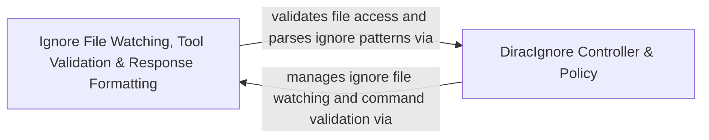

## Details

Enforces `.diracignore` file and command access policies, validates tool access, and formats tool execution responses.

### Ignore File Watching, Tool Validation & Response Formatting
Validates tool paths and command access, watches ignore files for changes, parses ignore patterns, and formats file lists and responses according to ignore rules.

**Related Classes/Methods**:

- `src.core.formatResponse.formatResponse.formatFilesList`:138-203
- `src.core.ignore.IgnoreFileWatcher.IgnoreFileWatcher`:10-69
- `src.core.ignore.IgnorePatternParser.parseIgnoreContent`:8-10
- `src.core.task.tools.ToolValidator.ToolValidator.checkDiracIgnorePath`:40-49

**Source Files:**

- `src/core/formatResponse.ts`
  - `src.core.formatResponse.formatResponse` (L10-L296) - Class
  - `src.core.formatResponse.formatResponse.duplicateFileReadNotice` (L11-L12) - Method
  - `src.core.formatResponse.formatResponse.contextTruncationNotice` (L14-L15) - Method
  - `src.core.formatResponse.formatResponse.processFirstUserMessageForTruncation` (L17-L19) - Method
  - `src.core.formatResponse.formatResponse.toolDenied` (L21-L21) - Method
  - `src.core.formatResponse.formatResponse.toolDeniedWithFeedback` (L23-L24) - Method
  - `src.core.formatResponse.formatResponse.toolError` (L26-L26) - Method
  - `src.core.formatResponse.formatResponse.toolTimeout` (L28-L29) - Method
  - `src.core.formatResponse.formatResponse.diracIgnoreError` (L31-L32) - Method
  - `src.core.formatResponse.formatResponse.pathConflictError` (L34-L35) - Method
  - `src.core.formatResponse.formatResponse.filePermissionError` (L37-L38) - Method
  - `src.core.formatResponse.formatResponse.readOnlyError` (L40-L40) - Method
  - `src.core.formatResponse.formatResponse.permissionDeniedError` (L42-L43) - Method
  - `src.core.formatResponse.formatResponse.noToolsUsed` (L45-L52) - Method
  - `src.core.formatResponse.formatResponse.tooManyMistakes` (L54-L55) - Method
  - `src.core.formatResponse.formatResponse.missingToolParameterError` (L57-L58) - Method
  - `src.core.formatResponse.formatResponse.writeToFileMissingContentError` (L65-L105) - Method
  - `src.core.formatResponse.formatResponse.toolResult` (L107-L132) - Method
  - `src.core.formatResponse.formatResponse.imageBlocks` (L134-L136) - Method
  - `src.core.formatResponse.formatResponse.formatFilesList` (L138-L203) - Method
  - `src.core.formatResponse.formatResponse.formatFilesList.pathMap` (L144-L144) - Class
  - `src.core.formatResponse.formatResponse.formatFilesList.pathMap.files.map() callback` (L144-L144) - Function
  - `src.core.formatResponse.formatResponse.formatFilesList.sorted` (L146-L171) - Class
  - `src.core.formatResponse.formatResponse.formatFilesList.sorted.files.sort() callback` (L146-L171) - Function
  - `src.core.formatResponse.formatResponse.formatFilesList.filtered` (L173-L173) - Class
  - `src.core.formatResponse.formatResponse.formatFilesList.filtered.sorted.filter() callback` (L173-L173) - Function
  - `src.core.formatResponse.formatResponse.formatFilesList.formatted` (L175-L183) - Class
  - `src.core.formatResponse.formatResponse.formatFilesList.formatted.filtered.map() callback` (L175-L183) - Function
  - `src.core.formatResponse.formatResponse.createPrettyPatch` (L205-L211) - Method
  - `src.core.formatResponse.formatResponse.taskResumption` (L213-L235) - Method
  - `src.core.formatResponse.formatResponse.planModeInstructions` (L237-L239) - Method
  - `src.core.formatResponse.formatResponse.fileEditWithUserChanges` (L241-L252) - Method
  - `src.core.formatResponse.formatResponse.fileEditWithoutUserChanges` (L254-L263) - Method
  - `src.core.formatResponse.formatResponse.diracIgnoreInstructions` (L265-L266) - Method
  - `src.core.formatResponse.formatResponse.diracRulesGlobalDirectoryInstructions` (L268-L269) - Method
  - `src.core.formatResponse.formatResponse.diracRulesLocalDirectoryInstructions` (L271-L272) - Method
  - `src.core.formatResponse.formatResponse.diracRulesLocalFileInstructions` (L274-L275) - Method
  - `src.core.formatResponse.formatResponse.windsurfRulesLocalFileInstructions` (L277-L278) - Method
  - `src.core.formatResponse.formatResponse.cursorRulesLocalFileInstructions` (L280-L281) - Method
  - `src.core.formatResponse.formatResponse.cursorRulesLocalDirectoryInstructions` (L283-L284) - Method
  - `src.core.formatResponse.formatResponse.agentsRulesLocalFileInstructions` (L286-L287) - Method
  - `src.core.formatResponse.formatResponse.fileContextWarning` (L289-L295) - Method
  - `src.core.formatResponse.formatResponse.fileContextWarning.editedFiles.map() callback` (L292-L292) - Function
  - `src.core.formatResponse.formatImagesIntoBlocks` (L299-L315) - Class
  - `src.core.formatResponse.formatImagesIntoBlocks.images.map() callback` (L301-L313) - Function
- `src/core/ignore/CommandAccessValidator.ts`
  - `src.core.ignore.CommandAccessValidator.findBlockedCommandArgument` (L24-L32) - Function
  - `src.core.ignore.CommandAccessValidator.findBlockedCommandArgument.find() callback` (L31-L31) - Function
  - `src.core.ignore.CommandAccessValidator.isFilePathArgument` (L38-L56) - Function
- `src/core/ignore/IgnoreFileWatcher.ts`
  - `src.core.ignore.IgnoreFileWatcher.IgnoreFileWatcher` (L10-L69) - Class
  - `src.core.ignore.IgnoreFileWatcher.IgnoreFileWatcher.constructor` (L15-L18) - Constructor
  - `src.core.ignore.IgnoreFileWatcher.IgnoreFileWatcher.start` (L20-L61) - Method
  - `src.core.ignore.IgnoreFileWatcher.IgnoreFileWatcher.start.reload` (L36-L45) - Class
  - `src.core.ignore.IgnoreFileWatcher.IgnoreFileWatcher.start.reload.catch() callback` (L39-L40) - Function
  - `src.core.ignore.IgnoreFileWatcher.IgnoreFileWatcher.start.watcher.on("error") callback` (L46-L53) - Function
  - `src.core.ignore.IgnoreFileWatcher.IgnoreFileWatcher.start.watcher.on("error") callback.catch() callback` (L52-L52) - Function
  - `src.core.ignore.IgnoreFileWatcher.IgnoreFileWatcher.dispose` (L63-L68) - Method
- `src/core/ignore/IgnorePatternParser.ts`
  - `src.core.ignore.IgnorePatternParser.parseIgnoreContent` (L8-L10) - Function
- `src/core/task/tools/ToolValidator.ts`
  - `src.core.task.tools.ToolValidator.ToolValidator` (L10-L50) - Class
  - `src.core.task.tools.ToolValidator.ToolValidator.constructor` (L11-L11) - Constructor
  - `src.core.task.tools.ToolValidator.ToolValidator.assertRequiredParams` (L17-L34) - Method
  - `src.core.task.tools.ToolValidator.ToolValidator.checkDiracIgnorePath` (L40-L49) - Method
- `src/services/glob/list-files.ts`
  - `src.services.glob.list-files.FileInfo` (L31-L36) - Interface
  - `src.services.glob.list-files.isRestrictedPath` (L39-L53) - Function
  - `src.services.glob.list-files.isTargetingHiddenDirectory` (L55-L58) - Function
  - `src.services.glob.list-files.buildIgnorePatterns` (L60-L77) - Function
  - `src.services.glob.list-files.buildIgnorePatterns.patterns.flatMap() callback` (L70-L76) - Function
  - `src.services.glob.list-files.listFiles` (L79-L166) - Function
  - `src.services.glob.list-files.listFiles.fileInfos` (L139-L163) - Class
  - `src.services.glob.list-files.listFiles.fileInfos.map() callback` (L140-L162) - Function
  - `src.services.glob.list-files.globbyLevelByLevel` (L180-L226) - Function
  - `src.services.glob.list-files.globbyLevelByLevel.timeoutPromise` (L216-L218) - Class
  - `src.services.glob.list-files.globbyLevelByLevel.timeoutPromise.<function>` (L216-L218) - Function
  - `src.services.glob.list-files.globbyLevelByLevel.timeoutPromise.<function>.setTimeout() callback` (L217-L217) - Function
- `src/utils/worktree-include.ts`
  - `src.utils.worktree-include.parseIgnoreFile` (L12-L22) - Function
  - `src.utils.worktree-include.parseIgnoreFile.map() callback` (L17-L17) - Function
  - `src.utils.worktree-include.parseIgnoreFile.filter() callback` (L18-L18) - Function
  - `src.utils.worktree-include.isDirectoryPattern` (L27-L48) - Function
  - `src.utils.worktree-include.copyDirectoryNative` (L53-L59) - Function
  - `src.utils.worktree-include.getAllFiles` (L64-L87) - Function
  - `src.utils.worktree-include.getAllFiles.results` (L68-L80) - Class
  - `src.utils.worktree-include.getAllFiles.results.entries.map() callback` (L69-L79) - Function
  - `src.utils.worktree-include.copyFilesInBatches` (L92-L128) - Function
  - `src.utils.worktree-include.copyFilesInBatches.results` (L104-L116) - Class
  - `src.utils.worktree-include.copyFilesInBatches.results.batch.map() callback` (L105-L115) - Function
  - `src.utils.worktree-include.copyWorktreeIncludeFiles` (L140-L230) - Function
  - `src.utils.worktree-include.copyWorktreeIncludeFiles.filesToCopy` (L211-L220) - Class
  - `src.utils.worktree-include.copyWorktreeIncludeFiles.filesToCopy.allFiles.filter() callback` (L211-L220) - Function
  - `src.utils.worktree-include.hasWorktreeInclude` (L235-L242) - Function

### DiracIgnore Controller & Policy
Manages `.diracignore` lifecycle and enforces ignore policy rules and file access validation across workspace paths.

**Related Classes/Methods**:

- `src.core.ignore.DiracIgnoreController.DiracIgnoreController`:17-76
- `src.core.ignore.DiracIgnoreController.DiracIgnoreController.validateAccess`:47-54
- `src.shared.ignore.DiracIgnorePolicy.parseDiracIgnoreContent`:127-135

**Source Files:**

- `src/core/ignore/DiracIgnoreController.ts`
  - `src.core.ignore.DiracIgnoreController.DiracIgnoreController` (L17-L76) - Class
  - `src.core.ignore.DiracIgnoreController.DiracIgnoreController.constructor` (L24-L28) - Constructor
  - `src.core.ignore.DiracIgnoreController.DiracIgnoreController.initialize` (L31-L34) - Method
  - `src.core.ignore.DiracIgnoreController.DiracIgnoreController.initialize.fileWatcher.start() callback` (L32-L32) - Function
  - `src.core.ignore.DiracIgnoreController.DiracIgnoreController.loadDiracIgnore` (L37-L44) - Method
  - `src.core.ignore.DiracIgnoreController.DiracIgnoreController.validateAccess` (L47-L54) - Method
  - `src.core.ignore.DiracIgnoreController.DiracIgnoreController.validateCommand` (L57-L60) - Method
  - `src.core.ignore.DiracIgnoreController.DiracIgnoreController.validateCommand.findBlockedCommandArgument() callback` (L59-L59) - Function
  - `src.core.ignore.DiracIgnoreController.DiracIgnoreController.filterPaths` (L63-L70) - Method
  - `src.core.ignore.DiracIgnoreController.DiracIgnoreController.filterPaths.paths.filter() callback` (L65-L65) - Function
  - `src.core.ignore.DiracIgnoreController.DiracIgnoreController.dispose` (L72-L75) - Method
- `src/shared/ignore/DiracIgnorePolicy.ts`
  - `src.shared.ignore.DiracIgnorePolicy.ParsedDiracIgnoreContent` (L117-L120) - Interface
  - `src.shared.ignore.DiracIgnorePolicy.ResolvedIgnoreLine` (L122-L125) - Interface
  - `src.shared.ignore.DiracIgnorePolicy.parseDiracIgnoreContent` (L127-L135) - Function
  - `src.shared.ignore.DiracIgnorePolicy.parseDiracIgnoreContent.resolvedLines` (L130-L130) - Class
  - `src.shared.ignore.DiracIgnorePolicy.parseDiracIgnoreContent.resolvedLines.map() callback` (L130-L130) - Function
  - `src.shared.ignore.DiracIgnorePolicy.parseDiracIgnoreContent.content.resolvedLines.map() callback` (L132-L132) - Function
  - `src.shared.ignore.DiracIgnorePolicy.parseDiracIgnoreContent.includedPaths.resolvedLines.flatMap() callback` (L133-L133) - Function
  - `src.shared.ignore.DiracIgnorePolicy.resolveIgnoreLine` (L137-L150) - Function
  - `src.shared.ignore.DiracIgnorePolicy.DiracIgnorePolicy` (L152-L204) - Class
  - `src.shared.ignore.DiracIgnorePolicy.DiracIgnorePolicy.constructor` (L157-L159) - Constructor
  - `src.shared.ignore.DiracIgnorePolicy.DiracIgnorePolicy.content` (L161-L163) - Method
  - `src.shared.ignore.DiracIgnorePolicy.DiracIgnorePolicy.reload` (L165-L184) - Method
  - `src.shared.ignore.DiracIgnorePolicy.DiracIgnorePolicy.allowsRelativePath` (L186-L191) - Method
  - `src.shared.ignore.DiracIgnorePolicy.DiracIgnorePolicy.allowsAbsolutePath` (L193-L195) - Method
  - `src.shared.ignore.DiracIgnorePolicy.DiracIgnorePolicy.isControlPath` (L197-L199) - Method
  - `src.shared.ignore.DiracIgnorePolicy.DiracIgnorePolicy.getControlPaths` (L201-L203) - Method
  - `src.shared.ignore.DiracIgnorePolicy.createMatcher` (L206-L208) - Function

### [FAQ](https://github.com/CodeBoarding/GeneratedOnBoardings/tree/main?tab=readme-ov-file#faq)