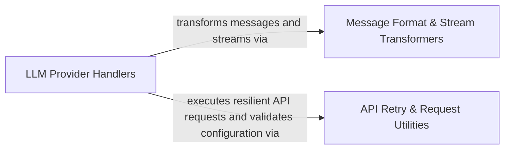

## Details

Integrates LLM API providers, message stream adapters, format transformers, and request retry policies.

### LLM Provider Handlers
Implements provider-specific LLM API client handlers, model selection, and streaming message generation across supported backends.

**Related Classes/Methods**:

- `src.core.api.providers.anthropic.AnthropicHandler.createMessage`:81-171
- `src.core.api.providers.aihubmix.AIhubmixHandler.createMessage`:128-148
- `src.core.api.providers.bedrock.AwsBedrockHandler.createMessageWithSignal`:106-151
- `src.core.api.providers.baseten.BasetenHandler.createMessage`:105-159

**Source Files:**

- `src/core/api/modelProviderSelection.ts`
  - `src.core.api.modelProviderSelection.modelProviderSelectionUpdates` (L45-L86) - Function
- `src/core/api/providers/aihubmix.ts`
  - `src.core.api.providers.aihubmix.AIhubmixHandlerOptions` (L15-L22) - Interface
  - `src.core.api.providers.aihubmix.AIhubmixHandler` (L24-L331) - Class
  - `src.core.api.providers.aihubmix.AIhubmixHandler.constructor` (L30-L37) - Constructor
  - `src.core.api.providers.aihubmix.AIhubmixHandler.ensureAnthropicClient` (L39-L58) - Method
  - `src.core.api.providers.aihubmix.AIhubmixHandler.ensureOpenaiClient` (L60-L79) - Method
  - `src.core.api.providers.aihubmix.AIhubmixHandler.ensureGeminiClient` (L81-L104) - Method
  - `src.core.api.providers.aihubmix.AIhubmixHandler.routeModel` (L106-L118) - Method
  - `src.core.api.providers.aihubmix.AIhubmixHandler.fixToolChoice` (L120-L125) - Method
  - `src.core.api.providers.aihubmix.AIhubmixHandler.createMessage` (L128-L148) - Method
  - `src.core.api.providers.aihubmix.AIhubmixHandler.createAnthropicMessage` (L150-L203) - Method
  - `src.core.api.providers.aihubmix.AIhubmixHandler.createOpenaiResponseMessage` (L205-L248) - Method
  - `src.core.api.providers.aihubmix.AIhubmixHandler.createOpenaiResponseMessage.input` (L209-L222) - Class
  - `src.core.api.providers.aihubmix.AIhubmixHandler.createOpenaiResponseMessage.input.map() callback` (L209-L222) - Function
  - `src.core.api.providers.aihubmix.createOpenaiResponseMessage.input.map() callback.content` (L212-L220) - Class
  - `src.core.api.providers.aihubmix.AIhubmixHandler.createOpenaiResponseMessage.input.map() callback.content.contentArray.filter() callback` (L213-L213) - Function
  - `src.core.api.providers.aihubmix.AIhubmixHandler.createOpenaiResponseMessage.input.map() callback.content.map() callback` (L214-L220) - Function
  - `src.core.api.providers.aihubmix.AIhubmixHandler.createOpenaiMessage` (L250-L287) - Method
  - `src.core.api.providers.aihubmix.AIhubmixHandler.createGeminiMessage` (L289-L319) - Method
  - `src.core.api.providers.aihubmix.AIhubmixHandler.requireModelId` (L321-L326) - Method
  - `src.core.api.providers.aihubmix.AIhubmixHandler.getModel` (L328-L330) - Method
- `src/core/api/providers/anthropic.ts`
  - `src.core.api.providers.anthropic.AnthropicHandlerOptions` (L32-L39) - Interface
  - `src.core.api.providers.anthropic.AnthropicHandler` (L41-L301) - Class
  - `src.core.api.providers.anthropic.AnthropicHandler.constructor` (L46-L48) - Constructor
  - `src.core.api.providers.anthropic.AnthropicHandler.shouldUseFastMode` (L50-L56) - Method
  - `src.core.api.providers.anthropic.AnthropicHandler.ensureClient` (L58-L78) - Method
  - `src.core.api.providers.anthropic.AnthropicHandler.createMessage` (L81-L171) - Method
  - `src.core.api.providers.anthropic.AnthropicHandler.parseAnthropicChunk` (L173-L201) - Method
  - `src.core.api.providers.anthropic.AnthropicHandler.parseAnthropicMessageStart` (L203-L215) - Method
  - `src.core.api.providers.anthropic.AnthropicHandler.parseAnthropicContentBlockStart` (L217-L251) - Method
  - `src.core.api.providers.anthropic.AnthropicHandler.parseAnthropicContentBlockDelta` (L253-L284) - Method
  - `src.core.api.providers.anthropic.AnthropicHandler.getModel` (L286-L300) - Method
- `src/core/api/providers/baseten.ts`
  - `src.core.api.providers.baseten.BasetenHandlerOptions` (L14-L19) - Interface
  - `src.core.api.providers.baseten.BasetenHandler` (L21-L172) - Class
  - `src.core.api.providers.baseten.BasetenHandler.constructor` (L25-L27) - Constructor
  - `src.core.api.providers.baseten.BasetenHandler.ensureClient` (L29-L46) - Method
  - `src.core.api.providers.baseten.BasetenHandler.getOptimalMaxTokens` (L51-L59) - Method
  - `src.core.api.providers.baseten.BasetenHandler.getModel` (L61-L87) - Method
  - `src.core.api.providers.baseten.BasetenHandler.yieldUsage` (L89-L102) - Method
  - `src.core.api.providers.baseten.BasetenHandler.createMessage` (L105-L159) - Method
  - `src.core.api.providers.baseten.BasetenHandler.supportsTools` (L164-L171) - Method
- `src/core/api/providers/bedrock-client.ts`
  - `src.core.api.providers.bedrock-client.AwsBedrockClientOptions` (L9-L19) - Interface
  - `src.core.api.providers.bedrock-client.resolveRegion` (L29-L31) - Function
  - `src.core.api.providers.bedrock-client.resolveAwsCredentials` (L34-L57) - Function
  - `src.core.api.providers.bedrock-client.createBedrockClient` (L59-L82) - Function
- `src/core/api/providers/bedrock-converse-utils.ts`
  - `src.core.api.providers.bedrock-converse-utils.estimateTokenCount` (L28-L30) - Function
  - `src.core.api.providers.bedrock-converse-utils.extractNonStreamingContent` (L33-L44) - Function
  - `src.core.api.providers.bedrock-converse-utils.formatConverseError` (L47-L53) - Function
  - `src.core.api.providers.bedrock-converse-utils.prepareSystemMessages` (L56-L64) - Function
  - `src.core.api.providers.bedrock-converse-utils.chunkText` (L69-L75) - Function
  - `src.core.api.providers.bedrock-converse-utils.mapDiracToolsToBedrockToolConfig` (L81-L103) - Function
  - `src.core.api.providers.bedrock-converse-utils.mapDiracToolsToBedrockToolConfig.bedrockTools` (L86-L93) - Class
  - `src.core.api.providers.bedrock-converse-utils.mapDiracToolsToBedrockToolConfig.bedrockTools.map() callback` (L86-L93) - Function
  - `src.core.api.providers.bedrock-converse-utils.processImageContent` (L106-L126) - Function
  - `src.core.api.providers.bedrock-converse-utils.applyCacheControlToMessages` (L132-L143) - Function
  - `src.core.api.providers.bedrock-converse-utils.applyCacheControlToMessages.messages.map() callback` (L137-L142) - Function
  - `src.core.api.providers.bedrock-converse-utils.appendCachePoint` (L145-L150) - Function
  - `src.core.api.providers.bedrock-converse-utils.formatMessagesForConverseAPI` (L153-L167) - Function
  - `src.core.api.providers.bedrock-converse-utils.formatMessagesForConverseAPI.messages.map() callback` (L154-L166) - Function
  - `src.core.api.providers.bedrock-converse-utils.formatMessagesForConverseAPI.messages.map() callback.message.content.map() callback` (L162-L162) - Function
  - `src.core.api.providers.bedrock-converse-utils.formatMessagesForConverseAPI.messages.map() callback.filter() callback` (L163-L163) - Function
  - `src.core.api.providers.bedrock-converse-utils.mapMessageContentBlock` (L169-L188) - Function
  - `src.core.api.providers.bedrock-converse-utils.mapToolResultContent` (L191-L200) - Function
  - `src.core.api.providers.bedrock-converse-utils.mapToolResultContent.content.flatMap() callback` (L197-L197) - Function
  - `src.core.api.providers.bedrock-converse-utils.mapToolResultContentBlock` (L202-L211) - Function
  - `src.core.api.providers.bedrock-converse-utils.getInferenceConfig` (L214-L230) - Function
- `src/core/api/providers/bedrock-stream-parser.ts`
  - `src.core.api.providers.bedrock-stream-parser.ThinkingResponseFields` (L15-L17) - Interface
  - `src.core.api.providers.bedrock-stream-parser.ReasoningStartFields` (L25-L29) - Interface
  - `src.core.api.providers.bedrock-stream-parser.ReasoningDeltaFields` (L32-L39) - Interface
  - `src.core.api.providers.bedrock-stream-parser.BedrockStreamParser` (L41-L203) - Class
  - `src.core.api.providers.bedrock-stream-parser.BedrockStreamParser.parseChunk` (L45-L51) - Method
  - `src.core.api.providers.bedrock-stream-parser.BedrockStreamParser.handleMetadata` (L53-L58) - Method
  - `src.core.api.providers.bedrock-stream-parser.BedrockStreamParser.parseThinkingResponse` (L60-L67) - Method
  - `src.core.api.providers.bedrock-stream-parser.BedrockStreamParser.buildUsageChunk` (L69-L82) - Method
  - `src.core.api.providers.bedrock-stream-parser.BedrockStreamParser.handleContentBlockStart` (L84-L94) - Method
  - `src.core.api.providers.bedrock-stream-parser.BedrockStreamParser.blockStartType` (L101-L106) - Method
  - `src.core.api.providers.bedrock-stream-parser.BedrockStreamParser.handleThinkingBlockStart` (L108-L119) - Method
  - `src.core.api.providers.bedrock-stream-parser.BedrockStreamParser.handleRedactedThinkingBlockStart` (L121-L128) - Method
  - `src.core.api.providers.bedrock-stream-parser.BedrockStreamParser.handleContentBlockDelta` (L130-L136) - Method
  - `src.core.api.providers.bedrock-stream-parser.BedrockStreamParser.parseDelta` (L138-L159) - Method
  - `src.core.api.providers.bedrock-stream-parser.BedrockStreamParser.parseToolUseDelta` (L161-L171) - Method
  - `src.core.api.providers.bedrock-stream-parser.BedrockStreamParser.parseTextDelta` (L173-L177) - Method
  - `src.core.api.providers.bedrock-stream-parser.BedrockStreamParser.handleContentBlockStop` (L179-L185) - Method
  - `src.core.api.providers.bedrock-stream-parser.BedrockStreamParser.handleStreamError` (L187-L202) - Method
  - `src.core.api.providers.bedrock-stream-parser.ContentBlockStartFields` (L206-L213) - Interface
- `src/core/api/providers/bedrock.ts`
  - `src.core.api.providers.bedrock.AwsBedrockHandlerOptions` (L44-L62) - Interface
  - `src.core.api.providers.bedrock.BedrockMessageConfig` (L64-L71) - Interface
  - `src.core.api.providers.bedrock.AwsBedrockHandler` (L87-L630) - Class
  - `src.core.api.providers.bedrock.AwsBedrockHandler.constructor` (L91-L93) - Constructor
  - `src.core.api.providers.bedrock.AwsBedrockHandler.createMessage` (L95-L103) - Method
  - `src.core.api.providers.bedrock.AwsBedrockHandler.createMessageWithSignal` (L106-L151) - Method
  - `src.core.api.providers.bedrock.AwsBedrockHandler.abort` (L153-L155) - Method
  - `src.core.api.providers.bedrock.AwsBedrockHandler.getModel` (L157-L198) - Method
  - `src.core.api.providers.bedrock.AwsBedrockHandler.getRegion` (L206-L208) - Method
  - `src.core.api.providers.bedrock.AwsBedrockHandler.getAwsCredentials` (L211-L213) - Method
  - `src.core.api.providers.bedrock.AwsBedrockHandler.getBedrockClient` (L215-L217) - Method
  - `src.core.api.providers.bedrock.AwsBedrockHandler.getModelId` (L223-L245) - Method
  - `src.core.api.providers.bedrock.AwsBedrockHandler.createDeepseekMessage` (L252-L384) - Method
  - `src.core.api.providers.bedrock.AwsBedrockHandler.formatDeepseekR1Prompt` (L391-L421) - Method
  - `src.core.api.providers.bedrock.AwsBedrockHandler.formatDeepseekR1Prompt.message.content.filter() callback` (L410-L410) - Function
  - `src.core.api.providers.bedrock.AwsBedrockHandler.formatDeepseekR1Prompt.map() callback` (L411-L411) - Function
  - `src.core.api.providers.bedrock.AwsBedrockHandler.estimateInputTokens` (L427-L432) - Method
  - `src.core.api.providers.bedrock.AwsBedrockHandler.executeConverseStream` (L448-L465) - Method
  - `src.core.api.providers.bedrock.AwsBedrockHandler.prepareConverseInputs` (L471-L494) - Method
  - `src.core.api.providers.bedrock.AwsBedrockHandler.prepareConverseInputs.messages.forEach() callback` (L482-L484) - Function
  - `src.core.api.providers.bedrock.AwsBedrockHandler.createAnthropicMessage` (L500-L535) - Method
  - `src.core.api.providers.bedrock.AwsBedrockHandler.createNovaMessage` (L541-L557) - Method
  - `src.core.api.providers.bedrock.AwsBedrockHandler.createOpenAIMessage` (L563-L565) - Method
  - `src.core.api.providers.bedrock.AwsBedrockHandler.createQwenMessage` (L571-L573) - Method
  - `src.core.api.providers.bedrock.AwsBedrockHandler.createNonStreamingConverseMessage` (L578-L629) - Method
- `src/core/api/providers/cerebras.ts`
  - `src.core.api.providers.cerebras.CerebrasHandlerOptions` (L19-L22) - Interface
  - `src.core.api.providers.cerebras.CerebrasHandler` (L30-L234) - Class
  - `src.core.api.providers.cerebras.CerebrasHandler.constructor` (L34-L36) - Constructor
  - `src.core.api.providers.cerebras.CerebrasHandler.ensureClient` (L38-L63) - Method
  - `src.core.api.providers.cerebras.CerebrasHandler.createMessage` (L70-L159) - Method
  - `src.core.api.providers.cerebras.CerebrasHandler.parseCerebrasReasoningContent` (L163-L177) - Method
  - `src.core.api.providers.cerebras.CerebrasHandler.getModel` (L179-L195) - Method
  - `src.core.api.providers.cerebras.CerebrasHandler.getRateLimits` (L206-L222) - Method
  - `src.core.api.providers.cerebras.CerebrasHandler.calculateCost` (L224-L233) - Method
- `src/core/api/providers/claude-code.ts`
  - `src.core.api.providers.claude-code.ClaudeCodeHandlerOptions` (L15-L19) - Interface
  - `src.core.api.providers.claude-code.ClaudeCodeHandler` (L21-L181) - Class
  - `src.core.api.providers.claude-code.ClaudeCodeHandler.constructor` (L24-L26) - Constructor
  - `src.core.api.providers.claude-code.ClaudeCodeHandler.createMessage` (L33-L89) - Method
  - `src.core.api.providers.claude-code.ClaudeCodeHandler.checkAssistantError` (L92-L107) - Method
  - `src.core.api.providers.claude-code.ClaudeCodeHandler.yieldAssistantContent` (L110-L127) - Method
  - `src.core.api.providers.claude-code.ClaudeCodeHandler.yieldToolUse` (L130-L159) - Method
  - `src.core.api.providers.claude-code.ClaudeCodeHandler.attemptParse` (L161-L167) - Method
  - `src.core.api.providers.claude-code.ClaudeCodeHandler.getModel` (L169-L180) - Method
- `src/core/api/providers/deepseek.ts`
  - `src.core.api.providers.deepseek.DeepSeekHandlerOptions` (L17-L21) - Interface
  - `src.core.api.providers.deepseek.DeepSeekHandler` (L23-L192) - Class
  - `src.core.api.providers.deepseek.DeepSeekHandler.constructor` (L28-L30) - Constructor
  - `src.core.api.providers.deepseek.DeepSeekHandler.ensureClient` (L32-L49) - Method
  - `src.core.api.providers.deepseek.DeepSeekHandler.yieldUsage` (L51-L54) - Method
  - `src.core.api.providers.deepseek.DeepSeekHandler.createMessage` (L56-L64) - Method
  - `src.core.api.providers.deepseek.DeepSeekHandler.createMessageWithRetry` (L67-L175) - Method
  - `src.core.api.providers.deepseek.DeepSeekHandler.createMessageWithRetry.deepSeekMessages` (L96-L105) - Class
  - `src.core.api.providers.deepseek.DeepSeekHandler.createMessageWithRetry.deepSeekMessages.openAiMessages.map() callback` (L96-L105) - Function
  - `src.core.api.providers.deepseek.DeepSeekHandler.createMessageWithRetry.deepSeekTools` (L107-L118) - Class
  - `src.core.api.providers.deepseek.DeepSeekHandler.createMessageWithRetry.deepSeekTools.tools.map() callback` (L107-L118) - Function
  - `src.core.api.providers.deepseek.DeepSeekHandler.abort` (L177-L179) - Method
  - `src.core.api.providers.deepseek.DeepSeekHandler.getModel` (L181-L191) - Method
- `src/core/api/providers/dify.ts`
  - `src.core.api.providers.dify.DifyHandlerOptions` (L9-L12) - Interface
  - `src.core.api.providers.dify.DifyRequestFile` (L14-L19) - Interface
  - `src.core.api.providers.dify.DifyMessageInput` (L21-L24) - Interface
  - `src.core.api.providers.dify.DifyFileResponse` (L27-L35) - Interface
  - `src.core.api.providers.dify.DifyMessage` (L37-L54) - Interface
  - `src.core.api.providers.dify.DifyHistoryResponse` (L56-L60) - Interface
  - `src.core.api.providers.dify.DifyConversation` (L62-L70) - Interface
  - `src.core.api.providers.dify.DifyConversationsResponse` (L72-L76) - Interface
  - `src.core.api.providers.dify.DifyConversationResponse` (L78-L86) - Interface
  - `src.core.api.providers.dify.DifyHandler` (L88-L626) - Class
  - `src.core.api.providers.dify.DifyHandler.constructor` (L96-L107) - Constructor
  - `src.core.api.providers.dify.DifyHandler.createMessage` (L109-L212) - Method
  - `src.core.api.providers.dify.DifyHandler.createMessage.response.headers.forEach() callback` (L137-L139) - Function
  - `src.core.api.providers.dify.DifyHandler.parseDifySseEvent` (L215-L264) - Method
  - `src.core.api.providers.dify.DifyHandler.parseDifyDirectJson` (L267-L294) - Method
  - `src.core.api.providers.dify.DifyHandler.convertMessagesToInput` (L296-L315) - Method
  - `src.core.api.providers.dify.DifyHandler.convertMessagesToInput.lastUserMessage` (L297-L297) - Class
  - `src.core.api.providers.dify.DifyHandler.convertMessagesToInput.lastUserMessage.messages.filter() callback` (L297-L297) - Function
  - `src.core.api.providers.dify.DifyHandler.collectMessageContent` (L317-L352) - Method
  - `src.core.api.providers.dify.DifyHandler.convertImageToDifyFile` (L354-L369) - Method
  - `src.core.api.providers.dify.DifyHandler.getModel` (L371-L384) - Method
  - `src.core.api.providers.dify.DifyHandler.uploadFile` (L395-L413) - Method
  - `src.core.api.providers.dify.DifyHandler.stopGeneration` (L421-L432) - Method
  - `src.core.api.providers.dify.DifyHandler.getConversationHistory` (L442-L463) - Method
  - `src.core.api.providers.dify.DifyHandler.getConversations` (L473-L498) - Method
  - `src.core.api.providers.dify.DifyHandler.deleteConversation` (L506-L517) - Method
  - `src.core.api.providers.dify.DifyHandler.renameConversation` (L527-L550) - Method
  - `src.core.api.providers.dify.DifyHandler.submitMessageFeedback` (L560-L581) - Method
  - `src.core.api.providers.dify.DifyHandler.getCurrentConversationId` (L587-L589) - Method
  - `src.core.api.providers.dify.DifyHandler.setConversationId` (L595-L597) - Method
  - `src.core.api.providers.dify.DifyHandler.resetConversation` (L602-L605) - Method
  - `src.core.api.providers.dify.DifyHandler.abort` (L607-L610) - Method
  - `src.core.api.providers.dify.DifyHandler.jsonHeaders` (L612-L617) - Method
  - `src.core.api.providers.dify.DifyHandler.headers` (L619-L625) - Method
- `src/core/api/providers/doubao.ts`
  - `src.core.api.providers.doubao.DoubaoHandlerOptions` (L12-L15) - Interface
  - `src.core.api.providers.doubao.DoubaoHandler` (L17-L100) - Class
  - `src.core.api.providers.doubao.DoubaoHandler.constructor` (L20-L22) - Constructor
  - `src.core.api.providers.doubao.DoubaoHandler.ensureClient` (L24-L39) - Method
  - `src.core.api.providers.doubao.DoubaoHandler.getModel` (L41-L51) - Method
  - `src.core.api.providers.doubao.DoubaoHandler.createMessage` (L54-L99) - Method
- `src/core/api/providers/fireworks.ts`
  - `src.core.api.providers.fireworks.FireworksHandlerOptions` (L14-L19) - Interface
  - `src.core.api.providers.fireworks.FireworksHandler` (L21-L116) - Class
  - `src.core.api.providers.fireworks.FireworksHandler.constructor` (L25-L27) - Constructor
  - `src.core.api.providers.fireworks.FireworksHandler.ensureClient` (L29-L44) - Method
  - `src.core.api.providers.fireworks.FireworksHandler.createMessage` (L47-L103) - Method
  - `src.core.api.providers.fireworks.FireworksHandler.getModel` (L105-L115) - Method
- `src/core/api/providers/gemini.ts`
  - `src.core.api.providers.gemini.GeminiHandlerOptions` (L25-L37) - Interface
  - `src.core.api.providers.gemini.mapReasoningEffortToGeminiThinkingLevel` (L39-L53) - Function
  - `src.core.api.providers.gemini.getGeminiMaxOutputTokens` (L55-L61) - Function
  - `src.core.api.providers.gemini.GeminiHandler` (L83-L647) - Class
  - `src.core.api.providers.gemini.GeminiHandler.constructor` (L88-L91) - Constructor
  - `src.core.api.providers.gemini.GeminiHandler.ensureClient` (L93-L139) - Method
  - `src.core.api.providers.gemini.GeminiHandler.createMessage` (L151-L161) - Method
  - `src.core.api.providers.gemini.GeminiHandler.createMessageWithSignal` (L168-L421) - Method
  - `src.core.api.providers.gemini.GeminiHandler.createMessageWithSignal.tools.requestConfig.tools.map() callback` (L267-L267) - Function
  - `src.core.api.providers.gemini.GeminiHandler.createMessageWithSignal.lastGroundingMetadata.groundingChunks.forEach() callback` (L337-L341) - Function
  - `src.core.api.providers.gemini.GeminiHandler.createMessageWithSignal.detail` (L366-L368) - Class
  - `src.core.api.providers.gemini.GeminiHandler.createMessageWithSignal.detail.responseBody.error.details.find() callback` (L367-L367) - Function
  - `src.core.api.providers.gemini.GeminiHandler.createMessageWithSignal.isRateLimit` (L386-L386) - Class
  - `src.core.api.providers.gemini.GeminiHandler.createMessageWithSignal.isRateLimit.rateLimitPatterns.some() callback` (L386-L386) - Function
  - `src.core.api.providers.gemini.GeminiHandler.abort` (L423-L425) - Method
  - `src.core.api.providers.gemini.GeminiHandler.parseGeminiPart` (L428-L457) - Method
  - `src.core.api.providers.gemini.GeminiHandler.nextToolCallId` (L460-L464) - Method
  - `src.core.api.providers.gemini.GeminiHandler.calculateCost` (L476-L539) - Method
  - `src.core.api.providers.gemini.GeminiHandler.calculateCost.tier` (L501-L501) - Class
  - `src.core.api.providers.gemini.GeminiHandler.calculateCost.tier.info.tiers.find() callback` (L501-L501) - Function
  - `src.core.api.providers.gemini.GeminiHandler.getModel` (L544-L554) - Method
  - `src.core.api.providers.gemini.GeminiHandler.countTokens` (L559-L588) - Method
  - `src.core.api.providers.gemini.GeminiHandler.countTokens.geminiContent` (L565-L570) - Class
  - `src.core.api.providers.gemini.GeminiHandler.countTokens.geminiContent.content.map() callback` (L565-L570) - Function
  - `src.core.api.providers.gemini.GeminiHandler.estimateTokens` (L593-L613) - Method
  - `src.core.api.providers.gemini.GeminiHandler.estimateTokens.totalChars` (L595-L610) - Class
  - `src.core.api.providers.gemini.GeminiHandler.estimateTokens.totalChars.content.reduce() callback` (L595-L610) - Function
  - `src.core.api.providers.gemini.GeminiHandler.parseRetryDelay` (L615-L638) - Method
  - `src.core.api.providers.gemini.GeminiHandler.attemptParse` (L640-L646) - Method
- `src/core/api/providers/github-copilot.ts`
  - `src.core.api.providers.github-copilot.GithubCopilotHandler` (L24-L215) - Class
  - `src.core.api.providers.github-copilot.GithubCopilotHandler.constructor` (L28-L31) - Constructor
  - `src.core.api.providers.github-copilot.GithubCopilotHandler.createMessage` (L33-L110) - Method
  - `src.core.api.providers.github-copilot.GithubCopilotHandler.createMessage.models.find() callback` (L44-L44) - Function
  - `src.core.api.providers.github-copilot.GithubCopilotHandler.createMessage.anthropicTools` (L59-L68) - Class
  - `src.core.api.providers.github-copilot.GithubCopilotHandler.createMessage.anthropicTools.map() callback` (L60-L67) - Function
  - `src.core.api.providers.github-copilot.GithubCopilotHandler.createMessage.messages.messages.map() callback` (L75-L75) - Function
  - `src.core.api.providers.github-copilot.GithubCopilotHandler.parseAnthropicStreamEvent` (L113-L153) - Method
  - `src.core.api.providers.github-copilot.GithubCopilotHandler.parseOpenAiStreamEvent` (L156-L162) - Method
  - `src.core.api.providers.github-copilot.GithubCopilotHandler.handleStream` (L164-L204) - Method
  - `src.core.api.providers.github-copilot.GithubCopilotHandler.getModel` (L206-L214) - Method
- `src/core/api/providers/groq.ts`
  - `src.core.api.providers.groq.GroqHandlerOptions` (L15-L20) - Interface
  - `src.core.api.providers.groq.GroqUsage` (L23-L27) - Interface
  - `src.core.api.providers.groq.GroqModelFamily` (L30-L40) - Interface
  - `src.core.api.providers.groq.GroqHandler` (L91-L322) - Class
  - `src.core.api.providers.groq.GroqHandler.constructor` (L95-L97) - Constructor
  - `src.core.api.providers.groq.GroqHandler.ensureClient` (L99-L116) - Method
  - `src.core.api.providers.groq.GroqHandler.yieldUsage` (L118-L141) - Method
  - `src.core.api.providers.groq.GroqHandler.detectModelFamily` (L146-L177) - Method
  - `src.core.api.providers.groq.GroqHandler.getOptimalMaxTokens` (L182-L195) - Method
  - `src.core.api.providers.groq.GroqHandler.createMessage` (L198-L265) - Method
  - `src.core.api.providers.groq.GroqHandler.supportsImages` (L270-L273) - Method
  - `src.core.api.providers.groq.GroqHandler.supportsTools` (L278-L282) - Method
  - `src.core.api.providers.groq.GroqHandler.getModel` (L287-L313) - Method
  - `src.core.api.providers.groq.GroqHandler.getModelFamily` (L318-L321) - Method
- `src/core/api/providers/huawei-cloud-maas.ts`
  - `src.core.api.providers.huawei-cloud-maas.HuaweiCloudMaaSHandlerOptions` (L12-L16) - Interface
  - `src.core.api.providers.huawei-cloud-maas.HuaweiCloudMaaSHandler` (L18-L142) - Class
  - `src.core.api.providers.huawei-cloud-maas.HuaweiCloudMaaSHandler.constructor` (L21-L23) - Constructor
  - `src.core.api.providers.huawei-cloud-maas.HuaweiCloudMaaSHandler.ensureClient` (L25-L40) - Method
  - `src.core.api.providers.huawei-cloud-maas.HuaweiCloudMaaSHandler.getModel` (L42-L61) - Method
  - `src.core.api.providers.huawei-cloud-maas.HuaweiCloudMaaSHandler.createMessage` (L64-L141) - Method
- `src/core/api/providers/huggingface.ts`
  - `src.core.api.providers.huggingface.HuggingFaceHandlerOptions` (L13-L17) - Interface
  - `src.core.api.providers.huggingface.HuggingFaceHandler` (L19-L111) - Class
  - `src.core.api.providers.huggingface.HuggingFaceHandler.constructor` (L24-L26) - Constructor
  - `src.core.api.providers.huggingface.HuggingFaceHandler.ensureClient` (L28-L44) - Method
  - `src.core.api.providers.huggingface.HuggingFaceHandler.yieldUsage` (L46-L65) - Method
  - `src.core.api.providers.huggingface.HuggingFaceHandler.createMessage` (L68-L96) - Method
  - `src.core.api.providers.huggingface.HuggingFaceHandler.getModel` (L98-L110) - Method
- `src/core/api/providers/litellm.ts`
  - `src.core.api.providers.litellm.LiteLlmHandlerOptions` (L18-L26) - Interface
  - `src.core.api.providers.litellm.LiteLlmChatCompletionCreateParams` (L32-L34) - Interface
  - `src.core.api.providers.litellm.LiteLlmModelInfoResponse` (L36-L52) - Interface
  - `src.core.api.providers.litellm.fetchLiteLlmModelsInfo` (L60-L100) - Function
  - `src.core.api.providers.litellm.LiteLlmHandler` (L102-L382) - Class
  - `src.core.api.providers.litellm.LiteLlmHandler.constructor` (L109-L111) - Constructor
  - `src.core.api.providers.litellm.LiteLlmHandler.ensureClient` (L113-L128) - Method
  - `src.core.api.providers.litellm.LiteLlmHandler.modelInfo` (L130-L138) - Method
  - `src.core.api.providers.litellm.LiteLlmHandler.modelInfo.modelInfo.data.find() callback` (L137-L137) - Function
  - `src.core.api.providers.litellm.LiteLlmHandler.fetchModelsInfo` (L140-L156) - Method
  - `src.core.api.providers.litellm.LiteLlmHandler.getModelCostInfo` (L158-L184) - Method
  - `src.core.api.providers.litellm.LiteLlmHandler.calculateCost` (L186-L210) - Method
  - `src.core.api.providers.litellm.LiteLlmHandler.createMessage` (L213-L320) - Method
  - `src.core.api.providers.litellm.LiteLlmHandler.createMessage.userMsgIndices` (L254-L257) - Class
  - `src.core.api.providers.litellm.LiteLlmHandler.createMessage.userMsgIndices.formattedMessages.reduce() callback` (L255-L255) - Function
  - `src.core.api.providers.litellm.LiteLlmHandler.createMessage.enhancedMessages` (L263-L299) - Class
  - `src.core.api.providers.litellm.LiteLlmHandler.createMessage.enhancedMessages.formattedMessages.map() callback` (L263-L299) - Function
  - `src.core.api.providers.litellm.LiteLlmHandler.createMessage.enhancedMessages.formattedMessages.map() callback.content.message.content.map() callback` (L282-L288) - Function
  - `src.core.api.providers.litellm.LiteLlmHandler.parseLiteLlmChunk` (L323-L344) - Method
  - `src.core.api.providers.litellm.LiteLlmHandler.parseLiteLlmUsage` (L347-L366) - Method
  - `src.core.api.providers.litellm.LiteLlmHandler.getModel` (L368-L381) - Method
- `src/core/api/providers/lmstudio.ts`
  - `src.core.api.providers.lmstudio.LmStudioHandlerOptions` (L13-L17) - Interface
  - `src.core.api.providers.lmstudio.LmStudioHandler` (L19-L105) - Class
  - `src.core.api.providers.lmstudio.LmStudioHandler.constructor` (L23-L25) - Constructor
  - `src.core.api.providers.lmstudio.LmStudioHandler.ensureClient` (L27-L40) - Method
  - `src.core.api.providers.lmstudio.LmStudioHandler.createMessage` (L43-L92) - Method
  - `src.core.api.providers.lmstudio.LmStudioHandler.getModel` (L94-L104) - Method
- `src/core/api/providers/minimax.ts`
  - `src.core.api.providers.minimax.MinimaxHandlerOptions` (L14-L19) - Interface
  - `src.core.api.providers.minimax.MinimaxHandler` (L21-L117) - Class
  - `src.core.api.providers.minimax.MinimaxHandler.constructor` (L26-L28) - Constructor
  - `src.core.api.providers.minimax.MinimaxHandler.ensureClient` (L30-L51) - Method
  - `src.core.api.providers.minimax.MinimaxHandler.createMessage` (L53-L61) - Method
  - `src.core.api.providers.minimax.MinimaxHandler.createMessageWithRetry` (L64-L103) - Method
  - `src.core.api.providers.minimax.MinimaxHandler.abort` (L105-L107) - Method
  - `src.core.api.providers.minimax.MinimaxHandler.getModel` (L109-L116) - Method
  - `src.core.api.providers.minimax.handleStreamChunk` (L122-L137) - Function
  - `src.core.api.providers.minimax.handleMessageStart` (L139-L148) - Function
  - `src.core.api.providers.minimax.handleMessageDelta` (L150-L152) - Function
  - `src.core.api.providers.minimax.handleContentBlockStart` (L154-L169) - Function
  - `src.core.api.providers.minimax.handleToolUseStart` (L171-L177) - Function
  - `src.core.api.providers.minimax.handleTextBlockStart` (L179-L183) - Function
  - `src.core.api.providers.minimax.handleContentBlockDelta` (L185-L196) - Function
  - `src.core.api.providers.minimax.handleSignatureDelta` (L198-L202) - Function
  - `src.core.api.providers.minimax.handleInputJsonDelta` (L204-L214) - Function
  - `src.core.api.providers.minimax.resetToolCall` (L216-L220) - Function
- `src/core/api/providers/mistral.ts`
  - `src.core.api.providers.mistral.MistralHandlerOptions` (L16-L19) - Interface
  - `src.core.api.providers.mistral.MistralHandler` (L21-L162) - Class
  - `src.core.api.providers.mistral.MistralHandler.constructor` (L25-L27) - Constructor
  - `src.core.api.providers.mistral.MistralHandler.ensureClient` (L29-L82) - Method
  - `src.core.api.providers.mistral.ensureClient.httpClient` (L40-L71) - Class
  - `src.core.api.providers.mistral.MistralHandler.ensureClient.httpClient.fetcher` (L41-L70) - Method
  - `src.core.api.providers.mistral.MistralHandler.ensureClient.httpClient.fetcher.forEach() callback` (L44-L48) - Function
  - `src.core.api.providers.mistral.MistralHandler.createMessage` (L85-L149) - Method
  - `src.core.api.providers.mistral.MistralHandler.createMessage.stream` (L88-L109) - Class
  - `src.core.api.providers.mistral.MistralHandler.createMessage.stream.catch() callback` (L101-L109) - Function
  - `src.core.api.providers.mistral.MistralHandler.createMessage.delta.toolCalls.map() callback` (L115-L126) - Function
  - `src.core.api.providers.mistral.MistralHandler.createMessage.delta.content.map() callback` (L133-L133) - Function
  - `src.core.api.providers.mistral.MistralHandler.getModel` (L151-L161) - Method
- `src/core/api/providers/moonshot.ts`
  - `src.core.api.providers.moonshot.MoonshotHandlerOptions` (L13-L17) - Interface
  - `src.core.api.providers.moonshot.MoonshotUsage` (L20-L22) - Interface
  - `src.core.api.providers.moonshot.MoonshotHandler` (L24-L137) - Class
  - `src.core.api.providers.moonshot.MoonshotHandler.constructor` (L28-L28) - Constructor
  - `src.core.api.providers.moonshot.MoonshotHandler.ensureClient` (L30-L46) - Method
  - `src.core.api.providers.moonshot.MoonshotHandler.createMessage` (L48-L56) - Method
  - `src.core.api.providers.moonshot.MoonshotHandler.createMessageWithRetry` (L59-L122) - Method
  - `src.core.api.providers.moonshot.MoonshotHandler.abort` (L124-L126) - Method
  - `src.core.api.providers.moonshot.MoonshotHandler.getModel` (L128-L136) - Method
- `src/core/api/providers/nebius.ts`
  - `src.core.api.providers.nebius.NebiusHandlerOptions` (L15-L18) - Interface
  - `src.core.api.providers.nebius.NebiusHandler` (L20-L112) - Class
  - `src.core.api.providers.nebius.NebiusHandler.constructor` (L23-L23) - Constructor
  - `src.core.api.providers.nebius.NebiusHandler.ensureClient` (L25-L40) - Method
  - `src.core.api.providers.nebius.NebiusHandler.createMessage` (L43-L95) - Method
  - `src.core.api.providers.nebius.NebiusHandler.getModel` (L97-L111) - Method
- `src/core/api/providers/nousresearch.ts`
  - `src.core.api.providers.nousresearch.NousResearchHandlerOptions` (L12-L15) - Interface
  - `src.core.api.providers.nousresearch.NousResearchHandler` (L17-L102) - Class
  - `src.core.api.providers.nousresearch.NousResearchHandler.constructor` (L21-L23) - Constructor
  - `src.core.api.providers.nousresearch.NousResearchHandler.ensureClient` (L25-L40) - Method
  - `src.core.api.providers.nousresearch.NousResearchHandler.createMessage` (L43-L91) - Method
  - `src.core.api.providers.nousresearch.NousResearchHandler.getModel` (L93-L101) - Method
- `src/core/api/providers/openai-codex.ts`
  - `src.core.api.providers.openai-codex.isWebSearchTool` (L58-L60) - Function
  - `src.core.api.providers.openai-codex.OpenAiCodexHandlerOptions` (L62-L65) - Interface
  - `src.core.api.providers.openai-codex.CodexRequestBodyOptions` (L67-L71) - Interface
  - `src.core.api.providers.openai-codex.OpenAiCodexHandler` (L83-L665) - Class
  - `src.core.api.providers.openai-codex.OpenAiCodexHandler.isCurrentModelResponse` (L96-L102) - Method
  - `src.core.api.providers.openai-codex.OpenAiCodexHandler.createRequestConfiguration` (L104-L134) - Method
  - `src.core.api.providers.openai-codex.OpenAiCodexHandler.createRequestConfiguration.tools.tools.map() callback` (L115-L126) - Function
  - `src.core.api.providers.openai-codex.OpenAiCodexHandler.canContinueWebsocketResponse` (L136-L149) - Method
  - `src.core.api.providers.openai-codex.OpenAiCodexHandler.canContinueWebsocketResponse.latestAssistantMessage` (L142-L142) - Class
  - `src.core.api.providers.openai-codex.OpenAiCodexHandler.canContinueWebsocketResponse.latestAssistantMessage.find() callback` (L142-L142) - Function
  - `src.core.api.providers.openai-codex.OpenAiCodexHandler.recordWebsocketContinuationAnchor` (L151-L157) - Method
  - `src.core.api.providers.openai-codex.OpenAiCodexHandler.clearWebsocketContinuationAnchor` (L159-L161) - Method
  - `src.core.api.providers.openai-codex.OpenAiCodexHandler.constructor` (L163-L166) - Constructor
  - `src.core.api.providers.openai-codex.OpenAiCodexHandler.supportsNativeWebSearch` (L168-L170) - Method
  - `src.core.api.providers.openai-codex.OpenAiCodexHandler.shouldEnableParallelToolCalling` (L172-L174) - Method
  - `src.core.api.providers.openai-codex.OpenAiCodexHandler.resolveServiceTier` (L176-L182) - Method
  - `src.core.api.providers.openai-codex.OpenAiCodexHandler.createCodexClient` (L184-L186) - Method
  - `src.core.api.providers.openai-codex.OpenAiCodexHandler.compactConversation` (L188-L253) - Method
  - `src.core.api.providers.openai-codex.OpenAiCodexHandler.compactConversation.opaqueItem` (L230-L230) - Class
  - `src.core.api.providers.openai-codex.OpenAiCodexHandler.compactConversation.opaqueItem.output.find() callback` (L230-L230) - Function
  - `src.core.api.providers.openai-codex.OpenAiCodexHandler.createMessage` (L255-L345) - Method
  - `src.core.api.providers.openai-codex.OpenAiCodexHandler.createMessage.functionCallOutputs` (L302-L302) - Class
  - `src.core.api.providers.openai-codex.OpenAiCodexHandler.createMessage.functionCallOutputs.input.filter() callback` (L302-L302) - Function
  - `src.core.api.providers.openai-codex.OpenAiCodexHandler.useWebsocketMode` (L347-L352) - Method
  - `src.core.api.providers.openai-codex.OpenAiCodexHandler.buildRequestBody` (L354-L420) - Method
  - `src.core.api.providers.openai-codex.OpenAiCodexHandler.buildRequestBody.tools.map() callback` (L395-L415) - Function
  - `src.core.api.providers.openai-codex.OpenAiCodexHandler.executeRequest` (L422-L522) - Method
  - `src.core.api.providers.openai-codex.executeRequest.createResponseStreamWebsocket() callback` (L460-L462) - Function
  - `src.core.api.providers.openai-codex.OpenAiCodexHandler.executeRequest.createResponseStreamWebsocket() callback` (L486-L488) - Function
  - `src.core.api.providers.openai-codex.OpenAiCodexHandler.createResponseStreamHttp` (L524-L582) - Method
  - `src.core.api.providers.openai-codex.OpenAiCodexHandler.createResponseStreamHttp.onRateLimits` (L554-L554) - Method
  - `src.core.api.providers.openai-codex.OpenAiCodexHandler.createResponseStreamWebsocket` (L583-L602) - Method
  - `src.core.api.providers.openai-codex.OpenAiCodexHandler.createResponseStreamWebsocket.onRateLimits` (L599-L599) - Method
  - `src.core.api.providers.openai-codex.OpenAiCodexHandler.closeResponsesWebsocket` (L604-L607) - Method
  - `src.core.api.providers.openai-codex.OpenAiCodexHandler.makeCodexRequest` (L608-L645) - Method
  - `src.core.api.providers.openai-codex.OpenAiCodexHandler.makeCodexRequest.errorBody` (L630-L630) - Class
  - `src.core.api.providers.openai-codex.OpenAiCodexHandler.makeCodexRequest.errorBody.catch() callback` (L630-L630) - Function
  - `src.core.api.providers.openai-codex.OpenAiCodexHandler.makeCodexRequest.onRateLimits` (L643-L643) - Method
  - `src.core.api.providers.openai-codex.OpenAiCodexHandler.abort` (L646-L650) - Method
  - `src.core.api.providers.openai-codex.OpenAiCodexHandler.getModel` (L652-L664) - Method
- `src/core/api/providers/openai-native.ts`
  - `src.core.api.providers.openai-native.OpenAiNativeHandlerOptions` (L42-L48) - Interface
  - `src.core.api.providers.openai-native.OpenAiNativeHandler` (L50-L401) - Class
  - `src.core.api.providers.openai-native.OpenAiNativeHandler.getResponsesWsManager` (L56-L63) - Method
  - `src.core.api.providers.openai-native.OpenAiNativeHandler.useWebsocketMode` (L65-L70) - Method
  - `src.core.api.providers.openai-native.OpenAiNativeHandler.isCurrentModelResponse` (L73-L79) - Method
  - `src.core.api.providers.openai-native.OpenAiNativeHandler.constructor` (L80-L82) - Constructor
  - `src.core.api.providers.openai-native.OpenAiNativeHandler.shouldEnableParallelToolCalling` (L84-L86) - Method
  - `src.core.api.providers.openai-native.OpenAiNativeHandler.resolveServiceTier` (L88-L94) - Method
  - `src.core.api.providers.openai-native.OpenAiNativeHandler.ensureClient` (L96-L110) - Method
  - `src.core.api.providers.openai-native.OpenAiNativeHandler.yieldUsage` (L112-L115) - Method
  - `src.core.api.providers.openai-native.OpenAiNativeHandler.compactConversation` (L117-L160) - Method
  - `src.core.api.providers.openai-native.OpenAiNativeHandler.compactConversation.opaqueItem` (L151-L151) - Class
  - `src.core.api.providers.openai-native.OpenAiNativeHandler.compactConversation.opaqueItem.output.find() callback` (L151-L151) - Function
  - `src.core.api.providers.openai-native.OpenAiNativeHandler.createMessage` (L164-L181) - Method
  - `src.core.api.providers.openai-native.OpenAiNativeHandler.createCompletionStream` (L183-L257) - Method
  - `src.core.api.providers.openai-native.OpenAiNativeHandler.createResponseStream` (L259-L372) - Method
  - `src.core.api.providers.openai-native.OpenAiNativeHandler.createResponseStream.catch() callback` (L276-L276) - Function
  - `src.core.api.providers.openai-native.OpenAiNativeHandler.createResponseStream.functionCallOutputs` (L319-L319) - Class
  - `src.core.api.providers.openai-native.OpenAiNativeHandler.createResponseStream.functionCallOutputs.input.filter() callback` (L319-L319) - Function
  - `src.core.api.providers.openai-native.OpenAiNativeHandler.createResponseStreamHttp` (L374-L381) - Method
  - `src.core.api.providers.openai-native.OpenAiNativeHandler.abort` (L383-L387) - Method
  - `src.core.api.providers.openai-native.OpenAiNativeHandler.getModel` (L389-L400) - Method
- `src/core/api/providers/openai-responses-compatible.ts`
  - `src.core.api.providers.openai-responses-compatible.OpenAiResponsesCompatibleHandlerOptions` (L14-L21) - Interface
  - `src.core.api.providers.openai-responses-compatible.OpenAiResponsesCompatibleHandler` (L23-L90) - Class
  - `src.core.api.providers.openai-responses-compatible.OpenAiResponsesCompatibleHandler.constructor` (L28-L30) - Constructor
  - `src.core.api.providers.openai-responses-compatible.OpenAiResponsesCompatibleHandler.shouldEnableParallelToolCalling` (L32-L34) - Method
  - `src.core.api.providers.openai-responses-compatible.OpenAiResponsesCompatibleHandler.ensureClient` (L36-L52) - Method
  - `src.core.api.providers.openai-responses-compatible.OpenAiResponsesCompatibleHandler.createMessage` (L55-L77) - Method
  - `src.core.api.providers.openai-responses-compatible.OpenAiResponsesCompatibleHandler.abort` (L79-L82) - Method
  - `src.core.api.providers.openai-responses-compatible.OpenAiResponsesCompatibleHandler.getModel` (L84-L89) - Method
- `src/core/api/providers/openai-responses-utils.ts`
  - `src.core.api.providers.openai-responses-utils.WebSearchChatTool` (L12-L18) - Interface
  - `src.core.api.providers.openai-responses-utils.getOpenAIServiceTier` (L22-L34) - Function
  - `src.core.api.providers.openai-responses-utils.normalizeOpenAIServiceTier` (L36-L40) - Function
  - `src.core.api.providers.openai-responses-utils.isWebSearchTool` (L42-L44) - Function
  - `src.core.api.providers.openai-responses-utils.ResponsesWebsocketOptions` (L46-L51) - Interface
  - `src.core.api.providers.openai-responses-utils.yieldUsage` (L53-L83) - Function
  - `src.core.api.providers.openai-responses-utils.mapResponseTools` (L85-L111) - Function
  - `src.core.api.providers.openai-responses-utils.mapResponseTools.mapped` (L86-L108) - Class
  - `src.core.api.providers.openai-responses-utils.mapResponseTools.mapped.map() callback` (L86-L108) - Function
  - `src.core.api.providers.openai-responses-utils.mapResponseTools.mapped.filter() callback` (L110-L110) - Function
  - `src.core.api.providers.openai-responses-utils.buildResponseCreateParams` (L113-L149) - Function
  - `src.core.api.providers.openai-responses-utils.parseSseResponse` (L151-L185) - Function
  - `src.core.api.providers.openai-responses-utils.ProcessResponsesEventsOptions` (L186-L189) - Interface
  - `src.core.api.providers.openai-responses-utils.FunctionCallStreamState` (L191-L196) - Interface
  - `src.core.api.providers.openai-responses-utils.processResponsesEvents` (L198-L212) - Function
  - `src.core.api.providers.openai-responses-utils.processResponseEvent` (L214-L281) - Function
  - `src.core.api.providers.openai-responses-utils.handleOutputItemAdded` (L284-L304) - Function
  - `src.core.api.providers.openai-responses-utils.handleOutputItemDone` (L307-L322) - Function
  - `src.core.api.providers.openai-responses-utils.handleFunctionCallArgumentsDelta` (L325-L340) - Function
  - `src.core.api.providers.openai-responses-utils.handleFunctionCallArgumentsDone` (L343-L357) - Function
  - `src.core.api.providers.openai-responses-utils.ResponsesWebsocketManager` (L359-L560) - Class
  - `src.core.api.providers.openai-responses-utils.ResponsesWebsocketManager.constructor` (L364-L364) - Constructor
  - `src.core.api.providers.openai-responses-utils.ResponsesWebsocketManager.ensureWebsocket` (L366-L425) - Method
  - `src.core.api.providers.openai-responses-utils.ResponsesWebsocketManager.ensureWebsocket.readyPromise` (L388-L409) - Class
  - `src.core.api.providers.openai-responses-utils.ResponsesWebsocketManager.ensureWebsocket.readyPromise.<function>` (L388-L409) - Function
  - `src.core.api.providers.openai-responses-utils.ResponsesWebsocketManager.close` (L427-L437) - Method
  - `src.core.api.providers.openai-responses-utils.ResponsesWebsocketManager.createResponseEvents` (L439-L559) - Method
  - `src.core.api.providers.openai-responses-utils.shouldRetryWithFullContext` (L562-L597) - Function
- `src/core/api/providers/openai.ts`
  - `src.core.api.providers.openai.OpenAiHandlerOptions` (L19-L28) - Interface
  - `src.core.api.providers.openai.OpenAiHandler` (L30-L270) - Class
  - `src.core.api.providers.openai.OpenAiHandler.constructor` (L35-L37) - Constructor
  - `src.core.api.providers.openai.OpenAiHandler.shouldEnableParallelToolCalling` (L39-L41) - Method
  - `src.core.api.providers.openai.OpenAiHandler.getAzureAudienceScope` (L43-L48) - Method
  - `src.core.api.providers.openai.OpenAiHandler.ensureClient` (L50-L109) - Method
  - `src.core.api.providers.openai.OpenAiHandler.createMessage` (L111-L120) - Method
  - `src.core.api.providers.openai.OpenAiHandler.createMessageWithSignal` (L123-L258) - Method
  - `src.core.api.providers.openai.OpenAiHandler.createMessageWithSignal.isReasoningModelFamily` (L143-L144) - Class
  - `src.core.api.providers.openai.OpenAiHandler.createMessageWithSignal.isReasoningModelFamily.some() callback` (L144-L144) - Function
  - `src.core.api.providers.openai.OpenAiHandler.abort` (L260-L262) - Method
  - `src.core.api.providers.openai.OpenAiHandler.getModel` (L264-L269) - Method
- `src/core/api/providers/openrouter.ts`
  - `src.core.api.providers.openrouter.OpenRouterHandlerOptions` (L19-L29) - Interface
  - `src.core.api.providers.openrouter.OpenRouterHandler` (L34-L310) - Class
  - `src.core.api.providers.openrouter.OpenRouterHandler.constructor` (L40-L42) - Constructor
  - `src.core.api.providers.openrouter.OpenRouterHandler.ensureClient` (L44-L64) - Method
  - `src.core.api.providers.openrouter.OpenRouterHandler.createMessage` (L66-L75) - Method
  - `src.core.api.providers.openrouter.OpenRouterHandler.createMessageWithSignal` (L78-L217) - Method
  - `src.core.api.providers.openrouter.OpenRouterHandler.getApiStreamUsage` (L219-L262) - Method
  - `src.core.api.providers.openrouter.OpenRouterHandler.getApiStreamUsage.hasProviderUsage` (L231-L237) - Class
  - `src.core.api.providers.openrouter.OpenRouterHandler.getApiStreamUsage.hasProviderUsage.some() callback` (L237-L237) - Function
  - `src.core.api.providers.openrouter.OpenRouterHandler.fetchGenerationDetails` (L265-L291) - Method
  - `src.core.api.providers.openrouter.OpenRouterHandler.shouldEstimateCost` (L293-L295) - Method
  - `src.core.api.providers.openrouter.OpenRouterHandler.abort` (L297-L299) - Method
  - `src.core.api.providers.openrouter.OpenRouterHandler.getModel` (L301-L309) - Method
- `src/core/api/providers/qwen-code.ts`
  - `src.core.api.providers.qwen-code.QwenOAuthCredentials` (L24-L30) - Interface
  - `src.core.api.providers.qwen-code.QwenCodeHandlerOptions` (L32-L35) - Interface
  - `src.core.api.providers.qwen-code.getQwenCachedCredentialPath` (L37-L46) - Function
  - `src.core.api.providers.qwen-code.objectToUrlEncoded` (L48-L52) - Function
  - `src.core.api.providers.qwen-code.objectToUrlEncoded.map() callback` (L50-L50) - Function
  - `src.core.api.providers.qwen-code.QwenCodeHandler` (L54-L266) - Class
  - `src.core.api.providers.qwen-code.QwenCodeHandler.constructor` (L59-L61) - Constructor
  - `src.core.api.providers.qwen-code.QwenCodeHandler.ensureClient` (L63-L76) - Method
  - `src.core.api.providers.qwen-code.QwenCodeHandler.loadCachedQwenCredentials` (L78-L89) - Method
  - `src.core.api.providers.qwen-code.QwenCodeHandler.refreshAccessToken` (L91-L134) - Method
  - `src.core.api.providers.qwen-code.QwenCodeHandler.isTokenValid` (L136-L142) - Method
  - `src.core.api.providers.qwen-code.QwenCodeHandler.ensureAuthenticated` (L144-L157) - Method
  - `src.core.api.providers.qwen-code.QwenCodeHandler.getBaseUrl` (L159-L165) - Method
  - `src.core.api.providers.qwen-code.QwenCodeHandler.callApiWithRetry` (L167-L180) - Method
  - `src.core.api.providers.qwen-code.QwenCodeHandler.createMessage` (L183-L238) - Method
  - `src.core.api.providers.qwen-code.QwenCodeHandler.createMessage.stream` (L208-L208) - Class
  - `src.core.api.providers.qwen-code.QwenCodeHandler.createMessage.stream.callApiWithRetry() callback` (L208-L208) - Function
  - `src.core.api.providers.qwen-code.QwenCodeHandler.parseQwenContent` (L242-L253) - Method
  - `src.core.api.providers.qwen-code.QwenCodeHandler.getModel` (L255-L265) - Method
- `src/core/api/providers/qwen.ts`
  - `src.core.api.providers.qwen.QwenHandlerOptions` (L24-L29) - Interface
  - `src.core.api.providers.qwen.QwenHandler` (L31-L159) - Class
  - `src.core.api.providers.qwen.QwenHandler.constructor` (L35-L41) - Constructor
  - `src.core.api.providers.qwen.QwenHandler.useChinaApi` (L43-L45) - Method
  - `src.core.api.providers.qwen.QwenHandler.ensureClient` (L47-L64) - Method
  - `src.core.api.providers.qwen.QwenHandler.getModel` (L66-L84) - Method
  - `src.core.api.providers.qwen.QwenHandler.createMessage` (L87-L158) - Method
- `src/core/api/providers/requesty.ts`
  - `src.core.api.providers.requesty.RequestyHandlerOptions` (L15-L22) - Interface
  - `src.core.api.providers.requesty.RequestyUsage` (L26-L32) - Interface
  - `src.core.api.providers.requesty.RequestyHandler` (L34-L164) - Class
  - `src.core.api.providers.requesty.RequestyHandler.constructor` (L38-L40) - Constructor
  - `src.core.api.providers.requesty.RequestyHandler.ensureClient` (L42-L61) - Method
  - `src.core.api.providers.requesty.RequestyHandler.createMessage` (L64-L151) - Method
  - `src.core.api.providers.requesty.RequestyHandler.getModel` (L153-L163) - Method
- `src/core/api/providers/sambanova.ts`
  - `src.core.api.providers.sambanova.SambanovaHandlerOptions` (L14-L17) - Interface
  - `src.core.api.providers.sambanova.SambanovaHandler` (L19-L117) - Class
  - `src.core.api.providers.sambanova.SambanovaHandler.constructor` (L23-L25) - Constructor
  - `src.core.api.providers.sambanova.SambanovaHandler.ensureClient` (L27-L42) - Method
  - `src.core.api.providers.sambanova.SambanovaHandler.createMessage` (L45-L104) - Method
  - `src.core.api.providers.sambanova.SambanovaHandler.getModel` (L106-L116) - Method
- `src/core/api/providers/together.ts`
  - `src.core.api.providers.together.TogetherHandlerOptions` (L15-L18) - Interface
  - `src.core.api.providers.together.TogetherHandler` (L20-L115) - Class
  - `src.core.api.providers.together.TogetherHandler.constructor` (L24-L26) - Constructor
  - `src.core.api.providers.together.TogetherHandler.ensureClient` (L28-L43) - Method
  - `src.core.api.providers.together.TogetherHandler.createMessage` (L46-L107) - Method
  - `src.core.api.providers.together.TogetherHandler.getModel` (L109-L114) - Method
- `src/core/api/providers/types.ts`
  - `src.core.api.providers.types.LanguageModelChatSelector` (L4-L9) - Interface
- `src/core/api/providers/vercel-ai-gateway.ts`
  - `src.core.api.providers.vercel-ai-gateway.VercelAIGatewayHandlerOptions` (L14-L20) - Interface
  - `src.core.api.providers.vercel-ai-gateway.VercelAIGatewayHandler` (L24-L149) - Class
  - `src.core.api.providers.vercel-ai-gateway.VercelAIGatewayHandler.constructor` (L28-L30) - Constructor
  - `src.core.api.providers.vercel-ai-gateway.VercelAIGatewayHandler.ensureClient` (L32-L51) - Method
  - `src.core.api.providers.vercel-ai-gateway.VercelAIGatewayHandler.createMessage` (L54-L141) - Method
  - `src.core.api.providers.vercel-ai-gateway.VercelAIGatewayHandler.getModel` (L143-L148) - Method
- `src/core/api/providers/vertex.ts`
  - `src.core.api.providers.vertex.VertexHandlerOptions` (L25-L34) - Interface
  - `src.core.api.providers.vertex.VertexHandler` (L36-L276) - Class
  - `src.core.api.providers.vertex.VertexHandler.constructor` (L42-L44) - Constructor
  - `src.core.api.providers.vertex.VertexHandler.ensureGeminiHandler` (L46-L59) - Method
  - `src.core.api.providers.vertex.VertexHandler.ensureAnthropicClient` (L61-L87) - Method
  - `src.core.api.providers.vertex.VertexHandler.createMessage` (L89-L98) - Method
  - `src.core.api.providers.vertex.VertexHandler.createMessageWithSignal` (L101-L167) - Method
  - `src.core.api.providers.vertex.VertexHandler.abort` (L169-L172) - Method
  - `src.core.api.providers.vertex.VertexHandler.parseVertexChunk` (L175-L195) - Method
  - `src.core.api.providers.vertex.VertexHandler.parseVertexMessageStart` (L197-L206) - Method
  - `src.core.api.providers.vertex.VertexHandler.parseVertexContentBlockStart` (L208-L231) - Method
  - `src.core.api.providers.vertex.VertexHandler.parseVertexContentBlockDelta` (L233-L263) - Method
  - `src.core.api.providers.vertex.VertexHandler.getModel` (L265-L275) - Method
- `src/core/api/providers/wandb.ts`
  - `src.core.api.providers.wandb.WandbHandlerOptions` (L13-L16) - Interface
  - `src.core.api.providers.wandb.WandbHandler` (L18-L101) - Class
  - `src.core.api.providers.wandb.WandbHandler.constructor` (L21-L21) - Constructor
  - `src.core.api.providers.wandb.WandbHandler.ensureClient` (L23-L38) - Method
  - `src.core.api.providers.wandb.WandbHandler.createMessage` (L41-L91) - Method
  - `src.core.api.providers.wandb.WandbHandler.getModel` (L93-L100) - Method
- `src/core/api/providers/xai.ts`
  - `src.core.api.providers.xai.XAIHandlerOptions` (L16-L20) - Interface
  - `src.core.api.providers.xai.XAIHandler` (L22-L123) - Class
  - `src.core.api.providers.xai.XAIHandler.constructor` (L26-L28) - Constructor
  - `src.core.api.providers.xai.XAIHandler.ensureClient` (L30-L45) - Method
  - `src.core.api.providers.xai.XAIHandler.createMessage` (L48-L110) - Method
  - `src.core.api.providers.xai.XAIHandler.getModel` (L112-L122) - Method
- `src/core/api/providers/zai.ts`
  - `src.core.api.providers.zai.ZAiHandlerOptions` (L22-L27) - Interface
  - `src.core.api.providers.zai.ZAiHandler` (L29-L166) - Class
  - `src.core.api.providers.zai.ZAiHandler.constructor` (L33-L35) - Constructor
  - `src.core.api.providers.zai.ZAiHandler.useChinaApi` (L37-L39) - Method
  - `src.core.api.providers.zai.ZAiHandler.ensureClient` (L41-L61) - Method
  - `src.core.api.providers.zai.ZAiHandler.getModel` (L63-L78) - Method
  - `src.core.api.providers.zai.ZAiHandler.createMessage` (L80-L88) - Method
  - `src.core.api.providers.zai.ZAiHandler.createMessageWithRetry` (L91-L161) - Method
  - `src.core.api.providers.zai.ZAiHandler.abort` (L163-L165) - Method
- `src/core/api/types.ts`
  - `src.core.api.types.ApiHandler` (L19-L33) - Interface
  - `src.core.api.types.ApiHandler.createMessage` (L20-L25) - Method
  - `src.core.api.types.ApiHandler.compactConversation` (L26-L26) - Method
  - `src.core.api.types.ApiHandler.supportsNativeWebSearch` (L27-L27) - Method
  - `src.core.api.types.ApiHandler.shouldEstimateCost` (L29-L29) - Method
  - `src.core.api.types.ApiHandler.getModel` (L30-L30) - Method
  - `src.core.api.types.ApiHandler.getApiStreamUsage` (L31-L31) - Method
  - `src.core.api.types.ApiHandler.abort` (L32-L32) - Method
  - `src.core.api.types.ApiHandlerModel` (L35-L38) - Interface
  - `src.core.api.types.ApiProviderInfo` (L40-L46) - Interface
  - `src.core.api.types.SingleCompletionHandler` (L48-L50) - Interface
  - `src.core.api.types.SingleCompletionHandler.completePrompt` (L49-L49) - Method

### Message Format & Stream Transformers
Converts internal conversation messages, tool calls, usage metrics, and streaming chunks to and from provider-specific formats.

**Related Classes/Methods**:

- `src.core.api.transform.anthropic-format.sanitizeAnthropicMessages`:14-43
- `src.core.api.transform.openai-format.convertToOpenAiMessages`:240-260
- `src.core.api.transform.gemini-format.convertAnthropicMessagesToGemini`:10-32

**Source Files:**

- `src/core/api/adapters/index.ts`
  - `src.core.api.adapters.index.transformToolCallMessages` (L12-L47) - Function
- `src/core/api/transform/anthropic-format.ts`
  - `src.core.api.transform.anthropic-format.sanitizeAnthropicMessages` (L14-L43) - Function
  - `src.core.api.transform.anthropic-format.sanitizeAnthropicMessages.userMsgIndices` (L22-L27) - Class
  - `src.core.api.transform.anthropic-format.sanitizeAnthropicMessages.userMsgIndices.diracMessages.reduce() callback` (L22-L27) - Function
  - `src.core.api.transform.anthropic-format.sanitizeAnthropicMessages.diracMessages.map() callback` (L33-L42) - Function
  - `src.core.api.transform.anthropic-format.addCacheControl` (L58-L90) - Function
- `src/core/api/transform/gemini-format.ts`
  - `src.core.api.transform.gemini-format.supportsMultimodalFunctionResponses` (L5-L8) - Function
  - `src.core.api.transform.gemini-format.convertAnthropicMessagesToGemini` (L10-L32) - Function
  - `src.core.api.transform.gemini-format.convertAnthropicMessagesToGemini.messages.map() callback` (L24-L31) - Function
  - `src.core.api.transform.gemini-format.convertImageBlockToGemini` (L34-L45) - Function
  - `src.core.api.transform.gemini-format.convertToolResultToGemini` (L47-L81) - Function
  - `src.core.api.transform.gemini-format.convertToolResultToGemini.textResult` (L53-L59) - Class
  - `src.core.api.transform.gemini-format.convertToolResultToGemini.textResult.nestedContent.filter() callback` (L57-L57) - Function
  - `src.core.api.transform.gemini-format.convertToolResultToGemini.textResult.map() callback` (L58-L58) - Function
  - `src.core.api.transform.gemini-format.convertToolResultToGemini.imageParts` (L60-L60) - Class
  - `src.core.api.transform.gemini-format.convertToolResultToGemini.imageParts.nestedContent.filter() callback` (L60-L60) - Function
  - `src.core.api.transform.gemini-format.convertAnthropicContentToGemini` (L83-L137) - Function
  - `src.core.api.transform.gemini-format.convertAnthropicContentToGemini.content.flatMap() callback` (L94-L136) - Function
  - `src.core.api.transform.gemini-format.convertAnthropicMessageToGemini` (L139-L144) - Function
  - `src.core.api.transform.gemini-format.unescapeGeminiContent` (L146-L148) - Function
  - `src.core.api.transform.gemini-format.convertGeminiResponseToAnthropic` (L150-L199) - Function
- `src/core/api/transform/mistral-format.ts`
  - `src.core.api.transform.mistral-format.MistralToolCall` (L7-L15) - Interface
  - `src.core.api.transform.mistral-format.hashMistralToolCallId` (L28-L30) - Function
  - `src.core.api.transform.mistral-format.createMistralToolCallIdMap` (L32-L64) - Function
  - `src.core.api.transform.mistral-format.convertMistralImageBlock` (L66-L70) - Function
  - `src.core.api.transform.mistral-format.convertMistralToolResultContent` (L72-L82) - Function
  - `src.core.api.transform.mistral-format.convertMistralToolResultContent.content` (L76-L80) - Class
  - `src.core.api.transform.mistral-format.convertMistralToolResultContent.content.part.content.flatMap() callback` (L76-L80) - Function
  - `src.core.api.transform.mistral-format.convertMistralUserMessages` (L84-L109) - Function
  - `src.core.api.transform.mistral-format.convertMistralAssistantMessage` (L111-L136) - Function
  - `src.core.api.transform.mistral-format.convertMistralAssistantMessage.text` (L115-L118) - Class
  - `src.core.api.transform.mistral-format.convertMistralAssistantMessage.text.map() callback` (L117-L117) - Function
  - `src.core.api.transform.mistral-format.convertMistralAssistantMessage.toolCalls` (L119-L129) - Class
  - `src.core.api.transform.mistral-format.convertMistralAssistantMessage.toolCalls.content.filter() callback` (L120-L120) - Function
  - `src.core.api.transform.mistral-format.convertMistralAssistantMessage.toolCalls.map() callback` (L121-L129) - Function
  - `src.core.api.transform.mistral-format.convertToMistralMessages` (L138-L166) - Function
- `src/core/api/transform/openai-format.ts`
  - `src.core.api.transform.openai-format.isOpenAIResponseToolId` (L28-L30) - Function
  - `src.core.api.transform.openai-format.transformToolCallIdForNativeApi` (L43-L58) - Function
  - `src.core.api.transform.openai-format.imageBlockToImageUrl` (L61-L65) - Function
  - `src.core.api.transform.openai-format.convertToolResultContent` (L68-L86) - Function
  - `src.core.api.transform.openai-format.convertToolResultContent.toolMessage.content.map() callback` (L77-L83) - Function
  - `src.core.api.transform.openai-format.convertUserMessage` (L89-L131) - Function
  - `src.core.api.transform.openai-format.convertUserMessage.content.nonToolMessages.map() callback` (L125-L128) - Function
  - `src.core.api.transform.openai-format.collectReasoningDetails` (L134-L161) - Function
  - `src.core.api.transform.openai-format.collectReasoningDetails.validDetails` (L151-L153) - Class
  - `src.core.api.transform.openai-format.collectReasoningDetails.validDetails.toolDetails.filter() callback` (L152-L152) - Function
  - `src.core.api.transform.openai-format.convertAssistantMessage` (L164-L227) - Function
  - `src.core.api.transform.openai-format.convertAssistantMessage.contentText` (L199-L206) - Class
  - `src.core.api.transform.openai-format.convertAssistantMessage.contentText.nonToolMessages.map() callback` (L202-L203) - Function
  - `src.core.api.transform.openai-format.convertAssistantMessage.tool_calls.toolMessages.map() callback` (L208-L212) - Function
  - `src.core.api.transform.openai-format.tool_calls` (L208-L212) - Class
  - `src.core.api.transform.openai-format.convertToOpenAiMessages` (L240-L260) - Function
  - `src.core.api.transform.openai-format.consolidateReasoningDetails` (L273-L348) - Function
  - `src.core.api.transform.openai-format.convertToAnthropicMessage` (L355-L437) - Function
  - `src.core.api.transform.openai-format.convertToAnthropicMessage.functionCalls` (L399-L401) - Class
  - `src.core.api.transform.openai-format.convertToAnthropicMessage.functionCalls.openAiMessage.tool_calls.filter() callback` (L400-L400) - Function
  - `src.core.api.transform.openai-format.convertToAnthropicMessage.functionCalls.map() callback` (L405-L423) - Function
  - `src.core.api.transform.openai-format.sanitizeGeminiMessages` (L439-L486) - Function
- `src/core/api/transform/openai-response-format.ts`
  - `src.core.api.transform.openai-response-format.OpenAIResponsesInputOptions` (L105-L108) - Interface
  - `src.core.api.transform.openai-response-format.convertToOpenAIResponsesInput` (L110-L152) - Function
  - `src.core.api.transform.openai-response-format.seedToolCallIdsFromAssistantTurn` (L154-L162) - Function
  - `src.core.api.transform.openai-response-format.getPartCallId` (L165-L169) - Function
  - `src.core.api.transform.openai-response-format.convertAssistantTurnItems` (L174-L272) - Function
  - `src.core.api.transform.openai-response-format.convertAssistantTurnItems.sortedIds` (L252-L256) - Class
  - `src.core.api.transform.openai-response-format.convertAssistantTurnItems.sortedIds.itemOrder.sort() callback` (L252-L256) - Function
  - `src.core.api.transform.openai-response-format.convertImageBlockToResponsesInput` (L274-L286) - Function
  - `src.core.api.transform.openai-response-format.convertToolResultContentToResponsesOutput` (L288-L299) - Function
  - `src.core.api.transform.openai-response-format.convertToolResultContentToResponsesOutput.content.map() callback` (L294-L298) - Function
  - `src.core.api.transform.openai-response-format.convertUserTurnItems` (L303-L337) - Function
- `src/core/api/transform/openai-usage.ts`
  - `src.core.api.transform.openai-usage.formatOpenAiCompatibleUsage` (L10-L63) - Function
- `src/core/api/transform/openrouter-stream.ts`
  - `src.core.api.transform.openrouter-stream.OpenRouterRoutingOptions` (L10-L14) - Interface
  - `src.core.api.transform.openrouter-stream.OpenRouterProviderRequest` (L16-L20) - Interface
  - `src.core.api.transform.openrouter-stream.buildOpenRouterProvider` (L22-L30) - Function
  - `src.core.api.transform.openrouter-stream.createOpenRouterStream` (L32-L87) - Function
  - `src.core.api.transform.openrouter-stream.buildOpenRouterSystemMessage` (L89-L104) - Function
  - `src.core.api.transform.openrouter-stream.addCacheControlToRecentUserMessages` (L106-L123) - Function
  - `src.core.api.transform.openrouter-stream.addCacheControlToRecentUserMessages.recentUserMessages` (L107-L107) - Class
  - `src.core.api.transform.openrouter-stream.addCacheControlToRecentUserMessages.recentUserMessages.messages.filter() callback` (L107-L107) - Function
  - `src.core.api.transform.openrouter-stream.addCacheControlToRecentUserMessages.lastTextPart` (L114-L114) - Class
  - `src.core.api.transform.openrouter-stream.addCacheControlToRecentUserMessages.lastTextPart.message.content.filter() callback` (L114-L114) - Function
  - `src.core.api.transform.openrouter-stream.buildOpenRouterReasoning` (L125-L134) - Function
- `src/core/api/transform/r1-format.ts`
  - `src.core.api.transform.r1-format.addReasoningContent` (L15-L56) - Function
  - `src.core.api.transform.r1-format.addReasoningContent.msg.content.filter() callback` (L29-L29) - Function
  - `src.core.api.transform.r1-format.addReasoningContent.map() callback` (L30-L30) - Function
  - `src.core.api.transform.r1-format.addReasoningContent.msg.content.some() callback` (L32-L32) - Function
  - `src.core.api.transform.r1-format.addReasoningContent.openAiMessages.map() callback` (L42-L55) - Function
  - `src.core.api.transform.r1-format.convertR1Content` (L63-L101) - Function
  - `src.core.api.transform.r1-format.convertR1Content.content.forEach() callback` (L74-L92) - Function
  - `src.core.api.transform.r1-format.mergeR1Message` (L104-L122) - Function
  - `src.core.api.transform.r1-format.convertToR1Format` (L124-L155) - Function
  - `src.core.api.transform.r1-format.convertToR1Format.messages.reduce() callback` (L128-L154) - Function
- `src/core/api/transform/stream.ts`
  - `src.core.api.transform.stream.ApiStreamTextChunk` (L4-L18) - Interface
  - `src.core.api.transform.stream.ApiStreamUsageChunk` (L20-L38) - Interface
  - `src.core.api.transform.stream.ApiStreamToolCallsChunk` (L40-L54) - Interface
  - `src.core.api.transform.stream.ApiStreamToolCall` (L56-L76) - Interface
  - `src.core.api.transform.stream.ApiStreamThinkingChunk` (L78-L104) - Interface
- `src/core/api/transform/tool-call-processor.ts`
  - `src.core.api.transform.tool-call-processor.ToolCallDelta` (L7-L13) - Interface
  - `src.core.api.transform.tool-call-processor.ToolCallProcessor` (L20-L138) - Class
  - `src.core.api.transform.tool-call-processor.ToolCallProcessor.constructor` (L23-L25) - Constructor
  - `src.core.api.transform.tool-call-processor.ToolCallProcessor.processToolCallDeltas` (L32-L112) - Method
  - `src.core.api.transform.tool-call-processor.ToolCallProcessor.processToolCallDeltas.candidates` (L65-L65) - Class
  - `src.core.api.transform.tool-call-processor.ToolCallProcessor.processToolCallDeltas.candidates.filter() callback` (L65-L65) - Function
  - `src.core.api.transform.tool-call-processor.ToolCallProcessor.processToolCallDeltas.candidateIds` (L74-L74) - Class
  - `src.core.api.transform.tool-call-processor.ToolCallProcessor.processToolCallDeltas.candidateIds.candidates.map() callback` (L74-L74) - Function
  - `src.core.api.transform.tool-call-processor.ToolCallProcessor.getOrCreateToolCallState` (L114-L123) - Method
  - `src.core.api.transform.tool-call-processor.ToolCallProcessor.reset` (L128-L130) - Method
  - `src.core.api.transform.tool-call-processor.ToolCallProcessor.getState` (L135-L137) - Method
  - `src.core.api.transform.tool-call-processor.WebSearchChatTool` (L141-L147) - Interface
  - `src.core.api.transform.tool-call-processor.isWebSearchTool` (L150-L152) - Function
  - `src.core.api.transform.tool-call-processor.getOpenAIToolParams` (L154-L182) - Function
  - `src.core.api.transform.tool-call-processor.getOpenAIToolParams.mappedTools` (L161-L175) - Class
  - `src.core.api.transform.tool-call-processor.getOpenAIToolParams.mappedTools.map() callback` (L161-L175) - Function
- `src/core/api/transform/vercel-ai-gateway-stream.ts`
  - `src.core.api.transform.vercel-ai-gateway-stream.createVercelAIGatewayStream` (L11-L141) - Function
  - `src.core.api.transform.vercel-ai-gateway-stream.createVercelAIGatewayStream.lastTwoUserMessages` (L53-L53) - Class
  - `src.core.api.transform.vercel-ai-gateway-stream.createVercelAIGatewayStream.lastTwoUserMessages.openAiMessages.filter() callback` (L53-L53) - Function
  - `src.core.api.transform.vercel-ai-gateway-stream.createVercelAIGatewayStream.lastTwoUserMessages.forEach() callback` (L54-L69) - Function
  - `src.core.api.transform.vercel-ai-gateway-stream.createVercelAIGatewayStream.lastTwoUserMessages.forEach() callback.lastTextPart` (L60-L60) - Class
  - `src.core.api.transform.vercel-ai-gateway-stream.createVercelAIGatewayStream.lastTwoUserMessages.forEach() callback.lastTextPart.msg.content.filter() callback` (L60-L60) - Function

### API Retry & Request Utilities
Provides API request retry policies, configuration error handling, and endpoint capability utilities for provider handlers.

**Related Classes/Methods**:

- `src.core.api.retry.withRetry`:31-99

**Source Files:**

- `src/core/api/ApiConfigurationError.ts`
  - `src.core.api.ApiConfigurationError.ApiConfigurationErrorCode` (L1-L12) - Enum
  - `src.core.api.ApiConfigurationError.ApiConfigurationError` (L14-L28) - Class
  - `src.core.api.ApiConfigurationError.ApiConfigurationError.constructor` (L15-L23) - Constructor
  - `src.core.api.ApiConfigurationError.ApiConfigurationError.toDisplayMessage` (L25-L27) - Method
- `src/core/api/ApiRequestRetryPolicy.ts`
  - `src.core.api.ApiRequestRetryPolicy.getApiRequestRetryDelay` (L5-L7) - Function
- `src/core/api/openrouter/openrouter-endpoints.ts`
  - `src.core.api.openrouter.openrouter-endpoints.OpenRouterEndpoint` (L7-L18) - Interface
  - `src.core.api.openrouter.openrouter-endpoints.OpenRouterRawEndpoint` (L40-L53) - Interface
  - `src.core.api.openrouter.openrouter-endpoints.getOpenRouterEndpoints` (L60-L78) - Function
  - `src.core.api.openrouter.openrouter-endpoints.getOpenRouterEndpoints.request` (L73-L75) - Class
  - `src.core.api.openrouter.openrouter-endpoints.getOpenRouterEndpoints.request.finally() callback` (L73-L75) - Function
  - `src.core.api.openrouter.openrouter-endpoints.fetchOpenRouterEndpoints` (L80-L108) - Function
  - `src.core.api.openrouter.openrouter-endpoints.buildOpenRouterEndpointsUrl` (L110-L120) - Function
  - `src.core.api.openrouter.openrouter-endpoints.parseOpenRouterEndpoints` (L122-L147) - Function
  - `src.core.api.openrouter.openrouter-endpoints.parseEndpointPricing` (L149-L165) - Function
  - `src.core.api.openrouter.openrouter-endpoints.parseEndpointPricingValue` (L167-L173) - Function
  - `src.core.api.openrouter.openrouter-endpoints.formatEndpointFetchError` (L175-L181) - Function
- `src/core/api/retry.ts`
  - `src.core.api.retry.RetryOptions` (L5-L10) - Interface
  - `src.core.api.retry.RetriableError` (L19-L29) - Class
  - `src.core.api.retry.RetriableError.constructor` (L23-L28) - Constructor
  - `src.core.api.retry.withRetry` (L31-L99) - Function
  - `src.core.api.retry.withRetry.<function>` (L34-L98) - Function
  - `src.core.api.retry.withRetry.<function>.value` (L37-L95) - Function
- `src/core/api/utils/messages_api_support.ts`
  - `src.core.api.utils.messages_api_support.handleAnthropicMessagesApiStreamResponse` (L7-L120) - Function
  - `src.core.api.utils.messages_api_support.convertOpenAIToolsToAnthropicTools` (L122-L150) - Function
- `src/core/api/utils/responses_api_support.ts`
  - `src.core.api.utils.responses_api_support.handleResponsesApiStreamResponse` (L7-L176) - Function

### [FAQ](https://github.com/CodeBoarding/GeneratedOnBoardings/tree/main?tab=readme-ov-file#faq)