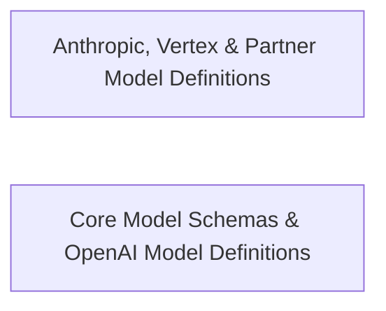

## Details

Provides model catalogs, metadata, and type definitions for supported LLM providers including Anthropic, DeepSeek, LiteLLM, OpenAI, Qwen, and Vertex AI.

### Anthropic, Vertex & Partner Model Definitions
Defines model catalogs, pricing configurations, defaults, and reasoning capability helpers for Anthropic, Vertex AI, DeepSeek, Qwen Mainland, and LiteLLM providers.

**Related Classes/Methods**:

- `src.shared.api.models.anthropic.getAnthropicReasoningEffort`:97-103
- `src.shared.api.models.anthropic.isAnthropicAdaptiveThinkingSupported`:111-142
- `src.shared.api.models.vertex.vertexGlobalModels`:289-291

**Source Files:**

- `src/shared/api/models/anthropic.ts`
  - `src.shared.api.models.anthropic.getAnthropicReasoningEffort` (L97-L103) - Function
  - `src.shared.api.models.anthropic.isAnthropicAdaptiveThinkingSupported` (L111-L142) - Function
- `src/shared/api/models/litellm.ts`
  - `src.shared.api.models.litellm.LiteLLMModelInfo` (L7-L9) - Interface
- `src/shared/api/models/qwen-mainland.ts`
  - `src.shared.api.models.qwen-mainland.QwenApiRegions` (L4-L7) - Enum
- `src/shared/api/models/vertex.ts`
  - `src.shared.api.models.vertex.vertexGlobalModels` (L289-L291) - Class
  - `src.shared.api.models.vertex.vertexGlobalModels.filter() callback` (L290-L290) - Function

### Core Model Schemas & OpenAI Model Definitions
Defines core model capability and pricing interfaces, pricing inspection helpers, and model catalogs for OpenAI Native and OpenAI Codex providers.

**Related Classes/Methods**:

- `src.shared.api.models.types.ModelCapabilities`:37-58
- `src.shared.api.models.types.ModelInfo`:60-82
- `src.shared.api.models.types.createModelProviderSelection`:110-120
- `src.shared.api.models.types.hasPricing`:162-176
- `src.shared.api.models.types.isFreeModel`:179-202

**Source Files:**

- `src/shared/api/models/openai-codex.ts`
  - `src.shared.api.models.openai-codex.OpenAiCodexModelInfo` (L11-L13) - Interface
- `src/shared/api/models/openai-native.ts`
  - `src.shared.api.models.openai-native.OpenAiNativeModelInfo` (L19-L21) - Interface
- `src/shared/api/models/types.ts`
  - `src.shared.api.models.types.PriceTier` (L5-L8) - Interface
  - `src.shared.api.models.types.ModelPricing` (L10-L15) - Interface
  - `src.shared.api.models.types.PricingSchedulePeriod` (L19-L25) - Interface
  - `src.shared.api.models.types.ModelPricingSchedule` (L27-L31) - Interface
  - `src.shared.api.models.types.ModelCapabilities` (L37-L58) - Interface
  - `src.shared.api.models.types.ModelInfo` (L60-L82) - Interface
  - `src.shared.api.models.types.OpenAiCompatibleProfile` (L84-L92) - Interface
  - `src.shared.api.models.types.ModelProviderPreset` (L94-L104) - Interface
  - `src.shared.api.models.types.createModelProviderSelection` (L110-L120) - Function
  - `src.shared.api.models.types.ModelProviderSelection` (L126-L134) - Interface
  - `src.shared.api.models.types.OpenAiCompatibleModelInfo` (L136-L142) - Interface
  - `src.shared.api.models.types.OcaModelInfo` (L144-L151) - Interface
  - `src.shared.api.models.types.LiteLLMModelInfo` (L153-L155) - Interface
  - `src.shared.api.models.types.BasetenModelInfo` (L157-L159) - Interface
  - `src.shared.api.models.types.hasPricing` (L162-L176) - Function
  - `src.shared.api.models.types.hasPricing.prices` (L163-L174) - Class
  - `src.shared.api.models.types.hasPricing.prices.modelInfo.pricingSchedule.periods.flatMap() callback` (L168-L173) - Function
  - `src.shared.api.models.types.hasPricing.prices.some() callback` (L175-L175) - Function
  - `src.shared.api.models.types.isFreeModel` (L179-L202) - Function
  - `src.shared.api.models.types.isFreeModel.overridePrices` (L182-L199) - Class
  - `src.shared.api.models.types.isFreeModel.overridePrices.modelInfo.pricingSchedule.periods.flatMap() callback` (L186-L191) - Function
  - `src.shared.api.models.types.isFreeModel.overridePrices.modelInfo.tiers.flatMap() callback` (L192-L197) - Function
  - `src.shared.api.models.types.isFreeModel.overridePrices.modelInfo.thinkingConfig.outputPriceTiers.map() callback` (L198-L198) - Function
  - `src.shared.api.models.types.isFreeModel.overridePrices.every() callback` (L201-L201) - Function

### [FAQ](https://github.com/CodeBoarding/GeneratedOnBoardings/tree/main?tab=readme-ov-file#faq)