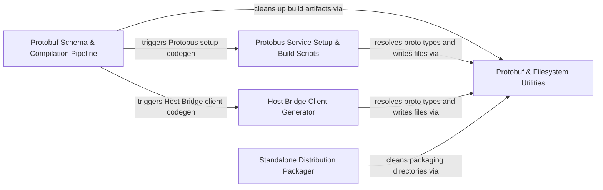

## Details

Generates Protocol Buffer definitions, host-bridge and protobus client/setup bindings, and standalone distribution packages.

### Protobuf Schema & Compilation Pipeline
Orchestrates Protocol Buffers schema generation and compilation across TypeScript and Python targets, invoking downstream client and service setup generators.

**Related Classes/Methods**:

- `scripts.build-proto.main`:61-66
- `scripts.build-proto.cleanup`:128-178

**Source Files:**

- `scripts/build-proto.mjs`
  - `scripts.build-proto.findProtoc` (L16-L37) - Function
  - `scripts.build-proto.main` (L61-L66) - Function
  - `scripts.build-proto.compileProtos` (L67-L106) - Function
  - `scripts.build-proto.tsProtoc` (L108-L126) - Function
  - `scripts.build-proto.tsProtoc.command` (L110-L117) - Class
  - `scripts.build-proto.tsProtoc.command.protoFiles.map() callback` (L116-L116) - Function
  - `scripts.build-proto.cleanup` (L128-L178) - Function
  - `scripts.build-proto.checkAppleSiliconCompatibility` (L181-L208) - Function
  - `scripts.build-proto.log_verbose` (L210-L214) - Function
  - `scripts.build-proto.catch() callback` (L217-L220) - Function
- `scripts/build-python-proto.mjs`
  - `scripts.build-python-proto.hasCommand` (L16-L27) - Function
  - `scripts.build-python-proto.resolvePython` (L29-L52) - Function
  - `scripts.build-python-proto.checkGrpcTools` (L54-L61) - Function
  - `scripts.build-python-proto.ensureDir` (L63-L65) - Function
  - `scripts.build-python-proto.ensureInitPy` (L67-L73) - Function
  - `scripts.build-python-proto.parseServicesWithFiles` (L80-L107) - Function
  - `scripts.build-python-proto.upperFirst` (L109-L111) - Function
  - `scripts.build-python-proto.generateConnectionPy` (L113-L149) - Function
  - `scripts.build-python-proto.generateDiracClientPy` (L151-L228) - Function
  - `scripts.build-python-proto.generateDiracClientPy.initLines` (L166-L170) - Class
  - `scripts.build-python-proto.generateDiracClientPy.initLines.services.map() callback` (L166-L170) - Function
  - `scripts.build-python-proto.generateDiracClientPy.nilLines` (L173-L176) - Class
  - `scripts.build-python-proto.generateDiracClientPy.nilLines.services.map() callback` (L173-L176) - Function
  - `scripts.build-python-proto.generateDiracClientPy.content` (L178-L224) - Class
  - `scripts.build-python-proto.generateDiracClientPy.content.services.map() callback` (L202-L202) - Function
  - `scripts.build-python-proto.generatePythonClient` (L230-L249) - Function
  - `scripts.build-python-proto.generateServiceClientsPy` (L251-L302) - Function
  - `scripts.build-python-proto.generateServiceClientsPy.methodLines` (L263-L286) - Class
  - `scripts.build-python-proto.generateServiceClientsPy.methodLines.s.methods.map() callback` (L264-L285) - Function
  - `scripts.build-python-proto.generatePyproject` (L304-L324) - Function
  - `scripts.build-python-proto.main` (L326-L418) - Function
  - `scripts.build-python-proto.main.cmd` (L374-L379) - Class
  - `scripts.build-python-proto.main.cmd.protoFiles.map() callback` (L379-L379) - Function
  - `scripts.build-python-proto.then() callback` (L397-L397) - Function
  - `scripts.build-python-proto.main.then() callback` (L401-L401) - Function
  - `scripts.build-python-proto.main.catch() callback` (L402-L402) - Function
  - `scripts.build-python-proto.catch() callback` (L421-L424) - Function
- `scripts/generate-state-proto.mjs`
  - `scripts.generate-state-proto.toProtoFieldName` (L25-L27) - Function
  - `scripts.generate-state-proto.toProtoFieldName.str.replace() callback` (L26-L26) - Function
  - `scripts.generate-state-proto.inferProtoType` (L40-L125) - Function
  - `scripts.generate-state-proto.parseSecretsKeys` (L130-L162) - Function
  - `scripts.generate-state-proto.parseFieldDefinitions` (L167-L237) - Function
  - `scripts.generate-state-proto.snakeToCamel` (L242-L244) - Function
  - `scripts.generate-state-proto.snakeToCamel.str.replace() callback` (L243-L243) - Function
  - `scripts.generate-state-proto.normalizePropertyNameForProtoLookup` (L252-L254) - Function
  - `scripts.generate-state-proto.assertNoNormalizedFieldNameCollisions` (L260-L278) - Function
  - `scripts.generate-state-proto.parseProtoMessageFieldNumbers` (L284-L310) - Function
  - `scripts.generate-state-proto.loadFieldNumbersFromProto` (L315-L329) - Function
  - `scripts.generate-state-proto.assignFieldNumbers` (L334-L375) - Function
  - `scripts.generate-state-proto.generateProtoMessage` (L380-L404) - Function
  - `scripts.generate-state-proto.generateProtoMessage.sortedFields` (L384-L384) - Class
  - `scripts.generate-state-proto.generateProtoMessage.sortedFields.sort() callback` (L384-L384) - Function
  - `scripts.generate-state-proto.generateSecretsMessage` (L409-L416) - Function
  - `scripts.generate-state-proto.generateSecretsMessage.fields` (L410-L413) - Class
  - `scripts.generate-state-proto.generateSecretsMessage.fields.secretsKeys.map() callback` (L410-L413) - Function
  - `scripts.generate-state-proto.replaceMessage` (L421-L431) - Function
  - `scripts.generate-state-proto.main` (L433-L478) - Function
  - `scripts.generate-state-proto.main.secretsFieldNumbers` (L455-L459) - Class
  - `scripts.generate-state-proto.main.secretsFieldNumbers.secretsKeys.map() callback` (L456-L456) - Function
  - `scripts.generate-state-proto.catch() callback` (L480-L483) - Function

### Protobus Service Setup & Build Scripts
Generates Protobus client and server setup scaffolding for VS Code, webview, and standalone targets alongside test compilation and npm packaging setup.

**Related Classes/Methods**:

- `scripts.generate-protobus-setup.main`:15-27
- `scripts.generate-protobus-setup.generateWebviewProtobusClients`:29-68
- `scripts.generate-protobus-setup.generateVscodeServiceTypes`:73-108
- `scripts.generate-protobus-setup.generateVscodeProtobusServers`:113-144
- `scripts.generate-protobus-setup.generateStandaloneProtobusServiceSetup`:149-199

**Source Files:**

- `scripts/build-tests.js`
  - `scripts.build-tests.esbuildProblemMatcherPlugin` (L10-L25) - Class
  - `scripts.build-tests.esbuildProblemMatcherPlugin.setup` (L13-L24) - Method
  - `scripts.build-tests.esbuildProblemMatcherPlugin.setup.build.onStart() callback` (L14-L16) - Function
  - `scripts.build-tests.esbuildProblemMatcherPlugin.setup.build.onEnd() callback` (L17-L23) - Function
  - `scripts.build-tests.esbuildProblemMatcherPlugin.setup.build.onEnd() callback.result.errors.forEach() callback` (L18-L21) - Function
  - `scripts.build-tests.main` (L44-L54) - Function
  - `scripts.build-tests.catch() callback` (L58-L61) - Function
- `scripts/generate-protobus-setup.mjs`
  - `scripts.generate-protobus-setup.main` (L15-L27) - Function
  - `scripts.generate-protobus-setup.generateWebviewProtobusClients` (L29-L68) - Function
  - `scripts.generate-protobus-setup.generateVscodeServiceTypes` (L73-L108) - Function
  - `scripts.generate-protobus-setup.generateVscodeProtobusServers` (L113-L144) - Function
  - `scripts.generate-protobus-setup.generateStandaloneProtobusServiceSetup` (L149-L199) - Function
  - `scripts.generate-protobus-setup.getDomainName` (L201-L203) - Function
  - `scripts.generate-protobus-setup.getDirName` (L204-L207) - Function
  - `scripts.generate-protobus-setup.catch() callback` (L211-L214) - Function
- `scripts/package-npm.mjs`
  - `scripts.package-npm.main` (L33-L48) - Function
  - `scripts.package-npm.setupEnvironmentVariables` (L50-L59) - Function
  - `scripts.package-npm.cleanBuildDir` (L64-L69) - Function
  - `scripts.package-npm.buildTypeScriptCli` (L74-L86) - Function
  - `scripts.package-npm.copyCliDist` (L91-L112) - Function
  - `scripts.package-npm.copyPackageJson` (L117-L145) - Function
  - `scripts.package-npm.copyReadme` (L150-L168) - Function
  - `scripts.package-npm.createNpmIgnoreFile` (L173-L189) - Function
  - `scripts.package-npm.cpr` (L192-L199) - Function
  - `scripts.package-npm.rmrf` (L202-L207) - Function
  - `scripts.package-npm.log_verbose` (L209-L213) - Function

### Protobuf & Filesystem Utilities
Provides shared filesystem manipulation and Protocol Buffers type resolution utilities used across codegen and packaging scripts.

**Related Classes/Methods**:

- `scripts.file-utils.writeFileWithMkdirs`:6-9
- `scripts.file-utils.rmrf`:11-13
- `scripts.proto-utils.getFqn`:19-24

**Source Files:**

- `scripts/file-utils.mjs`
  - `scripts.file-utils.writeFileWithMkdirs` (L6-L9) - Function
  - `scripts.file-utils.rmrf` (L11-L13) - Function
  - `scripts.file-utils.rmdir` (L18-L27) - Function
- `scripts/proto-shared-utils.mjs`
  - `scripts.proto-shared-utils.parseProtoForServices` (L10-L42) - Function
  - `scripts.proto-shared-utils.createServiceNameMap` (L49-L56) - Function
  - `scripts.proto-shared-utils.logVerbose` (L62-L66) - Function
- `scripts/proto-utils.mjs`
  - `scripts.proto-utils.addTypeNameToFqn` (L12-L17) - Function
  - `scripts.proto-utils.getFqn` (L19-L24) - Function
  - `scripts.proto-utils.getPackageDefinition` (L26-L30) - Function
  - `scripts.proto-utils.loadProtoDescriptorSet` (L32-L35) - Function
  - `scripts.proto-utils.loadServicesFromProtoDescriptor` (L37-L59) - Function

### Host Bridge Client Generator
Generates TypeScript interfaces and client implementations for the Host Bridge across VS Code and external runtime environments.

**Related Classes/Methods**:

- `scripts.generate-host-bridge-client.main`:18-29
- `scripts.generate-host-bridge-client.generateTypesFile`:34-49
- `scripts.generate-host-bridge-client.generateClientInterfaceType`:54-78
- `scripts.generate-host-bridge-client.generateExternalClientFile`:83-110
- `scripts.generate-host-bridge-client.generateVscodeClientFile`:175-212

**Source Files:**

- `scripts/generate-host-bridge-client.mjs`
  - `scripts.generate-host-bridge-client.main` (L18-L29) - Function
  - `scripts.generate-host-bridge-client.generateTypesFile` (L34-L49) - Function
  - `scripts.generate-host-bridge-client.generateClientInterfaceType` (L54-L78) - Function
  - `scripts.generate-host-bridge-client.generateClientInterfaceType.methods` (L56-L68) - Class
  - `scripts.generate-host-bridge-client.generateClientInterfaceType.methods.map() callback` (L57-L67) - Function
  - `scripts.generate-host-bridge-client.generateExternalClientFile` (L83-L110) - Function
  - `scripts.generate-host-bridge-client.generateExternalClientSetup` (L115-L170) - Function
  - `scripts.generate-host-bridge-client.generateExternalClientSetup.methods` (L117-L154) - Class
  - `scripts.generate-host-bridge-client.generateExternalClientSetup.methods.map() callback` (L118-L153) - Function
  - `scripts.generate-host-bridge-client.generateVscodeClientFile` (L175-L212) - Function
  - `scripts.generate-host-bridge-client.generateVscodeClientImplementation` (L214-L233) - Function
  - `scripts.generate-host-bridge-client.generateVscodeClientImplementation.methods` (L218-L227) - Class
  - `scripts.generate-host-bridge-client.generateVscodeClientImplementation.methods.map() callback` (L219-L226) - Function
  - `scripts.generate-host-bridge-client.catch() callback` (L237-L240) - Function

### Standalone Distribution Packager
Packages node dependencies and platform-specific binary dependencies into a standalone distribution bundle.

**Related Classes/Methods**:

- `scripts.package-standalone.installNodeDependencies`:42-51
- `scripts.package-standalone.packageAllBinaryDeps`:60-102

**Source Files:**

- `scripts/package-standalone.mjs`
  - `scripts.package-standalone.main` (L31-L40) - Function
  - `scripts.package-standalone.installNodeDependencies` (L42-L51) - Function
  - `scripts.package-standalone.packageAllBinaryDeps` (L60-L102) - Function
  - `scripts.package-standalone.packageAllBinaryDeps.isAllowed` (L63-L63) - Class
  - `scripts.package-standalone.packageAllBinaryDeps.isAllowed.SUPPORTED_BINARY_MODULES.some() callback` (L63-L63) - Function
  - `scripts.package-standalone.packageAllBinaryDeps.blocked` (L64-L64) - Class
  - `scripts.package-standalone.packageAllBinaryDeps.blocked.allNativeModules.filter() callback` (L64-L64) - Function
  - `scripts.package-standalone.zipDistribution` (L104-L145) - Function
  - `scripts.package-standalone.zipDistribution.output.on("close") callback` (L111-L115) - Function
  - `scripts.package-standalone.zipDistribution.archive.on("warning") callback` (L116-L118) - Function
  - `scripts.package-standalone.zipDistribution.archive.on("error") callback` (L119-L121) - Function
  - `scripts.package-standalone.zipDistribution.archive.directory("extension") callback` (L135-L141) - Function
  - `scripts.package-standalone.createIsIgnored` (L151-L227) - Function
  - `scripts.package-standalone.createIsIgnored.parsedIgnore` (L192-L196) - Class
  - `scripts.package-standalone.createIsIgnored.parsedIgnore.map() callback` (L194-L194) - Function
  - `scripts.package-standalone.filter() callback` (L195-L195) - Function
  - `scripts.package-standalone.createIsIgnored.parsedIgnore.filter() callback` (L196-L196) - Function
  - `scripts.package-standalone.createIsIgnored.expandedIgnore` (L199-L202) - Class
  - `scripts.package-standalone.createIsIgnored.expandedIgnore.map() callback` (L201-L201) - Function
  - `scripts.package-standalone.createIsIgnored.expandedIgnore.parsedIgnore.filter() callback` (L201-L201) - Function
  - `scripts.package-standalone.createIsIgnored.allIgnore.filter() callback` (L210-L210) - Function
  - `scripts.package-standalone.createIsIgnored.ignoreMatchers` (L220-L220) - Class
  - `scripts.package-standalone.createIsIgnored.ignoreMatchers.ignore.map() callback` (L220-L220) - Function
  - `scripts.package-standalone.createIsIgnored.negateMatchers` (L221-L221) - Class
  - `scripts.package-standalone.createIsIgnored.negateMatchers.negate.map() callback` (L221-L221) - Function
  - `scripts.package-standalone.createIsIgnored.isIgnored` (L223-L225) - Function
  - `scripts.package-standalone.createIsIgnored.isIgnored.ignoreMatchers.some() callback` (L224-L224) - Function
  - `scripts.package-standalone.createIsIgnored.isIgnored.negateMatchers.some() callback` (L224-L224) - Function
  - `scripts.package-standalone.cpr` (L230-L237) - Function
  - `scripts.package-standalone.log_verbose` (L239-L243) - Function

### [FAQ](https://github.com/CodeBoarding/GeneratedOnBoardings/tree/main?tab=readme-ov-file#faq)