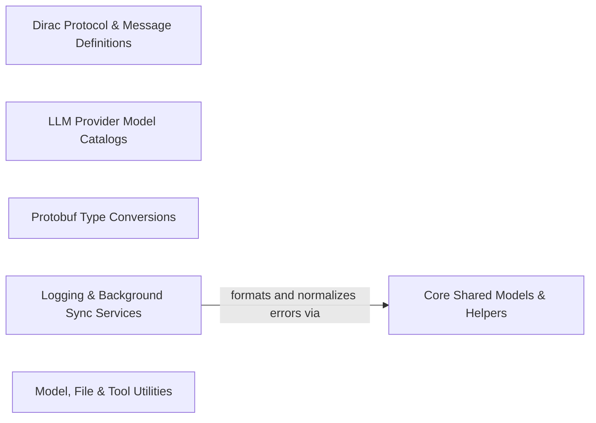

## Details

Defines shared domain models, protocol buffer conversions, logging, error helpers, and cross-cutting utilities used across core, hosts, and CLI.

### Core Shared Models & Helpers [[Expand]](./Core_Shared_Models_Helpers.md)
Defines core domain models, presentation state, API metrics, configuration types, and common error and data manipulation helpers shared across the extension and webview.

**Related Classes/Methods**:

- `src.shared.errors.getErrorMessage`:6-8
- `src.shared.errors.toError`:14-16

**Source Files:**

- `src/shared/AutoApprovalSettings.ts`
  - `src.shared.AutoApprovalSettings.AutoApprovalSettings` (L1-L25) - Interface
- `src/shared/ChatContent.ts`
  - `src.shared.ChatContent.ChatContent` (L1-L5) - Interface
- `src/shared/HistoryItem.ts`
  - `src.shared.HistoryItem.RunHistoryItemBase` (L3-L23) - Interface
  - `src.shared.HistoryItem.TaskHistoryItem` (L29-L36) - Interface
  - `src.shared.HistoryItem.GoalHistoryItem` (L39-L51) - Interface
  - `src.shared.HistoryItem.isGoalHistoryItem` (L61-L63) - Function
  - `src.shared.HistoryItem.isTaskHistoryItem` (L65-L67) - Function
- `src/shared/Languages.ts`
  - `src.shared.Languages.getLanguageKey` (L64-L73) - Function
  - `src.shared.Languages.getLanguageKey.languageOption` (L68-L68) - Class
  - `src.shared.Languages.getLanguageKey.languageOption.languageOptions.find() callback` (L68-L68) - Function
- `src/shared/Patch.ts`
  - `src.shared.Patch.PatchActionType` (L23-L27) - Enum
  - `src.shared.Patch.PatchChunk` (L29-L33) - Interface
  - `src.shared.Patch.PatchAction` (L35-L40) - Interface
  - `src.shared.Patch.PatchWarning` (L45-L50) - Interface
  - `src.shared.Patch.Patch` (L55-L58) - Interface
  - `src.shared.Patch.DiffError` (L60-L65) - Class
  - `src.shared.Patch.DiffError.constructor` (L61-L64) - Constructor
- `src/shared/PresentationOperation.ts`
  - `src.shared.PresentationOperation.PresentationBatch` (L26-L29) - Interface
- `src/shared/UserApprovedCommand.ts`
  - `src.shared.UserApprovedCommand.UserApprovedCommand` (L3-L6) - Interface
  - `src.shared.UserApprovedCommand.normalizeUserApprovedCommand` (L8-L15) - Function
  - `src.shared.UserApprovedCommand.normalizeUserApprovedCommands` (L17-L34) - Function
- `src/shared/UserInfo.ts`
  - `src.shared.UserInfo.UserInfo` (L1-L6) - Interface
- `src/shared/anchor-limits.ts`
  - `src.shared.anchor-limits.anchorLimitMessage` (L4-L6) - Function
  - `src.shared.anchor-limits.anchorByteLimitMessage` (L8-L10) - Function
- `src/shared/api.ts`
  - `src.shared.api.stripOpenRouterPreset` (L12-L18) - Function
  - `src.shared.api.ApiHandlerOptions` (L105-L113) - Interface
  - `src.shared.api.getProviderForModel` (L193-L201) - Function
  - `src.shared.api.getModelInfo` (L206-L214) - Function
  - `src.shared.api.getModelInfoForProvider` (L218-L224) - Function
  - `src.shared.api.providerSupportsInferenceSpeed` (L226-L228) - Function
  - `src.shared.api.modelSupportsInferenceSpeed` (L230-L232) - Function
  - `src.shared.api.clampThinkingBudget` (L238-L246) - Function
- `src/shared/array.ts`
  - `src.shared.array.findLastIndex` (L9-L17) - Function
  - `src.shared.array.findLast` (L19-L22) - Function
  - `src.shared.array.parsePartialArrayString` (L31-L56) - Function
  - `src.shared.array.parsePartialArrayString.map() callback` (L53-L53) - Function
- `src/shared/cardIdentity.ts`
  - `src.shared.cardIdentity.CardHeader` (L3-L8) - Enum
  - `src.shared.cardIdentity.inferLegacyCardKind` (L10-L22) - Function
  - `src.shared.cardIdentity.getCardKind` (L24-L26) - Function
  - `src.shared.cardIdentity.isTaskCompletionCard` (L28-L30) - Function
  - `src.shared.cardIdentity.isSuccessfulTaskCompletionCard` (L32-L34) - Function
  - `src.shared.cardIdentity.isResumePromptCard` (L36-L39) - Function
- `src/shared/combineCardSequences.ts`
  - `src.shared.combineCardSequences.combineCardSequences` (L8-L29) - Function
- `src/shared/config-types.ts`
  - `src.shared.config-types.Environment` (L6-L11) - Enum
  - `src.shared.config-types.EnvironmentConfig` (L13-L17) - Interface
- `src/shared/content-limits.ts`
  - `src.shared.content-limits.formatBytes` (L12-L20) - Function
  - `src.shared.content-limits.truncateHeadTail` (L38-L64) - Function
  - `src.shared.content-limits.truncateContent` (L66-L80) - Function
- `src/shared/context-management.ts`
  - `src.shared.context-management.isValidAutoCondenseContextLimit` (L6-L8) - Function
  - `src.shared.context-management.getAutoCondenseContextLimit` (L10-L16) - Function
- `src/shared/errors.ts`
  - `src.shared.errors.getErrorMessage` (L6-L8) - Function
  - `src.shared.errors.toError` (L14-L16) - Function
- `src/shared/getApiMetrics.ts`
  - `src.shared.getApiMetrics.ApiMetrics` (L4-L13) - Interface
  - `src.shared.getApiMetrics.getApiMetrics` (L35-L94) - Function
  - `src.shared.getApiMetrics.getApiMetrics.messages.forEach() callback` (L46-L87) - Function
  - `src.shared.getApiMetrics.getLastApiReqTotalTokens` (L105-L117) - Function
  - `src.shared.getApiMetrics.getLastApiReqInfo` (L128-L140) - Function
- `src/shared/goal.ts`
  - `src.shared.goal.GoalPendingInteraction` (L11-L16) - Interface
  - `src.shared.goal.GoalChildRecord` (L18-L30) - Interface
  - `src.shared.goal.GoalAccounting` (L32-L40) - Interface
  - `src.shared.goal.GoalObjectiveRevision` (L42-L46) - Interface
  - `src.shared.goal.GoalRecord` (L67-L86) - Interface
  - `src.shared.goal.GoalStatusTransition` (L88-L91) - Interface
  - `src.shared.goal.GoalTaskSummary` (L93-L96) - Interface
  - `src.shared.goal.GoalViewState` (L98-L115) - Interface
  - `src.shared.goal.isSettledGoalStatus` (L119-L121) - Function
  - `src.shared.goal.isActiveGoalStatus` (L123-L125) - Function
  - `src.shared.goal.isResumableGoalStatus` (L127-L129) - Function
  - `src.shared.goal.isTerminalGoalChildStatus` (L131-L133) - Function
- `src/shared/historyItemFromProto.ts`
  - `src.shared.historyItemFromProto.historyItemFromProto` (L8-L37) - Function
  - `src.shared.historyItemFromProto.historyBaseFromProto` (L39-L48) - Function
  - `src.shared.historyItemFromProto.accountingFromProto` (L50-L61) - Function
  - `src.shared.historyItemFromProto.optionalMetric` (L63-L67) - Function
  - `src.shared.historyItemFromProto.requiredString` (L69-L72) - Function
  - `src.shared.historyItemFromProto.requiredNonnegativeNumber` (L74-L82) - Function
  - `src.shared.historyItemFromProto.requiredGoalStatus` (L84-L89) - Function
- `src/shared/net.ts`
  - `src.shared.net.fetch` (L113-L129) - Class
  - `src.shared.net.fetch.<function>` (L113-L129) - Function
  - `src.shared.net.mockFetchForTesting` (L139-L157) - Function
  - `src.shared.net.mockFetchForTesting.result.finally() callback` (L147-L149) - Function
  - `src.shared.net.getAxiosSettings` (L175-L180) - Function
  - `src.shared.net.jsonHeaders` (L196-L198) - Function
  - `src.shared.net.createOpenAIClient` (L205-L215) - Function
- `src/shared/openai-codex-auth.ts`
  - `src.shared.openai-codex-auth.OpenAiCodexAuthInstructions` (L4-L7) - Interface
- `src/shared/openai-codex-usage.ts`
  - `src.shared.openai-codex-usage.OpenAiCodexRateLimitWindow` (L6-L10) - Interface
  - `src.shared.openai-codex-usage.OpenAiCodexRateLimitBucket` (L12-L17) - Interface
  - `src.shared.openai-codex-usage.OpenAiCodexCredits` (L19-L23) - Interface
  - `src.shared.openai-codex-usage.OpenAiCodexIndividualSpendLimit` (L25-L33) - Interface
  - `src.shared.openai-codex-usage.OpenAiCodexSpendControl` (L35-L38) - Interface
  - `src.shared.openai-codex-usage.OpenAiCodexDailyActivity` (L40-L43) - Interface
  - `src.shared.openai-codex-usage.OpenAiCodexActivity` (L45-L52) - Interface
  - `src.shared.openai-codex-usage.OpenAiCodexUsageSnapshot` (L54-L66) - Interface
  - `src.shared.openai-codex-usage.OpenAiCodexRollingRateLimitWindow` (L68-L72) - Interface
  - `src.shared.openai-codex-usage.OpenAiCodexRollingRateLimitBucket` (L74-L79) - Interface
  - `src.shared.openai-codex-usage.OpenAiCodexRollingUsageUpdate` (L81-L89) - Interface
  - `src.shared.openai-codex-usage.OpenAiCodexDisplayWindow` (L91-L95) - Interface
  - `src.shared.openai-codex-usage.valueOrUndefined` (L198-L200) - Function
  - `src.shared.openai-codex-usage.deriveResetAt` (L202-L206) - Function
  - `src.shared.openai-codex-usage.normalizeFullWindow` (L208-L221) - Function
  - `src.shared.openai-codex-usage.normalizeRateLimitBucket` (L223-L235) - Function
  - `src.shared.openai-codex-usage.normalizeOpenAiCodexUsagePayload` (L238-L292) - Function
  - `src.shared.openai-codex-usage.normalizeOpenAiCodexActivityPayload` (L295-L317) - Function
  - `src.shared.openai-codex-usage.normalizeOpenAiCodexActivityPayload.activity.dailyUsageBuckets.stats.daily_usage_buckets.map() callback` (L310-L313) - Function
  - `src.shared.openai-codex-usage.collectHeaders` (L321-L335) - Function
  - `src.shared.openai-codex-usage.collectHeaders.forEach() callback` (L324-L324) - Function
  - `src.shared.openai-codex-usage.parseFiniteHeaderNumber` (L337-L341) - Function
  - `src.shared.openai-codex-usage.parseHeaderBoolean` (L343-L348) - Function
  - `src.shared.openai-codex-usage.parseOpenAiCodexRateLimitHeaders` (L351-L396) - Function
  - `src.shared.openai-codex-usage.normalizeRollingEventWindow` (L398-L407) - Function
  - `src.shared.openai-codex-usage.parseOpenAiCodexRateLimitEvent` (L410-L442) - Function
  - `src.shared.openai-codex-usage.mergeRollingWindow` (L444-L456) - Function
  - `src.shared.openai-codex-usage.mergeOpenAiCodexRollingUsage` (L459-L494) - Function
  - `src.shared.openai-codex-usage.mergeOpenAiCodexRollingUsage.byId` (L464-L464) - Class
  - `src.shared.openai-codex-usage.mergeOpenAiCodexRollingUsage.byId.previousSnapshot.rateLimits.map() callback` (L464-L464) - Function
  - `src.shared.openai-codex-usage.selectOpenAiCodexDisplayWindows` (L497-L518) - Function
  - `src.shared.openai-codex-usage.selectOpenAiCodexDisplayWindows.buckets` (L499-L503) - Class
  - `src.shared.openai-codex-usage.selectOpenAiCodexDisplayWindows.buckets.sort() callback` (L499-L503) - Function
  - `src.shared.openai-codex-usage.selectOpenAiCodexDisplayWindows.buckets.flatMap() callback` (L505-L517) - Function
  - `src.shared.openai-codex-usage.selectOpenAiCodexDisplayWindows.buckets.flatMap() callback.windows.sort() callback` (L509-L516) - Function
- `src/shared/presentationState.ts`
  - `src.shared.presentationState.MutablePresentationState` (L4-L9) - Interface
  - `src.shared.presentationState.createPresentationState` (L13-L24) - Function
  - `src.shared.presentationState.applyPresentationBatch` (L26-L47) - Function
  - `src.shared.presentationState.materializePresentationAppend` (L49-L68) - Function
  - `src.shared.presentationState.materializeAllPresentationAppends` (L70-L72) - Function
  - `src.shared.presentationState.applyOperation` (L74-L141) - Function
  - `src.shared.presentationState.indexMessages` (L143-L147) - Function
- `src/shared/release-notes.ts`
  - `src.shared.release-notes.ReleaseNoteAction` (L3-L6) - Interface
  - `src.shared.release-notes.ReleaseNoteHighlight` (L8-L15) - Interface
  - `src.shared.release-notes.ReleaseNotesDocument` (L17-L28) - Interface
  - `src.shared.release-notes.ReleaseNotesView` (L30-L34) - Interface
- `src/shared/responseTool.ts`
  - `src.shared.responseTool.ResponseParameter` (L5-L9) - Enum
  - `src.shared.responseTool.LegacyResponseParameter` (L11-L17) - Enum
  - `src.shared.responseTool.ResponseToolCall` (L19-L31) - Interface
  - `src.shared.responseTool.ResponseOperation` (L33-L38) - Enum
  - `src.shared.responseTool.LegacyResponseTool` (L42-L47) - Enum
  - `src.shared.responseTool.ResponseCardHeader` (L49-L55) - Enum
  - `src.shared.responseTool.PlanInteractionResponse` (L57-L59) - Enum
  - `src.shared.responseTool.ResponseArguments` (L77-L81) - Interface
  - `src.shared.responseTool.ResponseShapeError` (L83-L83) - Class
  - `src.shared.responseTool.validateResponseShape` (L85-L111) - Function
  - `src.shared.responseTool.validateResponseShape.unsupportedParameter` (L98-L98) - Class
  - `src.shared.responseTool.validateResponseShape.unsupportedParameter.find() callback` (L98-L98) - Function
  - `src.shared.responseTool.normalizeResponseOptions` (L113-L116) - Function
  - `src.shared.responseTool.validateQuestionOptions` (L118-L133) - Function
  - `src.shared.responseTool.options.some() callback` (L123-L123) - Function
  - `src.shared.responseTool.validateQuestionOptions.normalized` (L126-L126) - Class
  - `src.shared.responseTool.validateQuestionOptions.normalized.options.map() callback` (L126-L126) - Function
  - `src.shared.responseTool.validateQuestionOptions.options.some() callback` (L130-L130) - Function
  - `src.shared.responseTool.ResponseCardInput` (L135-L139) - Interface
  - `src.shared.responseTool.responseOperationFromToolCall` (L141-L147) - Function
  - `src.shared.responseTool.isCompletionResponseCall` (L149-L151) - Function
  - `src.shared.responseTool.canonicalizeResponseToolCall` (L153-L173) - Function
  - `src.shared.responseTool.responseOperationFromCard` (L175-L189) - Function
  - `src.shared.responseTool.isQuestionResponseCard` (L191-L193) - Function
  - `src.shared.responseTool.isPlanResponseCard` (L195-L197) - Function
  - `src.shared.responseTool.responseCardInput` (L199-L205) - Function
- `src/shared/safe-json-parse.ts`
  - `src.shared.safe-json-parse.payloadExcerpt` (L6-L12) - Function
  - `src.shared.safe-json-parse.JsonParseError` (L15-L23) - Class
  - `src.shared.safe-json-parse.JsonParseError.constructor` (L18-L22) - Constructor
  - `src.shared.safe-json-parse.safeParseJson` (L32-L53) - Function
- `src/shared/settings-presentation.ts`
  - `src.shared.settings-presentation.SettingsDestinationPresentation` (L15-L23) - Interface
- `src/shared/skills.ts`
  - `src.shared.skills.SkillMetadata` (L10-L20) - Interface
  - `src.shared.skills.SkillContent` (L25-L27) - Interface
  - `src.shared.skills.filterSkillsByProviderCapabilities` (L29-L34) - Function
  - `src.shared.skills.filterSkillsByProviderCapabilities.skills.filter() callback` (L33-L33) - Function
- `src/shared/slashCommands.ts`
  - `src.shared.slashCommands.SlashCommand` (L1-L6) - Interface
- `src/shared/sqlJsModule.ts`
  - `src.shared.sqlJsModule.ensureSqlModule` (L10-L22) - Function
  - `src.shared.sqlJsModule.ensureSqlModule.locateFile` (L13-L18) - Method
- `src/shared/string.ts`
  - `src.shared.string.canonicalize` (L34-L48) - Function
  - `src.shared.string.canonicalize.normalized` (L36-L36) - Class
  - `src.shared.string.canonicalize.normalized.replace() callback` (L36-L36) - Function
  - `src.shared.string.preserveEscaping` (L54-L77) - Function
  - `src.shared.string.extractFirstPath` (L93-L111) - Function
- `src/shared/subagentUsage.ts`
  - `src.shared.subagentUsage.getSubagentUsage` (L4-L15) - Function
  - `src.shared.subagentUsage.parseUsage` (L17-L36) - Function
  - `src.shared.subagentUsage.parseUsage.fields.every() callback` (L23-L23) - Function
- `src/shared/subagents.ts`
  - `src.shared.subagents.SubagentIdentity` (L41-L44) - Interface
  - `src.shared.subagents.SubagentTrajectoryEventType` (L46-L52) - Enum
  - `src.shared.subagents.SubagentTrajectoryEvent` (L54-L57) - Interface
  - `src.shared.subagents.SubagentCardUsage` (L60-L66) - Interface
  - `src.shared.subagents.SubagentCardData` (L68-L74) - Interface
  - `src.shared.subagents.SubagentProgressEvent` (L76-L81) - Interface
  - `src.shared.subagents.allocateSubagentIdentity` (L83-L93) - Function
  - `src.shared.subagents.allocateSubagentIdentity.existing` (L84-L87) - Class
  - `src.shared.subagents.allocateSubagentIdentity.existing.messages.filter() callback` (L85-L85) - Function
  - `src.shared.subagents.allocateSubagentIdentity.existing.map() callback` (L86-L86) - Function
  - `src.shared.subagents.allocateSubagentIdentity.existing.filter() callback` (L87-L87) - Function
  - `src.shared.subagents.allocateSubagentIdentity.usedNames` (L89-L89) - Class
  - `src.shared.subagents.allocateSubagentIdentity.usedNames.identities.map() callback` (L89-L89) - Function
  - `src.shared.subagents.allocateSubagentIdentity.id.identities.reduce() callback` (L91-L91) - Function
  - `src.shared.subagents.id` (L91-L91) - Class
  - `src.shared.subagents.allocateUniqueSubagentName` (L95-L107) - Function
  - `src.shared.subagents.allocateUniqueSubagentName.availableNames` (L96-L96) - Class
  - `src.shared.subagents.allocateUniqueSubagentName.availableNames.SUBAGENT_NAMES.filter() callback` (L96-L96) - Function
  - `src.shared.subagents.createSubagentCardInput` (L109-L117) - Function
  - `src.shared.subagents.createSubagentCardOutput` (L122-L144) - Function
  - `src.shared.subagents.createSubagentCardOutput.trajectory.map() callback` (L131-L131) - Function
  - `src.shared.subagents.createSubagentTrajectoryEvent` (L146-L148) - Function
  - `src.shared.subagents.appendSubagentTrajectoryEvent` (L150-L154) - Function
  - `src.shared.subagents.recordSubagentProgress` (L156-L171) - Function
  - `src.shared.subagents.appendUniqueTerminalEvent` (L173-L181) - Function
  - `src.shared.subagents.subagentCardStatus` (L183-L189) - Function
  - `src.shared.subagents.isTerminalSubagentStatus` (L191-L197) - Function
  - `src.shared.subagents.readSubagentCardData` (L199-L212) - Function
  - `src.shared.subagents.SubagentTrajectoryFormatOptions` (L214-L217) - Interface
  - `src.shared.subagents.formatSubagentTrajectory` (L219-L252) - Function
  - `src.shared.subagents.formatSubagentTrajectory.activity` (L223-L236) - Class
  - `src.shared.subagents.formatSubagentTrajectory.activity.data.trajectory.flatMap() callback` (L223-L236) - Function
  - `src.shared.subagents.formatSubagentTrajectory.map() callback` (L249-L249) - Function
  - `src.shared.subagents.formatSubagentUsage` (L254-L262) - Function
  - `src.shared.subagents.isTrajectoryEvent` (L264-L275) - Function
  - `src.shared.subagents.readStatus` (L277-L286) - Function
  - `src.shared.subagents.truncateTrajectoryText` (L288-L291) - Function
  - `src.shared.subagents.truncateLine` (L293-L296) - Function
- `src/shared/taskStatusProjection.ts`
  - `src.shared.taskStatusProjection.TaskStatusProjection` (L5-L11) - Interface
  - `src.shared.taskStatusProjection.projectTaskStatus` (L87-L98) - Function
  - `src.shared.taskStatusProjection.isBusyTaskStatus` (L100-L102) - Function
- `src/shared/text-file-window.ts`
  - `src.shared.text-file-window.TextFileWindowOptions` (L1-L8) - Interface
  - `src.shared.text-file-window.TextFileWindow` (L10-L16) - Interface
- `src/shared/vsCodeSelectorUtils.ts`
  - `src.shared.vsCodeSelectorUtils.LanguageModelChatSelector` (L5-L10) - Interface
  - `src.shared.vsCodeSelectorUtils.stringifyVsCodeLmModelSelector` (L14-L16) - Function

### Dirac Protocol & Message Definitions [[Expand]](./Dirac_Protocol_Message_Definitions.md)
Defines Dirac-specific account, banner, webview message, tool, metric, and context schemas and constants.

**Related Classes/Methods**: _None_

**Source Files:**

- `src/shared/DiracAccount.ts`
  - `src.shared.DiracAccount.UserResponse` (L1-L17) - Interface
  - `src.shared.DiracAccount.BalanceResponse` (L19-L22) - Interface
  - `src.shared.DiracAccount.UsageTransaction` (L24-L44) - Interface
  - `src.shared.DiracAccount.PaymentTransaction` (L46-L51) - Interface
  - `src.shared.DiracAccount.OrganizationBalanceResponse` (L53-L56) - Interface
  - `src.shared.DiracAccount.OrganizationUsageTransaction` (L58-L80) - Interface
- `src/shared/DiracBanner.ts`
  - `src.shared.DiracBanner.Banner` (L8-L21) - Interface
  - `src.shared.DiracBanner.BannerAction` (L23-L27) - Interface
  - `src.shared.DiracBanner.BannersResponse` (L29-L35) - Interface
  - `src.shared.DiracBanner.BannerRules` (L45-L62) - Interface
  - `src.shared.DiracBanner.BannerEventPayload` (L72-L77) - Interface
  - `src.shared.DiracBanner.BannerDismissal` (L82-L85) - Interface
- `src/shared/WebviewMessage.ts`
  - `src.shared.WebviewMessage.WebviewMessage` (L1-L5) - Interface
  - `src.shared.WebviewMessage.DiracAskResponse` (L19-L26) - Enum
- `src/shared/dirac/api.ts`
  - `src.shared.dirac.api.CLINE_API_AUTH_ENDPOINTS` (L1-L4) - Enum
  - `src.shared.dirac.api.CLINE_API_ENDPOINT_V1` (L6-L12) - Enum
- `src/shared/dirac/banner.ts`
  - `src.shared.dirac.banner.BannerActionType` (L5-L18) - Enum
  - `src.shared.dirac.banner.BannerCardData` (L24-L55) - Interface
  - `src.shared.dirac.banner.BannerAction` (L60-L82) - Interface
- `src/shared/dirac/context.ts`
  - `src.shared.dirac.context.ExtensionMode` (L8-L26) - Enum
  - `src.shared.dirac.context.DiracExtensionContext` (L28-L148) - Interface
  - `src.shared.dirac.context.DiracExtensionContext.asAbsolutePath` (L68-L68) - Method
  - `src.shared.dirac.context.ExtensionKind` (L150-L160) - Enum
  - `src.shared.dirac.context.Extension` (L162-L210) - Interface
  - `src.shared.dirac.context.Extension.activate` (L209-L209) - Method
- `src/shared/dirac/index.ts`
  - `src.shared.dirac.index.DiracClient` (L4-L8) - Enum
- `src/shared/icons.ts`
  - `src.shared.icons.DiracIcon` (L3-L26) - Enum
- `src/shared/internal/account.ts`
  - `src.shared.internal.account.isDiracBotUser` (L10-L12) - Function
  - `src.shared.internal.account.isDiracInternalTester` (L14-L16) - Function
  - `src.shared.internal.account.isDiracInternalTester.DIRAC_TRUSTED_TESTER_DOMAINS.some() callback` (L15-L15) - Function
- `src/shared/messages/metrics.ts`
  - `src.shared.messages.metrics.DiracMessageModelInfo` (L3-L7) - Interface
  - `src.shared.messages.metrics.DiracTokensInfo` (L9-L14) - Interface
  - `src.shared.messages.metrics.DiracMessageMetricsInfo` (L16-L19) - Interface
- `src/shared/tools.ts`
  - `src.shared.tools.DiracToolSpecParameter` (L7-L31) - Interface
  - `src.shared.tools.DiracToolSpec` (L33-L42) - Interface
  - `src.shared.tools.DiracDefaultTool` (L45-L65) - Enum
  - `src.shared.tools.setDynamicToolUseNames` (L73-L75) - Function
  - `src.shared.tools.setDynamicToolUseNames.names.map() callback` (L74-L74) - Function
  - `src.shared.tools.getToolUseNames` (L77-L81) - Function
  - `src.shared.tools.getToolUseNames.dynamic` (L79-L79) - Class
  - `src.shared.tools.getToolUseNames.dynamic.flatMap() callback` (L79-L79) - Function
  - `src.shared.tools.isMutatingTool` (L107-L109) - Function

### LLM Provider Model Catalogs [[Expand]](./LLM_Provider_Model_Catalogs.md)
Provides model catalogs, metadata, and type definitions for supported LLM providers including Anthropic, DeepSeek, LiteLLM, OpenAI, Qwen, and Vertex AI.

**Related Classes/Methods**: _None_

**Source Files:**

- `src/shared/api/models/anthropic.ts`
  - `src.shared.api.models.anthropic.getAnthropicReasoningEffort` (L97-L103) - Function
  - `src.shared.api.models.anthropic.isAnthropicAdaptiveThinkingSupported` (L111-L142) - Function
- `src/shared/api/models/litellm.ts`
  - `src.shared.api.models.litellm.LiteLLMModelInfo` (L7-L9) - Interface
- `src/shared/api/models/openai-codex.ts`
  - `src.shared.api.models.openai-codex.OpenAiCodexModelInfo` (L11-L13) - Interface
- `src/shared/api/models/openai-native.ts`
  - `src.shared.api.models.openai-native.OpenAiNativeModelInfo` (L19-L21) - Interface
- `src/shared/api/models/qwen-mainland.ts`
  - `src.shared.api.models.qwen-mainland.QwenApiRegions` (L4-L7) - Enum
- `src/shared/api/models/types.ts`
  - `src.shared.api.models.types.PriceTier` (L5-L8) - Interface
  - `src.shared.api.models.types.ModelPricing` (L10-L15) - Interface
  - `src.shared.api.models.types.PricingSchedulePeriod` (L19-L25) - Interface
  - `src.shared.api.models.types.ModelPricingSchedule` (L27-L31) - Interface
  - `src.shared.api.models.types.ModelCapabilities` (L37-L58) - Interface
  - `src.shared.api.models.types.ModelInfo` (L60-L82) - Interface
  - `src.shared.api.models.types.OpenAiCompatibleProfile` (L84-L92) - Interface
  - `src.shared.api.models.types.ModelProviderPreset` (L94-L104) - Interface
  - `src.shared.api.models.types.createModelProviderSelection` (L110-L120) - Function
  - `src.shared.api.models.types.ModelProviderSelection` (L126-L134) - Interface
  - `src.shared.api.models.types.OpenAiCompatibleModelInfo` (L136-L142) - Interface
  - `src.shared.api.models.types.OcaModelInfo` (L144-L151) - Interface
  - `src.shared.api.models.types.LiteLLMModelInfo` (L153-L155) - Interface
  - `src.shared.api.models.types.BasetenModelInfo` (L157-L159) - Interface
  - `src.shared.api.models.types.hasPricing` (L162-L176) - Function
  - `src.shared.api.models.types.hasPricing.prices` (L163-L174) - Class
  - `src.shared.api.models.types.hasPricing.prices.modelInfo.pricingSchedule.periods.flatMap() callback` (L168-L173) - Function
  - `src.shared.api.models.types.hasPricing.prices.some() callback` (L175-L175) - Function
  - `src.shared.api.models.types.isFreeModel` (L179-L202) - Function
  - `src.shared.api.models.types.isFreeModel.overridePrices` (L182-L199) - Class
  - `src.shared.api.models.types.isFreeModel.overridePrices.modelInfo.pricingSchedule.periods.flatMap() callback` (L186-L191) - Function
  - `src.shared.api.models.types.isFreeModel.overridePrices.modelInfo.tiers.flatMap() callback` (L192-L197) - Function
  - `src.shared.api.models.types.isFreeModel.overridePrices.modelInfo.thinkingConfig.outputPriceTiers.map() callback` (L198-L198) - Function
  - `src.shared.api.models.types.isFreeModel.overridePrices.every() callback` (L201-L201) - Function
- `src/shared/api/models/vertex.ts`
  - `src.shared.api.models.vertex.vertexGlobalModels` (L279-L281) - Class
  - `src.shared.api.models.vertex.vertexGlobalModels.filter() callback` (L280-L280) - Function

### Protobuf Type Conversions
Converts domain objects such as Dirac messages, API configurations, search results, telemetry settings, and usage metrics to and from Protobuf representations.

**Related Classes/Methods**: _None_

**Source Files:**

- `src/shared/proto-conversions/dirac-message.ts`
  - `src.shared.proto-conversions.dirac-message.convertCardStatusToProtoEnum` (L18-L31) - Function
  - `src.shared.proto-conversions.dirac-message.convertProtoEnumToCardStatus` (L33-L50) - Function
  - `src.shared.proto-conversions.dirac-message.convertCardKindToProtoEnum` (L52-L60) - Function
  - `src.shared.proto-conversions.dirac-message.convertProtoEnumToCardKind` (L62-L76) - Function
  - `src.shared.proto-conversions.dirac-message.convertSteeringStatusToProtoEnum` (L78-L86) - Function
  - `src.shared.proto-conversions.dirac-message.parseLegacySteeringStatus` (L88-L92) - Function
  - `src.shared.proto-conversions.dirac-message.convertProtoEnumToSteeringStatus` (L94-L105) - Function
  - `src.shared.proto-conversions.dirac-message.serializeCardRecord` (L108-L115) - Function
  - `src.shared.proto-conversions.dirac-message.parseCardRecord` (L117-L127) - Function
  - `src.shared.proto-conversions.dirac-message.convertCardToProto` (L130-L173) - Function
  - `src.shared.proto-conversions.dirac-message.convertCardToProto.diffs.card.diffs.map() callback` (L153-L157) - Function
  - `src.shared.proto-conversions.dirac-message.convertCardToProto.locations.card.locations.map() callback` (L159-L162) - Function
  - `src.shared.proto-conversions.dirac-message.convertCardToProto.actions.card.actions.map() callback` (L164-L170) - Function
  - `src.shared.proto-conversions.dirac-message.convertProtoToCard` (L175-L215) - Function
  - `src.shared.proto-conversions.dirac-message.convertProtoToCard.diffs.protoCard.diffs.map() callback` (L199-L199) - Function
  - `src.shared.proto-conversions.dirac-message.convertProtoToCard.locations.protoCard.locations.map() callback` (L203-L203) - Function
  - `src.shared.proto-conversions.dirac-message.convertProtoToCard.actions.protoCard.actions.map() callback` (L206-L212) - Function
  - `src.shared.proto-conversions.dirac-message.convertDiracMessageToProto` (L220-L284) - Function
  - `src.shared.proto-conversions.dirac-message.convertProtoToDiracMessage` (L289-L348) - Function
  - `src.shared.proto-conversions.dirac-message.convertProtoToDiracMessage.steering.<function>` (L300-L306) - Function
- `src/shared/proto-conversions/file/search-result-conversion.ts`
  - `src.shared.proto-conversions.file.search-result-conversion.convertSearchResultsToProtoFileInfos` (L6-L15) - Function
  - `src.shared.proto-conversions.file.search-result-conversion.convertSearchResultsToProtoFileInfos.results.map() callback` (L9-L14) - Function
  - `src.shared.proto-conversions.file.search-result-conversion.convertProtoFileInfosToSearchResults` (L20-L29) - Function
  - `src.shared.proto-conversions.file.search-result-conversion.convertProtoFileInfosToSearchResults.protoResults.map() callback` (L23-L28) - Function
- `src/shared/proto-conversions/models/api-configuration-conversion.ts`
  - `src.shared.proto-conversions.models.api-configuration-conversion.parseReasoningEffortOptions` (L26-L29) - Function
  - `src.shared.proto-conversions.models.api-configuration-conversion.parseReasoningEffort` (L31-L33) - Function
  - `src.shared.proto-conversions.models.api-configuration-conversion.convertThinkingConfigToProto` (L36-L46) - Function
  - `src.shared.proto-conversions.models.api-configuration-conversion.convertStringArrayMapToProto` (L48-L50) - Function
  - `src.shared.proto-conversions.models.api-configuration-conversion.convertStringArrayMapToProto.map() callback` (L49-L49) - Function
  - `src.shared.proto-conversions.models.api-configuration-conversion.convertProtoToStringArrayMap` (L52-L57) - Function
  - `src.shared.proto-conversions.models.api-configuration-conversion.convertProtoToStringArrayMap.map() callback` (L56-L56) - Function
  - `src.shared.proto-conversions.models.api-configuration-conversion.convertProtoToThinkingConfig` (L60-L70) - Function
  - `src.shared.proto-conversions.models.api-configuration-conversion.convertModelInfoToProtoOpenRouter` (L73-L98) - Function
  - `src.shared.proto-conversions.models.api-configuration-conversion.convertProtoToModelInfo` (L101-L126) - Function
  - `src.shared.proto-conversions.models.api-configuration-conversion.convertOcaModelInfoToProtoOcaModelInfo` (L129-L153) - Function
  - `src.shared.proto-conversions.models.api-configuration-conversion.convertProtoOcaModelInfoToOcaModelInfo` (L156-L179) - Function
  - `src.shared.proto-conversions.models.api-configuration-conversion.convertLiteLLMModelInfoToProto` (L182-L203) - Function
  - `src.shared.proto-conversions.models.api-configuration-conversion.convertProtoToLiteLLMModelInfo` (L206-L227) - Function
  - `src.shared.proto-conversions.models.api-configuration-conversion.convertOpenAiCompatibleModelInfoToProto` (L230-L255) - Function
  - `src.shared.proto-conversions.models.api-configuration-conversion.convertOpenAiCompatibleProfileToProto` (L259-L269) - Function
  - `src.shared.proto-conversions.models.api-configuration-conversion.convertProtoToOpenAiCompatibleProfile` (L272-L282) - Function
  - `src.shared.proto-conversions.models.api-configuration-conversion.convertProtoToOpenAiCompatibleModelInfo` (L284-L309) - Function
  - `src.shared.proto-conversions.models.api-configuration-conversion.convertApiProviderToProto` (L312-L396) - Function
  - `src.shared.proto-conversions.models.api-configuration-conversion.convertModelProviderSelectionToProto` (L398-L408) - Function
  - `src.shared.proto-conversions.models.api-configuration-conversion.convertProtoToModelProviderSelection` (L410-L420) - Function
  - `src.shared.proto-conversions.models.api-configuration-conversion.convertProtoToApiProvider` (L423-L507) - Function
  - `src.shared.proto-conversions.models.api-configuration-conversion.convertApiConfigurationToProto` (L510-L657) - Function
  - `src.shared.proto-conversions.models.api-configuration-conversion.convertProtoToApiConfiguration` (L660-L811) - Function
- `src/shared/proto-conversions/models/typeConversion.ts`
  - `src.shared.proto-conversions.models.typeConversion.parseReasoningEffortOptions` (L11-L14) - Function
  - `src.shared.proto-conversions.models.typeConversion.parseReasoningEffort` (L16-L18) - Function
  - `src.shared.proto-conversions.models.typeConversion.convertThinkingConfig` (L24-L34) - Function
  - `src.shared.proto-conversions.models.typeConversion.toProtobufThinkingConfig` (L40-L50) - Function
  - `src.shared.proto-conversions.models.typeConversion.fromProtobufModelInfo` (L55-L76) - Function
  - `src.shared.proto-conversions.models.typeConversion.toProtobufModelInfo` (L81-L102) - Function
  - `src.shared.proto-conversions.models.typeConversion.fromProtobufOpenAiCompatibleModelInfo` (L107-L130) - Function
  - `src.shared.proto-conversions.models.typeConversion.fromProtobufLiteLLMModelInfo` (L135-L153) - Function
  - `src.shared.proto-conversions.models.typeConversion.fromProtobufOcaModelInfo` (L158-L180) - Function
  - `src.shared.proto-conversions.models.typeConversion.fromProtobufModels` (L185-L191) - Function
  - `src.shared.proto-conversions.models.typeConversion.toProtobufModels` (L196-L202) - Function
- `src/shared/proto-conversions/models/vscode-lm-models-conversion.ts`
  - `src.shared.proto-conversions.models.vscode-lm-models-conversion.VsCodeNativeModel` (L6-L11) - Interface
  - `src.shared.proto-conversions.models.vscode-lm-models-conversion.convertVsCodeNativeModelsToProtoModels` (L16-L23) - Function
  - `src.shared.proto-conversions.models.vscode-lm-models-conversion.convertVsCodeNativeModelsToProtoModels.map() callback` (L17-L22) - Function
- `src/shared/proto-conversions/openai-codex-usage.ts`
  - `src.shared.proto-conversions.openai-codex-usage.toProtobufWindow` (L16-L23) - Function
  - `src.shared.proto-conversions.openai-codex-usage.toProtobufOpenAiCodexUsage` (L25-L78) - Function
  - `src.shared.proto-conversions.openai-codex-usage.toProtobufOpenAiCodexUsage.rateLimits.snapshot.rateLimits.map() callback` (L28-L34) - Function
  - `src.shared.proto-conversions.openai-codex-usage.toProtobufOpenAiCodexUsage.activity.dailyUsageBuckets.map() callback` (L68-L69) - Function
  - `src.shared.proto-conversions.openai-codex-usage.fromProtobufWindow` (L80-L87) - Function
  - `src.shared.proto-conversions.openai-codex-usage.fromProtobufOpenAiCodexUsage` (L89-L141) - Function
  - `src.shared.proto-conversions.openai-codex-usage.fromProtobufOpenAiCodexUsage.rateLimits.message.rateLimits.map() callback` (L92-L97) - Function
  - `src.shared.proto-conversions.openai-codex-usage.fromProtobufOpenAiCodexUsage.activity.dailyUsageBuckets.message.activity.dailyUsageBuckets.map() callback` (L130-L133) - Function
- `src/shared/proto-conversions/state/telemetry-setting-conversion.ts`
  - `src.shared.proto-conversions.state.telemetry-setting-conversion.convertDomainTelemetrySettingToProto` (L7-L18) - Function
  - `src.shared.proto-conversions.state.telemetry-setting-conversion.convertProtoTelemetrySettingToDomain` (L23-L34) - Function
- `src/shared/proto-conversions/web/open-graph-conversion.ts`
  - `src.shared.proto-conversions.web.open-graph-conversion.convertDomainOpenGraphDataToProto` (L9-L18) - Function

### Logging & Background Sync Services
Provides session tracking, rotating file logging, and background worker queue processing for data synchronization and backfilling.

**Related Classes/Methods**:

- `src.shared.services.file-logger.RotatingFileLoggerImpl.enqueuePendingRecords`:133-148
- `src.shared.services.worker.backfill.backfillTask`:80-115
- `src.shared.services.worker.worker.SyncWorker.processQueue`:191-252

**Source Files:**

- `src/shared/services/Logger.ts`
  - `src.shared.services.Logger.Logger` (L5-L87) - Class
  - `src.shared.services.Logger.Logger.setVerbose` (L8-L10) - Method
  - `src.shared.services.Logger.Logger.output` (L13-L25) - Method
  - `src.shared.services.Logger.Logger.subscribe` (L30-L33) - Method
  - `src.shared.services.Logger.Logger.error` (L35-L37) - Method
  - `src.shared.services.Logger.Logger.warn` (L39-L41) - Method
  - `src.shared.services.Logger.Logger.log` (L43-L45) - Method
  - `src.shared.services.Logger.Logger.debug` (L47-L49) - Method
  - `src.shared.services.Logger.Logger.info` (L51-L53) - Method
  - `src.shared.services.Logger.Logger.verbose` (L56-L60) - Method
  - `src.shared.services.Logger.Logger.trace` (L62-L64) - Method
  - `src.shared.services.Logger.Logger.#output` (L66-L86) - Method
  - `src.shared.services.Logger.Logger.#output.args.map() callback` (L71-L80) - Function
- `src/shared/services/Session.ts`
  - `src.shared.services.Session.ToolCallRecord` (L3-L8) - Interface
  - `src.shared.services.Session.ResourceUsage` (L10-L19) - Interface
  - `src.shared.services.Session.SessionStats` (L21-L34) - Interface
  - `src.shared.services.Session.Session` (L40-L265) - Class
  - `src.shared.services.Session.Session.constructor` (L57-L62) - Constructor
  - `src.shared.services.Session.Session.updatePeakMemory` (L67-L72) - Method
  - `src.shared.services.Session.Session.getResourceUsage` (L77-L91) - Method
  - `src.shared.services.Session.Session.get` (L96-L101) - Method
  - `src.shared.services.Session.Session.reset` (L106-L109) - Method
  - `src.shared.services.Session.Session.getSessionId` (L114-L116) - Method
  - `src.shared.services.Session.Session.startApiCall` (L121-L123) - Method
  - `src.shared.services.Session.Session.endApiCall` (L128-L133) - Method
  - `src.shared.services.Session.Session.updateToolCall` (L141-L160) - Method
  - `src.shared.services.Session.Session.addApiTime` (L165-L167) - Method
  - `src.shared.services.Session.Session.finalizeRequest` (L173-L185) - Method
  - `src.shared.services.Session.Session.getStats` (L191-L210) - Method
  - `src.shared.services.Session.Session.getStats.successful` (L196-L196) - Class
  - `src.shared.services.Session.Session.getStats.successful.allToolCalls.filter() callback` (L196-L196) - Function
  - `src.shared.services.Session.Session.getStats.failed` (L197-L197) - Class
  - `src.shared.services.Session.Session.getStats.failed.allToolCalls.filter() callback` (L197-L197) - Function
  - `src.shared.services.Session.Session.getWallTimeMs` (L215-L217) - Method
  - `src.shared.services.Session.Session.getStartTime` (L222-L224) - Method
  - `src.shared.services.Session.Session.getEndTime` (L229-L231) - Method
  - `src.shared.services.Session.Session.formatTime` (L236-L243) - Method
  - `src.shared.services.Session.Session.getAgentActiveTimeMs` (L249-L252) - Method
  - `src.shared.services.Session.Session.getSuccessRate` (L258-L264) - Method
- `src/shared/services/file-logger.ts`
  - `src.shared.services.file-logger.FamilyFile` (L20-L25) - Interface
  - `src.shared.services.file-logger.MigrationManifest` (L27-L30) - Interface
  - `src.shared.services.file-logger.RotatingFileLogger` (L32-L36) - Interface
  - `src.shared.services.file-logger.RotatingFileLogger.write` (L34-L34) - Method
  - `src.shared.services.file-logger.RotatingFileLogger.dispose` (L35-L35) - Method
  - `src.shared.services.file-logger.RotatingFileLoggerOptions` (L38-L41) - Interface
  - `src.shared.services.file-logger.resolveLogDirectory` (L44-L51) - Function
  - `src.shared.services.file-logger.prepareLogDirectory` (L57-L70) - Function
  - `src.shared.services.file-logger.prepareLogDirectory.withLockSync() callback` (L59-L69) - Function
  - `src.shared.services.file-logger.prepareLogDirectory.withLockSync() callback.withLockSync() callback` (L64-L64) - Function
  - `src.shared.services.file-logger.createRotatingFileLogger` (L72-L74) - Function
  - `src.shared.services.file-logger.writeLogEntrySync` (L77-L85) - Function
  - `src.shared.services.file-logger.writeLogEntrySync.withLockSync() callback` (L81-L84) - Function
  - `src.shared.services.file-logger.RotatingFileLoggerImpl` (L87-L149) - Class
  - `src.shared.services.file-logger.RotatingFileLoggerImpl.constructor` (L98-L104) - Constructor
  - `src.shared.services.file-logger.RotatingFileLoggerImpl.write` (L106-L117) - Method
  - `src.shared.services.file-logger.RotatingFileLoggerImpl.write.setImmediate() callback` (L113-L116) - Function
  - `src.shared.services.file-logger.RotatingFileLoggerImpl.dispose` (L119-L131) - Method
  - `src.shared.services.file-logger.RotatingFileLoggerImpl.enqueuePendingRecords` (L133-L148) - Method
  - `src.shared.services.file-logger.RotatingFileLoggerImpl.enqueuePendingRecords.flushChain.then() callback` (L138-L143) - Function
  - `src.shared.services.file-logger.RotatingFileLoggerImpl.enqueuePendingRecords.flushChain.then() callback.withLockSync() callback` (L139-L142) - Function
  - `src.shared.services.file-logger.RotatingFileLoggerImpl.enqueuePendingRecords.flushChain.catch() callback` (L144-L147) - Function
  - `src.shared.services.file-logger.appendRecordsLocked` (L151-L165) - Function
  - `src.shared.services.file-logger.rotateFamilyLocked` (L167-L179) - Function
  - `src.shared.services.file-logger.migrateFamilyLocked` (L181-L203) - Function
  - `src.shared.services.file-logger.familyAlreadyComplies` (L205-L211) - Function
  - `src.shared.services.file-logger.familyAlreadyComplies.files.every() callback` (L209-L209) - Function
  - `src.shared.services.file-logger.readNewestFamilyContent` (L213-L241) - Function
  - `src.shared.services.file-logger.readFileRange` (L243-L257) - Function
  - `src.shared.services.file-logger.splitRetainedContent` (L259-L276) - Function
  - `src.shared.services.file-logger.safeUtf8Start` (L278-L282) - Function
  - `src.shared.services.file-logger.prepareMigrationTransaction` (L284-L300) - Function
  - `src.shared.services.file-logger.installPreparedMigration` (L302-L335) - Function
  - `src.shared.services.file-logger.installPreparedMigration.preparedChunks` (L304-L311) - Class
  - `src.shared.services.file-logger.installPreparedMigration.preparedChunks.manifest.chunks.map() callback` (L304-L311) - Function
  - `src.shared.services.file-logger.installPreparedMigration.retainedPaths` (L326-L326) - Class
  - `src.shared.services.file-logger.installPreparedMigration.retainedPaths.preparedChunks.map() callback` (L326-L326) - Function
  - `src.shared.services.file-logger.listFamilyFiles` (L337-L358) - Function
  - `src.shared.services.file-logger.listFamilyFiles.files.sort() callback` (L357-L357) - Function
  - `src.shared.services.file-logger.removeObsoleteLegacyLogs` (L360-L365) - Function
  - `src.shared.services.file-logger.encodeBoundedRecord` (L367-L382) - Function
  - `src.shared.services.file-logger.prefixRecordLines` (L384-L391) - Function
  - `src.shared.services.file-logger.prefixRecordLines.formattedLines` (L389-L389) - Class
  - `src.shared.services.file-logger.prefixRecordLines.formattedLines.lines.map() callback` (L389-L389) - Function
  - `src.shared.services.file-logger.safeUtf8End` (L393-L397) - Function
  - `src.shared.services.file-logger.getFamilyPath` (L399-L403) - Function
  - `src.shared.services.file-logger.migrationTransactionPath` (L405-L407) - Function
  - `src.shared.services.file-logger.familyLockPath` (L409-L411) - Function
  - `src.shared.services.file-logger.HeldLock` (L413-L416) - Interface
  - `src.shared.services.file-logger.withLockSync` (L418-L425) - Function
  - `src.shared.services.file-logger.acquireLockSync` (L427-L449) - Function
  - `src.shared.services.file-logger.releaseLockSync` (L451-L458) - Function
  - `src.shared.services.file-logger.removeStaleLock` (L460-L473) - Function
  - `src.shared.services.file-logger.readLockOwner` (L475-L485) - Function
  - `src.shared.services.file-logger.isProcessAlive` (L487-L495) - Function
  - `src.shared.services.file-logger.ensurePrivateDirectory` (L497-L500) - Function
  - `src.shared.services.file-logger.setPrivateDirectoryMode` (L502-L504) - Function
  - `src.shared.services.file-logger.setPrivateFileMode` (L506-L508) - Function
  - `src.shared.services.file-logger.writePrivateFileAtomically` (L510-L515) - Function
  - `src.shared.services.file-logger.assertLogFileName` (L517-L521) - Function
  - `src.shared.services.file-logger.escapeRegex` (L523-L525) - Function
- `src/shared/services/worker/backfill.ts`
  - `src.shared.services.worker.backfill.BackfillTaskResult` (L18-L23) - Interface
  - `src.shared.services.worker.backfill.BackfillResult` (L28-L34) - Interface
  - `src.shared.services.worker.backfill.BackfillOptions` (L39-L46) - Interface
  - `src.shared.services.worker.backfill.listTaskItems` (L51-L73) - Function
  - `src.shared.services.worker.backfill.listTaskItems.history.filter() callback` (L59-L59) - Function
  - `src.shared.services.worker.backfill.listTaskItems.filter() callback` (L60-L68) - Function
  - `src.shared.services.worker.backfill.backfillTask` (L80-L115) - Function
  - `src.shared.services.worker.backfill.backfillTasks` (L122-L176) - Function
  - `src.shared.services.worker.backfill.backfillTasks.specificTaskIds.map() callback` (L135-L135) - Function
- `src/shared/services/worker/queue.ts`
  - `src.shared.services.worker.queue.SyncQueueItem` (L14-L31) - Interface
  - `src.shared.services.worker.queue.QueueData` (L36-L38) - Interface
  - `src.shared.services.worker.queue.SyncQueue` (L52-L423) - Class
  - `src.shared.services.worker.queue.SyncQueue.getInstance` (L63-L68) - Method
  - `src.shared.services.worker.queue.SyncQueue.reset` (L73-L78) - Method
  - `src.shared.services.worker.queue.SyncQueue.constructor` (L80-L91) - Constructor
  - `src.shared.services.worker.queue.SyncQueue.load` (L96-L106) - Method
  - `src.shared.services.worker.queue.SyncQueue.scheduleWrite` (L111-L119) - Method
  - `src.shared.services.worker.queue.SyncQueue.scheduleWrite.setTimeout() callback` (L116-L118) - Function
  - `src.shared.services.worker.queue.SyncQueue.flush` (L124-L140) - Method
  - `src.shared.services.worker.queue.SyncQueue.close` (L145-L147) - Method
  - `src.shared.services.worker.queue.SyncQueue.enqueue` (L157-L170) - Method
  - `src.shared.services.worker.queue.SyncQueue.getPending` (L175-L179) - Method
  - `src.shared.services.worker.queue.SyncQueue.getPending.filter() callback` (L177-L177) - Function
  - `src.shared.services.worker.queue.SyncQueue.getPending.sort() callback` (L178-L178) - Function
  - `src.shared.services.worker.queue.SyncQueue.getAll` (L184-L186) - Method
  - `src.shared.services.worker.queue.SyncQueue.getAll.sort() callback` (L185-L185) - Function
  - `src.shared.services.worker.queue.SyncQueue.getFailed` (L191-L195) - Method
  - `src.shared.services.worker.queue.SyncQueue.getFailed.filter() callback` (L193-L193) - Function
  - `src.shared.services.worker.queue.SyncQueue.getFailed.sort() callback` (L194-L194) - Function
  - `src.shared.services.worker.queue.SyncQueue.getItem` (L200-L203) - Method
  - `src.shared.services.worker.queue.SyncQueue.markSynced` (L212-L221) - Method
  - `src.shared.services.worker.queue.SyncQueue.markFailed` (L231-L240) - Method
  - `src.shared.services.worker.queue.SyncQueue.resetToPending` (L248-L255) - Method
  - `src.shared.services.worker.queue.SyncQueue.remove` (L263-L267) - Method
  - `src.shared.services.worker.queue.SyncQueue.removeTask` (L275-L281) - Method
  - `src.shared.services.worker.queue.SyncQueue.removeTask.keysToRemove` (L276-L276) - Class
  - `src.shared.services.worker.queue.SyncQueue.removeTask.keysToRemove.filter() callback` (L276-L276) - Function
  - `src.shared.services.worker.queue.SyncQueue.getStats` (L286-L294) - Method
  - `src.shared.services.worker.queue.SyncQueue.getStats.pending.items.filter() callback` (L289-L289) - Function
  - `src.shared.services.worker.queue.SyncQueue.getStats.synced.items.filter() callback` (L290-L290) - Function
  - `src.shared.services.worker.queue.SyncQueue.getStats.failed.items.filter() callback` (L291-L291) - Function
  - `src.shared.services.worker.queue.SyncQueue.cleanupOldSynced` (L302-L315) - Method
  - `src.shared.services.worker.queue.SyncQueue.cleanupOldSynced.forEach() callback` (L305-L310) - Function
  - `src.shared.services.worker.queue.SyncQueue.cleanupFailedItems` (L325-L338) - Method
  - `src.shared.services.worker.queue.SyncQueue.cleanupFailedItems.forEach() callback` (L328-L333) - Function
  - `src.shared.services.worker.queue.SyncQueue.enforceMaxSize` (L347-L389) - Method
  - `src.shared.services.worker.queue.SyncQueue.enforceMaxSize.sorted` (L357-L375) - Class
  - `src.shared.services.worker.queue.SyncQueue.enforceMaxSize.sorted.items.sort() callback` (L357-L375) - Function
  - `src.shared.services.worker.queue.SyncQueue.enforceMaxSize.keysToRemove` (L377-L377) - Class
  - `src.shared.services.worker.queue.SyncQueue.enforceMaxSize.keysToRemove.map() callback` (L377-L377) - Function
  - `src.shared.services.worker.queue.SyncQueue.enqueueBulk` (L397-L413) - Method
  - `src.shared.services.worker.queue.SyncQueue.getPendingBatch` (L420-L422) - Method
- `src/shared/services/worker/sync.ts`
  - `src.shared.services.worker.sync.getSyncQueuePath` (L32-L34) - Function
  - `src.shared.services.worker.sync.getSyncQueue` (L40-L50) - Function
  - `src.shared.services.worker.sync.init` (L59-L83) - Function
  - `src.shared.services.worker.sync.init.catch() callback` (L79-L79) - Function
  - `src.shared.services.worker.sync.dispose` (L89-L96) - Function
  - `src.shared.services.worker.sync.enqueue` (L106-L117) - Function
  - `src.shared.services.worker.sync.syncWorker` (L119-L126) - Function
- `src/shared/services/worker/worker.ts`
  - `src.shared.services.worker.worker.SyncWorkerOptions` (L11-L13) - Interface
  - `src.shared.services.worker.worker.parseIntEnv` (L19-L25) - Function
  - `src.shared.services.worker.worker.getBlobStoreSettingsFromEnv` (L31-L48) - Function
  - `src.shared.services.worker.worker.WorkerEvent` (L50-L57) - Enum
  - `src.shared.services.worker.worker.SyncWorker` (L98-L253) - Class
  - `src.shared.services.worker.worker.SyncWorker.constructor` (L104-L119) - Constructor
  - `src.shared.services.worker.worker.SyncWorker.onEvent` (L125-L133) - Method
  - `src.shared.services.worker.worker.SyncWorker.onEvent.<function>` (L127-L132) - Function
  - `src.shared.services.worker.worker.SyncWorker.emit` (L135-L143) - Method
  - `src.shared.services.worker.worker.SyncWorker.start` (L148-L160) - Method
  - `src.shared.services.worker.worker.SyncWorker.start.setInterval() callback` (L154-L154) - Function
  - `src.shared.services.worker.worker.SyncWorker.start.catch() callback` (L157-L159) - Function
  - `src.shared.services.worker.worker.SyncWorker.stop` (L166-L180) - Method
  - `src.shared.services.worker.worker.SyncWorker.getStatus` (L187-L189) - Method
  - `src.shared.services.worker.worker.SyncWorker.processQueue` (L191-L252) - Method
  - `src.shared.services.worker.worker.initSyncWorker` (L265-L271) - Function
  - `src.shared.services.worker.worker.disposeSyncWorker` (L277-L280) - Function

### Model, File & Tool Utilities
Provides specialized utilities for file watcher cleanup, line hashing, model filtering, reasoning support checks, and tool fingerprinting.

**Related Classes/Methods**: _None_

**Source Files:**

- `src/shared/utils/ChokidarWatcherCloser.ts`
  - `src.shared.utils.ChokidarWatcherCloser.ChokidarWatcherCloser` (L4-L25) - Class
  - `src.shared.utils.ChokidarWatcherCloser.ChokidarWatcherCloser.close` (L8-L19) - Method
  - `src.shared.utils.ChokidarWatcherCloser.ChokidarWatcherCloser.close.closure` (L13-L16) - Class
  - `src.shared.utils.ChokidarWatcherCloser.ChokidarWatcherCloser.close.closure.finally() callback` (L13-L16) - Function
  - `src.shared.utils.ChokidarWatcherCloser.ChokidarWatcherCloser.closeAll` (L21-L24) - Method
  - `src.shared.utils.ChokidarWatcherCloser.ChokidarWatcherCloser.closeAll.map() callback` (L23-L23) - Function
- `src/shared/utils/line-hashing.ts`
  - `src.shared.utils.line-hashing.AnchoredLineParts` (L10-L13) - Interface
  - `src.shared.utils.line-hashing.getDelimiter` (L16-L18) - Function
  - `src.shared.utils.line-hashing.isValidAnchorId` (L21-L23) - Function
  - `src.shared.utils.line-hashing.getAnchoredLinePattern` (L26-L29) - Function
  - `src.shared.utils.line-hashing.parseAnchoredLine` (L32-L43) - Function
  - `src.shared.utils.line-hashing.containsAnchoredLine` (L46-L48) - Function
  - `src.shared.utils.line-hashing.containsAnchoredLine.some() callback` (L47-L47) - Function
  - `src.shared.utils.line-hashing.stripAnchorPrefix` (L51-L54) - Function
  - `src.shared.utils.line-hashing.transformLinesPreservingSeparators` (L56-L61) - Function
  - `src.shared.utils.line-hashing.transformLinesPreservingSeparators.map() callback` (L59-L59) - Function
  - `src.shared.utils.line-hashing.stripHashes` (L67-L70) - Function
  - `src.shared.utils.line-hashing.stripHashes.transformLinesPreservingSeparators() callback` (L69-L69) - Function
  - `src.shared.utils.line-hashing.stripHashesFromDiff` (L73-L81) - Function
  - `src.shared.utils.line-hashing.stripHashesFromDiff.transformLinesPreservingSeparators() callback` (L75-L80) - Function
  - `src.shared.utils.line-hashing.extractId` (L84-L88) - Function
- `src/shared/utils/model-filters.ts`
  - `src.shared.utils.model-filters.filterOpenRouterModelIds` (L7-L9) - Function
  - `src.shared.utils.model-filters.filterOpenRouterModelIds.modelIds.filter() callback` (L8-L8) - Function
- `src/shared/utils/reasoning-support.ts`
  - `src.shared.utils.reasoning-support.modelIdSupportsReasoningEffort` (L9-L22) - Function
  - `src.shared.utils.reasoning-support.getReasoningEffortOptionsForModel` (L24-L30) - Function
  - `src.shared.utils.reasoning-support.resolveReasoningEffortForModel` (L32-L45) - Function
  - `src.shared.utils.reasoning-support.supportsReasoningEffortForModel` (L47-L52) - Function
- `src/shared/utils/tool-fingerprint.ts`
  - `src.shared.utils.tool-fingerprint.ToolFingerprintEntry` (L3-L10) - Interface
  - `src.shared.utils.tool-fingerprint.fingerprintAvailableTools` (L12-L41) - Function
  - `src.shared.utils.tool-fingerprint.fingerprintAvailableTools.entries` (L15-L34) - Class
  - `src.shared.utils.tool-fingerprint.fingerprintAvailableTools.entries.tools.map() callback` (L16-L33) - Function
  - `src.shared.utils.tool-fingerprint.fingerprintAvailableTools.entries.sort() callback` (L37-L38) - Function

### [FAQ](https://github.com/CodeBoarding/GeneratedOnBoardings/tree/main?tab=readme-ov-file#faq)