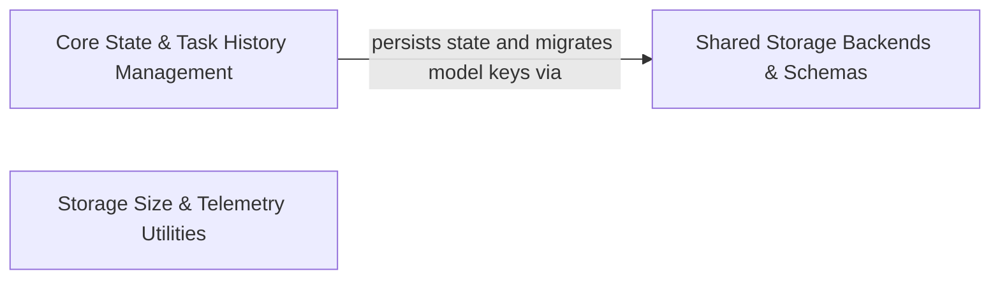

## Details

Persists application state, API configurations, secrets, task metadata, and conversation history on disk and in host storage.

### Core State & Task History Management [[Expand]](./Core_State_Task_History_Management.md)
Manages runtime application state, settings cache, conversation history, and task directory persistence on disk.

**Related Classes/Methods**:

- `src.core.storage.StateManager.StateManager.initialize`:168-233
- `src.core.storage.StateManagerSettings.buildEffectiveApiConfigurationFromCache`:125-141
- `src.core.controller.TaskHistoryController.TaskHistoryController.readOpenRouterModels`:47-59

**Source Files:**

- `src/core/controller/TaskHistoryController.ts`
  - `src.core.controller.TaskHistoryController.deleteRunStorage` (L29-L39) - Function
  - `src.core.controller.TaskHistoryController.deleteRunStorage.goal.children.map() callback` (L37-L37) - Function
  - `src.core.controller.TaskHistoryController.TaskHistoryController` (L41-L177) - Class
  - `src.core.controller.TaskHistoryController.TaskHistoryController.constructor` (L42-L45) - Constructor
  - `src.core.controller.TaskHistoryController.TaskHistoryController.readOpenRouterModels` (L47-L59) - Method
  - `src.core.controller.TaskHistoryController.TaskHistoryController.getTaskWithId` (L61-L104) - Method
  - `src.core.controller.TaskHistoryController.TaskHistoryController.getTaskWithId.runHistoryItem` (L71-L71) - Class
  - `src.core.controller.TaskHistoryController.TaskHistoryController.getTaskWithId.runHistoryItem.history.find() callback` (L71-L71) - Function
  - `src.core.controller.TaskHistoryController.TaskHistoryController.getPromptHistory` (L107-L126) - Method
  - `src.core.controller.TaskHistoryController.TaskHistoryController.getPromptHistory.runs` (L108-L118) - Class
  - `src.core.controller.TaskHistoryController.TaskHistoryController.getPromptHistory.runs.filter() callback` (L111-L115) - Function
  - `src.core.controller.TaskHistoryController.TaskHistoryController.getPromptHistory.runs.filter() callback.some() callback` (L114-L114) - Function
  - `src.core.controller.TaskHistoryController.TaskHistoryController.getPromptHistory.runs.sort() callback` (L117-L117) - Function
  - `src.core.controller.TaskHistoryController.TaskHistoryController.getPromptHistory.prompts` (L119-L124) - Class
  - `src.core.controller.TaskHistoryController.TaskHistoryController.getPromptHistory.prompts.runs.map() callback` (L120-L123) - Function
  - `src.core.controller.TaskHistoryController.TaskHistoryController.getRunHistoryItem` (L128-L132) - Method
  - `src.core.controller.TaskHistoryController.TaskHistoryController.getRunHistoryItem.item` (L129-L129) - Class
  - `src.core.controller.TaskHistoryController.TaskHistoryController.getRunHistoryItem.item.find() callback` (L129-L129) - Function
  - `src.core.controller.TaskHistoryController.TaskHistoryController.getGoalHistoryItem` (L134-L138) - Method
  - `src.core.controller.TaskHistoryController.TaskHistoryController.exportTaskWithId` (L140-L145) - Method
  - `src.core.controller.TaskHistoryController.TaskHistoryController.deleteTaskFromState` (L147-L149) - Method
  - `src.core.controller.TaskHistoryController.TaskHistoryController.updateRunHistory` (L151-L153) - Method
  - `src.core.controller.TaskHistoryController.TaskHistoryController.updateTaskHistory` (L155-L158) - Method
  - `src.core.controller.TaskHistoryController.TaskHistoryController.updateGoalHistory` (L160-L162) - Method
  - `src.core.controller.TaskHistoryController.TaskHistoryController.deleteRunStorage` (L165-L167) - Method
  - `src.core.controller.TaskHistoryController.TaskHistoryController.deleteRunWithId` (L169-L176) - Method
  - `src.core.controller.TaskHistoryController.TaskHistoryController.deleteRunWithId.withTaskHistoryInventoryLock() callback` (L170-L175) - Function
- `src/core/storage/StateManager.ts`
  - `src.core.storage.StateManager.StateManager` (L87-L471) - Class
  - `src.core.storage.StateManager.onPersistenceError` (L107-L109) - Method
  - `src.core.storage.StateManager.StateManager.onPersistenceError` (L110-L112) - Method
  - `src.core.storage.StateManager.StateManager.constructor` (L117-L134) - Constructor
  - `src.core.storage.StateManager.StateManager.constructor.getGlobalStateValue` (L120-L120) - Method
  - `src.core.storage.StateManager.StateManager.constructor.getTaskStateValue` (L121-L121) - Method
  - `src.core.storage.StateManager.StateManager.constructor.getSecretValue` (L122-L122) - Method
  - `src.core.storage.StateManager.StateManager.constructor.getWorkspaceStateValue` (L123-L123) - Method
  - `src.core.storage.StateManager.StateManager.constructor.setTaskHistoryInCache` (L124-L126) - Method
  - `src.core.storage.StateManager.StateManager.constructor.onTaskHistoryCommitMerged` (L127-L132) - Method
  - `src.core.storage.StateManager.StateManager.constructor.onTaskHistoryCommitMerged.catch() callback` (L129-L131) - Function
  - `src.core.storage.StateManager.StateManager.settingsCaches` (L136-L143) - Method
  - `src.core.storage.StateManager.StateManager.allCaches` (L145-L150) - Method
  - `src.core.storage.StateManager.StateManager.settersContext` (L152-L163) - Method
  - `src.core.storage.StateManager.StateManager.settersContext.notifyStateChange` (L161-L161) - Method
  - `src.core.storage.StateManager.StateManager.initialize` (L168-L233) - Method
  - `src.core.storage.StateManager.initialize.StateManager.instance.persistence.setupTaskHistoryWatcher() callback` (L218-L218) - Function
  - `src.core.storage.StateManager.StateManager.initialize.StateManager.instance.persistence.setupTaskHistoryWatcher() callback` (L219-L221) - Function
  - `src.core.storage.StateManager.StateManager.isInitialized` (L235-L237) - Method
  - `src.core.storage.StateManager.StateManager.get` (L239-L244) - Method
  - `src.core.storage.StateManager.StateManager.registerCallbacks` (L249-L259) - Method
  - `src.core.storage.StateManager.StateManager.subscribe` (L265-L270) - Method
  - `src.core.storage.StateManager.StateManager.notifyStateChange` (L272-L276) - Method
  - `src.core.storage.StateManager.StateManager.setGlobalState` (L278-L280) - Method
  - `src.core.storage.StateManager.StateManager.refreshModelProviderPresetsFromDisk` (L282-L284) - Method
  - `src.core.storage.StateManager.StateManager.setGlobalStateBatch` (L286-L288) - Method
  - `src.core.storage.StateManager.StateManager.upsertTaskHistoryItem` (L290-L292) - Method
  - `src.core.storage.StateManager.StateManager.setTaskHistoryFavorite` (L294-L296) - Method
  - `src.core.storage.StateManager.StateManager.removeTaskHistoryItems` (L298-L300) - Method
  - `src.core.storage.StateManager.StateManager.insertMissingTaskHistoryItems` (L302-L304) - Method
  - `src.core.storage.StateManager.StateManager.replaceTaskHistory` (L306-L308) - Method
  - `src.core.storage.StateManager.StateManager.setTaskSettings` (L310-L312) - Method
  - `src.core.storage.StateManager.StateManager.setTaskSettingsBatch` (L314-L316) - Method
  - `src.core.storage.StateManager.StateManager.hasTaskSetting` (L318-L320) - Method
  - `src.core.storage.StateManager.StateManager.getTaskSetting` (L322-L324) - Method
  - `src.core.storage.StateManager.StateManager.clearTaskSetting` (L326-L328) - Method
  - `src.core.storage.StateManager.StateManager.loadTaskSettings` (L330-L332) - Method
  - `src.core.storage.StateManager.StateManager.clearTaskSettings` (L334-L336) - Method
  - `src.core.storage.StateManager.StateManager.setSecret` (L338-L340) - Method
  - `src.core.storage.StateManager.StateManager.setSecretsBatch` (L342-L344) - Method
  - `src.core.storage.StateManager.setWorkspaceState` (L346-L346) - Method
  - `src.core.storage.StateManager.StateManager.setWorkspaceState` (L348-L350) - Method
  - `src.core.storage.StateManager.StateManager.setWorkspaceStateBatch` (L352-L354) - Method
  - `src.core.storage.StateManager.StateManager.setSessionOverride` (L356-L358) - Method
  - `src.core.storage.StateManager.StateManager.hasSessionOverride` (L361-L363) - Method
  - `src.core.storage.StateManager.StateManager.clearSessionOverride` (L365-L367) - Method
  - `src.core.storage.StateManager.StateManager.setModelsCache` (L370-L372) - Method
  - `src.core.storage.StateManager.StateManager.getModelsCache` (L374-L376) - Method
  - `src.core.storage.StateManager.StateManager.getModelInfo` (L378-L383) - Method
  - `src.core.storage.StateManager.StateManager.getApiConfiguration` (L385-L387) - Method
  - `src.core.storage.StateManager.StateManager.captureEffectiveTaskConfiguration` (L394-L412) - Method
  - `src.core.storage.StateManager.StateManager.setApiConfiguration` (L414-L416) - Method
  - `src.core.storage.StateManager.StateManager.getGlobalSettingsKey` (L418-L420) - Method
  - `src.core.storage.StateManager.StateManager.getSystemDefaultSettingsKey` (L423-L425) - Method
  - `src.core.storage.StateManager.StateManager.getGlobalStateKey` (L427-L429) - Method
  - `src.core.storage.StateManager.StateManager.getSecretKey` (L431-L433) - Method
  - `src.core.storage.StateManager.getWorkspaceStateKey` (L435-L435) - Method
  - `src.core.storage.StateManager.StateManager.getWorkspaceStateKey` (L437-L439) - Method
  - `src.core.storage.StateManager.StateManager.reInitialize` (L441-L446) - Method
  - `src.core.storage.StateManager.StateManager.dispose` (L448-L452) - Method
  - `src.core.storage.StateManager.StateManager.flushPendingState` (L454-L456) - Method
  - `src.core.storage.StateManager.StateManager.getAllGlobalStateEntries` (L458-L460) - Method
  - `src.core.storage.StateManager.StateManager.getAllWorkspaceStateEntries` (L462-L464) - Method
  - `src.core.storage.StateManager.StateManager.populateCache` (L466-L470) - Method
- `src/core/storage/StateManagerGetters.ts`
  - `src.core.storage.StateManagerGetters.StateManagerGetterCaches` (L6-L8) - Interface
  - `src.core.storage.StateManagerGetters.getGlobalSettingsKey` (L10-L17) - Function
  - `src.core.storage.StateManagerGetters.getSystemDefaultSettingsKey` (L19-L26) - Function
  - `src.core.storage.StateManagerGetters.getGlobalStateKey` (L28-L35) - Function
  - `src.core.storage.StateManagerGetters.getSecretKey` (L37-L44) - Function
  - `src.core.storage.StateManagerGetters.getWorkspaceStateKey` (L46-L53) - Function
  - `src.core.storage.StateManagerGetters.getAllGlobalStateEntries` (L55-L61) - Function
  - `src.core.storage.StateManagerGetters.getAllWorkspaceStateEntries` (L63-L69) - Function
  - `src.core.storage.StateManagerGetters.getApiConfiguration` (L71-L74) - Function
- `src/core/storage/StateManagerModelCache.ts`
  - `src.core.storage.StateManagerModelCache.ModelCacheEntry` (L3-L6) - Interface
  - `src.core.storage.StateManagerModelCache.setModelsCache` (L13-L21) - Function
  - `src.core.storage.StateManagerModelCache.getModelsCache` (L23-L32) - Function
  - `src.core.storage.StateManagerModelCache.getModelInfo` (L34-L38) - Function
- `src/core/storage/StateManagerSetters.ts`
  - `src.core.storage.StateManagerSetters.StateManagerSettersContext` (L20-L29) - Interface
  - `src.core.storage.StateManagerSetters.guardInitialized` (L31-L33) - Function
  - `src.core.storage.StateManagerSetters.setGlobalState` (L35-L46) - Function
  - `src.core.storage.StateManagerSetters.setGlobalStateBatch` (L48-L55) - Function
  - `src.core.storage.StateManagerSetters.mutateTaskHistory` (L57-L68) - Function
  - `src.core.storage.StateManagerSetters.setTaskSettings` (L70-L79) - Function
  - `src.core.storage.StateManagerSetters.setTaskSettingsBatch` (L81-L86) - Function
  - `src.core.storage.StateManagerSetters.hasTaskSetting` (L88-L91) - Function
  - `src.core.storage.StateManagerSetters.getTaskSetting` (L93-L96) - Function
  - `src.core.storage.StateManagerSetters.clearTaskSetting` (L98-L102) - Function
  - `src.core.storage.StateManagerSetters.loadTaskSettings` (L104-L112) - Function
  - `src.core.storage.StateManagerSetters.clearTaskSettings` (L114-L122) - Function
  - `src.core.storage.StateManagerSetters.setSecret` (L124-L128) - Function
  - `src.core.storage.StateManagerSetters.setSecretsBatch` (L130-L140) - Function
  - `src.core.storage.StateManagerSetters.setSecretsBatch.forEach() callback` (L133-L138) - Function
  - `src.core.storage.StateManagerSetters.setWorkspaceState` (L142-L146) - Function
  - `src.core.storage.StateManagerSetters.setWorkspaceStateBatch` (L148-L156) - Function
  - `src.core.storage.StateManagerSetters.setWorkspaceStateBatch.forEach() callback` (L151-L154) - Function
  - `src.core.storage.StateManagerSetters.setSessionOverride` (L158-L161) - Function
  - `src.core.storage.StateManagerSetters.hasSessionOverride` (L164-L167) - Function
  - `src.core.storage.StateManagerSetters.clearSessionOverride` (L169-L172) - Function
  - `src.core.storage.StateManagerSetters.refreshModelProviderPresetsFromDisk` (L175-L190) - Function
  - `src.core.storage.StateManagerSetters.refreshModelProviderPresetsFromDisk.mergedPresets` (L187-L187) - Class
  - `src.core.storage.StateManagerSetters.refreshModelProviderPresetsFromDisk.mergedPresets.sort() callback` (L187-L187) - Function
  - `src.core.storage.StateManagerSetters.setApiConfiguration` (L192-L210) - Function
- `src/core/storage/StateManagerSettings.ts`
  - `src.core.storage.StateManagerSettings.StateManagerSettingsCaches` (L27-L32) - Interface
  - `src.core.storage.StateManagerSettings.normalizeLoadedSetting` (L34-L48) - Function
  - `src.core.storage.StateManagerSettings.normalizeLoadedSettings` (L50-L58) - Function
  - `src.core.storage.StateManagerSettings.getSettingWithOverride` (L60-L68) - Function
  - `src.core.storage.StateManagerSettings.getSecret` (L70-L72) - Function
  - `src.core.storage.StateManagerSettings.resolutionCaches` (L74-L85) - Function
  - `src.core.storage.StateManagerSettings.buildEffectiveSettingsFromCache` (L88-L122) - Function
  - `src.core.storage.StateManagerSettings.buildEffectiveSettingsFromCache.settings` (L93-L93) - Class
  - `src.core.storage.StateManagerSettings.buildEffectiveSettingsFromCache.settings.SettingsKeys.map() callback` (L93-L93) - Function
  - `src.core.storage.StateManagerSettings.buildEffectiveApiConfigurationFromCache` (L125-L141) - Function
  - `src.core.storage.StateManagerSettings.buildEffectiveApiConfigurationFromCache.secrets` (L130-L132) - Class
  - `src.core.storage.StateManagerSettings.buildEffectiveApiConfigurationFromCache.secrets.SecretKeys.map() callback` (L131-L131) - Function
  - `src.core.storage.StateManagerSettings.buildEffectiveApiConfigurationFromCache.settings` (L139-L139) - Class
  - `src.core.storage.StateManagerSettings.buildEffectiveApiConfigurationFromCache.settings.ApiHandlerSettingsKeys.map() callback` (L139-L139) - Function
  - `src.core.storage.StateManagerSettings.buildApiConfigurationFromCache` (L143-L145) - Function
- `src/core/storage/StatePersistenceManager.ts`
  - `src.core.storage.StatePersistenceManager.PersistenceErrorEvent` (L30-L32) - Interface
  - `src.core.storage.StatePersistenceManager.CacheAccessors` (L35-L42) - Interface
  - `src.core.storage.StatePersistenceManager.StatePersistenceManager` (L50-L404) - Class
  - `src.core.storage.StatePersistenceManager.StatePersistenceManager.constructor` (L68-L71) - Constructor
  - `src.core.storage.StatePersistenceManager.StatePersistenceManager.addPendingGlobalState` (L75-L79) - Method
  - `src.core.storage.StatePersistenceManager.StatePersistenceManager.addPendingGlobalStateBatch` (L81-L85) - Method
  - `src.core.storage.StatePersistenceManager.StatePersistenceManager.addPendingGlobalStateBatch.keys.forEach() callback` (L83-L83) - Function
  - `src.core.storage.StatePersistenceManager.StatePersistenceManager.addPendingTaskState` (L87-L93) - Method
  - `src.core.storage.StatePersistenceManager.StatePersistenceManager.addPendingTaskStateBatch` (L95-L101) - Method
  - `src.core.storage.StatePersistenceManager.StatePersistenceManager.addPendingTaskStateBatch.keys.forEach() callback` (L99-L99) - Function
  - `src.core.storage.StatePersistenceManager.StatePersistenceManager.addPendingSecret` (L103-L106) - Method
  - `src.core.storage.StatePersistenceManager.StatePersistenceManager.addPendingSecretBatch` (L108-L111) - Method
  - `src.core.storage.StatePersistenceManager.StatePersistenceManager.addPendingSecretBatch.keys.forEach() callback` (L109-L109) - Function
  - `src.core.storage.StatePersistenceManager.StatePersistenceManager.addPendingWorkspaceState` (L113-L116) - Method
  - `src.core.storage.StatePersistenceManager.StatePersistenceManager.addPendingWorkspaceStateBatch` (L118-L121) - Method
  - `src.core.storage.StatePersistenceManager.StatePersistenceManager.addPendingWorkspaceStateBatch.keys.forEach() callback` (L119-L119) - Function
  - `src.core.storage.StatePersistenceManager.StatePersistenceManager.addPendingTaskHistoryMutation` (L123-L126) - Method
  - `src.core.storage.StatePersistenceManager.StatePersistenceManager.hasPendingTaskState` (L130-L132) - Method
  - `src.core.storage.StatePersistenceManager.StatePersistenceManager.persistAndClearPendingTaskState` (L134-L141) - Method
  - `src.core.storage.StatePersistenceManager.StatePersistenceManager.clearPendingTaskState` (L143-L145) - Method
  - `src.core.storage.StatePersistenceManager.StatePersistenceManager.persistPendingState` (L149-L153) - Method
  - `src.core.storage.StatePersistenceManager.StatePersistenceManager.persistPendingState.operation` (L150-L150) - Class
  - `src.core.storage.StatePersistenceManager.StatePersistenceManager.persistPendingState.operation.persistenceTail.then() callback` (L150-L150) - Function
  - `src.core.storage.StatePersistenceManager.StatePersistenceManager.persistPendingState.operation.catch() callback` (L151-L151) - Function
  - `src.core.storage.StatePersistenceManager.StatePersistenceManager.persistNextBatch` (L155-L210) - Method
  - `src.core.storage.StatePersistenceManager.StatePersistenceManager.flushPendingState` (L212-L218) - Method
  - `src.core.storage.StatePersistenceManager.StatePersistenceManager.dispose` (L221-L229) - Method
  - `src.core.storage.StatePersistenceManager.StatePersistenceManager.scheduleDebouncedPersistence` (L233-L246) - Method
  - `src.core.storage.StatePersistenceManager.StatePersistenceManager.scheduleDebouncedPersistence.setTimeout() callback` (L237-L245) - Function
  - `src.core.storage.StatePersistenceManager.StatePersistenceManager.persistGlobalStateBatch` (L250-L258) - Method
  - `src.core.storage.StatePersistenceManager.StatePersistenceManager.persistTaskHistoryBatch` (L260-L267) - Method
  - `src.core.storage.StatePersistenceManager.StatePersistenceManager.persistTaskStateBatch` (L269-L284) - Method
  - `src.core.storage.StatePersistenceManager.StatePersistenceManager.persistTaskStateBatch.map() callback` (L272-L282) - Function
  - `src.core.storage.StatePersistenceManager.StatePersistenceManager.persistSecretsBatch` (L286-L293) - Method
  - `src.core.storage.StatePersistenceManager.StatePersistenceManager.persistWorkspaceStateBatch` (L295-L301) - Method
  - `src.core.storage.StatePersistenceManager.StatePersistenceManager.readGlobalStateKeyFromDisk` (L305-L308) - Method
  - `src.core.storage.StatePersistenceManager.StatePersistenceManager.readAllFromDisk` (L310-L315) - Method
  - `src.core.storage.StatePersistenceManager.StatePersistenceManager.loadTaskSettingsFromDisk` (L317-L327) - Method
  - `src.core.storage.StatePersistenceManager.StatePersistenceManager.setupTaskHistoryWatcher` (L329-L403) - Method
  - `src.core.storage.StatePersistenceManager.StatePersistenceManager.setupTaskHistoryWatcher.watcher.on("error") callback` (L368-L377) - Function
  - `src.core.storage.StatePersistenceManager.StatePersistenceManager.setupTaskHistoryWatcher.watcher.on("error") callback.catch() callback` (L374-L375) - Function
  - `src.core.storage.StatePersistenceManager.StatePersistenceManager.setupTaskHistoryWatcher.on("add") callback` (L378-L381) - Function
  - `src.core.storage.StatePersistenceManager.StatePersistenceManager.setupTaskHistoryWatcher.on("change") callback` (L382-L385) - Function
  - `src.core.storage.StatePersistenceManager.StatePersistenceManager.setupTaskHistoryWatcher.on("unlink") callback` (L386-L390) - Function
  - `src.core.storage.StatePersistenceManager.StatePersistenceManager.setupTaskHistoryWatcher.on("unlink") callback.setTimeout() callback` (L389-L389) - Function
  - `src.core.storage.StatePersistenceManager.StatePersistenceManager.setupTaskHistoryWatcher.catch() callback` (L397-L398) - Function
- `src/core/storage/atomicWrite.ts`
  - `src.core.storage.atomicWrite.atomicWriteFile` (L5-L14) - Function
  - `src.core.storage.atomicWrite.atomicWriteFile.catch() callback` (L11-L11) - Function
- `src/core/storage/conversationHistory.ts`
  - `src.core.storage.conversationHistory.SavedPresentationHistory` (L21-L24) - Interface
  - `src.core.storage.conversationHistory.SavedApiConversationHistory` (L26-L29) - Interface
  - `src.core.storage.conversationHistory.getSavedApiConversationHistory` (L36-L38) - Function
  - `src.core.storage.conversationHistory.getSavedApiConversationState` (L40-L53) - Function
  - `src.core.storage.conversationHistory.getSavedApiConversationState.replayOperationRecords() callback` (L46-L51) - Function
  - `src.core.storage.conversationHistory.appendApiConversationOperations` (L55-L69) - Function
  - `src.core.storage.conversationHistory.createApiConversationBaseline` (L71-L83) - Function
  - `src.core.storage.conversationHistory.getSavedApiConversationProviderState` (L86-L90) - Function
  - `src.core.storage.conversationHistory.saveApiConversationProviderState` (L93-L99) - Function
  - `src.core.storage.conversationHistory.saveApiConversationHistory` (L102-L135) - Function
  - `src.core.storage.conversationHistory.getSavedDiracMessages` (L138-L140) - Function
  - `src.core.storage.conversationHistory.getSavedPresentationHistory` (L142-L149) - Function
  - `src.core.storage.conversationHistory.appendPresentationOperations` (L151-L157) - Function
  - `src.core.storage.conversationHistory.createPresentationBaseline` (L159-L171) - Function
  - `src.core.storage.conversationHistory.getPresentationHistoryAtMessage` (L174-L197) - Function
  - `src.core.storage.conversationHistory.getPresentationHistoryAtMessage.legacyTargetIndex` (L180-L180) - Class
  - `src.core.storage.conversationHistory.getPresentationHistoryAtMessage.legacyTargetIndex.messages.findIndex() callback` (L180-L180) - Function
  - `src.core.storage.conversationHistory.getPresentationHistoryAtMessage.replayPresentationOperationPaths() callback` (L188-L193) - Function
  - `src.core.storage.conversationHistory.readApiConversationBaseline` (L199-L221) - Function
  - `src.core.storage.conversationHistory.readApiConversationBaseline.replayOperationRecords() callback` (L209-L218) - Function
  - `src.core.storage.conversationHistory.readPresentationBaseline` (L223-L258) - Function
  - `src.core.storage.conversationHistory.readPresentationBaseline.replayOperationRecords() callback` (L246-L255) - Function
  - `src.core.storage.conversationHistory.applyApiConversationOperation` (L260-L279) - Function
  - `src.core.storage.conversationHistory.PresentationReplayState` (L281-L286) - Interface
  - `src.core.storage.conversationHistory.createPresentationReplayState` (L288-L295) - Function
  - `src.core.storage.conversationHistory.clonePresentationReplayState` (L297-L307) - Function
  - `src.core.storage.conversationHistory.clonePresentationReplayState.appendChunks.map() callback` (L303-L303) - Function
  - `src.core.storage.conversationHistory.snapshotPresentationMessages` (L309-L313) - Function
  - `src.core.storage.conversationHistory.applyPresentationOperationToState` (L315-L325) - Function
  - `src.core.storage.conversationHistory.replayPresentationOperationPaths` (L332-L405) - Function
  - `src.core.storage.conversationHistory.replayPresentationOperationPaths.replayOperationRecords() callback` (L357-L399) - Function
  - `src.core.storage.conversationHistory.materializePresentationAppends` (L407-L427) - Function
  - `src.core.storage.conversationHistory.materializeAllPresentationAppends` (L429-L437) - Function
  - `src.core.storage.conversationHistory.applyPresentationOperation` (L439-L497) - Function
  - `src.core.storage.conversationHistory.presentationOperationHistoryPaths` (L499-L515) - Function
  - `src.core.storage.conversationHistory.presentationOperationHistoryPaths.archives` (L503-L511) - Class
  - `src.core.storage.conversationHistory.presentationOperationHistoryPaths.archives.entries.filter() callback` (L504-L504) - Function
  - `src.core.storage.conversationHistory.archives.map() callback` (L505-L508) - Function
  - `src.core.storage.conversationHistory.presentationOperationHistoryPaths.archives.filter() callback` (L509-L509) - Function
  - `src.core.storage.conversationHistory.presentationOperationHistoryPaths.archives.sort() callback` (L510-L510) - Function
  - `src.core.storage.conversationHistory.presentationOperationHistoryPaths.archives.map() callback` (L511-L511) - Function
  - `src.core.storage.conversationHistory.indexMessagesById` (L517-L521) - Function
  - `src.core.storage.conversationHistory.assertNextOffset` (L523-L527) - Function
  - `src.core.storage.conversationHistory.parseSavedDiracMessages` (L529-L554) - Function
  - `src.core.storage.conversationHistory.backupTranscriptBeforeSkippingMessages` (L556-L568) - Function
  - `src.core.storage.conversationHistory.isReadableDiracMessage` (L580-L598) - Function
  - `src.core.storage.conversationHistory.isReadableMarkdown` (L600-L614) - Function
  - `src.core.storage.conversationHistory.isReadableMarkdown.isOptional() callback` (L609-L609) - Function
  - `src.core.storage.conversationHistory.isReadableSteeringState` (L616-L618) - Function
  - `src.core.storage.conversationHistory.isReadableApiStatus` (L620-L640) - Function
  - `src.core.storage.conversationHistory.isReadableApiStatus.isOptional() callback` (L635-L635) - Function
  - `src.core.storage.conversationHistory.isReadableUsageAvailability` (L642-L652) - Function
  - `src.core.storage.conversationHistory.isReadableDeletedMetrics` (L654-L662) - Function
  - `src.core.storage.conversationHistory.isReadableRetryStatus` (L664-L672) - Function
  - `src.core.storage.conversationHistory.isReadableCard` (L674-L703) - Function
  - `src.core.storage.conversationHistory.isReadableCard.isOptional() callback` (L697-L697) - Function
  - `src.core.storage.conversationHistory.isReadableCardActions` (L705-L707) - Function
  - `src.core.storage.conversationHistory.isReadableCardAction` (L709-L718) - Function
  - `src.core.storage.conversationHistory.isReadableCardAction.isOptional() callback` (L715-L715) - Function
  - `src.core.storage.conversationHistory.isReadableCardLocations` (L720-L727) - Function
  - `src.core.storage.conversationHistory.isReadableCardLocations.value.every() callback` (L724-L724) - Function
  - `src.core.storage.conversationHistory.isReadableCardDiffs` (L729-L740) - Function
  - `src.core.storage.conversationHistory.isReadableCardDiffs.value.every() callback` (L733-L737) - Function
  - `src.core.storage.conversationHistory.isRecord` (L742-L744) - Function
  - `src.core.storage.conversationHistory.isOptional` (L746-L748) - Function
  - `src.core.storage.conversationHistory.isString` (L750-L752) - Function
  - `src.core.storage.conversationHistory.isBoolean` (L754-L756) - Function
  - `src.core.storage.conversationHistory.isFiniteNumber` (L758-L760) - Function
  - `src.core.storage.conversationHistory.isStringArray` (L762-L764) - Function
  - `src.core.storage.conversationHistory.isStringInSet` (L766-L768) - Function
  - `src.core.storage.conversationHistory.saveDiracMessages` (L771-L794) - Function
- `src/core/storage/conversationHistoryFiles.ts`
  - `src.core.storage.conversationHistoryFiles.writeConversationHistoryJson` (L10-L25) - Function
  - `src.core.storage.conversationHistoryFiles.cleanupConversationHistoryFile` (L28-L36) - Function
  - `src.core.storage.conversationHistoryFiles.writeConversationHistoryText` (L39-L55) - Function
  - `src.core.storage.conversationHistoryFiles.formatConversationHistoryText` (L58-L68) - Function
  - `src.core.storage.conversationHistoryFiles.formatMessageContent` (L71-L79) - Function
  - `src.core.storage.conversationHistoryFiles.formatMessageContent.content.map() callback` (L78-L78) - Function
  - `src.core.storage.conversationHistoryFiles.formatContentBlock` (L82-L95) - Function
  - `src.core.storage.conversationHistoryFiles.formatToolResultContent` (L98-L116) - Function
  - `src.core.storage.conversationHistoryFiles.formatToolResultContent.content.map() callback` (L106-L114) - Function
- `src/core/storage/directoryEnsurers.ts`
  - `src.core.storage.directoryEnsurers.ensureTaskDirectoryExists` (L9-L11) - Function
  - `src.core.storage.directoryEnsurers.isExpectedMigrationError` (L14-L17) - Function
  - `src.core.storage.directoryEnsurers.migrateFile` (L20-L26) - Function
  - `src.core.storage.directoryEnsurers.readLegacyDir` (L29-L37) - Function
  - `src.core.storage.directoryEnsurers.migrateDir` (L40-L53) - Function
  - `src.core.storage.directoryEnsurers.migrateDir.entries.map() callback` (L46-L51) - Function
  - `src.core.storage.directoryEnsurers.migrateFromDocumentsDir` (L56-L59) - Function
  - `src.core.storage.directoryEnsurers.ensureDiracSubdir` (L62-L67) - Function
  - `src.core.storage.directoryEnsurers.ensureSettingsDirectoryExists` (L79-L81) - Function
  - `src.core.storage.directoryEnsurers.ensureStateDirectoryExists` (L84-L86) - Function
  - `src.core.storage.directoryEnsurers.ensureCacheDirectoryExists` (L89-L91) - Function
- `src/core/storage/environmentMetadata.ts`
  - `src.core.storage.environmentMetadata.collectEnvironmentMetadata` (L8-L30) - Function
- `src/core/storage/fileNames.ts`
  - `src.core.storage.fileNames.GlobalFileNames` (L2-L34) - Class
  - `src.core.storage.fileNames.GlobalFileNames.remoteConfig` (L33-L33) - Method
- `src/core/storage/globalStorageDir.ts`
  - `src.core.storage.globalStorageDir.getGlobalStorageDir` (L6-L10) - Function
- `src/core/storage/hooksStorage.ts`
  - `src.core.storage.hooksStorage.setRuntimeHooksDir` (L10-L12) - Function
  - `src.core.storage.hooksStorage.getGlobalHooksDir` (L15-L18) - Function
  - `src.core.storage.hooksStorage.getAllHooksDirs` (L21-L33) - Function
  - `src.core.storage.hooksStorage.getWorkspaceHooksDirs` (L36-L49) - Function
  - `src.core.storage.hooksStorage.getWorkspaceHooksDirs.workspaceRootPaths` (L37-L40) - Class
  - `src.core.storage.hooksStorage.workspaceRootPaths.map() callback` (L40-L40) - Function
  - `src.core.storage.hooksStorage.getWorkspaceHooksDirs.workspaceRootPaths.map() callback` (L43-L46) - Function
  - `src.core.storage.hooksStorage.getWorkspaceHooksDirs.filter() callback` (L48-L48) - Function
- `src/core/storage/operationLog.ts`
  - `src.core.storage.operationLog.encodeOperationRecords` (L7-L9) - Function
  - `src.core.storage.operationLog.encodeOperationRecords.records.map() callback` (L8-L8) - Function
  - `src.core.storage.operationLog.appendOperationRecords` (L12-L19) - Function
  - `src.core.storage.operationLog.discardIncompleteFinalRecord` (L22-L55) - Function
  - `src.core.storage.operationLog.operationLogExceedsBaselineThreshold` (L57-L64) - Function
  - `src.core.storage.operationLog.writeFramedBaseline` (L67-L85) - Function
  - `src.core.storage.operationLog.writeFramedBaseline.catch() callback` (L80-L82) - Function
  - `src.core.storage.operationLog.archiveOperationLog` (L88-L95) - Function
  - `src.core.storage.operationLog.replayOperationRecords` (L101-L138) - Function
  - `src.core.storage.operationLog.parseAndApplyRecord` (L140-L160) - Function
- `src/core/storage/paths.ts`
  - `src.core.storage.paths.getDocumentsPath` (L6-L14) - Function
  - `src.core.storage.paths.getWindowsDocumentsPath` (L17-L28) - Function
  - `src.core.storage.paths.getLinuxDocumentsPath` (L31-L39) - Function
  - `src.core.storage.paths.getDiracHomePath` (L42-L44) - Function
- `src/core/storage/remoteConfigCache.ts`
  - `src.core.storage.remoteConfigCache.readRemoteConfigFromCache` (L10-L23) - Function
  - `src.core.storage.remoteConfigCache.writeRemoteConfigToCache` (L26-L33) - Function
  - `src.core.storage.remoteConfigCache.deleteRemoteConfigFromCache` (L36-L46) - Function
- `src/core/storage/skillsStorage.ts`
  - `src.core.storage.skillsStorage.getDiracSkillsDirectoryPath` (L13-L15) - Function
  - `src.core.storage.skillsStorage.getAgentSkillsDirectoryPath` (L18-L20) - Function
  - `src.core.storage.skillsStorage.getClaudeSkillsDirectoryPath` (L23-L25) - Function
  - `src.core.storage.skillsStorage.getAiSkillsDirectoryPath` (L28-L30) - Function
  - `src.core.storage.skillsStorage.ensureAgentSkillsDirectoryExists` (L33-L43) - Function
  - `src.core.storage.skillsStorage.getSkillsDirectoriesForScan` (L46-L58) - Function
- `src/core/storage/state-migrations.ts`
  - `src.core.storage.state-migrations.MigrationStateStore` (L9-L12) - Interface
  - `src.core.storage.state-migrations.MigrationStateStore.get` (L10-L10) - Method
  - `src.core.storage.state-migrations.MigrationStateStore.update` (L11-L11) - Method
  - `src.core.storage.state-migrations.MigrationSecrets` (L15-L18) - Interface
  - `src.core.storage.state-migrations.MigrationSecrets.get` (L16-L16) - Method
  - `src.core.storage.state-migrations.MigrationSecrets.delete` (L17-L17) - Method
  - `src.core.storage.state-migrations.StateMigrationContext` (L25-L29) - Interface
  - `src.core.storage.state-migrations.migrateWorkspaceToGlobalStorage` (L31-L88) - Function
  - `src.core.storage.state-migrations.migrateTaskHistoryToFile` (L90-L126) - Function
  - `src.core.storage.state-migrations.migrateTaskHistoryToFile.writtenIds` (L112-L112) - Class
  - `src.core.storage.state-migrations.migrateTaskHistoryToFile.writtenIds.successfullyWrittenData.map() callback` (L112-L112) - Function
  - `src.core.storage.state-migrations.migrateTaskHistoryToFile.oldLocationData.some() callback` (L113-L113) - Function
  - `src.core.storage.state-migrations.migrateCustomInstructionsToGlobalRules` (L128-L171) - Function
  - `src.core.storage.state-migrations.migrateWelcomeViewCompleted` (L173-L246) - Function
  - `src.core.storage.state-migrations.migrateWelcomeViewCompleted.hasKey` (L211-L235) - Class
  - `src.core.storage.state-migrations.migrateWelcomeViewCompleted.hasKey.some() callback` (L235-L235) - Function
  - `src.core.storage.state-migrations.cleanupOldApiKey` (L248-L257) - Function
- `src/core/storage/taskDirectory.ts`
  - `src.core.storage.taskDirectory.assertTaskDirectoryId` (L5-L9) - Function
  - `src.core.storage.taskDirectory.getTasksDirectoryPath` (L11-L13) - Function
  - `src.core.storage.taskDirectory.getTaskDirectoryPath` (L15-L18) - Function
  - `src.core.storage.taskDirectory.listTaskDirectoryIds` (L20-L28) - Function
  - `src.core.storage.taskDirectory.listTaskDirectoryIds.entries.filter() callback` (L23-L23) - Function
  - `src.core.storage.taskDirectory.listTaskDirectoryIds.map() callback` (L23-L23) - Function
  - `src.core.storage.taskDirectory.deleteTaskDirectory` (L31-L33) - Function
- `src/core/storage/taskHistory.ts`
  - `src.core.storage.taskHistory.getTaskHistoryStateFilePath` (L37-L39) - Function
  - `src.core.storage.taskHistory.taskHistoryStateFileExists` (L42-L45) - Function
  - `src.core.storage.taskHistory.getTaskHistoryInventoryLockPath` (L47-L49) - Function
  - `src.core.storage.taskHistory.tryAcquireTaskHistoryInventoryLease` (L51-L61) - Function
  - `src.core.storage.taskHistory.withTaskHistoryInventoryLock` (L63-L70) - Function
  - `src.core.storage.taskHistory.readTaskHistoryFromState` (L73-L85) - Function
  - `src.core.storage.taskHistory.parseTaskHistoryContents` (L88-L123) - Function
  - `src.core.storage.taskHistory.isExplicitGoalRecord` (L125-L127) - Function
  - `src.core.storage.taskHistory.hasUnsupportedRunKind` (L129-L133) - Function
  - `src.core.storage.taskHistory.hasReadableHistoryBase` (L135-L156) - Function
  - `src.core.storage.taskHistory.isReadableTaskHistoryItem` (L158-L162) - Function
  - `src.core.storage.taskHistory.assertReadableGoalHistoryItem` (L164-L193) - Function
  - `src.core.storage.taskHistory.isOptional` (L195-L197) - Function
  - `src.core.storage.taskHistory.isString` (L199-L201) - Function
  - `src.core.storage.taskHistory.isBoolean` (L203-L205) - Function
  - `src.core.storage.taskHistory.isFiniteNumber` (L207-L209) - Function
  - `src.core.storage.taskHistory.isFiniteNumberPair` (L211-L213) - Function
  - `src.core.storage.taskHistory.recoverTaskHistory` (L216-L227) - Function
  - `src.core.storage.taskHistory.backupUnreadableTaskHistory` (L229-L236) - Function
  - `src.core.storage.taskHistory.applyTaskHistoryMutations` (L238-L285) - Function
  - `src.core.storage.taskHistory.index` (L246-L246) - Class
  - `src.core.storage.taskHistory.index.items.findIndex() callback` (L246-L246) - Function
  - `src.core.storage.taskHistory.applyTaskHistoryMutations.index` (L260-L260) - Class
  - `src.core.storage.taskHistory.applyTaskHistoryMutations.index.items.findIndex() callback` (L260-L260) - Function
  - `src.core.storage.taskHistory.applyTaskHistoryMutations.items.filter() callback` (L267-L267) - Function
  - `src.core.storage.taskHistory.applyTaskHistoryMutations.existingIds` (L271-L271) - Class
  - `src.core.storage.taskHistory.applyTaskHistoryMutations.existingIds.items.map() callback` (L271-L271) - Function
  - `src.core.storage.taskHistory.commitTaskHistoryMutations` (L287-L308) - Function
  - `src.core.storage.taskHistory.commitTaskHistoryMutations.taskHistoryWriteMutex.withLock() callback` (L291-L307) - Function
  - `src.core.storage.taskHistory.writeTaskHistoryToState` (L311-L313) - Function
  - `src.core.storage.taskHistory.readTaskHistoryFileWithoutRecovery` (L315-L331) - Function
  - `src.core.storage.taskHistory.assertWritableTaskHistory` (L333-L341) - Function
  - `src.core.storage.taskHistory.assertWritableTaskHistory.items.forEach() callback` (L335-L340) - Function
  - `src.core.storage.taskHistory.assertMatchingRunKinds` (L343-L346) - Function
  - `src.core.storage.taskHistory.isLockContentionError` (L348-L350) - Function
- `src/core/storage/taskStorage.ts`
  - `src.core.storage.taskStorage.getTaskMetadataLock` (L15-L22) - Function
  - `src.core.storage.taskStorage.getTaskSettingsLock` (L24-L31) - Function
  - `src.core.storage.taskStorage.getTaskMetadata` (L34-L44) - Function
  - `src.core.storage.taskStorage.writeTaskMetadata` (L46-L50) - Function
  - `src.core.storage.taskStorage.saveTaskMetadata` (L53-L59) - Function
  - `src.core.storage.taskStorage.saveTaskMetadata.withLock() callback` (L55-L55) - Function
  - `src.core.storage.taskStorage.updateTaskMetadata` (L62-L72) - Function
  - `src.core.storage.taskStorage.updateTaskMetadata.withLock() callback` (L66-L71) - Function
  - `src.core.storage.taskStorage.readTaskSettingsFromStorage` (L75-L88) - Function
  - `src.core.storage.taskStorage.writeTaskSettingsToStorage` (L91-L108) - Function
  - `src.core.storage.taskStorage.writeTaskSettingsToStorage.withLock() callback` (L93-L103) - Function
- `src/core/storage/utils/state-helpers.ts`
  - `src.core.storage.utils.state-helpers.readSecretsFromStorage` (L26-L31) - Function
  - `src.core.storage.utils.state-helpers.readSecretsFromStorage.SecretKeys.reduce() callback` (L27-L30) - Function
  - `src.core.storage.utils.state-helpers.readWorkspaceStateFromStorage` (L36-L41) - Function
  - `src.core.storage.utils.state-helpers.readWorkspaceStateFromStorage.LocalStateKeys.reduce() callback` (L37-L40) - Function
  - `src.core.storage.utils.state-helpers.readGlobalStateFromStorage` (L46-L87) - Function
  - `src.core.storage.utils.state-helpers.handleComputedProperties` (L94-L108) - Function
  - `src.core.storage.utils.state-helpers.handleAsyncProperties` (L113-L116) - Function
  - `src.core.storage.utils.state-helpers.resetWorkspaceState` (L118-L122) - Function
  - `src.core.storage.utils.state-helpers.resetWorkspaceState.LocalStateKeys.map() callback` (L120-L120) - Function
  - `src.core.storage.utils.state-helpers.resetGlobalState` (L124-L135) - Function
  - `src.core.storage.utils.state-helpers.resetGlobalState.withTaskHistoryInventoryLock() callback` (L127-L134) - Function
  - `src.core.storage.utils.state-helpers.resetGlobalState.withTaskHistoryInventoryLock() callback.GlobalStateAndSettingKeys.map() callback` (L128-L131) - Function
  - `src.core.storage.utils.state-helpers.resetGlobalState.withTaskHistoryInventoryLock() callback.SecretKeys.map() callback` (L132-L132) - Function

### Shared Storage Backends & Schemas [[Expand]](./Shared_Storage_Backends_Schemas.md)
Provides low-level file and blob storage implementations, state and provider key definitions, environment configuration loaders, and legacy model ID migrations.

**Related Classes/Methods**:

- `src.shared.storage.DiracFileStorage.DiracFileStorage`:19-102
- `src.shared.storage.env-config.getExplicitDiracSecretsFromEnv`:63-69
- `src.shared.storage.legacy-model-id-migration.buildLegacyModelIdStateUpdates`:61-71

**Source Files:**

- `src/shared/messages/content.ts`
  - `src.shared.messages.content.DiracReasoningDetailParam` (L8-L14) - Interface
  - `src.shared.messages.content.DiracSharedMessageParam` (L16-L19) - Interface
  - `src.shared.messages.content.DiracTextContentBlock` (L28-L38) - Interface
  - `src.shared.messages.content.DiracImageContentBlock` (L40-L40) - Interface
  - `src.shared.messages.content.DiracDocumentContentBlock` (L42-L42) - Interface
  - `src.shared.messages.content.DiracUserToolResultContentBlock` (L44-L44) - Interface
  - `src.shared.messages.content.DiracAssistantToolUseBlock` (L49-L54) - Interface
  - `src.shared.messages.content.DiracAssistantThinkingBlock` (L56-L60) - Interface
  - `src.shared.messages.content.DiracAssistantRedactedThinkingBlock` (L62-L62) - Interface
  - `src.shared.messages.content.DiracStorageMessage` (L88-L110) - Interface
  - `src.shared.messages.content.removeUserInputMarkersFromContent` (L112-L132) - Function
  - `src.shared.messages.content.removeUserInputMarkersFromContent.content.block.content.map() callback` (L117-L117) - Function
  - `src.shared.messages.content.removeUserInputMarkersFromContent.source.content.block.source.content.map() callback` (L125-L126) - Function
  - `src.shared.messages.content.removeUserInputMarkersFromMessage` (L134-L137) - Function
  - `src.shared.messages.content.removeProviderBoundaryMetadataFromMessage` (L139-L142) - Function
  - `src.shared.messages.content.convertDiracStorageToAnthropicMessage` (L144-L158) - Function
  - `src.shared.messages.content.convertDiracStorageToAnthropicMessage.filteredContent` (L152-L152) - Class
  - `src.shared.messages.content.convertDiracStorageToAnthropicMessage.filteredContent.content.filter() callback` (L152-L152) - Function
  - `src.shared.messages.content.removeProviderBoundaryMetadata` (L160-L181) - Function
  - `src.shared.messages.content.removeProviderBoundaryMetadata.content.block.content.map() callback` (L168-L168) - Function
  - `src.shared.messages.content.removeProviderBoundaryMetadata.source.content.block.source.content.map() callback` (L176-L176) - Function
  - `src.shared.messages.content.cleanContentBlock` (L183-L198) - Function
  - `src.shared.messages.content.cleanContentBlock.block.content.map() callback` (L188-L188) - Function
  - `src.shared.messages.content.cleanContentBlock.content.block.source.content.map() callback` (L193-L193) - Function
- `src/shared/storage/DiracBlobStorage.ts`
  - `src.shared.storage.DiracBlobStorage.BlobStoreSettings` (L5-L26) - Interface
  - `src.shared.storage.DiracBlobStorage.DiracBlobStorage` (L32-L146) - Class
  - `src.shared.storage.DiracBlobStorage.DiracBlobStorage.instance` (L36-L41) - Method
  - `src.shared.storage.DiracBlobStorage.DiracBlobStorage.init` (L51-L87) - Method
  - `src.shared.storage.DiracBlobStorage.DiracBlobStorage.isReady` (L92-L94) - Method
  - `src.shared.storage.DiracBlobStorage.DiracBlobStorage.isConfigured` (L96-L109) - Method
  - `src.shared.storage.DiracBlobStorage.DiracBlobStorage._get` (L111-L121) - Method
  - `src.shared.storage.DiracBlobStorage.DiracBlobStorage._store` (L123-L133) - Method
  - `src.shared.storage.DiracBlobStorage.DiracBlobStorage._delete` (L135-L145) - Method
- `src/shared/storage/DiracFileStorage.ts`
  - `src.shared.storage.DiracFileStorage.DiracFileStorageOptions` (L6-L12) - Interface
  - `src.shared.storage.DiracFileStorage.DiracFileStorage` (L19-L102) - Class
  - `src.shared.storage.DiracFileStorage.DiracFileStorage.constructor` (L25-L31) - Constructor
  - `src.shared.storage.DiracFileStorage.DiracFileStorage.reloadFromDisk` (L34-L36) - Method
  - `src.shared.storage.DiracFileStorage.DiracFileStorage._get` (L38-L40) - Method
  - `src.shared.storage.DiracFileStorage.DiracFileStorage._set` (L42-L45) - Method
  - `src.shared.storage.DiracFileStorage.DiracFileStorage._delete` (L47-L49) - Method
  - `src.shared.storage.DiracFileStorage.DiracFileStorage.setBatch` (L56-L76) - Method
  - `src.shared.storage.DiracFileStorage.DiracFileStorage._keys` (L78-L80) - Method
  - `src.shared.storage.DiracFileStorage.DiracFileStorage.readFromDisk` (L82-L91) - Method
  - `src.shared.storage.DiracFileStorage.DiracFileStorage.writeToDisk` (L93-L101) - Method
  - `src.shared.storage.DiracFileStorage.atomicWriteFileSync` (L108-L127) - Function
- `src/shared/storage/DiracStorage.ts`
  - `src.shared.storage.DiracStorage.DiracStorageChangeEvent` (L3-L5) - Interface
  - `src.shared.storage.DiracStorage.DiracMemento` (L17-L27) - Interface
  - `src.shared.storage.DiracStorage.get` (L18-L18) - Method
  - `src.shared.storage.DiracStorage.DiracMemento.get` (L19-L19) - Method
  - `src.shared.storage.DiracStorage.DiracMemento.update` (L20-L20) - Method
  - `src.shared.storage.DiracStorage.DiracMemento.keys` (L21-L21) - Method
  - `src.shared.storage.DiracStorage.DiracMemento.setBatch` (L26-L26) - Method
  - `src.shared.storage.DiracStorage.DiracStorage` (L34-L113) - Class
  - `src.shared.storage.DiracStorage.DiracStorage.onDidChange` (L47-L55) - Method
  - `src.shared.storage.DiracStorage.DiracStorage.onDidChange.<function>` (L49-L54) - Function
  - `src.shared.storage.DiracStorage.DiracStorage.get` (L61-L67) - Method
  - `src.shared.storage.DiracStorage.DiracStorage._dangerousStore` (L69-L71) - Method
  - `src.shared.storage.DiracStorage.DiracStorage.store` (L78-L84) - Method
  - `src.shared.storage.DiracStorage.DiracStorage.delete` (L91-L97) - Method
  - `src.shared.storage.DiracStorage.DiracStorage._get` (L102-L102) - Method
  - `src.shared.storage.DiracStorage.DiracStorage._store` (L107-L107) - Method
  - `src.shared.storage.DiracStorage.DiracStorage._delete` (L112-L112) - Method
  - `src.shared.storage.DiracStorage.DiracSyncStorage` (L127-L212) - Class
  - `src.shared.storage.DiracStorage.DiracSyncStorage.onDidChange` (L138-L146) - Method
  - `src.shared.storage.DiracStorage.DiracSyncStorage.onDidChange.<function>` (L140-L145) - Function
  - `src.shared.storage.DiracStorage.DiracSyncStorage.fireChange` (L151-L159) - Method
  - `src.shared.storage.DiracStorage.DiracSyncStorage.get` (L163-L171) - Method
  - `src.shared.storage.DiracStorage.DiracSyncStorage.update` (L176-L179) - Method
  - `src.shared.storage.DiracStorage.DiracSyncStorage.set` (L181-L188) - Method
  - `src.shared.storage.DiracStorage.DiracSyncStorage.delete` (L190-L197) - Method
  - `src.shared.storage.DiracStorage.DiracSyncStorage.keys` (L199-L206) - Method
  - `src.shared.storage.DiracStorage.DiracSyncStorage._get` (L208-L208) - Method
  - `src.shared.storage.DiracStorage.DiracSyncStorage._set` (L209-L209) - Method
  - `src.shared.storage.DiracStorage.DiracSyncStorage._delete` (L210-L210) - Method
  - `src.shared.storage.DiracStorage.DiracSyncStorage._keys` (L211-L211) - Method
  - `src.shared.storage.DiracStorage.DiracInMemoryStorage` (L217-L234) - Class
  - `src.shared.storage.DiracStorage.DiracInMemoryStorage._get` (L223-L225) - Method
  - `src.shared.storage.DiracStorage.DiracInMemoryStorage._store` (L227-L229) - Method
  - `src.shared.storage.DiracStorage.DiracInMemoryStorage._delete` (L231-L233) - Method
- `src/shared/storage/adapters.ts`
  - `src.shared.storage.adapters.StorageAdapter` (L5-L9) - Interface
  - `src.shared.storage.adapters.StorageAdapter.read` (L6-L6) - Method
  - `src.shared.storage.adapters.StorageAdapter.write` (L7-L7) - Method
  - `src.shared.storage.adapters.StorageAdapter.remove` (L8-L8) - Method
  - `src.shared.storage.adapters.createAdapter` (L11-L48) - Function
  - `src.shared.storage.adapters.createAdapter.read` (L14-L23) - Method
  - `src.shared.storage.adapters.createAdapter.write` (L25-L36) - Method
  - `src.shared.storage.adapters.createAdapter.remove` (L38-L46) - Method
  - `src.shared.storage.adapters.createS3Adapter` (L50-L71) - Function
  - `src.shared.storage.adapters.createR2Adapter` (L73-L92) - Function
  - `src.shared.storage.adapters.getStorageAdapter` (L94-L109) - Function
- `src/shared/storage/env-config.ts`
  - `src.shared.storage.env-config.getExplicitDiracProviderFromEnv` (L58-L61) - Function
  - `src.shared.storage.env-config.getExplicitDiracSecretsFromEnv` (L63-L69) - Function
  - `src.shared.storage.env-config.getExplicitDiracSettingsFromEnv` (L71-L88) - Function
  - `src.shared.storage.env-config.getSecretsFromEnv` (L94-L118) - Function
  - `src.shared.storage.env-config.getSettingsFromEnv` (L124-L151) - Function
  - `src.shared.storage.env-config.getProviderFromEnv` (L156-L185) - Function
- `src/shared/storage/legacy-model-id-migration.ts`
  - `src.shared.storage.legacy-model-id-migration.normalizeRetiredDeepSeekModelId` (L22-L24) - Function
  - `src.shared.storage.legacy-model-id-migration.normalizeLegacySynthetic1mModelId` (L30-L37) - Function
  - `src.shared.storage.legacy-model-id-migration.normalizeLegacyAnthropicFastModeModelId` (L41-L43) - Function
  - `src.shared.storage.legacy-model-id-migration.buildLegacyAnthropicFastModeStateUpdates` (L45-L59) - Function
  - `src.shared.storage.legacy-model-id-migration.buildLegacyModelIdStateUpdates` (L61-L71) - Function
  - `src.shared.storage.legacy-model-id-migration.buildRetiredDeepSeekModelStateUpdates` (L72-L97) - Function
  - `src.shared.storage.legacy-model-id-migration.normalizeLegacyOpenRouterPinMap` (L98-L115) - Function
  - `src.shared.storage.legacy-model-id-migration.normalizeLegacyOpenRouterPinMap.canonicalKeys` (L105-L105) - Class
  - `src.shared.storage.legacy-model-id-migration.normalizeLegacyOpenRouterPinMap.canonicalKeys.keys.filter() callback` (L105-L105) - Function
  - `src.shared.storage.legacy-model-id-migration.normalizeLegacyOpenRouterPinMap.legacyKeys` (L106-L106) - Class
  - `src.shared.storage.legacy-model-id-migration.normalizeLegacyOpenRouterPinMap.legacyKeys.keys.filter() callback` (L106-L106) - Function
  - `src.shared.storage.legacy-model-id-migration.removeLegacySynthetic1mModelEntries` (L117-L121) - Function
  - `src.shared.storage.legacy-model-id-migration.removeLegacySynthetic1mModelEntries.filter() callback` (L119-L119) - Function
  - `src.shared.storage.legacy-model-id-migration.buildLegacySynthetic1mStateUpdates` (L123-L150) - Function
  - `src.shared.storage.legacy-model-id-migration.normalizeLegacyModelProviderPresets` (L152-L167) - Function
  - `src.shared.storage.legacy-model-id-migration.normalizeLegacyModelProviderPreset` (L169-L187) - Function
- `src/shared/storage/provider-keys.ts`
  - `src.shared.storage.provider-keys.getProviderModelIdKey` (L131-L141) - Function
  - `src.shared.storage.provider-keys.getProviderModelInfoKey` (L143-L146) - Function
  - `src.shared.storage.provider-keys.getProviderDefaultModelId` (L148-L150) - Function
- `src/shared/storage/state-keys.ts`
  - `src.shared.storage.state-keys.UtilityModelUseCases` (L51-L56) - Interface
  - `src.shared.storage.state-keys.USER_SETTINGS_FIELDS.browserSettings.transform` (L251-L251) - Method
  - `src.shared.storage.state-keys.USER_SETTINGS_FIELDS.autoCondenseContextLimits.transform` (L268-L273) - Method
  - `src.shared.storage.state-keys.USER_SETTINGS_FIELDS.autoCondenseContextLimits.transform.filter() callback` (L271-L271) - Function
  - `src.shared.storage.state-keys.extractDefaults` (L445-L451) - Function
  - `src.shared.storage.state-keys.extractDefaults.map() callback` (L448-L448) - Function
  - `src.shared.storage.state-keys.extractDefaults.filter() callback` (L449-L449) - Function
  - `src.shared.storage.state-keys.extractTransforms` (L453-L459) - Function
  - `src.shared.storage.state-keys.extractTransforms.filter() callback` (L456-L456) - Function
  - `src.shared.storage.state-keys.extractTransforms.map() callback` (L457-L457) - Function
  - `src.shared.storage.state-keys.extractMetadata` (L461-L467) - Function
  - `src.shared.storage.state-keys.extractMetadata.filter() callback` (L464-L464) - Function
  - `src.shared.storage.state-keys.extractMetadata.map() callback` (L465-L465) - Function
- `src/shared/storage/storage-context.ts`
  - `src.shared.storage.storage-context.StorageContext` (L15-L39) - Interface
  - `src.shared.storage.storage-context.StorageContextOptions` (L41-L62) - Interface
  - `src.shared.storage.storage-context.hashString` (L70-L78) - Function
  - `src.shared.storage.storage-context.createStorageContext` (L94-L126) - Function
- `src/shared/storage/types.ts`
  - `src.shared.storage.types.isOpenaiReasoningEffort` (L21-L23) - Function
  - `src.shared.storage.types.normalizeOpenaiReasoningEffort` (L25-L28) - Function
  - `src.shared.storage.types.isInferenceSpeed` (L42-L44) - Function
  - `src.shared.storage.types.normalizeInferenceSpeed` (L46-L49) - Function

### Storage Size & Telemetry Utilities
Calculates disk usage across task and checkpoint directories and records extension storage error and user lifecycle telemetry events.

**Related Classes/Methods**:

- `src.utils.storage.getTotalTasksSize`:10-22
- `src.services.telemetry.UserTelemetry.UserTelemetry`:12-78

**Source Files:**

- `src/services/telemetry/UserTelemetry.ts`
  - `src.services.telemetry.UserTelemetry.UserTelemetry` (L12-L78) - Class
  - `src.services.telemetry.UserTelemetry.UserTelemetry.constructor` (L15-L19) - Constructor
  - `src.services.telemetry.UserTelemetry.UserTelemetry.captureUserOptOut` (L21-L23) - Method
  - `src.services.telemetry.UserTelemetry.UserTelemetry.captureUserOptIn` (L25-L27) - Method
  - `src.services.telemetry.UserTelemetry.UserTelemetry.captureExtensionActivated` (L29-L31) - Method
  - `src.services.telemetry.UserTelemetry.UserTelemetry.captureExtensionStorageError` (L33-L44) - Method
  - `src.services.telemetry.UserTelemetry.UserTelemetry.captureAuthStarted` (L46-L48) - Method
  - `src.services.telemetry.UserTelemetry.UserTelemetry.captureAuthSucceeded` (L50-L52) - Method
  - `src.services.telemetry.UserTelemetry.UserTelemetry.captureAuthFailed` (L54-L56) - Method
  - `src.services.telemetry.UserTelemetry.UserTelemetry.captureAuthLoggedOut` (L58-L60) - Method
  - `src.services.telemetry.UserTelemetry.UserTelemetry.captureOnboardingProgress` (L62-L64) - Method
  - `src.services.telemetry.UserTelemetry.UserTelemetry.identifyAccount` (L66-L77) - Method
- `src/utils/storage.ts`
  - `src.utils.storage.getTotalTasksSize` (L10-L22) - Function

### [FAQ](https://github.com/CodeBoarding/GeneratedOnBoardings/tree/main?tab=readme-ov-file#faq)