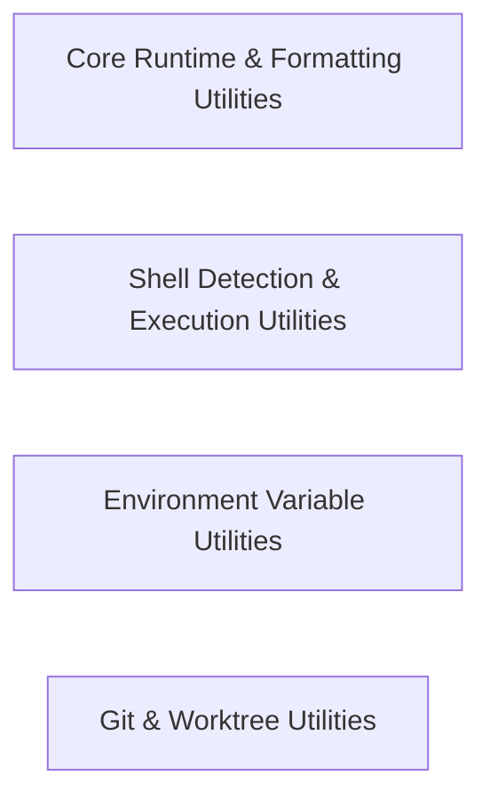

## Details

Provides low-level utilities for filesystem access, Git operations, worktree management, shell detection, line hashing, retry backoff, and API cost calculation.

### Core Runtime & Formatting Utilities
Provides shared helper functions for filesystem operations, process termination, retry logic, cost calculation, model helpers, frontmatter parsing, and string/time formatting.

**Related Classes/Methods**: _None_

**Source Files:**

- `src/utils/announcements.ts`
  - `src.utils.announcements.getLatestAnnouncementId` (L10-L13) - Function
- `src/utils/cost.ts`
  - `src.utils.cost.getModelPricingForDate` (L6-L24) - Function
  - `src.utils.cost.getModelPricingForDate.period` (L10-L16) - Class
  - `src.utils.cost.getModelPricingForDate.period.schedule.periods.find() callback` (L11-L15) - Function
  - `src.utils.cost.getModelInfoForInferenceSpeed` (L25-L60) - Function
  - `src.utils.cost.getModelInfoForInferenceSpeed.pricingSchedule.periods.modelInfo.pricingSchedule.periods.map() callback` (L38-L46) - Function
  - `src.utils.cost.getModelInfoForInferenceSpeed.tiers.modelInfo.tiers.map() callback` (L49-L55) - Function
  - `src.utils.cost.calculateApiCostInternal` (L62-L130) - Function
  - `src.utils.cost.calculateApiCostInternal.sortedTiers` (L88-L88) - Class
  - `src.utils.cost.calculateApiCostInternal.sortedTiers.sort() callback` (L88-L88) - Function
  - `src.utils.cost.calculateApiCostInternal.tier` (L91-L91) - Class
  - `src.utils.cost.calculateApiCostInternal.tier.sortedTiers.find() callback` (L91-L91) - Function
  - `src.utils.cost.calculateApiCostAnthropic` (L132-L158) - Function
  - `src.utils.cost.calculateApiCostOpenAI` (L161-L187) - Function
  - `src.utils.cost.calculateApiCostQwen` (L190-L216) - Function
- `src/utils/frontmatter.ts`
  - `src.utils.frontmatter.parseYamlFrontmatter` (L38-L54) - Function
- `src/utils/fs.ts`
  - `src.utils.fs.createDirectoriesForFile` (L15-L36) - Function
  - `src.utils.fs.isNotFound` (L47-L49) - Function
  - `src.utils.fs.isNotADirectory` (L51-L53) - Function
  - `src.utils.fs.fileExistsAtPath` (L55-L65) - Function
  - `src.utils.fs.isDirectory` (L72-L82) - Function
  - `src.utils.fs.getFileSizeInKB` (L89-L100) - Function
  - `src.utils.fs.writeFile` (L109-L119) - Function
  - `src.utils.fs.readDirectory.filePaths` (L138-L167) - Class
  - `src.utils.fs.filePaths.then() callback` (L140-L140) - Function
  - `src.utils.fs.filePaths.then() callback.entries.filter() callback` (L140-L140) - Function
  - `src.utils.fs.readDirectory.filePaths.then() callback.entries.filter() callback` (L141-L141) - Function
  - `src.utils.fs.readDirectory.filePaths.then() callback.files.map() callback` (L143-L150) - Function
  - `src.utils.fs.readDirectory.filePaths.then() callback` (L152-L166) - Function
  - `src.utils.fs.readDirectory.filePaths.then() callback.filePaths.filter() callback` (L153-L166) - Function
  - `src.utils.fs.getBinaryLocation` (L175-L183) - Function
- `src/utils/line-hashing.ts`
  - `src.utils.line-hashing.contentHash` (L17-L23) - Function
  - `src.utils.line-hashing.splitAnchor` (L26-L28) - Function
  - `src.utils.line-hashing.formatLineWithHash` (L31-L33) - Function
  - `src.utils.line-hashing.hashLinesStateful` (L36-L41) - Function
  - `src.utils.line-hashing.hashLinesStateful.lines.map() callback` (L40-L40) - Function
  - `src.utils.line-hashing.formatLineForModel` (L44-L46) - Function
  - `src.utils.line-hashing.formatLinesForModel` (L49-L51) - Function
  - `src.utils.line-hashing.formatLinesForModel.lines.map() callback` (L50-L50) - Function
  - `src.utils.line-hashing.hashLines` (L54-L57) - Function
- `src/utils/model-utils.ts`
  - `src.utils.model-utils.modelDoesntSupportWebp` (L9-L12) - Function
  - `src.utils.model-utils.shouldSkipReasoningForModel` (L20-L26) - Function
  - `src.utils.model-utils.isAnthropicModelId` (L28-L34) - Function
  - `src.utils.model-utils.isAnthropicModelId.CLAUDE_MODELS.some() callback` (L33-L33) - Function
  - `src.utils.model-utils.isGptGenerationAtLeast` (L38-L41) - Function
  - `src.utils.model-utils.supportsOpenAiPersistedReasoning` (L43-L45) - Function
  - `src.utils.model-utils.isLocalModel` (L47-L50) - Function
  - `src.utils.model-utils.parsePrice` (L57-L67) - Function
  - `src.utils.model-utils.isParallelToolCallingEnabled` (L73-L75) - Function
  - `src.utils.model-utils.normalize` (L77-L79) - Function
- `src/utils/os.ts`
  - `src.utils.os.getAvailableCores` (L7-L57) - Function
- `src/utils/process-termination.ts`
  - `src.utils.process-termination.TerminateProcessTreeOptions` (L13-L22) - Interface
  - `src.utils.process-termination.terminateProcessTree` (L33-L56) - Function
  - `src.utils.process-termination.terminateProcessTree.processExit` (L41-L48) - Class
  - `src.utils.process-termination.terminateProcessTree.processExit.<function>` (L41-L48) - Function
  - `src.utils.process-termination.terminateProcessTree.processExit.<function>.childProcess.once("exit") callback` (L43-L43) - Function
- `src/utils/retry.ts`
  - `src.utils.retry.RetryWithBackoffOptions` (L2-L10) - Interface
  - `src.utils.retry.retryWithBackoff` (L32-L62) - Function
  - `src.utils.retry.retryOperation` (L68-L92) - Function
  - `src.utils.retry.retryOperation.timeoutPromise.<function>` (L74-L75) - Function
  - `src.utils.retry.retryOperation.timeoutPromise` (L74-L76) - Class
  - `src.utils.retry.retryOperation.timeoutPromise.<function>.setTimeout() callback` (L75-L75) - Function
  - `src.utils.retry.sleep` (L95-L97) - Function
- `src/utils/string.ts`
  - `src.utils.string.fixModelHtmlEscaping` (L6-L13) - Function
  - `src.utils.string.removeInvalidChars` (L20-L22) - Function
- `src/utils/tabFiltering.ts`
  - `src.utils.tabFiltering.filterExistingFiles` (L8-L20) - Function
- `src/utils/time.ts`
  - `src.utils.time.secondsToMs` (L1-L3) - Function

### Shell Detection & Execution Utilities
Detects available system shells and manages shell and PowerShell command execution routines.

**Related Classes/Methods**: _None_

**Source Files:**

- `src/utils/powershell.ts`
  - `src.utils.powershell.uniquePreserveOrder` (L10-L12) - Function
  - `src.utils.powershell.getFallbackWindowsPowerShellPath` (L14-L16) - Function
  - `src.utils.powershell.getWindowsPowerShellCandidates` (L18-L31) - Function
  - `src.utils.powershell.resetPowerShellResolverCacheForTesting` (L33-L36) - Function
  - `src.utils.powershell.setPowerShellProbeForTesting` (L38-L42) - Function
  - `src.utils.powershell.probeWindowsExecutable` (L44-L73) - Function
  - `src.utils.powershell.probeWindowsExecutable.<function>` (L45-L72) - Function
  - `src.utils.powershell.probeWindowsExecutable.<function>.timer` (L63-L68) - Class
  - `src.utils.powershell.probeWindowsExecutable.<function>.timer.setTimeout() callback` (L63-L68) - Function
  - `src.utils.powershell.probeWindowsExecutable.<function>.child.once("error") callback` (L70-L70) - Function
  - `src.utils.powershell.probeWindowsExecutable.<function>.child.once("exit") callback` (L71-L71) - Function
  - `src.utils.powershell.resolveWindowsPowerShellExecutable` (L75-L96) - Function
  - `src.utils.powershell.resolveWindowsPowerShellExecutable.<function>` (L77-L92) - Function
- `src/utils/shell-detection.ts`
  - `src.utils.shell-detection.ShellInfo` (L6-L10) - Interface
  - `src.utils.shell-detection.detectBestShell` (L24-L89) - Function
  - `src.utils.shell-detection.getShellArgs` (L94-L108) - Function
- `src/utils/shell.ts`
  - `src.utils.shell.MacTerminalProfile` (L29-L31) - Interface
  - `src.utils.shell.WindowsTerminalProfile` (L35-L38) - Interface
  - `src.utils.shell.LinuxTerminalProfile` (L42-L44) - Interface
  - `src.utils.shell.getWindowsTerminalConfig` (L52-L62) - Function
  - `src.utils.shell.getMacTerminalConfig` (L64-L73) - Function
  - `src.utils.shell.getLinuxTerminalConfig` (L75-L84) - Function
  - `src.utils.shell.getWindowsShellFromVSCode` (L91-L127) - Function
  - `src.utils.shell.getMacShellFromVSCode` (L130-L138) - Function
  - `src.utils.shell.getLinuxShellFromVSCode` (L141-L149) - Function
  - `src.utils.shell.getShellFromUserInfo` (L159-L166) - Function
  - `src.utils.shell.getShellFromEnv` (L169-L187) - Function
  - `src.utils.shell.getAvailableTerminalProfiles` (L196-L287) - Function
  - `src.utils.shell.getAvailableTerminalProfiles.windowsProfiles.filter() callback` (L245-L245) - Function
  - `src.utils.shell.shellPathExists` (L290-L296) - Function
  - `src.utils.shell.getShellForProfile` (L299-L315) - Function
  - `src.utils.shell.getShellForProfile.profile` (L307-L307) - Class
  - `src.utils.shell.getShellForProfile.profile.profiles.find() callback` (L307-L307) - Function
  - `src.utils.shell.getShell` (L321-L374) - Function

### Environment Variable Utilities
Reads, resolves, and expands environment variables across configuration and runtime contexts.

**Related Classes/Methods**: _None_

**Source Files:**

- `src/utils/env.ts`
  - `src.utils.env.writeTextToClipboard` (L13-L20) - Function
  - `src.utils.env.readTextFromClipboard` (L27-L35) - Function
  - `src.utils.env.openExternal` (L46-L67) - Function
- `src/utils/envExpansion.ts`
  - `src.utils.envExpansion.expandString` (L20-L34) - Function
  - `src.utils.envExpansion.expandString.value.replace() callback` (L21-L33) - Function
  - `src.utils.envExpansion.expandEnvironmentVariables` (L52-L74) - Function
  - `src.utils.envExpansion.expandEnvironmentVariables.value.map() callback` (L60-L60) - Function

### Git & Worktree Utilities
Provides Git repository inspection, command execution, and Git worktree management helpers.

**Related Classes/Methods**: _None_

**Source Files:**

- `src/utils/git-worktree.ts`
  - `src.utils.git-worktree.Worktree` (L7-L16) - Interface
  - `src.utils.git-worktree.WorktreeResult` (L18-L22) - Interface
  - `src.utils.git-worktree.BranchInfo` (L24-L28) - Interface
  - `src.utils.git-worktree.checkGitInstalled` (L33-L40) - Function
  - `src.utils.git-worktree.checkGitRepo` (L45-L52) - Function
  - `src.utils.git-worktree.getCurrentWorktreePath` (L57-L65) - Function
  - `src.utils.git-worktree.getGitRootPath` (L71-L88) - Function
  - `src.utils.git-worktree.listWorktrees` (L93-L157) - Function
  - `src.utils.git-worktree.createWorktree` (L162-L233) - Function
  - `src.utils.git-worktree.createWorktree.createdWorktree` (L209-L209) - Class
  - `src.utils.git-worktree.createWorktree.createdWorktree.worktrees.find() callback` (L209-L209) - Function
  - `src.utils.git-worktree.deleteWorktree` (L238-L265) - Function
  - `src.utils.git-worktree.getAvailableBranches` (L270-L326) - Function
  - `src.utils.git-worktree.getAvailableBranches.remoteBranches.remoteBranchSummary.all.filter() callback` (L304-L304) - Function
  - `src.utils.git-worktree.getAvailableBranches.usedBranches` (L308-L308) - Class
  - `src.utils.git-worktree.getAvailableBranches.usedBranches.worktrees.map() callback` (L308-L308) - Function
  - `src.utils.git-worktree.getAvailableBranches.availableLocalBranches` (L310-L310) - Class
  - `src.utils.git-worktree.getAvailableBranches.availableLocalBranches.localBranches.filter() callback` (L310-L310) - Function
  - `src.utils.git-worktree.getAvailableBranches.availableRemoteBranches` (L311-L315) - Class
  - `src.utils.git-worktree.getAvailableBranches.availableRemoteBranches.remoteBranches.filter() callback` (L311-L315) - Function
- `src/utils/git.ts`
  - `src.utils.git.GitCommit` (L9-L15) - Interface
  - `src.utils.git.checkGitRepo` (L17-L24) - Function
  - `src.utils.git.checkGitInstalled` (L26-L33) - Function
  - `src.utils.git.checkGitRepoHasCommits` (L35-L42) - Function
  - `src.utils.git.searchCommits` (L44-L112) - Function
  - `src.utils.git.searchCommits.lines` (L92-L95) - Class
  - `src.utils.git.searchCommits.lines.filter() callback` (L95-L95) - Function
  - `src.utils.git.getCommitInfo` (L114-L158) - Function
  - `src.utils.git.getWorkingState` (L160-L194) - Function
  - `src.utils.git.getGitDiff` (L196-L230) - Function
  - `src.utils.git.getGitRemoteUrls` (L232-L266) - Function
  - `src.utils.git.getGitRemoteUrls.remotes` (L251-L259) - Class
  - `src.utils.git.remotes.filter() callback` (L254-L254) - Function
  - `src.utils.git.remotes.map() callback` (L255-L258) - Function
  - `src.utils.git.getGitRemoteUrls.remotes.filter() callback` (L259-L259) - Function
  - `src.utils.git.getGitRemoteUrls.remotes.map() callback` (L261-L261) - Function
  - `src.utils.git.getLatestGitCommitHash` (L268-L286) - Function
  - `src.utils.git.truncateOutput` (L288-L305) - Function
  - `src.utils.git.isGitRepository` (L315-L317) - Function

### [FAQ](https://github.com/CodeBoarding/GeneratedOnBoardings/tree/main?tab=readme-ov-file#faq)