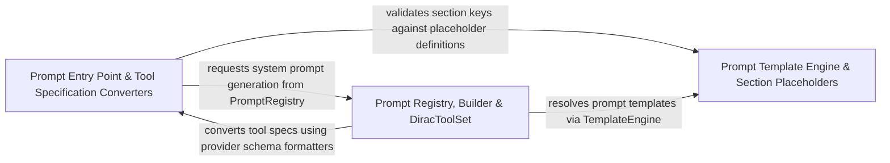

## Details

Builds system prompts, registers prompt templates, and formats tool specifications for model invocations.

### Prompt Entry Point & Tool Specification Converters
Provides the main system prompt entry point, section validation types, prompt sections, tool initialization, and provider-specific native tool schema converters.

**Related Classes/Methods**:

- `src.core.prompts.system-prompt.index.getSystemPrompt`:16-20
- `src.core.prompts.system-prompt.spec.toolSpecFunctionDefinition`:13-128
- `src.core.prompts.system-prompt.spec.toolSpecInputSchema`:150-227
- `src.core.prompts.system-prompt.spec.toolSpecFunctionDeclarations`:242-353
- `src.core.prompts.system-prompt.types.isValidSystemPromptSection`:64-66

**Source Files:**

- `src/core/prompts/system-prompt/index.ts`
  - `src.core.prompts.system-prompt.index.getSystemPrompt` (L16-L20) - Function
- `src/core/prompts/system-prompt/spec.ts`
  - `src.core.prompts.system-prompt.spec.toolSpecFunctionDefinition` (L13-L128) - Function
  - `src.core.prompts.system-prompt.spec.shouldUseStrictToolSchemas` (L137-L145) - Function
  - `src.core.prompts.system-prompt.spec.toolSpecInputSchema` (L150-L227) - Function
  - `src.core.prompts.system-prompt.spec.toolSpecFunctionDeclarations` (L242-L353) - Function
  - `src.core.prompts.system-prompt.spec.openAIToolToAnthropic` (L358-L386) - Function
  - `src.core.prompts.system-prompt.spec.toOpenAIResponseTools` (L392-L406) - Function
  - `src.core.prompts.system-prompt.spec.toOpenAIResponseTools.openAITools.filter() callback` (L398-L398) - Function
  - `src.core.prompts.system-prompt.spec.toOpenAIResponseTools.map() callback` (L399-L405) - Function
  - `src.core.prompts.system-prompt.spec.toOpenAIResponsesAPITool` (L411-L442) - Function
  - `src.core.prompts.system-prompt.spec.resolveToolDescription` (L443-L445) - Function
  - `src.core.prompts.system-prompt.spec.replacer` (L450-L461) - Function
  - `src.core.prompts.system-prompt.spec.resolveInstruction` (L466-L471) - Function
- `src/core/prompts/system-prompt/tools/init.ts`
  - `src.core.prompts.system-prompt.tools.init.registerDiracToolSets` (L9-L14) - Function
- `src/core/prompts/system-prompt/types.ts`
  - `src.core.prompts.system-prompt.types.SystemPromptContext` (L16-L59) - Interface
  - `src.core.prompts.system-prompt.types.isValidSystemPromptSection` (L64-L66) - Function
  - `src.core.prompts.system-prompt.types.isValidDiracDefaultTool` (L68-L70) - Function

### Prompt Registry, Builder & DiracToolSet
Manages prompt variant registration, orchestrates prompt assembly via PromptBuilder, and converts registered DiracToolSet definitions into native tool schemas.

**Related Classes/Methods**:

- `src.core.prompts.system-prompt.registry.PromptRegistry.PromptRegistry`:6-70
- `src.core.prompts.system-prompt.registry.PromptBuilder.PromptBuilder`:7-101
- `src.core.prompts.system-prompt.registry.DiracToolSet.DiracToolSet.convertSpecsToNativeTools`:105-112
- `src.core.prompts.system-prompt.registry.DiracToolSet.DiracToolSet.getNativeConverter`:117-135

**Source Files:**

- `src/core/prompts/system-prompt/registry/DiracToolSet.ts`
  - `src.core.prompts.system-prompt.registry.DiracToolSet.DiracToolSet` (L21-L136) - Class
  - `src.core.prompts.system-prompt.registry.DiracToolSet.DiracToolSet.constructor` (L22-L22) - Constructor
  - `src.core.prompts.system-prompt.registry.DiracToolSet.DiracToolSet.getDynamicSubagentToolSpecs` (L24-L54) - Method
  - `src.core.prompts.system-prompt.registry.DiracToolSet.DiracToolSet.getDynamicSubagentToolSpecs.agentConfigs.map() callback` (L30-L53) - Function
  - `src.core.prompts.system-prompt.registry.DiracToolSet.DiracToolSet.getDynamicSubagentToolSpecs.agentConfigs.map() callback.contextRequirements` (L34-L34) - Method
  - `src.core.prompts.system-prompt.registry.DiracToolSet.DiracToolSet.withDynamicSubagentToolSpecs` (L56-L70) - Method
  - `src.core.prompts.system-prompt.registry.DiracToolSet.DiracToolSet.withDynamicSubagentToolSpecs.contextualizedRegisteredTools` (L57-L57) - Class
  - `src.core.prompts.system-prompt.registry.DiracToolSet.DiracToolSet.withDynamicSubagentToolSpecs.contextualizedRegisteredTools.registeredTools.map() callback` (L57-L57) - Function
  - `src.core.prompts.system-prompt.registry.DiracToolSet.DiracToolSet.withDynamicSubagentToolSpecs.hasSubagentDispatcher` (L58-L58) - Class
  - `src.core.prompts.system-prompt.registry.DiracToolSet.DiracToolSet.withDynamicSubagentToolSpecs.hasSubagentDispatcher.contextualizedRegisteredTools.some() callback` (L58-L58) - Function
  - `src.core.prompts.system-prompt.registry.DiracToolSet.DiracToolSet.withDynamicSubagentToolSpecs.filteredRegistered` (L65-L67) - Class
  - `src.core.prompts.system-prompt.registry.DiracToolSet.DiracToolSet.withDynamicSubagentToolSpecs.filteredRegistered.contextualizedRegisteredTools.filter() callback` (L66-L66) - Function
  - `src.core.prompts.system-prompt.registry.DiracToolSet.DiracToolSet.withUtilityModelParameter` (L72-L103) - Method
  - `src.core.prompts.system-prompt.registry.DiracToolSet.DiracToolSet.withUtilityModelParameter.parameters.tool.parameters.map() callback` (L83-L101) - Function
  - `src.core.prompts.system-prompt.registry.DiracToolSet.DiracToolSet.convertSpecsToNativeTools` (L105-L112) - Method
  - `src.core.prompts.system-prompt.registry.DiracToolSet.DiracToolSet.convertSpecsToNativeTools.enabledTools` (L106-L106) - Class
  - `src.core.prompts.system-prompt.registry.DiracToolSet.DiracToolSet.convertSpecsToNativeTools.enabledTools.specs.filter() callback` (L106-L106) - Function
  - `src.core.prompts.system-prompt.registry.DiracToolSet.DiracToolSet.convertSpecsToNativeTools.enabledTools.map() callback` (L111-L111) - Function
  - `src.core.prompts.system-prompt.registry.DiracToolSet.DiracToolSet.getNativeConverter` (L117-L135) - Method
- `src/core/prompts/system-prompt/registry/PromptBuilder.ts`
  - `src.core.prompts.system-prompt.registry.PromptBuilder.PromptBuilder` (L7-L101) - Class
  - `src.core.prompts.system-prompt.registry.PromptBuilder.PromptBuilder.constructor` (L10-L12) - Constructor
  - `src.core.prompts.system-prompt.registry.PromptBuilder.PromptBuilder.build` (L14-L19) - Method
  - `src.core.prompts.system-prompt.registry.PromptBuilder.PromptBuilder.preparePlaceholders` (L21-L44) - Method
  - `src.core.prompts.system-prompt.registry.PromptBuilder.PromptBuilder.postProcess` (L46-L73) - Method
  - `src.core.prompts.system-prompt.registry.PromptBuilder.postProcess.replace() callback` (L59-L64) - Function
  - `src.core.prompts.system-prompt.registry.PromptBuilder.PromptBuilder.postProcess.replace() callback` (L65-L70) - Function
  - `src.core.prompts.system-prompt.registry.PromptBuilder.PromptBuilder.formatSkillsSection` (L75-L100) - Method
  - `src.core.prompts.system-prompt.registry.PromptBuilder.PromptBuilder.formatSkillsSection.filtered` (L76-L76) - Class
  - `src.core.prompts.system-prompt.registry.PromptBuilder.PromptBuilder.formatSkillsSection.filtered.skills.filter() callback` (L76-L76) - Function
  - `src.core.prompts.system-prompt.registry.PromptBuilder.PromptBuilder.formatSkillsSection.capabilitySkills` (L83-L83) - Class
  - `src.core.prompts.system-prompt.registry.PromptBuilder.PromptBuilder.formatSkillsSection.capabilitySkills.filtered.filter() callback` (L83-L83) - Function
  - `src.core.prompts.system-prompt.registry.PromptBuilder.PromptBuilder.formatSkillsSection.capabilityNames` (L84-L84) - Class
  - `src.core.prompts.system-prompt.registry.PromptBuilder.PromptBuilder.formatSkillsSection.capabilityNames.capabilitySkills.map() callback` (L84-L84) - Function
  - `src.core.prompts.system-prompt.registry.PromptBuilder.PromptBuilder.formatSkillsSection.projectSkills` (L85-L85) - Class
  - `src.core.prompts.system-prompt.registry.PromptBuilder.PromptBuilder.formatSkillsSection.projectSkills.filtered.filter() callback` (L85-L85) - Function
  - `src.core.prompts.system-prompt.registry.PromptBuilder.PromptBuilder.formatSkillsSection.builtinSkills` (L86-L86) - Class
  - `src.core.prompts.system-prompt.registry.PromptBuilder.PromptBuilder.formatSkillsSection.builtinSkills.filtered.filter() callback` (L86-L86) - Function
  - `src.core.prompts.system-prompt.registry.PromptBuilder.PromptBuilder.formatSkillsSection.globalSkills` (L87-L87) - Class
  - `src.core.prompts.system-prompt.registry.PromptBuilder.PromptBuilder.formatSkillsSection.globalSkills.filtered.filter() callback` (L87-L87) - Function
  - `src.core.prompts.system-prompt.registry.PromptBuilder.PromptBuilder.formatSkillsSection.displaySkills.forEach() callback` (L91-L93) - Function
- `src/core/prompts/system-prompt/registry/PromptRegistry.ts`
  - `src.core.prompts.system-prompt.registry.PromptRegistry.PromptRegistry` (L6-L70) - Class
  - `src.core.prompts.system-prompt.registry.PromptRegistry.PromptRegistry.constructor` (L12-L12) - Constructor
  - `src.core.prompts.system-prompt.registry.PromptRegistry.PromptRegistry.getInstance` (L14-L19) - Method
  - `src.core.prompts.system-prompt.registry.PromptRegistry.PromptRegistry.get` (L24-L36) - Method
  - `src.core.prompts.system-prompt.registry.PromptRegistry.PromptRegistry.computePromptFingerprint` (L38-L65) - Method
  - `src.core.prompts.system-prompt.registry.PromptRegistry.PromptRegistry.dispose` (L67-L69) - Method

### Prompt Template Engine & Section Placeholders
Defines system prompt section placeholder constants and resolves template placeholders into rendered prompt content via TemplateEngine.

**Related Classes/Methods**:

- `src.core.prompts.system-prompt.templates.TemplateEngine.TemplateEngine`:3-91
- `src.core.prompts.system-prompt.templates.TemplateEngine.TemplateEngine.resolve`:7-29
- `src.core.prompts.system-prompt.templates.placeholders.SystemPromptSection`:1-16

**Source Files:**

- `src/core/prompts/system-prompt/templates/TemplateEngine.ts`
  - `src.core.prompts.system-prompt.templates.TemplateEngine.TemplateEngine` (L3-L91) - Class
  - `src.core.prompts.system-prompt.templates.TemplateEngine.TemplateEngine.resolve` (L7-L29) - Method
  - `src.core.prompts.system-prompt.templates.TemplateEngine.TemplateEngine.resolve.template.replace() callback` (L16-L28) - Function
  - `src.core.prompts.system-prompt.templates.TemplateEngine.TemplateEngine.validate` (L34-L45) - Method
  - `src.core.prompts.system-prompt.templates.TemplateEngine.TemplateEngine.extractPlaceholders` (L50-L65) - Method
  - `src.core.prompts.system-prompt.templates.TemplateEngine.TemplateEngine.getNestedValue` (L70-L76) - Method
  - `src.core.prompts.system-prompt.templates.TemplateEngine.TemplateEngine.getNestedValue.reduce() callback` (L71-L75) - Function
  - `src.core.prompts.system-prompt.templates.TemplateEngine.TemplateEngine.escape` (L81-L83) - Method
  - `src.core.prompts.system-prompt.templates.TemplateEngine.TemplateEngine.unescape` (L88-L90) - Method
- `src/core/prompts/system-prompt/templates/placeholders.ts`
  - `src.core.prompts.system-prompt.templates.placeholders.SystemPromptSection` (L1-L16) - Enum
  - `src.core.prompts.system-prompt.templates.placeholders.validateRequiredPlaceholders` (L57-L67) - Function

### [FAQ](https://github.com/CodeBoarding/GeneratedOnBoardings/tree/main?tab=readme-ov-file#faq)