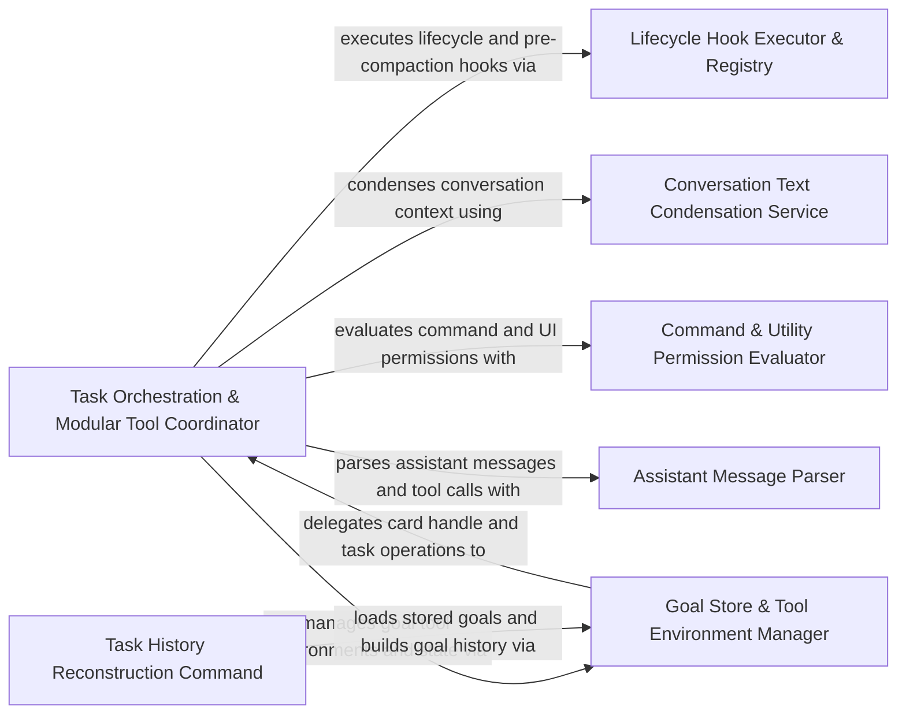

## Details

Executes agent tasks, tool modules, subagents, goals, lifecycle hooks, command permissions, and conversation condensation.

### Task Orchestration & Modular Tool Coordinator
Manages task state, streaming API responses, conversation compaction, subagent execution, and modular tool coordination.

**Related Classes/Methods**:

- `src.core.task.HookManager.HookManager.runUserPromptSubmitHook`:140-190
- `src.core.task.LocalConversationCompaction.LocalConversationCompaction.generateSummary`:201-224
- `src.core.task.tools.ToolExecutorCoordinator.ToolExecutorCoordinator.executeModularTool`:80-218
- `src.core.task.tools.adapters.DelegatingCardHandle.DelegatingCardHandle`:5-41

**Source Files:**

- `src/core/task/AssistantStreamManager.ts`
  - `src.core.task.AssistantStreamManager.AssistantStreamManager` (L4-L37) - Class
  - `src.core.task.AssistantStreamManager.AssistantStreamManager.constructor` (L8-L8) - Constructor
  - `src.core.task.AssistantStreamManager.AssistantStreamManager.handleChunk` (L15-L24) - Method
  - `src.core.task.AssistantStreamManager.AssistantStreamManager.pauseForToolCall` (L30-L36) - Method
- `src/core/task/ContextLoader.ts`
  - `src.core.task.ContextLoader.ContextLoader` (L14-L151) - Class
  - `src.core.task.ContextLoader.ContextLoader.constructor` (L18-L21) - Constructor
  - `src.core.task.ContextLoader.ContextLoader.loadContext` (L24-L107) - Method
  - `src.core.task.ContextLoader.ContextLoader.loadContext.parsedResults` (L89-L89) - Class
  - `src.core.task.ContextLoader.ContextLoader.loadContext.parsedResults.parsedTextMetadata.filter() callback` (L89-L89) - Function
  - `src.core.task.ContextLoader.ContextLoader.loadContext.needsDiracrulesFileCheck` (L90-L90) - Class
  - `src.core.task.ContextLoader.ContextLoader.loadContext.needsDiracrulesFileCheck.parsedResults.some() callback` (L90-L90) - Function
  - `src.core.task.ContextLoader.ContextLoader.loadContext.lastDirectResponse` (L91-L91) - Class
  - `src.core.task.ContextLoader.ContextLoader.loadContext.lastDirectResponse.find() callback` (L91-L91) - Function
  - `src.core.task.ContextLoader.ContextLoader.loadContext.directActions` (L92-L92) - Class
  - `src.core.task.ContextLoader.ContextLoader.loadContext.directActions.parsedResults.flatMap() callback` (L92-L92) - Function
  - `src.core.task.ContextLoader.ContextLoader.resolveAvailableSkills` (L110-L124) - Method
  - `src.core.task.ContextLoader.ContextLoader.resolveAvailableSkills.providerSkills.filter() callback` (L118-L123) - Function
  - `src.core.task.ContextLoader.ContextLoader.processContentBlock` (L128-L134) - Method
  - `src.core.task.ContextLoader.ContextLoader.processTextContent` (L138-L146) - Method
  - `src.core.task.ContextLoader.ContextLoader.hasUserContentTag` (L148-L150) - Method
  - `src.core.task.ContextLoader.ContextLoader.hasUserContentTag.USER_CONTENT_TAGS.some() callback` (L149-L149) - Function
- `src/core/task/HookManager.ts`
  - `src.core.task.HookManager.HookManager` (L13-L191) - Class
  - `src.core.task.HookManager.HookManager.constructor` (L14-L14) - Constructor
  - `src.core.task.HookManager.HookManager.setApi` (L16-L18) - Method
  - `src.core.task.HookManager.HookManager.setUlid` (L20-L22) - Method
  - `src.core.task.HookManager.HookManager.setActiveHookExecution` (L24-L28) - Method
  - `src.core.task.HookManager.HookManager.setActiveHookExecution.dependencies.withStateLock() callback` (L25-L27) - Function
  - `src.core.task.HookManager.HookManager.clearActiveHookExecution` (L30-L34) - Method
  - `src.core.task.HookManager.HookManager.clearActiveHookExecution.dependencies.withStateLock() callback` (L31-L33) - Function
  - `src.core.task.HookManager.HookManager.getActiveHookExecution` (L36-L40) - Method
  - `src.core.task.HookManager.HookManager.getActiveHookExecution.dependencies.withStateLock() callback` (L37-L39) - Function
  - `src.core.task.HookManager.HookManager.cancelHookExecution` (L42-L77) - Method
  - `src.core.task.HookManager.HookManager.shouldRunTaskCancelHook` (L79-L121) - Method
  - `src.core.task.HookManager.HookManager.handleHookCancellation` (L123-L138) - Method
  - `src.core.task.HookManager.HookManager.runUserPromptSubmitHook` (L140-L190) - Method
- `src/core/task/ITaskContext.ts`
  - `src.core.task.ITaskContext.ITaskContext` (L6-L21) - Interface
- `src/core/task/LocalConversationCompaction.ts`
  - `src.core.task.LocalConversationCompaction.LocalConversationCompactionDependencies` (L40-L54) - Interface
  - `src.core.task.LocalConversationCompaction.LocalConversationCompactionOptions` (L56-L60) - Interface
  - `src.core.task.LocalConversationCompaction.UtilityModelIdentity` (L62-L65) - Interface
  - `src.core.task.LocalConversationCompaction.LocalConversationCompaction` (L71-L325) - Class
  - `src.core.task.LocalConversationCompaction.LocalConversationCompaction.constructor` (L72-L72) - Constructor
  - `src.core.task.LocalConversationCompaction.LocalConversationCompaction.isAvailable` (L74-L85) - Method
  - `src.core.task.LocalConversationCompaction.LocalConversationCompaction.run` (L87-L195) - Method
  - `src.core.task.LocalConversationCompaction.LocalConversationCompaction.run.generateSummary() callback` (L132-L137) - Function
  - `src.core.task.LocalConversationCompaction.LocalConversationCompaction.throwIfCancelled` (L197-L199) - Method
  - `src.core.task.LocalConversationCompaction.LocalConversationCompaction.generateSummary` (L201-L224) - Method
  - `src.core.task.LocalConversationCompaction.LocalConversationCompaction.generateSummary.runner` (L208-L211) - Class
  - `src.core.task.LocalConversationCompaction.LocalConversationCompaction.generateSummary.runner.onUsage` (L210-L210) - Method
  - `src.core.task.LocalConversationCompaction.LocalConversationCompaction.generateSummary.service` (L213-L218) - Class
  - `src.core.task.LocalConversationCompaction.LocalConversationCompaction.generateSummary.service.getConversationHistoryDeletedRange` (L216-L216) - Method
  - `src.core.task.LocalConversationCompaction.LocalConversationCompaction.runPreCompactHook` (L226-L254) - Method
  - `src.core.task.LocalConversationCompaction.LocalConversationCompaction.applyCompaction` (L256-L292) - Method
  - `src.core.task.LocalConversationCompaction.LocalConversationCompaction.displayFailure` (L295-L305) - Method
  - `src.core.task.LocalConversationCompaction.LocalConversationCompaction.buildFailureBody` (L307-L310) - Method
  - `src.core.task.LocalConversationCompaction.LocalConversationCompaction.getConfiguredIdentity` (L312-L320) - Method
  - `src.core.task.LocalConversationCompaction.LocalConversationCompaction.formatIdentity` (L322-L324) - Method
- `src/core/task/ResponseProcessor.ts`
  - `src.core.task.ResponseProcessor.ResponseProcessor` (L14-L228) - Class
  - `src.core.task.ResponseProcessor.ResponseProcessor.constructor` (L20-L25) - Constructor
  - `src.core.task.ResponseProcessor.ResponseProcessor.setApi` (L27-L29) - Method
  - `src.core.task.ResponseProcessor.ResponseProcessor.resetStreamState` (L31-L33) - Method
  - `src.core.task.ResponseProcessor.ResponseProcessor.sanitizeModelQuirks` (L36-L38) - Method
  - `src.core.task.ResponseProcessor.pendingPresentationError` (L41-L43) - Method
  - `src.core.task.ResponseProcessor.ResponseProcessor.pendingPresentationError` (L44-L46) - Method
  - `src.core.task.ResponseProcessor.ResponseProcessor.consumeStream` (L48-L140) - Method
  - `src.core.task.ResponseProcessor.ResponseProcessor.consumeStream.catch() callback` (L114-L117) - Function
  - `src.core.task.ResponseProcessor.ResponseProcessor.routeAssistantResponse` (L142-L204) - Method
  - `src.core.task.ResponseProcessor.ResponseProcessor.handleEmptyAssistantResponse` (L206-L219) - Method
  - `src.core.task.ResponseProcessor.ResponseProcessor.presentAssistantMessage` (L221-L223) - Method
  - `src.core.task.ResponseProcessor.ResponseProcessor.syncStreamState` (L225-L227) - Method
- `src/core/task/StreamChunkCoordinator.ts`
  - `src.core.task.StreamChunkCoordinator.StreamChunkCoordinator` (L23-L119) - Class
  - `src.core.task.StreamChunkCoordinator.StreamChunkCoordinator.constructor` (L32-L38) - Constructor
  - `src.core.task.StreamChunkCoordinator.StreamChunkCoordinator.notifyWaiter` (L40-L45) - Method
  - `src.core.task.StreamChunkCoordinator.StreamChunkCoordinator.waitForData` (L47-L54) - Method
  - `src.core.task.StreamChunkCoordinator.StreamChunkCoordinator.closeIterator` (L56-L65) - Method
  - `src.core.task.StreamChunkCoordinator.StreamChunkCoordinator.startPump` (L67-L89) - Method
  - `src.core.task.StreamChunkCoordinator.StreamChunkCoordinator.startPump.<function>` (L68-L88) - Function
  - `src.core.task.StreamChunkCoordinator.StreamChunkCoordinator.nextChunk` (L91-L105) - Method
  - `src.core.task.StreamChunkCoordinator.StreamChunkCoordinator.stop` (L107-L111) - Method
  - `src.core.task.StreamChunkCoordinator.StreamChunkCoordinator.stop.pumpPromise.catch() callback` (L110-L110) - Function
  - `src.core.task.StreamChunkCoordinator.StreamChunkCoordinator.waitForCompletion` (L113-L118) - Method
- `src/core/task/StreamResponseHandler.ts`
  - `src.core.task.StreamResponseHandler.StreamResponseHandler` (L12-L100) - Class
  - `src.core.task.StreamResponseHandler.StreamResponseHandler.setRequestId` (L20-L22) - Method
  - `src.core.task.StreamResponseHandler.StreamResponseHandler.requestId` (L24-L26) - Method
  - `src.core.task.StreamResponseHandler.StreamResponseHandler.getParsedToolUseStates` (L28-L30) - Method
  - `src.core.task.StreamResponseHandler.StreamResponseHandler.getHandlers` (L32-L34) - Method
  - `src.core.task.StreamResponseHandler.StreamResponseHandler.recordId` (L37-L46) - Method
  - `src.core.task.StreamResponseHandler.StreamResponseHandler.processTextDelta` (L48-L59) - Method
  - `src.core.task.StreamResponseHandler.StreamResponseHandler.processReasoningDelta` (L61-L65) - Method
  - `src.core.task.StreamResponseHandler.StreamResponseHandler.processToolUseDelta` (L67-L71) - Method
  - `src.core.task.StreamResponseHandler.StreamResponseHandler.getOrderedBlocks` (L74-L90) - Method
  - `src.core.task.StreamResponseHandler.StreamResponseHandler.reset` (L92-L99) - Method
- `src/core/task/StreamingMetricsManager.ts`
  - `src.core.task.StreamingMetricsManager.StreamingMetrics` (L6-L14) - Interface
  - `src.core.task.StreamingMetricsManager.UsageMetricAvailability` (L16-L23) - Interface
  - `src.core.task.StreamingMetricsManager.UsageChunk` (L25-L33) - Interface
  - `src.core.task.StreamingMetricsManager.StreamingMetricsManager` (L43-L131) - Class
  - `src.core.task.StreamingMetricsManager.StreamingMetricsManager.constructor` (L61-L65) - Constructor
  - `src.core.task.StreamingMetricsManager.StreamingMetricsManager.updateFromChunk` (L68-L81) - Method
  - `src.core.task.StreamingMetricsManager.StreamingMetricsManager.updateApiReqMsgFromMetrics` (L84-L110) - Method
  - `src.core.task.StreamingMetricsManager.StreamingMetricsManager.getTotalCost` (L113-L125) - Method
  - `src.core.task.StreamingMetricsManager.StreamingMetricsManager.getMetrics` (L128-L130) - Method
- `src/core/task/TaskApiRequestAttempt.ts`
  - `src.core.task.TaskApiRequestAttempt.attemptApiRequest` (L15-L118) - Function
  - `src.core.task.TaskApiRequestAttempt.attemptApiRequest.firstChunk` (L75-L77) - Class
  - `src.core.task.TaskApiRequestAttempt.attemptApiRequest.firstChunk.finally() callback` (L75-L77) - Function
- `src/core/task/TaskConversationPersistence.ts`
  - `src.core.task.TaskConversationPersistence.TaskConversationPersistenceHooks` (L1-L4) - Interface
  - `src.core.task.TaskConversationPersistence.TaskConversationPersistenceHooks.onUserContentPersisted` (L2-L2) - Method
  - `src.core.task.TaskConversationPersistence.TaskConversationPersistenceHooks.onUserContentPersistenceFailed` (L3-L3) - Method
  - `src.core.task.TaskConversationPersistence.TaskConversationPersistence` (L9-L28) - Class
  - `src.core.task.TaskConversationPersistence.TaskConversationPersistence.constructor` (L12-L14) - Constructor
  - `src.core.task.TaskConversationPersistence.TaskConversationPersistence.persist` (L16-L21) - Method
  - `src.core.task.TaskConversationPersistence.TaskConversationPersistence.rollback` (L23-L27) - Method
- `src/core/task/TaskExecutionProfile.ts`
  - `src.core.task.TaskExecutionProfile.isToolAvailableToTaskProfile` (L20-L24) - Function
  - `src.core.task.TaskExecutionProfile.isDiscoveredToolAvailableToTaskProfile` (L26-L29) - Function
  - `src.core.task.TaskExecutionProfile.taskProfileSystemInstructions` (L31-L66) - Function
- `src/core/task/TaskLockUtils.ts`
  - `src.core.task.TaskLockUtils.tryAcquireTaskLockWithRetry` (L17-L25) - Function
  - `src.core.task.TaskLockUtils.releaseTaskLock` (L34-L36) - Function
- `src/core/task/TaskMistakeLimit.ts`
  - `src.core.task.TaskMistakeLimit.TaskMistakeLimitContext` (L13-L18) - Interface
  - `src.core.task.TaskMistakeLimit.handleMistakeLimitReached` (L20-L118) - Function
- `src/core/task/TaskPromptArtifacts.ts`
  - `src.core.task.TaskPromptArtifacts.realpathOrSelf` (L8-L10) - Function
  - `src.core.task.TaskPromptArtifacts.realpathOrSelf.catch() callback` (L9-L9) - Function
  - `src.core.task.TaskPromptArtifacts.TaskPromptArtifactsContext` (L12-L21) - Interface
  - `src.core.task.TaskPromptArtifacts.writePromptMetadataArtifacts` (L23-L141) - Function
  - `src.core.task.TaskPromptArtifacts.writePromptMetadataArtifacts.catch() callback` (L82-L82) - Function
- `src/core/task/TaskRequestBuilder.ts`
  - `src.core.task.TaskRequestBuilder.TaskRequestBuilderContext` (L44-L66) - Interface
  - `src.core.task.TaskRequestBuilder.buildApiRequestParams` (L68-L293) - Function
  - `src.core.task.TaskRequestBuilder.buildApiRequestParams.map() callback` (L146-L150) - Function
  - `src.core.task.TaskRequestBuilder.buildApiRequestParams.availableSkills` (L159-L164) - Class
  - `src.core.task.TaskRequestBuilder.buildApiRequestParams.availableSkills.providerSkills.filter() callback` (L159-L164) - Function
- `src/core/task/TaskRequestOutcome.ts`
  - `src.core.task.TaskRequestOutcome.TaskRequestOutcomeContext` (L25-L52) - Interface
  - `src.core.task.TaskRequestOutcome.handleApiRequestError` (L54-L211) - Function
  - `src.core.task.TaskRequestOutcome.processStreamResult` (L213-L300) - Function
  - `src.core.task.TaskRequestOutcome.processStreamResult.pWaitFor() callback` (L229-L229) - Function
  - `src.core.task.TaskRequestOutcome.processStreamResult.hasMutatingTools` (L230-L232) - Class
  - `src.core.task.TaskRequestOutcome.processStreamResult.hasMutatingTools.ctx.taskState.assistantMessageContent.some() callback` (L231-L231) - Function
  - `src.core.task.TaskRequestOutcome.processStreamResult.didToolUse` (L237-L237) - Class
  - `src.core.task.TaskRequestOutcome.processStreamResult.didToolUse.ctx.taskState.assistantMessageContent.some() callback` (L237-L237) - Function
  - `src.core.task.TaskRequestOutcome.persistApiStopReason` (L302-L309) - Function
- `src/core/task/TaskRunOutcome.ts`
  - `src.core.task.TaskRunOutcome.SerializedTaskError` (L1-L5) - Interface
  - `src.core.task.TaskRunOutcome.serializeTaskError` (L15-L19) - Function
  - `src.core.task.TaskRunOutcome.deserializeTaskError` (L21-L26) - Function
- `src/core/task/TaskState.ts`
  - `src.core.task.TaskState.CompletionVerificationFailure` (L11-L14) - Interface
  - `src.core.task.TaskState.TaskReplacementRequest` (L16-L20) - Interface
  - `src.core.task.TaskState.TaskState` (L22-L271) - Class
  - `src.core.task.TaskState.TaskState.isApiRequestActive` (L35-L37) - Method
  - `src.core.task.TaskState.TaskState.activeVoiceStreamId` (L38-L40) - Method
  - `src.core.task.TaskState.TaskState.isWaitingForFirstChunk` (L41-L43) - Method
  - `src.core.task.TaskState.TaskState.didCompleteReadingStream` (L44-L46) - Method
  - `src.core.task.TaskState.TaskState.taskFirstTokenTimeMs` (L49-L51) - Method
  - `src.core.task.TaskState.TaskState.recordFirstTokenAt` (L52-L54) - Method
  - `src.core.task.TaskState.TaskState.beginApiRequest` (L57-L59) - Method
  - `src.core.task.TaskState.TaskState.endApiRequest` (L61-L64) - Method
  - `src.core.task.TaskState.TaskState.beginFirstChunkWait` (L65-L67) - Method
  - `src.core.task.TaskState.TaskState.endFirstChunkWait` (L68-L70) - Method
  - `src.core.task.TaskState.TaskState.completeStreamRead` (L71-L73) - Method
  - `src.core.task.TaskState.TaskState.resetStreamRead` (L74-L76) - Method
  - `src.core.task.TaskState.TaskState.attachVoiceStream` (L77-L79) - Method
  - `src.core.task.TaskState.TaskState.detachVoiceStream` (L81-L84) - Method
  - `src.core.task.TaskState.TaskState.lastWaitingCardId` (L107-L109) - Method
  - `src.core.task.TaskState.TaskState.cancellationIntent` (L156-L158) - Method
  - `src.core.task.TaskState.TaskState.completionResponse` (L159-L161) - Method
  - `src.core.task.TaskState.TaskState.terminalError` (L162-L164) - Method
  - `src.core.task.TaskState.TaskState.runOutcome` (L165-L167) - Method
  - `src.core.task.TaskState.TaskState.captureCancellationIntent` (L170-L173) - Method
  - `src.core.task.TaskState.TaskState.settleRunOutcome` (L176-L183) - Method
  - `src.core.task.TaskState.TaskState.commitCompletionResponse` (L185-L187) - Method
  - `src.core.task.TaskState.TaskState.clearCompletionResponse` (L188-L190) - Method
  - `src.core.task.TaskState.abort` (L193-L195) - Method
  - `src.core.task.TaskState.TaskState.abort` (L197-L203) - Method
  - `src.core.task.TaskState.TaskState.abortSignal` (L205-L207) - Method
  - `src.core.task.TaskState.TaskState.didFinishAbortingStream` (L212-L214) - Method
  - `src.core.task.TaskState.TaskState.markStreamAbortFinished` (L215-L217) - Method
- `src/core/task/TaskSteering.ts`
  - `src.core.task.TaskSteering.TaskSteeringContext` (L18-L25) - Interface
  - `src.core.task.TaskSteering.canAcceptSteeringMessage` (L27-L32) - Function
  - `src.core.task.TaskSteering.enqueueSteeringMessage` (L34-L69) - Function
  - `src.core.task.TaskSteering.enqueueSteeringMessage.steeringMessage` (L38-L65) - Class
  - `src.core.task.TaskSteering.enqueueSteeringMessage.steeringMessage.ctx.withStateLock() callback` (L38-L65) - Function
  - `src.core.task.TaskSteering.claimSteeringMessages` (L71-L85) - Function
  - `src.core.task.TaskSteering.claimSteeringMessages.ctx.withStateLock() callback` (L72-L84) - Function
  - `src.core.task.TaskSteering.ctx.withStateLock() callback.messages` (L73-L75) - Class
  - `src.core.task.TaskSteering.claimSteeringMessages.ctx.withStateLock() callback.messages.ctx.taskState.steeringMessages.filter() callback` (L74-L74) - Function
  - `src.core.task.TaskSteering.claimSteeringMessages.ctx.withStateLock() callback.messages.messages.map() callback` (L83-L83) - Function
  - `src.core.task.TaskSteering.commitSteeringClaim` (L87-L115) - Function
  - `src.core.task.TaskSteering.commitSteeringClaim.claimedMessages` (L88-L97) - Class
  - `src.core.task.TaskSteering.commitSteeringClaim.claimedMessages.ctx.withStateLock() callback` (L88-L97) - Function
  - `src.core.task.TaskSteering.commitSteeringClaim.claimedMessages.ctx.withStateLock() callback.messages` (L89-L91) - Class
  - `src.core.task.TaskSteering.commitSteeringClaim.claimedMessages.ctx.withStateLock() callback.messages.ctx.taskState.steeringMessages.filter() callback` (L90-L90) - Function
  - `src.core.task.TaskSteering.commitSteeringClaim.claimedMessages.ctx.withStateLock() callback.messages.map() callback` (L96-L96) - Function
  - `src.core.task.TaskSteering.commitSteeringClaim.transcriptMessages` (L99-L106) - Class
  - `src.core.task.TaskSteering.commitSteeringClaim.transcriptMessages.claimedMessages.map() callback` (L99-L106) - Function
  - `src.core.task.TaskSteering.settleConsumedSteeringClaim` (L117-L136) - Function
  - `src.core.task.TaskSteering.settleConsumedSteeringClaim.claim.messages.map() callback` (L121-L121) - Function
  - `src.core.task.TaskSteering.rollbackSteeringClaim` (L138-L146) - Function
  - `src.core.task.TaskSteering.rollbackSteeringClaim.ctx.withStateLock() callback` (L139-L145) - Function
  - `src.core.task.TaskSteering.isSlashCommandSteeringMessage` (L148-L150) - Function
  - `src.core.task.TaskSteering.releaseSteeringClaimSuffix` (L152-L168) - Function
  - `src.core.task.TaskSteering.releaseSteeringClaimSuffix.retainedMessageIds` (L158-L158) - Class
  - `src.core.task.TaskSteering.releaseSteeringClaimSuffix.retainedMessageIds.retainedMessages.map() callback` (L158-L158) - Function
  - `src.core.task.TaskSteering.releaseSteeringClaimSuffix.ctx.withStateLock() callback` (L159-L166) - Function
  - `src.core.task.TaskSteering.appendQueuedSteeringToUserContent` (L170-L196) - Function
  - `src.core.task.TaskSteering.appendQueuedSteeringToUserContent.commandIndex` (L176-L176) - Class
  - `src.core.task.TaskSteering.appendQueuedSteeringToUserContent.commandIndex.steeringClaim.messages.findIndex() callback` (L176-L176) - Function
  - `src.core.task.TaskSteering.appendQueuedSteeringToUserContent.steeringMessageIds.steeringClaim.messages.map() callback` (L182-L182) - Function
  - `src.core.task.TaskSteering.appendQueuedSteeringToUserContent.steeringMessageIds.requestClaim.messages.map() callback` (L193-L193) - Function
  - `src.core.task.TaskSteering.appendQueuedSteeringToNextApiRequest` (L198-L237) - Function
  - `src.core.task.TaskSteering.appendQueuedSteeringToNextApiRequest.steeringClaim.messages.some() callback` (L204-L204) - Function
  - `src.core.task.TaskSteering.appendQueuedSteeringToNextApiRequest.messageIds` (L209-L209) - Class
  - `src.core.task.TaskSteering.appendQueuedSteeringToNextApiRequest.messageIds.steeringClaim.messages.map() callback` (L209-L209) - Function
  - `src.core.task.TaskSteering.commitAttemptCompletion` (L239-L256) - Function
  - `src.core.task.TaskSteering.commitAttemptCompletion.ctx.withStateLock() callback` (L243-L255) - Function
  - `src.core.task.TaskSteering.commitAttemptCompletion.ctx.withStateLock() callback.hasQueuedSteering` (L244-L246) - Class
  - `src.core.task.TaskSteering.commitAttemptCompletion.ctx.withStateLock() callback.hasQueuedSteering.ctx.taskState.steeringMessages.some() callback` (L245-L245) - Function
  - `src.core.task.TaskSteering.restoreQueuedSteeringFromTranscript` (L258-L267) - Function
- `src/core/task/TaskUserInput.ts`
  - `src.core.task.TaskUserInput.TaskUserInputContext` (L10-L12) - Interface
  - `src.core.task.TaskUserInput.waitForFollowUp` (L14-L49) - Function
  - `src.core.task.TaskUserInput.waitForFollowUp.pWaitFor() callback` (L23-L25) - Function
  - `src.core.task.TaskUserInput.clearAskResponse` (L51-L60) - Function
  - `src.core.task.TaskUserInput.submitCardResponse` (L62-L91) - Function
- `src/core/task/activateTaskSkill.ts`
  - `src.core.task.activateTaskSkill.activateTaskSkill` (L4-L9) - Function
  - `src.core.task.activateTaskSkill.activateTaskSkill.metadata` (L5-L7) - Class
  - `src.core.task.activateTaskSkill.activateTaskSkill.metadata.updateTaskMetadata() callback` (L5-L7) - Function
- `src/core/task/context/FileContextLoader.ts`
  - `src.core.task.context.FileContextLoader.PathMatch` (L26-L30) - Interface
  - `src.core.task.context.FileContextLoader.FileContextLoader` (L32-L337) - Class
  - `src.core.task.context.FileContextLoader.FileContextLoader.constructor` (L33-L33) - Constructor
  - `src.core.task.context.FileContextLoader.FileContextLoader.extractContext` (L36-L47) - Method
  - `src.core.task.context.FileContextLoader.FileContextLoader.getPathContext` (L50-L61) - Method
  - `src.core.task.context.FileContextLoader.FileContextLoader.getSymbolContext` (L64-L93) - Method
  - `src.core.task.context.FileContextLoader.FileContextLoader.scrubNoise` (L96-L102) - Method
  - `src.core.task.context.FileContextLoader.FileContextLoader.scrubNoise.scrubbed` (L97-L97) - Class
  - `src.core.task.context.FileContextLoader.FileContextLoader.scrubNoise.scrubbed.text.replace() callback` (L97-L97) - Function
  - `src.core.task.context.FileContextLoader.scrubNoise.scrubbed.replace() callback` (L98-L98) - Function
  - `src.core.task.context.FileContextLoader.FileContextLoader.scrubNoise.scrubbed.replace() callback` (L100-L100) - Function
  - `src.core.task.context.FileContextLoader.FileContextLoader.collectPaths` (L105-L130) - Method
  - `src.core.task.context.FileContextLoader.FileContextLoader.consumePath` (L133-L137) - Method
  - `src.core.task.context.FileContextLoader.FileContextLoader.resolveAbsolute` (L140-L151) - Method
  - `src.core.task.context.FileContextLoader.FileContextLoader.getPathMatches` (L154-L169) - Method
  - `src.core.task.context.FileContextLoader.FileContextLoader.collectSkeletons` (L172-L209) - Method
  - `src.core.task.context.FileContextLoader.FileContextLoader.collectSkeletons.sourceAst` (L174-L184) - Class
  - `src.core.task.context.FileContextLoader.FileContextLoader.collectSkeletons.sourceAst.resolvePath` (L176-L179) - Method
  - `src.core.task.context.FileContextLoader.FileContextLoader.collectSkeletons.sourceAst.validateAccess` (L180-L180) - Method
  - `src.core.task.context.FileContextLoader.FileContextLoader.collectSkeletons.sourceAst.reconcileAnchors` (L181-L181) - Method
  - `src.core.task.context.FileContextLoader.FileContextLoader.collectSkeletons.sourceAst.getAnchorFingerprint` (L182-L183) - Method
  - `src.core.task.context.FileContextLoader.FileContextLoader.collectSkeletons.callsByLine` (L190-L190) - Class
  - `src.core.task.context.FileContextLoader.FileContextLoader.collectSkeletons.callsByLine.file.definitions.map() callback` (L190-L190) - Function
  - `src.core.task.context.FileContextLoader.FileContextLoader.collectDirectoryLists` (L212-L234) - Method
  - `src.core.task.context.FileContextLoader.FileContextLoader.initSymbolResults` (L237-L243) - Method
  - `src.core.task.context.FileContextLoader.FileContextLoader.processSymbolPass` (L246-L269) - Method
  - `src.core.task.context.FileContextLoader.FileContextLoader.processLocation` (L272-L295) - Method
  - `src.core.task.context.FileContextLoader.FileContextLoader.readLineAt` (L298-L312) - Method
  - `src.core.task.context.FileContextLoader.FileContextLoader.assembleSymbolDefinitions` (L315-L336) - Method
- `src/core/task/lifecycle/TaskAbortManager.ts`
  - `src.core.task.lifecycle.TaskAbortManager.TaskAbortManager` (L10-L113) - Class
  - `src.core.task.lifecycle.TaskAbortManager.TaskAbortManager.constructor` (L11-L11) - Constructor
  - `src.core.task.lifecycle.TaskAbortManager.TaskAbortManager.abort` (L13-L26) - Method
  - `src.core.task.lifecycle.TaskAbortManager.TaskAbortManager.cancelActiveHook` (L28-L38) - Method
  - `src.core.task.lifecycle.TaskAbortManager.TaskAbortManager.cancelBackgroundCommand` (L40-L47) - Method
  - `src.core.task.lifecycle.TaskAbortManager.TaskAbortManager.runTaskCancelHook` (L49-L74) - Method
  - `src.core.task.lifecycle.TaskAbortManager.TaskAbortManager.saveStateAndPost` (L76-L83) - Method
  - `src.core.task.lifecycle.TaskAbortManager.TaskAbortManager.disposeResources` (L85-L93) - Method
  - `src.core.task.lifecycle.TaskAbortManager.TaskAbortManager.releaseLockIfNeeded` (L95-L104) - Method
  - `src.core.task.lifecycle.TaskAbortManager.TaskAbortManager.postFinalState` (L106-L112) - Method
- `src/core/task/recordUtilityModelUsage.ts`
  - `src.core.task.recordUtilityModelUsage.recordUtilityModelUsage` (L6-L33) - Function
- `src/core/task/response/EmptyResponseHandler.ts`
  - `src.core.task.response.EmptyResponseHandler.EmptyResponseHandler` (L14-L122) - Class
  - `src.core.task.response.EmptyResponseHandler.EmptyResponseHandler.constructor` (L15-L15) - Constructor
  - `src.core.task.response.EmptyResponseHandler.EmptyResponseHandler.handleEmptyResponse` (L17-L33) - Method
  - `src.core.task.response.EmptyResponseHandler.EmptyResponseHandler.createErrorCard` (L36-L40) - Method
  - `src.core.task.response.EmptyResponseHandler.EmptyResponseHandler.recordFailureInHistory` (L43-L59) - Method
  - `src.core.task.response.EmptyResponseHandler.EmptyResponseHandler.handleRetry` (L62-L65) - Method
  - `src.core.task.response.EmptyResponseHandler.EmptyResponseHandler.autoRetry` (L68-L84) - Method
  - `src.core.task.response.EmptyResponseHandler.EmptyResponseHandler.promptManualRetry` (L87-L121) - Method
- `src/core/task/response/ResponseFormatter.ts`
  - `src.core.task.response.ResponseFormatter.ResponseFormatter` (L3-L30) - Class
  - `src.core.task.response.ResponseFormatter.ResponseFormatter.sanitizeModelQuirks` (L5-L9) - Method
  - `src.core.task.response.ResponseFormatter.ResponseFormatter.trimTrailingCodeFence` (L12-L16) - Method
  - `src.core.task.response.ResponseFormatter.ResponseFormatter.trimIncompleteTag` (L19-L29) - Method
- `src/core/task/response/StreamStateSync.ts`
  - `src.core.task.response.StreamStateSync.StreamStateSync` (L8-L111) - Class
  - `src.core.task.response.StreamStateSync.StreamStateSync.constructor` (L9-L12) - Constructor
  - `src.core.task.response.StreamStateSync.StreamStateSync.syncStreamState` (L18-L31) - Method
  - `src.core.task.response.StreamStateSync.StreamStateSync.syncStreamState.taskState.assistantMessageContent.map() callback` (L20-L20) - Function
  - `src.core.task.response.StreamStateSync.StreamStateSync.buildContent` (L34-L38) - Method
  - `src.core.task.response.StreamStateSync.StreamStateSync.convertBlock` (L41-L54) - Method
  - `src.core.task.response.StreamStateSync.StreamStateSync.convertTextBlock` (L56-L76) - Method
  - `src.core.task.response.StreamStateSync.StreamStateSync.convertTextBlock.parsed.map() callback` (L58-L75) - Function
  - `src.core.task.response.StreamStateSync.StreamStateSync.convertToolUseBlock` (L78-L89) - Method
  - `src.core.task.response.StreamStateSync.StreamStateSync.convertThinkingBlock` (L91-L99) - Method
  - `src.core.task.response.StreamStateSync.StreamStateSync.convertRedactedThinkingBlock` (L101-L110) - Method
- `src/core/task/response/ToolCallExtractor.ts`
  - `src.core.task.response.ToolCallExtractor.ToolCallExtractor` (L7-L36) - Class
  - `src.core.task.response.ToolCallExtractor.ToolCallExtractor.constructor` (L8-L11) - Constructor
  - `src.core.task.response.ToolCallExtractor.ToolCallExtractor.processToolCallChunk` (L14-L31) - Method
  - `src.core.task.response.ToolCallExtractor.ToolCallExtractor.getParsedToolUseStates` (L33-L35) - Method
- `src/core/task/runtime/TaskRequestRuntime.ts`
  - `src.core.task.runtime.TaskRequestRuntime.TaskRequestRuntime` (L14-L19) - Interface
  - `src.core.task.runtime.TaskRequestRuntime.createTaskRequestRuntime` (L21-L27) - Function
  - `src.core.task.runtime.TaskRequestRuntime.bindToolSnapshotToRequestRuntime` (L29-L47) - Function
  - `src.core.task.runtime.TaskRequestRuntime.isTaskMutationAuthorized` (L54-L63) - Function
  - `src.core.task.runtime.TaskRequestRuntime.TaskMutationGate` (L65-L168) - Class
  - `src.core.task.runtime.TaskRequestRuntime.TaskMutationGate.withMutation` (L72-L87) - Method
  - `src.core.task.runtime.TaskRequestRuntime.TaskMutationGate.transitionFromMutation` (L89-L102) - Method
  - `src.core.task.runtime.TaskRequestRuntime.TaskMutationGate.retainMutationUntil` (L104-L113) - Method
  - `src.core.task.runtime.TaskRequestRuntime.retainMutationUntil.completion.then() callback` (L110-L110) - Function
  - `src.core.task.runtime.TaskRequestRuntime.TaskMutationGate.retainMutationUntil.completion.then() callback` (L111-L111) - Function
  - `src.core.task.runtime.TaskRequestRuntime.TaskMutationGate.withTransition` (L115-L123) - Method
  - `src.core.task.runtime.TaskRequestRuntime.TaskMutationGate.acquireMutation` (L125-L131) - Method
  - `src.core.task.runtime.TaskRequestRuntime.TaskMutationGate.releaseMutation` (L133-L136) - Method
  - `src.core.task.runtime.TaskRequestRuntime.TaskMutationGate.acquireTransition` (L138-L144) - Method
  - `src.core.task.runtime.TaskRequestRuntime.TaskMutationGate.acquireTransitionFromMutation` (L146-L152) - Method
  - `src.core.task.runtime.TaskRequestRuntime.TaskMutationGate.releaseTransition` (L154-L158) - Method
  - `src.core.task.runtime.TaskRequestRuntime.TaskMutationGate.startNextTransition` (L160-L167) - Method
  - `src.core.task.runtime.TaskRequestRuntime.assertTaskMutationAuthorized` (L170-L177) - Function
- `src/core/task/runtime/TaskRuntimeModelContext.ts`
  - `src.core.task.runtime.TaskRuntimeModelContext.getTaskHookModelContext` (L8-L27) - Function
- `src/core/task/runtime/TaskWorkingConfiguration.ts`
  - `src.core.task.runtime.TaskWorkingConfiguration.TaskExecutionOptions` (L21-L25) - Interface
  - `src.core.task.runtime.TaskWorkingConfiguration.TaskWorkingConfiguration` (L36-L42) - Interface
  - `src.core.task.runtime.TaskWorkingConfiguration.TaskWorkingConfigurationInput` (L44-L50) - Interface
  - `src.core.task.runtime.TaskWorkingConfiguration.TaskWorkingConfigurationPatch` (L56-L60) - Interface
  - `src.core.task.runtime.TaskWorkingConfiguration.cloneConfigurationValue` (L63-L65) - Function
  - `src.core.task.runtime.TaskWorkingConfiguration.deepFreezeConfiguration` (L68-L87) - Function
  - `src.core.task.runtime.TaskWorkingConfiguration.createTaskWorkingConfiguration` (L90-L104) - Function
  - `src.core.task.runtime.TaskWorkingConfiguration.buildTaskWorkingConfigurationUpdate` (L111-L149) - Function
- `src/core/task/steering.ts`
  - `src.core.task.steering.SteeringDeliveryState` (L4-L8) - Enum
  - `src.core.task.steering.SteeringMessage` (L10-L17) - Interface
  - `src.core.task.steering.SteeringClaim` (L19-L22) - Interface
  - `src.core.task.steering.collectDeliveredSteeringMessageIds` (L24-L35) - Function
  - `src.core.task.steering.restoreQueuedSteeringMessages` (L37-L56) - Function
  - `src.core.task.steering.restoreQueuedSteeringMessages.messages.flatMap() callback` (L41-L55) - Function
  - `src.core.task.steering.escapeXml` (L57-L66) - Function
  - `src.core.task.steering.escapeXml.value.replace() callback` (L65-L65) - Function
  - `src.core.task.steering.formatSteeringMessages` (L68-L77) - Function
  - `src.core.task.steering.formatSteeringMessages.formattedMessages` (L69-L69) - Class
  - `src.core.task.steering.formatSteeringMessages.formattedMessages.messages.map() callback` (L69-L69) - Function
- `src/core/task/stream/ReasoningHandler.ts`
  - `src.core.task.stream.ReasoningHandler.ReasoningHandler` (L5-L98) - Class
  - `src.core.task.stream.ReasoningHandler.ReasoningHandler.markAsComplete` (L9-L12) - Method
  - `src.core.task.stream.ReasoningHandler.ReasoningHandler.hasReasoning` (L14-L16) - Method
  - `src.core.task.stream.ReasoningHandler.ReasoningHandler.getLastReasoningId` (L17-L19) - Method
  - `src.core.task.stream.ReasoningHandler.ReasoningHandler.getReasoningBlock` (L21-L24) - Method
  - `src.core.task.stream.ReasoningHandler.ReasoningHandler.getRedactedThinkingForId` (L26-L28) - Method
  - `src.core.task.stream.ReasoningHandler.ReasoningHandler.processReasoningDelta` (L30-L49) - Method
  - `src.core.task.stream.ReasoningHandler.ReasoningHandler.getCurrentReasoning` (L51-L55) - Method
  - `src.core.task.stream.ReasoningHandler.ReasoningHandler.getAllReasoningBlocks` (L57-L64) - Method
  - `src.core.task.stream.ReasoningHandler.ReasoningHandler.getRedactedThinking` (L66-L70) - Method
  - `src.core.task.stream.ReasoningHandler.ReasoningHandler.reset` (L72-L75) - Method
  - `src.core.task.stream.ReasoningHandler.ReasoningHandler.mapToThinkingBlock` (L77-L97) - Method
- `src/core/task/stream/ToolUseHandler.ts`
  - `src.core.task.stream.ToolUseHandler.ToolUseHandler` (L11-L127) - Class
  - `src.core.task.stream.ToolUseHandler.ToolUseHandler.markAsComplete` (L14-L17) - Method
  - `src.core.task.stream.ToolUseHandler.ToolUseHandler.processToolUseDelta` (L19-L33) - Method
  - `src.core.task.stream.ToolUseHandler.ToolUseHandler.getFinalizedToolUse` (L35-L47) - Method
  - `src.core.task.stream.ToolUseHandler.ToolUseHandler.getAllFinalizedToolUses` (L49-L56) - Method
  - `src.core.task.stream.ToolUseHandler.ToolUseHandler.hasToolUse` (L58-L60) - Method
  - `src.core.task.stream.ToolUseHandler.ToolUseHandler.getParsedToolUseStates` (L62-L79) - Method
  - `src.core.task.stream.ToolUseHandler.ToolUseHandler.parsePendingInput` (L81-L89) - Method
  - `src.core.task.stream.ToolUseHandler.ToolUseHandler.createPendingToolUse` (L91-L110) - Method
  - `src.core.task.stream.ToolUseHandler.ToolUseHandler.createPendingToolUse.onValue` (L103-L105) - Function
  - `src.core.task.stream.ToolUseHandler.ToolUseHandler.createPendingToolUse.onError` (L106-L106) - Function
  - `src.core.task.stream.ToolUseHandler.ToolUseHandler.extractPartialJsonFields` (L113-L126) - Method
  - `src.core.task.stream.ToolUseHandler.ToolUseHandler.extractPartialJsonFields.replace() callback` (L117-L117) - Function
  - `src.core.task.stream.ToolUseHandler.ToolUseHandler.extractPartialJsonFields.map() callback` (L122-L122) - Function
  - `src.core.task.stream.ToolUseHandler.ToolUseHandler.extractPartialJsonFields.filter() callback` (L123-L123) - Function
- `src/core/task/stream/types.ts`
  - `src.core.task.stream.types.ParsedToolUseState` (L4-L11) - Interface
  - `src.core.task.stream.types.PendingToolUse` (L13-L22) - Interface
  - `src.core.task.stream.types.ToolUseDeltaBlock` (L24-L30) - Interface
  - `src.core.task.stream.types.ReasoningDelta` (L32-L38) - Interface
  - `src.core.task.stream.types.PendingReasoning` (L40-L47) - Interface
- `src/core/task/tools/ToolExecutorCoordinator.ts`
  - `src.core.task.tools.ToolExecutorCoordinator.PartialToolUseHandler` (L19-L21) - Interface
  - `src.core.task.tools.ToolExecutorCoordinator.PartialToolUseHandler.bufferPartialToolUse` (L20-L20) - Method
  - `src.core.task.tools.ToolExecutorCoordinator.ToolExecutorCoordinator` (L27-L219) - Class
  - `src.core.task.tools.ToolExecutorCoordinator.ToolExecutorCoordinator.constructor` (L28-L28) - Constructor
  - `src.core.task.tools.ToolExecutorCoordinator.ToolExecutorCoordinator.createEmptySibling` (L30-L32) - Method
  - `src.core.task.tools.ToolExecutorCoordinator.ToolExecutorCoordinator.bufferPartialToolUse` (L36-L42) - Method
  - `src.core.task.tools.ToolExecutorCoordinator.ToolExecutorCoordinator.registerModularTool` (L44-L50) - Method
  - `src.core.task.tools.ToolExecutorCoordinator.ToolExecutorCoordinator.has` (L52-L61) - Method
  - `src.core.task.tools.ToolExecutorCoordinator.ToolExecutorCoordinator.execute` (L63-L78) - Method
  - `src.core.task.tools.ToolExecutorCoordinator.ToolExecutorCoordinator.executeModularTool` (L80-L218) - Method
  - `src.core.task.tools.ToolExecutorCoordinator.ToolExecutorCoordinator.executeModularTool.nativeTool` (L83-L85) - Class
  - `src.core.task.tools.ToolExecutorCoordinator.ToolExecutorCoordinator.executeModularTool.nativeTool.requestSnapshot.nativeTools.find() callback` (L84-L84) - Function
  - `src.core.task.tools.ToolExecutorCoordinator.ToolExecutorCoordinator.executeModularTool.requestSpec` (L87-L87) - Class
  - `src.core.task.tools.ToolExecutorCoordinator.ToolExecutorCoordinator.executeModularTool.requestSpec.requestSnapshot.promptVisibleSpecs.find() callback` (L87-L87) - Function
  - `src.core.task.tools.ToolExecutorCoordinator.ToolExecutorCoordinator.executeModularTool.unfinalizedCards.map() callback` (L214-L214) - Function
- `src/core/task/tools/adapters/ApprovedPermissionCardHandle.ts`
  - `src.core.task.tools.adapters.ApprovedPermissionCardHandle.ApprovedPermissionCardHandle` (L8-L76) - Class
  - `src.core.task.tools.adapters.ApprovedPermissionCardHandle.ApprovedPermissionCardHandle.constructor` (L27-L43) - Constructor
  - `src.core.task.tools.adapters.ApprovedPermissionCardHandle.ApprovedPermissionCardHandle.update` (L45-L61) - Method
  - `src.core.task.tools.adapters.ApprovedPermissionCardHandle.ApprovedPermissionCardHandle.waitForInteraction` (L63-L66) - Method
  - `src.core.task.tools.adapters.ApprovedPermissionCardHandle.ApprovedPermissionCardHandle.waitForInteraction.action.actions.find() callback` (L64-L64) - Function
  - `src.core.task.tools.adapters.ApprovedPermissionCardHandle.waitForInteraction.action` (L64-L64) - Class
  - `src.core.task.tools.adapters.ApprovedPermissionCardHandle.ApprovedPermissionCardHandle.appendBody` (L68-L70) - Method
  - `src.core.task.tools.adapters.ApprovedPermissionCardHandle.ApprovedPermissionCardHandle.finalize` (L72-L75) - Method
- `src/core/task/tools/adapters/CardHandle.ts`
  - `src.core.task.tools.adapters.CardHandle.CardHandle` (L6-L110) - Class
  - `src.core.task.tools.adapters.CardHandle.CardHandle.constructor` (L7-L11) - Constructor
  - `src.core.task.tools.adapters.CardHandle.CardHandle.card` (L13-L15) - Method
  - `src.core.task.tools.adapters.CardHandle.CardHandle.id` (L17-L17) - Method
  - `src.core.task.tools.adapters.CardHandle.CardHandle.header` (L18-L18) - Method
  - `src.core.task.tools.adapters.CardHandle.CardHandle.toolName` (L19-L19) - Method
  - `src.core.task.tools.adapters.CardHandle.CardHandle.icon` (L20-L20) - Method
  - `src.core.task.tools.adapters.CardHandle.CardHandle.status` (L21-L21) - Method
  - `src.core.task.tools.adapters.CardHandle.CardHandle.renderType` (L22-L22) - Method
  - `src.core.task.tools.adapters.CardHandle.CardHandle.body` (L23-L23) - Method
  - `src.core.task.tools.adapters.CardHandle.CardHandle.rawInput` (L24-L24) - Method
  - `src.core.task.tools.adapters.CardHandle.CardHandle.rawOutput` (L25-L25) - Method
  - `src.core.task.tools.adapters.CardHandle.CardHandle.diffs` (L26-L26) - Method
  - `src.core.task.tools.adapters.CardHandle.CardHandle.locations` (L27-L27) - Method
  - `src.core.task.tools.adapters.CardHandle.CardHandle.requireApproval` (L28-L28) - Method
  - `src.core.task.tools.adapters.CardHandle.CardHandle.requireFeedback` (L29-L29) - Method
  - `src.core.task.tools.adapters.CardHandle.CardHandle.feedbackPlaceholder` (L30-L30) - Method
  - `src.core.task.tools.adapters.CardHandle.CardHandle.actions` (L31-L31) - Method
  - `src.core.task.tools.adapters.CardHandle.CardHandle.collapsed` (L32-L32) - Method
  - `src.core.task.tools.adapters.CardHandle.CardHandle.maxHeight` (L33-L33) - Method
  - `src.core.task.tools.adapters.CardHandle.CardHandle.cleanupStrategy` (L34-L34) - Method
  - `src.core.task.tools.adapters.CardHandle.CardHandle.do_not_auto_collapse` (L35-L35) - Method
  - `src.core.task.tools.adapters.CardHandle.CardHandle.startTime` (L36-L36) - Method
  - `src.core.task.tools.adapters.CardHandle.CardHandle.endTime` (L37-L37) - Method
  - `src.core.task.tools.adapters.CardHandle.CardHandle.outcome` (L38-L38) - Method
  - `src.core.task.tools.adapters.CardHandle.CardHandle.requiresUserInteraction` (L39-L45) - Method
  - `src.core.task.tools.adapters.CardHandle.CardHandle.approvedAction` (L47-L49) - Method
  - `src.core.task.tools.adapters.CardHandle.CardHandle.toData` (L51-L53) - Method
  - `src.core.task.tools.adapters.CardHandle.CardHandle.update` (L55-L57) - Method
  - `src.core.task.tools.adapters.CardHandle.CardHandle.appendBody` (L59-L61) - Method
  - `src.core.task.tools.adapters.CardHandle.CardHandle.finalize` (L62-L64) - Method
  - `src.core.task.tools.adapters.CardHandle.CardHandle.waitForInteraction` (L66-L109) - Method
  - `src.core.task.tools.adapters.CardHandle.CardHandle.waitForInteraction.isAction` (L91-L91) - Class
  - `src.core.task.tools.adapters.CardHandle.CardHandle.waitForInteraction.isAction.actions.some() callback` (L91-L91) - Function
- `src/core/task/tools/adapters/DelegatingCardHandle.ts`
  - `src.core.task.tools.adapters.DelegatingCardHandle.DelegatingCardHandle` (L5-L41) - Class
  - `src.core.task.tools.adapters.DelegatingCardHandle.DelegatingCardHandle.constructor` (L6-L6) - Constructor
  - `src.core.task.tools.adapters.DelegatingCardHandle.DelegatingCardHandle.collapsed` (L8-L8) - Method
  - `src.core.task.tools.adapters.DelegatingCardHandle.DelegatingCardHandle.id` (L9-L9) - Method
  - `src.core.task.tools.adapters.DelegatingCardHandle.DelegatingCardHandle.header` (L10-L10) - Method
  - `src.core.task.tools.adapters.DelegatingCardHandle.DelegatingCardHandle.icon` (L11-L11) - Method
  - `src.core.task.tools.adapters.DelegatingCardHandle.DelegatingCardHandle.renderType` (L12-L12) - Method
  - `src.core.task.tools.adapters.DelegatingCardHandle.DelegatingCardHandle.body` (L13-L13) - Method
  - `src.core.task.tools.adapters.DelegatingCardHandle.DelegatingCardHandle.rawInput` (L14-L14) - Method
  - `src.core.task.tools.adapters.DelegatingCardHandle.DelegatingCardHandle.rawOutput` (L15-L15) - Method
  - `src.core.task.tools.adapters.DelegatingCardHandle.DelegatingCardHandle.locations` (L16-L16) - Method
  - `src.core.task.tools.adapters.DelegatingCardHandle.DelegatingCardHandle.requireApproval` (L17-L17) - Method
  - `src.core.task.tools.adapters.DelegatingCardHandle.DelegatingCardHandle.requireFeedback` (L18-L18) - Method
  - `src.core.task.tools.adapters.DelegatingCardHandle.DelegatingCardHandle.feedbackPlaceholder` (L19-L19) - Method
  - `src.core.task.tools.adapters.DelegatingCardHandle.DelegatingCardHandle.actions` (L20-L20) - Method
  - `src.core.task.tools.adapters.DelegatingCardHandle.DelegatingCardHandle.maxHeight` (L21-L21) - Method
  - `src.core.task.tools.adapters.DelegatingCardHandle.DelegatingCardHandle.cleanupStrategy` (L22-L22) - Method
  - `src.core.task.tools.adapters.DelegatingCardHandle.DelegatingCardHandle.status` (L23-L23) - Method
  - `src.core.task.tools.adapters.DelegatingCardHandle.DelegatingCardHandle.requiresUserInteraction` (L24-L24) - Method
  - `src.core.task.tools.adapters.DelegatingCardHandle.DelegatingCardHandle.update` (L26-L28) - Method
  - `src.core.task.tools.adapters.DelegatingCardHandle.DelegatingCardHandle.waitForInteraction` (L30-L32) - Method
  - `src.core.task.tools.adapters.DelegatingCardHandle.DelegatingCardHandle.appendBody` (L34-L36) - Method
  - `src.core.task.tools.adapters.DelegatingCardHandle.DelegatingCardHandle.finalize` (L38-L40) - Method
- `src/core/task/tools/adapters/SurfaceAdapter.ts`
  - `src.core.task.tools.adapters.SurfaceAdapter.SurfaceAdapter` (L49-L191) - Class
  - `src.core.task.tools.adapters.SurfaceAdapter.SurfaceAdapter.constructor` (L70-L108) - Constructor
  - `src.core.task.tools.adapters.SurfaceAdapter.SurfaceAdapter.constructor.reconcile` (L88-L92) - Method
  - `src.core.task.tools.adapters.SurfaceAdapter.SurfaceAdapter.constructor.getDocumentFingerprint` (L93-L94) - Method
  - `src.core.task.tools.adapters.SurfaceAdapter.SurfaceAdapter.constructor.clear` (L95-L98) - Method
  - `src.core.task.tools.adapters.SurfaceAdapter.SurfaceAdapter.constructor.recordResponse` (L104-L104) - Method
  - `src.core.task.tools.adapters.SurfaceAdapter.SurfaceAdapter.getCustomMetadata` (L110-L112) - Method
  - `src.core.task.tools.adapters.SurfaceAdapter.SurfaceAdapter.createCard` (L114-L124) - Method
  - `src.core.task.tools.adapters.SurfaceAdapter.SurfaceAdapter.createManualInteractionCard` (L126-L136) - Method
  - `src.core.task.tools.adapters.SurfaceAdapter.SurfaceAdapter.locationsForTool` (L138-L147) - Method
  - `src.core.task.tools.adapters.SurfaceAdapter.SurfaceAdapter.pathFromToolArguments` (L149-L161) - Method
  - `src.core.task.tools.adapters.SurfaceAdapter.SurfaceAdapter.lineFromToolArguments` (L163-L170) - Method
  - `src.core.task.tools.adapters.SurfaceAdapter.SurfaceAdapter.executeCommand` (L172-L186) - Method
  - `src.core.task.tools.adapters.SurfaceAdapter.SurfaceAdapter.getCreatedCards` (L188-L190) - Method
  - `src.core.task.tools.adapters.SurfaceAdapter.SurfaceToolEnvironmentFactory` (L193-L197) - Class
  - `src.core.task.tools.adapters.SurfaceAdapter.SurfaceToolEnvironmentFactory.create` (L194-L196) - Method
- `src/core/task/tools/adapters/traits/ConversationCondensationTraitBuilder.ts`
  - `src.core.task.tools.adapters.traits.ConversationCondensationTraitBuilder.ConversationCondensationUnavailableError` (L12-L17) - Class
  - `src.core.task.tools.adapters.traits.ConversationCondensationTraitBuilder.ConversationCondensationUnavailableError.constructor` (L13-L16) - Constructor
  - `src.core.task.tools.adapters.traits.ConversationCondensationTraitBuilder.buildConversationCondensationTrait` (L19-L61) - Function
  - `src.core.task.tools.adapters.traits.ConversationCondensationTraitBuilder.buildConversationCondensationTrait.isAvailable` (L23-L33) - Method
  - `src.core.task.tools.adapters.traits.ConversationCondensationTraitBuilder.buildConversationCondensationTrait.condenseConversation` (L34-L59) - Method
  - `src.core.task.tools.adapters.traits.ConversationCondensationTraitBuilder.buildConversationCondensationTrait.condenseConversation.service` (L47-L49) - Class
  - `src.core.task.tools.adapters.traits.ConversationCondensationTraitBuilder.buildConversationCondensationTrait.condenseConversation.service.createConversationCondensationService() callback` (L47-L49) - Function
  - `src.core.task.tools.adapters.traits.ConversationCondensationTraitBuilder.createConversationCondensationService` (L63-L81) - Function
  - `src.core.task.tools.adapters.traits.ConversationCondensationTraitBuilder.createConversationCondensationService.runner` (L69-L72) - Class
  - `src.core.task.tools.adapters.traits.ConversationCondensationTraitBuilder.createConversationCondensationService.runner.onModelResolved` (L71-L71) - Method
  - `src.core.task.tools.adapters.traits.ConversationCondensationTraitBuilder.createConversationCondensationService.getConversationHistoryDeletedRange` (L78-L78) - Method
- `src/core/task/tools/adapters/traits/DiagnosticsTraitBuilder.ts`
  - `src.core.task.tools.adapters.traits.DiagnosticsTraitBuilder.buildDiagnosticsTrait` (L5-L17) - Function
  - `src.core.task.tools.adapters.traits.DiagnosticsTraitBuilder.buildDiagnosticsTrait.prepare` (L7-L9) - Method
  - `src.core.task.tools.adapters.traits.DiagnosticsTraitBuilder.buildDiagnosticsTrait.getRaw` (L10-L13) - Method
  - `src.core.task.tools.adapters.traits.DiagnosticsTraitBuilder.buildDiagnosticsTrait.formatProblems` (L14-L15) - Method
- `src/core/task/tools/adapters/traits/EditorTraitBuilder.ts`
  - `src.core.task.tools.adapters.traits.EditorTraitBuilder.buildEditorTrait` (L4-L38) - Function
  - `src.core.task.tools.adapters.traits.EditorTraitBuilder.buildEditorTrait.readText` (L14-L14) - Method
  - `src.core.task.tools.adapters.traits.EditorTraitBuilder.buildEditorTrait.showReview` (L15-L15) - Method
  - `src.core.task.tools.adapters.traits.EditorTraitBuilder.buildEditorTrait.hideReview` (L16-L16) - Method
  - `src.core.task.tools.adapters.traits.EditorTraitBuilder.buildEditorTrait.open` (L17-L17) - Method
  - `src.core.task.tools.adapters.traits.EditorTraitBuilder.buildEditorTrait.open.withMutationAuthorization() callback` (L17-L17) - Function
  - `src.core.task.tools.adapters.traits.EditorTraitBuilder.buildEditorTrait.update` (L18-L19) - Method
  - `src.core.task.tools.adapters.traits.EditorTraitBuilder.buildEditorTrait.update.withMutationAuthorization() callback` (L19-L19) - Function
  - `src.core.task.tools.adapters.traits.EditorTraitBuilder.buildEditorTrait.saveChanges` (L20-L21) - Method
  - `src.core.task.tools.adapters.traits.EditorTraitBuilder.buildEditorTrait.saveChanges.withMutationAuthorization() callback` (L21-L21) - Function
  - `src.core.task.tools.adapters.traits.EditorTraitBuilder.buildEditorTrait.applyAndSaveSilently` (L22-L25) - Method
  - `src.core.task.tools.adapters.traits.EditorTraitBuilder.buildEditorTrait.applyAndSaveSilently.withMutationAuthorization() callback` (L24-L24) - Function
  - `src.core.task.tools.adapters.traits.EditorTraitBuilder.buildEditorTrait.applyAndSaveBatchSilently` (L26-L31) - Method
  - `src.core.task.tools.adapters.traits.EditorTraitBuilder.buildEditorTrait.applyAndSaveBatchSilently.results` (L27-L27) - Class
  - `src.core.task.tools.adapters.traits.EditorTraitBuilder.buildEditorTrait.applyAndSaveBatchSilently.results.withMutationAuthorization() callback` (L27-L27) - Function
  - `src.core.task.tools.adapters.traits.EditorTraitBuilder.buildEditorTrait.revertChanges` (L32-L32) - Method
  - `src.core.task.tools.adapters.traits.EditorTraitBuilder.buildEditorTrait.revertChanges.withMutationAuthorization() callback` (L32-L32) - Function
  - `src.core.task.tools.adapters.traits.EditorTraitBuilder.buildEditorTrait.reset` (L33-L33) - Method
  - `src.core.task.tools.adapters.traits.EditorTraitBuilder.buildEditorTrait.scrollToFirstDiff` (L34-L34) - Method
  - `src.core.task.tools.adapters.traits.EditorTraitBuilder.buildEditorTrait.undoUserEdits` (L35-L35) - Method
  - `src.core.task.tools.adapters.traits.EditorTraitBuilder.buildEditorTrait.undoUserEdits.withMutationAuthorization() callback` (L35-L35) - Function
  - `src.core.task.tools.adapters.traits.EditorTraitBuilder.buildEditorTrait.format` (L36-L36) - Method
  - `src.core.task.tools.adapters.traits.EditorTraitBuilder.buildEditorTrait.format.withMutationAuthorization() callback` (L36-L36) - Function
- `src/core/task/tools/adapters/traits/LoggingTraitBuilder.ts`
  - `src.core.task.tools.adapters.traits.LoggingTraitBuilder.buildLoggingTrait` (L5-L14) - Function
  - `src.core.task.tools.adapters.traits.LoggingTraitBuilder.buildLoggingTrait.error` (L7-L7) - Method
  - `src.core.task.tools.adapters.traits.LoggingTraitBuilder.buildLoggingTrait.warn` (L8-L8) - Method
  - `src.core.task.tools.adapters.traits.LoggingTraitBuilder.buildLoggingTrait.info` (L9-L9) - Method
  - `src.core.task.tools.adapters.traits.LoggingTraitBuilder.buildLoggingTrait.debug` (L10-L10) - Method
  - `src.core.task.tools.adapters.traits.LoggingTraitBuilder.buildLoggingTrait.log` (L11-L11) - Method
  - `src.core.task.tools.adapters.traits.LoggingTraitBuilder.buildLoggingTrait.trace` (L12-L12) - Method
- `src/core/task/tools/adapters/traits/SkillsTraitBuilder.ts`
  - `src.core.task.tools.adapters.traits.SkillsTraitBuilder.buildSkillsTrait` (L7-L26) - Function
  - `src.core.task.tools.adapters.traits.SkillsTraitBuilder.buildSkillsTrait.getAvailableSkills` (L9-L22) - Method
  - `src.core.task.tools.adapters.traits.SkillsTraitBuilder.buildSkillsTrait.getAvailableSkills.providerSkills.filter() callback` (L16-L21) - Function
  - `src.core.task.tools.adapters.traits.SkillsTraitBuilder.buildSkillsTrait.getSkillContent` (L23-L23) - Method
  - `src.core.task.tools.adapters.traits.SkillsTraitBuilder.buildSkillsTrait.listSupportingFiles` (L24-L24) - Method
- `src/core/task/tools/adapters/traits/SourceAstTraitBuilder.ts`
  - `src.core.task.tools.adapters.traits.SourceAstTraitBuilder.buildSourceAstTrait` (L7-L43) - Function
  - `src.core.task.tools.adapters.traits.SourceAstTraitBuilder.buildSourceAstTrait.service` (L13-L24) - Class
  - `src.core.task.tools.adapters.traits.SourceAstTraitBuilder.buildSourceAstTrait.service.resolvePath` (L15-L20) - Method
  - `src.core.task.tools.adapters.traits.SourceAstTraitBuilder.buildSourceAstTrait.service.validateAccess` (L21-L21) - Method
  - `src.core.task.tools.adapters.traits.SourceAstTraitBuilder.buildSourceAstTrait.service.getAnchorFingerprint` (L23-L23) - Method
  - `src.core.task.tools.adapters.traits.SourceAstTraitBuilder.buildSourceAstTrait.outline` (L27-L30) - Method
  - `src.core.task.tools.adapters.traits.SourceAstTraitBuilder.buildSourceAstTrait.implementations` (L31-L34) - Method
  - `src.core.task.tools.adapters.traits.SourceAstTraitBuilder.buildSourceAstTrait.occurrences` (L35-L38) - Method
  - `src.core.task.tools.adapters.traits.SourceAstTraitBuilder.buildSourceAstTrait.planRename` (L39-L39) - Method
  - `src.core.task.tools.adapters.traits.SourceAstTraitBuilder.buildSourceAstTrait.planReplacements` (L40-L40) - Method
  - `src.core.task.tools.adapters.traits.SourceAstTraitBuilder.buildSourceAstTrait.getAnchorFingerprint` (L41-L41) - Method
- `src/core/task/tools/adapters/traits/SubagentUsagePublisher.ts`
  - `src.core.task.tools.adapters.traits.SubagentUsagePublisher.SubagentUsagePublisher` (L7-L63) - Class
  - `src.core.task.tools.adapters.traits.SubagentUsagePublisher.SubagentUsagePublisher.constructor` (L13-L17) - Constructor
  - `src.core.task.tools.adapters.traits.SubagentUsagePublisher.SubagentUsagePublisher.update` (L19-L23) - Method
  - `src.core.task.tools.adapters.traits.SubagentUsagePublisher.SubagentUsagePublisher.update.then() callback` (L22-L22) - Function
  - `src.core.task.tools.adapters.traits.SubagentUsagePublisher.SubagentUsagePublisher.finish` (L25-L29) - Method
  - `src.core.task.tools.adapters.traits.SubagentUsagePublisher.SubagentUsagePublisher.enqueue` (L31-L62) - Method
  - `src.core.task.tools.adapters.traits.SubagentUsagePublisher.SubagentUsagePublisher.enqueue.pending.then() callback` (L49-L60) - Function
- `src/core/task/tools/adapters/traits/SystemTraitBuilder.ts`
  - `src.core.task.tools.adapters.traits.SystemTraitBuilder.buildSystemTrait` (L12-L58) - Function
  - `src.core.task.tools.adapters.traits.SystemTraitBuilder.buildSystemTrait.executeCommand` (L17-L24) - Method
  - `src.core.task.tools.adapters.traits.SystemTraitBuilder.buildSystemTrait.executeCommand.config.callbacks.withMutationAuthorization() callback` (L19-L23) - Function
  - `src.core.task.tools.adapters.traits.SystemTraitBuilder.buildSystemTrait.searchFiles` (L25-L40) - Method
  - `src.core.task.tools.adapters.traits.SystemTraitBuilder.buildSystemTrait.searchFiles.regexSearchFiles() callback` (L37-L37) - Function
  - `src.core.task.tools.adapters.traits.SystemTraitBuilder.buildSystemTrait.getSystemInfo` (L41-L54) - Method
  - `src.core.task.tools.adapters.traits.SystemTraitBuilder.buildSystemTrait.openUrl` (L55-L55) - Method
  - `src.core.task.tools.adapters.traits.SystemTraitBuilder.buildSystemTrait.showNotification` (L56-L56) - Method
- `src/core/task/tools/adapters/traits/TelemetryTraitBuilder.ts`
  - `src.core.task.tools.adapters.traits.TelemetryTraitBuilder.buildTelemetryTrait` (L6-L20) - Function
  - `src.core.task.tools.adapters.traits.TelemetryTraitBuilder.buildTelemetryTrait.captureCustomMetadata` (L11-L13) - Method
  - `src.core.task.tools.adapters.traits.TelemetryTraitBuilder.buildTelemetryTrait.captureTaskCompleted` (L14-L14) - Method
  - `src.core.task.tools.adapters.traits.TelemetryTraitBuilder.buildTelemetryTrait.captureOptionSelected` (L15-L16) - Method
  - `src.core.task.tools.adapters.traits.TelemetryTraitBuilder.buildTelemetryTrait.captureOptionsIgnored` (L17-L18) - Method
- `src/core/task/tools/adapters/traits/UiTraitBuilder.ts`
  - `src.core.task.tools.adapters.traits.UiTraitBuilder.buildUiTrait` (L11-L28) - Function
  - `src.core.task.tools.adapters.traits.UiTraitBuilder.buildUiTrait.upsertText` (L19-L22) - Method
  - `src.core.task.tools.adapters.traits.UiTraitBuilder.buildUiTrait.streamText` (L23-L25) - Method
  - `src.core.task.tools.adapters.traits.UiTraitBuilder.buildUiTrait.publishState` (L26-L26) - Method
  - `src.core.task.tools.adapters.traits.UiTraitBuilder.buildInteractionTrait` (L30-L37) - Function
  - `src.core.task.tools.adapters.traits.UiTraitBuilder.buildInteractionTrait.askPermission` (L35-L35) - Method
  - `src.core.task.tools.adapters.traits.UiTraitBuilder.askPermissionOnCard` (L41-L77) - Function
  - `src.core.task.tools.adapters.traits.UiTraitBuilder.createCardFromMessenger` (L80-L116) - Function
  - `src.core.task.tools.adapters.traits.UiTraitBuilder.isUnrestrictedToolApproval` (L118-L120) - Function
  - `src.core.task.tools.adapters.traits.UiTraitBuilder.createUtilityPermissionRequest` (L122-L141) - Function
  - `src.core.task.tools.adapters.traits.UiTraitBuilder.publishPermissionApprovalCard` (L143-L167) - Function
  - `src.core.task.tools.adapters.traits.UiTraitBuilder.createManualInteractionCardFromMessenger` (L169-L176) - Function
  - `src.core.task.tools.adapters.traits.UiTraitBuilder.createDisplayedCardFromMessenger` (L179-L211) - Function
  - `src.core.task.tools.adapters.traits.UiTraitBuilder.createDisplayedCardFromMessenger.autoApprovedAction` (L186-L189) - Class
  - `src.core.task.tools.adapters.traits.UiTraitBuilder.createDisplayedCardFromMessenger.autoApprovedAction.params.actions.find() callback` (L188-L188) - Function
  - `src.core.task.tools.adapters.traits.UiTraitBuilder.createDisplayedCardFromMessenger.liveAutoApprovedAction` (L190-L195) - Class
  - `src.core.task.tools.adapters.traits.UiTraitBuilder.createDisplayedCardFromMessenger.liveAutoApprovedAction.<function>` (L191-L194) - Function
  - `src.core.task.tools.adapters.traits.UiTraitBuilder.createDisplayedCardFromMessenger.liveAutoApprovedAction.<function>.params.actions.find() callback` (L193-L193) - Function
- `src/core/task/tools/discovery/DiscoveredTool.ts`
  - `src.core.task.tools.discovery.DiscoveredTool.DiscoveredTool` (L19-L40) - Interface
- `src/core/task/tools/discovery/UserToolLoader.ts`
  - `src.core.task.tools.discovery.UserToolLoader.UserToolLoadResult` (L16-L19) - Interface
  - `src.core.task.tools.discovery.UserToolLoader.UserToolModule` (L40-L43) - Interface
  - `src.core.task.tools.discovery.UserToolLoader.UserToolLoader` (L45-L259) - Class
  - `src.core.task.tools.discovery.UserToolLoader.UserToolLoader.load` (L46-L49) - Method
  - `src.core.task.tools.discovery.UserToolLoader.UserToolLoader.describe` (L52-L77) - Method
  - `src.core.task.tools.discovery.UserToolLoader.UserToolLoader.describe.factory` (L68-L68) - Method
  - `src.core.task.tools.discovery.UserToolLoader.UserToolLoader.loadWithDiagnostics` (L79-L127) - Method
  - `src.core.task.tools.discovery.UserToolLoader.UserToolLoader.loadWithDiagnostics.nonAscii` (L95-L95) - Class
  - `src.core.task.tools.discovery.UserToolLoader.UserToolLoader.loadWithDiagnostics.nonAscii.filter() callback` (L95-L95) - Function
  - `src.core.task.tools.discovery.UserToolLoader.UserToolLoader.loadWithDiagnostics.nonAscii.map() callback` (L98-L98) - Function
  - `src.core.task.tools.discovery.UserToolLoader.UserToolLoader.readManifest` (L129-L148) - Method
  - `src.core.task.tools.discovery.UserToolLoader.UserToolLoader.compileTool` (L150-L190) - Method
  - `src.core.task.tools.discovery.UserToolLoader.UserToolLoader.compileTool.diagnostics` (L174-L174) - Class
  - `src.core.task.tools.discovery.UserToolLoader.UserToolLoader.compileTool.diagnostics.result.diagnostics.filter() callback` (L174-L174) - Function
  - `src.core.task.tools.discovery.UserToolLoader.UserToolLoader.compileTool.messages` (L176-L176) - Class
  - `src.core.task.tools.discovery.UserToolLoader.UserToolLoader.compileTool.messages.diagnostics.map() callback` (L176-L176) - Function
  - `src.core.task.tools.discovery.UserToolLoader.UserToolLoader.compileTool.catch() callback` (L186-L186) - Function
  - `src.core.task.tools.discovery.UserToolLoader.UserToolLoader.importCompiledTool` (L192-L204) - Method
  - `src.core.task.tools.discovery.UserToolLoader.UserToolLoader.validateModule` (L206-L216) - Method
  - `src.core.task.tools.discovery.UserToolLoader.UserToolLoader.hashToolSource` (L218-L228) - Method
  - `src.core.task.tools.discovery.UserToolLoader.UserToolLoader.purgeStaleCache` (L235-L254) - Method
  - `src.core.task.tools.discovery.UserToolLoader.UserToolLoader.purgeStaleCache.catch() callback` (L251-L251) - Function
  - `src.core.task.tools.discovery.UserToolLoader.UserToolLoader.getDiracHomePath` (L256-L258) - Method
- `src/core/task/tools/goal/GoalTaskActionCard.ts`
  - `src.core.task.tools.goal.GoalTaskActionCard.GoalTaskAction` (L7-L12) - Interface
  - `src.core.task.tools.goal.GoalTaskActionCard.GoalTaskAction.completed` (L9-L9) - Method
  - `src.core.task.tools.goal.GoalTaskActionCard.GoalTaskAction.operation` (L11-L11) - Method
  - `src.core.task.tools.goal.GoalTaskActionCard.runGoalTaskActionCard` (L15-L31) - Function
  - `src.core.task.tools.goal.GoalTaskActionCard.finalizeFailedGoalTaskAction` (L33-L54) - Function
  - `src.core.task.tools.goal.GoalTaskActionCard.goalTaskCardBody` (L56-L68) - Function
  - `src.core.task.tools.goal.GoalTaskActionCard.pendingGoalTaskCardBody` (L70-L77) - Function
  - `src.core.task.tools.goal.GoalTaskActionCard.goalTaskCardOutput` (L79-L81) - Function
- `src/core/task/tools/goal/GoalToolInput.ts`
  - `src.core.task.tools.goal.GoalToolInput.requireGoalTrait` (L18-L21) - Function
  - `src.core.task.tools.goal.GoalToolInput.requireArguments` (L23-L28) - Function
  - `src.core.task.tools.goal.GoalToolInput.requireNonEmptyString` (L30-L36) - Function
  - `src.core.task.tools.goal.GoalToolInput.optionalNonEmptyString` (L38-L45) - Function
  - `src.core.task.tools.goal.GoalToolInput.boundedLimit` (L47-L54) - Function
  - `src.core.task.tools.goal.GoalToolInput.optionalGoalChildRole` (L56-L63) - Function
  - `src.core.task.tools.goal.GoalToolInput.optionalGoalChildStatuses` (L65-L72) - Function
  - `src.core.task.tools.goal.GoalToolInput.optionalGoalChildStatuses.value.some() callback` (L68-L68) - Function
  - `src.core.task.tools.goal.GoalToolInput.goalToolJson` (L74-L76) - Function
- `src/core/task/tools/interfaces/IDiracContext.ts`
  - `src.core.task.tools.interfaces.IDiracContext.IDiracContext` (L1-L23) - Interface
  - `src.core.task.tools.interfaces.IDiracContext.IDiracContext.resetTaskContext` (L18-L18) - Method
  - `src.core.task.tools.interfaces.IDiracContext.IDiracContext.load` (L19-L19) - Method
  - `src.core.task.tools.interfaces.IDiracContext.IDiracContext.ensureAnchorState` (L20-L20) - Method
  - `src.core.task.tools.interfaces.IDiracContext.IDiracContext.markAnchorStateDirty` (L21-L21) - Method
  - `src.core.task.tools.interfaces.IDiracContext.IDiracContext.save` (L22-L22) - Method
- `src/core/task/tools/interfaces/IDiracTool.ts`
  - `src.core.task.tools.interfaces.IDiracTool.IDiracTool` (L7-L26) - Interface
  - `src.core.task.tools.interfaces.IDiracTool.IDiracTool.spec` (L12-L12) - Method
  - `src.core.task.tools.interfaces.IDiracTool.IDiracTool.supportedSurfaces` (L18-L18) - Method
  - `src.core.task.tools.interfaces.IDiracTool.IDiracTool.processCall` (L25-L25) - Method
- `src/core/task/tools/interfaces/ToolEnvironmentFactory.ts`
  - `src.core.task.tools.interfaces.ToolEnvironmentFactory.ToolExecutionEnvironment` (L4-L7) - Interface
  - `src.core.task.tools.interfaces.ToolEnvironmentFactory.ToolExecutionEnvironment.getCustomMetadata` (L5-L5) - Method
  - `src.core.task.tools.interfaces.ToolEnvironmentFactory.ToolExecutionEnvironment.getCreatedCards` (L6-L6) - Method
  - `src.core.task.tools.interfaces.ToolEnvironmentFactory.ToolEnvironmentFactory` (L9-L11) - Interface
  - `src.core.task.tools.interfaces.ToolEnvironmentFactory.ToolEnvironmentFactory.create` (L10-L10) - Method
- `src/core/task/tools/interfaces/ValidationResult.ts`
  - `src.core.task.tools.interfaces.ValidationResult.ValidationResult` (L1-L4) - Interface
- `src/core/task/tools/modules/block_goal/BlockGoalTool.ts`
  - `src.core.task.tools.modules.block_goal.BlockGoalTool.BlockGoalTool` (L20-L35) - Class
  - `src.core.task.tools.modules.block_goal.BlockGoalTool.BlockGoalTool.spec` (L21-L23) - Method
  - `src.core.task.tools.modules.block_goal.BlockGoalTool.BlockGoalTool.supportedSurfaces` (L25-L27) - Method
  - `src.core.task.tools.modules.block_goal.BlockGoalTool.BlockGoalTool.processCall` (L29-L34) - Method
- `src/core/task/tools/modules/block_goal/tool.ts`
  - `src.core.task.tools.modules.block_goal.tool.create` (L9-L11) - Function
- `src/core/task/tools/modules/cancel_task/CancelTaskTool.ts`
  - `src.core.task.tools.modules.cancel_task.CancelTaskTool.CancelTaskTool` (L38-L72) - Class
  - `src.core.task.tools.modules.cancel_task.CancelTaskTool.CancelTaskTool.spec` (L39-L41) - Method
  - `src.core.task.tools.modules.cancel_task.CancelTaskTool.CancelTaskTool.supportedSurfaces` (L43-L45) - Method
  - `src.core.task.tools.modules.cancel_task.CancelTaskTool.CancelTaskTool.processCall` (L47-L71) - Method
  - `src.core.task.tools.modules.cancel_task.CancelTaskTool.CancelTaskTool.processCall.task` (L53-L69) - Class
  - `src.core.task.tools.modules.cancel_task.CancelTaskTool.CancelTaskTool.processCall.task.operation` (L60-L60) - Method
  - `src.core.task.tools.modules.cancel_task.CancelTaskTool.CancelTaskTool.processCall.task.completed` (L61-L68) - Method
- `src/core/task/tools/modules/cancel_task/tool.ts`
  - `src.core.task.tools.modules.cancel_task.tool.create` (L9-L11) - Function
- `src/core/task/tools/modules/condense/CondenseTool.ts`
  - `src.core.task.tools.modules.condense.CondenseTool.CondenseTool` (L33-L322) - Class
  - `src.core.task.tools.modules.condense.CondenseTool.CondenseTool.spec` (L34-L36) - Method
  - `src.core.task.tools.modules.condense.CondenseTool.CondenseTool.supportedSurfaces` (L38-L40) - Method
  - `src.core.task.tools.modules.condense.CondenseTool.CondenseTool.processCall` (L42-L90) - Method
  - `src.core.task.tools.modules.condense.CondenseTool.CondenseTool.throwIfCancelled` (L92-L94) - Method
  - `src.core.task.tools.modules.condense.CondenseTool.CondenseTool.runPostCompactionEffects` (L96-L125) - Method
  - `src.core.task.tools.modules.condense.CondenseTool.CondenseTool.getSource` (L127-L129) - Method
  - `src.core.task.tools.modules.condense.CondenseTool.CondenseTool.consumeSource` (L131-L133) - Method
  - `src.core.task.tools.modules.condense.CondenseTool.CondenseTool.resolveContext` (L135-L162) - Method
  - `src.core.task.tools.modules.condense.CondenseTool.CondenseTool.requestUserApproval` (L164-L197) - Method
  - `src.core.task.tools.modules.condense.CondenseTool.CondenseTool.finalizeCancelledApproval` (L199-L203) - Method
  - `src.core.task.tools.modules.condense.CondenseTool.CondenseTool.displayCompletedSummary` (L205-L231) - Method
  - `src.core.task.tools.modules.condense.CondenseTool.CondenseTool.runPreCompactHook` (L233-L250) - Method
  - `src.core.task.tools.modules.condense.CondenseTool.CondenseTool.applyCompaction` (L252-L283) - Method
  - `src.core.task.tools.modules.condense.CondenseTool.CondenseTool.captureSuccessfulCondense` (L285-L299) - Method
  - `src.core.task.tools.modules.condense.CondenseTool.CondenseTool.captureToolUsage` (L301-L313) - Method
  - `src.core.task.tools.modules.condense.CondenseTool.CondenseTool.getContextTelemetry` (L315-L321) - Method
- `src/core/task/tools/modules/condense/tool.ts`
  - `src.core.task.tools.modules.condense.tool.create` (L7-L9) - Function
- `src/core/task/tools/modules/diagnostics_scan/index.ts`
  - `src.core.task.tools.modules.diagnostics_scan.index.DiagnosticsScanArgs` (L30-L32) - Interface
  - `src.core.task.tools.modules.diagnostics_scan.index.DiagnosticsScanTool` (L34-L205) - Class
  - `src.core.task.tools.modules.diagnostics_scan.index.DiagnosticsScanTool.spec` (L38-L40) - Method
  - `src.core.task.tools.modules.diagnostics_scan.index.DiagnosticsScanTool.supportedSurfaces` (L42-L44) - Method
  - `src.core.task.tools.modules.diagnostics_scan.index.DiagnosticsScanTool.processCall` (L46-L150) - Method
  - `src.core.task.tools.modules.diagnostics_scan.index.DiagnosticsScanTool.processCall.fileInfos.deadline.run("reading files for diagnostics") callback` (L69-L70) - Function
  - `src.core.task.tools.modules.diagnostics_scan.index.DiagnosticsScanTool.processCall.fileInfos` (L69-L71) - Class
  - `src.core.task.tools.modules.diagnostics_scan.index.DiagnosticsScanTool.processCall.fileInfos.deadline.run("reading files for diagnostics") callback.relPaths.map() callback` (L70-L70) - Function
  - `src.core.task.tools.modules.diagnostics_scan.index.DiagnosticsScanTool.processCall.errorResults` (L73-L73) - Class
  - `src.core.task.tools.modules.diagnostics_scan.index.DiagnosticsScanTool.processCall.errorResults.fileInfos.filter() callback` (L73-L73) - Function
  - `src.core.task.tools.modules.diagnostics_scan.index.DiagnosticsScanTool.processCall.errorResults.map() callback` (L73-L73) - Function
  - `src.core.task.tools.modules.diagnostics_scan.index.DiagnosticsScanTool.processCall.validFiles` (L74-L74) - Class
  - `src.core.task.tools.modules.diagnostics_scan.index.DiagnosticsScanTool.processCall.validFiles.fileInfos.filter() callback` (L74-L74) - Function
  - `src.core.task.tools.modules.diagnostics_scan.index.DiagnosticsScanTool.processCall.deadline.run("preparing diagnostics") callback` (L88-L88) - Function
  - `src.core.task.tools.modules.diagnostics_scan.index.DiagnosticsScanTool.processCall.deadline.run("preparing diagnostics") callback.validFiles.map() callback` (L88-L88) - Function
  - `src.core.task.tools.modules.diagnostics_scan.index.DiagnosticsScanTool.processCall.totalLines` (L91-L91) - Class
  - `src.core.task.tools.modules.diagnostics_scan.index.DiagnosticsScanTool.processCall.totalLines.validFiles.reduce() callback` (L91-L91) - Function
  - `src.core.task.tools.modules.diagnostics_scan.index.DiagnosticsScanTool.processCall.deadline.run("collecting diagnostics") callback` (L97-L98) - Function
  - `src.core.task.tools.modules.diagnostics_scan.index.DiagnosticsScanTool.processCall.deadline.run("collecting diagnostics") callback.validFiles.map() callback` (L98-L98) - Function
  - `src.core.task.tools.modules.diagnostics_scan.index.DiagnosticsScanTool.processCall.results` (L110-L112) - Class
  - `src.core.task.tools.modules.diagnostics_scan.index.DiagnosticsScanTool.processCall.results.validFiles.map() callback` (L110-L112) - Function
  - `src.core.task.tools.modules.diagnostics_scan.index.DiagnosticsScanTool.throwIfAborted` (L152-L156) - Method
  - `src.core.task.tools.modules.diagnostics_scan.index.DiagnosticsScanTool.readFileInfo` (L158-L171) - Method
  - `src.core.task.tools.modules.diagnostics_scan.index.DiagnosticsScanTool.hasDiagnostics` (L173-L189) - Method
  - `src.core.task.tools.modules.diagnostics_scan.index.DiagnosticsScanTool.hasDiagnostics.validFiles.some() callback` (L177-L188) - Function
  - `src.core.task.tools.modules.diagnostics_scan.index.DiagnosticsScanTool.hasDiagnostics.validFiles.some() callback.fileDiags` (L178-L180) - Class
  - `src.core.task.tools.modules.diagnostics_scan.index.DiagnosticsScanTool.hasDiagnostics.validFiles.some() callback.fileDiags.allDiagnostics.find() callback` (L179-L179) - Function
  - `src.core.task.tools.modules.diagnostics_scan.index.DiagnosticsScanTool.hasDiagnostics.validFiles.some() callback.fileDiags.diagnostics.some() callback` (L183-L185) - Function
  - `src.core.task.tools.modules.diagnostics_scan.index.DiagnosticsScanTool.interruptibleSleep` (L191-L204) - Method
  - `src.core.task.tools.modules.diagnostics_scan.index.DiagnosticsScanTool.interruptibleSleep.<function>` (L193-L203) - Function
  - `src.core.task.tools.modules.diagnostics_scan.index.DiagnosticsScanTool.interruptibleSleep.<function>.timer` (L198-L201) - Class
  - `src.core.task.tools.modules.diagnostics_scan.index.DiagnosticsScanTool.interruptibleSleep.<function>.timer.setTimeout() callback` (L198-L201) - Function
- `src/core/task/tools/modules/diagnostics_scan/tool.ts`
  - `src.core.task.tools.modules.diagnostics_scan.tool.create` (L7-L9) - Function
- `src/core/task/tools/modules/edit_ast/AstEditApplier.ts`
  - `src.core.task.tools.modules.edit_ast.AstEditApplier.AstEditFileApplyResult` (L8-L18) - Interface
  - `src.core.task.tools.modules.edit_ast.AstEditApplier.AstEditApplyResult` (L20-L27) - Interface
  - `src.core.task.tools.modules.edit_ast.AstEditApplier.AstEditApplier` (L30-L130) - Class
  - `src.core.task.tools.modules.edit_ast.AstEditApplier.AstEditApplier.apply` (L31-L125) - Method
  - `src.core.task.tools.modules.edit_ast.AstEditApplier.AstEditApplier.apply.fileDiagnostics` (L83-L88) - Class
  - `src.core.task.tools.modules.edit_ast.AstEditApplier.AstEditApplier.apply.fileDiagnostics.diagnostics.find() callback` (L84-L87) - Function
  - `src.core.task.tools.modules.edit_ast.AstEditApplier.apply.errorCount` (L89-L92) - Class
  - `src.core.task.tools.modules.edit_ast.AstEditApplier.AstEditApplier.apply.errorCount.fileDiagnostics.diagnostics.filter() callback` (L91-L91) - Function
  - `src.core.task.tools.modules.edit_ast.AstEditApplier.AstEditApplier.apply.savedFileCount.files.filter() callback` (L115-L115) - Function
  - `src.core.task.tools.modules.edit_ast.AstEditApplier.apply.savedFileCount` (L115-L115) - Class
  - `src.core.task.tools.modules.edit_ast.AstEditApplier.AstEditApplier.apply.diagnosticsErrorCount.files.reduce() callback` (L121-L121) - Function
  - `src.core.task.tools.modules.edit_ast.AstEditApplier.AstEditApplier.apply.diagnosticsFailureCount.files.filter() callback` (L122-L122) - Function
  - `src.core.task.tools.modules.edit_ast.AstEditApplier.AstEditApplier.errorMessage` (L127-L129) - Method
- `src/core/task/tools/modules/edit_ast/AstEditApproval.ts`
  - `src.core.task.tools.modules.edit_ast.AstEditApproval.AstEditApprovalResult` (L13-L18) - Interface
  - `src.core.task.tools.modules.edit_ast.AstEditApproval.AstEditApproval` (L21-L261) - Class
  - `src.core.task.tools.modules.edit_ast.AstEditApproval.AstEditApproval.constructor` (L22-L22) - Constructor
  - `src.core.task.tools.modules.edit_ast.AstEditApproval.AstEditApproval.request` (L24-L158) - Method
  - `src.core.task.tools.modules.edit_ast.AstEditApproval.request.plan.files.map() callback` (L63-L68) - Function
  - `src.core.task.tools.modules.edit_ast.AstEditApproval.AstEditApproval.request.plan.files.map() callback` (L99-L104) - Function
  - `src.core.task.tools.modules.edit_ast.AstEditApproval.AstEditApproval.resolvePermissionDisposition` (L160-L186) - Method
  - `src.core.task.tools.modules.edit_ast.AstEditApproval.AstEditApproval.createApprovalCard` (L188-L220) - Method
  - `src.core.task.tools.modules.edit_ast.AstEditApproval.AstEditApproval.createApprovalCard.locations.plan.files.map() callback` (L207-L207) - Function
  - `src.core.task.tools.modules.edit_ast.AstEditApproval.AstEditApproval.createApprovalCard.rawInput.targets.args.targets.map() callback` (L211-L211) - Function
  - `src.core.task.tools.modules.edit_ast.AstEditApproval.AstEditApproval.finalizeApprovalCard` (L222-L245) - Method
  - `src.core.task.tools.modules.edit_ast.AstEditApproval.AstEditApproval.updateProgressCards` (L247-L249) - Method
  - `src.core.task.tools.modules.edit_ast.AstEditApproval.AstEditApproval.finalizeProgressCards` (L251-L256) - Method
  - `src.core.task.tools.modules.edit_ast.AstEditApproval.AstEditApproval.errorMessage` (L258-L260) - Method
- `src/core/task/tools/modules/edit_ast/AstEditFormatter.ts`
  - `src.core.task.tools.modules.edit_ast.AstEditFormatter.AstEditFormatter` (L18-L138) - Class
  - `src.core.task.tools.modules.edit_ast.AstEditFormatter.AstEditFormatter.progressHeader` (L19-L22) - Method
  - `src.core.task.tools.modules.edit_ast.AstEditFormatter.AstEditFormatter.completedHeader` (L24-L27) - Method
  - `src.core.task.tools.modules.edit_ast.AstEditFormatter.AstEditFormatter.diffs` (L29-L35) - Method
  - `src.core.task.tools.modules.edit_ast.AstEditFormatter.AstEditFormatter.diffs.plan.files.map() callback` (L30-L34) - Function
  - `src.core.task.tools.modules.edit_ast.AstEditFormatter.AstEditFormatter.approvalHeader` (L37-L40) - Method
  - `src.core.task.tools.modules.edit_ast.AstEditFormatter.AstEditFormatter.approvalBody` (L42-L49) - Method
  - `src.core.task.tools.modules.edit_ast.AstEditFormatter.AstEditFormatter.approvalBody.plan.files.map() callback` (L47-L47) - Function
  - `src.core.task.tools.modules.edit_ast.AstEditFormatter.AstEditFormatter.approvalBody.plan.files.map() callback.file.changedSymbols.map() callback` (L47-L47) - Function
  - `src.core.task.tools.modules.edit_ast.AstEditFormatter.AstEditFormatter.invalidPlan` (L51-L63) - Method
  - `src.core.task.tools.modules.edit_ast.AstEditFormatter.AstEditFormatter.invalidPlan.plan.unchangedTargets.map() callback` (L56-L56) - Function
  - `src.core.task.tools.modules.edit_ast.AstEditFormatter.AstEditFormatter.formatResult` (L65-L85) - Method
  - `src.core.task.tools.modules.edit_ast.AstEditFormatter.AstEditFormatter.formatResult.applied.files.map() callback` (L75-L75) - Function
  - `src.core.task.tools.modules.edit_ast.AstEditFormatter.AstEditFormatter.formatResult.plan.unchangedTargets.map() callback` (L79-L79) - Function
  - `src.core.task.tools.modules.edit_ast.AstEditFormatter.AstEditFormatter.formatFailure` (L87-L89) - Method
  - `src.core.task.tools.modules.edit_ast.AstEditFormatter.AstEditFormatter.formatFileResult` (L91-L118) - Method
  - `src.core.task.tools.modules.edit_ast.AstEditFormatter.AstEditFormatter.formatFailures` (L120-L131) - Method
  - `src.core.task.tools.modules.edit_ast.AstEditFormatter.AstEditFormatter.formatFailures.failures.map() callback` (L122-L129) - Function
  - `src.core.task.tools.modules.edit_ast.AstEditFormatter.AstEditFormatter.formatFailures.failures.map() callback.candidates` (L123-L127) - Class
  - `src.core.task.tools.modules.edit_ast.AstEditFormatter.AstEditFormatter.formatFailures.failures.map() callback.candidates.failure.candidates.map() callback` (L125-L125) - Function
  - `src.core.task.tools.modules.edit_ast.AstEditFormatter.AstEditFormatter.symbolSummary` (L133-L137) - Method
- `src/core/task/tools/modules/edit_ast/EditAstTool.ts`
  - `src.core.task.tools.modules.edit_ast.EditAstTool.EditAstTool` (L59-L330) - Class
  - `src.core.task.tools.modules.edit_ast.EditAstTool.EditAstTool.spec` (L65-L67) - Method
  - `src.core.task.tools.modules.edit_ast.EditAstTool.EditAstTool.supportedSurfaces` (L69-L71) - Method
  - `src.core.task.tools.modules.edit_ast.EditAstTool.EditAstTool.processCall` (L73-L136) - Method
  - `src.core.task.tools.modules.edit_ast.EditAstTool.EditAstTool.processCall.catch() callback` (L122-L122) - Function
  - `src.core.task.tools.modules.edit_ast.EditAstTool.EditAstTool.completeAfterWrites` (L138-L182) - Method
  - `src.core.task.tools.modules.edit_ast.EditAstTool.EditAstTool.plan` (L184-L193) - Method
  - `src.core.task.tools.modules.edit_ast.EditAstTool.EditAstTool.plan.paths.args.targets.map() callback` (L187-L187) - Function
  - `src.core.task.tools.modules.edit_ast.EditAstTool.EditAstTool.createProgressCards` (L195-L219) - Method
  - `src.core.task.tools.modules.edit_ast.EditAstTool.EditAstTool.finalizeProgressCards` (L221-L273) - Method
  - `src.core.task.tools.modules.edit_ast.EditAstTool.EditAstTool.finalizeUnexpectedFailure` (L275-L290) - Method
  - `src.core.task.tools.modules.edit_ast.EditAstTool.EditAstTool.captureTelemetry` (L292-L320) - Method
  - `src.core.task.tools.modules.edit_ast.EditAstTool.EditAstTool.incrementMistake` (L322-L325) - Method
  - `src.core.task.tools.modules.edit_ast.EditAstTool.EditAstTool.errorMessage` (L327-L329) - Method
- `src/core/task/tools/modules/edit_ast/EditAstValidator.ts`
  - `src.core.task.tools.modules.edit_ast.EditAstValidator.EditAstArgs` (L5-L8) - Interface
  - `src.core.task.tools.modules.edit_ast.EditAstValidator.EditAstValidator` (L15-L83) - Class
  - `src.core.task.tools.modules.edit_ast.EditAstValidator.EditAstValidator.validate` (L16-L78) - Method
  - `src.core.task.tools.modules.edit_ast.EditAstValidator.validate.targets.some() callback` (L53-L53) - Function
  - `src.core.task.tools.modules.edit_ast.EditAstValidator.EditAstValidator.validate.targets.some() callback` (L56-L56) - Function
  - `src.core.task.tools.modules.edit_ast.EditAstValidator.EditAstValidator.isIdentifier` (L80-L82) - Method
- `src/core/task/tools/modules/edit_ast/tool.ts`
  - `src.core.task.tools.modules.edit_ast.tool.create` (L7-L9) - Function
- `src/core/task/tools/modules/edit_file/EditFileApplier.ts`
  - `src.core.task.tools.modules.edit_file.EditFileApplier.AppliedFileResult` (L13-L20) - Interface
  - `src.core.task.tools.modules.edit_file.EditFileApplier.EditFileApplier` (L23-L163) - Class
  - `src.core.task.tools.modules.edit_file.EditFileApplier.EditFileApplier.constructor` (L24-L24) - Constructor
  - `src.core.task.tools.modules.edit_file.EditFileApplier.EditFileApplier.applyAndSave` (L26-L120) - Method
  - `src.core.task.tools.modules.edit_file.EditFileApplier.EditFileApplier.applyAndSave.filesToApply` (L33-L36) - Class
  - `src.core.task.tools.modules.edit_file.EditFileApplier.EditFileApplier.applyAndSave.filesToApply.preparedBatches.map() callback` (L33-L36) - Function
  - `src.core.task.tools.modules.edit_file.EditFileApplier.applyAndSave.preparedBatches.map() callback` (L49-L52) - Function
  - `src.core.task.tools.modules.edit_file.EditFileApplier.EditFileApplier.applyAndSave.preparedBatches.map() callback` (L67-L116) - Function
  - `src.core.task.tools.modules.edit_file.EditFileApplier.EditFileApplier.applyAndSave.preparedBatches.map() callback.failureSummary` (L98-L100) - Class
  - `src.core.task.tools.modules.edit_file.EditFileApplier.EditFileApplier.applyAndSave.preparedBatches.map() callback.failureSummary.prepared.failedEdits.map() callback` (L99-L99) - Function
  - `src.core.task.tools.modules.edit_file.EditFileApplier.EditFileApplier.finalizeResults` (L122-L162) - Method
  - `src.core.task.tools.modules.edit_file.EditFileApplier.EditFileApplier.finalizeResults.paths` (L128-L128) - Class
  - `src.core.task.tools.modules.edit_file.EditFileApplier.EditFileApplier.finalizeResults.paths.preparedBatches.map() callback` (L128-L128) - Function
  - `src.core.task.tools.modules.edit_file.EditFileApplier.EditFileApplier.finalizeResults.fileDiagnostics` (L134-L134) - Class
  - `src.core.task.tools.modules.edit_file.EditFileApplier.EditFileApplier.finalizeResults.fileDiagnostics.rawDiagnostics.find() callback` (L134-L134) - Function
- `src/core/task/tools/modules/edit_file/EditFileApprovalFlow.ts`
  - `src.core.task.tools.modules.edit_file.EditFileApprovalFlow.EditFileApprovalFlow` (L11-L134) - Class
  - `src.core.task.tools.modules.edit_file.EditFileApprovalFlow.EditFileApprovalFlow.handle` (L12-L86) - Method
  - `src.core.task.tools.modules.edit_file.EditFileApprovalFlow.EditFileApprovalFlow.handle.totalRequestedEdits` (L24-L24) - Class
  - `src.core.task.tools.modules.edit_file.EditFileApprovalFlow.EditFileApprovalFlow.handle.totalRequestedEdits.preparedBatches.reduce() callback` (L24-L24) - Function
  - `src.core.task.tools.modules.edit_file.EditFileApprovalFlow.EditFileApprovalFlow.handle.aggregatedDiffs` (L27-L30) - Class
  - `src.core.task.tools.modules.edit_file.EditFileApprovalFlow.EditFileApprovalFlow.handle.aggregatedDiffs.preparedBatches.map() callback` (L28-L28) - Function
  - `src.core.task.tools.modules.edit_file.EditFileApprovalFlow.EditFileApprovalFlow.handle.aggregatedDiffs.filter() callback` (L29-L29) - Function
  - `src.core.task.tools.modules.edit_file.EditFileApprovalFlow.EditFileApprovalFlow.resolvePermissionDisposition` (L88-L115) - Method
  - `src.core.task.tools.modules.edit_file.EditFileApprovalFlow.EditFileApprovalFlow.showReview` (L117-L126) - Method
  - `src.core.task.tools.modules.edit_file.EditFileApprovalFlow.EditFileApprovalFlow.showReview.batches.map() callback` (L119-L124) - Function
  - `src.core.task.tools.modules.edit_file.EditFileApprovalFlow.EditFileApprovalFlow.finalizeBatchCards` (L128-L133) - Method
- `src/core/task/tools/modules/edit_file/EditFileBatchPreparer.ts`
  - `src.core.task.tools.modules.edit_file.EditFileBatchPreparer.EditFileBatchPreparer` (L20-L152) - Class
  - `src.core.task.tools.modules.edit_file.EditFileBatchPreparer.EditFileBatchPreparer.constructor` (L21-L24) - Constructor
  - `src.core.task.tools.modules.edit_file.EditFileBatchPreparer.EditFileBatchPreparer.prepare` (L26-L101) - Method
  - `src.core.task.tools.modules.edit_file.EditFileBatchPreparer.EditFileBatchPreparer.prepare.totalRequestedEdits.files.reduce() callback` (L29-L29) - Function
  - `src.core.task.tools.modules.edit_file.EditFileBatchPreparer.prepare.totalRequestedEdits` (L29-L29) - Class
  - `src.core.task.tools.modules.edit_file.EditFileBatchPreparer.EditFileBatchPreparer.prepare.failureMessages.prepared.failedEdits.map() callback` (L51-L52) - Function
  - `src.core.task.tools.modules.edit_file.EditFileBatchPreparer.EditFileBatchPreparer.prepare.failureMessages` (L51-L53) - Class
  - `src.core.task.tools.modules.edit_file.EditFileBatchPreparer.EditFileBatchPreparer.prepareEdits` (L103-L151) - Method
- `src/core/task/tools/modules/edit_file/EditFileFormatter.ts`
  - `src.core.task.tools.modules.edit_file.EditFileFormatter.EditFileFormatter` (L6-L32) - Class
  - `src.core.task.tools.modules.edit_file.EditFileFormatter.EditFileFormatter.generateDiff` (L8-L10) - Method
  - `src.core.task.tools.modules.edit_file.EditFileFormatter.EditFileFormatter.buildEditMessage` (L13-L31) - Method
  - `src.core.task.tools.modules.edit_file.EditFileFormatter.EditFileFormatter.buildEditMessage.totalRequestedEdits` (L14-L14) - Class
  - `src.core.task.tools.modules.edit_file.EditFileFormatter.EditFileFormatter.buildEditMessage.totalRequestedEdits.batches.reduce() callback` (L14-L14) - Function
  - `src.core.task.tools.modules.edit_file.EditFileFormatter.EditFileFormatter.buildEditMessage.diffs` (L15-L15) - Class
  - `src.core.task.tools.modules.edit_file.EditFileFormatter.EditFileFormatter.buildEditMessage.diffs.batches.map() callback` (L15-L15) - Function
  - `src.core.task.tools.modules.edit_file.EditFileFormatter.EditFileFormatter.buildEditMessage.editSummaries.batches.map() callback` (L22-L27) - Function
  - `src.core.task.tools.modules.edit_file.EditFileFormatter.EditFileFormatter.buildEditMessage.editSummaries.batches.map() callback.edits.b.prepared.appliedEdits.map() callback` (L24-L24) - Function
- `src/core/task/tools/modules/edit_file/EditFileTool.ts`
  - `src.core.task.tools.modules.edit_file.EditFileTool.EditFileArgs` (L20-L22) - Interface
  - `src.core.task.tools.modules.edit_file.EditFileTool.EditFileTool` (L106-L219) - Class
  - `src.core.task.tools.modules.edit_file.EditFileTool.EditFileTool.spec` (L115-L117) - Method
  - `src.core.task.tools.modules.edit_file.EditFileTool.EditFileTool.supportedSurfaces` (L119-L121) - Method
  - `src.core.task.tools.modules.edit_file.EditFileTool.EditFileTool.processCall` (L123-L218) - Method
  - `src.core.task.tools.modules.edit_file.EditFileTool.EditFileTool.processCall.catch() callback` (L180-L180) - Function
- `src/core/task/tools/modules/edit_file/EditFileValidator.ts`
  - `src.core.task.tools.modules.edit_file.EditFileValidator.fileEditsSchema.path.refine() callback` (L15-L15) - Function
  - `src.core.task.tools.modules.edit_file.EditFileValidator.EditFileValidator` (L22-L59) - Class
  - `src.core.task.tools.modules.edit_file.EditFileValidator.EditFileValidator.validateFiles` (L23-L53) - Method
  - `src.core.task.tools.modules.edit_file.EditFileValidator.EditFileValidator.fail` (L55-L58) - Method
- `src/core/task/tools/modules/edit_file/tool.ts`
  - `src.core.task.tools.modules.edit_file.tool.create` (L7-L9) - Function
- `src/core/task/tools/modules/edit_file/types.ts`
  - `src.core.task.tools.modules.edit_file.types.Edit` (L4-L9) - Interface
  - `src.core.task.tools.modules.edit_file.types.FileEdit` (L11-L14) - Interface
  - `src.core.task.tools.modules.edit_file.types.ResolvedEdit` (L16-L21) - Interface
  - `src.core.task.tools.modules.edit_file.types.FailedEdit` (L23-L27) - Interface
  - `src.core.task.tools.modules.edit_file.types.AppliedEdit` (L29-L37) - Interface
  - `src.core.task.tools.modules.edit_file.types.PreparedEdits` (L39-L51) - Interface
  - `src.core.task.tools.modules.edit_file.types.PreparedFileBatch` (L53-L61) - Interface
- `src/core/task/tools/modules/edit_file/utils/EditExecutor.ts`
  - `src.core.task.tools.modules.edit_file.utils.EditExecutor.EditExecutor` (L7-L196) - Class
  - `src.core.task.tools.modules.edit_file.utils.EditExecutor.EditExecutor.resolveEdits` (L8-L55) - Method
  - `src.core.task.tools.modules.edit_file.utils.EditExecutor.EditExecutor.resolveEdits.resolvedEdits.resolvedEdits.filter() callback` (L54-L54) - Function
  - `src.core.task.tools.modules.edit_file.utils.EditExecutor.EditExecutor.validateEdit` (L57-L70) - Method
  - `src.core.task.tools.modules.edit_file.utils.EditExecutor.EditExecutor.resolveAnchor` (L72-L109) - Method
  - `src.core.task.tools.modules.edit_file.utils.EditExecutor.EditExecutor.findConflicts` (L111-L123) - Method
  - `src.core.task.tools.modules.edit_file.utils.EditExecutor.EditExecutor.addConflict` (L125-L129) - Method
  - `src.core.task.tools.modules.edit_file.utils.EditExecutor.EditExecutor.editsConflict` (L131-L140) - Method
  - `src.core.task.tools.modules.edit_file.utils.EditExecutor.EditExecutor.insertionBoundary` (L142-L147) - Method
  - `src.core.task.tools.modules.edit_file.utils.EditExecutor.EditExecutor.applyEdits` (L149-L190) - Method
  - `src.core.task.tools.modules.edit_file.utils.EditExecutor.EditExecutor.applyEdits.sortedEdits` (L153-L153) - Class
  - `src.core.task.tools.modules.edit_file.utils.EditExecutor.EditExecutor.applyEdits.sortedEdits.sort() callback` (L153-L153) - Function
  - `src.core.task.tools.modules.edit_file.utils.EditExecutor.EditExecutor.applyEdits.appliedEdits.changes.map() callback` (L174-L188) - Function
  - `src.core.task.tools.modules.edit_file.utils.EditExecutor.applyEdits.appliedEdits` (L174-L188) - Class
  - `src.core.task.tools.modules.edit_file.utils.EditExecutor.EditExecutor.formatFailureMessage` (L192-L195) - Method
- `src/core/task/tools/modules/edit_file/utils/EditFormatter.ts`
  - `src.core.task.tools.modules.edit_file.utils.EditFormatter.EditFormatter` (L6-L158) - Class
  - `src.core.task.tools.modules.edit_file.utils.EditFormatter.EditFormatter.constructor` (L7-L7) - Constructor
  - `src.core.task.tools.modules.edit_file.utils.EditFormatter.EditFormatter.getAdditionOnlyDiffBlock` (L9-L40) - Method
  - `src.core.task.tools.modules.edit_file.utils.EditFormatter.EditFormatter.getDiffBlock` (L42-L72) - Method
  - `src.core.task.tools.modules.edit_file.utils.EditFormatter.EditFormatter.createResultsResponse` (L74-L157) - Method
  - `src.core.task.tools.modules.edit_file.utils.EditFormatter.EditFormatter.createResultsResponse.totalDiffLines` (L110-L110) - Class
  - `src.core.task.tools.modules.edit_file.utils.EditFormatter.EditFormatter.createResultsResponse.totalDiffLines.appliedDiffs.reduce() callback` (L110-L110) - Function
  - `src.core.task.tools.modules.edit_file.utils.EditFormatter.EditFormatter.createResultsResponse.addedBlankLineAtEof.resolvedEdits.some() callback` (L147-L152) - Function
  - `src.core.task.tools.modules.edit_file.utils.EditFormatter.EditFormatter.createResultsResponse.addedBlankLineAtEof` (L147-L153) - Class
- `src/core/task/tools/modules/execute_command/path-display.ts`
  - `src.core.task.tools.modules.execute_command.path-display.shortenCommandForDisplay` (L11-L32) - Function
  - `src.core.task.tools.modules.execute_command.path-display.shortenCommandForDisplay.command.replace() callback` (L16-L31) - Function
- `src/core/task/tools/modules/execute_command/tool.ts`
  - `src.core.task.tools.modules.execute_command.tool.create` (L8-L19) - Function
- `src/core/task/tools/modules/inspect_ast/InspectAstFormatter.ts`
  - `src.core.task.tools.modules.inspect_ast.InspectAstFormatter.ImplementationCacheRecord` (L18-L21) - Interface
  - `src.core.task.tools.modules.inspect_ast.InspectAstFormatter.InspectAstCacheStats` (L23-L26) - Interface
  - `src.core.task.tools.modules.inspect_ast.InspectAstFormatter.InspectAstSummary` (L28-L34) - Interface
  - `src.core.task.tools.modules.inspect_ast.InspectAstFormatter.FormattedInspectAstResult` (L36-L40) - Interface
  - `src.core.task.tools.modules.inspect_ast.InspectAstFormatter.implementationCacheKey` (L42-L45) - Function
  - `src.core.task.tools.modules.inspect_ast.InspectAstFormatter.formatLine` (L47-L49) - Function
  - `src.core.task.tools.modules.inspect_ast.InspectAstFormatter.describeDefinition` (L51-L55) - Function
  - `src.core.task.tools.modules.inspect_ast.InspectAstFormatter.summaryFromGroups` (L57-L67) - Function
  - `src.core.task.tools.modules.inspect_ast.InspectAstFormatter.summaryFromGroups.successCount.groups.filter() callback` (L58-L58) - Function
  - `src.core.task.tools.modules.inspect_ast.InspectAstFormatter.summaryFromGroups.issueCount.groups.reduce() callback` (L64-L64) - Function
  - `src.core.task.tools.modules.inspect_ast.InspectAstFormatter.InspectAstFormatter` (L70-L204) - Class
  - `src.core.task.tools.modules.inspect_ast.InspectAstFormatter.InspectAstFormatter.formatOutline` (L71-L86) - Method
  - `src.core.task.tools.modules.inspect_ast.InspectAstFormatter.InspectAstFormatter.formatOutline.sections` (L72-L84) - Class
  - `src.core.task.tools.modules.inspect_ast.InspectAstFormatter.InspectAstFormatter.formatOutline.sections.groups.map() callback` (L72-L84) - Function
  - `src.core.task.tools.modules.inspect_ast.InspectAstFormatter.InspectAstFormatter.formatOutline.sections.groups.map() callback.sourceLines` (L77-L77) - Class
  - `src.core.task.tools.modules.inspect_ast.InspectAstFormatter.InspectAstFormatter.formatOutline.sections.groups.map() callback.sourceLines.lines.map() callback` (L77-L77) - Function
  - `src.core.task.tools.modules.inspect_ast.InspectAstFormatter.InspectAstFormatter.formatOutline.sections.groups.map() callback.definitions.definitions.map() callback` (L78-L79) - Function
  - `src.core.task.tools.modules.inspect_ast.InspectAstFormatter.InspectAstFormatter.formatOutline.sections.groups.map() callback.definitions` (L78-L80) - Class
  - `src.core.task.tools.modules.inspect_ast.InspectAstFormatter.InspectAstFormatter.formatImplementations` (L88-L109) - Method
  - `src.core.task.tools.modules.inspect_ast.InspectAstFormatter.InspectAstFormatter.formatImplementations.sections` (L95-L107) - Class
  - `src.core.task.tools.modules.inspect_ast.InspectAstFormatter.InspectAstFormatter.formatImplementations.sections.groups.map() callback` (L95-L107) - Function
  - `src.core.task.tools.modules.inspect_ast.InspectAstFormatter.InspectAstFormatter.formatImplementations.sections.groups.map() callback.matches.group.matches.map() callback` (L100-L101) - Function
  - `src.core.task.tools.modules.inspect_ast.InspectAstFormatter.InspectAstFormatter.formatImplementations.sections.groups.map() callback.matches` (L100-L102) - Class
  - `src.core.task.tools.modules.inspect_ast.InspectAstFormatter.InspectAstFormatter.formatOccurrences` (L111-L146) - Method
  - `src.core.task.tools.modules.inspect_ast.InspectAstFormatter.InspectAstFormatter.formatOccurrences.sections` (L117-L144) - Class
  - `src.core.task.tools.modules.inspect_ast.InspectAstFormatter.InspectAstFormatter.formatOccurrences.sections.groups.map() callback` (L117-L144) - Function
  - `src.core.task.tools.modules.inspect_ast.InspectAstFormatter.InspectAstFormatter.formatImplementationMatch` (L148-L174) - Method
  - `src.core.task.tools.modules.inspect_ast.InspectAstFormatter.InspectAstFormatter.formatImplementationMatch.context` (L170-L170) - Class
  - `src.core.task.tools.modules.inspect_ast.InspectAstFormatter.InspectAstFormatter.formatImplementationMatch.context.map() callback` (L170-L170) - Function
  - `src.core.task.tools.modules.inspect_ast.InspectAstFormatter.InspectAstFormatter.formatImplementationMatch.implementation` (L171-L171) - Class
  - `src.core.task.tools.modules.inspect_ast.InspectAstFormatter.InspectAstFormatter.formatImplementationMatch.implementation.map() callback` (L171-L171) - Function
  - `src.core.task.tools.modules.inspect_ast.InspectAstFormatter.InspectAstFormatter.missingOccurrenceMessage` (L176-L180) - Method
  - `src.core.task.tools.modules.inspect_ast.InspectAstFormatter.InspectAstFormatter.formatFailure` (L182-L186) - Method
  - `src.core.task.tools.modules.inspect_ast.InspectAstFormatter.InspectAstFormatter.formatFailure.issues.map() callback` (L183-L183) - Function
  - `src.core.task.tools.modules.inspect_ast.InspectAstFormatter.InspectAstFormatter.appendIssueMessages` (L188-L191) - Method
  - `src.core.task.tools.modules.inspect_ast.InspectAstFormatter.InspectAstFormatter.document` (L193-L203) - Method
- `src/core/task/tools/modules/inspect_ast/InspectAstResultReducer.ts`
  - `src.core.task.tools.modules.inspect_ast.InspectAstResultReducer.InspectAstIssue` (L12-L16) - Interface
  - `src.core.task.tools.modules.inspect_ast.InspectAstResultReducer.InspectAstResultGroupBase` (L18-L23) - Interface
  - `src.core.task.tools.modules.inspect_ast.InspectAstResultReducer.InspectAstOutlineGroup` (L25-L29) - Interface
  - `src.core.task.tools.modules.inspect_ast.InspectAstResultReducer.InspectAstImplementationGroup` (L31-L35) - Interface
  - `src.core.task.tools.modules.inspect_ast.InspectAstResultReducer.InspectAstOccurrenceGroup` (L37-L41) - Interface
  - `src.core.task.tools.modules.inspect_ast.InspectAstResultReducer.InspectAstResultReducer` (L49-L248) - Class
  - `src.core.task.tools.modules.inspect_ast.InspectAstResultReducer.InspectAstResultReducer.reduceOutline` (L50-L94) - Method
  - `src.core.task.tools.modules.inspect_ast.InspectAstResultReducer.InspectAstResultReducer.reduceOutline.paths.map() callback` (L51-L93) - Function
  - `src.core.task.tools.modules.inspect_ast.InspectAstResultReducer.InspectAstResultReducer.reduceOutline.paths.map() callback.file.result.files.find() callback` (L52-L52) - Function
  - `src.core.task.tools.modules.inspect_ast.InspectAstResultReducer.reduceOutline.paths.map() callback.file` (L52-L52) - Class
  - `src.core.task.tools.modules.inspect_ast.InspectAstResultReducer.InspectAstResultReducer.reduceImplementations` (L96-L149) - Method
  - `src.core.task.tools.modules.inspect_ast.InspectAstResultReducer.InspectAstResultReducer.reduceImplementations.symbols.map() callback` (L101-L148) - Function
  - `src.core.task.tools.modules.inspect_ast.InspectAstResultReducer.InspectAstResultReducer.reduceImplementations.symbols.map() callback.targets` (L102-L102) - Class
  - `src.core.task.tools.modules.inspect_ast.InspectAstResultReducer.InspectAstResultReducer.reduceImplementations.symbols.map() callback.targets.result.targets.filter() callback` (L102-L102) - Function
  - `src.core.task.tools.modules.inspect_ast.InspectAstResultReducer.InspectAstResultReducer.reduceImplementations.symbols.map() callback.matches.targets.filter() callback` (L103-L104) - Function
  - `src.core.task.tools.modules.inspect_ast.InspectAstResultReducer.reduceImplementations.symbols.map() callback.matches` (L103-L105) - Class
  - `src.core.task.tools.modules.inspect_ast.InspectAstResultReducer.InspectAstResultReducer.reduceImplementations.symbols.map() callback.targets.some() callback` (L109-L109) - Function
  - `src.core.task.tools.modules.inspect_ast.InspectAstResultReducer.InspectAstResultReducer.reduceImplementations.symbols.map() callback.candidates` (L127-L131) - Class
  - `src.core.task.tools.modules.inspect_ast.InspectAstResultReducer.InspectAstResultReducer.reduceImplementations.symbols.map() callback.candidates.target.candidates.map() callback` (L128-L129) - Function
  - `src.core.task.tools.modules.inspect_ast.InspectAstResultReducer.InspectAstResultReducer.reduceOccurrences` (L151-L199) - Method
  - `src.core.task.tools.modules.inspect_ast.InspectAstResultReducer.InspectAstResultReducer.reduceOccurrences.symbols.map() callback` (L157-L198) - Function
  - `src.core.task.tools.modules.inspect_ast.InspectAstResultReducer.InspectAstResultReducer.reduceOccurrences.symbols.map() callback.targets` (L158-L158) - Class
  - `src.core.task.tools.modules.inspect_ast.InspectAstResultReducer.InspectAstResultReducer.reduceOccurrences.symbols.map() callback.targets.result.targets.filter() callback` (L158-L158) - Function
  - `src.core.task.tools.modules.inspect_ast.InspectAstResultReducer.InspectAstResultReducer.reduceOccurrences.symbols.map() callback.targets.some() callback` (L162-L162) - Function
  - `src.core.task.tools.modules.inspect_ast.InspectAstResultReducer.InspectAstResultReducer.reduceOccurrences.symbols.map() callback.occurrences.targets.flatMap() callback` (L188-L188) - Function
  - `src.core.task.tools.modules.inspect_ast.InspectAstResultReducer.reduceOccurrences.symbols.map() callback.occurrences` (L188-L188) - Class
  - `src.core.task.tools.modules.inspect_ast.InspectAstResultReducer.InspectAstResultReducer.occurrenceFailureReason` (L201-L205) - Method
  - `src.core.task.tools.modules.inspect_ast.InspectAstResultReducer.InspectAstResultReducer.uniqueImplementationMatches` (L207-L217) - Method
  - `src.core.task.tools.modules.inspect_ast.InspectAstResultReducer.InspectAstResultReducer.uniqueOccurrences` (L219-L238) - Method
  - `src.core.task.tools.modules.inspect_ast.InspectAstResultReducer.InspectAstResultReducer.uniqueOccurrences.sort() callback` (L232-L236) - Function
  - `src.core.task.tools.modules.inspect_ast.InspectAstResultReducer.InspectAstResultReducer.uniqueIssues` (L240-L247) - Method
- `src/core/task/tools/modules/inspect_ast/InspectAstTool.ts`
  - `src.core.task.tools.modules.inspect_ast.InspectAstTool.InspectCardRecord` (L80-L84) - Interface
  - `src.core.task.tools.modules.inspect_ast.InspectAstTool.InspectAstTool` (L108-L454) - Class
  - `src.core.task.tools.modules.inspect_ast.InspectAstTool.InspectAstTool.spec` (L112-L114) - Method
  - `src.core.task.tools.modules.inspect_ast.InspectAstTool.InspectAstTool.supportedSurfaces` (L116-L118) - Method
  - `src.core.task.tools.modules.inspect_ast.InspectAstTool.InspectAstTool.processCall` (L120-L161) - Method
  - `src.core.task.tools.modules.inspect_ast.InspectAstTool.InspectAstTool.processCall.catch() callback` (L125-L125) - Function
  - `src.core.task.tools.modules.inspect_ast.InspectAstTool.InspectAstTool.executeOperation` (L163-L247) - Method
  - `src.core.task.tools.modules.inspect_ast.InspectAstTool.InspectAstTool.executeOperation.result.deadline.run("inspecting source outlines") callback` (L169-L174) - Function
  - `src.core.task.tools.modules.inspect_ast.InspectAstTool.executeOperation.result` (L169-L174) - Class
  - `src.core.task.tools.modules.inspect_ast.InspectAstTool.InspectAstTool.executeOperation.result.deadline.run("inspecting symbol implementations") callback` (L185-L190) - Function
  - `src.core.task.tools.modules.inspect_ast.InspectAstTool.InspectAstTool.executeOperation.cacheKeys.groups.flatMap() callback` (L192-L193) - Function
  - `src.core.task.tools.modules.inspect_ast.InspectAstTool.InspectAstTool.executeOperation.cacheKeys` (L192-L194) - Class
  - `src.core.task.tools.modules.inspect_ast.InspectAstTool.InspectAstTool.executeOperation.deadline.run("loading implementation cache entries") callback` (L199-L200) - Function
  - `src.core.task.tools.modules.inspect_ast.InspectAstTool.executeOperation.formatted` (L207-L212) - Class
  - `src.core.task.tools.modules.inspect_ast.InspectAstTool.InspectAstTool.executeOperation.formatted.formatter.formatImplementations() callback` (L211-L211) - Function
  - `src.core.task.tools.modules.inspect_ast.InspectAstTool.InspectAstTool.executeOperation.cacheUpdates` (L213-L215) - Class
  - `src.core.task.tools.modules.inspect_ast.InspectAstTool.InspectAstTool.executeOperation.cacheUpdates.filter() callback` (L214-L214) - Function
  - `src.core.task.tools.modules.inspect_ast.InspectAstTool.InspectAstTool.executeOperation.deadline.run("saving the implementation cache") callback` (L218-L219) - Function
  - `src.core.task.tools.modules.inspect_ast.InspectAstTool.InspectAstTool.executeOperation.result.deadline.run(`finding symbol ${args.operation}`) callback` (L233-L239) - Function
  - `src.core.task.tools.modules.inspect_ast.InspectAstTool.InspectAstTool.createCards` (L249-L285) - Method
  - `src.core.task.tools.modules.inspect_ast.InspectAstTool.InspectAstTool.finalizeCards` (L287-L291) - Method
  - `src.core.task.tools.modules.inspect_ast.InspectAstTool.InspectAstTool.finalizeCard` (L293-L325) - Method
  - `src.core.task.tools.modules.inspect_ast.InspectAstTool.InspectAstTool.captureTelemetry` (L327-L350) - Method
  - `src.core.task.tools.modules.inspect_ast.InspectAstTool.InspectAstTool.captureTelemetry.symbolGroups.execution.groups.filter() callback` (L329-L330) - Function
  - `src.core.task.tools.modules.inspect_ast.InspectAstTool.InspectAstTool.captureTelemetry.symbolGroups` (L329-L331) - Class
  - `src.core.task.tools.modules.inspect_ast.InspectAstTool.InspectAstTool.incrementMistakeCount` (L352-L355) - Method
  - `src.core.task.tools.modules.inspect_ast.InspectAstTool.InspectAstTool.iconFor` (L357-L361) - Method
  - `src.core.task.tools.modules.inspect_ast.InspectAstTool.InspectAstTool.runningHeader` (L363-L368) - Method
  - `src.core.task.tools.modules.inspect_ast.InspectAstTool.InspectAstTool.completedHeader` (L370-L378) - Method
  - `src.core.task.tools.modules.inspect_ast.InspectAstTool.InspectAstTool.completedHeaderPaths` (L380-L388) - Method
  - `src.core.task.tools.modules.inspect_ast.InspectAstTool.InspectAstTool.completedHeaderPaths.group.matches.map() callback` (L383-L383) - Function
  - `src.core.task.tools.modules.inspect_ast.InspectAstTool.InspectAstTool.completedHeaderPaths.group.occurrences.map() callback` (L386-L386) - Function
  - `src.core.task.tools.modules.inspect_ast.InspectAstTool.InspectAstTool.pathLabel` (L390-L394) - Method
  - `src.core.task.tools.modules.inspect_ast.InspectAstTool.InspectAstTool.truncateHeaderPath` (L396-L402) - Method
  - `src.core.task.tools.modules.inspect_ast.InspectAstTool.InspectAstTool.countForGroup` (L404-L417) - Method
  - `src.core.task.tools.modules.inspect_ast.InspectAstTool.InspectAstTool.locationsForGroup` (L419-L439) - Method
  - `src.core.task.tools.modules.inspect_ast.InspectAstTool.InspectAstTool.locationsForGroup.locations.group.file.definitions.map() callback` (L421-L424) - Function
  - `src.core.task.tools.modules.inspect_ast.InspectAstTool.locationsForGroup.locations` (L421-L424) - Class
  - `src.core.task.tools.modules.inspect_ast.InspectAstTool.InspectAstTool.locationsForGroup.locations.group.matches.map() callback` (L428-L431) - Function
  - `src.core.task.tools.modules.inspect_ast.InspectAstTool.locationsForGroup.group.searchedPaths.map() callback` (L432-L432) - Function
  - `src.core.task.tools.modules.inspect_ast.InspectAstTool.InspectAstTool.locationsForGroup.locations` (L434-L437) - Class
  - `src.core.task.tools.modules.inspect_ast.InspectAstTool.InspectAstTool.locationsForGroup.locations.group.occurrences.map() callback` (L434-L437) - Function
  - `src.core.task.tools.modules.inspect_ast.InspectAstTool.InspectAstTool.locationsForGroup.group.searchedPaths.map() callback` (L438-L438) - Function
  - `src.core.task.tools.modules.inspect_ast.InspectAstTool.InspectAstTool.groupIdentity` (L441-L443) - Method
  - `src.core.task.tools.modules.inspect_ast.InspectAstTool.InspectAstTool.uniqueLocations` (L445-L449) - Method
  - `src.core.task.tools.modules.inspect_ast.InspectAstTool.InspectAstTool.errorMessage` (L451-L453) - Method
- `src/core/task/tools/modules/inspect_ast/InspectAstValidator.ts`
  - `src.core.task.tools.modules.inspect_ast.InspectAstValidator.InspectAstArgs` (L11-L16) - Interface
  - `src.core.task.tools.modules.inspect_ast.InspectAstValidator.NormalizedInspectAstArgs` (L18-L23) - Interface
  - `src.core.task.tools.modules.inspect_ast.InspectAstValidator.normalizeStrings` (L36-L39) - Function
  - `src.core.task.tools.modules.inspect_ast.InspectAstValidator.normalizeStrings.map() callback` (L38-L38) - Function
  - `src.core.task.tools.modules.inspect_ast.InspectAstValidator.normalizeStrings.values.filter() callback` (L38-L38) - Function
  - `src.core.task.tools.modules.inspect_ast.InspectAstValidator.InspectAstValidator` (L41-L82) - Class
  - `src.core.task.tools.modules.inspect_ast.InspectAstValidator.InspectAstValidator.normalize` (L42-L81) - Method
- `src/core/task/tools/modules/inspect_ast/tool.ts`
  - `src.core.task.tools.modules.inspect_ast.tool.create` (L7-L9) - Function
- `src/core/task/tools/modules/list_files/index.ts`
  - `src.core.task.tools.modules.list_files.index.ListFilesArgs` (L12-L15) - Interface
  - `src.core.task.tools.modules.list_files.index.ListFilesTool` (L40-L178) - Class
  - `src.core.task.tools.modules.list_files.index.ListFilesTool.spec` (L43-L45) - Method
  - `src.core.task.tools.modules.list_files.index.ListFilesTool.supportedSurfaces` (L47-L49) - Method
  - `src.core.task.tools.modules.list_files.index.ListFilesTool.processCall` (L51-L177) - Method
  - `src.core.task.tools.modules.list_files.index.ListFilesTool.processCall.deadline.run(`resolving ${relPath}`) callback` (L71-L71) - Function
  - `src.core.task.tools.modules.list_files.index.ListFilesTool.processCall.map() callback` (L135-L135) - Function
  - `src.core.task.tools.modules.list_files.index.ListFilesTool.processCall.isError` (L166-L166) - Class
  - `src.core.task.tools.modules.list_files.index.ListFilesTool.processCall.isError.results.find() callback` (L166-L166) - Function
- `src/core/task/tools/modules/list_files/tool.ts`
  - `src.core.task.tools.modules.list_files.tool.create` (L7-L9) - Function
- `src/core/task/tools/modules/list_skills/ListSkillsTool.ts`
  - `src.core.task.tools.modules.list_skills.ListSkillsTool.list_skills_spec` (L10-L16) - Class
  - `src.core.task.tools.modules.list_skills.ListSkillsTool.list_skills_spec.contextRequirements` (L15-L15) - Method
  - `src.core.task.tools.modules.list_skills.ListSkillsTool.ListSkillsTool` (L18-L82) - Class
  - `src.core.task.tools.modules.list_skills.ListSkillsTool.ListSkillsTool.spec` (L22-L24) - Method
  - `src.core.task.tools.modules.list_skills.ListSkillsTool.ListSkillsTool.supportedSurfaces` (L29-L31) - Method
  - `src.core.task.tools.modules.list_skills.ListSkillsTool.ListSkillsTool.processCall` (L33-L81) - Method
  - `src.core.task.tools.modules.list_skills.ListSkillsTool.ListSkillsTool.processCall.projectSkills` (L52-L52) - Class
  - `src.core.task.tools.modules.list_skills.ListSkillsTool.ListSkillsTool.processCall.projectSkills.skills.filter() callback` (L52-L52) - Function
  - `src.core.task.tools.modules.list_skills.ListSkillsTool.ListSkillsTool.processCall.builtinSkills` (L53-L53) - Class
  - `src.core.task.tools.modules.list_skills.ListSkillsTool.ListSkillsTool.processCall.builtinSkills.skills.filter() callback` (L53-L53) - Function
  - `src.core.task.tools.modules.list_skills.ListSkillsTool.ListSkillsTool.processCall.globalSkills` (L54-L54) - Class
  - `src.core.task.tools.modules.list_skills.ListSkillsTool.ListSkillsTool.processCall.globalSkills.skills.filter() callback` (L54-L54) - Function
  - `src.core.task.tools.modules.list_skills.ListSkillsTool.ListSkillsTool.processCall.sortedSkills.forEach() callback` (L58-L60) - Function
- `src/core/task/tools/modules/list_skills/tool.ts`
  - `src.core.task.tools.modules.list_skills.tool.create` (L7-L9) - Function
- `src/core/task/tools/modules/list_tasks/ListTasksTool.ts`
  - `src.core.task.tools.modules.list_tasks.ListTasksTool.ListTasksTool` (L56-L81) - Class
  - `src.core.task.tools.modules.list_tasks.ListTasksTool.ListTasksTool.spec` (L57-L59) - Method
  - `src.core.task.tools.modules.list_tasks.ListTasksTool.ListTasksTool.supportedSurfaces` (L61-L63) - Method
  - `src.core.task.tools.modules.list_tasks.ListTasksTool.ListTasksTool.processCall` (L65-L80) - Method
  - `src.core.task.tools.modules.list_tasks.ListTasksTool.ListTasksTool.processCall.result` (L73-L74) - Class
  - `src.core.task.tools.modules.list_tasks.ListTasksTool.ListTasksTool.processCall.result.deadline.run("listing contained tasks") callback` (L73-L74) - Function
- `src/core/task/tools/modules/list_tasks/tool.ts`
  - `src.core.task.tools.modules.list_tasks.tool.create` (L9-L11) - Function
- `src/core/task/tools/modules/new_task/NewTaskTool.ts`
  - `src.core.task.tools.modules.new_task.NewTaskTool.new_task_spec` (L17-L41) - Class
  - `src.core.task.tools.modules.new_task.NewTaskTool.new_task_spec.promptDescription` (L21-L24) - Method
  - `src.core.task.tools.modules.new_task.NewTaskTool.parameters.contextRequirements` (L29-L29) - Method
  - `src.core.task.tools.modules.new_task.NewTaskTool.new_task_spec.parameters.contextRequirements` (L36-L36) - Method
  - `src.core.task.tools.modules.new_task.NewTaskTool.NewTaskTool` (L43-L229) - Class
  - `src.core.task.tools.modules.new_task.NewTaskTool.NewTaskTool.spec` (L44-L46) - Method
  - `src.core.task.tools.modules.new_task.NewTaskTool.NewTaskTool.supportedSurfaces` (L48-L50) - Method
  - `src.core.task.tools.modules.new_task.NewTaskTool.NewTaskTool.processCall` (L52-L114) - Method
  - `src.core.task.tools.modules.new_task.NewTaskTool.NewTaskTool.resolvePreview` (L116-L178) - Method
  - `src.core.task.tools.modules.new_task.NewTaskTool.NewTaskTool.captureDismissal` (L180-L191) - Method
  - `src.core.task.tools.modules.new_task.NewTaskTool.NewTaskTool.finalizeInterruptedPreview` (L193-L199) - Method
  - `src.core.task.tools.modules.new_task.NewTaskTool.NewTaskTool.nonEmptyString` (L201-L205) - Method
  - `src.core.task.tools.modules.new_task.NewTaskTool.NewTaskTool.incrementMistakeCount` (L207-L209) - Method
  - `src.core.task.tools.modules.new_task.NewTaskTool.NewTaskTool.throwIfCancelled` (L211-L213) - Method
  - `src.core.task.tools.modules.new_task.NewTaskTool.NewTaskTool.generateTaskHandoff` (L215-L228) - Method
- `src/core/task/tools/modules/new_task/tool.ts`
  - `src.core.task.tools.modules.new_task.tool.create` (L7-L9) - Function
- `src/core/task/tools/modules/read_file/ReadFileTool.ts`
  - `src.core.task.tools.modules.read_file.ReadFileTool.ReadFileArgs` (L20-L25) - Interface
  - `src.core.task.tools.modules.read_file.ReadFileTool.LineRange` (L27-L30) - Interface
  - `src.core.task.tools.modules.read_file.ReadFileTool.TextSelection` (L32-L39) - Interface
  - `src.core.task.tools.modules.read_file.ReadFileTool.FullReadCacheRecord` (L41-L44) - Interface
  - `src.core.task.tools.modules.read_file.ReadFileTool.ReadFileTool` (L87-L471) - Class
  - `src.core.task.tools.modules.read_file.ReadFileTool.ReadFileTool.spec` (L88-L90) - Method
  - `src.core.task.tools.modules.read_file.ReadFileTool.ReadFileTool.supportedSurfaces` (L92-L94) - Method
  - `src.core.task.tools.modules.read_file.ReadFileTool.ReadFileTool.processCall` (L96-L153) - Method
  - `src.core.task.tools.modules.read_file.ReadFileTool.ReadFileTool.processCall.getFileHash.value` (L115-L116) - Class
  - `src.core.task.tools.modules.read_file.ReadFileTool.ReadFileTool.processCall.getFileHash.value.deadline.run("loading the file-read cache entry") callback` (L115-L116) - Function
  - `src.core.task.tools.modules.read_file.ReadFileTool.ReadFileTool.processCall.deadline.run("saving the file-read cache") callback` (L141-L142) - Function
  - `src.core.task.tools.modules.read_file.ReadFileTool.ReadFileTool.readFileContent` (L155-L247) - Method
  - `src.core.task.tools.modules.read_file.ReadFileTool.ReadFileTool.readFileContent.resolved` (L173-L173) - Class
  - `src.core.task.tools.modules.read_file.ReadFileTool.ReadFileTool.readFileContent.resolved.deadline.run(`resolving ${relPath}`) callback` (L173-L173) - Function
  - `src.core.task.tools.modules.read_file.ReadFileTool.ReadFileTool.readRawText` (L249-L347) - Method
  - `src.core.task.tools.modules.read_file.ReadFileTool.ReadFileTool.readRawText.window` (L263-L271) - Class
  - `src.core.task.tools.modules.read_file.ReadFileTool.ReadFileTool.readRawText.window.deadline.run(`streaming ${displayPath}`) callback` (L263-L271) - Function
  - `src.core.task.tools.modules.read_file.ReadFileTool.ReadFileTool.readRawText.clearUnsupportedState` (L279-L286) - Class
  - `src.core.task.tools.modules.read_file.ReadFileTool.ReadFileTool.readRawText.clearUnsupportedState.deadline.run("clearing unsupported source anchors") callback` (L282-L285) - Function
  - `src.core.task.tools.modules.read_file.ReadFileTool.ReadFileTool.readRawText.deadline.run("preparing source anchors") callback` (L323-L323) - Function
  - `src.core.task.tools.modules.read_file.ReadFileTool.ReadFileTool.readExtractedContent` (L349-L387) - Method
  - `src.core.task.tools.modules.read_file.ReadFileTool.ReadFileTool.readExtractedContent.fileContent` (L360-L361) - Class
  - `src.core.task.tools.modules.read_file.ReadFileTool.ReadFileTool.readExtractedContent.fileContent.deadline.run(`extracting ${displayPath}`) callback` (L360-L361) - Function
  - `src.core.task.tools.modules.read_file.ReadFileTool.ReadFileTool.selectionHeader` (L389-L393) - Method
  - `src.core.task.tools.modules.read_file.ReadFileTool.ReadFileTool.parseLineRange` (L395-L409) - Method
  - `src.core.task.tools.modules.read_file.ReadFileTool.ReadFileTool.selectionFromWindow` (L411-L422) - Method
  - `src.core.task.tools.modules.read_file.ReadFileTool.ReadFileTool.selectText` (L424-L445) - Method
  - `src.core.task.tools.modules.read_file.ReadFileTool.ReadFileTool.enforceSelectedByteCount` (L447-L453) - Method
  - `src.core.task.tools.modules.read_file.ReadFileTool.ReadFileTool.captureReadTelemetry` (L455-L462) - Method
  - `src.core.task.tools.modules.read_file.ReadFileTool.ReadFileTool.incrementMistakeCount` (L464-L466) - Method
  - `src.core.task.tools.modules.read_file.ReadFileTool.ReadFileTool.updateTaskState` (L468-L470) - Method
- `src/core/task/tools/modules/read_file/tool.ts`
  - `src.core.task.tools.modules.read_file.tool.create` (L7-L9) - Function
- `src/core/task/tools/modules/read_task_transcript/ReadTaskTranscriptTool.ts`
  - `src.core.task.tools.modules.read_task_transcript.ReadTaskTranscriptTool.ReadTaskTranscriptTool` (L45-L69) - Class
  - `src.core.task.tools.modules.read_task_transcript.ReadTaskTranscriptTool.ReadTaskTranscriptTool.spec` (L46-L48) - Method
  - `src.core.task.tools.modules.read_task_transcript.ReadTaskTranscriptTool.ReadTaskTranscriptTool.supportedSurfaces` (L50-L52) - Method
  - `src.core.task.tools.modules.read_task_transcript.ReadTaskTranscriptTool.ReadTaskTranscriptTool.processCall` (L54-L68) - Method
  - `src.core.task.tools.modules.read_task_transcript.ReadTaskTranscriptTool.ReadTaskTranscriptTool.processCall.result` (L61-L62) - Class
  - `src.core.task.tools.modules.read_task_transcript.ReadTaskTranscriptTool.ReadTaskTranscriptTool.processCall.result.deadline.run(`reading transcript for ${taskId}`) callback` (L61-L62) - Function
- `src/core/task/tools/modules/read_task_transcript/tool.ts`
  - `src.core.task.tools.modules.read_task_transcript.tool.create` (L9-L11) - Function
- `src/core/task/tools/modules/resolve_task_interaction/ResolveTaskInteractionTool.ts`
  - `src.core.task.tools.modules.resolve_task_interaction.ResolveTaskInteractionTool.ResolveTaskInteractionTool` (L48-L113) - Class
  - `src.core.task.tools.modules.resolve_task_interaction.ResolveTaskInteractionTool.ResolveTaskInteractionTool.spec` (L49-L51) - Method
  - `src.core.task.tools.modules.resolve_task_interaction.ResolveTaskInteractionTool.ResolveTaskInteractionTool.supportedSurfaces` (L53-L55) - Method
  - `src.core.task.tools.modules.resolve_task_interaction.ResolveTaskInteractionTool.ResolveTaskInteractionTool.processCall` (L57-L94) - Method
  - `src.core.task.tools.modules.resolve_task_interaction.ResolveTaskInteractionTool.ResolveTaskInteractionTool.processCall.result` (L74-L92) - Class
  - `src.core.task.tools.modules.resolve_task_interaction.ResolveTaskInteractionTool.ResolveTaskInteractionTool.processCall.result.operation` (L86-L86) - Method
  - `src.core.task.tools.modules.resolve_task_interaction.ResolveTaskInteractionTool.ResolveTaskInteractionTool.processCall.result.completed` (L87-L91) - Method
  - `src.core.task.tools.modules.resolve_task_interaction.ResolveTaskInteractionTool.ResolveTaskInteractionTool.requireResolution` (L96-L101) - Method
  - `src.core.task.tools.modules.resolve_task_interaction.ResolveTaskInteractionTool.ResolveTaskInteractionTool.resolveAnswer` (L103-L112) - Method
- `src/core/task/tools/modules/resolve_task_interaction/tool.ts`
  - `src.core.task.tools.modules.resolve_task_interaction.tool.create` (L9-L11) - Function
- `src/core/task/tools/modules/respond/CompletionResponseOperation.ts`
  - `src.core.task.tools.modules.respond.CompletionResponseOperation.CompletionResponseOperation` (L31-L318) - Class
  - `src.core.task.tools.modules.respond.CompletionResponseOperation.CompletionResponseOperation.execute` (L32-L95) - Method
  - `src.core.task.tools.modules.respond.CompletionResponseOperation.CompletionResponseOperation.handleDoubleCheckCompletion` (L97-L126) - Method
  - `src.core.task.tools.modules.respond.CompletionResponseOperation.CompletionResponseOperation.runVerificationSubagent` (L128-L282) - Method
  - `src.core.task.tools.modules.respond.CompletionResponseOperation.CompletionResponseOperation.runVerificationSubagent.cardPromise.then() callback` (L190-L190) - Function
  - `src.core.task.tools.modules.respond.CompletionResponseOperation.runVerificationSubagent.catch() callback` (L191-L191) - Function
  - `src.core.task.tools.modules.respond.CompletionResponseOperation.CompletionResponseOperation.runVerificationSubagent.enqueuePresentationUpdate` (L200-L209) - Class
  - `src.core.task.tools.modules.respond.CompletionResponseOperation.CompletionResponseOperation.runVerificationSubagent.enqueuePresentationUpdate.presentationUpdates.then() callback` (L202-L205) - Function
  - `src.core.task.tools.modules.respond.CompletionResponseOperation.CompletionResponseOperation.runVerificationSubagent.enqueuePresentationUpdate.catch() callback` (L206-L208) - Function
  - `src.core.task.tools.modules.respond.CompletionResponseOperation.CompletionResponseOperation.runVerificationSubagent.runCardOperation.observedOperation` (L212-L214) - Class
  - `src.core.task.tools.modules.respond.CompletionResponseOperation.CompletionResponseOperation.runVerificationSubagent.runCardOperation.observedOperation.operation.catch() callback` (L212-L214) - Function
  - `src.core.task.tools.modules.respond.CompletionResponseOperation.CompletionResponseOperation.runVerificationSubagent.runResult` (L220-L236) - Class
  - `src.core.task.tools.modules.respond.CompletionResponseOperation.CompletionResponseOperation.runVerificationSubagent.runResult.onUpdate` (L225-L235) - Method
  - `src.core.task.tools.modules.respond.CompletionResponseOperation.CompletionResponseOperation.runVerificationSubagent.runResult.onUpdate.enqueuePresentationUpdate() callback` (L234-L234) - Function
  - `src.core.task.tools.modules.respond.CompletionResponseOperation.CompletionResponseOperation.runVerificationSubagent.catch() callback` (L264-L264) - Function
  - `src.core.task.tools.modules.respond.CompletionResponseOperation.CompletionResponseOperation.recordVerificationFailure` (L284-L301) - Method
  - `src.core.task.tools.modules.respond.CompletionResponseOperation.CompletionResponseOperation.handleCompletionResult` (L303-L317) - Method
- `src/core/task/tools/modules/respond/CompletionVerificationContext.ts`
  - `src.core.task.tools.modules.respond.CompletionVerificationContext.normalizeInitialTask` (L9-L14) - Function
  - `src.core.task.tools.modules.respond.CompletionVerificationContext.earliestUserTask` (L16-L23) - Function
  - `src.core.task.tools.modules.respond.CompletionVerificationContext.earliestUserTask.firstUserMessage` (L17-L19) - Class
  - `src.core.task.tools.modules.respond.CompletionVerificationContext.earliestUserTask.firstUserMessage.history.find() callback` (L18-L18) - Function
  - `src.core.task.tools.modules.respond.CompletionVerificationContext.completionVerificationTaskPreview` (L26-L33) - Function
  - `src.core.task.tools.modules.respond.CompletionVerificationContext.formatPreviousVerificationFailures` (L35-L39) - Function
  - `src.core.task.tools.modules.respond.CompletionVerificationContext.formatPreviousVerificationFailures.failures` (L37-L37) - Class
  - `src.core.task.tools.modules.respond.CompletionVerificationContext.formatPreviousVerificationFailures.failures.reports.map() callback` (L37-L37) - Function
  - `src.core.task.tools.modules.respond.CompletionVerificationContext.completionVerificationCandidateFingerprint` (L41-L49) - Function
- `src/core/task/tools/modules/respond/PlanResponseOperation.ts`
  - `src.core.task.tools.modules.respond.PlanResponseOperation.presentPlanForApproval` (L16-L100) - Function
  - `src.core.task.tools.modules.respond.PlanResponseOperation.promptUserDecision` (L102-L117) - Function
  - `src.core.task.tools.modules.respond.PlanResponseOperation.patchLastPlanCard` (L119-L139) - Function
  - `src.core.task.tools.modules.respond.PlanResponseOperation.patchLastPlanCard.lastPlanMessageIndex` (L121-L124) - Class
  - `src.core.task.tools.modules.respond.PlanResponseOperation.patchLastPlanCard.lastPlanMessageIndex.findLastIndex() callback` (L123-L123) - Function
- `src/core/task/tools/modules/respond/ProgressResponseOperation.ts`
  - `src.core.task.tools.modules.respond.ProgressResponseOperation.presentProgressResponse` (L3-L9) - Function
- `src/core/task/tools/modules/respond/QuestionResponseOperation.ts`
  - `src.core.task.tools.modules.respond.QuestionResponseOperation.requestQuestionResponse` (L9-L89) - Function
  - `src.core.task.tools.modules.respond.QuestionResponseOperation.requestQuestionResponse.cardHandle.actions.options.map() callback` (L37-L37) - Function
- `src/core/task/tools/modules/respond/RespondTool.ts`
  - `src.core.task.tools.modules.respond.RespondTool.isLowVerbosityEnabled` (L22-L24) - Function
  - `src.core.task.tools.modules.respond.RespondTool.respondSpec` (L26-L58) - Class
  - `src.core.task.tools.modules.respond.RespondTool.respondSpec.promptDescription` (L31-L32) - Method
  - `src.core.task.tools.modules.respond.RespondTool.RespondTool` (L60-L91) - Class
  - `src.core.task.tools.modules.respond.RespondTool.RespondTool.spec` (L63-L65) - Method
  - `src.core.task.tools.modules.respond.RespondTool.RespondTool.supportedSurfaces` (L67-L69) - Method
  - `src.core.task.tools.modules.respond.RespondTool.RespondTool.processCall` (L71-L90) - Method
- `src/core/task/tools/modules/respond/ResponseArgumentsValidator.ts`
  - `src.core.task.tools.modules.respond.ResponseArgumentsValidator.ResponseArgumentsError` (L9-L14) - Class
  - `src.core.task.tools.modules.respond.ResponseArgumentsValidator.ResponseArgumentsError.constructor` (L10-L13) - Constructor
  - `src.core.task.tools.modules.respond.ResponseArgumentsValidator.validateResponseArguments` (L16-L28) - Function
  - `src.core.task.tools.modules.respond.ResponseArgumentsValidator.validateMode` (L30-L38) - Function
- `src/core/task/tools/modules/respond/tool.ts`
  - `src.core.task.tools.modules.respond.tool.create` (L7-L9) - Function
- `src/core/task/tools/modules/search_files/tool.ts`
  - `src.core.task.tools.modules.search_files.tool.create` (L7-L9) - Function
- `src/core/task/tools/modules/send_task_message/SendTaskMessageTool.ts`
  - `src.core.task.tools.modules.send_task_message.SendTaskMessageTool.SendTaskMessageTool` (L32-L62) - Class
  - `src.core.task.tools.modules.send_task_message.SendTaskMessageTool.SendTaskMessageTool.spec` (L33-L35) - Method
  - `src.core.task.tools.modules.send_task_message.SendTaskMessageTool.SendTaskMessageTool.supportedSurfaces` (L37-L39) - Method
  - `src.core.task.tools.modules.send_task_message.SendTaskMessageTool.SendTaskMessageTool.processCall` (L41-L61) - Method
  - `src.core.task.tools.modules.send_task_message.SendTaskMessageTool.SendTaskMessageTool.processCall.operation` (L53-L53) - Method
  - `src.core.task.tools.modules.send_task_message.SendTaskMessageTool.SendTaskMessageTool.processCall.completed` (L54-L58) - Method
- `src/core/task/tools/modules/send_task_message/tool.ts`
  - `src.core.task.tools.modules.send_task_message.tool.create` (L9-L11) - Function
- `src/core/task/tools/modules/start_task/StartTaskTool.ts`
  - `src.core.task.tools.modules.start_task.StartTaskTool.StartTaskTool` (L32-L62) - Class
  - `src.core.task.tools.modules.start_task.StartTaskTool.StartTaskTool.spec` (L33-L35) - Method
  - `src.core.task.tools.modules.start_task.StartTaskTool.StartTaskTool.supportedSurfaces` (L37-L39) - Method
  - `src.core.task.tools.modules.start_task.StartTaskTool.StartTaskTool.processCall` (L41-L61) - Method
  - `src.core.task.tools.modules.start_task.StartTaskTool.StartTaskTool.processCall.task` (L46-L59) - Class
  - `src.core.task.tools.modules.start_task.StartTaskTool.StartTaskTool.processCall.task.operation` (L53-L53) - Method
  - `src.core.task.tools.modules.start_task.StartTaskTool.StartTaskTool.processCall.task.completed` (L54-L58) - Method
- `src/core/task/tools/modules/start_task/tool.ts`
  - `src.core.task.tools.modules.start_task.tool.create` (L9-L11) - Function
- `src/core/task/tools/modules/update_goal/UpdateGoalTool.ts`
  - `src.core.task.tools.modules.update_goal.UpdateGoalTool.UpdateGoalTool` (L20-L34) - Class
  - `src.core.task.tools.modules.update_goal.UpdateGoalTool.UpdateGoalTool.spec` (L21-L23) - Method
  - `src.core.task.tools.modules.update_goal.UpdateGoalTool.UpdateGoalTool.supportedSurfaces` (L25-L27) - Method
  - `src.core.task.tools.modules.update_goal.UpdateGoalTool.UpdateGoalTool.processCall` (L29-L33) - Method
- `src/core/task/tools/modules/update_goal/tool.ts`
  - `src.core.task.tools.modules.update_goal.tool.create` (L9-L11) - Function
- `src/core/task/tools/modules/upsert_tool/UpsertTool.ts`
  - `src.core.task.tools.modules.upsert_tool.UpsertTool.PreparedTool` (L33-L41) - Interface
  - `src.core.task.tools.modules.upsert_tool.UpsertTool.ActivatedTool` (L43-L50) - Interface
  - `src.core.task.tools.modules.upsert_tool.UpsertTool.UpsertTool` (L52-L134) - Class
  - `src.core.task.tools.modules.upsert_tool.UpsertTool.UpsertTool.spec` (L53-L55) - Method
  - `src.core.task.tools.modules.upsert_tool.UpsertTool.UpsertTool.supportedSurfaces` (L57-L59) - Method
  - `src.core.task.tools.modules.upsert_tool.UpsertTool.UpsertTool.processCall` (L61-L133) - Method
  - `src.core.task.tools.modules.upsert_tool.UpsertTool.UpsertTool.processCall.updateProgress.body.progressLines.map() callback` (L79-L79) - Function
  - `src.core.task.tools.modules.upsert_tool.UpsertTool.UpsertTool.processCall.env.config.callbacks.withMutationAuthorization() callback` (L90-L114) - Function
  - `src.core.task.tools.modules.upsert_tool.UpsertTool.UpsertTool.processCall.env.config.callbacks.withMutationAuthorization() callback.env.config.callbacks.transitionFromMutation() callback` (L98-L112) - Function
  - `src.core.task.tools.modules.upsert_tool.UpsertTool.UpsertTool.processCall.env.config.callbacks.withMutationAuthorization() callback.env.config.callbacks.transitionFromMutation() callback.env.config.callbacks.commitEnabledToolToggles() callback` (L100-L101) - Function
  - `src.core.task.tools.modules.upsert_tool.UpsertTool.UpsertTool.processCall.successCount` (L128-L128) - Class
  - `src.core.task.tools.modules.upsert_tool.UpsertTool.UpsertTool.processCall.successCount.outcome.outcomeLines.filter() callback` (L128-L128) - Function
  - `src.core.task.tools.modules.upsert_tool.UpsertTool.ToolBuildOutcome` (L136-L139) - Interface
  - `src.core.task.tools.modules.upsert_tool.UpsertTool.buildAndActivateTools` (L141-L219) - Function
  - `src.core.task.tools.modules.upsert_tool.UpsertTool.buildAndActivateTools.buildResults` (L169-L186) - Class
  - `src.core.task.tools.modules.upsert_tool.UpsertTool.buildAndActivateTools.buildResults.prepared.map() callback` (L170-L184) - Function
  - `src.core.task.tools.modules.upsert_tool.UpsertTool.buildAndActivateTools.buildResults.prepared.map() callback.buildToolWithRepairs() callback` (L181-L181) - Function
  - `src.core.task.tools.modules.upsert_tool.UpsertTool.buildAndActivateTools.paramHint` (L212-L212) - Class
  - `src.core.task.tools.modules.upsert_tool.UpsertTool.buildAndActivateTools.paramHint.tool.parameters.map() callback` (L212-L212) - Function
  - `src.core.task.tools.modules.upsert_tool.UpsertTool.prepareTool` (L221-L250) - Function
  - `src.core.task.tools.modules.upsert_tool.UpsertTool.resolveToolDirectory` (L252-L273) - Function
  - `src.core.task.tools.modules.upsert_tool.UpsertTool.promoteAndActivateTool` (L275-L332) - Function
  - `src.core.task.tools.modules.upsert_tool.UpsertTool.promoteAndActivateTool.replacement.ToolRegistry.withExclusiveAccess() callback` (L297-L298) - Function
  - `src.core.task.tools.modules.upsert_tool.UpsertTool.promoteAndActivateTool.replacement` (L297-L299) - Class
  - `src.core.task.tools.modules.upsert_tool.UpsertTool.promoteAndActivateTool.registryVersion` (L328-L328) - Class
  - `src.core.task.tools.modules.upsert_tool.UpsertTool.promoteAndActivateTool.registryVersion.ToolRegistry.withExclusiveAccess() callback` (L328-L328) - Function
  - `src.core.task.tools.modules.upsert_tool.UpsertTool.commitActivatedTools` (L334-L348) - Function
  - `src.core.task.tools.modules.upsert_tool.UpsertTool.rollbackActivatedTools` (L350-L372) - Function
  - `src.core.task.tools.modules.upsert_tool.UpsertTool.rollbackActivatedTools.ToolRegistry.withExclusiveAccess() callback` (L354-L360) - Function
  - `src.core.task.tools.modules.upsert_tool.UpsertTool.validateToolDefinitions` (L375-L410) - Function
  - `src.core.task.tools.modules.upsert_tool.UpsertTool.validateToolDefinitions.errors.map() callback` (L408-L408) - Function
- `src/core/task/tools/modules/upsert_tool/builder-validation.ts`
  - `src.core.task.tools.modules.upsert_tool.builder-validation.StagedToolValidationResult` (L11-L14) - Interface
  - `src.core.task.tools.modules.upsert_tool.builder-validation.validateStagedTool` (L19-L52) - Function
  - `src.core.task.tools.modules.upsert_tool.builder-validation.validateSmokeArguments` (L54-L69) - Function
  - `src.core.task.tools.modules.upsert_tool.builder-validation.runSmokeHarness` (L71-L88) - Function
  - `src.core.task.tools.modules.upsert_tool.builder-validation.formatOutput` (L90-L95) - Function
  - `src.core.task.tools.modules.upsert_tool.builder-validation.errorMessage` (L97-L99) - Function
- `src/core/task/tools/modules/upsert_tool/constants.ts`
  - `src.core.task.tools.modules.upsert_tool.constants.ManifestData` (L162-L172) - Interface
  - `src.core.task.tools.modules.upsert_tool.constants.resolveTaskToolDir` (L174-L178) - Function
  - `src.core.task.tools.modules.upsert_tool.constants.buildManifest` (L180-L192) - Function
- `src/core/task/tools/modules/upsert_tool/scaffold-generator.ts`
  - `src.core.task.tools.modules.upsert_tool.scaffold-generator.buildScaffoldedToolSource` (L5-L38) - Function
  - `src.core.task.tools.modules.upsert_tool.scaffold-generator.buildScaffoldedToolSource.paramsArray` (L6-L16) - Class
  - `src.core.task.tools.modules.upsert_tool.scaffold-generator.buildScaffoldedToolSource.paramsArray.parameters.map() callback` (L8-L14) - Function
  - `src.core.task.tools.modules.upsert_tool.scaffold-generator.writeTestHarness` (L45-L147) - Function
- `src/core/task/tools/modules/upsert_tool/subagent-builder.ts`
  - `src.core.task.tools.modules.upsert_tool.subagent-builder.ToolBuildRequest` (L34-L41) - Interface
  - `src.core.task.tools.modules.upsert_tool.subagent-builder.buildToolWithRepairs` (L43-L80) - Function
  - `src.core.task.tools.modules.upsert_tool.subagent-builder.runBuilderSubagentAttempt` (L82-L217) - Function
  - `src.core.task.tools.modules.upsert_tool.subagent-builder.runBuilderSubagentAttempt.cardPromise.then() callback` (L108-L108) - Function
  - `src.core.task.tools.modules.upsert_tool.subagent-builder.catch() callback` (L109-L109) - Function
  - `src.core.task.tools.modules.upsert_tool.subagent-builder.runBuilderSubagentAttempt.enqueuePresentationUpdate` (L117-L126) - Class
  - `src.core.task.tools.modules.upsert_tool.subagent-builder.runBuilderSubagentAttempt.enqueuePresentationUpdate.presentationUpdates.then() callback` (L119-L122) - Function
  - `src.core.task.tools.modules.upsert_tool.subagent-builder.runBuilderSubagentAttempt.enqueuePresentationUpdate.catch() callback` (L123-L125) - Function
  - `src.core.task.tools.modules.upsert_tool.subagent-builder.runBuilderSubagentAttempt.runPresentationOperation.observedOperation` (L129-L131) - Class
  - `src.core.task.tools.modules.upsert_tool.subagent-builder.runBuilderSubagentAttempt.runPresentationOperation.observedOperation.operation.catch() callback` (L129-L131) - Function
  - `src.core.task.tools.modules.upsert_tool.subagent-builder.runBuilderSubagentAttempt.result` (L138-L175) - Class
  - `src.core.task.tools.modules.upsert_tool.subagent-builder.runBuilderSubagentAttempt.result.onUpdate` (L146-L174) - Method
  - `src.core.task.tools.modules.upsert_tool.subagent-builder.result.onUpdate.enqueuePresentationUpdate() callback` (L156-L156) - Function
  - `src.core.task.tools.modules.upsert_tool.subagent-builder.runBuilderSubagentAttempt.result.onUpdate.enqueuePresentationUpdate() callback` (L172-L172) - Function
  - `src.core.task.tools.modules.upsert_tool.subagent-builder.runBuilderSubagentAttempt.catch() callback` (L203-L203) - Function
  - `src.core.task.tools.modules.upsert_tool.subagent-builder.buildSubagentPrompt` (L219-L254) - Function
  - `src.core.task.tools.modules.upsert_tool.subagent-builder.summarizeError` (L256-L259) - Function
- `src/core/task/tools/modules/upsert_tool/tool-lifecycle.ts`
  - `src.core.task.tools.modules.upsert_tool.tool-lifecycle.ToolPromotion` (L5-L8) - Interface
  - `src.core.task.tools.modules.upsert_tool.tool-lifecycle.createToolStagingDirectory` (L10-L14) - Function
  - `src.core.task.tools.modules.upsert_tool.tool-lifecycle.discardStagedTool` (L16-L18) - Function
  - `src.core.task.tools.modules.upsert_tool.tool-lifecycle.promoteStagedTool` (L20-L40) - Function
  - `src.core.task.tools.modules.upsert_tool.tool-lifecycle.rollbackToolPromotion` (L42-L47) - Function
  - `src.core.task.tools.modules.upsert_tool.tool-lifecycle.commitToolPromotion` (L49-L53) - Function
  - `src.core.task.tools.modules.upsert_tool.tool-lifecycle.pathExists` (L55-L62) - Function
- `src/core/task/tools/modules/upsert_tool/tool.ts`
  - `src.core.task.tools.modules.upsert_tool.tool.create` (L13-L15) - Function
- `src/core/task/tools/modules/use_skill/UseSkillTool.ts`
  - `src.core.task.tools.modules.use_skill.UseSkillTool.UseSkillTool` (L24-L120) - Class
  - `src.core.task.tools.modules.use_skill.UseSkillTool.UseSkillTool.spec` (L25-L27) - Method
  - `src.core.task.tools.modules.use_skill.UseSkillTool.UseSkillTool.supportedSurfaces` (L29-L31) - Method
  - `src.core.task.tools.modules.use_skill.UseSkillTool.UseSkillTool.processCall` (L33-L119) - Method
  - `src.core.task.tools.modules.use_skill.UseSkillTool.UseSkillTool.processCall.availableSkills` (L50-L51) - Class
  - `src.core.task.tools.modules.use_skill.UseSkillTool.UseSkillTool.processCall.availableSkills.deadline.run("discovering available skills") callback` (L50-L51) - Function
  - `src.core.task.tools.modules.use_skill.UseSkillTool.UseSkillTool.processCall.skillContent` (L52-L53) - Class
  - `src.core.task.tools.modules.use_skill.UseSkillTool.UseSkillTool.processCall.skillContent.deadline.run(`loading skill ${skill_name}`) callback` (L52-L53) - Function
  - `src.core.task.tools.modules.use_skill.UseSkillTool.UseSkillTool.processCall.availableNames` (L56-L56) - Class
  - `src.core.task.tools.modules.use_skill.UseSkillTool.UseSkillTool.processCall.availableNames.availableSkills.map() callback` (L56-L56) - Function
  - `src.core.task.tools.modules.use_skill.UseSkillTool.UseSkillTool.processCall.globalCount` (L73-L73) - Class
  - `src.core.task.tools.modules.use_skill.UseSkillTool.UseSkillTool.processCall.globalCount.availableSkills.filter() callback` (L73-L73) - Function
  - `src.core.task.tools.modules.use_skill.UseSkillTool.UseSkillTool.processCall.projectCount` (L74-L74) - Class
  - `src.core.task.tools.modules.use_skill.UseSkillTool.UseSkillTool.processCall.projectCount.availableSkills.filter() callback` (L74-L74) - Function
  - `src.core.task.tools.modules.use_skill.UseSkillTool.UseSkillTool.processCall.docs.map() callback` (L91-L91) - Function
  - `src.core.task.tools.modules.use_skill.UseSkillTool.UseSkillTool.processCall.scripts.map() callback` (L94-L94) - Function
- `src/core/task/tools/modules/use_skill/tool.ts`
  - `src.core.task.tools.modules.use_skill.tool.create` (L7-L9) - Function
- `src/core/task/tools/modules/use_subagents/UseSubagentsTool.ts`
  - `src.core.task.tools.modules.use_subagents.UseSubagentsTool.SubagentRequest` (L29-L35) - Interface
  - `src.core.task.tools.modules.use_subagents.UseSubagentsTool.PresentationIssueContext` (L40-L49) - Interface
  - `src.core.task.tools.modules.use_subagents.UseSubagentsTool.SubagentPresentationIssue` (L51-L53) - Interface
  - `src.core.task.tools.modules.use_subagents.UseSubagentsTool.use_subagents_spec` (L55-L91) - Class
  - `src.core.task.tools.modules.use_subagents.UseSubagentsTool.use_subagents_spec.contextRequirements` (L59-L59) - Method
  - `src.core.task.tools.modules.use_subagents.UseSubagentsTool.UseSubagentsTool` (L93-L804) - Class
  - `src.core.task.tools.modules.use_subagents.UseSubagentsTool.UseSubagentsTool.spec` (L94-L96) - Method
  - `src.core.task.tools.modules.use_subagents.UseSubagentsTool.UseSubagentsTool.supportedSurfaces` (L98-L100) - Method
  - `src.core.task.tools.modules.use_subagents.UseSubagentsTool.UseSubagentsTool.processCall` (L102-L283) - Method
  - `src.core.task.tools.modules.use_subagents.UseSubagentsTool.UseSubagentsTool.processCall.reportPresentationIssue.correlation` (L123-L135) - Class
  - `src.core.task.tools.modules.use_subagents.UseSubagentsTool.UseSubagentsTool.processCall.reportPresentationIssue.correlation.filter() callback` (L134-L134) - Function
  - `src.core.task.tools.modules.use_subagents.UseSubagentsTool.UseSubagentsTool.processCall.entries.forEach() callback` (L139-L143) - Function
  - `src.core.task.tools.modules.use_subagents.UseSubagentsTool.UseSubagentsTool.processCall.cardPromise.then() callback` (L160-L160) - Function
  - `src.core.task.tools.modules.use_subagents.UseSubagentsTool.UseSubagentsTool.processCall.catch() callback` (L161-L162) - Function
  - `src.core.task.tools.modules.use_subagents.UseSubagentsTool.UseSubagentsTool.processCall.aggregatePresentation` (L174-L179) - Class
  - `src.core.task.tools.modules.use_subagents.UseSubagentsTool.UseSubagentsTool.processCall.aggregatePresentation.<function>` (L174-L179) - Function
  - `src.core.task.tools.modules.use_subagents.UseSubagentsTool.UseSubagentsTool.processCall.emitStatus` (L180-L195) - Class
  - `src.core.task.tools.modules.use_subagents.UseSubagentsTool.UseSubagentsTool.processCall.emitStatus.wrappingUpCount` (L183-L185) - Class
  - `src.core.task.tools.modules.use_subagents.UseSubagentsTool.UseSubagentsTool.processCall.emitStatus.wrappingUpCount.entries.filter() callback` (L184-L184) - Function
  - `src.core.task.tools.modules.use_subagents.UseSubagentsTool.UseSubagentsTool.processCall.emitStatus.aggregatePresentation.enqueue() callback` (L194-L194) - Function
  - `src.core.task.tools.modules.use_subagents.UseSubagentsTool.UseSubagentsTool.processCall.runAggregateOperation.observedOperation` (L202-L204) - Class
  - `src.core.task.tools.modules.use_subagents.UseSubagentsTool.UseSubagentsTool.processCall.runAggregateOperation.observedOperation.operation.catch() callback` (L202-L204) - Function
  - `src.core.task.tools.modules.use_subagents.UseSubagentsTool.UseSubagentsTool.processCall.runSubagents() callback` (L220-L222) - Function
  - `src.core.task.tools.modules.use_subagents.UseSubagentsTool.UseSubagentsTool.processCall.failures` (L224-L224) - Class
  - `src.core.task.tools.modules.use_subagents.UseSubagentsTool.UseSubagentsTool.processCall.failures.entries.filter() callback` (L224-L224) - Function
  - `src.core.task.tools.modules.use_subagents.UseSubagentsTool.UseSubagentsTool.processCall.cancellations` (L225-L225) - Class
  - `src.core.task.tools.modules.use_subagents.UseSubagentsTool.UseSubagentsTool.processCall.cancellations.entries.filter() callback` (L225-L225) - Function
  - `src.core.task.tools.modules.use_subagents.UseSubagentsTool.UseSubagentsTool.processCall.succeeded` (L271-L271) - Class
  - `src.core.task.tools.modules.use_subagents.UseSubagentsTool.UseSubagentsTool.processCall.succeeded.entries.filter() callback` (L271-L271) - Function
  - `src.core.task.tools.modules.use_subagents.UseSubagentsTool.UseSubagentsTool.processCall.subagentPresentationTimeoutCount.presentationIssues.filter() callback` (L279-L279) - Function
  - `src.core.task.tools.modules.use_subagents.UseSubagentsTool.UseSubagentsTool.validateExecution` (L285-L289) - Method
  - `src.core.task.tools.modules.use_subagents.UseSubagentsTool.UseSubagentsTool.resolveRequests` (L291-L314) - Method
  - `src.core.task.tools.modules.use_subagents.UseSubagentsTool.UseSubagentsTool.resolveRequests.args.subagents.map() callback` (L302-L313) - Function
  - `src.core.task.tools.modules.use_subagents.UseSubagentsTool.UseSubagentsTool.parseTaskTitle` (L316-L328) - Method
  - `src.core.task.tools.modules.use_subagents.UseSubagentsTool.UseSubagentsTool.deriveTaskTitle` (L330-L335) - Method
  - `src.core.task.tools.modules.use_subagents.UseSubagentsTool.UseSubagentsTool.parseOptions` (L337-L344) - Method
  - `src.core.task.tools.modules.use_subagents.UseSubagentsTool.UseSubagentsTool.initializeEntries` (L346-L371) - Method
  - `src.core.task.tools.modules.use_subagents.UseSubagentsTool.UseSubagentsTool.initializeEntries.requests.map() callback` (L351-L370) - Function
  - `src.core.task.tools.modules.use_subagents.UseSubagentsTool.UseSubagentsTool.calculateStatusPayload` (L373-L407) - Method
  - `src.core.task.tools.modules.use_subagents.UseSubagentsTool.calculateStatusPayload.completed` (L374-L379) - Class
  - `src.core.task.tools.modules.use_subagents.UseSubagentsTool.UseSubagentsTool.calculateStatusPayload.completed.entries.filter() callback` (L375-L378) - Function
  - `src.core.task.tools.modules.use_subagents.UseSubagentsTool.UseSubagentsTool.calculateStatusPayload.successes.entries.filter() callback` (L380-L380) - Function
  - `src.core.task.tools.modules.use_subagents.UseSubagentsTool.calculateStatusPayload.successes` (L380-L380) - Class
  - `src.core.task.tools.modules.use_subagents.UseSubagentsTool.UseSubagentsTool.calculateStatusPayload.failures.entries.filter() callback` (L381-L381) - Function
  - `src.core.task.tools.modules.use_subagents.UseSubagentsTool.calculateStatusPayload.failures` (L381-L381) - Class
  - `src.core.task.tools.modules.use_subagents.UseSubagentsTool.UseSubagentsTool.calculateStatusPayload.toolCalls.entries.reduce() callback` (L382-L382) - Function
  - `src.core.task.tools.modules.use_subagents.UseSubagentsTool.calculateStatusPayload.toolCalls` (L382-L382) - Class
  - `src.core.task.tools.modules.use_subagents.UseSubagentsTool.UseSubagentsTool.calculateStatusPayload.inputTokens.entries.reduce() callback` (L383-L383) - Function
  - `src.core.task.tools.modules.use_subagents.UseSubagentsTool.calculateStatusPayload.inputTokens` (L383-L383) - Class
  - `src.core.task.tools.modules.use_subagents.UseSubagentsTool.UseSubagentsTool.calculateStatusPayload.outputTokens.entries.reduce() callback` (L384-L384) - Function
  - `src.core.task.tools.modules.use_subagents.UseSubagentsTool.calculateStatusPayload.outputTokens` (L384-L384) - Class
  - `src.core.task.tools.modules.use_subagents.UseSubagentsTool.UseSubagentsTool.calculateStatusPayload.cacheWrites.entries.reduce() callback` (L385-L385) - Function
  - `src.core.task.tools.modules.use_subagents.UseSubagentsTool.calculateStatusPayload.cacheWrites` (L385-L385) - Class
  - `src.core.task.tools.modules.use_subagents.UseSubagentsTool.UseSubagentsTool.calculateStatusPayload.cacheReads.entries.reduce() callback` (L386-L386) - Function
  - `src.core.task.tools.modules.use_subagents.UseSubagentsTool.calculateStatusPayload.cacheReads` (L386-L386) - Class
  - `src.core.task.tools.modules.use_subagents.UseSubagentsTool.UseSubagentsTool.calculateStatusPayload.contextWindow.entries.reduce() callback` (L387-L387) - Function
  - `src.core.task.tools.modules.use_subagents.UseSubagentsTool.calculateStatusPayload.contextWindow` (L387-L387) - Class
  - `src.core.task.tools.modules.use_subagents.UseSubagentsTool.UseSubagentsTool.calculateStatusPayload.maxContextTokens.entries.reduce() callback` (L388-L388) - Function
  - `src.core.task.tools.modules.use_subagents.UseSubagentsTool.calculateStatusPayload.maxContextTokens` (L388-L388) - Class
  - `src.core.task.tools.modules.use_subagents.UseSubagentsTool.UseSubagentsTool.calculateStatusPayload.maxContextUsagePercentage.entries.reduce() callback` (L389-L389) - Function
  - `src.core.task.tools.modules.use_subagents.UseSubagentsTool.calculateStatusPayload.maxContextUsagePercentage` (L389-L389) - Class
  - `src.core.task.tools.modules.use_subagents.UseSubagentsTool.UseSubagentsTool.runSubagents` (L409-L716) - Method
  - `src.core.task.tools.modules.use_subagents.UseSubagentsTool.UseSubagentsTool.runSubagents.execution` (L427-L685) - Class
  - `src.core.task.tools.modules.use_subagents.UseSubagentsTool.UseSubagentsTool.runSubagents.execution.requests.map() callback` (L427-L685) - Function
  - `src.core.task.tools.modules.use_subagents.UseSubagentsTool.UseSubagentsTool.runSubagents.execution.requests.map() callback.runCardOperation.observedOperation` (L456-L458) - Class
  - `src.core.task.tools.modules.use_subagents.UseSubagentsTool.UseSubagentsTool.runSubagents.execution.requests.map() callback.runCardOperation.observedOperation.operation.catch() callback` (L456-L458) - Function
  - `src.core.task.tools.modules.use_subagents.UseSubagentsTool.UseSubagentsTool.runSubagents.execution.requests.map() callback.cardPromise.then() callback` (L491-L491) - Function
  - `src.core.task.tools.modules.use_subagents.UseSubagentsTool.UseSubagentsTool.runSubagents.execution.requests.map() callback.catch() callback` (L492-L492) - Function
  - `src.core.task.tools.modules.use_subagents.UseSubagentsTool.UseSubagentsTool.runSubagents.execution.requests.map() callback.runResult` (L507-L580) - Class
  - `src.core.task.tools.modules.use_subagents.UseSubagentsTool.UseSubagentsTool.runSubagents.execution.requests.map() callback.runResult.onUpdate` (L515-L579) - Method
  - `src.core.task.tools.modules.use_subagents.UseSubagentsTool.UseSubagentsTool.runSubagents.execution.requests.map() callback.runResult.onUpdate.presentation.enqueue() callback` (L578-L578) - Function
  - `src.core.task.tools.modules.use_subagents.UseSubagentsTool.UseSubagentsTool.runSubagents.results.forEach() callback` (L688-L715) - Function
  - `src.core.task.tools.modules.use_subagents.UseSubagentsTool.UseSubagentsTool.formatFinalResponse` (L718-L747) - Method
  - `src.core.task.tools.modules.use_subagents.UseSubagentsTool.UseSubagentsTool.formatFinalResponse.succeeded` (L719-L719) - Class
  - `src.core.task.tools.modules.use_subagents.UseSubagentsTool.UseSubagentsTool.formatFinalResponse.succeeded.entries.filter() callback` (L719-L719) - Function
  - `src.core.task.tools.modules.use_subagents.UseSubagentsTool.UseSubagentsTool.formatFinalResponse.failed` (L720-L720) - Class
  - `src.core.task.tools.modules.use_subagents.UseSubagentsTool.UseSubagentsTool.formatFinalResponse.failed.entries.filter() callback` (L720-L720) - Function
  - `src.core.task.tools.modules.use_subagents.UseSubagentsTool.UseSubagentsTool.formatFinalResponse.cancelled` (L721-L721) - Class
  - `src.core.task.tools.modules.use_subagents.UseSubagentsTool.UseSubagentsTool.formatFinalResponse.cancelled.entries.filter() callback` (L721-L721) - Function
  - `src.core.task.tools.modules.use_subagents.UseSubagentsTool.UseSubagentsTool.formatFinalResponse.totalToolCalls` (L722-L722) - Class
  - `src.core.task.tools.modules.use_subagents.UseSubagentsTool.UseSubagentsTool.formatFinalResponse.totalToolCalls.entries.reduce() callback` (L722-L722) - Function
  - `src.core.task.tools.modules.use_subagents.UseSubagentsTool.UseSubagentsTool.formatFinalResponse.maxContextTokens` (L723-L723) - Class
  - `src.core.task.tools.modules.use_subagents.UseSubagentsTool.UseSubagentsTool.formatFinalResponse.maxContextTokens.entries.reduce() callback` (L723-L723) - Function
  - `src.core.task.tools.modules.use_subagents.UseSubagentsTool.UseSubagentsTool.formatFinalResponse.contextWindow` (L724-L724) - Class
  - `src.core.task.tools.modules.use_subagents.UseSubagentsTool.UseSubagentsTool.formatFinalResponse.contextWindow.entries.reduce() callback` (L724-L724) - Function
  - `src.core.task.tools.modules.use_subagents.UseSubagentsTool.UseSubagentsTool.formatFinalResponse.maxContextUsagePercentage` (L725-L725) - Class
  - `src.core.task.tools.modules.use_subagents.UseSubagentsTool.UseSubagentsTool.formatFinalResponse.maxContextUsagePercentage.entries.reduce() callback` (L725-L725) - Function
  - `src.core.task.tools.modules.use_subagents.UseSubagentsTool.UseSubagentsTool.formatFinalResponse.totalCacheReads` (L726-L726) - Class
  - `src.core.task.tools.modules.use_subagents.UseSubagentsTool.UseSubagentsTool.formatFinalResponse.totalCacheReads.entries.reduce() callback` (L726-L726) - Function
  - `src.core.task.tools.modules.use_subagents.UseSubagentsTool.UseSubagentsTool.formatFinalResponse.totalCacheWrites` (L727-L727) - Class
  - `src.core.task.tools.modules.use_subagents.UseSubagentsTool.UseSubagentsTool.formatFinalResponse.totalCacheWrites.entries.reduce() callback` (L727-L727) - Function
  - `src.core.task.tools.modules.use_subagents.UseSubagentsTool.UseSubagentsTool.formatFinalResponse.entries.map() callback` (L739-L743) - Function
  - `src.core.task.tools.modules.use_subagents.UseSubagentsTool.UseSubagentsTool.formatFinalResponse.filter() callback` (L745-L745) - Function
  - `src.core.task.tools.modules.use_subagents.UseSubagentsTool.UseSubagentsTool.formatSubagentLiveState` (L748-L765) - Method
  - `src.core.task.tools.modules.use_subagents.UseSubagentsTool.UseSubagentsTool.formatSubagentLiveState.artifactPaths` (L753-L758) - Class
  - `src.core.task.tools.modules.use_subagents.UseSubagentsTool.UseSubagentsTool.formatSubagentLiveState.artifactPaths.filter() callback` (L757-L757) - Function
  - `src.core.task.tools.modules.use_subagents.UseSubagentsTool.UseSubagentsTool.formatSubagentLiveState.filter() callback` (L763-L763) - Function
  - `src.core.task.tools.modules.use_subagents.UseSubagentsTool.UseSubagentsTool.formatSubagentStatusMarkdown` (L767-L803) - Method
  - `src.core.task.tools.modules.use_subagents.UseSubagentsTool.UseSubagentsTool.formatSubagentStatusMarkdown.payload.items.forEach() callback` (L771-L787) - Function
  - `src.core.task.tools.modules.use_subagents.UseSubagentsTool.UseSubagentsTool.formatSubagentStatusMarkdown.artifactLinks` (L788-L799) - Class
  - `src.core.task.tools.modules.use_subagents.UseSubagentsTool.UseSubagentsTool.formatSubagentStatusMarkdown.artifactLinks.payload.items.map() callback` (L789-L798) - Function
  - `src.core.task.tools.modules.use_subagents.UseSubagentsTool.UseSubagentsTool.formatSubagentStatusMarkdown.artifactLinks.payload.items.map() callback.paths` (L791-L796) - Class
  - `src.core.task.tools.modules.use_subagents.UseSubagentsTool.UseSubagentsTool.formatSubagentStatusMarkdown.artifactLinks.payload.items.map() callback.paths.filter() callback` (L795-L795) - Function
  - `src.core.task.tools.modules.use_subagents.UseSubagentsTool.UseSubagentsTool.formatSubagentStatusMarkdown.artifactLinks.filter() callback` (L799-L799) - Function
  - `src.core.task.tools.modules.use_subagents.UseSubagentsTool.UseSubagentsTool.formatSubagentStatusMarkdown.payload.items.reduce() callback` (L801-L801) - Function
- `src/core/task/tools/modules/use_subagents/tool.ts`
  - `src.core.task.tools.modules.use_subagents.tool.create` (L7-L9) - Function
- `src/core/task/tools/modules/verify_goal/VerifyGoalTool.ts`
  - `src.core.task.tools.modules.verify_goal.VerifyGoalTool.VerifyGoalTool` (L26-L56) - Class
  - `src.core.task.tools.modules.verify_goal.VerifyGoalTool.VerifyGoalTool.spec` (L27-L29) - Method
  - `src.core.task.tools.modules.verify_goal.VerifyGoalTool.VerifyGoalTool.supportedSurfaces` (L31-L33) - Method
  - `src.core.task.tools.modules.verify_goal.VerifyGoalTool.VerifyGoalTool.processCall` (L35-L55) - Method
  - `src.core.task.tools.modules.verify_goal.VerifyGoalTool.VerifyGoalTool.processCall.task` (L40-L53) - Class
  - `src.core.task.tools.modules.verify_goal.VerifyGoalTool.VerifyGoalTool.processCall.task.operation` (L47-L47) - Method
  - `src.core.task.tools.modules.verify_goal.VerifyGoalTool.VerifyGoalTool.processCall.task.completed` (L48-L52) - Method
- `src/core/task/tools/modules/verify_goal/tool.ts`
  - `src.core.task.tools.modules.verify_goal.tool.create` (L9-L11) - Function
- `src/core/task/tools/modules/wait_for_goal_events/WaitForGoalEventsTool.ts`
  - `src.core.task.tools.modules.wait_for_goal_events.WaitForGoalEventsTool.WaitForGoalEventsTool` (L12-L25) - Class
  - `src.core.task.tools.modules.wait_for_goal_events.WaitForGoalEventsTool.WaitForGoalEventsTool.spec` (L13-L15) - Method
  - `src.core.task.tools.modules.wait_for_goal_events.WaitForGoalEventsTool.WaitForGoalEventsTool.supportedSurfaces` (L17-L19) - Method
  - `src.core.task.tools.modules.wait_for_goal_events.WaitForGoalEventsTool.WaitForGoalEventsTool.processCall` (L21-L24) - Method
- `src/core/task/tools/modules/wait_for_goal_events/tool.ts`
  - `src.core.task.tools.modules.wait_for_goal_events.tool.create` (L9-L11) - Function
- `src/core/task/tools/modules/write_to_file/WriteToFileTool.ts`
  - `src.core.task.tools.modules.write_to_file.WriteToFileTool.WriteFileArgs` (L15-L18) - Interface
  - `src.core.task.tools.modules.write_to_file.WriteToFileTool.BaseWriteFileTool` (L20-L323) - Class
  - `src.core.task.tools.modules.write_to_file.WriteToFileTool.BaseWriteFileTool.spec` (L21-L21) - Method
  - `src.core.task.tools.modules.write_to_file.WriteToFileTool.BaseWriteFileTool.supportedSurfaces` (L23-L25) - Method
  - `src.core.task.tools.modules.write_to_file.WriteToFileTool.BaseWriteFileTool.processCall` (L27-L88) - Method
  - `src.core.task.tools.modules.write_to_file.WriteToFileTool.BaseWriteFileTool.validateAndResolve` (L90-L139) - Method
  - `src.core.task.tools.modules.write_to_file.WriteToFileTool.BaseWriteFileTool.preprocessContent` (L141-L154) - Method
  - `src.core.task.tools.modules.write_to_file.WriteToFileTool.BaseWriteFileTool.awaitApprovalThenWriteFile` (L156-L269) - Method
  - `src.core.task.tools.modules.write_to_file.WriteToFileTool.BaseWriteFileTool.finalizeResults` (L271-L309) - Method
  - `src.core.task.tools.modules.write_to_file.WriteToFileTool.BaseWriteFileTool.finalizeResults.problemCount` (L283-L283) - Class
  - `src.core.task.tools.modules.write_to_file.WriteToFileTool.BaseWriteFileTool.finalizeResults.problemCount.diagnostics.reduce() callback` (L283-L283) - Function
  - `src.core.task.tools.modules.write_to_file.WriteToFileTool.BaseWriteFileTool.finalizeCardWithError` (L311-L322) - Method
  - `src.core.task.tools.modules.write_to_file.WriteToFileTool.WriteToFileTool` (L345-L349) - Class
  - `src.core.task.tools.modules.write_to_file.WriteToFileTool.WriteToFileTool.spec` (L346-L348) - Method
- `src/core/task/tools/modules/write_to_file/tool.ts`
  - `src.core.task.tools.modules.write_to_file.tool.create` (L7-L9) - Function
- `src/core/task/tools/runtime/ToolExecutionDeadline.ts`
  - `src.core.task.tools.runtime.ToolExecutionDeadline.ToolTimeoutError` (L5-L16) - Class
  - `src.core.task.tools.runtime.ToolExecutionDeadline.ToolTimeoutError.constructor` (L8-L15) - Constructor
  - `src.core.task.tools.runtime.ToolExecutionDeadline.ToolExecutionDeadlineOptions` (L18-L22) - Interface
  - `src.core.task.tools.runtime.ToolExecutionDeadline.ToolExecutionDeadline` (L25-L68) - Class
  - `src.core.task.tools.runtime.ToolExecutionDeadline.ToolExecutionDeadline.constructor` (L31-L38) - Constructor
  - `src.core.task.tools.runtime.ToolExecutionDeadline.ToolExecutionDeadline.run` (L40-L67) - Method
- `src/core/task/tools/runtime/ToolHookRunner.ts`
  - `src.core.task.tools.runtime.ToolHookRunner.ToolHookRunner` (L11-L90) - Class
  - `src.core.task.tools.runtime.ToolHookRunner.ToolHookRunner.constructor` (L12-L19) - Constructor
  - `src.core.task.tools.runtime.ToolHookRunner.ToolHookRunner.runPostToolUseHook` (L23-L68) - Method
  - `src.core.task.tools.runtime.ToolHookRunner.ToolHookRunner.addHookContextToConversation` (L71-L89) - Method
  - `src.core.task.tools.runtime.ToolHookRunner.ToolHookRunner.addHookContextToConversation.remainingLines` (L82-L82) - Class
  - `src.core.task.tools.runtime.ToolHookRunner.ToolHookRunner.addHookContextToConversation.remainingLines.filter() callback` (L82-L82) - Function
  - `src.core.task.tools.runtime.ToolHookRunner.ToolErrorHandler` (L93-L115) - Class
  - `src.core.task.tools.runtime.ToolHookRunner.ToolErrorHandler.constructor` (L94-L97) - Constructor
  - `src.core.task.tools.runtime.ToolHookRunner.ToolErrorHandler.handleError` (L100-L114) - Method
- `src/core/task/tools/runtime/ToolResultPusher.ts`
  - `src.core.task.tools.runtime.ToolResultPusher.ToolResultPusher` (L7-L32) - Class
  - `src.core.task.tools.runtime.ToolResultPusher.ToolResultPusher.constructor` (L8-L8) - Constructor
  - `src.core.task.tools.runtime.ToolResultPusher.ToolResultPusher.pushToolResult` (L10-L18) - Method
  - `src.core.task.tools.runtime.ToolResultPusher.ToolResultPusher.appendLoopWarning` (L21-L31) - Method
- `src/core/task/tools/runtime/ToolSelectionPolicy.ts`
  - `src.core.task.tools.runtime.ToolSelectionPolicy.applyToolSelectionPolicy` (L8-L35) - Function
  - `src.core.task.tools.runtime.ToolSelectionPolicy.applyToolSelectionPolicy.selectedIds` (L15-L15) - Class
  - `src.core.task.tools.runtime.ToolSelectionPolicy.applyToolSelectionPolicy.selectedIds.configuredEnabledTools.map() callback` (L15-L15) - Function
  - `src.core.task.tools.runtime.ToolSelectionPolicy.applyToolSelectionPolicy.configurableTools` (L16-L16) - Class
  - `src.core.task.tools.runtime.ToolSelectionPolicy.applyToolSelectionPolicy.configurableTools.allTools.filter() callback` (L16-L16) - Function
  - `src.core.task.tools.runtime.ToolSelectionPolicy.applyToolSelectionPolicy.configurableToolIds` (L17-L17) - Class
  - `src.core.task.tools.runtime.ToolSelectionPolicy.applyToolSelectionPolicy.configurableToolIds.configurableTools.map() callback` (L17-L17) - Function
  - `src.core.task.tools.runtime.ToolSelectionPolicy.applyToolSelectionPolicy.allTools.filter() callback` (L34-L34) - Function
- `src/core/task/tools/runtime/ToolSnapshot.ts`
  - `src.core.task.tools.runtime.ToolSnapshot.ToolInventorySnapshot` (L12-L19) - Interface
  - `src.core.task.tools.runtime.ToolSnapshot.ToolRequestSnapshot` (L21-L32) - Interface
  - `src.core.task.tools.runtime.ToolSnapshot.validateToolRequestSnapshot` (L34-L48) - Function
  - `src.core.task.tools.runtime.ToolSnapshot.validateToolRequestSnapshot.tool.exposure.authorizedSkillIds.some() callback` (L38-L38) - Function
- `src/core/task/tools/runtime/ToolTimeoutPresentation.ts`
  - `src.core.task.tools.runtime.ToolTimeoutPresentation.presentToolTimeout` (L5-L37) - Function
- `src/core/task/tools/runtime/assertValidToolResponse.ts`
  - `src.core.task.tools.runtime.assertValidToolResponse.invalidToolResponse` (L5-L7) - Function
  - `src.core.task.tools.runtime.assertValidToolResponse.assertValidImageSource` (L9-L33) - Function
  - `src.core.task.tools.runtime.assertValidToolResponse.assertValidToolResponse` (L35-L61) - Function
  - `src.core.task.tools.runtime.assertValidToolResponse.assertValidToolResponse.value.forEach() callback` (L41-L60) - Function
- `src/core/task/tools/runtime/normalizeOptionalToolParameters.ts`
  - `src.core.task.tools.runtime.normalizeOptionalToolParameters.normalizeSchemaValue` (L3-L23) - Function
  - `src.core.task.tools.runtime.normalizeOptionalToolParameters.normalizeSchemaValue.value.map() callback` (L5-L5) - Function
  - `src.core.task.tools.runtime.normalizeOptionalToolParameters.normalizeParameterValue` (L25-L39) - Function
  - `src.core.task.tools.runtime.normalizeOptionalToolParameters.normalizeParameterValue.value.map() callback` (L27-L27) - Function
  - `src.core.task.tools.runtime.normalizeOptionalToolParameters.normalizeOptionalToolParameters` (L41-L52) - Function
  - `src.core.task.tools.runtime.normalizeOptionalToolParameters.normalizeOptionalToolParameters.parameters` (L42-L42) - Class
  - `src.core.task.tools.runtime.normalizeOptionalToolParameters.normalizeOptionalToolParameters.parameters.map() callback` (L42-L42) - Function
- `src/core/task/tools/subagent/AgentConfigLoader.ts`
  - `src.core.task.tools.subagent.AgentConfigLoader.resolveToolAlias` (L39-L47) - Function
  - `src.core.task.tools.subagent.AgentConfigLoader.parseTools` (L49-L59) - Function
  - `src.core.task.tools.subagent.AgentConfigLoader.normalizeSkillName` (L61-L67) - Function
  - `src.core.task.tools.subagent.AgentConfigLoader.parseSkills` (L69-L76) - Function
  - `src.core.task.tools.subagent.AgentConfigLoader.parseAgentConfigFromYaml` (L78-L101) - Function
  - `src.core.task.tools.subagent.AgentConfigLoader.getAgentsConfigPath` (L107-L110) - Function
  - `src.core.task.tools.subagent.AgentConfigLoader.getLegacyAgentsConfigPath` (L115-L117) - Function
  - `src.core.task.tools.subagent.AgentConfigLoader.normalizeAgentName` (L119-L121) - Function
  - `src.core.task.tools.subagent.AgentConfigLoader.isYamlFile` (L123-L125) - Function
  - `src.core.task.tools.subagent.AgentConfigLoader.isExpectedMigrationError` (L127-L130) - Function
  - `src.core.task.tools.subagent.AgentConfigLoader.migrateLegacyAgentConfigs` (L132-L185) - Function
  - `src.core.task.tools.subagent.AgentConfigLoader.migrateLegacyAgentConfigs.entries.filter() callback` (L147-L147) - Function
  - `src.core.task.tools.subagent.AgentConfigLoader.migrateLegacyAgentConfigs.map() callback` (L148-L160) - Function
  - `src.core.task.tools.subagent.AgentConfigLoader.readAgentConfigsFromDisk` (L187-L229) - Function
  - `src.core.task.tools.subagent.AgentConfigLoader.readAgentConfigsFromDisk.yamlFiles` (L199-L203) - Class
  - `src.core.task.tools.subagent.AgentConfigLoader.readAgentConfigsFromDisk.yamlFiles.entries.filter() callback` (L200-L200) - Function
  - `src.core.task.tools.subagent.AgentConfigLoader.yamlFiles.map() callback` (L201-L201) - Function
  - `src.core.task.tools.subagent.AgentConfigLoader.readAgentConfigsFromDisk.yamlFiles.sort() callback` (L203-L203) - Function
  - `src.core.task.tools.subagent.AgentConfigLoader.readAgentConfigsFromDisk.yamlFiles.map() callback` (L207-L217) - Function
  - `src.core.task.tools.subagent.AgentConfigLoader.AgentConfigLoader` (L233-L472) - Class
  - `src.core.task.tools.subagent.AgentConfigLoader.AgentConfigLoader.constructor` (L247-L258) - Constructor
  - `src.core.task.tools.subagent.AgentConfigLoader.AgentConfigLoader.constructor.then() callback` (L251-L251) - Function
  - `src.core.task.tools.subagent.AgentConfigLoader.AgentConfigLoader.constructor.catch() callback` (L252-L254) - Function
  - `src.core.task.tools.subagent.AgentConfigLoader.AgentConfigLoader.constructor.finally() callback` (L255-L256) - Function
  - `src.core.task.tools.subagent.AgentConfigLoader.AgentConfigLoader.constructor.finally() callback.catch() callback` (L256-L256) - Function
  - `src.core.task.tools.subagent.AgentConfigLoader.AgentConfigLoader.getInstance` (L260-L265) - Method
  - `src.core.task.tools.subagent.AgentConfigLoader.AgentConfigLoader.resetInstanceForTests` (L270-L277) - Method
  - `src.core.task.tools.subagent.AgentConfigLoader.AgentConfigLoader.getConfigPath` (L279-L281) - Method
  - `src.core.task.tools.subagent.AgentConfigLoader.AgentConfigLoader.ready` (L283-L285) - Method
  - `src.core.task.tools.subagent.AgentConfigLoader.AgentConfigLoader.getCachedConfig` (L287-L292) - Method
  - `src.core.task.tools.subagent.AgentConfigLoader.AgentConfigLoader.getAllCachedConfigs` (L294-L296) - Method
  - `src.core.task.tools.subagent.AgentConfigLoader.AgentConfigLoader.getAllCachedConfigsWithToolNames` (L298-L307) - Method
  - `src.core.task.tools.subagent.AgentConfigLoader.AgentConfigLoader.resolveSubagentNameForTool` (L309-L320) - Method
  - `src.core.task.tools.subagent.AgentConfigLoader.AgentConfigLoader.isDynamicSubagentTool` (L322-L327) - Method
  - `src.core.task.tools.subagent.AgentConfigLoader.AgentConfigLoader.load` (L329-L335) - Method
  - `src.core.task.tools.subagent.AgentConfigLoader.AgentConfigLoader.watch` (L337-L413) - Method
  - `src.core.task.tools.subagent.AgentConfigLoader.AgentConfigLoader.watch.watcher.on("error") callback` (L360-L381) - Function
  - `src.core.task.tools.subagent.AgentConfigLoader.AgentConfigLoader.watch.watcher.on("error") callback.catch() callback` (L378-L379) - Function
  - `src.core.task.tools.subagent.AgentConfigLoader.AgentConfigLoader.watch.on("add") callback` (L382-L387) - Function
  - `src.core.task.tools.subagent.AgentConfigLoader.AgentConfigLoader.watch.on("change") callback` (L388-L393) - Function
  - `src.core.task.tools.subagent.AgentConfigLoader.AgentConfigLoader.watch.on("unlink") callback` (L394-L399) - Function
  - `src.core.task.tools.subagent.AgentConfigLoader.AgentConfigLoader.unwatch` (L415-L417) - Method
  - `src.core.task.tools.subagent.AgentConfigLoader.AgentConfigLoader.dispose` (L419-L424) - Method
  - `src.core.task.tools.subagent.AgentConfigLoader.AgentConfigLoader.reloadAndNotify` (L426-L435) - Method
  - `src.core.task.tools.subagent.AgentConfigLoader.AgentConfigLoader.notify` (L437-L445) - Method
  - `src.core.task.tools.subagent.AgentConfigLoader.AgentConfigLoader.rebuildDynamicToolMappings` (L447-L471) - Method
  - `src.core.task.tools.subagent.AgentConfigLoader.AgentConfigLoader.rebuildDynamicToolMappings.sortedConfigs` (L448-L448) - Class
  - `src.core.task.tools.subagent.AgentConfigLoader.AgentConfigLoader.rebuildDynamicToolMappings.sortedConfigs.sort() callback` (L448-L448) - Function
- `src/core/task/tools/subagent/LatestPresentationQueue.ts`
  - `src.core.task.tools.subagent.LatestPresentationQueue.LatestPresentationQueue` (L1-L39) - Class
  - `src.core.task.tools.subagent.LatestPresentationQueue.LatestPresentationQueue.constructor` (L7-L7) - Constructor
  - `src.core.task.tools.subagent.LatestPresentationQueue.LatestPresentationQueue.enqueue` (L9-L16) - Method
  - `src.core.task.tools.subagent.LatestPresentationQueue.LatestPresentationQueue.stopAcceptingUpdates` (L18-L21) - Method
  - `src.core.task.tools.subagent.LatestPresentationQueue.LatestPresentationQueue.waitForInFlightPresentation` (L23-L25) - Method
  - `src.core.task.tools.subagent.LatestPresentationQueue.LatestPresentationQueue.drainLatestPresentation` (L27-L38) - Method
- `src/core/task/tools/subagent/PresentationDeadline.ts`
  - `src.core.task.tools.subagent.PresentationDeadline.waitForPresentationOperation` (L7-L19) - Function
  - `src.core.task.tools.subagent.PresentationDeadline.waitForPresentationOperation.operation.then() callback` (L11-L11) - Function
  - `src.core.task.tools.subagent.PresentationDeadline.waitForPresentationOperation.<function>` (L12-L14) - Function
  - `src.core.task.tools.subagent.PresentationDeadline.waitForPresentationOperation.<function>.setTimeout() callback` (L13-L13) - Function
- `src/core/task/tools/subagent/SubagentAbortHandler.ts`
  - `src.core.task.tools.subagent.SubagentAbortHandler.SubagentAbortHandler` (L6-L22) - Class
  - `src.core.task.tools.subagent.SubagentAbortHandler.SubagentAbortHandler.constructor` (L7-L10) - Constructor
  - `src.core.task.tools.subagent.SubagentAbortHandler.SubagentAbortHandler.buildAbortResult` (L12-L21) - Method
- `src/core/task/tools/subagent/SubagentBuilder.ts`
  - `src.core.task.tools.subagent.SubagentBuilder.SubagentBuilderOptions` (L12-L18) - Interface
  - `src.core.task.tools.subagent.SubagentBuilder.SUBAGENT_DEFAULT_ALLOWED_TOOLS` (L20-L30) - Class
  - `src.core.task.tools.subagent.SubagentBuilder.SUBAGENT_DEFAULT_ALLOWED_TOOLS.filter() callback` (L22-L26) - Function
  - `src.core.task.tools.subagent.SubagentBuilder.SubagentBuilder` (L42-L121) - Class
  - `src.core.task.tools.subagent.SubagentBuilder.SubagentBuilder.constructor` (L48-L63) - Constructor
  - `src.core.task.tools.subagent.SubagentBuilder.SubagentBuilder.getRuntime` (L65-L67) - Method
  - `src.core.task.tools.subagent.SubagentBuilder.SubagentBuilder.getProviderId` (L69-L71) - Method
  - `src.core.task.tools.subagent.SubagentBuilder.SubagentBuilder.getAllowedTools` (L73-L75) - Method
  - `src.core.task.tools.subagent.SubagentBuilder.SubagentBuilder.getConfiguredSkills` (L77-L79) - Method
  - `src.core.task.tools.subagent.SubagentBuilder.SubagentBuilder.buildSystemPrompt` (L81-L85) - Method
  - `src.core.task.tools.subagent.SubagentBuilder.SubagentBuilder.resolveAllowedTools` (L87-L102) - Method
  - `src.core.task.tools.subagent.SubagentBuilder.SubagentBuilder.resolveAllowedTools.migrated` (L91-L94) - Class
  - `src.core.task.tools.subagent.SubagentBuilder.SubagentBuilder.resolveAllowedTools.migrated.sourceTools.map() callback` (L91-L94) - Function
  - `src.core.task.tools.subagent.SubagentBuilder.SubagentBuilder.buildAgentIdentitySystemPrefix` (L104-L120) - Method
- `src/core/task/tools/subagent/SubagentExecutionPolicy.ts`
  - `src.core.task.tools.subagent.SubagentExecutionPolicy.resolveSubagentTimeoutSeconds` (L3-L9) - Function
- `src/core/task/tools/subagent/SubagentRunHelpers.ts`
  - `src.core.task.tools.subagent.SubagentRunHelpers.createEmptyRequestUsageState` (L12-L20) - Function
  - `src.core.task.tools.subagent.SubagentRunHelpers.createEmptySubagentRunStats` (L22-L34) - Function
  - `src.core.task.tools.subagent.SubagentRunHelpers.serializeToolResult` (L36-L48) - Function
  - `src.core.task.tools.subagent.SubagentRunHelpers.serializeToolResult.result.map() callback` (L42-L46) - Function
  - `src.core.task.tools.subagent.SubagentRunHelpers.toToolUseParams` (L50-L56) - Function
  - `src.core.task.tools.subagent.SubagentRunHelpers.formatToolArgPreview` (L58-L65) - Function
  - `src.core.task.tools.subagent.SubagentRunHelpers.formatToolCallPreview` (L67-L78) - Function
  - `src.core.task.tools.subagent.SubagentRunHelpers.formatToolCallPreview.entries` (L68-L68) - Class
  - `src.core.task.tools.subagent.SubagentRunHelpers.formatToolCallPreview.entries.filter() callback` (L68-L68) - Function
  - `src.core.task.tools.subagent.SubagentRunHelpers.formatToolCallPreview.args` (L72-L75) - Class
  - `src.core.task.tools.subagent.SubagentRunHelpers.formatToolCallPreview.args.visibleEntries.map() callback` (L73-L73) - Function
  - `src.core.task.tools.subagent.SubagentRunHelpers.normalizeToolCallArguments` (L80-L90) - Function
  - `src.core.task.tools.subagent.SubagentRunHelpers.resolveToolUseId` (L92-L106) - Function
  - `src.core.task.tools.subagent.SubagentRunHelpers.toAssistantToolUseBlock` (L108-L117) - Function
  - `src.core.task.tools.subagent.SubagentRunHelpers.parseNonNativeToolCalls` (L119-L132) - Function
  - `src.core.task.tools.subagent.SubagentRunHelpers.parseNonNativeToolCalls.parsedBlocks.filter() callback` (L123-L123) - Function
  - `src.core.task.tools.subagent.SubagentRunHelpers.parseNonNativeToolCalls.map() callback` (L124-L131) - Function
  - `src.core.task.tools.subagent.SubagentRunHelpers.pushSubagentToolResultBlock` (L134-L156) - Function
  - `src.core.task.tools.subagent.SubagentRunHelpers.getBestEffortResult` (L158-L176) - Function
  - `src.core.task.tools.subagent.SubagentRunHelpers.getBestEffortResult.assistantTexts` (L159-L169) - Class
  - `src.core.task.tools.subagent.SubagentRunHelpers.getBestEffortResult.assistantTexts.conversation.filter() callback` (L160-L160) - Function
  - `src.core.task.tools.subagent.SubagentRunHelpers.getBestEffortResult.assistantTexts.flatMap() callback` (L161-L166) - Function
  - `src.core.task.tools.subagent.SubagentRunHelpers.assistantTexts.filter() callback` (L167-L167) - Function
  - `src.core.task.tools.subagent.SubagentRunHelpers.getBestEffortResult.assistantTexts.map() callback` (L168-L168) - Function
  - `src.core.task.tools.subagent.SubagentRunHelpers.getBestEffortResult.assistantTexts.filter() callback` (L169-L169) - Function
- `src/core/task/tools/subagent/SubagentRunProgress.ts`
  - `src.core.task.tools.subagent.SubagentRunProgress.SubagentRunProgress` (L12-L123) - Class
  - `src.core.task.tools.subagent.SubagentRunProgress.SubagentRunProgress.constructor` (L20-L23) - Constructor
  - `src.core.task.tools.subagent.SubagentRunProgress.SubagentRunProgress.getPaths` (L25-L27) - Method
  - `src.core.task.tools.subagent.SubagentRunProgress.SubagentRunProgress.beginExecution` (L29-L36) - Method
  - `src.core.task.tools.subagent.SubagentRunProgress.SubagentRunProgress.endExecution` (L38-L41) - Method
  - `src.core.task.tools.subagent.SubagentRunProgress.SubagentRunProgress.stopAcceptingUpdates` (L43-L45) - Method
  - `src.core.task.tools.subagent.SubagentRunProgress.SubagentRunProgress.discardQueuedUpdates` (L47-L49) - Method
  - `src.core.task.tools.subagent.SubagentRunProgress.SubagentRunProgress.enqueueExecutionProgress` (L51-L60) - Method
  - `src.core.task.tools.subagent.SubagentRunProgress.SubagentRunProgress.enqueueExecutionProgress.progressUpdates.then() callback` (L55-L58) - Function
  - `src.core.task.tools.subagent.SubagentRunProgress.SubagentRunProgress.enqueueExecutionProgress.catch() callback` (L59-L59) - Function
  - `src.core.task.tools.subagent.SubagentRunProgress.SubagentRunProgress.publishRuntimeState` (L62-L64) - Method
  - `src.core.task.tools.subagent.SubagentRunProgress.SubagentRunProgress.drainProgressUpdates` (L66-L80) - Method
  - `src.core.task.tools.subagent.SubagentRunProgress.SubagentRunProgress.drainProgressUpdates.progressUpdatesDrained` (L69-L74) - Class
  - `src.core.task.tools.subagent.SubagentRunProgress.SubagentRunProgress.drainProgressUpdates.progressUpdatesDrained.updates.then() callback` (L70-L70) - Function
  - `src.core.task.tools.subagent.SubagentRunProgress.SubagentRunProgress.drainProgressUpdates.progressUpdatesDrained.<function>` (L71-L73) - Function
  - `src.core.task.tools.subagent.SubagentRunProgress.SubagentRunProgress.drainProgressUpdates.progressUpdatesDrained.<function>.setTimeout() callback` (L72-L72) - Function
  - `src.core.task.tools.subagent.SubagentRunProgress.SubagentRunProgress.toTerminalProgressUpdate` (L82-L90) - Method
  - `src.core.task.tools.subagent.SubagentRunProgress.SubagentRunProgress.recordTranscript` (L92-L95) - Method
  - `src.core.task.tools.subagent.SubagentRunProgress.SubagentRunProgress.recordTranscript.catch() callback` (L94-L94) - Function
  - `src.core.task.tools.subagent.SubagentRunProgress.SubagentRunProgress.recordDiagnostic` (L97-L100) - Method
  - `src.core.task.tools.subagent.SubagentRunProgress.SubagentRunProgress.recordDiagnostic.catch() callback` (L99-L99) - Function
  - `src.core.task.tools.subagent.SubagentRunProgress.SubagentRunProgress.recordTerminal` (L102-L107) - Method
  - `src.core.task.tools.subagent.SubagentRunProgress.SubagentRunProgress.recordTerminal.catch() callback` (L106-L106) - Function
  - `src.core.task.tools.subagent.SubagentRunProgress.SubagentRunProgress.flush` (L109-L116) - Method
  - `src.core.task.tools.subagent.SubagentRunProgress.SubagentRunProgress.reportRecorderFailure` (L118-L122) - Method
- `src/core/task/tools/subagent/SubagentRunRecorder.ts`
  - `src.core.task.tools.subagent.SubagentRunRecorder.SubagentRunRecorderOptions` (L22-L33) - Interface
  - `src.core.task.tools.subagent.SubagentRunRecorder.SubagentRunArtifactPaths` (L35-L41) - Interface
  - `src.core.task.tools.subagent.SubagentRunRecorder.SubagentTranscriptEvent` (L43-L46) - Interface
  - `src.core.task.tools.subagent.SubagentRunRecorder.SubagentDiagnosticEvent` (L48-L52) - Interface
  - `src.core.task.tools.subagent.SubagentRunRecorder.SubagentRunRecorder` (L61-L146) - Class
  - `src.core.task.tools.subagent.SubagentRunRecorder.SubagentRunRecorder.constructor` (L66-L69) - Constructor
  - `src.core.task.tools.subagent.SubagentRunRecorder.SubagentRunRecorder.create` (L71-L85) - Method
  - `src.core.task.tools.subagent.SubagentRunRecorder.SubagentRunRecorder.getPaths` (L87-L89) - Method
  - `src.core.task.tools.subagent.SubagentRunRecorder.SubagentRunRecorder.recordTranscript` (L91-L94) - Method
  - `src.core.task.tools.subagent.SubagentRunRecorder.SubagentRunRecorder.recordDiagnostic` (L96-L102) - Method
  - `src.core.task.tools.subagent.SubagentRunRecorder.SubagentRunRecorder.recordTerminal` (L104-L111) - Method
  - `src.core.task.tools.subagent.SubagentRunRecorder.SubagentRunRecorder.flush` (L113-L119) - Method
  - `src.core.task.tools.subagent.SubagentRunRecorder.SubagentRunRecorder.flush.map() callback` (L116-L116) - Function
  - `src.core.task.tools.subagent.SubagentRunRecorder.SubagentRunRecorder.initialize` (L121-L128) - Method
  - `src.core.task.tools.subagent.SubagentRunRecorder.SubagentRunRecorder.append` (L130-L145) - Method
  - `src.core.task.tools.subagent.SubagentRunRecorder.SubagentRunRecorder.append.operation` (L132-L132) - Class
  - `src.core.task.tools.subagent.SubagentRunRecorder.SubagentRunRecorder.append.operation.previous.then() callback` (L132-L132) - Function
  - `src.core.task.tools.subagent.SubagentRunRecorder.SubagentRunRecorder.append.tail` (L133-L133) - Class
  - `src.core.task.tools.subagent.SubagentRunRecorder.SubagentRunRecorder.append.tail.operation.catch() callback` (L133-L133) - Function
  - `src.core.task.tools.subagent.SubagentRunRecorder.createRunId` (L148-L150) - Function
  - `src.core.task.tools.subagent.SubagentRunRecorder.slugify` (L152-L159) - Function
  - `src.core.task.tools.subagent.SubagentRunRecorder.terminalPhase` (L161-L165) - Function
  - `src.core.task.tools.subagent.SubagentRunRecorder.formatTranscriptHeader` (L167-L184) - Function
  - `src.core.task.tools.subagent.SubagentRunRecorder.formatDiagnosticsHeader` (L186-L199) - Function
  - `src.core.task.tools.subagent.SubagentRunRecorder.formatIndexRecord` (L201-L215) - Function
  - `src.core.task.tools.subagent.SubagentRunRecorder.relativePath` (L217-L219) - Function
  - `src.core.task.tools.subagent.SubagentRunRecorder.formatRecord` (L221-L224) - Function
  - `src.core.task.tools.subagent.SubagentRunRecorder.formatMetadata` (L226-L230) - Function
  - `src.core.task.tools.subagent.SubagentRunRecorder.chooseFence` (L232-L236) - Function
  - `src.core.task.tools.subagent.SubagentRunRecorder.chooseFence.width` (L234-L234) - Class
  - `src.core.task.tools.subagent.SubagentRunRecorder.chooseFence.width.matches.reduce() callback` (L234-L234) - Function
  - `src.core.task.tools.subagent.SubagentRunRecorder.jsonReplacer` (L238-L242) - Function
  - `src.core.task.tools.subagent.SubagentRunRecorder.redact` (L244-L259) - Function
  - `src.core.task.tools.subagent.SubagentRunRecorder.redact.value.map() callback` (L257-L257) - Function
  - `src.core.task.tools.subagent.SubagentRunRecorder.redact.map() callback` (L258-L258) - Function
  - `src.core.task.tools.subagent.SubagentRunRecorder.redactString` (L261-L263) - Function
  - `src.core.task.tools.subagent.SubagentRunRecorder.redactString.SECRET_VALUE_PATTERNS.reduce() callback` (L262-L262) - Function
- `src/core/task/tools/subagent/SubagentRunState.ts`
  - `src.core.task.tools.subagent.SubagentRunState.SubagentRunState` (L9-L139) - Class
  - `src.core.task.tools.subagent.SubagentRunState.SubagentRunState.constructor` (L20-L23) - Constructor
  - `src.core.task.tools.subagent.SubagentRunState.SubagentRunState.reset` (L25-L34) - Method
  - `src.core.task.tools.subagent.SubagentRunState.SubagentRunState.enterPhase` (L36-L62) - Method
  - `src.core.task.tools.subagent.SubagentRunState.SubagentRunState.markActivity` (L64-L72) - Method
  - `src.core.task.tools.subagent.SubagentRunState.SubagentRunState.startHeartbeat` (L74-L76) - Method
  - `src.core.task.tools.subagent.SubagentRunState.SubagentRunState.startHeartbeat.setInterval() callback` (L75-L75) - Function
  - `src.core.task.tools.subagent.SubagentRunState.SubagentRunState.stopHeartbeat` (L78-L83) - Method
  - `src.core.task.tools.subagent.SubagentRunState.SubagentRunState.heartbeat` (L85-L100) - Method
  - `src.core.task.tools.subagent.SubagentRunState.SubagentRunState.getRuntimeProgress` (L102-L119) - Method
  - `src.core.task.tools.subagent.SubagentRunState.SubagentRunState.getDiagnosticDetails` (L121-L132) - Method
  - `src.core.task.tools.subagent.SubagentRunState.SubagentRunState.phaseForStatus` (L134-L138) - Method
- `src/core/task/tools/subagent/SubagentRunTypes.ts`
  - `src.core.task.tools.subagent.SubagentRunTypes.SubagentRunResult` (L10-L15) - Interface
  - `src.core.task.tools.subagent.SubagentRunTypes.SubagentProgressUpdate` (L17-L32) - Interface
  - `src.core.task.tools.subagent.SubagentRunTypes.SubagentRunStats` (L34-L44) - Interface
  - `src.core.task.tools.subagent.SubagentRunTypes.SubagentRequestUsageState` (L46-L53) - Interface
  - `src.core.task.tools.subagent.SubagentRunTypes.SubagentUsageState` (L55-L58) - Interface
  - `src.core.task.tools.subagent.SubagentRunTypes.SubagentToolCall` (L60-L68) - Interface
- `src/core/task/tools/subagent/SubagentToolExecutor.ts`
  - `src.core.task.tools.subagent.SubagentToolExecutor.SubagentToolExecutionObserver` (L24-L29) - Interface
  - `src.core.task.tools.subagent.SubagentToolExecutor.SubagentToolExecutionObserver.recordToolCall` (L25-L25) - Method
  - `src.core.task.tools.subagent.SubagentToolExecutor.SubagentToolExecutionObserver.recordToolResult` (L26-L26) - Method
  - `src.core.task.tools.subagent.SubagentToolExecutor.SubagentToolExecutionObserver.recordProgress` (L27-L27) - Method
  - `src.core.task.tools.subagent.SubagentToolExecutor.SubagentToolExecutionObserver.markActivity` (L28-L28) - Method
  - `src.core.task.tools.subagent.SubagentToolExecutor.SubagentToolExecutor` (L33-L168) - Class
  - `src.core.task.tools.subagent.SubagentToolExecutor.SubagentToolExecutor.constructor` (L34-L38) - Constructor
  - `src.core.task.tools.subagent.SubagentToolExecutor.SubagentToolExecutor.executeToolCalls` (L41-L161) - Method
  - `src.core.task.tools.subagent.SubagentToolExecutor.SubagentToolExecutor.isResponseOperationAllowed` (L163-L167) - Method
  - `src.core.task.tools.subagent.SubagentToolExecutor.SubagentToolExecutor.isResponseOperationAllowed.spec` (L164-L164) - Class
  - `src.core.task.tools.subagent.SubagentToolExecutor.SubagentToolExecutor.isResponseOperationAllowed.spec.snapshot.promptVisibleSpecs.find() callback` (L164-L164) - Function
  - `src.core.task.tools.subagent.SubagentToolExecutor.SubagentToolExecutor.isResponseOperationAllowed.allowed` (L165-L165) - Class
  - `src.core.task.tools.subagent.SubagentToolExecutor.SubagentToolExecutor.isResponseOperationAllowed.allowed.spec.parameters.find() callback` (L165-L165) - Function
- `src/core/task/tools/subagent/SubagentToolName.ts`
  - `src.core.task.tools.subagent.SubagentToolName.sanitizeAgentName` (L4-L11) - Function
  - `src.core.task.tools.subagent.SubagentToolName.hashString` (L13-L20) - Function
  - `src.core.task.tools.subagent.SubagentToolName.trimToolNameToMax` (L22-L27) - Function
  - `src.core.task.tools.subagent.SubagentToolName.buildSubagentToolName` (L29-L41) - Function
  - `src.core.task.tools.subagent.SubagentToolName.isSubagentToolName` (L43-L45) - Function
- `src/core/task/tools/types/ToolSkippedByUserMessage.ts`
  - `src.core.task.tools.types.ToolSkippedByUserMessage.ToolSkippedByUserMessage` (L8-L17) - Class
  - `src.core.task.tools.types.ToolSkippedByUserMessage.ToolSkippedByUserMessage.constructor` (L9-L16) - Constructor
- `src/core/task/tools/types/UIHelpers.ts`
  - `src.core.task.tools.types.UIHelpers.StronglyTypedUIHelpers` (L11-L26) - Interface
  - `src.core.task.tools.types.UIHelpers.createUIHelpers` (L31-L56) - Function
  - `src.core.task.tools.types.UIHelpers.createUIHelpers.removeClosingTag` (L33-L33) - Method
  - `src.core.task.tools.types.UIHelpers.createUIHelpers.shouldAutoApproveTool` (L34-L34) - Method
  - `src.core.task.tools.types.UIHelpers.createUIHelpers.captureTelemetry` (L37-L50) - Method
  - `src.core.task.tools.types.UIHelpers.createUIHelpers.showNotificationIfEnabled` (L51-L53) - Method
  - `src.core.task.tools.types.UIHelpers.createUIHelpers.getConfig` (L54-L54) - Method
- `src/core/task/tools/utils/AiOutputTelemetry.ts`
  - `src.core.task.tools.utils.AiOutputTelemetry.getModelInfo` (L13-L17) - Function
  - `src.core.task.tools.utils.AiOutputTelemetry.captureAccepted` (L23-L47) - Function
  - `src.core.task.tools.utils.AiOutputTelemetry.captureRejected` (L53-L77) - Function
- `src/core/task/tools/utils/CommandSafetyChecker.ts`
  - `src.core.task.tools.utils.CommandSafetyChecker.splitByShellOperators` (L43-L94) - Function
  - `src.core.task.tools.utils.CommandSafetyChecker.containsRedirectionOutsideQuotes` (L101-L131) - Function
  - `src.core.task.tools.utils.CommandSafetyChecker.isSafeCommand` (L140-L222) - Function
  - `src.core.task.tools.utils.CommandSafetyChecker.isSafeCommand.parts.some() callback.dangerousFlags.some() callback` (L193-L193) - Function
  - `src.core.task.tools.utils.CommandSafetyChecker.parts.some() callback` (L193-L193) - Function
  - `src.core.task.tools.utils.CommandSafetyChecker.isSafeCommand.parts.some() callback` (L208-L211) - Function
- `src/core/task/tools/utils/CommandTimeoutUtils.ts`
  - `src.core.task.tools.utils.CommandTimeoutUtils.isLikelyLongRunningCommand` (L24-L27) - Function
  - `src.core.task.tools.utils.CommandTimeoutUtils.isLikelyLongRunningCommand.LONG_RUNNING_COMMAND_PATTERNS.some() callback` (L26-L26) - Function
  - `src.core.task.tools.utils.CommandTimeoutUtils.resolveCommandTimeoutSeconds` (L29-L35) - Function
- `src/core/task/tools/utils/DiagnosticFormatter.ts`
  - `src.core.task.tools.utils.DiagnosticFormatter.DiagnosticFormatter` (L4-L87) - Class
  - `src.core.task.tools.utils.DiagnosticFormatter.DiagnosticFormatter.formatSummary` (L8-L17) - Method
  - `src.core.task.tools.utils.DiagnosticFormatter.DiagnosticFormatter.formatSummary.errors` (L9-L9) - Class
  - `src.core.task.tools.utils.DiagnosticFormatter.DiagnosticFormatter.formatSummary.errors.diagnostics.filter() callback` (L9-L9) - Function
  - `src.core.task.tools.utils.DiagnosticFormatter.DiagnosticFormatter.formatSummary.warnings` (L10-L10) - Class
  - `src.core.task.tools.utils.DiagnosticFormatter.DiagnosticFormatter.formatSummary.warnings.diagnostics.filter() callback` (L10-L10) - Function
  - `src.core.task.tools.utils.DiagnosticFormatter.DiagnosticFormatter.formatDetailed` (L22-L86) - Method
  - `src.core.task.tools.utils.DiagnosticFormatter.DiagnosticFormatter.formatDetailed.fileDiags` (L31-L33) - Class
  - `src.core.task.tools.utils.DiagnosticFormatter.DiagnosticFormatter.formatDetailed.fileDiags.allDiagnostics.find() callback` (L32-L32) - Function
  - `src.core.task.tools.utils.DiagnosticFormatter.DiagnosticFormatter.formatDetailed.allProblems` (L35-L38) - Class
  - `src.core.task.tools.utils.DiagnosticFormatter.DiagnosticFormatter.formatDetailed.allProblems.fileDiags.diagnostics.filter() callback` (L37-L37) - Function
  - `src.core.task.tools.utils.DiagnosticFormatter.DiagnosticFormatter.formatDetailed.formattedProblems` (L57-L82) - Class
  - `src.core.task.tools.utils.DiagnosticFormatter.DiagnosticFormatter.formatDetailed.formattedProblems.sort() callback` (L58-L58) - Function
  - `src.core.task.tools.utils.DiagnosticFormatter.DiagnosticFormatter.formatDetailed.formattedProblems.map() callback` (L59-L81) - Function
  - `src.core.task.tools.utils.DiagnosticFormatter.DiagnosticFormatter.formatDetailed.formattedProblems.map() callback.map() callback` (L66-L79) - Function
  - `src.core.task.tools.utils.DiagnosticFormatter.DiagnosticFormatter.formatDetailed.formattedProblems.map() callback.map() callback.messages` (L70-L75) - Class
  - `src.core.task.tools.utils.DiagnosticFormatter.DiagnosticFormatter.formatDetailed.formattedProblems.map() callback.map() callback.messages.diags.map() callback` (L71-L74) - Function
- `src/core/task/tools/utils/FileProviderOperations.ts`
  - `src.core.task.tools.utils.FileProviderOperations.FileOpsResult` (L3-L9) - Interface
  - `src.core.task.tools.utils.FileProviderOperations.FileProviderOperations` (L14-L102) - Class
  - `src.core.task.tools.utils.FileProviderOperations.FileProviderOperations.constructor` (L15-L15) - Constructor
  - `src.core.task.tools.utils.FileProviderOperations.FileProviderOperations.openFile` (L17-L19) - Method
  - `src.core.task.tools.utils.FileProviderOperations.FileProviderOperations.saveChanges` (L24-L27) - Method
  - `src.core.task.tools.utils.FileProviderOperations.FileProviderOperations.createFile` (L33-L45) - Method
  - `src.core.task.tools.utils.FileProviderOperations.FileProviderOperations.modifyFile` (L51-L63) - Method
  - `src.core.task.tools.utils.FileProviderOperations.FileProviderOperations.deleteFile` (L70-L82) - Method
  - `src.core.task.tools.utils.FileProviderOperations.FileProviderOperations.moveFile` (L88-L97) - Method
  - `src.core.task.tools.utils.FileProviderOperations.FileProviderOperations.getFileContent` (L99-L101) - Method
- `src/core/task/tools/utils/ModelContentProcessor.ts`
  - `src.core.task.tools.utils.ModelContentProcessor.applyModelContentFixes` (L19-L35) - Function
  - `src.core.task.tools.utils.ModelContentProcessor.applyModelContentFixes.usesEscapedCharacters` (L24-L24) - Class
  - `src.core.task.tools.utils.ModelContentProcessor.applyModelContentFixes.usesEscapedCharacters.ESCAPED_CHARACTER_EXTENSIONS.some() callback` (L24-L24) - Function
- `src/core/task/tools/utils/PatchParser.ts`
  - `src.core.task.tools.utils.PatchParser.PatchParser` (L15-L210) - Class
  - `src.core.task.tools.utils.PatchParser.PatchParser.constructor` (L21-L24) - Constructor
  - `src.core.task.tools.utils.PatchParser.PatchParser.parse` (L26-L39) - Method
  - `src.core.task.tools.utils.PatchParser.PatchParser.addWarning` (L41-L46) - Method
  - `src.core.task.tools.utils.PatchParser.PatchParser.skipBeginSentinel` (L48-L52) - Method
  - `src.core.task.tools.utils.PatchParser.PatchParser.hasMoreLines` (L54-L56) - Method
  - `src.core.task.tools.utils.PatchParser.PatchParser.isEndMarker` (L58-L60) - Method
  - `src.core.task.tools.utils.PatchParser.PatchParser.parseNextAction` (L62-L74) - Method
  - `src.core.task.tools.utils.PatchParser.PatchParser.checkDuplicate` (L76-L80) - Method
  - `src.core.task.tools.utils.PatchParser.PatchParser.parseUpdate` (L82-L101) - Method
  - `src.core.task.tools.utils.PatchParser.PatchParser.parseUpdateFile` (L103-L172) - Method
  - `src.core.task.tools.utils.PatchParser.PatchParser.parseUpdateFile.stopMarkers.some() callback` (L116-L116) - Function
  - `src.core.task.tools.utils.PatchParser.PatchParser.parseDelete` (L174-L183) - Method
  - `src.core.task.tools.utils.PatchParser.PatchParser.parseAdd` (L185-L209) - Method
  - `src.core.task.tools.utils.PatchParser.PatchParser.parseAdd.stopMarkers.some() callback` (L197-L197) - Function
  - `src.core.task.tools.utils.PatchParser.calculateSimilarity` (L215-L224) - Function
  - `src.core.task.tools.utils.PatchParser.levenshteinDistance` (L229-L253) - Function
  - `src.core.task.tools.utils.PatchParser.findContext` (L259-L336) - Function
  - `src.core.task.tools.utils.PatchParser.findCore.segment.map() callback` (L286-L286) - Function
  - `src.core.task.tools.utils.PatchParser.findCore.ctx` (L289-L289) - Class
  - `src.core.task.tools.utils.PatchParser.findCore.ctx.context.map() callback` (L289-L289) - Function
  - `src.core.task.tools.utils.PatchParser.findContext.findCore.segment.map() callback` (L300-L300) - Function
  - `src.core.task.tools.utils.PatchParser.findContext.findCore.ctx` (L303-L303) - Class
  - `src.core.task.tools.utils.PatchParser.findContext.findCore.ctx.context.map() callback` (L303-L303) - Function
  - `src.core.task.tools.utils.PatchParser.peek` (L344-L427) - Function
  - `src.core.task.tools.utils.PatchParser.peek.stopMarkers.some() callback` (L363-L363) - Function
- `src/core/task/tools/utils/PathResolver.ts`
  - `src.core.task.tools.utils.PathResolver.PathResolver` (L8-L45) - Class
  - `src.core.task.tools.utils.PathResolver.PathResolver.constructor` (L9-L12) - Constructor
  - `src.core.task.tools.utils.PathResolver.PathResolver.resolve` (L14-L23) - Method
  - `src.core.task.tools.utils.PathResolver.PathResolver.validate` (L25-L27) - Method
  - `src.core.task.tools.utils.PathResolver.PathResolver.resolveAndValidate` (L29-L44) - Method
- `src/core/task/tools/utils/ToolConstants.ts`
  - `src.core.task.tools.utils.ToolConstants.removeClosingTag` (L125-L139) - Function
  - `src.core.task.tools.utils.ToolConstants.removeClosingTag.tagRegex` (L131-L137) - Class
  - `src.core.task.tools.utils.ToolConstants.removeClosingTag.tagRegex.map() callback` (L134-L134) - Function
- `src/core/task/tools/utils/ToolDisplayUtils.ts`
  - `src.core.task.tools.utils.ToolDisplayUtils.ToolDisplayUtils` (L8-L20) - Class
  - `src.core.task.tools.utils.ToolDisplayUtils.ToolDisplayUtils.getToolDescription` (L9-L11) - Method
  - `src.core.task.tools.utils.ToolDisplayUtils.ToolDisplayUtils.removeClosingTag` (L17-L19) - Method
- `src/core/task/tools/utils/ToolHookUtils.ts`
  - `src.core.task.tools.utils.ToolHookUtils.ToolHookUtils` (L10-L146) - Class
  - `src.core.task.tools.utils.ToolHookUtils.ToolHookUtils.runPreToolUseIfEnabled` (L22-L102) - Method
  - `src.core.task.tools.utils.ToolHookUtils.ToolHookUtils.addHookContextToConversation` (L112-L145) - Method
  - `src.core.task.tools.utils.ToolHookUtils.ToolHookUtils.addHookContextToConversation.remainingLines` (L137-L137) - Class
  - `src.core.task.tools.utils.ToolHookUtils.ToolHookUtils.addHookContextToConversation.remainingLines.filter() callback` (L137-L137) - Function
- `src/core/task/tools/utils/ToolResponseCombiner.ts`
  - `src.core.task.tools.utils.ToolResponseCombiner.ToolResponseCombiner` (L4-L34) - Class
  - `src.core.task.tools.utils.ToolResponseCombiner.ToolResponseCombiner.combine` (L10-L33) - Method
  - `src.core.task.tools.utils.ToolResponseCombiner.ToolResponseCombiner.combine.allAreStrings` (L14-L14) - Class
  - `src.core.task.tools.utils.ToolResponseCombiner.ToolResponseCombiner.combine.allAreStrings.responses.every() callback` (L14-L14) - Function
- `src/core/task/tools/utils/UserApprovedCommandMatcher.ts`
  - `src.core.task.tools.utils.UserApprovedCommandMatcher.isDescriptorRedirectBoundary` (L6-L8) - Function
  - `src.core.task.tools.utils.UserApprovedCommandMatcher.stripStderrToStdoutRedirects` (L10-L52) - Function
  - `src.core.task.tools.utils.UserApprovedCommandMatcher.hasUnsupportedShellSyntax` (L54-L86) - Function
  - `src.core.task.tools.utils.UserApprovedCommandMatcher.normalizeSingleCommand` (L88-L95) - Function
  - `src.core.task.tools.utils.UserApprovedCommandMatcher.matchesEntry` (L97-L102) - Function
  - `src.core.task.tools.utils.UserApprovedCommandMatcher.areParsedCommandSegmentsApproved` (L104-L116) - Function
  - `src.core.task.tools.utils.UserApprovedCommandMatcher.areParsedCommandSegmentsApproved.parsed.subshells.every() callback` (L115-L115) - Function
  - `src.core.task.tools.utils.UserApprovedCommandMatcher.isUserApprovedCommandSegment` (L118-L120) - Function
  - `src.core.task.tools.utils.UserApprovedCommandMatcher.isUserApprovedCommandSegment.entries.some() callback` (L119-L119) - Function
  - `src.core.task.tools.utils.UserApprovedCommandMatcher.areCommandSegmentsApproved` (L122-L126) - Function
- `src/core/task/tools/utils/index.ts`
  - `src.core.task.tools.utils.index.getTaskCompletionTelemetry` (L7-L21) - Function
- `src/core/task/tools/utils/lineDiffStats.ts`
  - `src.core.task.tools.utils.lineDiffStats.LineDiffStats` (L10-L14) - Interface
  - `src.core.task.tools.utils.lineDiffStats.countLines` (L20-L25) - Function
  - `src.core.task.tools.utils.lineDiffStats.computeLineDiffStats` (L37-L72) - Function
- `src/core/task/types/HookExecution.ts`
  - `src.core.task.types.HookExecution.HookExecution` (L5-L15) - Interface
- `src/core/task/types/api-conversation-manager.ts`
  - `src.core.task.types.api-conversation-manager.ApiConversationManagerDependencies` (L17-L61) - Interface
- `src/core/task/types/context-loader.ts`
  - `src.core.task.types.context-loader.ContextLoaderDependencies` (L12-L31) - Interface
- `src/core/task/types/hook-manager.ts`
  - `src.core.task.types.hook-manager.HookManagerDependencies` (L8-L21) - Interface
- `src/core/task/types/lifecycle-manager.ts`
  - `src.core.task.types.lifecycle-manager.LifecycleManagerDependencies` (L21-L48) - Interface
- `src/core/task/types/response-processor.ts`
  - `src.core.task.types.response-processor.ResponseProcessorDependencies` (L11-L27) - Interface
- `src/core/task/types/task-messenger.ts`
  - `src.core.task.types.task-messenger.TaskMessengerDependencies` (L7-L17) - Interface
- `src/core/task/utils/buildUserFeedbackContent.ts`
  - `src.core.task.utils.buildUserFeedbackContent.buildUserFeedbackContent` (L16-L42) - Function
- `src/core/task/utils/excerpt.ts`
  - `src.core.task.utils.excerpt.excerpt` (L8-L19) - Function
- `src/core/task/utils/extractUserPromptFromContent.ts`
  - `src.core.task.utils.extractUserPromptFromContent.extractUserPromptFromContent` (L12-L55) - Function
  - `src.core.task.utils.extractUserPromptFromContent.extractUserPromptFromContent.isSystemContent` (L29-L29) - Class
  - `src.core.task.utils.extractUserPromptFromContent.extractUserPromptFromContent.isSystemContent.SYSTEM_CONTENT_MARKERS.some() callback` (L29-L29) - Function
  - `src.core.task.utils.extractUserPromptFromContent.extractUserPromptFromContent.hasUserTag` (L36-L36) - Class
  - `src.core.task.utils.extractUserPromptFromContent.extractUserPromptFromContent.hasUserTag.USER_CONTENT_TAGS.some() callback` (L36-L36) - Function
  - `src.core.task.utils.extractUserPromptFromContent.extractFromUserContentTags` (L65-L84) - Function
- `src/core/task/utils/symbol-block.ts`
  - `src.core.task.utils.symbol-block.SymbolBlock` (L5-L8) - Interface
  - `src.core.task.utils.symbol-block.getSymbolStructuralBlock` (L11-L50) - Function
  - `src.core.task.utils.symbol-block.fallbackBlock` (L52-L54) - Function
  - `src.core.task.utils.symbol-block.findContainingDefinition` (L56-L77) - Function
  - `src.core.task.utils.symbol-block.isDefinitionNode` (L79-L83) - Function
  - `src.core.task.utils.symbol-block.isDefinitionNode.some() callback` (L80-L81) - Function
- `src/core/task/utils/ui-projector.ts`
  - `src.core.task.utils.ui-projector.projectUIActionState` (L15-L99) - Function
  - `src.core.task.utils.ui-projector.projectUIActionState.activeCardMessage` (L29-L40) - Class
  - `src.core.task.utils.ui-projector.projectUIActionState.activeCardMessage.state.waitingCardIds.map() callback` (L30-L31) - Function
  - `src.core.task.utils.ui-projector.projectUIActionState.activeCardMessage.state.waitingCardIds.map() callback.messages.find() callback` (L31-L31) - Function
  - `src.core.task.utils.ui-projector.projectUIActionState.activeCardMessage.find() callback` (L34-L39) - Function
  - `src.core.task.utils.ui-projector.mapCardActionToUIButton` (L101-L114) - Function

### Lifecycle Hook Executor & Registry
Executes lifecycle, pre-tool-use, and pre-compaction hooks while managing hook processes, registries, and output parsing.

**Related Classes/Methods**:

- `src.core.hooks.hook-executor.executeHook`:59-264
- `src.core.hooks.precompact-executor.executePreCompactHookWithCleanup`:180-290
- `src.core.hooks.hooks-utils.getHooksEnabledSafe`:6-8

**Source Files:**

- `src/core/hooks/HookError.ts`
  - `src.core.hooks.HookError.HookErrorType` (L4-L13) - Enum
  - `src.core.hooks.HookError.HookErrorInfo` (L19-L32) - Interface
  - `src.core.hooks.HookError.HookExecutionError` (L38-L123) - Class
  - `src.core.hooks.HookError.HookExecutionError.constructor` (L39-L45) - Constructor
  - `src.core.hooks.HookError.HookExecutionError.isHookError` (L50-L52) - Method
  - `src.core.hooks.HookError.HookExecutionError.timeout` (L57-L77) - Method
  - `src.core.hooks.HookError.HookExecutionError.validation` (L82-L89) - Method
  - `src.core.hooks.HookError.HookExecutionError.execution` (L94-L108) - Method
  - `src.core.hooks.HookError.HookExecutionError.cancellation` (L113-L122) - Method
- `src/core/hooks/HookLaunchConfig.ts`
  - `src.core.hooks.HookLaunchConfig.HookLaunchConfig` (L4-L9) - Interface
  - `src.core.hooks.HookLaunchConfig.resetHookLaunchConfigCacheForTesting` (L16-L19) - Function
  - `src.core.hooks.HookLaunchConfig.shouldRefreshWindowsLauncherCache` (L21-L23) - Function
  - `src.core.hooks.HookLaunchConfig.getHookLaunchConfig` (L37-L47) - Function
  - `src.core.hooks.HookLaunchConfig.getWindowsHookLaunchConfig` (L50-L72) - Function
  - `src.core.hooks.HookLaunchConfig.getWindowsHookLaunchConfig.catch() callback` (L57-L61) - Function
- `src/core/hooks/HookOutputParser.ts`
  - `src.core.hooks.HookOutputParser.HookOutputParser` (L14-L98) - Class
  - `src.core.hooks.HookOutputParser.HookOutputParser.constructor` (L28-L28) - Constructor
  - `src.core.hooks.HookOutputParser.HookOutputParser.parseOutput` (L31-L45) - Method
  - `src.core.hooks.HookOutputParser.HookOutputParser.emitRemainingBuffer` (L48-L54) - Method
  - `src.core.hooks.HookOutputParser.HookOutputParser.getStdout` (L56-L58) - Method
  - `src.core.hooks.HookOutputParser.HookOutputParser.getStderr` (L60-L62) - Method
  - `src.core.hooks.HookOutputParser.HookOutputParser.getUnretrievedOutput` (L65-L69) - Method
  - `src.core.hooks.HookOutputParser.HookOutputParser.exceedsSizeLimit` (L71-L73) - Method
  - `src.core.hooks.HookOutputParser.HookOutputParser.emitTruncationMarker` (L75-L80) - Method
  - `src.core.hooks.HookOutputParser.HookOutputParser.trackSize` (L82-L85) - Method
  - `src.core.hooks.HookOutputParser.HookOutputParser.emitLines` (L88-L97) - Method
- `src/core/hooks/HookProcess.ts`
  - `src.core.hooks.HookProcess.HookProcess` (L22-L313) - Class
  - `src.core.hooks.HookProcess.HookProcess.constructor` (L33-L41) - Constructor
  - `src.core.hooks.HookProcess.HookProcess.run` (L47-L208) - Method
  - `src.core.hooks.HookProcess.HookProcess.run.<function>` (L50-L203) - Function
  - `src.core.hooks.HookProcess.HookProcess.run.<function>.<function>` (L97-L202) - Function
  - `src.core.hooks.HookProcess.HookProcess.run.<function>.<function>.setTimeout() callback` (L111-L120) - Function
  - `src.core.hooks.HookProcess.HookProcess.run.<function>.<function>.childProcess.stdout.on("data") callback` (L123-L130) - Function
  - `src.core.hooks.HookProcess.HookProcess.run.<function>.<function>.childProcess.stderr.on("data") callback` (L133-L140) - Function
  - `src.core.hooks.HookProcess.HookProcess.run.<function>.<function>.childProcess.on("close") callback` (L143-L169) - Function
  - `src.core.hooks.HookProcess.HookProcess.run.<function>.<function>.childProcess.on("error") callback` (L172-L186) - Function
  - `src.core.hooks.HookProcess.HookProcess.safeUnregister` (L214-L219) - Method
  - `src.core.hooks.HookProcess.HookProcess.getUnretrievedOutput` (L224-L226) - Method
  - `src.core.hooks.HookProcess.HookProcess.getStdout` (L231-L233) - Method
  - `src.core.hooks.HookProcess.HookProcess.getStderr` (L238-L240) - Method
  - `src.core.hooks.HookProcess.HookProcess.getExitCode` (L245-L247) - Method
  - `src.core.hooks.HookProcess.HookProcess.hasCompleted` (L252-L254) - Method
  - `src.core.hooks.HookProcess.HookProcess.terminate` (L261-L312) - Method
- `src/core/hooks/HookProcessRegistry.ts`
  - `src.core.hooks.HookProcessRegistry.HookProcessRegistry` (L17-L64) - Class
  - `src.core.hooks.HookProcessRegistry.HookProcessRegistry.register` (L24-L26) - Method
  - `src.core.hooks.HookProcessRegistry.HookProcessRegistry.unregister` (L32-L34) - Method
  - `src.core.hooks.HookProcessRegistry.HookProcessRegistry.terminateAll` (L40-L47) - Method
  - `src.core.hooks.HookProcessRegistry.HookProcessRegistry.terminateAll.processes.map() callback` (L44-L44) - Function
  - `src.core.hooks.HookProcessRegistry.HookProcessRegistry.getActiveCount` (L53-L55) - Method
  - `src.core.hooks.HookProcessRegistry.HookProcessRegistry.resetForTesting` (L61-L63) - Method
- `src/core/hooks/HookRegistry.ts`
  - `src.core.hooks.HookRegistry.isExpectedHookError` (L13-L19) - Function
  - `src.core.hooks.HookRegistry.HookRegistry` (L28-L88) - Class
  - `src.core.hooks.HookRegistry.HookRegistry.isGlobalHooksDir` (L30-L32) - Method
  - `src.core.hooks.HookRegistry.HookRegistry.findHookScripts` (L35-L42) - Method
  - `src.core.hooks.HookRegistry.HookRegistry.findHookInHooksDir` (L45-L49) - Method
  - `src.core.hooks.HookRegistry.HookRegistry.findWindowsHook` (L52-L55) - Method
  - `src.core.hooks.HookRegistry.HookRegistry.isHookFile` (L58-L66) - Method
  - `src.core.hooks.HookRegistry.HookRegistry.findUnixHook` (L69-L78) - Method
  - `src.core.hooks.HookRegistry.HookRegistry.handleHookDiscoveryError` (L81-L87) - Method
- `src/core/hooks/HookResponseParser.ts`
  - `src.core.hooks.HookResponseParser.validateHookOutput` (L11-L72) - Function
  - `src.core.hooks.HookResponseParser.HookResponseParser` (L78-L157) - Class
  - `src.core.hooks.HookResponseParser.HookResponseParser.parse` (L80-L88) - Method
  - `src.core.hooks.HookResponseParser.HookResponseParser.createValidatedOutput` (L91-L98) - Method
  - `src.core.hooks.HookResponseParser.HookResponseParser.extractJsonFromMixedOutput` (L101-L128) - Method
  - `src.core.hooks.HookResponseParser.HookResponseParser.parseExtractedJson` (L131-L143) - Method
  - `src.core.hooks.HookResponseParser.HookResponseParser.truncateContextModification` (L146-L156) - Method
- `src/core/hooks/HookTelemetryRecorder.ts`
  - `src.core.hooks.HookTelemetryRecorder.HookTelemetryContext` (L10-L14) - Interface
  - `src.core.hooks.HookTelemetryRecorder.HookTelemetryRecorder` (L20-L210) - Class
  - `src.core.hooks.HookTelemetryRecorder.HookTelemetryRecorder.captureStarted` (L22-L31) - Method
  - `src.core.hooks.HookTelemetryRecorder.HookTelemetryRecorder.captureStarted.telemetryService.safeCapture("HookFactory.exec.started") callback` (L24-L28) - Function
  - `src.core.hooks.HookTelemetryRecorder.HookTelemetryRecorder.captureCompleted` (L34-L46) - Method
  - `src.core.hooks.HookTelemetryRecorder.HookTelemetryRecorder.captureNoJson` (L49-L62) - Method
  - `src.core.hooks.HookTelemetryRecorder.HookTelemetryRecorder.captureNoJson.telemetryService.safeCapture("HookFactory.exec.completed.noJson") callback` (L51-L59) - Function
  - `src.core.hooks.HookTelemetryRecorder.HookTelemetryRecorder.captureHookError` (L65-L92) - Method
  - `src.core.hooks.HookTelemetryRecorder.HookTelemetryRecorder.captureTimeout` (L95-L106) - Method
  - `src.core.hooks.HookTelemetryRecorder.HookTelemetryRecorder.captureCancellation` (L109-L111) - Method
  - `src.core.hooks.HookTelemetryRecorder.HookTelemetryRecorder.captureGenericError` (L114-L132) - Method
  - `src.core.hooks.HookTelemetryRecorder.HookTelemetryRecorder.captureCancelCompleted` (L134-L154) - Method
  - `src.core.hooks.HookTelemetryRecorder.HookTelemetryRecorder.captureCancelCompleted.telemetryService.safeCapture("HookFactory.exec.completed.cancel") callback` (L142-L151) - Function
  - `src.core.hooks.HookTelemetryRecorder.HookTelemetryRecorder.captureSuccessCompleted` (L156-L176) - Method
  - `src.core.hooks.HookTelemetryRecorder.HookTelemetryRecorder.captureSuccessCompleted.telemetryService.safeCapture("HookFactory.exec.completed.success") callback` (L164-L173) - Function
  - `src.core.hooks.HookTelemetryRecorder.HookTelemetryRecorder.captureCancelled` (L178-L187) - Method
  - `src.core.hooks.HookTelemetryRecorder.HookTelemetryRecorder.captureCancelled.telemetryService.safeCapture() callback` (L180-L184) - Function
  - `src.core.hooks.HookTelemetryRecorder.HookTelemetryRecorder.captureFailed` (L189-L209) - Method
  - `src.core.hooks.HookTelemetryRecorder.HookTelemetryRecorder.captureFailed.telemetryService.safeCapture() callback` (L201-L206) - Function
- `src/core/hooks/PreToolUseHookCancellationError.ts`
  - `src.core.hooks.PreToolUseHookCancellationError.PreToolUseHookCancellationError` (L5-L10) - Class
  - `src.core.hooks.PreToolUseHookCancellationError.PreToolUseHookCancellationError.constructor` (L6-L9) - Constructor
- `src/core/hooks/hook-executor.ts`
  - `src.core.hooks.hook-executor.HookExecutionOptions` (L12-L32) - Interface
  - `src.core.hooks.hook-executor.HookExecutionResult` (L34-L39) - Interface
  - `src.core.hooks.hook-executor.fromHookOutput` (L41-L53) - Function
  - `src.core.hooks.hook-executor.executeHook` (L59-L264) - Function
  - `src.core.hooks.hook-executor.updateHookMessage` (L269-L290) - Function
  - `src.core.hooks.hook-executor.reorderHookAndToolMessages` (L296-L335) - Function
- `src/core/hooks/hook-model-context.ts`
  - `src.core.hooks.hook-model-context.HookModelSelection` (L7-L9) - Interface
  - `src.core.hooks.hook-model-context.getHookModelContext` (L12-L17) - Function
- `src/core/hooks/hooks-utils.ts`
  - `src.core.hooks.hooks-utils.getHooksEnabledSafe` (L6-L8) - Function
- `src/core/hooks/precompact-executor.ts`
  - `src.core.hooks.precompact-executor.HookCancellationError` (L19-L27) - Class
  - `src.core.hooks.precompact-executor.HookCancellationError.constructor` (L22-L26) - Constructor
  - `src.core.hooks.precompact-executor.TokenUsage` (L32-L37) - Interface
  - `src.core.hooks.precompact-executor.extractTokenUsageFromMessage` (L44-L63) - Function
  - `src.core.hooks.precompact-executor.PreCompactContextFiles` (L68-L72) - Interface
  - `src.core.hooks.precompact-executor.writePreCompactContextFiles` (L80-L94) - Function
  - `src.core.hooks.precompact-executor.TaskStateForCancellation` (L99-L102) - Interface
  - `src.core.hooks.precompact-executor.TaskStateForCancellation.markStreamAbortFinished` (L101-L101) - Method
  - `src.core.hooks.precompact-executor.PreCompactHookParams` (L108-L160) - Interface
  - `src.core.hooks.precompact-executor.PreCompactHookResult` (L165-L168) - Interface
  - `src.core.hooks.precompact-executor.executePreCompactHookWithCleanup` (L180-L290) - Function
  - `src.core.hooks.precompact-executor.executePreCompactHookWithCleanup.previousApiReqIndex` (L200-L200) - Class
  - `src.core.hooks.precompact-executor.executePreCompactHookWithCleanup.previousApiReqIndex.findLastIndex() callback` (L200-L200) - Function
- `src/core/hooks/shell-escape.ts`
  - `src.core.hooks.shell-escape.escapeWindowsShellPath` (L19-L26) - Function
  - `src.core.hooks.shell-escape.escapeUnixShellPath` (L40-L45) - Function
  - `src.core.hooks.shell-escape.escapeShellPath` (L65-L67) - Function
- `src/core/hooks/templates.ts`
  - `src.core.hooks.templates.getHookTemplate` (L8-L26) - Function
  - `src.core.hooks.templates.getWindowsPowerShellTemplate` (L28-L47) - Function
  - `src.core.hooks.templates.getTaskStartTemplate` (L49-L91) - Function
  - `src.core.hooks.templates.getTaskResumeTemplate` (L93-L123) - Function
  - `src.core.hooks.templates.getTaskCancelTemplate` (L125-L155) - Function
  - `src.core.hooks.templates.getTaskCompleteTemplate` (L157-L188) - Function
  - `src.core.hooks.templates.getPreToolUseTemplate` (L190-L230) - Function
  - `src.core.hooks.templates.getPostToolUseTemplate` (L232-L280) - Function
  - `src.core.hooks.templates.getUserPromptSubmitTemplate` (L282-L314) - Function
  - `src.core.hooks.templates.getNotificationTemplate` (L316-L357) - Function
  - `src.core.hooks.templates.getPreCompactTemplate` (L359-L398) - Function
  - `src.core.hooks.templates.getDefaultTemplate` (L400-L424) - Function

### Conversation Text Condensation Service
Serializes and condenses conversation history and task handoff context using utility models and prompt templates.

**Related Classes/Methods**:

- `src.core.text-condensation.ConversationCondensationService.ConversationCondensationService`:27-67
- `src.core.text-condensation.UtilityModelTextCondenser.UtilityModelTextCondenser`:20-75
- `src.core.text-condensation.CurrentTurnUserRequests.formatCurrentTurnUserRequests`:41-43

**Source Files:**

- `src/core/text-condensation/ConversationCondensationService.ts`
  - `src.core.text-condensation.ConversationCondensationService.ConversationCondensationServiceDependencies` (L7-L13) - Interface
  - `src.core.text-condensation.ConversationCondensationService.ConversationCondensationOptions` (L17-L21) - Interface
  - `src.core.text-condensation.ConversationCondensationService.ConversationCondensationService` (L27-L67) - Class
  - `src.core.text-condensation.ConversationCondensationService.ConversationCondensationService.constructor` (L30-L32) - Constructor
  - `src.core.text-condensation.ConversationCondensationService.ConversationCondensationService.condenseConversation` (L34-L46) - Method
  - `src.core.text-condensation.ConversationCondensationService.ConversationCondensationService.getConversationHistory` (L48-L56) - Method
  - `src.core.text-condensation.ConversationCondensationService.ConversationCondensationService.sourceStream` (L58-L60) - Method
  - `src.core.text-condensation.ConversationCondensationService.ConversationCondensationService.collect` (L62-L66) - Method
- `src/core/text-condensation/ConversationTextSerializer.ts`
  - `src.core.text-condensation.ConversationTextSerializer.ConversationTextSerializer` (L9-L88) - Class
  - `src.core.text-condensation.ConversationTextSerializer.ConversationTextSerializer.serialize` (L10-L12) - Method
  - `src.core.text-condensation.ConversationTextSerializer.ConversationTextSerializer.serialize.messages.map() callback` (L11-L11) - Function
  - `src.core.text-condensation.ConversationTextSerializer.ConversationTextSerializer.serializeMessage` (L14-L17) - Method
  - `src.core.text-condensation.ConversationTextSerializer.ConversationTextSerializer.serializeContent` (L19-L24) - Method
  - `src.core.text-condensation.ConversationTextSerializer.ConversationTextSerializer.serializeContent.blocks` (L22-L22) - Class
  - `src.core.text-condensation.ConversationTextSerializer.ConversationTextSerializer.serializeContent.blocks.content.map() callback` (L22-L22) - Function
  - `src.core.text-condensation.ConversationTextSerializer.ConversationTextSerializer.serializeContent.blocks.filter() callback` (L22-L22) - Function
  - `src.core.text-condensation.ConversationTextSerializer.ConversationTextSerializer.serializeBlock` (L26-L44) - Method
  - `src.core.text-condensation.ConversationTextSerializer.ConversationTextSerializer.serializeText` (L46-L48) - Method
  - `src.core.text-condensation.ConversationTextSerializer.ConversationTextSerializer.serializeToolUse` (L50-L53) - Method
  - `src.core.text-condensation.ConversationTextSerializer.ConversationTextSerializer.serializeToolResult` (L55-L59) - Method
  - `src.core.text-condensation.ConversationTextSerializer.ConversationTextSerializer.serializeToolResultContent` (L61-L65) - Method
  - `src.core.text-condensation.ConversationTextSerializer.ConversationTextSerializer.serializeToolResultContent.content.map() callback` (L64-L64) - Function
  - `src.core.text-condensation.ConversationTextSerializer.ConversationTextSerializer.serializeToolResultContent.filter() callback` (L64-L64) - Function
  - `src.core.text-condensation.ConversationTextSerializer.ConversationTextSerializer.getMediaType` (L67-L70) - Method
  - `src.core.text-condensation.ConversationTextSerializer.ConversationTextSerializer.stableJson` (L72-L74) - Method
  - `src.core.text-condensation.ConversationTextSerializer.ConversationTextSerializer.sortJson` (L76-L87) - Method
  - `src.core.text-condensation.ConversationTextSerializer.ConversationTextSerializer.sortJson.value.map() callback` (L78-L78) - Function
  - `src.core.text-condensation.ConversationTextSerializer.ConversationTextSerializer.sortJson.sort() callback` (L82-L82) - Function
  - `src.core.text-condensation.ConversationTextSerializer.ConversationTextSerializer.sortJson.map() callback` (L83-L83) - Function
- `src/core/text-condensation/CurrentTurnUserRequests.ts`
  - `src.core.text-condensation.CurrentTurnUserRequests.isTaskRequest` (L5-L7) - Function
  - `src.core.text-condensation.CurrentTurnUserRequests.getCurrentTurnUserRequests` (L10-L38) - Function
  - `src.core.text-condensation.CurrentTurnUserRequests.formatCurrentTurnUserRequests` (L41-L43) - Function
- `src/core/text-condensation/TextCondensationTemplateRegistry.ts`
  - `src.core.text-condensation.TextCondensationTemplateRegistry.TextCondensationTemplateRegistry` (L4-L31) - Class
  - `src.core.text-condensation.TextCondensationTemplateRegistry.TextCondensationTemplateRegistry.constructor` (L7-L9) - Constructor
  - `src.core.text-condensation.TextCondensationTemplateRegistry.TextCondensationTemplateRegistry.register` (L11-L16) - Method
  - `src.core.text-condensation.TextCondensationTemplateRegistry.TextCondensationTemplateRegistry.unregister` (L18-L20) - Method
  - `src.core.text-condensation.TextCondensationTemplateRegistry.TextCondensationTemplateRegistry.has` (L22-L24) - Method
  - `src.core.text-condensation.TextCondensationTemplateRegistry.TextCondensationTemplateRegistry.get` (L26-L30) - Method
- `src/core/text-condensation/TextCondenser.ts`
  - `src.core.text-condensation.TextCondenser.TextCondensationOptions` (L5-L8) - Interface
  - `src.core.text-condensation.TextCondenser.TextCondenser` (L10-L12) - Interface
  - `src.core.text-condensation.TextCondenser.TextCondenser.condense` (L11-L11) - Method
  - `src.core.text-condensation.TextCondenser.TextCondensationTemplateDefinition` (L14-L19) - Interface
  - `src.core.text-condensation.TextCondenser.TextCondensationTemplateDefinition.buildSourceMessage` (L17-L17) - Method
  - `src.core.text-condensation.TextCondenser.TextCondensationTemplateDefinition.validateOutput` (L18-L18) - Method
  - `src.core.text-condensation.TextCondenser.TextCondensationOutputError` (L21-L26) - Class
  - `src.core.text-condensation.TextCondenser.TextCondensationOutputError.constructor` (L22-L25) - Constructor
  - `src.core.text-condensation.TextCondenser.buildTextCondensationSourceMessage` (L28-L30) - Function
  - `src.core.text-condensation.TextCondenser.validateTextCondensationOutput` (L32-L36) - Function
- `src/core/text-condensation/UtilityModelTextCondenser.ts`
  - `src.core.text-condensation.UtilityModelTextCondenser.UtilityModelRequestRunner` (L11-L13) - Interface
  - `src.core.text-condensation.UtilityModelTextCondenser.UtilityModelRequestRunner.run` (L12-L12) - Method
  - `src.core.text-condensation.UtilityModelTextCondenser.UtilityModelTextCondenser` (L20-L75) - Class
  - `src.core.text-condensation.UtilityModelTextCondenser.UtilityModelTextCondenser.constructor` (L21-L24) - Constructor
  - `src.core.text-condensation.UtilityModelTextCondenser.UtilityModelTextCondenser.condense` (L26-L28) - Method
  - `src.core.text-condensation.UtilityModelTextCondenser.UtilityModelTextCondenser.stream` (L30-L43) - Method
  - `src.core.text-condensation.UtilityModelTextCondenser.UtilityModelTextCondenser.collectInput` (L45-L54) - Method
  - `src.core.text-condensation.UtilityModelTextCondenser.UtilityModelTextCondenser.collectOutput` (L56-L70) - Method
  - `src.core.text-condensation.UtilityModelTextCondenser.UtilityModelTextCondenser.throwIfCancelled` (L72-L74) - Method
- `src/core/text-condensation/UtilityTextCondensationAvailability.ts`
  - `src.core.text-condensation.UtilityTextCondensationAvailability.UtilityTextCondensationSettings` (L9-L15) - Interface
  - `src.core.text-condensation.UtilityTextCondensationAvailability.isUtilityModelUseCaseEnabled` (L19-L33) - Function
  - `src.core.text-condensation.UtilityTextCondensationAvailability.isUtilityTextCondensationAvailable` (L36-L46) - Function
- `src/core/text-condensation/templates/index.ts`
  - `src.core.text-condensation.templates.index.createDefaultTextCondensationTemplateRegistry` (L10-L12) - Function
- `src/core/text-condensation/templates/taskHandoffTemplate.ts`
  - `src.core.text-condensation.templates.taskHandoffTemplate.buildTaskHandoffIntentSource` (L9-L11) - Function

### Goal Store & Tool Environment Manager
Manages goal records, storage, history, lifecycle accounting, and coordinator/child tool execution environments.

**Related Classes/Methods**:

- `src.core.goal.GoalCoordinatorEnvironment.GoalCoordinatorToolEnvironmentFactory.create`:101-110
- `src.core.goal.GoalTaskEnvironment.GoalChildToolEnvironment.getCreatedCards`:183-185
- `src.core.goal.GoalStore.GoalStore`:112-241
- `src.core.goal.GoalHistory.createGoalHistoryItem`:5-28

**Source Files:**

- `src/core/goal/GoalAccounting.ts`
  - `src.core.goal.GoalAccounting.calculateGoalAccounting` (L13-L23) - Function
  - `src.core.goal.GoalAccounting.calculateGoalAccounting.snapshots.some() callback` (L19-L19) - Function
  - `src.core.goal.GoalAccounting.calculateGoalAccounting.snapshots.reduce() callback` (L20-L20) - Function
  - `src.core.goal.GoalAccounting.replaceGoalAccountingSource` (L26-L30) - Function
- `src/core/goal/GoalCoordinatorEnvironment.ts`
  - `src.core.goal.GoalCoordinatorEnvironment.GoalCoordinatorInteractionOwner` (L12-L14) - Interface
  - `src.core.goal.GoalCoordinatorEnvironment.GoalCoordinatorInteractionOwner.duringUserInteraction` (L13-L13) - Method
  - `src.core.goal.GoalCoordinatorEnvironment.GoalCoordinatorCardHandle` (L16-L31) - Class
  - `src.core.goal.GoalCoordinatorEnvironment.GoalCoordinatorCardHandle.constructor` (L17-L19) - Constructor
  - `src.core.goal.GoalCoordinatorEnvironment.GoalCoordinatorCardHandle.waitForInteraction` (L21-L30) - Method
  - `src.core.goal.GoalCoordinatorEnvironment.GoalCoordinatorCardHandle.waitForInteraction.interactionOwner.duringUserInteraction() callback` (L29-L29) - Function
  - `src.core.goal.GoalCoordinatorEnvironment.GoalCoordinatorToolEnvironment` (L33-L93) - Class
  - `src.core.goal.GoalCoordinatorEnvironment.GoalCoordinatorToolEnvironment.constructor` (L54-L84) - Constructor
  - `src.core.goal.GoalCoordinatorEnvironment.GoalCoordinatorToolEnvironment.getCustomMetadata` (L86-L88) - Method
  - `src.core.goal.GoalCoordinatorEnvironment.GoalCoordinatorToolEnvironment.getCreatedCards` (L90-L92) - Method
  - `src.core.goal.GoalCoordinatorEnvironment.GoalCoordinatorToolEnvironmentFactory` (L95-L111) - Class
  - `src.core.goal.GoalCoordinatorEnvironment.GoalCoordinatorToolEnvironmentFactory.constructor` (L96-L99) - Constructor
  - `src.core.goal.GoalCoordinatorEnvironment.GoalCoordinatorToolEnvironmentFactory.create` (L101-L110) - Method
- `src/core/goal/GoalHistory.ts`
  - `src.core.goal.GoalHistory.createGoalHistoryItem` (L5-L28) - Function
  - `src.core.goal.GoalHistory.objectivePreview` (L30-L33) - Function
- `src/core/goal/GoalLifecycle.ts`
  - `src.core.goal.GoalLifecycle.assertTransitionTime` (L19-L25) - Function
  - `src.core.goal.GoalLifecycle.goalActiveDurationAt` (L27-L31) - Function
  - `src.core.goal.GoalLifecycle.goalWallDurationAt` (L33-L37) - Function
  - `src.core.goal.GoalLifecycle.applyGoalStatusTransition` (L43-L64) - Function
  - `src.core.goal.GoalLifecycle.interruptNonterminalGoalChildren` (L67-L79) - Function
- `src/core/goal/GoalStore.ts`
  - `src.core.goal.GoalStore.GoalStartupReconciliationFailure` (L17-L20) - Interface
  - `src.core.goal.GoalStore.GoalStartupReconciliationReport` (L22-L25) - Interface
  - `src.core.goal.GoalStore.GoalLifecycleSnapshot` (L27-L33) - Interface
  - `src.core.goal.GoalStore.goalLock` (L35-L42) - Function
  - `src.core.goal.GoalStore.withGoalLock` (L44-L51) - Function
  - `src.core.goal.GoalStore.goalStatePath` (L53-L55) - Function
  - `src.core.goal.GoalStore.lifecycleSnapshot` (L57-L65) - Function
  - `src.core.goal.GoalStore.assertLifecycleUnchanged` (L67-L78) - Function
  - `src.core.goal.GoalStore.assertClockTime` (L80-L82) - Function
  - `src.core.goal.GoalStore.readGoalRecord` (L84-L90) - Function
  - `src.core.goal.GoalStore.containsCurrentGoalRecord` (L92-L99) - Function
  - `src.core.goal.GoalStore.isSupersededGoalRecord` (L101-L105) - Function
  - `src.core.goal.GoalStore.writeGoalRecord` (L107-L110) - Function
  - `src.core.goal.GoalStore.GoalStore` (L112-L241) - Class
  - `src.core.goal.GoalStore.GoalStore.constructor` (L113-L113) - Constructor
  - `src.core.goal.GoalStore.GoalStore.create` (L115-L145) - Method
  - `src.core.goal.GoalStore.GoalStore.create.withGoalLock() callback` (L118-L144) - Function
  - `src.core.goal.GoalStore.GoalStore.read` (L147-L149) - Method
  - `src.core.goal.GoalStore.GoalStore.read.withGoalLock() callback` (L148-L148) - Function
  - `src.core.goal.GoalStore.GoalStore.list` (L151-L159) - Method
  - `src.core.goal.GoalStore.GoalStore.list.records` (L157-L157) - Class
  - `src.core.goal.GoalStore.GoalStore.list.records.goalIds.map() callback` (L157-L157) - Function
  - `src.core.goal.GoalStore.GoalStore.list.records.sort() callback` (L158-L158) - Function
  - `src.core.goal.GoalStore.GoalStore.update` (L161-L174) - Method
  - `src.core.goal.GoalStore.GoalStore.update.withGoalLock() callback` (L162-L173) - Function
  - `src.core.goal.GoalStore.GoalStore.transition` (L176-L191) - Method
  - `src.core.goal.GoalStore.GoalStore.transition.withGoalLock() callback` (L177-L190) - Function
  - `src.core.goal.GoalStore.GoalStore.delete` (L194-L198) - Method
  - `src.core.goal.GoalStore.GoalStore.delete.withGoalLock() callback` (L195-L197) - Function
  - `src.core.goal.GoalStore.GoalStore.reconcileOnStartup` (L200-L240) - Method
  - `src.core.goal.GoalStore.GoalStore.reconcileOnStartup.record` (L217-L233) - Class
  - `src.core.goal.GoalStore.GoalStore.reconcileOnStartup.record.withGoalLock() callback` (L217-L233) - Function
  - `src.core.goal.GoalStore.GoalStore.reconcileOnStartup.records.records.sort() callback` (L239-L239) - Function
- `src/core/goal/GoalTaskEnvironment.ts`
  - `src.core.goal.GoalTaskEnvironment.GoalChildInteractionResult` (L23-L31) - Interface
  - `src.core.goal.GoalTaskEnvironment.GoalChildSurfaceOwner` (L33-L42) - Interface
  - `src.core.goal.GoalTaskEnvironment.GoalChildSurfaceOwner.recordActivity` (L35-L35) - Method
  - `src.core.goal.GoalTaskEnvironment.GoalChildSurfaceOwner.recordResponse` (L36-L36) - Method
  - `src.core.goal.GoalTaskEnvironment.GoalChildSurfaceOwner.waitForInteraction` (L37-L41) - Method
  - `src.core.goal.GoalTaskEnvironment.GoalChildCardHandle` (L44-L97) - Class
  - `src.core.goal.GoalTaskEnvironment.GoalChildCardHandle.constructor` (L45-L52) - Constructor
  - `src.core.goal.GoalTaskEnvironment.GoalChildCardHandle.update` (L54-L58) - Method
  - `src.core.goal.GoalTaskEnvironment.GoalChildCardHandle.waitForInteraction` (L60-L65) - Method
  - `src.core.goal.GoalTaskEnvironment.GoalChildCardHandle.appendBody` (L67-L71) - Method
  - `src.core.goal.GoalTaskEnvironment.GoalChildCardHandle.finalize` (L73-L76) - Method
  - `src.core.goal.GoalTaskEnvironment.GoalChildCardHandle.currentParams` (L78-L96) - Method
  - `src.core.goal.GoalTaskEnvironment.GoalChildToolEnvironment` (L99-L186) - Class
  - `src.core.goal.GoalTaskEnvironment.GoalChildToolEnvironment.constructor` (L120-L177) - Constructor
  - `src.core.goal.GoalTaskEnvironment.GoalChildToolEnvironment.constructor.captureTaskCompleted` (L140-L140) - Method
  - `src.core.goal.GoalTaskEnvironment.GoalChildToolEnvironment.constructor.showNotification` (L141-L141) - Method
  - `src.core.goal.GoalTaskEnvironment.GoalChildToolEnvironment.constructor.createCard` (L144-L148) - Method
  - `src.core.goal.GoalTaskEnvironment.GoalChildToolEnvironment.constructor.createManualInteractionCard` (L149-L153) - Method
  - `src.core.goal.GoalTaskEnvironment.GoalChildToolEnvironment.constructor.publishState` (L154-L154) - Method
  - `src.core.goal.GoalTaskEnvironment.GoalChildToolEnvironment.constructor.askPermission` (L157-L157) - Method
  - `src.core.goal.GoalTaskEnvironment.GoalChildToolEnvironment.constructor.askPermission.askPermissionOnCard() callback` (L157-L157) - Function
  - `src.core.goal.GoalTaskEnvironment.GoalChildToolEnvironment.constructor.recordResponse` (L161-L174) - Method
  - `src.core.goal.GoalTaskEnvironment.GoalChildToolEnvironment.getCustomMetadata` (L179-L181) - Method
  - `src.core.goal.GoalTaskEnvironment.GoalChildToolEnvironment.getCreatedCards` (L183-L185) - Method
  - `src.core.goal.GoalTaskEnvironment.GoalChildToolEnvironmentFactory` (L188-L207) - Class
  - `src.core.goal.GoalTaskEnvironment.GoalChildToolEnvironmentFactory.constructor` (L189-L193) - Constructor
  - `src.core.goal.GoalTaskEnvironment.GoalChildToolEnvironmentFactory.create` (L195-L206) - Method
- `src/core/goal/GoalTaskFactory.ts`
  - `src.core.goal.GoalTaskFactory.GoalTaskBaseConstruction` (L17-L26) - Interface
  - `src.core.goal.GoalTaskFactory.GoalTaskFactoryDependencies` (L33-L40) - Interface
  - `src.core.goal.GoalTaskFactory.GoalTaskFactory` (L43-L133) - Class
  - `src.core.goal.GoalTaskFactory.GoalTaskFactory.constructor` (L44-L44) - Constructor
  - `src.core.goal.GoalTaskFactory.GoalTaskFactory.create` (L46-L104) - Method
  - `src.core.goal.GoalTaskFactory.GoalTaskFactory.create.params` (L58-L97) - Class
  - `src.core.goal.GoalTaskFactory.GoalTaskFactory.create.params.updateTaskHistory` (L60-L63) - Method
  - `src.core.goal.GoalTaskFactory.GoalTaskFactory.create.params.reinitExistingTaskFromId` (L68-L70) - Method
  - `src.core.goal.GoalTaskFactory.GoalTaskFactory.create.params.cancelTask` (L71-L73) - Method
  - `src.core.goal.GoalTaskFactory.GoalTaskFactory.workingConfiguration` (L106-L132) - Method
- `src/core/goal/validateGoalRecord.ts`
  - `src.core.goal.validateGoalRecord.invalid` (L28-L30) - Function
  - `src.core.goal.validateGoalRecord.recordAt` (L32-L37) - Function
  - `src.core.goal.validateGoalRecord.assertKnownKeys` (L39-L43) - Function
  - `src.core.goal.validateGoalRecord.assertKnownKeys.unknown` (L41-L41) - Class
  - `src.core.goal.validateGoalRecord.assertKnownKeys.unknown.find() callback` (L41-L41) - Function
  - `src.core.goal.validateGoalRecord.stringAt` (L45-L48) - Function
  - `src.core.goal.validateGoalRecord.optionalStringAt` (L50-L52) - Function
  - `src.core.goal.validateGoalRecord.booleanAt` (L54-L56) - Function
  - `src.core.goal.validateGoalRecord.optionalBooleanAt` (L58-L60) - Function
  - `src.core.goal.validateGoalRecord.finiteNumberAt` (L62-L65) - Function
  - `src.core.goal.validateGoalRecord.nonnegativeNumberAt` (L67-L71) - Function
  - `src.core.goal.validateGoalRecord.optionalNonnegativeNumberAt` (L73-L75) - Function
  - `src.core.goal.validateGoalRecord.nonnegativeIntegerAt` (L77-L81) - Function
  - `src.core.goal.validateGoalRecord.positiveIntegerAt` (L83-L87) - Function
  - `src.core.goal.validateGoalRecord.optionalTimestampAt` (L89-L91) - Function
  - `src.core.goal.validateGoalRecord.enumAt` (L93-L96) - Function
  - `src.core.goal.validateGoalRecord.arrayAt` (L98-L101) - Function
  - `src.core.goal.validateGoalRecord.assertJsonValue` (L103-L117) - Function
  - `src.core.goal.validateGoalRecord.assertJsonValue.value.forEach() callback` (L110-L112) - Function
  - `src.core.goal.validateGoalRecord.validateCard` (L119-L203) - Function
  - `src.core.goal.validateGoalRecord.validateCard.forEach() callback` (L184-L193) - Function
  - `src.core.goal.validateGoalRecord.validatePendingInteraction` (L205-L212) - Function
  - `src.core.goal.validateGoalRecord.validateChild` (L214-L266) - Function
  - `src.core.goal.validateGoalRecord.assertGoalAccounting` (L268-L286) - Function
  - `src.core.goal.validateGoalRecord.validateEvent` (L288-L302) - Function
  - `src.core.goal.validateGoalRecord.assertGoalRecord` (L304-L418) - Function
  - `src.core.goal.validateGoalRecord.assertGoalRecord.accountingFields.some() callback` (L369-L369) - Function
  - `src.core.goal.validateGoalRecord.assertGoalRecord.forEach() callback` (L395-L400) - Function
  - `src.core.goal.validateGoalRecord.assertGoalRecord.events.forEach() callback` (L404-L417) - Function

### Command & Utility Permission Evaluator
Parses shell command segments and evaluates permission rules and utility model permission decisions for tool execution.

**Related Classes/Methods**:

- `src.core.permissions.UtilityPermissionDecisionService.UtilityPermissionDecisionService.decide`:77-102
- `src.core.permissions.CommandParser.CommandParser.parseCommandSegments`:20-30

**Source Files:**

- `src/core/permissions/CommandParser.ts`
  - `src.core.permissions.CommandParser.ParsedCommand` (L8-L12) - Interface
  - `src.core.permissions.CommandParser.CommandParser` (L18-L116) - Class
  - `src.core.permissions.CommandParser.CommandParser.parseCommandSegments` (L20-L30) - Method
  - `src.core.permissions.CommandParser.CommandParser.processTokens` (L32-L86) - Method
  - `src.core.permissions.CommandParser.CommandParser.getTokenOp` (L89-L94) - Method
  - `src.core.permissions.CommandParser.CommandParser.extractSubshell` (L97-L115) - Method
- `src/core/permissions/CommandPermissionController.ts`
  - `src.core.permissions.CommandPermissionController.CommandPermissionController` (L29-L319) - Class
  - `src.core.permissions.CommandPermissionController.CommandPermissionController.constructor` (L38-L40) - Constructor
  - `src.core.permissions.CommandPermissionController.CommandPermissionController.initialize` (L43-L47) - Method
  - `src.core.permissions.CommandPermissionController.CommandPermissionController.setupFileWatcher` (L50-L86) - Method
  - `src.core.permissions.CommandPermissionController.CommandPermissionController.setupFileWatcher.watcher.on("error") callback` (L68-L75) - Function
  - `src.core.permissions.CommandPermissionController.CommandPermissionController.setupFileWatcher.watcher.on("error") callback.catch() callback` (L74-L74) - Function
  - `src.core.permissions.CommandPermissionController.CommandPermissionController.setupFileWatcher.watcher.on("all") callback` (L76-L81) - Function
  - `src.core.permissions.CommandPermissionController.CommandPermissionController.setupFileWatcher.watcher.on("all") callback.catch() callback` (L78-L80) - Function
  - `src.core.permissions.CommandPermissionController.CommandPermissionController.loadConfig` (L89-L98) - Method
  - `src.core.permissions.CommandPermissionController.CommandPermissionController.loadConfigFromFile` (L101-L113) - Method
  - `src.core.permissions.CommandPermissionController.CommandPermissionController.addRule` (L116-L127) - Method
  - `src.core.permissions.CommandPermissionController.CommandPermissionController.addRule.exists` (L121-L121) - Class
  - `src.core.permissions.CommandPermissionController.CommandPermissionController.addRule.exists.rules.some() callback` (L121-L121) - Function
  - `src.core.permissions.CommandPermissionController.CommandPermissionController.listRules` (L130-L133) - Method
  - `src.core.permissions.CommandPermissionController.CommandPermissionController.deleteRule` (L136-L150) - Method
  - `src.core.permissions.CommandPermissionController.deleteRule.rules` (L142-L144) - Class
  - `src.core.permissions.CommandPermissionController.CommandPermissionController.deleteRule.rules.currentConfig.rules.filter() callback` (L143-L143) - Function
  - `src.core.permissions.CommandPermissionController.CommandPermissionController.saveConfig` (L152-L171) - Method
  - `src.core.permissions.CommandPermissionController.CommandPermissionController.isConfigEmpty` (L173-L176) - Method
  - `src.core.permissions.CommandPermissionController.CommandPermissionController.parseConfigFromEnv` (L179-L194) - Method
  - `src.core.permissions.CommandPermissionController.CommandPermissionController.validateTool` (L196-L216) - Method
  - `src.core.permissions.CommandPermissionController.CommandPermissionController.matchToolRule` (L219-L246) - Method
  - `src.core.permissions.CommandPermissionController.CommandPermissionController.validateCommand` (L253-L275) - Method
  - `src.core.permissions.CommandPermissionController.CommandPermissionController.validateParsedCommand` (L278-L300) - Method
  - `src.core.permissions.CommandPermissionController.CommandPermissionController.toSegmentResult` (L303-L311) - Method
  - `src.core.permissions.CommandPermissionController.CommandPermissionController.dispose` (L314-L318) - Method
- `src/core/permissions/DangerousCharDetector.ts`
  - `src.core.permissions.DangerousCharDetector.DangerousCharDetector` (L25-L74) - Class
  - `src.core.permissions.DangerousCharDetector.DangerousCharDetector.detect` (L27-L73) - Method
- `src/core/permissions/PermissionRuleEvaluator.ts`
  - `src.core.permissions.PermissionRuleEvaluator.PermissionRuleEvaluator` (L9-L93) - Class
  - `src.core.permissions.PermissionRuleEvaluator.PermissionRuleEvaluator.matchesRule` (L11-L20) - Method
  - `src.core.permissions.PermissionRuleEvaluator.PermissionRuleEvaluator.matchesPattern` (L26-L37) - Method
  - `src.core.permissions.PermissionRuleEvaluator.PermissionRuleEvaluator.validateSingleCommand` (L40-L72) - Method
  - `src.core.permissions.PermissionRuleEvaluator.PermissionRuleEvaluator.checkRules` (L75-L92) - Method
- `src/core/permissions/UtilityPermissionDecisionService.ts`
  - `src.core.permissions.UtilityPermissionDecisionService.UtilityPermissionDecision` (L9-L12) - Interface
  - `src.core.permissions.UtilityPermissionDecisionService.UtilityPermissionRequest` (L14-L25) - Interface
  - `src.core.permissions.UtilityPermissionDecisionService.PermissionDecisionService` (L27-L29) - Interface
  - `src.core.permissions.UtilityPermissionDecisionService.PermissionDecisionService.decide` (L28-L28) - Method
  - `src.core.permissions.UtilityPermissionDecisionService.PermissionDecisionServiceBinding` (L31-L34) - Interface
  - `src.core.permissions.UtilityPermissionDecisionService.UtilityPermissionRequestRunner` (L36-L38) - Interface
  - `src.core.permissions.UtilityPermissionDecisionService.UtilityPermissionRequestRunner.run` (L37-L37) - Method
  - `src.core.permissions.UtilityPermissionDecisionService.UtilityPermissionDecisionService` (L69-L168) - Class
  - `src.core.permissions.UtilityPermissionDecisionService.UtilityPermissionDecisionService.constructor` (L70-L75) - Constructor
  - `src.core.permissions.UtilityPermissionDecisionService.UtilityPermissionDecisionService.decide` (L77-L102) - Method
  - `src.core.permissions.UtilityPermissionDecisionService.UtilityPermissionDecisionService.collectOutput` (L104-L119) - Method
  - `src.core.permissions.UtilityPermissionDecisionService.UtilityPermissionDecisionService.nextChunk` (L121-L142) - Method
  - `src.core.permissions.UtilityPermissionDecisionService.UtilityPermissionDecisionService.nextChunk.<function>` (L128-L141) - Function
  - `src.core.permissions.UtilityPermissionDecisionService.nextChunk.<function>.then() callback` (L132-L135) - Function
  - `src.core.permissions.UtilityPermissionDecisionService.UtilityPermissionDecisionService.nextChunk.<function>.then() callback` (L136-L139) - Function
  - `src.core.permissions.UtilityPermissionDecisionService.UtilityPermissionDecisionService.parseDecision` (L144-L163) - Method
  - `src.core.permissions.UtilityPermissionDecisionService.UtilityPermissionDecisionService.throwIfCancelled` (L165-L167) - Method
- `src/core/permissions/types.ts`
  - `src.core.permissions.types.ToolPermissionRule` (L6-L10) - Interface
  - `src.core.permissions.types.CommandPermissionConfig` (L12-L17) - Interface
  - `src.core.permissions.types.PermissionValidationResult` (L22-L36) - Interface
  - `src.core.permissions.types.ShellOperatorMatch` (L47-L50) - Interface

### Assistant Message Parser
Parses assistant message text streams into structured content blocks and non-native tool invocations.

**Related Classes/Methods**:

- `src.core.assistant-message.parse-assistant-message.parseAssistantMessageV2`:11-113

**Source Files:**

- `src/core/assistant-message/index.ts`
  - `src.core.assistant-message.index.TextStreamContent` (L7-L13) - Interface
  - `src.core.assistant-message.index.ToolUse` (L80-L99) - Interface
  - `src.core.assistant-message.index.ReasoningStreamContent` (L101-L127) - Interface
- `src/core/assistant-message/parse-assistant-message.ts`
  - `src.core.assistant-message.parse-assistant-message.parseAssistantMessageV2` (L11-L113) - Function

### Task History Reconstruction Command
Reconstructs task and goal history items from persisted storage records.

**Related Classes/Methods**:

- `src.core.commands.reconstructTaskHistory.performTaskHistoryReconstruction`:90-151

**Source Files:**

- `src/core/commands/reconstructTaskHistory.ts`
  - `src.core.commands.reconstructTaskHistory.TaskReconstructionResult` (L22-L27) - Interface
  - `src.core.commands.reconstructTaskHistory.reconstructTaskHistory` (L35-L88) - Function
  - `src.core.commands.reconstructTaskHistory.reconstructTaskHistory.result` (L57-L57) - Class
  - `src.core.commands.reconstructTaskHistory.reconstructTaskHistory.result.withTaskHistoryInventoryLock() callback` (L57-L57) - Function
  - `src.core.commands.reconstructTaskHistory.performTaskHistoryReconstruction` (L90-L151) - Function
  - `src.core.commands.reconstructTaskHistory.performTaskHistoryReconstruction.goalOwnedDirectoryIds` (L112-L112) - Class
  - `src.core.commands.reconstructTaskHistory.performTaskHistoryReconstruction.goalOwnedDirectoryIds.goals.flatMap() callback` (L112-L112) - Function
  - `src.core.commands.reconstructTaskHistory.performTaskHistoryReconstruction.goalOwnedDirectoryIds.goals.flatMap() callback.goal.children.map() callback` (L112-L112) - Function
  - `src.core.commands.reconstructTaskHistory.performTaskHistoryReconstruction.ordinaryTaskIds` (L113-L113) - Class
  - `src.core.commands.reconstructTaskHistory.performTaskHistoryReconstruction.ordinaryTaskIds.taskIds.filter() callback` (L113-L113) - Function
  - `src.core.commands.reconstructTaskHistory.performTaskHistoryReconstruction.reconstructedItems.sort() callback` (L145-L145) - Function
  - `src.core.commands.reconstructTaskHistory.initialGoalDisplayText` (L153-L162) - Function
  - `src.core.commands.reconstructTaskHistory.initialGoalDisplayText.initialUserMessage` (L154-L159) - Class
  - `src.core.commands.reconstructTaskHistory.initialGoalDisplayText.initialUserMessage.messages.find() callback` (L155-L158) - Function
  - `src.core.commands.reconstructTaskHistory.backupExistingTaskHistory` (L164-L178) - Function
  - `src.core.commands.reconstructTaskHistory.scanTaskDirectories` (L180-L189) - Function
  - `src.core.commands.reconstructTaskHistory.scanTaskDirectories.entries.filter() callback` (L185-L185) - Function
  - `src.core.commands.reconstructTaskHistory.scanTaskDirectories.map() callback` (L185-L185) - Function
  - `src.core.commands.reconstructTaskHistory.reconstructTaskHistoryItem` (L191-L225) - Function
  - `src.core.commands.reconstructTaskHistory.TaskInfo` (L227-L239) - Interface
  - `src.core.commands.reconstructTaskHistory.extractTaskInformation` (L241-L298) - Function
  - `src.core.commands.reconstructTaskHistory.extractTaskInformation.firstUserMessage` (L243-L245) - Class
  - `src.core.commands.reconstructTaskHistory.extractTaskInformation.firstUserMessage.diracMessages.find() callback` (L244-L244) - Function

### [FAQ](https://github.com/CodeBoarding/GeneratedOnBoardings/tree/main?tab=readme-ov-file#faq)