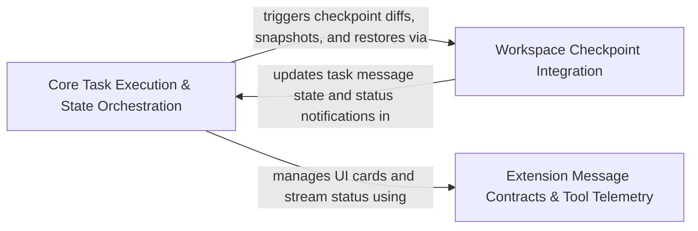

## Details

Executes the core task request loop, tool invocation pipeline, conversation state management, and shadow-git workspace checkpointing.

### Core Task Execution & State Orchestration [[Expand]](./Core_Task_Execution_State_Orchestration.md)
Orchestrates core task execution, API conversation loops, message state persistence, and checkpoint controller commands.

**Related Classes/Methods**:

- `src.core.task.ApiConversationManager.ApiConversationManager`:17-508
- `src.core.task.TaskMessenger.TaskMessenger`:34-500
- `src.core.task.message-state.MessageStateHandler`:76-1005
- `src.core.controller.checkpoints.checkpointDiff.checkpointDiff`:4-12
- `src.core.controller.checkpoints.checkpointRestore.checkpointRestore`:10-37

**Source Files:**

- `src/core/api/conversation.ts`
  - `src.core.api.conversation.ApiConversationCheckpoint` (L4-L9) - Interface
  - `src.core.api.conversation.ApiConversationContinuationReset` (L11-L15) - Interface
  - `src.core.api.conversation.ApiConversationProviderState` (L17-L22) - Interface
  - `src.core.api.conversation.PendingApiConversationCompaction` (L24-L27) - Interface
  - `src.core.api.conversation.ApiConversationRequestOptions` (L29-L33) - Interface
  - `src.core.api.conversation.ApiConversationCompactionRequest` (L35-L40) - Interface
  - `src.core.api.conversation.ApiConversationCompactionResult` (L42-L44) - Interface
- `src/core/controller/checkpoints/checkpointDiff.ts`
  - `src.core.controller.checkpoints.checkpointDiff.checkpointDiff` (L4-L12) - Function
  - `src.core.controller.checkpoints.checkpointDiff.checkpointDiff.message` (L6-L6) - Class
  - `src.core.controller.checkpoints.checkpointDiff.checkpointDiff.message.find() callback` (L6-L6) - Function
- `src/core/controller/checkpoints/checkpointRestore.ts`
  - `src.core.controller.checkpoints.checkpointRestore.checkpointRestore` (L10-L37) - Function
  - `src.core.controller.checkpoints.checkpointRestore.checkpointRestore.pWaitFor() callback` (L15-L15) - Function
  - `src.core.controller.checkpoints.checkpointRestore.checkpointRestore.catch() callback` (L17-L24) - Function
  - `src.core.controller.checkpoints.checkpointRestore.checkpointRestore.message` (L27-L27) - Class
  - `src.core.controller.checkpoints.checkpointRestore.checkpointRestore.message.find() callback` (L27-L27) - Function
- `src/core/controller/checkpoints/getCwdHash.ts`
  - `src.core.controller.checkpoints.getCwdHash.getCwdHash` (L6-L18) - Function
- `src/core/controller/checkpoints/subscribeToCheckpoints.ts`
  - `src.core.controller.checkpoints.subscribeToCheckpoints.CheckpointEventData` (L10-L16) - Interface
  - `src.core.controller.checkpoints.subscribeToCheckpoints.subscribeToCheckpoints` (L39-L74) - Function
  - `src.core.controller.checkpoints.subscribeToCheckpoints.sendCheckpointEvent` (L81-L118) - Function
  - `src.core.controller.checkpoints.subscribeToCheckpoints.sendCheckpointEvent.promises` (L105-L115) - Class
  - `src.core.controller.checkpoints.subscribeToCheckpoints.sendCheckpointEvent.promises.map() callback` (L105-L115) - Function
- `src/core/task/ApiConversationManager.ts`
  - `src.core.task.ApiConversationManager.ApiConversationManager` (L17-L508) - Class
  - `src.core.task.ApiConversationManager.ApiConversationManager.constructor` (L18-L18) - Constructor
  - `src.core.task.ApiConversationManager.ApiConversationManager.setApi` (L20-L22) - Method
  - `src.core.task.ApiConversationManager.ApiConversationManager.getOperationalApi` (L24-L26) - Method
  - `src.core.task.ApiConversationManager.ApiConversationManager.scheduleProviderConversationCompaction` (L28-L39) - Method
  - `src.core.task.ApiConversationManager.ApiConversationManager.calculatePreCompactDeletedRange` (L41-L49) - Method
  - `src.core.task.ApiConversationManager.ApiConversationManager.handleContextWindowExceededError` (L51-L110) - Method
  - `src.core.task.ApiConversationManager.ApiConversationManager.determineContextCompaction` (L112-L143) - Method
  - `src.core.task.ApiConversationManager.ApiConversationManager.isCompatibleCheckpoint` (L144-L156) - Method
  - `src.core.task.ApiConversationManager.ApiConversationManager.hasCompatibleAssistantAfterBoundary` (L158-L173) - Method
  - `src.core.task.ApiConversationManager.ApiConversationManager.hasCompatibleAssistantAfterBoundary.some() callback` (L167-L171) - Function
  - `src.core.task.ApiConversationManager.ApiConversationManager.prepareProviderConversationDispatch` (L175-L322) - Method
  - `src.core.task.ApiConversationManager.ApiConversationManager.prepareApiRequest` (L324-L507) - Method
  - `src.core.task.ApiConversationManager.ApiConversationManager.prepareApiRequest.skillIds` (L394-L398) - Class
  - `src.core.task.ApiConversationManager.ApiConversationManager.prepareApiRequest.skillIds.flatMap() callback` (L396-L396) - Function
  - `src.core.task.ApiConversationManager.ApiConversationManager.prepareApiRequest.directActions.some() callback` (L403-L403) - Function
  - `src.core.task.ApiConversationManager.prepareApiRequest.request.userContent.map() callback` (L458-L458) - Function
  - `src.core.task.ApiConversationManager.ApiConversationManager.prepareApiRequest.request.userContent.map() callback` (L486-L486) - Function
- `src/core/task/LifecycleManager.ts`
  - `src.core.task.LifecycleManager.ResumeTaskOptions` (L36-L45) - Interface
  - `src.core.task.LifecycleManager.LifecycleManager` (L47-L719) - Class
  - `src.core.task.LifecycleManager.LifecycleManager.constructor` (L51-L51) - Constructor
  - `src.core.task.LifecycleManager.LifecycleManager.setApi` (L53-L55) - Method
  - `src.core.task.LifecycleManager.LifecycleManager.setBrowserSession` (L57-L59) - Method
  - `src.core.task.LifecycleManager.LifecycleManager.getOperationalApi` (L61-L63) - Method
  - `src.core.task.LifecycleManager.LifecycleManager.initializeCheckpoints` (L65-L120) - Method
  - `src.core.task.LifecycleManager.LifecycleManager.initializeCheckpoints.lastCheckpointMessageIndex` (L93-L93) - Class
  - `src.core.task.LifecycleManager.LifecycleManager.initializeCheckpoints.lastCheckpointMessageIndex.findLastIndex() callback` (L93-L93) - Function
  - `src.core.task.LifecycleManager.LifecycleManager.initializeCheckpoints.commitPromise.then() callback` (L105-L111) - Function
  - `src.core.task.LifecycleManager.LifecycleManager.initializeCheckpoints.catch() callback` (L112-L117) - Function
  - `src.core.task.LifecycleManager.LifecycleManager.startTask` (L122-L238) - Method
  - `src.core.task.LifecycleManager.LifecycleManager.resumeTaskFromHistory` (L240-L541) - Method
  - `src.core.task.LifecycleManager.LifecycleManager.resumeTaskFromHistory.lastRelevantMessageIndex` (L257-L260) - Class
  - `src.core.task.LifecycleManager.LifecycleManager.resumeTaskFromHistory.lastRelevantMessageIndex.findLastIndex() callback` (L259-L259) - Function
  - `src.core.task.LifecycleManager.LifecycleManager.resumeTaskFromHistory.lastApiReqStartedIndex` (L265-L265) - Class
  - `src.core.task.LifecycleManager.LifecycleManager.resumeTaskFromHistory.lastApiReqStartedIndex.findLastIndex() callback` (L265-L265) - Function
  - `src.core.task.LifecycleManager.LifecycleManager.resumeTaskFromHistory.lastDiracMessage` (L308-L316) - Class
  - `src.core.task.LifecycleManager.LifecycleManager.resumeTaskFromHistory.lastDiracMessage.find() callback` (L313-L315) - Function
  - `src.core.task.LifecycleManager.LifecycleManager.resumeTaskFromHistory.pWaitFor() callback` (L333-L333) - Function
  - `src.core.task.LifecycleManager.LifecycleManager.resumeTaskFromHistory.agoText` (L451-L462) - Class
  - `src.core.task.LifecycleManager.LifecycleManager.resumeTaskFromHistory.agoText.<function>` (L451-L462) - Function
  - `src.core.task.LifecycleManager.LifecycleManager.abortTask` (L543-L550) - Method
  - `src.core.task.LifecycleManager.LifecycleManager.finalizeTaskRun` (L553-L560) - Method
  - `src.core.task.LifecycleManager.LifecycleManager.performAbortTask` (L562-L672) - Method
  - `src.core.task.LifecycleManager.LifecycleManager.releaseOwnedTaskResources` (L674-L677) - Method
  - `src.core.task.LifecycleManager.LifecycleManager.performOwnedResourceCleanup` (L679-L696) - Method
  - `src.core.task.LifecycleManager.LifecycleManager.performOwnedResourceCleanup.ToolRegistry.withExclusiveAccess() callback` (L683-L685) - Function
  - `src.core.task.LifecycleManager.LifecycleManager.disposeTaskResources` (L698-L718) - Method
  - `src.core.task.LifecycleManager.disposeTaskResources.attempt() callback` (L708-L708) - Function
  - `src.core.task.LifecycleManager.LifecycleManager.disposeTaskResources.attempt() callback` (L715-L715) - Function
- `src/core/task/TaskMessenger.ts`
  - `src.core.task.TaskMessenger.TaskCardParams` (L26-L28) - Interface
  - `src.core.task.TaskMessenger.TaskCardHandle` (L30-L32) - Interface
  - `src.core.task.TaskMessenger.TaskCardHandle.getCard` (L31-L31) - Method
  - `src.core.task.TaskMessenger.TaskMessenger` (L34-L500) - Class
  - `src.core.task.TaskMessenger.TaskMessenger.constructor` (L38-L38) - Constructor
  - `src.core.task.TaskMessenger.TaskMessenger.postPresentationToWebview` (L40-L42) - Method
  - `src.core.task.TaskMessenger.TaskMessenger.setApi` (L44-L46) - Method
  - `src.core.task.TaskMessenger.TaskMessenger.generateId` (L48-L50) - Method
  - `src.core.task.TaskMessenger.TaskMessenger.streamText` (L52-L114) - Method
  - `src.core.task.TaskMessenger.TaskMessenger.streamText.handle` (L76-L110) - Class
  - `src.core.task.TaskMessenger.TaskMessenger.streamText.handle.append` (L78-L81) - Method
  - `src.core.task.TaskMessenger.TaskMessenger.streamText.handle.setImages` (L82-L87) - Method
  - `src.core.task.TaskMessenger.TaskMessenger.streamText.handle.setFiles` (L88-L93) - Method
  - `src.core.task.TaskMessenger.TaskMessenger.streamText.handle.close` (L94-L109) - Method
  - `src.core.task.TaskMessenger.TaskMessenger.scheduleStatePublication` (L116-L120) - Method
  - `src.core.task.TaskMessenger.TaskMessenger.scheduleStatePublication.catch() callback` (L117-L119) - Function
  - `src.core.task.TaskMessenger.TaskMessenger.createCard` (L122-L357) - Method
  - `src.core.task.TaskMessenger.TaskMessenger.createCard.removeWaitingCard` (L188-L192) - Class
  - `src.core.task.TaskMessenger.TaskMessenger.createCard.removeWaitingCard.dependencies.taskState.waitingCardIds.filter() callback` (L190-L190) - Function
  - `src.core.task.TaskMessenger.TaskMessenger.createCard.handle` (L212-L354) - Class
  - `src.core.task.TaskMessenger.TaskMessenger.createCard.handle.update` (L215-L218) - Method
  - `src.core.task.TaskMessenger.TaskMessenger.createCard.handle.appendBody` (L219-L222) - Method
  - `src.core.task.TaskMessenger.TaskMessenger.createCard.handle.finalize` (L223-L227) - Method
  - `src.core.task.TaskMessenger.TaskMessenger.createCard.handle.waitForInteraction` (L228-L353) - Method
  - `src.core.task.TaskMessenger.createCard.handle.waitForInteraction.pWaitFor() callback` (L244-L248) - Function
  - `src.core.task.TaskMessenger.TaskMessenger.createCard.handle.waitForInteraction.pWaitFor() callback` (L282-L291) - Function
  - `src.core.task.TaskMessenger.TaskMessenger.createCheckpoint` (L359-L393) - Method
  - `src.core.task.TaskMessenger.TaskMessenger.createCheckpoint.handle` (L376-L390) - Class
  - `src.core.task.TaskMessenger.TaskMessenger.createCheckpoint.handle.update` (L378-L380) - Method
  - `src.core.task.TaskMessenger.TaskMessenger.createCheckpoint.handle.appendBody` (L381-L383) - Method
  - `src.core.task.TaskMessenger.TaskMessenger.createCheckpoint.handle.finalize` (L384-L386) - Method
  - `src.core.task.TaskMessenger.TaskMessenger.createCheckpoint.handle.waitForInteraction` (L387-L389) - Method
  - `src.core.task.TaskMessenger.TaskMessenger.upsertApiStatus` (L395-L411) - Method
  - `src.core.task.TaskMessenger.TaskMessenger.upsertText` (L413-L466) - Method
  - `src.core.task.TaskMessenger.TaskMessenger.runNotificationHook` (L468-L499) - Method
- `src/core/task/TaskRequestLoop.ts`
  - `src.core.task.TaskRequestLoop.TaskRequestLoopContext` (L30-L45) - Interface
  - `src.core.task.TaskRequestLoop.recursivelyMakeDiracRequests` (L47-L447) - Function
  - `src.core.task.TaskRequestLoop.recursivelyMakeDiracRequests.afterUserContentPersisted` (L127-L132) - Method
  - `src.core.task.TaskRequestLoop.recursivelyMakeDiracRequests.afterUserContentPersisted.conversationPersistence.persist() callback` (L128-L128) - Function
  - `src.core.task.TaskRequestLoop.recursivelyMakeDiracRequests.queueUsageChunkSideEffects` (L169-L190) - Class
  - `src.core.task.TaskRequestLoop.recursivelyMakeDiracRequests.queueUsageChunkSideEffects.usageChunkSideEffectsQueue.then() callback` (L174-L189) - Function
  - `src.core.task.TaskRequestLoop.recursivelyMakeDiracRequests.onUsageChunk` (L317-L328) - Method
  - `src.core.task.TaskRequestLoop.recursivelyMakeDiracRequests.streamResult` (L331-L335) - Class
  - `src.core.task.TaskRequestLoop.recursivelyMakeDiracRequests.streamResult.apiAbort` (L334-L334) - Method
- `src/core/task/ToolExecutor.ts`
  - `src.core.task.ToolExecutor.ToolExecutor` (L51-L555) - Class
  - `src.core.task.ToolExecutor.ToolExecutor.constructor` (L66-L147) - Constructor
  - `src.core.task.ToolExecutor.ToolExecutor.constructor.createTaskConfig` (L125-L125) - Method
  - `src.core.task.ToolExecutor.ToolExecutor.constructor.getTaskId` (L126-L126) - Method
  - `src.core.task.ToolExecutor.ToolExecutor.constructor.getWorkspaceRoot` (L127-L127) - Method
  - `src.core.task.ToolExecutor.ToolExecutor.constructor.getToggles` (L128-L128) - Method
  - `src.core.task.ToolExecutor.ToolExecutor.constructor.getSelectionPolicy` (L129-L129) - Method
  - `src.core.task.ToolExecutor.ToolExecutor.constructor.getActiveSkills` (L130-L133) - Method
  - `src.core.task.ToolExecutor.ToolExecutor.constructor.getActiveSkills.taskState.availableSkills.filter() callback` (L132-L132) - Function
  - `src.core.task.ToolExecutor.ToolExecutor.constructor.isToolAvailable` (L134-L134) - Method
  - `src.core.task.ToolExecutor.ToolExecutor.setApi` (L149-L151) - Method
  - `src.core.task.ToolExecutor.ToolExecutor.requestAutoApprover` (L153-L159) - Method
  - `src.core.task.ToolExecutor.ToolExecutor.shouldAutoApproveTool` (L161-L163) - Method
  - `src.core.task.ToolExecutor.ToolExecutor.assertMutationAuthorized` (L165-L167) - Method
  - `src.core.task.ToolExecutor.ToolExecutor.withMutationAuthorization` (L169-L171) - Method
  - `src.core.task.ToolExecutor.ToolExecutor.shouldAutoApproveToolWithPath` (L173-L184) - Method
  - `src.core.task.ToolExecutor.ToolExecutor.resolveToolPathPermission` (L186-L197) - Method
  - `src.core.task.ToolExecutor.ToolExecutor.requestRuntime` (L199-L206) - Method
  - `src.core.task.ToolExecutor.ToolExecutor.requestProviderId` (L208-L214) - Method
  - `src.core.task.ToolExecutor.ToolExecutor.createUtilityRunner` (L216-L230) - Method
  - `src.core.task.ToolExecutor.ToolExecutor.createUtilityRunner.onUsage` (L225-L228) - Method
  - `src.core.task.ToolExecutor.ToolExecutor.createPermissionDecisionBinding` (L233-L253) - Method
  - `src.core.task.ToolExecutor.ToolExecutor.createSubagentRuntime` (L255-L286) - Method
  - `src.core.task.ToolExecutor.ToolExecutor.createSubagentRuntime.abort` (L284-L284) - Method
  - `src.core.task.ToolExecutor.ToolExecutor.asToolConfig` (L288-L388) - Method
  - `src.core.task.ToolExecutor.ToolExecutor.asToolConfig.config` (L295-L384) - Class
  - `src.core.task.ToolExecutor.ToolExecutor.asToolConfig.config.yoloModeToggled` (L301-L303) - Method
  - `src.core.task.ToolExecutor.ToolExecutor.asToolConfig.config.autoApprovalSettings` (L331-L333) - Method
  - `src.core.task.ToolExecutor.ToolExecutor.asToolConfig.config.permissionDecisionBinding` (L336-L338) - Method
  - `src.core.task.ToolExecutor.ToolExecutor.asToolConfig.config.callbacks.assertMutationAuthorized` (L349-L349) - Method
  - `src.core.task.ToolExecutor.ToolExecutor.asToolConfig.config.callbacks.withMutationAuthorization` (L350-L350) - Method
  - `src.core.task.ToolExecutor.ToolExecutor.asToolConfig.config.callbacks.transitionFromMutation` (L351-L351) - Method
  - `src.core.task.ToolExecutor.ToolExecutor.asToolConfig.config.callbacks.retainMutationUntil` (L352-L352) - Method
  - `src.core.task.ToolExecutor.ToolExecutor.asToolConfig.config.callbacks.commitEnabledToolToggles` (L353-L353) - Method
  - `src.core.task.ToolExecutor.ToolExecutor.asToolConfig.config.callbacks.saveCheckpoint` (L354-L356) - Method
  - `src.core.task.ToolExecutor.ToolExecutor.asToolConfig.config.callbacks.commitAttemptCompletion` (L357-L357) - Method
  - `src.core.task.ToolExecutor.ToolExecutor.asToolConfig.config.callbacks.getDiracMessages` (L363-L363) - Method
  - `src.core.task.ToolExecutor.ToolExecutor.asToolConfig.config.callbacks.updateDiracMessage` (L364-L367) - Method
  - `src.core.task.ToolExecutor.ToolExecutor.asToolConfig.config.callbacks.createUtilityModelRunner` (L379-L379) - Method
  - `src.core.task.ToolExecutor.ToolExecutor.asToolConfig.config.callbacks.createSubagentRuntime` (L380-L380) - Method
  - `src.core.task.ToolExecutor.ToolExecutor.refreshToolsForTask` (L390-L392) - Method
  - `src.core.task.ToolExecutor.ToolExecutor.markToolsDirty` (L393-L395) - Method
  - `src.core.task.ToolExecutor.ToolExecutor.getSnapshotForRequest` (L396-L409) - Method
  - `src.core.task.ToolExecutor.ToolExecutor.getActiveSnapshot` (L410-L412) - Method
  - `src.core.task.ToolExecutor.ToolExecutor.activateSnapshot` (L413-L425) - Method
  - `src.core.task.ToolExecutor.ToolExecutor.executeTool` (L426-L428) - Method
  - `src.core.task.ToolExecutor.ToolExecutor.applyLatestBrowserSettings` (L430-L438) - Method
  - `src.core.task.ToolExecutor.ToolExecutor.isPlanModeToolRestricted` (L440-L442) - Method
  - `src.core.task.ToolExecutor.ToolExecutor.createToolRejectionMessage` (L444-L449) - Method
  - `src.core.task.ToolExecutor.ToolExecutor.execute` (L451-L480) - Method
  - `src.core.task.ToolExecutor.ToolExecutor.isPlanModeRestricted` (L483-L495) - Method
  - `src.core.task.ToolExecutor.ToolExecutor.handleCompleteBlock` (L497-L554) - Method
- `src/core/task/index.ts`
  - `src.core.task.index.Task` (L143-L1360) - Class
  - `src.core.task.index.Task.stateView` (L160-L162) - Method
  - `src.core.task.index.Task.withStateLock` (L176-L178) - Method
  - `src.core.task.index.Task.steeringContext` (L180-L190) - Method
  - `src.core.task.index.Task.steeringContext.postStateToWebview` (L187-L187) - Method
  - `src.core.task.index.Task.steeringContext.withStateLock` (L188-L188) - Method
  - `src.core.task.index.Task.promptArtifactsContext` (L192-L203) - Method
  - `src.core.task.index.Task.requestBuilderContext` (L205-L233) - Method
  - `src.core.task.index.Task.requestBuilderContext.writePromptMetadataArtifacts` (L221-L231) - Method
  - `src.core.task.index.Task.requestOutcomeContext` (L235-L255) - Method
  - `src.core.task.index.Task.requestOutcomeContext.postStateToWebview` (L245-L245) - Method
  - `src.core.task.index.Task.requestOutcomeContext.abortTask` (L246-L246) - Method
  - `src.core.task.index.Task.requestOutcomeContext.handleContextWindowExceededError` (L247-L247) - Method
  - `src.core.task.index.Task.requestOutcomeContext.reinitExistingTaskFromId` (L248-L248) - Method
  - `src.core.task.index.Task.requestOutcomeContext.attemptApiRequest` (L249-L250) - Method
  - `src.core.task.index.Task.requestOutcomeContext.recursivelyMakeDiracRequests` (L251-L252) - Method
  - `src.core.task.index.Task.requestOutcomeContext.handleEmptyAssistantResponse` (L253-L253) - Method
  - `src.core.task.index.Task.requestLoopContext` (L257-L276) - Method
  - `src.core.task.index.Task.requestLoopContext.handleMistakeLimitReached` (L263-L263) - Method
  - `src.core.task.index.Task.requestLoopContext.enqueuePreRequestSteeringMessages` (L264-L264) - Method
  - `src.core.task.index.Task.requestLoopContext.resetStreamingState` (L265-L265) - Method
  - `src.core.task.index.Task.requestLoopContext.initializeCheckpoints` (L266-L266) - Method
  - `src.core.task.index.Task.requestLoopContext.determineContextCompaction` (L267-L267) - Method
  - `src.core.task.index.Task.canAcceptSteeringMessage` (L278-L280) - Method
  - `src.core.task.index.Task.enqueueSteeringMessage` (L282-L284) - Method
  - `src.core.task.index.Task.claimSteeringMessages` (L286-L288) - Method
  - `src.core.task.index.Task.commitSteeringClaim` (L290-L292) - Method
  - `src.core.task.index.Task.settleConsumedSteeringClaim` (L294-L296) - Method
  - `src.core.task.index.Task.rollbackSteeringClaim` (L298-L300) - Method
  - `src.core.task.index.Task.appendQueuedSteeringToUserContent` (L302-L304) - Method
  - `src.core.task.index.Task.appendQueuedSteeringToNextApiRequest` (L306-L308) - Method
  - `src.core.task.index.Task.commitAttemptCompletion` (L310-L314) - Method
  - `src.core.task.index.Task.setActiveHookExecution` (L316-L318) - Method
  - `src.core.task.index.Task.clearActiveHookExecution` (L320-L322) - Method
  - `src.core.task.index.Task.setContextCompactionObserver` (L325-L327) - Method
  - `src.core.task.index.Task.notifyContextCompacted` (L329-L335) - Method
  - `src.core.task.index.Task.getActiveHookExecution` (L337-L339) - Method
  - `src.core.task.index.Task.constructor` (L408-L875) - Constructor
  - `src.core.task.index.constructor.getWorkingConfiguration` (L492-L492) - Method
  - `src.core.task.index.constructor.getRequestRuntime` (L493-L493) - Method
  - `src.core.task.index.Task.constructor.shouldRunBackgroundCheck` (L510-L510) - Method
  - `src.core.task.index.Task.constructor.catch() callback` (L597-L600) - Function
  - `src.core.task.index.Task.constructor.effectiveApiConfiguration` (L616-L629) - Class
  - `src.core.task.index.Task.constructor.effectiveApiConfiguration.onRetryAttempt` (L619-L628) - Method
  - `src.core.task.index.Task.constructor.commandExecutorCallbacks` (L668-L685) - Class
  - `src.core.task.index.Task.constructor.commandExecutorCallbacks.updateBackgroundCommandState` (L670-L674) - Method
  - `src.core.task.index.Task.constructor.commandExecutorCallbacks.updateDiracMessage` (L675-L678) - Method
  - `src.core.task.index.Task.constructor.commandExecutorCallbacks.getDiracMessages` (L679-L679) - Method
  - `src.core.task.index.Task.constructor.commandExecutorCallbacks.addToUserMessageContent` (L680-L683) - Method
  - `src.core.task.index.Task.constructor.commandExecutorCallbacks.getEnvironmentVariables` (L684-L684) - Method
  - `src.core.task.index.Task.constructor.isTextCondensationAvailable` (L767-L777) - Method
  - `src.core.task.index.Task.constructor.time` (L808-L808) - Method
  - `src.core.task.index.Task.constructor.getApi` (L819-L819) - Method
  - `src.core.task.index.Task.constructor.getWorkingConfiguration` (L832-L832) - Method
  - `src.core.task.index.Task.constructor.getRequestRuntime` (L833-L833) - Method
  - `src.core.task.index.Task.constructor.activateSkill` (L844-L844) - Method
  - `src.core.task.index.Task.constructor.getPinnedContext` (L847-L847) - Method
  - `src.core.task.index.Task.constructor.writePromptMetadataArtifacts` (L848-L848) - Method
  - `src.core.task.index.Task.constructor.runLocalConversationCompaction` (L856-L856) - Method
  - `src.core.task.index.Task.getWorkingConfiguration` (L878-L880) - Method
  - `src.core.task.index.Task.applyWorkingConfigurationUpdate` (L888-L919) - Method
  - `src.core.task.index.Task.applyWorkingConfigurationUpdate.mutationGate.withTransition() callback` (L892-L917) - Function
  - `src.core.task.index.Task.applyWorkingConfigurationUpdate.mutationGate.withTransition() callback.withStateLock() callback` (L893-L917) - Function
  - `src.core.task.index.Task.commitEnabledToolToggles` (L921-L938) - Method
  - `src.core.task.index.commitEnabledToolToggles.applyWorkingConfigurationUpdate() callback` (L928-L932) - Function
  - `src.core.task.index.Task.commitEnabledToolToggles.applyWorkingConfigurationUpdate() callback` (L933-L936) - Function
  - `src.core.task.index.Task.withMutationAuthorization` (L940-L949) - Method
  - `src.core.task.index.Task.withMutationAuthorization.mutationGate.withMutation() callback` (L946-L946) - Function
  - `src.core.task.index.Task.createApiHandlerForRuntime` (L952-L970) - Method
  - `src.core.task.index.Task.createApiHandlerForRuntime.onRetryAttempt` (L957-L966) - Method
  - `src.core.task.index.Task.installApiHandler` (L973-L982) - Method
  - `src.core.task.index.Task.applyCommittedModeEffects` (L984-L990) - Method
  - `src.core.task.index.Task.getEnvironmentDetails` (L992-L994) - Method
  - `src.core.task.index.Task.persistApiStopReason` (L996-L999) - Method
  - `src.core.task.index.Task.handleMistakeLimitReached` (L1001-L1013) - Method
  - `src.core.task.index.Task.handleMistakeLimitReached.postStateToWebview` (L1009-L1009) - Method
  - `src.core.task.index.Task.loadContext` (L1015-L1021) - Method
  - `src.core.task.index.Task.resetTransientState` (L1025-L1033) - Method
  - `src.core.task.index.Task.waitForFollowUp` (L1035-L1037) - Method
  - `src.core.task.index.Task.addPermissionRule` (L1040-L1042) - Method
  - `src.core.task.index.Task.listPermissionRules` (L1045-L1047) - Method
  - `src.core.task.index.Task.deletePermissionRule` (L1050-L1052) - Method
  - `src.core.task.index.Task.submitCardResponse` (L1054-L1065) - Method
  - `src.core.task.index.Task.submitCardResponse.withStateLock() callback` (L1062-L1064) - Function
  - `src.core.task.index.Task.saveCheckpointCallback` (L1067-L1072) - Method
  - `src.core.task.index.Task.switchToActModeCallback` (L1074-L1076) - Method
  - `src.core.task.index.Task.runUserPromptSubmitHook` (L1078-L1083) - Method
  - `src.core.task.index.Task.startTask` (L1085-L1090) - Method
  - `src.core.task.index.Task.startTask.runTaskLifecycle() callback` (L1086-L1089) - Function
  - `src.core.task.index.Task.restoreQueuedSteeringFromTranscript` (L1092-L1094) - Method
  - `src.core.task.index.Task.resumeTaskFromHistory` (L1096-L1101) - Method
  - `src.core.task.index.Task.resumeTaskFromHistory.runTaskLifecycle() callback` (L1097-L1100) - Function
  - `src.core.task.index.Task.markToolsDirty` (L1103-L1105) - Method
  - `src.core.task.index.Task.initiateTaskLoop` (L1107-L1153) - Method
  - `src.core.task.index.Task.runTaskLifecycle` (L1155-L1163) - Method
  - `src.core.task.index.Task.taskRunOutcomeFromState` (L1165-L1188) - Method
  - `src.core.task.index.Task.settleTaskRun` (L1190-L1221) - Method
  - `src.core.task.index.Task.settleTaskRun.withStateLock() callback` (L1216-L1220) - Function
  - `src.core.task.index.Task.shouldRunTaskCancelHook` (L1223-L1225) - Method
  - `src.core.task.index.Task.abortTask` (L1227-L1234) - Method
  - `src.core.task.index.Task.abortTask.withStateLock() callback` (L1228-L1228) - Function
  - `src.core.task.index.Task.retirePersistence` (L1237-L1240) - Method
  - `src.core.task.index.Task.retirePersistenceAndReleaseLock` (L1242-L1246) - Method
  - `src.core.task.index.Task.executeCommandTool` (L1249-L1255) - Method
  - `src.core.task.index.Task.cancelBackgroundCommand` (L1261-L1263) - Method
  - `src.core.task.index.Task.cancelHookExecution` (L1265-L1267) - Method
  - `src.core.task.index.Task.getCurrentProviderInfo` (L1269-L1283) - Method
  - `src.core.task.index.Task.writePromptMetadataArtifacts` (L1285-L1293) - Method
  - `src.core.task.index.Task.getApiRequestIdSafe` (L1295-L1301) - Method
  - `src.core.task.index.Task.handleContextWindowExceededError` (L1303-L1305) - Method
  - `src.core.task.index.Task.handleApiRequestError` (L1307-L1318) - Method
  - `src.core.task.index.Task.resetStreamingState` (L1320-L1332) - Method
  - `src.core.task.index.Task.attemptApiRequest` (L1334-L1337) - Method
  - `src.core.task.index.Task.presentAssistantMessage` (L1339-L1341) - Method
  - `src.core.task.index.Task.recursivelyMakeDiracRequests` (L1343-L1351) - Method
  - `src.core.task.index.Task.initializeCheckpoints` (L1353-L1355) - Method
  - `src.core.task.index.Task.determineContextCompaction` (L1357-L1359) - Method
- `src/core/task/message-state.ts`
  - `src.core.task.message-state.DiracMessageChange` (L34-L48) - Interface
  - `src.core.task.message-state.PresentationSnapshot` (L50-L54) - Interface
  - `src.core.task.message-state.MessageStateHandlerEvents` (L57-L60) - Interface
  - `src.core.task.message-state.MessageStateHandlerParams` (L62-L70) - Interface
  - `src.core.task.message-state.MessageStateHandler` (L76-L1005) - Class
  - `src.core.task.message-state.MessageStateHandler.recordPresentationOperation` (L118-L130) - Method
  - `src.core.task.message-state.MessageStateHandler.recordApiConversationOperation` (L132-L137) - Method
  - `src.core.task.message-state.MessageStateHandler.bufferPresentationAppend` (L139-L143) - Method
  - `src.core.task.message-state.MessageStateHandler.materializePresentationAppends` (L145-L158) - Method
  - `src.core.task.message-state.MessageStateHandler.materializeAllPresentationAppends` (L160-L165) - Method
  - `src.core.task.message-state.MessageStateHandler.flushIfPersistenceBatchIsFull` (L167-L174) - Method
  - `src.core.task.message-state.MessageStateHandler.getPendingPresentationOperations` (L176-L178) - Method
  - `src.core.task.message-state.MessageStateHandler.hasPresentationPublicationGap` (L180-L182) - Method
  - `src.core.task.message-state.MessageStateHandler.acknowledgePresentationOperations` (L184-L198) - Method
  - `src.core.task.message-state.MessageStateHandler.acknowledgePresentationOperations.pendingPresentationPublications.filter() callback` (L186-L186) - Function
  - `src.core.task.message-state.MessageStateHandler.acknowledgePresentationOperations.pendingPresentationPublications.reduce() callback` (L189-L189) - Function
  - `src.core.task.message-state.MessageStateHandler.hasPendingPresentationOperations` (L200-L202) - Method
  - `src.core.task.message-state.MessageStateHandler.constructor` (L203-L211) - Constructor
  - `src.core.task.message-state.MessageStateHandler.emitDiracMessagesChanged` (L216-L218) - Method
  - `src.core.task.message-state.MessageStateHandler.publishCardInteractionReady` (L221-L224) - Method
  - `src.core.task.message-state.MessageStateHandler.setCheckpointTracker` (L226-L228) - Method
  - `src.core.task.message-state.MessageStateHandler.withStateLock` (L235-L237) - Method
  - `src.core.task.message-state.MessageStateHandler.capturePresentationSnapshot` (L239-L248) - Method
  - `src.core.task.message-state.MessageStateHandler.capturePresentationSnapshot.withStateLock() callback` (L240-L247) - Function
  - `src.core.task.message-state.MessageStateHandler.scheduleUiFlush` (L251-L262) - Method
  - `src.core.task.message-state.MessageStateHandler.scheduleUiFlush.setTimeout() callback` (L257-L261) - Function
  - `src.core.task.message-state.MessageStateHandler.scheduleUiFlush.setTimeout() callback.catch() callback` (L260-L260) - Function
  - `src.core.task.message-state.MessageStateHandler.scheduleApiHistoryFlush` (L265-L272) - Method
  - `src.core.task.message-state.MessageStateHandler.scheduleApiHistoryFlush.queueMicrotask() callback` (L268-L271) - Function
  - `src.core.task.message-state.MessageStateHandler.scheduleApiHistoryFlush.queueMicrotask() callback.catch() callback` (L270-L270) - Function
  - `src.core.task.message-state.MessageStateHandler.cancelScheduledUiFlush` (L274-L278) - Method
  - `src.core.task.message-state.MessageStateHandler.retirePersistence` (L281-L296) - Method
  - `src.core.task.message-state.MessageStateHandler.retirePersistence.persistenceMutex.withLock() callback` (L285-L294) - Function
  - `src.core.task.message-state.MessageStateHandler.retirePersistence.persistenceMutex.withLock() callback.withStateLock() callback` (L286-L294) - Function
  - `src.core.task.message-state.MessageStateHandler.persistPendingOperations` (L299-L336) - Method
  - `src.core.task.message-state.MessageStateHandler.persistPendingOperations.pending` (L301-L313) - Class
  - `src.core.task.message-state.MessageStateHandler.persistPendingOperations.pending.withStateLock() callback` (L301-L313) - Function
  - `src.core.task.message-state.persistPendingOperations.withStateLock() callback` (L320-L323) - Function
  - `src.core.task.message-state.MessageStateHandler.persistPendingOperations.withStateLock() callback` (L329-L332) - Function
  - `src.core.task.message-state.MessageStateHandler.createBaselinesWhenTailIsLarge` (L338-L359) - Method
  - `src.core.task.message-state.MessageStateHandler.createBaselinesWhenTailIsLarge.withStateLock() callback` (L349-L358) - Function
  - `src.core.task.message-state.MessageStateHandler.flushPendingWrites` (L365-L369) - Method
  - `src.core.task.message-state.MessageStateHandler.flushPendingWrites.persistenceMutex.withLock() callback` (L368-L368) - Function
  - `src.core.task.message-state.MessageStateHandler.flushTaskHistory` (L375-L379) - Method
  - `src.core.task.message-state.MessageStateHandler.flushTaskHistory.persistenceMutex.withLock() callback` (L378-L378) - Function
  - `src.core.task.message-state.MessageStateHandler.getApiConversationHistory` (L381-L383) - Method
  - `src.core.task.message-state.MessageStateHandler.setApiConversationHistory` (L385-L391) - Method
  - `src.core.task.message-state.MessageStateHandler.getApiConversationProviderState` (L393-L395) - Method
  - `src.core.task.message-state.MessageStateHandler.setApiConversationProviderState` (L397-L399) - Method
  - `src.core.task.message-state.MessageStateHandler.overwriteApiConversationProviderState` (L401-L411) - Method
  - `src.core.task.message-state.MessageStateHandler.overwriteApiConversationProviderState.persistenceMutex.withLock() callback` (L404-L410) - Function
  - `src.core.task.message-state.MessageStateHandler.overwriteApiConversationProviderState.persistenceMutex.withLock() callback.withStateLock() callback` (L406-L409) - Function
  - `src.core.task.message-state.MessageStateHandler.getDiracMessages` (L413-L416) - Method
  - `src.core.task.message-state.MessageStateHandler.setDiracMessages` (L418-L436) - Method
  - `src.core.task.message-state.MessageStateHandler.rebuildMessageIndexes` (L438-L450) - Method
  - `src.core.task.message-state.MessageStateHandler.updateLatestApiStatusAfterMutation` (L452-L460) - Method
  - `src.core.task.message-state.MessageStateHandler.findLastApiStatusMessageId` (L462-L470) - Method
  - `src.core.task.message-state.MessageStateHandler.rebuildHistoryProjection` (L472-L480) - Method
  - `src.core.task.message-state.MessageStateHandler.updateHistoryProjection` (L482-L511) - Method
  - `src.core.task.message-state.MessageStateHandler.historyProjectionBeforeMutation` (L513-L523) - Method
  - `src.core.task.message-state.MessageStateHandler.findLastRelevantMessageId` (L525-L532) - Method
  - `src.core.task.message-state.MessageStateHandler.updateTaskHistoryInternal` (L539-L583) - Method
  - `src.core.task.message-state.MessageStateHandler.saveDiracMessagesAndUpdateHistory` (L589-L593) - Method
  - `src.core.task.message-state.MessageStateHandler.saveDiracMessagesAndUpdateHistory.persistenceMutex.withLock() callback` (L592-L592) - Function
  - `src.core.task.message-state.MessageStateHandler.addToApiConversationHistory` (L595-L608) - Method
  - `src.core.task.message-state.MessageStateHandler.addToApiConversationHistory.withStateLock() callback` (L596-L605) - Function
  - `src.core.task.message-state.MessageStateHandler.appendToLastApiConversationUserMessage` (L610-L632) - Method
  - `src.core.task.message-state.MessageStateHandler.appendToLastApiConversationUserMessage.message` (L612-L628) - Class
  - `src.core.task.message-state.MessageStateHandler.appendToLastApiConversationUserMessage.message.withStateLock() callback` (L612-L628) - Function
  - `src.core.task.message-state.MessageStateHandler.overwriteApiConversationHistory` (L634-L646) - Method
  - `src.core.task.message-state.MessageStateHandler.overwriteApiConversationHistory.withStateLock() callback` (L636-L644) - Function
  - `src.core.task.message-state.MessageStateHandler.recordDeliveredSteeringMessageIds` (L648-L663) - Method
  - `src.core.task.message-state.MessageStateHandler.recordDeliveredSteeringMessageIds.persistenceMutex.withLock() callback` (L651-L662) - Function
  - `src.core.task.message-state.MessageStateHandler.recordDeliveredSteeringMessageIds.persistenceMutex.withLock() callback.withStateLock() callback` (L653-L661) - Function
  - `src.core.task.message-state.MessageStateHandler.addToDiracMessages` (L671-L701) - Method
  - `src.core.task.message-state.MessageStateHandler.addToDiracMessages.withStateLock() callback` (L672-L698) - Function
  - `src.core.task.message-state.MessageStateHandler.overwriteDiracMessages` (L707-L727) - Method
  - `src.core.task.message-state.MessageStateHandler.overwriteDiracMessages.withStateLock() callback` (L709-L725) - Function
  - `src.core.task.message-state.MessageStateHandler.findMessageIndexById` (L732-L734) - Method
  - `src.core.task.message-state.MessageStateHandler.getMessageById` (L736-L742) - Method
  - `src.core.task.message-state.MessageStateHandler.getLatestApiStatusMessage` (L744-L746) - Method
  - `src.core.task.message-state.MessageStateHandler.getPresentationOffset` (L748-L750) - Method
  - `src.core.task.message-state.MessageStateHandler.getPresentationStateGeneration` (L752-L754) - Method
  - `src.core.task.message-state.MessageStateHandler.findMessageIndexByCardId` (L759-L761) - Method
  - `src.core.task.message-state.MessageStateHandler.patchCardById` (L763-L789) - Method
  - `src.core.task.message-state.MessageStateHandler.patchCardById.updatedCard` (L764-L785) - Class
  - `src.core.task.message-state.MessageStateHandler.patchCardById.updatedCard.withStateLock() callback` (L764-L785) - Function
  - `src.core.task.message-state.MessageStateHandler.appendCardBodyById` (L791-L812) - Method
  - `src.core.task.message-state.MessageStateHandler.appendCardBodyById.withStateLock() callback` (L792-L809) - Function
  - `src.core.task.message-state.MessageStateHandler.appendMarkdownById` (L814-L836) - Method
  - `src.core.task.message-state.MessageStateHandler.appendMarkdownById.withStateLock() callback` (L815-L833) - Function
  - `src.core.task.message-state.MessageStateHandler.patchMarkdownById` (L838-L865) - Method
  - `src.core.task.message-state.MessageStateHandler.patchMarkdownById.withStateLock() callback` (L842-L862) - Function
  - `src.core.task.message-state.MessageStateHandler.patchApiStatusById` (L867-L897) - Method
  - `src.core.task.message-state.MessageStateHandler.patchApiStatusById.withStateLock() callback` (L872-L894) - Function
  - `src.core.task.message-state.MessageStateHandler.requireMessageIndex` (L899-L903) - Method
  - `src.core.task.message-state.MessageStateHandler.requireCardMessageIndex` (L905-L909) - Method
  - `src.core.task.message-state.MessageStateHandler.updateDiracMessage` (L914-L943) - Method
  - `src.core.task.message-state.MessageStateHandler.updateDiracMessage.withStateLock() callback` (L915-L940) - Function
  - `src.core.task.message-state.MessageStateHandler.patchMessageById` (L945-L970) - Method
  - `src.core.task.message-state.MessageStateHandler.patchMessageById.withStateLock() callback` (L946-L967) - Function
  - `src.core.task.message-state.MessageStateHandler.deleteDiracMessage` (L976-L1004) - Method
  - `src.core.task.message-state.MessageStateHandler.deleteDiracMessage.withStateLock() callback` (L977-L1001) - Function
  - `src.core.task.message-state.isTaskHistoryRelevantMessage` (L1007-L1012) - Function
  - `src.core.task.message-state.addApiMetrics` (L1014-L1031) - Function
  - `src.core.task.message-state.findLastModelInfo` (L1033-L1038) - Function
- `src/core/task/multifile-diff.ts`
  - `src.core.task.multifile-diff.showChangedFilesDiff` (L11-L48) - Function
  - `src.core.task.multifile-diff.diffs` (L42-L46) - Class
  - `src.core.task.multifile-diff.showChangedFilesDiff.diffs.changedFiles.map() callback` (L42-L46) - Function
  - `src.core.task.multifile-diff.getChangedFiles` (L57-L92) - Function
  - `src.core.task.multifile-diff.getChangesSinceLastTaskCompletion` (L94-L129) - Function
  - `src.core.task.multifile-diff.getChangesSinceLastTaskCompletion.lastTaskCompletedMessageCheckpointHash` (L101-L104) - Class
  - `src.core.task.multifile-diff.getChangesSinceLastTaskCompletion.lastTaskCompletedMessageCheckpointHash.findLast() callback` (L103-L103) - Function
  - `src.core.task.multifile-diff.getChangesSinceLastTaskCompletion.firstCheckpointMessageCheckpointHash` (L107-L113) - Class
  - `src.core.task.multifile-diff.getChangesSinceLastTaskCompletion.firstCheckpointMessageCheckpointHash.find() callback` (L110-L112) - Function
- `src/core/task/response/AssistantMessagePresenter.ts`
  - `src.core.task.response.AssistantMessagePresenter.AssistantMessagePresenter` (L12-L151) - Class
  - `src.core.task.response.AssistantMessagePresenter.AssistantMessagePresenter.constructor` (L21-L21) - Constructor
  - `src.core.task.response.AssistantMessagePresenter.pendingPresentationError` (L23-L25) - Method
  - `src.core.task.response.AssistantMessagePresenter.AssistantMessagePresenter.pendingPresentationError` (L26-L28) - Method
  - `src.core.task.response.AssistantMessagePresenter.AssistantMessagePresenter.resetState` (L30-L36) - Method
  - `src.core.task.response.AssistantMessagePresenter.AssistantMessagePresenter.sanitizeModelQuirks` (L39-L41) - Method
  - `src.core.task.response.AssistantMessagePresenter.AssistantMessagePresenter.present` (L43-L50) - Method
  - `src.core.task.response.AssistantMessagePresenter.AssistantMessagePresenter.runPresentationLoop` (L53-L64) - Method
  - `src.core.task.response.AssistantMessagePresenter.AssistantMessagePresenter.processPendingBlocks` (L67-L79) - Method
  - `src.core.task.response.AssistantMessagePresenter.AssistantMessagePresenter.computeBlockComplete` (L82-L88) - Method
  - `src.core.task.response.AssistantMessagePresenter.AssistantMessagePresenter.processBlock` (L91-L100) - Method
  - `src.core.task.response.AssistantMessagePresenter.AssistantMessagePresenter.processTextBlock` (L102-L113) - Method
  - `src.core.task.response.AssistantMessagePresenter.AssistantMessagePresenter.processReasoningBlock` (L115-L122) - Method
  - `src.core.task.response.AssistantMessagePresenter.AssistantMessagePresenter.processToolUseBlock` (L124-L131) - Method
  - `src.core.task.response.AssistantMessagePresenter.AssistantMessagePresenter.awaitCheckpointIfNeeded` (L134-L142) - Method
  - `src.core.task.response.AssistantMessagePresenter.AssistantMessagePresenter.checkAllBlocksProcessed` (L145-L150) - Method
- `src/core/task/tools/adapters/traits/OrchestrationTraitBuilder.ts`
  - `src.core.task.tools.adapters.traits.OrchestrationTraitBuilder.buildOrchestrationTrait` (L13-L114) - Function
  - `src.core.task.tools.adapters.traits.OrchestrationTraitBuilder.buildOrchestrationTrait.runSubagent` (L15-L69) - Method
  - `src.core.task.tools.adapters.traits.OrchestrationTraitBuilder.buildOrchestrationTrait.runSubagent.result` (L60-L63) - Class
  - `src.core.task.tools.adapters.traits.OrchestrationTraitBuilder.buildOrchestrationTrait.runSubagent.result.runner.run() callback` (L60-L63) - Function
  - `src.core.task.tools.adapters.traits.OrchestrationTraitBuilder.buildOrchestrationTrait.runHook` (L70-L84) - Method
  - `src.core.task.tools.adapters.traits.OrchestrationTraitBuilder.buildOrchestrationTrait.switchToActMode` (L85-L85) - Method
  - `src.core.task.tools.adapters.traits.OrchestrationTraitBuilder.buildOrchestrationTrait.saveCheckpoint` (L86-L86) - Method
  - `src.core.task.tools.adapters.traits.OrchestrationTraitBuilder.buildOrchestrationTrait.commitAttemptCompletion` (L87-L87) - Method
  - `src.core.task.tools.adapters.traits.OrchestrationTraitBuilder.buildOrchestrationTrait.getHistory` (L88-L88) - Method
  - `src.core.task.tools.adapters.traits.OrchestrationTraitBuilder.buildOrchestrationTrait.getCurrentTurnUserRequests` (L89-L89) - Method
  - `src.core.task.tools.adapters.traits.OrchestrationTraitBuilder.buildOrchestrationTrait.setTruncationRange` (L90-L92) - Method
  - `src.core.task.tools.adapters.traits.OrchestrationTraitBuilder.buildOrchestrationTrait.getNextTruncationRange` (L93-L98) - Method
  - `src.core.task.tools.adapters.traits.OrchestrationTraitBuilder.buildOrchestrationTrait.getTaskState` (L99-L99) - Method
  - `src.core.task.tools.adapters.traits.OrchestrationTraitBuilder.buildOrchestrationTrait.setTaskState` (L100-L102) - Method
  - `src.core.task.tools.adapters.traits.OrchestrationTraitBuilder.buildOrchestrationTrait.commitCompletionResponse` (L103-L103) - Method
  - `src.core.task.tools.adapters.traits.OrchestrationTraitBuilder.buildOrchestrationTrait.requestTaskReplacement` (L104-L107) - Method
  - `src.core.task.tools.adapters.traits.OrchestrationTraitBuilder.buildOrchestrationTrait.activateSkill` (L108-L108) - Method
  - `src.core.task.tools.adapters.traits.OrchestrationTraitBuilder.buildOrchestrationTrait.doesLatestTaskCompletionHaveNewChanges` (L109-L109) - Method
  - `src.core.task.tools.adapters.traits.OrchestrationTraitBuilder.buildOrchestrationTrait.updateMessage` (L110-L110) - Method
  - `src.core.task.tools.adapters.traits.OrchestrationTraitBuilder.buildOrchestrationTrait.resetTransientState` (L111-L111) - Method
  - `src.core.task.tools.adapters.traits.OrchestrationTraitBuilder.buildOrchestrationTrait.notifyContextCompacted` (L112-L112) - Method
- `src/core/task/tools/types/TaskConfig.ts`
  - `src.core.task.tools.types.TaskConfig.TaskConfig` (L37-L99) - Interface
  - `src.core.task.tools.types.TaskConfig.TaskServices` (L104-L112) - Interface
  - `src.core.task.tools.types.TaskConfig.SubagentRuntime` (L113-L124) - Interface
  - `src.core.task.tools.types.TaskConfig.SubagentRuntime.createMessage` (L117-L122) - Method
  - `src.core.task.tools.types.TaskConfig.SubagentRuntime.abort` (L123-L123) - Method
  - `src.core.task.tools.types.TaskConfig.TaskCallbacks` (L131-L188) - Interface
  - `src.core.task.tools.types.TaskConfig.validateTaskConfig` (L194-L228) - Function

### Workspace Checkpoint Integration [[Expand]](./Workspace_Checkpoint_Integration.md)
Manages Git-backed workspace checkpoints, multi-root tracking, storage lifecycle, diff presentation, and state restoration.

**Related Classes/Methods**:

- `src.integrations.checkpoints.index.TaskCheckpointManager`:62-350
- `src.integrations.checkpoints.MultiRootCheckpointManager.MultiRootCheckpointManager`:44-319
- `src.integrations.checkpoints.CheckpointDiffPresenter.CheckpointDiffPresenter`:28-175
- `src.integrations.checkpoints.CheckpointRestoreHandler.CheckpointRestoreHandler`:54-328
- `src.integrations.checkpoints.types.ICheckpointManager`:5-25

**Source Files:**

- `src/integrations/checkpoints/CheckpointDiffPresenter.ts`
  - `src.integrations.checkpoints.CheckpointDiffPresenter.CheckpointDiffConfig` (L12-L15) - Interface
  - `src.integrations.checkpoints.CheckpointDiffPresenter.CheckpointDiffServices` (L16-L19) - Interface
  - `src.integrations.checkpoints.CheckpointDiffPresenter.CheckpointDiffPresenter` (L28-L175) - Class
  - `src.integrations.checkpoints.CheckpointDiffPresenter.CheckpointDiffPresenter.constructor` (L33-L37) - Constructor
  - `src.integrations.checkpoints.CheckpointDiffPresenter.CheckpointDiffPresenter.setEnabled` (L39-L41) - Method
  - `src.integrations.checkpoints.CheckpointDiffPresenter.CheckpointDiffPresenter.presentMultifileDiff` (L48-L174) - Method
  - `src.integrations.checkpoints.CheckpointDiffPresenter.CheckpointDiffPresenter.presentMultifileDiff.messageIndex` (L64-L64) - Class
  - `src.integrations.checkpoints.CheckpointDiffPresenter.CheckpointDiffPresenter.presentMultifileDiff.messageIndex.diracMessages.findIndex() callback` (L64-L64) - Function
  - `src.integrations.checkpoints.CheckpointDiffPresenter.CheckpointDiffPresenter.presentMultifileDiff.lastTaskCompletedMessageCheckpointHash` (L115-L118) - Class
  - `src.integrations.checkpoints.CheckpointDiffPresenter.CheckpointDiffPresenter.presentMultifileDiff.lastTaskCompletedMessageCheckpointHash.findLast() callback` (L117-L117) - Function
  - `src.integrations.checkpoints.CheckpointDiffPresenter.CheckpointDiffPresenter.presentMultifileDiff.firstCheckpointMessageCheckpointHash` (L121-L123) - Class
  - `src.integrations.checkpoints.CheckpointDiffPresenter.CheckpointDiffPresenter.presentMultifileDiff.firstCheckpointMessageCheckpointHash.find() callback` (L123-L123) - Function
  - `src.integrations.checkpoints.CheckpointDiffPresenter.CheckpointDiffPresenter.presentMultifileDiff.diffs.changedFiles.map() callback` (L154-L158) - Function
  - `src.integrations.checkpoints.CheckpointDiffPresenter.presentMultifileDiff.diffs` (L154-L158) - Class
- `src/integrations/checkpoints/CheckpointExclusions.ts`
  - `src.integrations.checkpoints.CheckpointExclusions.getBuildArtifactPatterns` (L76-L106) - Function
  - `src.integrations.checkpoints.CheckpointExclusions.getMediaFilePatterns` (L112-L154) - Function
  - `src.integrations.checkpoints.CheckpointExclusions.getCacheFilePatterns` (L160-L183) - Function
  - `src.integrations.checkpoints.CheckpointExclusions.getConfigFilePatterns` (L189-L191) - Function
  - `src.integrations.checkpoints.CheckpointExclusions.getLargeDataFilePatterns` (L197-L214) - Function
  - `src.integrations.checkpoints.CheckpointExclusions.getDatabaseFilePatterns` (L220-L243) - Function
  - `src.integrations.checkpoints.CheckpointExclusions.getGeospatialPatterns` (L249-L279) - Function
  - `src.integrations.checkpoints.CheckpointExclusions.getLogFilePatterns` (L285-L287) - Function
  - `src.integrations.checkpoints.CheckpointExclusions.getLfsPatterns` (L311-L325) - Class
  - `src.integrations.checkpoints.CheckpointExclusions.getLfsPatterns.filter() callback` (L318-L318) - Function
  - `src.integrations.checkpoints.CheckpointExclusions.getLfsPatterns.map() callback` (L319-L319) - Function
- `src/integrations/checkpoints/CheckpointGitOperations.ts`
  - `src.integrations.checkpoints.CheckpointGitOperations.CheckpointAddResult` (L12-L14) - Interface
  - `src.integrations.checkpoints.CheckpointGitOperations.GitOperations` (L29-L258) - Class
  - `src.integrations.checkpoints.CheckpointGitOperations.GitOperations.constructor` (L38-L40) - Constructor
  - `src.integrations.checkpoints.CheckpointGitOperations.GitOperations.initShadowGit` (L61-L117) - Method
  - `src.integrations.checkpoints.CheckpointGitOperations.GitOperations.initShadowGit.catch() callback` (L65-L67) - Function
  - `src.integrations.checkpoints.CheckpointGitOperations.GitOperations.getShadowGitConfigWorkTree` (L128-L137) - Method
  - `src.integrations.checkpoints.CheckpointGitOperations.GitOperations.renameNestedGitRepos` (L150-L200) - Method
  - `src.integrations.checkpoints.CheckpointGitOperations.GitOperations.renameNestedGitRepos.nestedGitCache.map() callback` (L169-L169) - Function
  - `src.integrations.checkpoints.CheckpointGitOperations.GitOperations.renameNestedGitRepos.gitPaths.map() callback` (L174-L195) - Function
  - `src.integrations.checkpoints.CheckpointGitOperations.GitOperations.addCheckpointFiles` (L202-L257) - Method
  - `src.integrations.checkpoints.CheckpointGitOperations.GitOperations.addCheckpointFiles.filesToStage` (L212-L212) - Class
  - `src.integrations.checkpoints.CheckpointGitOperations.GitOperations.addCheckpointFiles.filesToStage.status.files.map() callback` (L212-L212) - Function
  - `src.integrations.checkpoints.CheckpointGitOperations.GitOperations.addCheckpointFiles.retryWithBackoff() callback` (L244-L244) - Function
  - `src.integrations.checkpoints.CheckpointGitOperations.GitOperations.addCheckpointFiles.onRetry` (L248-L252) - Method
  - `src.integrations.checkpoints.CheckpointGitOperations.GitOperations.addCheckpointFiles.catch() callback` (L253-L255) - Function
- `src/integrations/checkpoints/CheckpointLockUtils.ts`
  - `src.integrations.checkpoints.CheckpointLockUtils.tryAcquireCheckpointLockWithRetry` (L18-L26) - Function
  - `src.integrations.checkpoints.CheckpointLockUtils.releaseCheckpointLock` (L35-L37) - Function
- `src/integrations/checkpoints/CheckpointMigration.ts`
  - `src.integrations.checkpoints.CheckpointMigration.cleanupLegacyCheckpoints` (L13-L69) - Function
  - `src.integrations.checkpoints.CheckpointMigration.cleanupLegacyCheckpoints.folderStats` (L29-L35) - Class
  - `src.integrations.checkpoints.CheckpointMigration.cleanupLegacyCheckpoints.folderStats.taskFolders.map() callback` (L30-L34) - Function
  - `src.integrations.checkpoints.CheckpointMigration.cleanupLegacyCheckpoints.folderStats.sort() callback` (L38-L38) - Function
- `src/integrations/checkpoints/CheckpointRestoreHandler.ts`
  - `src.integrations.checkpoints.CheckpointRestoreHandler.CheckpointRestoreConfig` (L19-L22) - Interface
  - `src.integrations.checkpoints.CheckpointRestoreHandler.CheckpointRestoreServices` (L30-L35) - Interface
  - `src.integrations.checkpoints.CheckpointRestoreHandler.CheckpointRestoreCallbacks` (L36-L40) - Interface
  - `src.integrations.checkpoints.CheckpointRestoreHandler.CheckpointRestoreResult` (L42-L45) - Interface
  - `src.integrations.checkpoints.CheckpointRestoreHandler.CheckpointRestoreHandler` (L54-L328) - Class
  - `src.integrations.checkpoints.CheckpointRestoreHandler.CheckpointRestoreHandler.constructor` (L62-L74) - Constructor
  - `src.integrations.checkpoints.CheckpointRestoreHandler.CheckpointRestoreHandler.setEnabled` (L76-L78) - Method
  - `src.integrations.checkpoints.CheckpointRestoreHandler.CheckpointRestoreHandler.getConversationHistoryDeletedRange` (L80-L82) - Method
  - `src.integrations.checkpoints.CheckpointRestoreHandler.CheckpointRestoreHandler.restoreCheckpoint` (L87-L224) - Method
  - `src.integrations.checkpoints.CheckpointRestoreHandler.CheckpointRestoreHandler.restoreCheckpoint.messageIndex` (L94-L94) - Class
  - `src.integrations.checkpoints.CheckpointRestoreHandler.CheckpointRestoreHandler.restoreCheckpoint.messageIndex.diracMessages.findIndex() callback` (L94-L94) - Function
  - `src.integrations.checkpoints.CheckpointRestoreHandler.CheckpointRestoreHandler.restoreCheckpoint.lastHashIndex` (L95-L95) - Class
  - `src.integrations.checkpoints.CheckpointRestoreHandler.CheckpointRestoreHandler.restoreCheckpoint.lastHashIndex.findLastIndex() callback` (L95-L95) - Function
  - `src.integrations.checkpoints.CheckpointRestoreHandler.CheckpointRestoreHandler.handleSuccessfulRestore` (L229-L327) - Method
  - `src.integrations.checkpoints.CheckpointRestoreHandler.CheckpointRestoreHandler.handleSuccessfulRestore.checkpointMessages` (L311-L311) - Class
  - `src.integrations.checkpoints.CheckpointRestoreHandler.CheckpointRestoreHandler.handleSuccessfulRestore.checkpointMessages.filter() callback` (L311-L311) - Function
  - `src.integrations.checkpoints.CheckpointRestoreHandler.CheckpointRestoreHandler.handleSuccessfulRestore.currentMessageIndex` (L312-L312) - Class
  - `src.integrations.checkpoints.CheckpointRestoreHandler.CheckpointRestoreHandler.handleSuccessfulRestore.currentMessageIndex.checkpointMessages.findIndex() callback` (L312-L312) - Function
- `src/integrations/checkpoints/CheckpointStorageManager.ts`
  - `src.integrations.checkpoints.CheckpointStorageManager.CheckpointStorageConfig` (L9-L12) - Interface
  - `src.integrations.checkpoints.CheckpointStorageManager.CheckpointStorageServices` (L13-L17) - Interface
  - `src.integrations.checkpoints.CheckpointStorageManager.CheckpointStorageCallbacks` (L18-L20) - Interface
  - `src.integrations.checkpoints.CheckpointStorageManager.CheckpointStorageManager` (L29-L226) - Class
  - `src.integrations.checkpoints.CheckpointStorageManager.CheckpointStorageManager.constructor` (L38-L42) - Constructor
  - `src.integrations.checkpoints.CheckpointStorageManager.CheckpointStorageManager.setEnabled` (L44-L46) - Method
  - `src.integrations.checkpoints.CheckpointStorageManager.CheckpointStorageManager.isEnabled` (L48-L50) - Method
  - `src.integrations.checkpoints.CheckpointStorageManager.CheckpointStorageManager.getTracker` (L52-L54) - Method
  - `src.integrations.checkpoints.CheckpointStorageManager.CheckpointStorageManager.setTracker` (L56-L58) - Method
  - `src.integrations.checkpoints.CheckpointStorageManager.CheckpointStorageManager.getErrorMessage` (L60-L62) - Method
  - `src.integrations.checkpoints.CheckpointStorageManager.CheckpointStorageManager.getInitPromise` (L64-L66) - Method
  - `src.integrations.checkpoints.CheckpointStorageManager.CheckpointStorageManager.setInitPromise` (L68-L70) - Method
  - `src.integrations.checkpoints.CheckpointStorageManager.CheckpointStorageManager.checkpointTrackerCheckAndInit` (L76-L88) - Method
  - `src.integrations.checkpoints.CheckpointStorageManager.CheckpointStorageManager.initializeCheckpointTracker` (L93-L137) - Method
  - `src.integrations.checkpoints.CheckpointStorageManager.CheckpointStorageManager.initializeCheckpointTracker.setTimeout() callback` (L98-L105) - Function
  - `src.integrations.checkpoints.CheckpointStorageManager.CheckpointStorageManager.setCheckpointManagerErrorMessage` (L142-L150) - Method
  - `src.integrations.checkpoints.CheckpointStorageManager.CheckpointStorageManager.commit` (L156-L175) - Method
  - `src.integrations.checkpoints.CheckpointStorageManager.CheckpointStorageManager.getWorkspacePath` (L180-L198) - Method
  - `src.integrations.checkpoints.CheckpointStorageManager.CheckpointStorageManager.ensureTrackerInitialized` (L203-L225) - Method
- `src/integrations/checkpoints/CheckpointTracker.ts`
  - `src.integrations.checkpoints.CheckpointTracker.normalizeWhitespace` (L20-L22) - Function
  - `src.integrations.checkpoints.CheckpointTracker.CheckpointTracker` (L59-L527) - Class
  - `src.integrations.checkpoints.CheckpointTracker.CheckpointTracker.cleanCommitHash` (L70-L72) - Method
  - `src.integrations.checkpoints.CheckpointTracker.CheckpointTracker.sendCheckpointSubscriptionEvent` (L81-L97) - Method
  - `src.integrations.checkpoints.CheckpointTracker.CheckpointTracker.constructor` (L107-L112) - Constructor
  - `src.integrations.checkpoints.CheckpointTracker.CheckpointTracker.create` (L136-L190) - Method
  - `src.integrations.checkpoints.CheckpointTracker.CheckpointTracker.commit` (L220-L283) - Method
  - `src.integrations.checkpoints.CheckpointTracker.CheckpointTracker.getShadowGitConfigWorkTree` (L308-L320) - Method
  - `src.integrations.checkpoints.CheckpointTracker.CheckpointTracker.resetHead` (L344-L390) - Method
  - `src.integrations.checkpoints.CheckpointTracker.CheckpointTracker.getDiffSet` (L392-L497) - Method
  - `src.integrations.checkpoints.CheckpointTracker.CheckpointTracker.getDiffSet.isExcluded` (L427-L435) - Class
  - `src.integrations.checkpoints.CheckpointTracker.CheckpointTracker.getDiffSet.isExcluded.exclusions.some() callback` (L427-L435) - Function
  - `src.integrations.checkpoints.CheckpointTracker.CheckpointTracker.getDiffSet.isBinary` (L449-L449) - Class
  - `src.integrations.checkpoints.CheckpointTracker.CheckpointTracker.getDiffSet.isBinary.catch() callback` (L449-L449) - Function
  - `src.integrations.checkpoints.CheckpointTracker.CheckpointTracker.getDiffCount` (L507-L526) - Method
- `src/integrations/checkpoints/CheckpointUtils.ts`
  - `src.integrations.checkpoints.CheckpointUtils.getShadowGitPath` (L21-L26) - Function
  - `src.integrations.checkpoints.CheckpointUtils.validateWorkspacePath` (L45-L70) - Function
  - `src.integrations.checkpoints.CheckpointUtils.getWorkingDirectory` (L88-L96) - Function
  - `src.integrations.checkpoints.CheckpointUtils.hashWorkingDir` (L104-L115) - Function
- `src/integrations/checkpoints/DiffContentProvider.ts`
  - `src.integrations.checkpoints.DiffContentProvider.DiffEntry` (L6-L11) - Interface
  - `src.integrations.checkpoints.DiffContentProvider.normalizeWhitespace` (L18-L20) - Function
  - `src.integrations.checkpoints.DiffContentProvider.isExcluded` (L25-L35) - Function
  - `src.integrations.checkpoints.DiffContentProvider.isExcluded.exclusions.some() callback` (L26-L34) - Function
  - `src.integrations.checkpoints.DiffContentProvider.hasExtension` (L40-L44) - Function
  - `src.integrations.checkpoints.DiffContentProvider.isDotfile` (L49-L53) - Function
  - `src.integrations.checkpoints.DiffContentProvider.getExtension` (L58-L62) - Function
  - `src.integrations.checkpoints.DiffContentProvider.DiffContentProvider` (L74-L175) - Class
  - `src.integrations.checkpoints.DiffContentProvider.DiffContentProvider.constructor` (L75-L81) - Constructor
  - `src.integrations.checkpoints.DiffContentProvider.DiffContentProvider.cleanCommitHash` (L84-L86) - Method
  - `src.integrations.checkpoints.DiffContentProvider.DiffContentProvider.prepareDiff` (L89-L107) - Method
  - `src.integrations.checkpoints.DiffContentProvider.DiffContentProvider.computeDiffSet` (L110-L161) - Method
  - `src.integrations.checkpoints.DiffContentProvider.DiffContentProvider.computeDiffSet.isBinary` (L124-L124) - Class
  - `src.integrations.checkpoints.DiffContentProvider.DiffContentProvider.computeDiffSet.isBinary.catch() callback` (L124-L124) - Function
  - `src.integrations.checkpoints.DiffContentProvider.DiffContentProvider.computeDiffCount` (L164-L174) - Method
- `src/integrations/checkpoints/MultiRootCheckpointManager.ts`
  - `src.integrations.checkpoints.MultiRootCheckpointManager.MultiRootCheckpointManager` (L44-L319) - Class
  - `src.integrations.checkpoints.MultiRootCheckpointManager.MultiRootCheckpointManager.constructor` (L49-L54) - Constructor
  - `src.integrations.checkpoints.MultiRootCheckpointManager.MultiRootCheckpointManager.setEnabled` (L56-L58) - Method
  - `src.integrations.checkpoints.MultiRootCheckpointManager.MultiRootCheckpointManager.isEnabled` (L60-L62) - Method
  - `src.integrations.checkpoints.MultiRootCheckpointManager.MultiRootCheckpointManager.initialize` (L68-L81) - Method
  - `src.integrations.checkpoints.MultiRootCheckpointManager.MultiRootCheckpointManager.doInitialize` (L83-L127) - Method
  - `src.integrations.checkpoints.MultiRootCheckpointManager.MultiRootCheckpointManager.doInitialize.initPromises` (L94-L109) - Class
  - `src.integrations.checkpoints.MultiRootCheckpointManager.MultiRootCheckpointManager.doInitialize.initPromises.roots.map() callback` (L94-L109) - Function
  - `src.integrations.checkpoints.MultiRootCheckpointManager.MultiRootCheckpointManager.doInitialize.successCount` (L112-L112) - Class
  - `src.integrations.checkpoints.MultiRootCheckpointManager.MultiRootCheckpointManager.doInitialize.successCount.results.filter() callback` (L112-L112) - Function
  - `src.integrations.checkpoints.MultiRootCheckpointManager.MultiRootCheckpointManager.saveCheckpoint` (L133-L183) - Method
  - `src.integrations.checkpoints.MultiRootCheckpointManager.MultiRootCheckpointManager.saveCheckpoint.commitPromises` (L146-L159) - Class
  - `src.integrations.checkpoints.MultiRootCheckpointManager.MultiRootCheckpointManager.saveCheckpoint.commitPromises.map() callback` (L146-L159) - Function
  - `src.integrations.checkpoints.MultiRootCheckpointManager.saveCheckpoint.commitPromises.map() callback.rootName` (L150-L150) - Class
  - `src.integrations.checkpoints.MultiRootCheckpointManager.saveCheckpoint.commitPromises.map() callback.rootName.find() callback` (L150-L150) - Function
  - `src.integrations.checkpoints.MultiRootCheckpointManager.MultiRootCheckpointManager.saveCheckpoint.commitPromises.map() callback.rootName` (L155-L155) - Class
  - `src.integrations.checkpoints.MultiRootCheckpointManager.MultiRootCheckpointManager.saveCheckpoint.commitPromises.map() callback.rootName.find() callback` (L155-L155) - Function
  - `src.integrations.checkpoints.MultiRootCheckpointManager.MultiRootCheckpointManager.saveCheckpoint.then() callback` (L165-L179) - Function
  - `src.integrations.checkpoints.MultiRootCheckpointManager.MultiRootCheckpointManager.saveCheckpoint.then() callback.successful` (L166-L166) - Class
  - `src.integrations.checkpoints.MultiRootCheckpointManager.MultiRootCheckpointManager.saveCheckpoint.then() callback.successful.results.filter() callback` (L166-L166) - Function
  - `src.integrations.checkpoints.MultiRootCheckpointManager.MultiRootCheckpointManager.saveCheckpoint.catch() callback` (L180-L182) - Function
  - `src.integrations.checkpoints.MultiRootCheckpointManager.MultiRootCheckpointManager.restoreCheckpoint` (L190-L212) - Method
  - `src.integrations.checkpoints.MultiRootCheckpointManager.MultiRootCheckpointManager.doesLatestTaskCompletionHaveNewChanges` (L218-L237) - Method
  - `src.integrations.checkpoints.MultiRootCheckpointManager.MultiRootCheckpointManager.doesLatestTaskCompletionHaveNewChanges.rootName` (L229-L229) - Class
  - `src.integrations.checkpoints.MultiRootCheckpointManager.MultiRootCheckpointManager.doesLatestTaskCompletionHaveNewChanges.rootName.find() callback` (L229-L229) - Function
  - `src.integrations.checkpoints.MultiRootCheckpointManager.MultiRootCheckpointManager.commit` (L243-L275) - Method
  - `src.integrations.checkpoints.MultiRootCheckpointManager.commit.commitPromises.map() callback` (L252-L256) - Function
  - `src.integrations.checkpoints.MultiRootCheckpointManager.commit.commitPromises` (L252-L257) - Class
  - `src.integrations.checkpoints.MultiRootCheckpointManager.commit.commitPromises.map() callback.catch() callback` (L253-L256) - Function
  - `src.integrations.checkpoints.MultiRootCheckpointManager.MultiRootCheckpointManager.commit.commitPromises.map() callback` (L263-L267) - Function
  - `src.integrations.checkpoints.MultiRootCheckpointManager.MultiRootCheckpointManager.commit.commitPromises` (L263-L268) - Class
  - `src.integrations.checkpoints.MultiRootCheckpointManager.MultiRootCheckpointManager.commit.commitPromises.map() callback.catch() callback` (L264-L267) - Function
  - `src.integrations.checkpoints.MultiRootCheckpointManager.MultiRootCheckpointManager.presentMultifileDiff` (L281-L318) - Method
- `src/integrations/checkpoints/factory.ts`
  - `src.integrations.checkpoints.factory.shouldUseMultiRoot` (L13-L23) - Function
  - `src.integrations.checkpoints.factory.buildCheckpointManager` (L56-L106) - Function
- `src/integrations/checkpoints/index.ts`
  - `src.integrations.checkpoints.index.CheckpointManagerTask` (L24-L26) - Interface
  - `src.integrations.checkpoints.index.CheckpointManagerConfig` (L27-L29) - Interface
  - `src.integrations.checkpoints.index.CheckpointManagerServices` (L30-L36) - Interface
  - `src.integrations.checkpoints.index.CheckpointManagerCallbacks` (L37-L43) - Interface
  - `src.integrations.checkpoints.index.CheckpointManagerInternalState` (L44-L49) - Interface
  - `src.integrations.checkpoints.index.CheckpointRestoreStateUpdate` (L50-L53) - Interface
  - `src.integrations.checkpoints.index.TaskCheckpointManager` (L62-L350) - Class
  - `src.integrations.checkpoints.index.TaskCheckpointManager.constructor` (L73-L125) - Constructor
  - `src.integrations.checkpoints.index.TaskCheckpointManager.setEnabled` (L127-L132) - Method
  - `src.integrations.checkpoints.index.TaskCheckpointManager.isEnabled` (L134-L136) - Method
  - `src.integrations.checkpoints.index.TaskCheckpointManager.saveCheckpoint` (L139-L226) - Method
  - `src.integrations.checkpoints.index.TaskCheckpointManager.saveCheckpoint.then() callback` (L185-L190) - Function
  - `src.integrations.checkpoints.index.TaskCheckpointManager.saveCheckpoint.catch() callback` (L191-L196) - Function
  - `src.integrations.checkpoints.index.TaskCheckpointManager.saveCheckpoint.lastCompletionResultMessage` (L201-L204) - Class
  - `src.integrations.checkpoints.index.TaskCheckpointManager.saveCheckpoint.lastCompletionResultMessage.findLast() callback` (L203-L203) - Function
  - `src.integrations.checkpoints.index.TaskCheckpointManager.restoreCheckpoint` (L229-L237) - Method
  - `src.integrations.checkpoints.index.TaskCheckpointManager.presentMultifileDiff` (L240-L242) - Method
  - `src.integrations.checkpoints.index.TaskCheckpointManager.commit` (L245-L247) - Method
  - `src.integrations.checkpoints.index.TaskCheckpointManager.doesLatestTaskCompletionHaveNewChanges` (L250-L317) - Method
  - `src.integrations.checkpoints.index.TaskCheckpointManager.doesLatestTaskCompletionHaveNewChanges.messageIndex` (L255-L258) - Class
  - `src.integrations.checkpoints.index.TaskCheckpointManager.doesLatestTaskCompletionHaveNewChanges.messageIndex.findLastIndex() callback` (L257-L257) - Function
  - `src.integrations.checkpoints.index.TaskCheckpointManager.doesLatestTaskCompletionHaveNewChanges.lastTaskCompletedMessageCheckpointHash` (L296-L299) - Class
  - `src.integrations.checkpoints.index.TaskCheckpointManager.doesLatestTaskCompletionHaveNewChanges.lastTaskCompletedMessageCheckpointHash.findLast() callback` (L298-L298) - Function
  - `src.integrations.checkpoints.index.TaskCheckpointManager.doesLatestTaskCompletionHaveNewChanges.firstCheckpointMessageCheckpointHash` (L300-L302) - Class
  - `src.integrations.checkpoints.index.TaskCheckpointManager.doesLatestTaskCompletionHaveNewChanges.firstCheckpointMessageCheckpointHash.find() callback` (L302-L302) - Function
  - `src.integrations.checkpoints.index.TaskCheckpointManager.checkpointTrackerCheckAndInit` (L322-L324) - Method
  - `src.integrations.checkpoints.index.TaskCheckpointManager.setCheckpointTracker` (L327-L329) - Method
  - `src.integrations.checkpoints.index.TaskCheckpointManager.setcheckpointManagerErrorMessage` (L332-L334) - Method
  - `src.integrations.checkpoints.index.TaskCheckpointManager.updateConversationHistoryDeletedRange` (L337-L339) - Method
  - `src.integrations.checkpoints.index.TaskCheckpointManager.getCurrentState` (L342-L349) - Method
  - `src.integrations.checkpoints.index.createTaskCheckpointManager` (L353-L361) - Function
- `src/integrations/checkpoints/initializer.ts`
  - `src.integrations.checkpoints.initializer.ensureCheckpointInitialized` (L9-L39) - Function
- `src/integrations/checkpoints/types.ts`
  - `src.integrations.checkpoints.types.ICheckpointManager` (L5-L25) - Interface
  - `src.integrations.checkpoints.types.ICheckpointManager.setEnabled` (L7-L7) - Method
  - `src.integrations.checkpoints.types.ICheckpointManager.isEnabled` (L8-L8) - Method
  - `src.integrations.checkpoints.types.ICheckpointManager.saveCheckpoint` (L10-L10) - Method
  - `src.integrations.checkpoints.types.ICheckpointManager.restoreCheckpoint` (L12-L12) - Method
  - `src.integrations.checkpoints.types.ICheckpointManager.doesLatestTaskCompletionHaveNewChanges` (L14-L14) - Method
  - `src.integrations.checkpoints.types.ICheckpointManager.commit` (L16-L16) - Method
  - `src.integrations.checkpoints.types.ICheckpointManager.presentMultifileDiff` (L18-L18) - Method
  - `src.integrations.checkpoints.types.ICheckpointManager.initialize` (L21-L21) - Method
  - `src.integrations.checkpoints.types.ICheckpointManager.checkpointTrackerCheckAndInit` (L24-L24) - Method

### Extension Message Contracts & Tool Telemetry
Defines shared extension UI message stream and card contracts along with tool execution telemetry helpers.

**Related Classes/Methods**:

- `src.shared.ExtensionMessage.ICardHandle`:291-294
- `src.shared.ExtensionMessage.ITextStreamHandle`:261-272
- `src.shared.ExtensionMessage.isFinalStatus`:521-529

**Source Files:**

- `src/services/telemetry/ToolTelemetry.ts`
  - `src.services.telemetry.ToolTelemetry.ToolTelemetry` (L14-L280) - Class
  - `src.services.telemetry.ToolTelemetry.ToolTelemetry.constructor` (L18-L22) - Constructor
  - `src.services.telemetry.ToolTelemetry.ToolTelemetry.captureToolUsage` (L24-L67) - Method
  - `src.services.telemetry.ToolTelemetry.ToolTelemetry.captureSkillUsed` (L69-L98) - Method
  - `src.services.telemetry.ToolTelemetry.ToolTelemetry.captureCheckpointUsage` (L100-L112) - Method
  - `src.services.telemetry.ToolTelemetry.ToolTelemetry.captureProviderApiError` (L114-L145) - Method
  - `src.services.telemetry.ToolTelemetry.ToolTelemetry.captureGeminiApiPerformance` (L147-L191) - Method
  - `src.services.telemetry.ToolTelemetry.ToolTelemetry.captureAiOutputAccepted` (L193-L235) - Method
  - `src.services.telemetry.ToolTelemetry.ToolTelemetry.captureAiOutputRejected` (L237-L279) - Method
- `src/shared/ExtensionMessage.ts`
  - `src.shared.ExtensionMessage.ExtensionMessage` (L49-L52) - Interface
  - `src.shared.ExtensionMessage.ToolMetadata` (L67-L75) - Interface
  - `src.shared.ExtensionMessage.ExtensionState` (L77-L181) - Interface
  - `src.shared.ExtensionMessage.TaskStatus` (L183-L196) - Enum
  - `src.shared.ExtensionMessage.SteeringTranscriptStatus` (L198-L201) - Enum
  - `src.shared.ExtensionMessage.DiracMessageType` (L203-L208) - Enum
  - `src.shared.ExtensionMessage.DiracMessage` (L232-L258) - Interface
  - `src.shared.ExtensionMessage.ITextStreamHandle` (L261-L272) - Interface
  - `src.shared.ExtensionMessage.ITextStreamHandle.append` (L265-L265) - Method
  - `src.shared.ExtensionMessage.ITextStreamHandle.setImages` (L267-L267) - Method
  - `src.shared.ExtensionMessage.ITextStreamHandle.setFiles` (L269-L269) - Method
  - `src.shared.ExtensionMessage.ITextStreamHandle.close` (L271-L271) - Method
  - `src.shared.ExtensionMessage.ITaskMessenger` (L275-L288) - Interface
  - `src.shared.ExtensionMessage.ITaskMessenger.streamText` (L276-L276) - Method
  - `src.shared.ExtensionMessage.ITaskMessenger.createCard` (L277-L277) - Method
  - `src.shared.ExtensionMessage.ITaskMessenger.upsertApiStatus` (L278-L278) - Method
  - `src.shared.ExtensionMessage.ITaskMessenger.createCheckpoint` (L279-L279) - Method
  - `src.shared.ExtensionMessage.ITaskMessenger.upsertText` (L280-L287) - Method
  - `src.shared.ExtensionMessage.ICardHandle` (L291-L294) - Interface
  - `src.shared.ExtensionMessage.ICardHandle.finalize` (L293-L293) - Method
  - `src.shared.ExtensionMessage.ReadFileResult` (L296-L300) - Interface
  - `src.shared.ExtensionMessage.SubagentStatusItem` (L322-L347) - Interface
  - `src.shared.ExtensionMessage.DiracApiReqInfo` (L356-L394) - Interface
  - `src.shared.ExtensionMessage.DiracSubagentUsageInfo` (L396-L403) - Interface
  - `src.shared.ExtensionMessage.ActionButton` (L414-L420) - Interface
  - `src.shared.ExtensionMessage.UIActionButtonType` (L422-L430) - Enum
  - `src.shared.ExtensionMessage.UIActionButton` (L432-L438) - Interface
  - `src.shared.ExtensionMessage.UIActionState` (L440-L452) - Interface
  - `src.shared.ExtensionMessage.CardDiff` (L454-L458) - Interface
  - `src.shared.ExtensionMessage.CardKind` (L466-L471) - Enum
  - `src.shared.ExtensionMessage.Card` (L473-L500) - Interface
  - `src.shared.ExtensionMessage.CardLocation` (L501-L504) - Interface
  - `src.shared.ExtensionMessage.CardStatus` (L506-L516) - Enum
  - `src.shared.ExtensionMessage.isFinalStatus` (L521-L529) - Function
  - `src.shared.ExtensionMessage.CardParams` (L531-L554) - Interface
  - `src.shared.ExtensionMessage.ICardHandleBase` (L556-L570) - Interface
  - `src.shared.ExtensionMessage.ICardHandleBase.update` (L558-L558) - Method
  - `src.shared.ExtensionMessage.ICardHandleBase.appendBody` (L559-L559) - Method
  - `src.shared.ExtensionMessage.ICardHandleBase.waitForInteraction` (L560-L569) - Method

### [FAQ](https://github.com/CodeBoarding/GeneratedOnBoardings/tree/main?tab=readme-ov-file#faq)