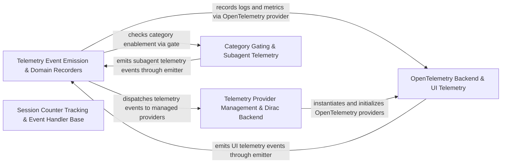

## Details

Captures and routes domain telemetry events, session metrics, and traces through Dirac and OpenTelemetry telemetry providers.

### Telemetry Event Emission & Domain Recorders
Captures domain telemetry events (hooks, mentions, terminal), manages telemetry context, and dispatches events and metrics to configured providers.

**Related Classes/Methods**:

- `src.services.telemetry.TelemetryEventEmitter.TelemetryEventEmitter`:10-85
- `src.services.telemetry.HookTelemetry.HookTelemetry`:26-113

**Source Files:**

- `src/services/telemetry/HookTelemetry.ts`
  - `src.services.telemetry.HookTelemetry.HookTelemetry` (L26-L113) - Class
  - `src.services.telemetry.HookTelemetry.HookTelemetry.constructor` (L30-L33) - Constructor
  - `src.services.telemetry.HookTelemetry.HookTelemetry.captureHookCacheAccess` (L35-L43) - Method
  - `src.services.telemetry.HookTelemetry.HookTelemetry.captureHookExecution` (L45-L96) - Method
  - `src.services.telemetry.HookTelemetry.HookTelemetry.captureHookDiscovery` (L98-L112) - Method
- `src/services/telemetry/MentionTelemetry.ts`
  - `src.services.telemetry.MentionTelemetry.MentionTelemetry` (L12-L57) - Class
  - `src.services.telemetry.MentionTelemetry.MentionTelemetry.constructor` (L15-L15) - Constructor
  - `src.services.telemetry.MentionTelemetry.MentionTelemetry.captureMentionUsed` (L17-L22) - Method
  - `src.services.telemetry.MentionTelemetry.MentionTelemetry.captureMentionFailed` (L24-L38) - Method
  - `src.services.telemetry.MentionTelemetry.MentionTelemetry.captureMentionSearchResults` (L40-L56) - Method
- `src/services/telemetry/TelemetryContextManager.ts`
  - `src.services.telemetry.TelemetryContextManager.UserInfo` (L8-L13) - Interface
  - `src.services.telemetry.TelemetryContextManager.TelemetryContextManager` (L15-L54) - Class
  - `src.services.telemetry.TelemetryContextManager.TelemetryContextManager.constructor` (L23-L23) - Constructor
  - `src.services.telemetry.TelemetryContextManager.TelemetryContextManager.setUserInfo` (L26-L33) - Method
  - `src.services.telemetry.TelemetryContextManager.TelemetryContextManager.getUserId` (L36-L38) - Method
  - `src.services.telemetry.TelemetryContextManager.TelemetryContextManager.getActiveOrg` (L41-L43) - Method
  - `src.services.telemetry.TelemetryContextManager.TelemetryContextManager.getStandardAttributes` (L46-L53) - Method
- `src/services/telemetry/TelemetryEventEmitter.ts`
  - `src.services.telemetry.TelemetryEventEmitter.TelemetryEventEmitter` (L10-L85) - Class
  - `src.services.telemetry.TelemetryEventEmitter.TelemetryEventEmitter.constructor` (L11-L14) - Constructor
  - `src.services.telemetry.TelemetryEventEmitter.TelemetryEventEmitter.capture` (L17-L20) - Method
  - `src.services.telemetry.TelemetryEventEmitter.TelemetryEventEmitter.captureRequired` (L23-L26) - Method
  - `src.services.telemetry.TelemetryEventEmitter.TelemetryEventEmitter.captureToProviders` (L29-L41) - Method
  - `src.services.telemetry.TelemetryEventEmitter.TelemetryEventEmitter.captureToProviders.forEach() callback` (L30-L40) - Function
  - `src.services.telemetry.TelemetryEventEmitter.TelemetryEventEmitter.recordCounter` (L43-L52) - Method
  - `src.services.telemetry.TelemetryEventEmitter.TelemetryEventEmitter.recordCounter.forEach() callback` (L45-L51) - Function
  - `src.services.telemetry.TelemetryEventEmitter.TelemetryEventEmitter.recordHistogram` (L54-L63) - Method
  - `src.services.telemetry.TelemetryEventEmitter.TelemetryEventEmitter.recordHistogram.forEach() callback` (L56-L62) - Function
  - `src.services.telemetry.TelemetryEventEmitter.TelemetryEventEmitter.recordGauge` (L69-L84) - Method
  - `src.services.telemetry.TelemetryEventEmitter.TelemetryEventEmitter.recordGauge.forEach() callback` (L77-L83) - Function
- `src/services/telemetry/TelemetryTypes.ts`
  - `src.services.telemetry.TelemetryTypes.TerminalOutputFailureReason` (L26-L30) - Enum
  - `src.services.telemetry.TelemetryTypes.TerminalUserInterventionAction` (L33-L37) - Enum
  - `src.services.telemetry.TelemetryTypes.TerminalHangStage` (L40-L44) - Enum
  - `src.services.telemetry.TelemetryTypes.TokenUsage` (L75-L81) - Interface
- `src/services/telemetry/TerminalTelemetry.ts`
  - `src.services.telemetry.TerminalTelemetry.TerminalTelemetry` (L16-L59) - Class
  - `src.services.telemetry.TerminalTelemetry.TerminalTelemetry.constructor` (L19-L19) - Constructor
  - `src.services.telemetry.TerminalTelemetry.TerminalTelemetry.captureTerminalExecution` (L21-L37) - Method
  - `src.services.telemetry.TerminalTelemetry.TerminalTelemetry.captureTerminalOutputFailure` (L39-L44) - Method
  - `src.services.telemetry.TerminalTelemetry.TerminalTelemetry.captureTerminalUserIntervention` (L46-L51) - Method
  - `src.services.telemetry.TerminalTelemetry.TerminalTelemetry.captureTerminalHang` (L53-L58) - Method

### Telemetry Provider Management & Dirac Backend
Defines telemetry provider interfaces, manages active provider lifecycles, and implements factory creation and Dirac telemetry logging.

**Related Classes/Methods**:

- `src.services.telemetry.TelemetryProviderManager.TelemetryProviderManager`:8-55
- `src.services.telemetry.TelemetryProviderFactory.TelemetryProviderFactory`:38-131
- `src.services.telemetry.providers.DiracTelemetryProvider.DiracTelemetryProvider`:95-279

**Source Files:**

- `src/services/telemetry/TelemetryProviderFactory.ts`
  - `src.services.telemetry.TelemetryProviderFactory.TelemetryProviderFactory` (L38-L131) - Class
  - `src.services.telemetry.TelemetryProviderFactory.TelemetryProviderFactory.createProviders` (L43-L61) - Method
  - `src.services.telemetry.TelemetryProviderFactory.TelemetryProviderFactory.createProvider` (L68-L93) - Method
  - `src.services.telemetry.TelemetryProviderFactory.TelemetryProviderFactory.getDefaultConfigs` (L99-L130) - Method
  - `src.services.telemetry.TelemetryProviderFactory.NoOpTelemetryProvider` (L137-L191) - Class
  - `src.services.telemetry.TelemetryProviderFactory.NoOpTelemetryProvider.log` (L141-L143) - Method
  - `src.services.telemetry.TelemetryProviderFactory.NoOpTelemetryProvider.logRequired` (L144-L146) - Method
  - `src.services.telemetry.TelemetryProviderFactory.NoOpTelemetryProvider.identifyUser` (L147-L149) - Method
  - `src.services.telemetry.TelemetryProviderFactory.NoOpTelemetryProvider.isEnabled` (L150-L152) - Method
  - `src.services.telemetry.TelemetryProviderFactory.NoOpTelemetryProvider.getSettings` (L153-L158) - Method
  - `src.services.telemetry.TelemetryProviderFactory.NoOpTelemetryProvider.recordCounter` (L159-L167) - Method
  - `src.services.telemetry.TelemetryProviderFactory.NoOpTelemetryProvider.recordHistogram` (L168-L176) - Method
  - `src.services.telemetry.TelemetryProviderFactory.NoOpTelemetryProvider.recordGauge` (L177-L185) - Method
  - `src.services.telemetry.TelemetryProviderFactory.NoOpTelemetryProvider.forceFlush` (L187-L187) - Method
  - `src.services.telemetry.TelemetryProviderFactory.NoOpTelemetryProvider.dispose` (L188-L190) - Method
- `src/services/telemetry/TelemetryProviderManager.ts`
  - `src.services.telemetry.TelemetryProviderManager.TelemetryProviderManager` (L8-L55) - Class
  - `src.services.telemetry.TelemetryProviderManager.TelemetryProviderManager.constructor` (L11-L13) - Constructor
  - `src.services.telemetry.TelemetryProviderManager.TelemetryProviderManager.addProvider` (L15-L17) - Method
  - `src.services.telemetry.TelemetryProviderManager.TelemetryProviderManager.removeProvider` (L19-L21) - Method
  - `src.services.telemetry.TelemetryProviderManager.TelemetryProviderManager.removeProvider.providers.filter() callback` (L20-L20) - Function
  - `src.services.telemetry.TelemetryProviderManager.TelemetryProviderManager.getProviders` (L23-L25) - Method
  - `src.services.telemetry.TelemetryProviderManager.TelemetryProviderManager.isEnabled` (L27-L29) - Method
  - `src.services.telemetry.TelemetryProviderManager.TelemetryProviderManager.isEnabled.providers.some() callback` (L28-L28) - Function
  - `src.services.telemetry.TelemetryProviderManager.TelemetryProviderManager.getSettings` (L31-L33) - Method
  - `src.services.telemetry.TelemetryProviderManager.TelemetryProviderManager.identifyUser` (L36-L44) - Method
  - `src.services.telemetry.TelemetryProviderManager.TelemetryProviderManager.identifyUser.providers.forEach() callback` (L37-L43) - Function
  - `src.services.telemetry.TelemetryProviderManager.TelemetryProviderManager.getProviderList` (L47-L49) - Method
  - `src.services.telemetry.TelemetryProviderManager.TelemetryProviderManager.dispose` (L51-L54) - Method
  - `src.services.telemetry.TelemetryProviderManager.TelemetryProviderManager.dispose.disposePromises` (L52-L52) - Class
  - `src.services.telemetry.TelemetryProviderManager.TelemetryProviderManager.dispose.disposePromises.providers.map() callback` (L52-L52) - Function
- `src/services/telemetry/providers/DiracTelemetryProvider.ts`
  - `src.services.telemetry.providers.DiracTelemetryProvider.isSensitiveKey` (L60-L62) - Function
  - `src.services.telemetry.providers.DiracTelemetryProvider.scrubTelemetryProperties` (L64-L89) - Function
  - `src.services.telemetry.providers.DiracTelemetryProvider.scrubTelemetryProperties.result` (L66-L69) - Class
  - `src.services.telemetry.providers.DiracTelemetryProvider.scrubTelemetryProperties.result.TELEMETRY_SECRET_PATTERNS.reduce() callback` (L67-L67) - Function
  - `src.services.telemetry.providers.DiracTelemetryProvider.scrubTelemetryProperties.map() callback` (L78-L85) - Function
  - `src.services.telemetry.providers.DiracTelemetryProvider.DiracTelemetryProvider` (L95-L279) - Class
  - `src.services.telemetry.providers.DiracTelemetryProvider.DiracTelemetryProvider.constructor` (L101-L108) - Constructor
  - `src.services.telemetry.providers.DiracTelemetryProvider.DiracTelemetryProvider.initialize` (L110-L134) - Method
  - `src.services.telemetry.providers.DiracTelemetryProvider.DiracTelemetryProvider.initialize.onResponse` (L116-L119) - Method
  - `src.services.telemetry.providers.DiracTelemetryProvider.DiracTelemetryProvider.forceFlush` (L136-L138) - Method
  - `src.services.telemetry.providers.DiracTelemetryProvider.DiracTelemetryProvider.log` (L140-L154) - Method
  - `src.services.telemetry.providers.DiracTelemetryProvider.DiracTelemetryProvider.logRequired` (L156-L161) - Method
  - `src.services.telemetry.providers.DiracTelemetryProvider.DiracTelemetryProvider.captureToDirac` (L163-L186) - Method
  - `src.services.telemetry.providers.DiracTelemetryProvider.DiracTelemetryProvider.identifyUser` (L188-L190) - Method
  - `src.services.telemetry.providers.DiracTelemetryProvider.DiracTelemetryProvider.isEnabled` (L192-L199) - Method
  - `src.services.telemetry.providers.DiracTelemetryProvider.DiracTelemetryProvider.getSettings` (L201-L203) - Method
  - `src.services.telemetry.providers.DiracTelemetryProvider.DiracTelemetryProvider.recordCounter` (L208-L222) - Method
  - `src.services.telemetry.providers.DiracTelemetryProvider.DiracTelemetryProvider.recordHistogram` (L227-L241) - Method
  - `src.services.telemetry.providers.DiracTelemetryProvider.DiracTelemetryProvider.recordGauge` (L246-L260) - Method
  - `src.services.telemetry.providers.DiracTelemetryProvider.DiracTelemetryProvider.dispose` (L262-L264) - Method
  - `src.services.telemetry.providers.DiracTelemetryProvider.DiracTelemetryProvider.getTelemetryLevel` (L269-L278) - Method
- `src/services/telemetry/providers/ITelemetryProvider.ts`
  - `src.services.telemetry.providers.ITelemetryProvider.TelemetrySettings` (L35-L40) - Interface
  - `src.services.telemetry.providers.ITelemetryProvider.ITelemetryProvider` (L46-L123) - Interface
  - `src.services.telemetry.providers.ITelemetryProvider.ITelemetryProvider.log` (L52-L52) - Method
  - `src.services.telemetry.providers.ITelemetryProvider.ITelemetryProvider.logRequired` (L60-L60) - Method
  - `src.services.telemetry.providers.ITelemetryProvider.ITelemetryProvider.identifyUser` (L67-L67) - Method
  - `src.services.telemetry.providers.ITelemetryProvider.ITelemetryProvider.isEnabled` (L72-L72) - Method
  - `src.services.telemetry.providers.ITelemetryProvider.ITelemetryProvider.getSettings` (L77-L77) - Method
  - `src.services.telemetry.providers.ITelemetryProvider.ITelemetryProvider.recordCounter` (L91-L91) - Method
  - `src.services.telemetry.providers.ITelemetryProvider.ITelemetryProvider.recordHistogram` (L100-L100) - Method
  - `src.services.telemetry.providers.ITelemetryProvider.ITelemetryProvider.recordGauge` (L109-L115) - Method
  - `src.services.telemetry.providers.ITelemetryProvider.ITelemetryProvider.forceFlush` (L117-L117) - Method
  - `src.services.telemetry.providers.ITelemetryProvider.ITelemetryProvider.dispose` (L122-L122) - Method

### OpenTelemetry Backend & UI Telemetry
Implements OpenTelemetry client setup, exporter construction, and metric/log provider integration alongside UI telemetry event recording.

**Related Classes/Methods**:

- `src.services.telemetry.providers.opentelemetry.OpenTelemetryTelemetryProvider.OpenTelemetryTelemetryProvider`:17-380
- `src.services.telemetry.providers.opentelemetry.OpenTelemetryClientProvider.OpenTelemetryClientProvider`:22-217
- `src.services.telemetry.UiTelemetry.UiTelemetry`:8-31

**Source Files:**

- `src/services/telemetry/UiTelemetry.ts`
  - `src.services.telemetry.UiTelemetry.UiTelemetry` (L8-L31) - Class
  - `src.services.telemetry.UiTelemetry.UiTelemetry.constructor` (L11-L11) - Constructor
  - `src.services.telemetry.UiTelemetry.UiTelemetry.captureModelSelected` (L13-L15) - Method
  - `src.services.telemetry.UiTelemetry.UiTelemetry.captureModelFavoritesUsage` (L17-L22) - Method
  - `src.services.telemetry.UiTelemetry.UiTelemetry.captureButtonClick` (L24-L26) - Method
  - `src.services.telemetry.UiTelemetry.UiTelemetry.captureRulesMenuOpened` (L28-L30) - Method
- `src/services/telemetry/providers/opentelemetry/OpenTelemetryClientProvider.ts`
  - `src.services.telemetry.providers.opentelemetry.OpenTelemetryClientProvider.OpenTelemetryClientProvider` (L22-L217) - Class
  - `src.services.telemetry.providers.opentelemetry.OpenTelemetryClientProvider.OpenTelemetryClientProvider.isDebugEnabled` (L31-L33) - Method
  - `src.services.telemetry.providers.opentelemetry.OpenTelemetryClientProvider.OpenTelemetryClientProvider.constructor` (L35-L76) - Constructor
  - `src.services.telemetry.providers.opentelemetry.OpenTelemetryClientProvider.OpenTelemetryClientProvider.createMeterProvider` (L78-L134) - Method
  - `src.services.telemetry.providers.opentelemetry.OpenTelemetryClientProvider.OpenTelemetryClientProvider.createMeterProvider.exporters` (L79-L79) - Class
  - `src.services.telemetry.providers.opentelemetry.OpenTelemetryClientProvider.OpenTelemetryClientProvider.createMeterProvider.exporters.map() callback` (L79-L79) - Function
  - `src.services.telemetry.providers.opentelemetry.OpenTelemetryClientProvider.OpenTelemetryClientProvider.createLoggerProvider` (L136-L194) - Method
  - `src.services.telemetry.providers.opentelemetry.OpenTelemetryClientProvider.OpenTelemetryClientProvider.createLoggerProvider.exporters` (L137-L137) - Class
  - `src.services.telemetry.providers.opentelemetry.OpenTelemetryClientProvider.OpenTelemetryClientProvider.createLoggerProvider.exporters.map() callback` (L137-L137) - Function
  - `src.services.telemetry.providers.opentelemetry.OpenTelemetryClientProvider.OpenTelemetryClientProvider.dispose` (L196-L216) - Method
  - `src.services.telemetry.providers.opentelemetry.OpenTelemetryClientProvider.dispose.catch() callback` (L201-L203) - Function
  - `src.services.telemetry.providers.opentelemetry.OpenTelemetryClientProvider.OpenTelemetryClientProvider.dispose.catch() callback` (L209-L211) - Function
- `src/services/telemetry/providers/opentelemetry/OpenTelemetryExporterFactory.ts`
  - `src.services.telemetry.providers.opentelemetry.OpenTelemetryExporterFactory.isDebugEnabled` (L18-L20) - Function
  - `src.services.telemetry.providers.opentelemetry.OpenTelemetryExporterFactory.createConsoleLogExporter` (L25-L27) - Function
  - `src.services.telemetry.providers.opentelemetry.OpenTelemetryExporterFactory.ensurePathSuffix` (L29-L36) - Function
  - `src.services.telemetry.providers.opentelemetry.OpenTelemetryExporterFactory.sanitizeEndpointForLogging` (L38-L45) - Function
  - `src.services.telemetry.providers.opentelemetry.OpenTelemetryExporterFactory.resolveGrpcCredentials` (L52-L61) - Function
  - `src.services.telemetry.providers.opentelemetry.OpenTelemetryExporterFactory.createOTLPLogExporter` (L66-L115) - Function
  - `src.services.telemetry.providers.opentelemetry.OpenTelemetryExporterFactory.createConsoleMetricReader` (L120-L127) - Function
  - `src.services.telemetry.providers.opentelemetry.OpenTelemetryExporterFactory.createOTLPMetricReader` (L132-L187) - Function
- `src/services/telemetry/providers/opentelemetry/OpenTelemetryTelemetryProvider.ts`
  - `src.services.telemetry.providers.opentelemetry.OpenTelemetryTelemetryProvider.OpenTelemetryTelemetryProvider` (L17-L380) - Class
  - `src.services.telemetry.providers.opentelemetry.OpenTelemetryTelemetryProvider.OpenTelemetryTelemetryProvider.constructor` (L34-L64) - Constructor
  - `src.services.telemetry.providers.opentelemetry.OpenTelemetryTelemetryProvider.OpenTelemetryTelemetryProvider.initialize` (L66-L90) - Method
  - `src.services.telemetry.providers.opentelemetry.OpenTelemetryTelemetryProvider.OpenTelemetryTelemetryProvider.initialize.onResponse` (L75-L78) - Method
  - `src.services.telemetry.providers.opentelemetry.OpenTelemetryTelemetryProvider.OpenTelemetryTelemetryProvider.forceFlush` (L92-L94) - Method
  - `src.services.telemetry.providers.opentelemetry.OpenTelemetryTelemetryProvider.OpenTelemetryTelemetryProvider.log` (L96-L120) - Method
  - `src.services.telemetry.providers.opentelemetry.OpenTelemetryTelemetryProvider.OpenTelemetryTelemetryProvider.logRequired` (L122-L136) - Method
  - `src.services.telemetry.providers.opentelemetry.OpenTelemetryTelemetryProvider.OpenTelemetryTelemetryProvider.identifyUser` (L138-L138) - Method
  - `src.services.telemetry.providers.opentelemetry.OpenTelemetryTelemetryProvider.OpenTelemetryTelemetryProvider.isEnabled` (L145-L150) - Method
  - `src.services.telemetry.providers.opentelemetry.OpenTelemetryTelemetryProvider.OpenTelemetryTelemetryProvider.getSettings` (L152-L154) - Method
  - `src.services.telemetry.providers.opentelemetry.OpenTelemetryTelemetryProvider.OpenTelemetryTelemetryProvider.recordCounter` (L160-L180) - Method
  - `src.services.telemetry.providers.opentelemetry.OpenTelemetryTelemetryProvider.OpenTelemetryTelemetryProvider.recordHistogram` (L186-L206) - Method
  - `src.services.telemetry.providers.opentelemetry.OpenTelemetryTelemetryProvider.OpenTelemetryTelemetryProvider.recordGauge` (L212-L263) - Method
  - `src.services.telemetry.providers.opentelemetry.OpenTelemetryTelemetryProvider.OpenTelemetryTelemetryProvider.recordGauge.gauge.addCallback() callback` (L248-L256) - Function
  - `src.services.telemetry.providers.opentelemetry.OpenTelemetryTelemetryProvider.OpenTelemetryTelemetryProvider.snapshotGaugeSeries` (L265-L278) - Method
  - `src.services.telemetry.providers.opentelemetry.OpenTelemetryTelemetryProvider.OpenTelemetryTelemetryProvider.dispose` (L280-L283) - Method
  - `src.services.telemetry.providers.opentelemetry.OpenTelemetryTelemetryProvider.OpenTelemetryTelemetryProvider.getTelemetryLevel` (L288-L298) - Method
  - `src.services.telemetry.providers.opentelemetry.OpenTelemetryTelemetryProvider.OpenTelemetryTelemetryProvider.flattenProperties` (L306-L379) - Method

### Session Counter Tracking & Event Handler Base
Tracks per-task session aggregate counters and provides base abstractions, registries, and barrel exports for telemetry event handling.

**Related Classes/Methods**:

- `src.services.telemetry.TelemetrySessionTracker.TelemetrySessionTracker`:5-34
- `src.services.telemetry.events.EventHandlerBase.EventHandlerBase`:8-45
- `src.services.telemetry.events.EventHandlerBase.EventHandlerRegistry`:50-91

**Source Files:**

- `src/services/telemetry/TelemetrySessionTracker.ts`
  - `src.services.telemetry.TelemetrySessionTracker.TelemetrySessionTracker` (L5-L34) - Class
  - `src.services.telemetry.TelemetrySessionTracker.TelemetrySessionTracker.incrementTurnCount` (L10-L12) - Method
  - `src.services.telemetry.TelemetrySessionTracker.TelemetrySessionTracker.incrementToolCallCount` (L14-L16) - Method
  - `src.services.telemetry.TelemetrySessionTracker.TelemetrySessionTracker.incrementErrorCount` (L18-L20) - Method
  - `src.services.telemetry.TelemetrySessionTracker.TelemetrySessionTracker.resetAggregates` (L23-L27) - Method
  - `src.services.telemetry.TelemetrySessionTracker.TelemetrySessionTracker.increment` (L29-L33) - Method
- `src/services/telemetry/events/EventHandlerBase.ts`
  - `src.services.telemetry.events.EventHandlerBase.EventHandlerBase` (L8-L45) - Class
  - `src.services.telemetry.events.EventHandlerBase.EventHandlerBase.capture` (L19-L25) - Method
  - `src.services.telemetry.events.EventHandlerBase.EventHandlerBase.captureRequired` (L33-L35) - Method
  - `src.services.telemetry.events.EventHandlerBase.EventHandlerBase.isEnabled` (L42-L44) - Method
  - `src.services.telemetry.events.EventHandlerBase.EventHandlerRegistry` (L50-L91) - Class
  - `src.services.telemetry.events.EventHandlerBase.EventHandlerRegistry.register` (L59-L61) - Method
  - `src.services.telemetry.events.EventHandlerBase.EventHandlerRegistry.getHandler` (L68-L70) - Method
  - `src.services.telemetry.events.EventHandlerBase.EventHandlerRegistry.registerAll` (L76-L82) - Method
  - `src.services.telemetry.events.EventHandlerBase.EventHandlerRegistry.getRegisteredPrefixes` (L88-L90) - Method
- `src/services/telemetry/index.ts`
  - `src.services.telemetry.index.getTelemetryService` (L36-L60) - Function
  - `src.services.telemetry.index.getTelemetryService.then() callback` (L49-L53) - Function
  - `src.services.telemetry.index.getTelemetryService.catch() callback` (L54-L57) - Function
  - `src.services.telemetry.index.resetTelemetryService` (L65-L68) - Function
  - `src.services.telemetry.index.telemetryService` (L70-L82) - Class
  - `src.services.telemetry.index.telemetryService.get` (L71-L81) - Method
  - `src.services.telemetry.index.telemetryService.get.<function>` (L73-L80) - Function

### Category Gating & Subagent Telemetry
Enforces category-level telemetry opt-in gates and records subagent execution and toggle telemetry events.

**Related Classes/Methods**:

- `src.services.telemetry.TelemetryCategoryGate.TelemetryCategoryGate`:7-24
- `src.services.telemetry.SubagentTelemetry.SubagentTelemetry`:9-36

**Source Files:**

- `src/services/telemetry/SubagentTelemetry.ts`
  - `src.services.telemetry.SubagentTelemetry.SubagentTelemetry` (L9-L36) - Class
  - `src.services.telemetry.SubagentTelemetry.SubagentTelemetry.constructor` (L12-L15) - Constructor
  - `src.services.telemetry.SubagentTelemetry.SubagentTelemetry.captureSubagentToggle` (L17-L25) - Method
  - `src.services.telemetry.SubagentTelemetry.SubagentTelemetry.captureSubagentExecution` (L27-L35) - Method
- `src/services/telemetry/TelemetryCategoryGate.ts`
  - `src.services.telemetry.TelemetryCategoryGate.TelemetryCategoryGate` (L7-L24) - Class
  - `src.services.telemetry.TelemetryCategoryGate.TelemetryCategoryGate.isEnabled` (L17-L19) - Method
  - `src.services.telemetry.TelemetryCategoryGate.TelemetryCategoryGate.setEnabled` (L21-L23) - Method

### [FAQ](https://github.com/CodeBoarding/GeneratedOnBoardings/tree/main?tab=readme-ov-file#faq)