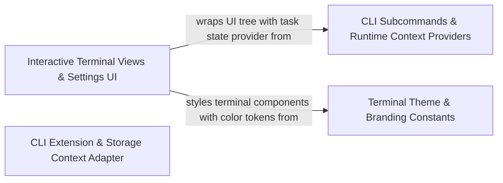

## Details

Implements CLI subcommands and React Ink terminal views, plus theme constants and mocked VS Code context, to drive interactive terminal sessions.

### Interactive Terminal Views & Settings UI
Renders interactive terminal views, chat interfaces, modular task cards, authentication flows, and configuration settings panels using Ink UI components.

**Related Classes/Methods**:

- `cli.src.components.App.InternalApp`:104-251
- `cli.src.components.AuthView.AuthView`:149-787
- `cli.src.components.ApiKeyInput.ApiKeyInput`:22-75

**Source Files:**

- `cli/src/components/ActionButtons.tsx`
  - `cli.src.components.ActionButtons.ActionButtons` (L14-L87) - Class
  - `cli.src.components.ActionButtons.ActionButtons.renderButton` (L36-L68) - Method
  - `cli.src.components.ActionButtons.ActionButtons.buttons.map() callback` (L77-L83) - Function
- `cli/src/components/AgentPanelContent.tsx`
  - `cli.src.components.AgentPanelContent.AgentPanelContentProps` (L13-L18) - Interface
  - `cli.src.components.AgentPanelContent.AgentListItem` (L20-L27) - Interface
  - `cli.src.components.AgentPanelContent.AgentPanelContent` (L29-L117) - Class
  - `cli.src.components.AgentPanelContent.AgentPanelContent.agents` (L36-L36) - Class
  - `cli.src.components.AgentPanelContent.AgentPanelContent.agents.useMemo() callback` (L36-L36) - Function
  - `cli.src.components.AgentPanelContent.AgentPanelContent.openAgent` (L37-L37) - Class
  - `cli.src.components.AgentPanelContent.AgentPanelContent.openAgent.agents.find() callback` (L37-L37) - Function
  - `cli.src.components.AgentPanelContent.useEffect() callback` (L47-L49) - Function
  - `cli.src.components.AgentPanelContent.AgentPanelContent.useEffect() callback.setSelectedIndex() callback` (L48-L48) - Function
  - `cli.src.components.AgentPanelContent.AgentPanelContent.useEffect() callback` (L51-L53) - Function
  - `cli.src.components.AgentPanelContent.AgentPanelContent.useInput() callback` (L56-L73) - Function
  - `cli.src.components.AgentPanelContent.useInput() callback.setScrollOffset() callback` (L64-L64) - Function
  - `cli.src.components.AgentPanelContent.AgentPanelContent.useInput() callback.setScrollOffset() callback` (L67-L67) - Function
  - `cli.src.components.AgentPanelContent.useInput() callback.setSelectedIndex() callback` (L70-L70) - Function
  - `cli.src.components.AgentPanelContent.AgentPanelContent.useInput() callback.setSelectedIndex() callback` (L71-L71) - Function
  - `cli.src.components.AgentPanelContent.AgentPanelContent.visibleAgents.map() callback` (L90-L109) - Function
  - `cli.src.components.AgentPanelContent.buildAgentList` (L119-L147) - Function
  - `cli.src.components.AgentPanelContent.buildAgentList.mainPrompt` (L121-L123) - Class
  - `cli.src.components.AgentPanelContent.buildAgentList.mainPrompt.messages.find() callback` (L122-L122) - Function
  - `cli.src.components.AgentPanelContent.buildAgentList.subagents` (L124-L128) - Class
  - `cli.src.components.AgentPanelContent.buildAgentList.subagents.messages.filter() callback` (L125-L125) - Function
  - `cli.src.components.AgentPanelContent.subagents.map() callback` (L126-L126) - Function
  - `cli.src.components.AgentPanelContent.buildAgentList.subagents.filter() callback` (L127-L127) - Function
  - `cli.src.components.AgentPanelContent.buildAgentList.subagents.sort() callback` (L128-L128) - Function
  - `cli.src.components.AgentPanelContent.buildAgentList.subagents.map() callback` (L138-L145) - Function
  - `cli.src.components.AgentPanelContent.formatAgentLabel` (L149-L157) - Function
  - `cli.src.components.AgentPanelContent.getAgentListRowLimit` (L159-L161) - Function
  - `cli.src.components.AgentPanelContent.formatMainTranscript` (L163-L182) - Function
  - `cli.src.components.AgentPanelContent.formatMainTranscript.messages.flatMap() callback` (L167-L179) - Function
  - `cli.src.components.AgentPanelContent.mainAgentStatus` (L184-L189) - Function
  - `cli.src.components.AgentPanelContent.oneLinePreview` (L191-L195) - Function
- `cli/src/components/ApiKeyInput.tsx`
  - `cli.src.components.ApiKeyInput.ApiKeyInputProps` (L13-L20) - Interface
  - `cli.src.components.ApiKeyInput.ApiKeyInput` (L22-L75) - Class
  - `cli.src.components.ApiKeyInput.ApiKeyInput.useInput() callback` (L33-L54) - Function
- `cli/src/components/App.tsx`
  - `cli.src.components.App.HistoryPagination` (L20-L25) - Interface
  - `cli.src.components.App.HookInfo` (L27-L31) - Interface
  - `cli.src.components.App.WorkspaceHooks` (L33-L36) - Interface
  - `cli.src.components.App.SkillInfo` (L38-L43) - Interface
  - `cli.src.components.App.AppProps` (L45-L90) - Interface
  - `cli.src.components.App.InternalApp` (L104-L251) - Class
  - `cli.src.components.App.InternalApp.useEffect() callback` (L151-L158) - Function
  - `cli.src.components.App.InternalApp.handleSelectTask` (L160-L163) - Class
  - `cli.src.components.App.InternalApp.handleSelectTask.useCallback() callback` (L160-L163) - Function
  - `cli.src.components.App.InternalApp.handleNavigateToWelcome` (L165-L167) - Class
  - `cli.src.components.App.InternalApp.handleNavigateToWelcome.useCallback() callback` (L165-L167) - Function
- `cli/src/components/AsciiMotionCli.tsx`
  - `cli.src.components.AsciiMotionCli.StaticRobotFrame` (L20-L30) - Class
  - `cli.src.components.AsciiMotionCli.StaticRobotFrame.DIRAC_LOGO.map() callback` (L23-L27) - Function
  - `cli.src.components.AsciiMotionCli.AsciiMotionCli` (L36-L55) - Class
  - `cli.src.components.AsciiMotionCli.AsciiMotionCli.useEffect() callback` (L37-L45) - Function
  - `cli.src.components.AsciiMotionCli.AsciiMotionCli.useEffect() callback.play` (L40-L40) - Method
  - `cli.src.components.AsciiMotionCli.AsciiMotionCli.useEffect() callback.pause` (L41-L41) - Method
  - `cli.src.components.AsciiMotionCli.AsciiMotionCli.useEffect() callback.restart` (L42-L42) - Method
  - `cli.src.components.AsciiMotionCli.AsciiMotionCli.useInput() callback` (L48-L52) - Function
- `cli/src/components/AuthView.tsx`
  - `cli.src.components.AuthView.AuthViewProps` (L49-L54) - Interface
  - `cli.src.components.AuthView.SelectItem` (L56-L59) - Interface
  - `cli.src.components.AuthView.Select` (L64-L103) - Class
  - `cli.src.components.AuthView.Select.useInput() callback` (L73-L81) - Function
  - `cli.src.components.AuthView.useInput() callback.setSelectedIndex() callback` (L75-L75) - Function
  - `cli.src.components.AuthView.Select.useInput() callback.setSelectedIndex() callback` (L77-L77) - Function
  - `cli.src.components.AuthView.Select.items.map() callback` (L92-L99) - Function
  - `cli.src.components.AuthView.TextInput` (L108-L147) - Class
  - `cli.src.components.AuthView.TextInput.useInput() callback` (L118-L131) - Function
  - `cli.src.components.AuthView.AuthView` (L149-L787) - Class
  - `cli.src.components.AuthView.AuthView.quote` (L151-L151) - Class
  - `cli.src.components.AuthView.AuthView.quote.useMemo() callback` (L151-L151) - Function
  - `cli.src.components.AuthView.AuthView.mainMenuItems` (L172-L192) - Class
  - `cli.src.components.AuthView.AuthView.mainMenuItems.useMemo() callback` (L172-L192) - Function
  - `cli.src.components.AuthView.AuthView.providerItems` (L195-L206) - Class
  - `cli.src.components.AuthView.AuthView.providerItems.useMemo() callback` (L195-L206) - Function
  - `cli.src.components.AuthView.AuthView.providerItems.useMemo() callback.filtered` (L197-L201) - Class
  - `cli.src.components.AuthView.AuthView.providerItems.useMemo() callback.filtered.providers.filter() callback` (L199-L199) - Function
  - `cli.src.components.AuthView.AuthView.providerItems.useMemo() callback.filtered.map() callback` (L202-L205) - Function
  - `cli.src.components.AuthView.AuthView.visibleProviderItems` (L217-L219) - Class
  - `cli.src.components.AuthView.AuthView.visibleProviderItems.useMemo() callback` (L217-L219) - Function
  - `cli.src.components.AuthView.useEffect() callback` (L222-L224) - Function
  - `cli.src.components.AuthView.AuthView.handleMainMenuSelect` (L240-L262) - Class
  - `cli.src.components.AuthView.AuthView.handleMainMenuSelect.useCallback() callback` (L241-L260) - Function
  - `cli.src.components.AuthView.AuthView.handleProviderSelect` (L264-L278) - Class
  - `cli.src.components.AuthView.AuthView.handleProviderSelect.useCallback() callback` (L265-L276) - Function
  - `cli.src.components.AuthView.AuthView.handleApiKeySubmit` (L280-L292) - Class
  - `cli.src.components.AuthView.AuthView.handleApiKeySubmit.useCallback() callback` (L281-L290) - Function
  - `cli.src.components.AuthView.AuthView.saveCustomBedrockConfiguration` (L295-L319) - Class
  - `cli.src.components.AuthView.AuthView.saveCustomBedrockConfiguration.useCallback() callback` (L296-L317) - Function
  - `cli.src.components.AuthView.AuthView.saveConfiguration` (L321-L351) - Class
  - `cli.src.components.AuthView.AuthView.saveConfiguration.useCallback() callback` (L322-L349) - Function
  - `cli.src.components.AuthView.AuthView.handleModelIdSubmit` (L353-L373) - Class
  - `cli.src.components.AuthView.AuthView.handleModelIdSubmit.useCallback() callback` (L354-L371) - Function
  - `cli.src.components.AuthView.AuthView.handleBaseUrlSubmit` (L375-L382) - Class
  - `cli.src.components.AuthView.AuthView.handleBaseUrlSubmit.useCallback() callback` (L376-L380) - Function
  - `cli.src.components.AuthView.AuthView.handleBedrockComplete` (L384-L387) - Class
  - `cli.src.components.AuthView.AuthView.handleBedrockComplete.useCallback() callback` (L384-L387) - Function
  - `cli.src.components.AuthView.AuthView.handleImportComplete` (L389-L391) - Class
  - `cli.src.components.AuthView.AuthView.handleImportComplete.useCallback() callback` (L389-L391) - Function
  - `cli.src.components.AuthView.AuthView.handleImportCancel` (L393-L396) - Class
  - `cli.src.components.AuthView.AuthView.handleImportCancel.useCallback() callback` (L393-L396) - Function
  - `cli.src.components.AuthView.AuthView.useEffect() callback` (L400-L410) - Function
  - `cli.src.components.AuthView.AuthView.errorMenuItems` (L413-L420) - Class
  - `cli.src.components.AuthView.AuthView.errorMenuItems.useMemo() callback` (L413-L420) - Function
  - `cli.src.components.AuthView.AuthView.handleErrorMenuSelect` (L422-L440) - Class
  - `cli.src.components.AuthView.AuthView.handleErrorMenuSelect.useCallback() callback` (L423-L438) - Function
  - `cli.src.components.AuthView.AuthView.goBack` (L443-L490) - Class
  - `cli.src.components.AuthView.AuthView.goBack.useCallback() callback` (L443-L490) - Function
  - `cli.src.components.AuthView.AuthView.renderAuthContent` (L494-L690) - Class
  - `cli.src.components.AuthView.AuthView.renderAuthContent.visibleProviderItems.map() callback` (L508-L518) - Function
  - `cli.src.components.AuthView.renderAuthContent.<function>` (L607-L615) - Function
  - `cli.src.components.AuthView.AuthView.renderAuthContent.<function>` (L633-L640) - Function
  - `cli.src.components.AuthView.AuthView.useInput() callback` (L707-L739) - Function
  - `cli.src.components.AuthView.useInput() callback.setMenuIndex() callback` (L717-L717) - Function
  - `cli.src.components.AuthView.AuthView.useInput() callback.setMenuIndex() callback` (L719-L719) - Function
  - `cli.src.components.AuthView.useInput() callback.setProviderIndex() callback` (L725-L725) - Function
  - `cli.src.components.AuthView.AuthView.useInput() callback.setProviderIndex() callback` (L727-L727) - Function
  - `cli.src.components.AuthView.useInput() callback.setProviderSearch() callback` (L733-L733) - Function
  - `cli.src.components.AuthView.AuthView.useInput() callback.setProviderSearch() callback` (L735-L735) - Function
  - `cli.src.components.AuthView.AuthView.mainMenuItems.map() callback` (L768-L777) - Function
- `cli/src/components/BedrockCustomModelFlow.tsx`
  - `cli.src.components.BedrockCustomModelFlow.BedrockCustomModelFlowProps` (L18-L25) - Interface
  - `cli.src.components.BedrockCustomModelFlow.BedrockCustomModelFlow` (L27-L112) - Class
  - `cli.src.components.BedrockCustomModelFlow.BedrockCustomModelFlow.handleArnSubmit` (L32-L36) - Class
  - `cli.src.components.BedrockCustomModelFlow.BedrockCustomModelFlow.handleArnSubmit.useCallback() callback` (L32-L36) - Function
  - `cli.src.components.BedrockCustomModelFlow.BedrockCustomModelFlow.handleBaseModelCancel` (L38-L40) - Class
  - `cli.src.components.BedrockCustomModelFlow.BedrockCustomModelFlow.handleBaseModelCancel.useCallback() callback` (L38-L40) - Function
  - `cli.src.components.BedrockCustomModelFlow.BedrockCustomModelFlow.useInput() callback` (L43-L63) - Function
  - `cli.src.components.BedrockCustomModelFlow.useInput() callback.setCustomArn() callback` (L50-L50) - Function
  - `cli.src.components.BedrockCustomModelFlow.BedrockCustomModelFlow.useInput() callback.setCustomArn() callback` (L52-L52) - Function
  - `cli.src.components.BedrockCustomModelFlow.BedrockCustomModelFlow.map() callback` (L101-L101) - Function
- `cli/src/components/BedrockSetup.tsx`
  - `cli.src.components.BedrockSetup.BedrockConfig` (L14-L22) - Interface
  - `cli.src.components.BedrockSetup.BedrockSetupProps` (L24-L28) - Interface
  - `cli.src.components.BedrockSetup.CredentialInput` (L46-L93) - Class
  - `cli.src.components.BedrockSetup.CredentialInput.useInput() callback` (L60-L71) - Function
  - `cli.src.components.BedrockSetup.BedrockSetup` (L95-L392) - Class
  - `cli.src.components.BedrockSetup.BedrockSetup.filteredRegions` (L117-L123) - Class
  - `cli.src.components.BedrockSetup.BedrockSetup.filteredRegions.useMemo() callback` (L117-L123) - Function
  - `cli.src.components.BedrockSetup.BedrockSetup.filteredRegions.useMemo() callback.AWS_REGIONS.filter() callback` (L122-L122) - Function
  - `cli.src.components.BedrockSetup.BedrockSetup.visibleRegions` (L132-L135) - Class
  - `cli.src.components.BedrockSetup.BedrockSetup.visibleRegions.useMemo() callback` (L133-L133) - Function
  - `cli.src.components.BedrockSetup.BedrockSetup.nextStepAfterAuth` (L137-L147) - Class
  - `cli.src.components.BedrockSetup.BedrockSetup.nextStepAfterAuth.useCallback() callback` (L137-L147) - Function
  - `cli.src.components.BedrockSetup.BedrockSetup.goBack` (L149-L175) - Class
  - `cli.src.components.BedrockSetup.BedrockSetup.goBack.useCallback() callback` (L149-L175) - Function
  - `cli.src.components.BedrockSetup.BedrockSetup.getSelectedRegion` (L177-L183) - Class
  - `cli.src.components.BedrockSetup.BedrockSetup.getSelectedRegion.useCallback() callback` (L177-L183) - Function
  - `cli.src.components.BedrockSetup.BedrockSetup.finish` (L185-L199) - Class
  - `cli.src.components.BedrockSetup.BedrockSetup.finish.useCallback() callback` (L185-L199) - Function
  - `cli.src.components.BedrockSetup.BedrockSetup.useInput() callback` (L203-L248) - Function
  - `cli.src.components.BedrockSetup.useInput() callback.setAuthMethodIndex() callback` (L210-L210) - Function
  - `cli.src.components.BedrockSetup.BedrockSetup.useInput() callback.setAuthMethodIndex() callback` (L212-L212) - Function
  - `cli.src.components.BedrockSetup.useInput() callback.setRegionIndex() callback` (L220-L220) - Function
  - `cli.src.components.BedrockSetup.BedrockSetup.useInput() callback.setRegionIndex() callback` (L222-L222) - Function
  - `cli.src.components.BedrockSetup.useInput() callback.setRegionSearch() callback` (L226-L226) - Function
  - `cli.src.components.BedrockSetup.BedrockSetup.useInput() callback.setRegionSearch() callback` (L229-L229) - Function
  - `cli.src.components.BedrockSetup.BedrockSetup.useInput() callback.setCrossRegion() callback` (L238-L238) - Function
  - `cli.src.components.BedrockSetup.useInput() callback.setOptionIndex() callback` (L243-L243) - Function
  - `cli.src.components.BedrockSetup.BedrockSetup.useInput() callback.setOptionIndex() callback` (L245-L245) - Function
  - `cli.src.components.BedrockSetup.BedrockSetup.AUTH_METHODS.map() callback` (L257-L267) - Function
  - `cli.src.components.BedrockSetup.BedrockSetup.visibleRegions.map() callback` (L351-L361) - Function
- `cli/src/components/ChatFooter.tsx`
  - `cli.src.components.ChatFooter.ChatFooterProps` (L12-L31) - Interface
  - `cli.src.components.ChatFooter.ChatFooter` (L33-L226) - Class
  - `cli.src.components.ChatFooter.<function>` (L137-L152) - Function
  - `cli.src.components.ChatFooter.ChatFooter.<function>` (L153-L161) - Function
- `cli/src/components/ChatHeader.tsx`
  - `cli.src.components.ChatHeader.ChatHeaderProps` (L8-L12) - Interface
- `cli/src/components/ChatInputBar.tsx`
  - `cli.src.components.ChatInputBar.ChatInputBarProps` (L8-L17) - Interface
  - `cli.src.components.ChatInputBar.ChatInputBar.viewport` (L36-L38) - Class
  - `cli.src.components.ChatInputBar.ChatInputBar.viewport.useMemo() callback` (L36-L38) - Function
- `cli/src/components/ChatMessage.tsx`
  - `cli.src.components.ChatMessage.ChatMessageProps` (L31-L44) - Interface
  - `cli.src.components.ChatMessage.renderBoundedMarkdownMessage` (L237-L252) - Function
  - `cli.src.components.ChatMessage.renderTimelineTail` (L255-L284) - Function
  - `cli.src.components.ChatMessage.ChatMessageListProps` (L292-L298) - Interface
  - `cli.src.components.ChatMessage.ChatMessageList` (L300-L353) - Class
  - `cli.src.components.ChatMessage.ChatMessageList.displayMessages` (L308-L312) - Class
  - `cli.src.components.ChatMessage.ChatMessageList.displayMessages.messages.filter() callback` (L308-L312) - Function
  - `cli.src.components.ChatMessage.ChatMessageList.messagesToShow.map() callback` (L324-L350) - Function
- `cli/src/components/ChatView.tsx`
  - `cli.src.components.ChatView.ChatViewProps` (L99-L109) - Interface
  - `cli.src.components.ChatView.ChatView` (L111-L1179) - Class
  - `cli.src.components.ChatView.ChatView.quote` (L121-L121) - Class
  - `cli.src.components.ChatView.ChatView.quote.useMemo() callback` (L121-L121) - Function
  - `cli.src.components.ChatView.ChatView.ctrl` (L127-L127) - Class
  - `cli.src.components.ChatView.ChatView.ctrl.useMemo() callback` (L127-L127) - Function
  - `cli.src.components.ChatView.ChatView.resetComposerInputRef` (L129-L129) - Class
  - `cli.src.components.ChatView.ChatView.resetComposerInputRef.useRef() callback` (L129-L129) - Function
  - `cli.src.components.ChatView.ChatView.composerActionsRef` (L130-L140) - Class
  - `cli.src.components.ChatView.ChatView.composerActionsRef.handleAskShortcuts` (L131-L131) - Method
  - `cli.src.components.ChatView.ChatView.composerActionsRef.handleSubmit` (L132-L132) - Method
  - `cli.src.components.ChatView.ChatView.composerActionsRef.handleExit` (L133-L133) - Method
  - `cli.src.components.ChatView.ChatView.composerActionsRef.clearViewAndResetTask` (L134-L134) - Method
  - `cli.src.components.ChatView.ChatView.composerActionsRef.handleButtonAction` (L135-L135) - Method
  - `cli.src.components.ChatView.ChatView.composerActionsRef.toggleMode` (L136-L136) - Method
  - `cli.src.components.ChatView.ChatView.composerActionsRef.toggleAutoApproveAll` (L137-L137) - Method
  - `cli.src.components.ChatView.ChatView.composerActionsRef.enableFastMode` (L138-L138) - Method
  - `cli.src.components.ChatView.ChatView.composerActionsRef.toggleQuietMode` (L139-L139) - Method
  - `cli.src.components.ChatView.ChatView.shouldSuppressCardBody` (L157-L157) - Class
  - `cli.src.components.ChatView.ChatView.shouldSuppressCardBody.useMemo() callback` (L157-L157) - Function
  - `cli.src.components.ChatView.ChatView.shouldSuppressCardBody.useMemo() callback.createCardBodySuppressionPolicy() callback` (L157-L157) - Function
  - `cli.src.components.ChatView.useEffect() callback` (L200-L202) - Function
  - `cli.src.components.ChatView.ChatView.toggleAutoApproveAll.useCallback() callback` (L222-L227) - Function
  - `cli.src.components.ChatView.ChatView.toggleQuietMode.useCallback() callback` (L229-L235) - Function
  - `cli.src.components.ChatView.ChatView.toggleQuietMode.useCallback() callback.setQuietMode() callback` (L230-L234) - Function
  - `cli.src.components.ChatView.ChatView.reportInteractionError` (L243-L251) - Class
  - `cli.src.components.ChatView.ChatView.reportInteractionError.useCallback() callback` (L244-L249) - Function
  - `cli.src.components.ChatView.ChatView.enableFastMode.useCallback() callback` (L253-L285) - Function
  - `cli.src.components.ChatView.ChatView.disarmGoalStopConfirmation` (L308-L313) - Class
  - `cli.src.components.ChatView.ChatView.disarmGoalStopConfirmation.useCallback() callback` (L308-L313) - Function
  - `cli.src.components.ChatView.ChatView.toggleGoalDetails` (L315-L318) - Class
  - `cli.src.components.ChatView.ChatView.toggleGoalDetails.useCallback() callback` (L315-L318) - Function
  - `cli.src.components.ChatView.ChatView.toggleGoalDetails.useCallback() callback.setGoalDetailsExpanded() callback` (L317-L317) - Function
  - `cli.src.components.ChatView.ChatView.handleGoalControl` (L334-L368) - Class
  - `cli.src.components.ChatView.ChatView.handleGoalControl.useCallback() callback` (L335-L366) - Function
  - `cli.src.components.ChatView.ChatView.handleGoalControl.useCallback() callback.setTimeout() callback` (L342-L346) - Function
  - `cli.src.components.ChatView.ChatView.useEffect() callback.timeout` (L385-L390) - Class
  - `cli.src.components.ChatView.ChatView.useEffect() callback.timeout.setTimeout() callback` (L385-L390) - Function
  - `cli.src.components.ChatView.ChatView.useEffect() callback.timeout.setTimeout() callback.catch() callback` (L389-L389) - Function
  - `cli.src.components.ChatView.ChatView.pendingAsk` (L398-L408) - Class
  - `cli.src.components.ChatView.ChatView.pendingAsk.useMemo() callback` (L398-L408) - Function
  - `cli.src.components.ChatView.ChatView.pendingAsk.useMemo() callback.find() callback` (L402-L405) - Function
  - `cli.src.components.ChatView.ChatView.scrollableCardMaxOffset` (L430-L440) - Class
  - `cli.src.components.ChatView.ChatView.scrollableCardMaxOffset.useMemo() callback` (L430-L440) - Function
  - `cli.src.components.ChatView.ChatView.setActiveScrollOffset` (L451-L460) - Class
  - `cli.src.components.ChatView.ChatView.setActiveScrollOffset.useCallback() callback` (L452-L458) - Function
  - `cli.src.components.ChatView.ChatView.toggleMode.useCallback() callback` (L525-L538) - Function
  - `cli.src.components.ChatView.ChatView.sendAskResponse` (L540-L559) - Class
  - `cli.src.components.ChatView.ChatView.sendAskResponse.useCallback() callback` (L541-L557) - Function
  - `cli.src.components.ChatView.ChatView.submitResumeResponse` (L561-L571) - Class
  - `cli.src.components.ChatView.ChatView.submitResumeResponse.useCallback() callback` (L562-L569) - Function
  - `cli.src.components.ChatView.ChatView.hasGlobalAction` (L576-L579) - Class
  - `cli.src.components.ChatView.ChatView.hasGlobalAction.useCallback() callback` (L577-L577) - Function
  - `cli.src.components.ChatView.ChatView.hasGlobalAction.useCallback() callback.uiActionState.globalButtons.some() callback` (L577-L577) - Function
  - `cli.src.components.ChatView.ChatView.submitResumeTextResponse` (L581-L607) - Class
  - `cli.src.components.ChatView.ChatView.submitResumeTextResponse.useCallback() callback` (L582-L598) - Function
  - `cli.src.components.ChatView.ChatView.useEffect() callback` (L609-L618) - Function
  - `cli.src.components.ChatView.ChatView.handleButtonAction.useCallback() callback` (L621-L668) - Function
  - `cli.src.components.ChatView.ChatView.handleAskShortcuts.useCallback() callback` (L690-L723) - Function
  - `cli.src.components.ChatView.ChatView.handleAskShortcuts.useCallback() callback.options` (L707-L707) - Class
  - `cli.src.components.ChatView.ChatView.handleAskShortcuts.useCallback() callback.options.card.actions.map() callback` (L707-L707) - Function
  - `cli.src.components.ChatView.ChatView.handleSubmit.useCallback() callback` (L728-L810) - Function
  - `cli.src.components.ChatView.ChatView.renderTurnBoundary` (L848-L854) - Method
  - `cli.src.components.ChatView.ChatView.renderDynamicItem` (L856-L888) - Method
  - `cli.src.components.ChatView.ChatView.activityContent` (L892-L915) - Class
  - `cli.src.components.ChatView.ChatView.activityContent.<function>` (L900-L909) - Function
  - `cli.src.components.ChatView.ChatView.composerFooterContent` (L953-L1080) - Class
  - `cli.src.components.ChatView.ChatView.composerFooterContent.availableCommands.map() callback` (L1048-L1048) - Function
- `cli/src/components/Checkbox.tsx`
  - `cli.src.components.Checkbox.CheckboxProps` (L9-L13) - Interface
- `cli/src/components/ConfigView.tsx`
  - `cli.src.components.ConfigView.ConfigViewProps` (L56-L92) - Interface
  - `cli.src.components.ConfigView.ConfigView` (L98-L706) - Class
  - `cli.src.components.ConfigView.ConfigView.runConfigAction` (L136-L151) - Class
  - `cli.src.components.ConfigView.ConfigView.runConfigAction.catch() callback` (L143-L146) - Function
  - `cli.src.components.ConfigView.ConfigView.runConfigAction.finally() callback` (L147-L150) - Function
  - `cli.src.components.ConfigView.ConfigView.configEntries` (L154-L157) - Class
  - `cli.src.components.ConfigView.ConfigView.configEntries.useMemo() callback` (L155-L155) - Function
  - `cli.src.components.ConfigView.ConfigView.filteredConfigEntries` (L159-L164) - Class
  - `cli.src.components.ConfigView.ConfigView.filteredConfigEntries.useMemo() callback` (L159-L164) - Function
  - `cli.src.components.ConfigView.ConfigView.filteredConfigEntries.useMemo() callback.fuzzyFilter() callback` (L163-L163) - Function
  - `cli.src.components.ConfigView.ConfigView.ruleEntries.useMemo() callback` (L167-L175) - Function
  - `cli.src.components.ConfigView.ConfigView.ruleEntries` (L167-L181) - Class
  - `cli.src.components.ConfigView.ConfigView.workflowEntries` (L184-L189) - Class
  - `cli.src.components.ConfigView.ConfigView.workflowEntries.useMemo() callback` (L184-L189) - Function
  - `cli.src.components.ConfigView.ConfigView.hookEntries` (L192-L199) - Class
  - `cli.src.components.ConfigView.ConfigView.hookEntries.useMemo() callback` (L192-L199) - Function
  - `cli.src.components.ConfigView.ConfigView.hookEntries.useMemo() callback.globalHooks.forEach() callback` (L194-L194) - Function
  - `cli.src.components.ConfigView.ConfigView.hookEntries.useMemo() callback.workspaceHooks.forEach() callback` (L195-L197) - Function
  - `cli.src.components.ConfigView.ConfigView.hookEntries.useMemo() callback.workspaceHooks.forEach() callback.ws.hooks.forEach() callback` (L196-L196) - Function
  - `cli.src.components.ConfigView.ConfigView.hookEntries.useMemo() callback.entries.sort() callback` (L198-L198) - Function
  - `cli.src.components.ConfigView.ConfigView.skillEntries` (L202-L207) - Class
  - `cli.src.components.ConfigView.ConfigView.skillEntries.useMemo() callback` (L202-L207) - Function
  - `cli.src.components.ConfigView.ConfigView.skillEntries.useMemo() callback.globalSkills.forEach() callback` (L204-L204) - Function
  - `cli.src.components.ConfigView.ConfigView.skillEntries.useMemo() callback.localSkills.forEach() callback` (L205-L205) - Function
  - `cli.src.components.ConfigView.ConfigView.skillEntries.useMemo() callback.entries.sort() callback` (L206-L206) - Function
  - `cli.src.components.ConfigView.ConfigView.currentListLength.useMemo() callback` (L210-L225) - Function
  - `cli.src.components.ConfigView.ConfigView.currentListLength` (L210-L232) - Class
  - `cli.src.components.ConfigView.ConfigView.availableTabs` (L235-L245) - Class
  - `cli.src.components.ConfigView.ConfigView.availableTabs.useMemo() callback` (L235-L245) - Function
  - `cli.src.components.ConfigView.ConfigView.availableTabs.useMemo() callback.TABS.filter() callback` (L236-L244) - Function
  - `cli.src.components.ConfigView.useEffect() callback` (L247-L249) - Function
  - `cli.src.components.ConfigView.ConfigView.useEffect() callback.setSelectedIndex() callback` (L248-L248) - Function
  - `cli.src.components.ConfigView.ConfigView.useEffect() callback` (L251-L258) - Function
  - `cli.src.components.ConfigView.ConfigView.useEffect() callback.availableTabs.some() callback` (L252-L252) - Function
  - `cli.src.components.ConfigView.ConfigView.handleTabChange` (L261-L266) - Method
  - `cli.src.components.ConfigView.ConfigView.handleSettingsSave` (L271-L283) - Method
  - `cli.src.components.ConfigView.ConfigView.persistObjectEditor` (L285-L291) - Method
  - `cli.src.components.ConfigView.ConfigView.handleSettingsReset` (L293-L301) - Method
  - `cli.src.components.ConfigView.ConfigView.handleToggle` (L304-L318) - Method
  - `cli.src.components.ConfigView.ConfigView.useInput() callback` (L322-L410) - Function
  - `cli.src.components.ConfigView.ConfigView.useInput() callback.currentTabIndex` (L333-L333) - Class
  - `cli.src.components.ConfigView.ConfigView.useInput() callback.currentTabIndex.availableTabs.findIndex() callback` (L333-L333) - Function
  - `cli.src.components.ConfigView.useInput() callback.setSelectedIndex() callback` (L349-L349) - Function
  - `cli.src.components.ConfigView.ConfigView.useInput() callback.setSelectedIndex() callback` (L352-L352) - Function
  - `cli.src.components.ConfigView.ConfigView.useInput() callback.runConfigAction("save") callback` (L359-L359) - Function
  - `cli.src.components.ConfigView.useInput() callback.setSearchQuery() callback` (L384-L384) - Function
  - `cli.src.components.ConfigView.ConfigView.useInput() callback.setSearchQuery() callback` (L386-L386) - Function
  - `cli.src.components.ConfigView.ConfigView.useInput() callback.runConfigAction("folder open") callback` (L406-L407) - Function
  - `cli.src.components.ConfigView.<function>` (L438-L438) - Function
  - `cli.src.components.ConfigView.<function>.runConfigAction("save") callback` (L438-L438) - Function
  - `cli.src.components.ConfigView.ConfigView.<function>.runConfigAction("save") callback` (L452-L452) - Function
  - `cli.src.components.ConfigView.ConfigView.<function>` (L470-L473) - Function
  - `cli.src.components.ConfigView.ConfigView.<function>.runConfigAction("object save") callback` (L471-L472) - Function
  - `cli.src.components.ConfigView.ConfigView.renderTabContent` (L484-L653) - Class
  - `cli.src.components.ConfigView.renderTabContent.visibleEntries.map() callback` (L503-L518) - Function
  - `cli.src.components.ConfigView.ConfigView.renderTabContent.visibleEntries.map() callback` (L632-L645) - Function
  - `cli.src.components.ConfigView.ConfigView.getHelpText` (L656-L663) - Method
- `cli/src/components/ConfigViewComponents.tsx`
  - `cli.src.components.ConfigViewComponents.ConfigEntry` (L18-L24) - Interface
  - `cli.src.components.ConfigViewComponents.ToggleEntry` (L26-L31) - Interface
  - `cli.src.components.ConfigViewComponents.HookInfo` (L33-L37) - Interface
  - `cli.src.components.ConfigViewComponents.WorkspaceHooks` (L39-L42) - Interface
  - `cli.src.components.ConfigViewComponents.SkillInfo` (L44-L49) - Interface
  - `cli.src.components.ConfigViewComponents.ObjectEditorState` (L51-L60) - Interface
  - `cli.src.components.ConfigViewComponents.getValueType` (L79-L93) - Function
  - `cli.src.components.ConfigViewComponents.isExcluded` (L95-L118) - Function
  - `cli.src.components.ConfigViewComponents.formatValue` (L120-L136) - Function
  - `cli.src.components.ConfigViewComponents.parseValue` (L138-L155) - Function
  - `cli.src.components.ConfigViewComponents.buildConfigEntries` (L160-L169) - Function
  - `cli.src.components.ConfigViewComponents.buildConfigEntries.filter() callback` (L162-L162) - Function
  - `cli.src.components.ConfigViewComponents.buildConfigEntries.sort() callback` (L163-L163) - Function
  - `cli.src.components.ConfigViewComponents.buildConfigEntries.map() callback` (L164-L168) - Function
  - `cli.src.components.ConfigViewComponents.buildToggleEntries` (L171-L182) - Function
  - `cli.src.components.ConfigViewComponents.buildToggleEntries.sort() callback` (L180-L180) - Function
  - `cli.src.components.ConfigViewComponents.buildToggleEntries.map() callback` (L181-L181) - Function
  - `cli.src.components.ConfigViewComponents.getFileName` (L184-L186) - Function
  - `cli.src.components.ConfigViewComponents.TextInputProps` (L197-L204) - Interface
  - `cli.src.components.ConfigViewComponents.TextInput` (L206-L236) - Class
  - `cli.src.components.ConfigViewComponents.TextInput.useInput() callback` (L210-L220) - Function
  - `cli.src.components.ConfigViewComponents.BooleanSelectProps` (L238-L243) - Interface
  - `cli.src.components.ConfigViewComponents.BooleanSelect` (L245-L274) - Class
  - `cli.src.components.ConfigViewComponents.BooleanSelect.useInput() callback` (L250-L258) - Function
  - `cli.src.components.ConfigViewComponents.BooleanSelect.useInput() callback.setSelected() callback` (L256-L256) - Function
  - `cli.src.components.ConfigViewComponents.TabBar` (L356-L384) - Class
  - `cli.src.components.ConfigViewComponents.TabBar.visibleTabs` (L362-L370) - Class
  - `cli.src.components.ConfigViewComponents.TabBar.visibleTabs.tabs.filter() callback` (L362-L370) - Function
  - `cli.src.components.ConfigViewComponents.TabBar.visibleTabs.map() callback` (L374-L381) - Function
  - `cli.src.components.ConfigViewComponents.ObjectEditorPanelProps` (L394-L401) - Interface
  - `cli.src.components.ConfigViewComponents.ObjectEditorPanel` (L403-L677) - Class
  - `cli.src.components.ConfigViewComponents.ObjectEditorPanel.objectEntries` (L414-L414) - Class
  - `cli.src.components.ConfigViewComponents.ObjectEditorPanel.objectEntries.sort() callback` (L414-L414) - Function
  - `cli.src.components.ConfigViewComponents.ObjectEditorPanel.useEffect() callback` (L418-L424) - Function
  - `cli.src.components.ConfigViewComponents.ObjectEditorPanel.useEffect() callback.setState() callback` (L419-L422) - Function
  - `cli.src.components.ConfigViewComponents.ObjectEditorPanel.useInput() callback` (L427-L608) - Function
  - `cli.src.components.ConfigViewComponents.useInput() callback.setState() callback` (L431-L431) - Function
  - `cli.src.components.ConfigViewComponents.ObjectEditorPanel.useInput() callback.setState() callback` (L602-L605) - Function
  - `cli.src.components.ConfigViewComponents.ObjectEditorPanel.objectEntries.map() callback` (L643-L655) - Function
- `cli/src/components/ConfigViewWrapper.tsx`
  - `cli.src.components.ConfigViewWrapper.HookInfo` (L18-L22) - Interface
  - `cli.src.components.ConfigViewWrapper.WorkspaceHooks` (L24-L27) - Interface
  - `cli.src.components.ConfigViewWrapper.SkillInfo` (L29-L34) - Interface
  - `cli.src.components.ConfigViewWrapper.ConfigViewWrapperProps` (L36-L44) - Interface
  - `cli.src.components.ConfigViewWrapper.ConfigViewWrapper` (L46-L282) - Class
  - `cli.src.components.ConfigViewWrapper.ConfigViewWrapper.useEffect() callback` (L80-L121) - Function
  - `cli.src.components.ConfigViewWrapper.ConfigViewWrapper.handleToggleRule` (L124-L160) - Class
  - `cli.src.components.ConfigViewWrapper.ConfigViewWrapper.handleToggleRule.useCallback() callback` (L125-L158) - Function
  - `cli.src.components.ConfigViewWrapper.ConfigViewWrapper.handleToggleRule.useCallback() callback.setLocalCursorRulesToggles() callback` (L135-L135) - Function
  - `cli.src.components.ConfigViewWrapper.ConfigViewWrapper.handleToggleRule.useCallback() callback.setLocalWindsurfRulesToggles() callback` (L140-L140) - Function
  - `cli.src.components.ConfigViewWrapper.ConfigViewWrapper.handleToggleRule.useCallback() callback.setLocalAgentsRulesToggles() callback` (L144-L144) - Function
  - `cli.src.components.ConfigViewWrapper.ConfigViewWrapper.handleToggleWorkflow` (L162-L172) - Class
  - `cli.src.components.ConfigViewWrapper.ConfigViewWrapper.handleToggleWorkflow.useCallback() callback` (L163-L170) - Function
  - `cli.src.components.ConfigViewWrapper.ConfigViewWrapper.handleToggleHook` (L174-L185) - Class
  - `cli.src.components.ConfigViewWrapper.ConfigViewWrapper.handleToggleHook.useCallback() callback` (L175-L183) - Function
  - `cli.src.components.ConfigViewWrapper.ConfigViewWrapper.handleToggleSkill` (L187-L196) - Class
  - `cli.src.components.ConfigViewWrapper.ConfigViewWrapper.handleToggleSkill.useCallback() callback` (L188-L194) - Function
  - `cli.src.components.ConfigViewWrapper.ConfigViewWrapper.handleToggleSkill.useCallback() callback.setGlobalSkills() callback` (L192-L192) - Function
  - `cli.src.components.ConfigViewWrapper.ConfigViewWrapper.handleToggleSkill.useCallback() callback.setGlobalSkills() callback.prev.map() callback` (L192-L192) - Function
  - `cli.src.components.ConfigViewWrapper.ConfigViewWrapper.handleToggleSkill.useCallback() callback.setLocalSkills() callback` (L193-L193) - Function
  - `cli.src.components.ConfigViewWrapper.ConfigViewWrapper.handleToggleSkill.useCallback() callback.setLocalSkills() callback.prev.map() callback` (L193-L193) - Function
  - `cli.src.components.ConfigViewWrapper.ConfigViewWrapper.handleOpenFolder` (L198-L227) - Class
  - `cli.src.components.ConfigViewWrapper.ConfigViewWrapper.handleOpenFolder.useCallback() callback` (L199-L225) - Function
  - `cli.src.components.ConfigViewWrapper.ConfigViewWrapper.handleOpenFolder.useCallback() callback.child.once("error") callback` (L221-L224) - Function
  - `cli.src.components.ConfigViewWrapper.ConfigViewWrapper.handleUpdateGlobal` (L230-L239) - Class
  - `cli.src.components.ConfigViewWrapper.ConfigViewWrapper.handleUpdateGlobal.useCallback() callback` (L231-L237) - Function
  - `cli.src.components.ConfigViewWrapper.ConfigViewWrapper.handleUpdateGlobal.useCallback() callback.setGlobalStateLocal() callback` (L233-L233) - Function
  - `cli.src.components.ConfigViewWrapper.ConfigViewWrapper.handleUpdateWorkspace` (L241-L250) - Class
  - `cli.src.components.ConfigViewWrapper.ConfigViewWrapper.handleUpdateWorkspace.useCallback() callback` (L242-L248) - Function
  - `cli.src.components.ConfigViewWrapper.ConfigViewWrapper.handleUpdateWorkspace.useCallback() callback.setWorkspaceStateLocal() callback` (L244-L244) - Function
- `cli/src/components/ErrorBoundary.tsx`
  - `cli.src.components.ErrorBoundary.writeErrorToLog` (L9-L18) - Function
  - `cli.src.components.ErrorBoundary.onReactError` (L21-L38) - Function
  - `cli.src.components.ErrorBoundary.ErrorBoundary` (L40-L73) - Class
  - `cli.src.components.ErrorBoundary.ErrorBoundary.constructor` (L43-L45) - Constructor
  - `cli.src.components.ErrorBoundary.ErrorBoundary.componentDidCatch` (L47-L49) - Method
  - `cli.src.components.ErrorBoundary.ErrorBoundary.getDerivedStateFromError` (L51-L53) - Method
  - `cli.src.components.ErrorBoundary.ErrorBoundary.render` (L55-L72) - Method
- `cli/src/components/FileMentionMenu.tsx`
  - `cli.src.components.FileMentionMenu.FileMentionMenuProps` (L14-L21) - Interface
  - `cli.src.components.FileMentionMenu.truncatePath` (L26-L33) - Function
  - `cli.src.components.FileMentionMenu.FileMentionMenu` (L35-L100) - Class
  - `cli.src.components.FileMentionMenu.FileMentionMenu.visibleResults.map() callback` (L84-L95) - Function
- `cli/src/components/GithubAuthView.tsx`
  - `cli.src.components.GithubAuthView.GithubAuthViewProps` (L10-L13) - Interface
  - `cli.src.components.GithubAuthView.GithubAuthView` (L15-L143) - Class
  - `cli.src.components.GithubAuthView.GithubAuthView.startAuth` (L32-L64) - Class
  - `cli.src.components.GithubAuthView.GithubAuthView.startAuth.useCallback() callback` (L32-L64) - Function
  - `cli.src.components.GithubAuthView.GithubAuthView.startAuth.useCallback() callback.setTimeout() callback` (L52-L58) - Function
  - `cli.src.components.GithubAuthView.GithubAuthView.startAuth.useCallback() callback.setTimeout() callback.catch() callback` (L53-L57) - Function
  - `cli.src.components.GithubAuthView.GithubAuthView.useEffect() callback` (L66-L74) - Function
  - `cli.src.components.GithubAuthView.GithubAuthView.useInput() callback` (L77-L84) - Function
- `cli/src/components/GoalSummary.tsx`
  - `cli.src.components.GoalSummary.formatDuration` (L10-L18) - Function
  - `cli.src.components.GoalSummary.statusColor` (L20-L26) - Function
  - `cli.src.components.GoalSummary.statusSymbol` (L28-L34) - Function
  - `cli.src.components.GoalSummary.accountingSummary` (L36-L47) - Function
  - `cli.src.components.GoalSummary.goalControls` (L49-L58) - Function
  - `cli.src.components.GoalSummary.plainTextObjective` (L60-L72) - Function
  - `cli.src.components.GoalSummary.GoalSummary` (L74-L209) - Class
  - `cli.src.components.GoalSummary.GoalSummary.childCounts` (L84-L88) - Class
  - `cli.src.components.GoalSummary.GoalSummary.childCounts.useMemo() callback` (L84-L88) - Function
  - `cli.src.components.GoalSummary.GoalSummary.childCounts.useMemo() callback.map() callback` (L87-L87) - Function
  - `cli.src.components.GoalSummary.GoalSummary.orderedChildren` (L89-L93) - Class
  - `cli.src.components.GoalSummary.GoalSummary.orderedChildren.useMemo() callback` (L89-L93) - Function
  - `cli.src.components.GoalSummary.GoalSummary.orderedChildren.useMemo() callback.activeChildren` (L90-L90) - Class
  - `cli.src.components.GoalSummary.GoalSummary.orderedChildren.useMemo() callback.activeChildren.goal.children.filter() callback` (L90-L90) - Function
  - `cli.src.components.GoalSummary.GoalSummary.orderedChildren.useMemo() callback.terminalChildren` (L91-L91) - Class
  - `cli.src.components.GoalSummary.GoalSummary.orderedChildren.useMemo() callback.terminalChildren.goal.children.filter() callback` (L91-L91) - Function
  - `cli.src.components.GoalSummary.useEffect() callback` (L97-L97) - Function
  - `cli.src.components.GoalSummary.GoalSummary.useEffect() callback` (L98-L100) - Function
  - `cli.src.components.GoalSummary.GoalSummary.useEffect() callback.setChildPageIndex() callback` (L99-L99) - Function
  - `cli.src.components.GoalSummary.GoalSummary.useInput() callback` (L103-L112) - Function
  - `cli.src.components.GoalSummary.useInput() callback.setChildPageIndex() callback` (L106-L106) - Function
  - `cli.src.components.GoalSummary.GoalSummary.useInput() callback.setChildPageIndex() callback` (L110-L110) - Function
  - `cli.src.components.GoalSummary.GoalSummary.visibleChildren.map() callback` (L173-L184) - Function
- `cli/src/components/HelpPanelContent.tsx`
  - `cli.src.components.HelpPanelContent.HelpPanelContentProps` (L15-L17) - Interface
  - `cli.src.components.HelpPanelContent.HelpPanelContent` (L19-L120) - Class
  - `cli.src.components.HelpPanelContent.HelpPanelContent.useInput() callback` (L26-L33) - Function
  - `cli.src.components.HelpPanelContent.map() callback` (L73-L81) - Function
  - `cli.src.components.HelpPanelContent.HelpPanelContent.map() callback` (L101-L109) - Function
- `cli/src/components/HighlightedInput.tsx`
  - `cli.src.components.HighlightedInput.HighlightedInputProps` (L14-L19) - Interface
  - `cli.src.components.HighlightedInput.Segment` (L24-L28) - Interface
  - `cli.src.components.HighlightedInput.parseInput` (L30-L113) - Function
  - `cli.src.components.HighlightedInput.parseInput.highlights.sort() callback` (L65-L65) - Function
  - `cli.src.components.HighlightedInput.HighlightedInput` (L115-L264) - Class
  - `cli.src.components.HighlightedInput.segments.map() callback` (L122-L134) - Function
  - `cli.src.components.HighlightedInput.HighlightedInput.renderSegmentWithCursor` (L144-L221) - Method
  - `cli.src.components.HighlightedInput.HighlightedInput.rows.map() callback` (L228-L246) - Function
  - `cli.src.components.HighlightedInput.HighlightedInput.rows.map() callback.rowSegments` (L229-L234) - Class
  - `cli.src.components.HighlightedInput.HighlightedInput.rows.map() callback.rowSegments.segments.flatMap() callback` (L229-L234) - Function
  - `cli.src.components.HighlightedInput.HighlightedInput.segments.map() callback` (L256-L256) - Function
- `cli/src/components/HistoryPanelContent.tsx`
  - `cli.src.components.HistoryPanelContent.HistoryPanelContentProps` (L23-L27) - Interface
  - `cli.src.components.HistoryPanelContent.formatRelativeDate` (L29-L40) - Function
  - `cli.src.components.HistoryPanelContent.formatCost` (L42-L45) - Function
  - `cli.src.components.HistoryPanelContent.HistoryPanelContent` (L47-L251) - Class
  - `cli.src.components.HistoryPanelContent.useEffect() callback` (L66-L92) - Function
  - `cli.src.components.HistoryPanelContent.HistoryPanelContent.useEffect() callback.timeout` (L68-L86) - Class
  - `cli.src.components.HistoryPanelContent.HistoryPanelContent.useEffect() callback.timeout.setTimeout() callback` (L68-L86) - Function
  - `cli.src.components.HistoryPanelContent.HistoryPanelContent.useEffect() callback.interval` (L95-L95) - Class
  - `cli.src.components.HistoryPanelContent.HistoryPanelContent.useEffect() callback.interval.setInterval() callback` (L95-L95) - Function
  - `cli.src.components.HistoryPanelContent.HistoryPanelContent.useEffect() callback` (L104-L106) - Function
  - `cli.src.components.HistoryPanelContent.HistoryPanelContent.useEffect() callback.setSelectedIndex() callback` (L105-L105) - Function
  - `cli.src.components.HistoryPanelContent.HistoryPanelContent.handleSelect` (L108-L123) - Class
  - `cli.src.components.HistoryPanelContent.HistoryPanelContent.handleSelect.useCallback() callback` (L109-L121) - Function
  - `cli.src.components.HistoryPanelContent.HistoryPanelContent.scrollOffset` (L126-L134) - Class
  - `cli.src.components.HistoryPanelContent.HistoryPanelContent.scrollOffset.useMemo() callback` (L126-L134) - Function
  - `cli.src.components.HistoryPanelContent.HistoryPanelContent.useInput() callback` (L141-L182) - Function
  - `cli.src.components.HistoryPanelContent.useInput() callback.setSelectedIndex() callback` (L163-L163) - Function
  - `cli.src.components.HistoryPanelContent.HistoryPanelContent.useInput() callback.setSelectedIndex() callback` (L168-L168) - Function
  - `cli.src.components.HistoryPanelContent.useInput() callback.setSearchQuery() callback` (L174-L174) - Function
  - `cli.src.components.HistoryPanelContent.HistoryPanelContent.useInput() callback.setSearchQuery() callback` (L180-L180) - Function
  - `cli.src.components.HistoryPanelContent.HistoryPanelContent.renderContent` (L186-L234) - Class
  - `cli.src.components.HistoryPanelContent.HistoryPanelContent.renderContent.visibleItems.map() callback` (L202-L230) - Function
- `cli/src/components/HistoryView.tsx`
  - `cli.src.components.HistoryView.LegacyHistoryDisplayItem` (L17-L23) - Interface
  - `cli.src.components.HistoryView.isGoalDisplayItem` (L27-L29) - Function
  - `cli.src.components.HistoryView.HistoryPagination` (L31-L36) - Interface
  - `cli.src.components.HistoryView.HistoryViewProps` (L38-L47) - Interface
  - `cli.src.components.HistoryView.formatSeparator` (L52-L54) - Function
  - `cli.src.components.HistoryView.HistoryView` (L56-L252) - Class
  - `cli.src.components.HistoryView.HistoryView.onSelect` (L83-L100) - Class
  - `cli.src.components.HistoryView.HistoryView.onSelect.useCallback() callback` (L84-L98) - Function
  - `cli.src.components.HistoryView.useEffect() callback` (L114-L118) - Function
  - `cli.src.components.HistoryView.HistoryView.useEffect() callback` (L120-L122) - Function
  - `cli.src.components.HistoryView.HistoryView.useEffect() callback.setSelectedIndex() callback` (L121-L121) - Function
  - `cli.src.components.HistoryView.HistoryView.handlePageChange` (L124-L135) - Class
  - `cli.src.components.HistoryView.HistoryView.handlePageChange.useCallback() callback` (L125-L133) - Function
  - `cli.src.components.HistoryView.HistoryView.useInput() callback` (L138-L161) - Function
  - `cli.src.components.HistoryView.useInput() callback.setSelectedIndex() callback` (L145-L145) - Function
  - `cli.src.components.HistoryView.HistoryView.useInput() callback.setSelectedIndex() callback` (L148-L148) - Function
  - `cli.src.components.HistoryView.HistoryView.visibleTasks.map() callback` (L203-L244) - Function
- `cli/src/components/ImportView.tsx`
  - `cli.src.components.ImportView.ImportStep` (L23-L28) - Enum
  - `cli.src.components.ImportView.ImportViewProps` (L30-L34) - Interface
  - `cli.src.components.ImportView.maskApiKey` (L36-L39) - Function
  - `cli.src.components.ImportView.ImportView` (L41-L219) - Class
  - `cli.src.components.ImportView.ImportView.useEffect() callback` (L50-L62) - Function
  - `cli.src.components.ImportView.ImportView.handleConfirm` (L64-L89) - Class
  - `cli.src.components.ImportView.ImportView.handleConfirm.useCallback() callback` (L64-L89) - Function
  - `cli.src.components.ImportView.ImportView.useInput() callback` (L92-L129) - Function
  - `cli.src.components.ImportView.useInput() callback.setSelectedIndex() callback` (L108-L108) - Function
  - `cli.src.components.ImportView.ImportView.useInput() callback.setSelectedIndex() callback` (L110-L110) - Function
  - `cli.src.components.ImportView.ImportView.useInput() callback.setConfirmIndex() callback` (L116-L116) - Function
  - `cli.src.components.ImportView.ImportView.keys.map() callback` (L140-L147) - Function
- `cli/src/components/LanguagePicker.tsx`
  - `cli.src.components.LanguagePicker.LanguagePickerProps` (L30-L33) - Interface
  - `cli.src.components.LanguagePicker.LanguagePicker.items` (L36-L43) - Class
  - `cli.src.components.LanguagePicker.LanguagePicker.items.useMemo() callback` (L37-L41) - Function
  - `cli.src.components.LanguagePicker.LanguagePicker.items.useMemo() callback.LANGUAGES.map() callback` (L38-L41) - Function
- `cli/src/components/ModelPicker.tsx`
  - `cli.src.components.ModelPicker.ModelPickerProps` (L26-L32) - Interface
  - `cli.src.components.ModelPicker.ModelPicker` (L34-L151) - Class
  - `cli.src.components.ModelPicker.ModelPicker.useEffect() callback` (L40-L84) - Function
  - `cli.src.components.ModelPicker.useEffect() callback.loadModels.then() callback` (L62-L72) - Function
  - `cli.src.components.ModelPicker.ModelPicker.useEffect() callback.loadModels.then() callback.modelIds` (L64-L64) - Class
  - `cli.src.components.ModelPicker.ModelPicker.useEffect() callback.loadModels.then() callback.modelIds.sort() callback` (L64-L64) - Function
  - `cli.src.components.ModelPicker.ModelPicker.useEffect() callback.loadModels.then() callback` (L73-L78) - Function
  - `cli.src.components.ModelPicker.ModelPicker.modelList` (L86-L90) - Class
  - `cli.src.components.ModelPicker.ModelPicker.modelList.useMemo() callback` (L86-L90) - Function
  - `cli.src.components.ModelPicker.ModelPicker.items` (L95-L109) - Class
  - `cli.src.components.ModelPicker.ModelPicker.items.useMemo() callback` (L95-L109) - Function
  - `cli.src.components.ModelPicker.ModelPicker.items.useMemo() callback.list` (L96-L99) - Class
  - `cli.src.components.ModelPicker.ModelPicker.items.useMemo() callback.list.modelList.map() callback` (L96-L99) - Function
- `cli/src/components/OpenAiCodexAuthView.tsx`
  - `cli.src.components.OpenAiCodexAuthView.OpenAiCodexAuthViewProps` (L12-L16) - Interface
  - `cli.src.components.OpenAiCodexAuthView.OpenAiCodexAuthView` (L19-L150) - Class
  - `cli.src.components.OpenAiCodexAuthView.OpenAiCodexAuthView.useEffect() callback` (L31-L55) - Function
  - `cli.src.components.OpenAiCodexAuthView.OpenAiCodexAuthView.useEffect() callback.<function>` (L38-L53) - Function
  - `cli.src.components.OpenAiCodexAuthView.OpenAiCodexAuthView.useEffect() callback.<function>.openAiCodexOAuthManager.authenticate() callback` (L42-L44) - Function
  - `cli.src.components.OpenAiCodexAuthView.OpenAiCodexAuthView.useInput() callback` (L58-L92) - Function
  - `cli.src.components.OpenAiCodexAuthView.OpenAiCodexAuthView.useInput() callback.setSelectedMethod() callback` (L65-L65) - Function
  - `cli.src.components.OpenAiCodexAuthView.useInput() callback.setAttempt() callback` (L72-L72) - Function
  - `cli.src.components.OpenAiCodexAuthView.OpenAiCodexAuthView.useInput() callback.setAttempt() callback` (L75-L75) - Function
  - `cli.src.components.OpenAiCodexAuthView.OpenAiCodexAuthView.useInput() callback.catch() callback` (L88-L90) - Function
- `cli/src/components/OpenAiCodexUsagePanel.tsx`
  - `cli.src.components.OpenAiCodexUsagePanel.OpenAiCodexUsagePanelProps` (L20-L25) - Interface
  - `cli.src.components.OpenAiCodexUsagePanel.DisplayWindow` (L27-L31) - Interface
  - `cli.src.components.OpenAiCodexUsagePanel.getOpenAiCodexRemainingPercent` (L33-L35) - Function
  - `cli.src.components.OpenAiCodexUsagePanel.formatRemainingPercent` (L37-L41) - Function
  - `cli.src.components.OpenAiCodexUsagePanel.matchesDuration` (L43-L45) - Function
  - `cli.src.components.OpenAiCodexUsagePanel.formatOpenAiCodexWindowDuration` (L47-L59) - Function
  - `cli.src.components.OpenAiCodexUsagePanel.humanize` (L61-L66) - Function
  - `cli.src.components.OpenAiCodexUsagePanel.humanize.replace() callback` (L64-L64) - Function
  - `cli.src.components.OpenAiCodexUsagePanel.formatOpenAiCodexPlan` (L68-L79) - Function
  - `cli.src.components.OpenAiCodexUsagePanel.formatRelativeDuration` (L81-L88) - Function
  - `cli.src.components.OpenAiCodexUsagePanel.formatOpenAiCodexReset` (L90-L108) - Function
  - `cli.src.components.OpenAiCodexUsagePanel.formatOpenAiCodexFreshness` (L110-L118) - Function
  - `cli.src.components.OpenAiCodexUsagePanel.getDisplayWindows` (L120-L137) - Function
  - `cli.src.components.OpenAiCodexUsagePanel.sort() callback` (L123-L127) - Function
  - `cli.src.components.OpenAiCodexUsagePanel.getDisplayWindows.flatMap() callback` (L128-L131) - Function
  - `cli.src.components.OpenAiCodexUsagePanel.getDisplayWindows.flatMap() callback.map() callback` (L130-L130) - Function
  - `cli.src.components.OpenAiCodexUsagePanel.getDisplayWindows.flatMap() callback.filter() callback` (L131-L131) - Function
  - `cli.src.components.OpenAiCodexUsagePanel.getDisplayWindows.sort() callback` (L133-L136) - Function
  - `cli.src.components.OpenAiCodexUsagePanel.RemainingBar` (L139-L148) - Function
  - `cli.src.components.OpenAiCodexUsagePanel.UsageWindowRow` (L150-L164) - Function
  - `cli.src.components.OpenAiCodexUsagePanel.formatTokenCount` (L166-L168) - Function
  - `cli.src.components.OpenAiCodexUsagePanel.formatActivityDate` (L170-L183) - Function
  - `cli.src.components.OpenAiCodexUsagePanel.getRecentActivityRowLimit` (L185-L189) - Function
  - `cli.src.components.OpenAiCodexUsagePanel.OpenAiCodexUsagePanel` (L191-L394) - Class
  - `cli.src.components.OpenAiCodexUsagePanel.useEffect() callback` (L206-L206) - Function
  - `cli.src.components.OpenAiCodexUsagePanel.OpenAiCodexUsagePanel.useEffect() callback.timer` (L208-L208) - Class
  - `cli.src.components.OpenAiCodexUsagePanel.OpenAiCodexUsagePanel.useEffect() callback.timer.setInterval() callback` (L208-L208) - Function
  - `cli.src.components.OpenAiCodexUsagePanel.OpenAiCodexUsagePanel.refresh` (L212-L224) - Class
  - `cli.src.components.OpenAiCodexUsagePanel.OpenAiCodexUsagePanel.refresh.useCallback() callback` (L212-L224) - Function
  - `cli.src.components.OpenAiCodexUsagePanel.OpenAiCodexUsagePanel.windows` (L244-L244) - Class
  - `cli.src.components.OpenAiCodexUsagePanel.OpenAiCodexUsagePanel.windows.useMemo() callback` (L244-L244) - Function
  - `cli.src.components.OpenAiCodexUsagePanel.OpenAiCodexUsagePanel.useEffect() callback` (L245-L255) - Function
  - `cli.src.components.OpenAiCodexUsagePanel.OpenAiCodexUsagePanel.useEffect() callback.passedReset` (L246-L250) - Class
  - `cli.src.components.OpenAiCodexUsagePanel.OpenAiCodexUsagePanel.useEffect() callback.passedReset.windows.find() callback` (L246-L250) - Function
  - `cli.src.components.OpenAiCodexUsagePanel.OpenAiCodexUsagePanel.useInput() callback` (L258-L262) - Function
  - `cli.src.components.OpenAiCodexUsagePanel.OpenAiCodexUsagePanel.windows.map() callback` (L301-L308) - Function
  - `cli.src.components.OpenAiCodexUsagePanel.OpenAiCodexUsagePanel.recentDays.map() callback` (L372-L376) - Function
- `cli/src/components/Panel.tsx`
  - `cli.src.components.Panel.PanelTab` (L11-L14) - Interface
  - `cli.src.components.Panel.PanelProps` (L16-L29) - Interface
  - `cli.src.components.Panel.Panel` (L31-L85) - Class
  - `cli.src.components.Panel.Panel.currentTabIndex` (L33-L33) - Class
  - `cli.src.components.Panel.Panel.currentTabIndex.tabs.findIndex() callback` (L33-L33) - Function
  - `cli.src.components.Panel.Panel.tabs.map() callback` (L48-L59) - Function
- `cli/src/components/PermissionModal.tsx`
  - `cli.src.components.PermissionModal.PermissionModalProps` (L12-L20) - Interface
  - `cli.src.components.PermissionModal.renderFooter` (L70-L105) - Function
  - `cli.src.components.PermissionModal.renderFooter.card.actions.map() callback` (L89-L97) - Function
- `cli/src/components/ProviderPicker.tsx`
  - `cli.src.components.ProviderPicker.isProviderConfigured` (L18-L102) - Function
  - `cli.src.components.ProviderPicker.ProviderPickerProps` (L104-L107) - Interface
  - `cli.src.components.ProviderPicker.ProviderPicker.items` (L115-L121) - Class
  - `cli.src.components.ProviderPicker.ProviderPicker.items.useMemo() callback` (L115-L121) - Function
  - `cli.src.components.ProviderPicker.ProviderPicker.items.useMemo() callback.sorted.map() callback` (L116-L120) - Function
- `cli/src/components/SearchableList.tsx`
  - `cli.src.components.SearchableList.SearchableListItem` (L15-L19) - Interface
  - `cli.src.components.SearchableList.SearchableListProps` (L21-L27) - Interface
  - `cli.src.components.SearchableList.SearchableList` (L31-L124) - Function
  - `cli.src.components.SearchableList.SearchableList.filteredItems` (L43-L50) - Class
  - `cli.src.components.SearchableList.SearchableList.filteredItems.useMemo() callback` (L43-L50) - Function
  - `cli.src.components.SearchableList.SearchableList.filteredItems.useMemo() callback.items.filter() callback` (L47-L47) - Function
  - `cli.src.components.SearchableList.SearchableList.filteredItems.useMemo() callback.fuzzyFilter() callback` (L49-L49) - Function
  - `cli.src.components.SearchableList.SearchableList.visibleItems` (L59-L61) - Class
  - `cli.src.components.SearchableList.SearchableList.visibleItems.useMemo() callback` (L59-L61) - Function
  - `cli.src.components.SearchableList.useEffect() callback` (L64-L66) - Function
  - `cli.src.components.SearchableList.SearchableList.useEffect() callback` (L68-L70) - Function
  - `cli.src.components.SearchableList.SearchableList.useEffect() callback.setIndex() callback` (L69-L69) - Function
  - `cli.src.components.SearchableList.SearchableList.useInput() callback` (L73-L94) - Function
  - `cli.src.components.SearchableList.useInput() callback.setIndex() callback` (L81-L81) - Function
  - `cli.src.components.SearchableList.SearchableList.useInput() callback.setIndex() callback` (L84-L84) - Function
  - `cli.src.components.SearchableList.useInput() callback.setSearch() callback` (L90-L90) - Function
  - `cli.src.components.SearchableList.SearchableList.useInput() callback.setSearch() callback` (L92-L92) - Function
  - `cli.src.components.SearchableList.SearchableList.visibleItems.map() callback` (L107-L119) - Function
- `cli/src/components/SkillsPanelContent.tsx`
  - `cli.src.components.SkillsPanelContent.SkillInfo` (L21-L26) - Interface
  - `cli.src.components.SkillsPanelContent.SkillsPanelContentProps` (L28-L32) - Interface
  - `cli.src.components.SkillsPanelContent.SkillsPanelContent` (L36-L251) - Class
  - `cli.src.components.SkillsPanelContent.useEffect() callback` (L46-L67) - Function
  - `cli.src.components.SkillsPanelContent.SkillsPanelContent.skillEntries` (L70-L78) - Class
  - `cli.src.components.SkillsPanelContent.SkillsPanelContent.skillEntries.useMemo() callback` (L70-L78) - Function
  - `cli.src.components.SkillsPanelContent.SkillsPanelContent.skillEntries.useMemo() callback.globalSkills.forEach() callback` (L72-L72) - Function
  - `cli.src.components.SkillsPanelContent.SkillsPanelContent.skillEntries.useMemo() callback.localSkills.forEach() callback` (L73-L73) - Function
  - `cli.src.components.SkillsPanelContent.SkillsPanelContent.skillEntries.useMemo() callback.entries.sort() callback` (L74-L77) - Function
  - `cli.src.components.SkillsPanelContent.SkillsPanelContent.handleToggle` (L81-L110) - Class
  - `cli.src.components.SkillsPanelContent.SkillsPanelContent.handleToggle.useCallback() callback` (L81-L110) - Function
  - `cli.src.components.SkillsPanelContent.SkillsPanelContent.handleToggle.useCallback() callback.update` (L87-L88) - Class
  - `cli.src.components.SkillsPanelContent.SkillsPanelContent.handleToggle.useCallback() callback.update.setter() callback` (L88-L88) - Function
  - `cli.src.components.SkillsPanelContent.SkillsPanelContent.handleToggle.useCallback() callback.update.setter() callback.prev.map() callback` (L88-L88) - Function
  - `cli.src.components.SkillsPanelContent.SkillsPanelContent.handleUse` (L113-L117) - Class
  - `cli.src.components.SkillsPanelContent.SkillsPanelContent.handleUse.useCallback() callback` (L113-L117) - Function
  - `cli.src.components.SkillsPanelContent.SkillsPanelContent.openMarketplace` (L120-L128) - Class
  - `cli.src.components.SkillsPanelContent.SkillsPanelContent.openMarketplace.useCallback() callback` (L120-L128) - Function
  - `cli.src.components.SkillsPanelContent.SkillsPanelContent.useEffect() callback` (L134-L136) - Function
  - `cli.src.components.SkillsPanelContent.SkillsPanelContent.useEffect() callback.setSelectedIndex() callback` (L135-L135) - Function
  - `cli.src.components.SkillsPanelContent.SkillsPanelContent.useInput() callback` (L139-L171) - Function
  - `cli.src.components.SkillsPanelContent.useInput() callback.setSelectedIndex() callback` (L150-L150) - Function
  - `cli.src.components.SkillsPanelContent.SkillsPanelContent.useInput() callback.setSelectedIndex() callback` (L154-L154) - Function
  - `cli.src.components.SkillsPanelContent.SkillsPanelContent.map() callback` (L206-L227) - Function
- `cli/src/components/SlashCommandMenu.tsx`
  - `cli.src.components.SlashCommandMenu.SlashCommandMenuProps` (L14-L18) - Interface
  - `cli.src.components.SlashCommandMenu.SlashCommandMenu` (L20-L65) - Class
  - `cli.src.components.SlashCommandMenu.SlashCommandMenu.truncateText` (L24-L29) - Method
  - `cli.src.components.SlashCommandMenu.SlashCommandMenu.visibleCommands.map() callback` (L44-L61) - Function
- `cli/src/components/Spinner.tsx`
  - `cli.src.components.Spinner.LoadingSpinnerProps` (L10-L12) - Interface
- `cli/src/components/ThinkingIndicator.tsx`
  - `cli.src.components.ThinkingIndicator.ThinkingIndicatorProps` (L9-L15) - Interface
  - `cli.src.components.ThinkingIndicator.formatElapsedTime` (L25-L34) - Function
  - `cli.src.components.ThinkingIndicator.ShimmerText` (L39-L54) - Class
  - `cli.src.components.ThinkingIndicator.ShimmerText.chars.map() callback` (L43-L51) - Function
  - `cli.src.components.ThinkingIndicator.ThinkingIndicator` (L56-L146) - Class
  - `cli.src.components.ThinkingIndicator.ThinkingIndicator.useInput() callback` (L67-L71) - Function
  - `cli.src.components.ThinkingIndicator.useEffect() callback` (L88-L94) - Function
  - `cli.src.components.ThinkingIndicator.useEffect() callback.interval` (L89-L91) - Class
  - `cli.src.components.ThinkingIndicator.useEffect() callback.interval.setInterval() callback` (L89-L91) - Function
  - `cli.src.components.ThinkingIndicator.ThinkingIndicator.useEffect() callback.interval.setInterval() callback.setSpinnerFrame() callback` (L90-L90) - Function
  - `cli.src.components.ThinkingIndicator.ThinkingIndicator.useEffect() callback.interval.setInterval() callback` (L98-L106) - Function
  - `cli.src.components.ThinkingIndicator.ThinkingIndicator.useEffect() callback.interval.setInterval() callback.setShimmerPos() callback` (L99-L105) - Function
  - `cli.src.components.ThinkingIndicator.ThinkingIndicator.useEffect() callback` (L112-L123) - Function
  - `cli.src.components.ThinkingIndicator.ThinkingIndicator.elapsedStr` (L125-L128) - Class
  - `cli.src.components.ThinkingIndicator.ThinkingIndicator.elapsedStr.useMemo() callback` (L125-L128) - Function
- `cli/src/components/UnbiasedAuthView.tsx`
  - `cli.src.components.UnbiasedAuthView.UnbiasedAuthViewProps` (L16-L20) - Interface
  - `cli.src.components.UnbiasedAuthView.UnbiasedAuthView` (L22-L136) - Class
  - `cli.src.components.UnbiasedAuthView.UnbiasedAuthView.useEffect() callback` (L34-L70) - Function
  - `cli.src.components.UnbiasedAuthView.UnbiasedAuthView.useEffect() callback.<function>` (L42-L68) - Function
  - `cli.src.components.UnbiasedAuthView.UnbiasedAuthView.useInput() callback` (L73-L97) - Function
  - `cli.src.components.UnbiasedAuthView.UnbiasedAuthView.useInput() callback.setAttempt() callback` (L81-L81) - Function
  - `cli.src.components.UnbiasedAuthView.UnbiasedAuthView.useInput() callback.catch() callback` (L93-L94) - Function
- `cli/src/components/modular-ui/CardBody.tsx`
  - `cli.src.components.modular-ui.CardBody.CardBodyProps` (L12-L18) - Interface
  - `cli.src.components.modular-ui.CardBody.CardBody.markdownLines` (L23-L26) - Class
  - `cli.src.components.modular-ui.CardBody.CardBody.markdownLines.useMemo() callback` (L24-L24) - Function
  - `cli.src.components.modular-ui.CardBody.renderContent` (L47-L57) - Function
- `cli/src/components/modular-ui/CardHeader.tsx`
  - `cli.src.components.modular-ui.CardHeader.CardHeaderProps` (L8-L14) - Interface
  - `cli.src.components.modular-ui.CardHeader.getHeaderPresentation` (L16-L29) - Function
- `cli/src/components/modular-ui/CardInteractions.tsx`
  - `cli.src.components.modular-ui.CardInteractions.CardInteractionsProps` (L6-L10) - Interface
  - `cli.src.components.modular-ui.CardInteractions.CardInteractions` (L12-L40) - Class
  - `cli.src.components.modular-ui.CardInteractions.CardInteractions.actions.map() callback` (L24-L35) - Function
- `cli/src/components/modular-ui/Diff.tsx`
  - `cli.src.components.modular-ui.Diff.DiffProps` (L9-L23) - Interface
  - `cli.src.components.modular-ui.Diff.lineNumberForSide` (L28-L31) - Function
  - `cli.src.components.modular-ui.Diff.lineTypeForSide` (L33-L39) - Function
  - `cli.src.components.modular-ui.Diff.prefixForType` (L41-L45) - Function
  - `cli.src.components.modular-ui.Diff.colorsForType` (L47-L55) - Function
  - `cli.src.components.modular-ui.Diff.truncateLine` (L57-L62) - Function
  - `cli.src.components.modular-ui.Diff.Diff` (L163-L203) - Class
  - `cli.src.components.modular-ui.Diff.Diff.layout` (L166-L169) - Class
  - `cli.src.components.modular-ui.Diff.Diff.layout.useMemo() callback` (L167-L167) - Function
  - `cli.src.components.modular-ui.Diff.Diff.rows.map() callback` (L174-L200) - Function
- `cli/src/components/modular-ui/Markdown.tsx`
  - `cli.src.components.modular-ui.Markdown.MarkdownProps` (L5-L12) - Interface
  - `cli.src.components.modular-ui.Markdown.Markdown.lines` (L17-L17) - Class
  - `cli.src.components.modular-ui.Markdown.Markdown.lines.useMemo() callback` (L17-L17) - Function
- `cli/src/components/modular-ui/ModularCard.tsx`
  - `cli.src.components.modular-ui.ModularCard.ModularCardProps` (L9-L14) - Interface
- `cli/src/components/modular-ui/TaskCompletionCard.tsx`
  - `cli.src.components.modular-ui.TaskCompletionCard.TaskCompletionCardProps` (L7-L12) - Interface
- `cli/src/components/modular-ui/TaskStatusIndicator.tsx`
  - `cli.src.components.modular-ui.TaskStatusIndicator.getToneColor` (L11-L22) - Function
  - `cli.src.components.modular-ui.TaskStatusIndicator.TaskStatusIndicatorProps` (L24-L26) - Interface
  - `cli.src.components.modular-ui.TaskStatusIndicator.TaskStatusIndicator` (L28-L60) - Class
  - `cli.src.components.modular-ui.TaskStatusIndicator.TaskStatusIndicator.projection` (L29-L29) - Class
  - `cli.src.components.modular-ui.TaskStatusIndicator.TaskStatusIndicator.projection.useMemo() callback` (L29-L29) - Function
  - `cli.src.components.modular-ui.TaskStatusIndicator.TaskStatusIndicator.useEffect() callback` (L32-L43) - Function
  - `cli.src.components.modular-ui.TaskStatusIndicator.TaskStatusIndicator.useEffect() callback.interval` (L38-L40) - Class
  - `cli.src.components.modular-ui.TaskStatusIndicator.TaskStatusIndicator.useEffect() callback.interval.setInterval() callback` (L38-L40) - Function
  - `cli.src.components.modular-ui.TaskStatusIndicator.TaskStatusIndicator.useEffect() callback.interval.setInterval() callback.setFrameIndex() callback` (L39-L39) - Function
- `cli/src/components/settings/SettingsHomeView.tsx`
  - `cli.src.components.settings.SettingsHomeView.SettingsHomeViewProps` (L8-L12) - Interface
  - `cli.src.components.settings.SettingsHomeView.SettingsHomeView` (L14-L54) - Class
  - `cli.src.components.settings.SettingsHomeView.SettingsHomeView.visible.map() callback` (L27-L48) - Function
- `cli/src/components/settings/SettingsListView.tsx`
  - `cli.src.components.settings.SettingsListView.SettingsListViewProps` (L7-L11) - Interface
  - `cli.src.components.settings.SettingsListView.SettingsListView` (L54-L160) - Class
  - `cli.src.components.settings.SettingsListView.SettingsListView.visibleItems.map() callback` (L63-L156) - Function
- `cli/src/components/settings/SettingsPanelContent.tsx`
  - `cli.src.components.settings.SettingsPanelContent.SettingsPanelContent` (L51-L813) - Class
  - `cli.src.components.settings.SettingsPanelContent.SettingsPanelContent.runSettingsAction` (L94-L110) - Class
  - `cli.src.components.settings.SettingsPanelContent.SettingsPanelContent.runSettingsAction.useCallback() callback` (L94-L110) - Function
  - `cli.src.components.settings.SettingsPanelContent.React.useEffect() callback` (L200-L204) - Function
  - `cli.src.components.settings.SettingsPanelContent.SettingsPanelContent.React.useEffect() callback.then() callback` (L225-L227) - Function
  - `cli.src.components.settings.SettingsPanelContent.SettingsPanelContent.React.useEffect() callback.catch() callback` (L228-L234) - Function
  - `cli.src.components.settings.SettingsPanelContent.SettingsPanelContent.refreshModelIds` (L239-L239) - Class
  - `cli.src.components.settings.SettingsPanelContent.SettingsPanelContent.refreshModelIds.useCallback() callback` (L239-L239) - Function
  - `cli.src.components.settings.SettingsPanelContent.SettingsPanelContent.refreshModelIds.useCallback() callback.setModelRefreshKey() callback` (L239-L239) - Function
  - `cli.src.components.settings.SettingsPanelContent.SettingsPanelContent.rebuildTaskApi` (L256-L261) - Class
  - `cli.src.components.settings.SettingsPanelContent.SettingsPanelContent.rebuildTaskApi.useCallback() callback` (L257-L259) - Function
  - `cli.src.components.settings.SettingsPanelContent.SettingsPanelContent.settingsSearchResults` (L309-L312) - Class
  - `cli.src.components.settings.SettingsPanelContent.SettingsPanelContent.settingsSearchResults.CLI_SETTINGS_DESTINATIONS.map() callback` (L311-L311) - Function
  - `cli.src.components.settings.SettingsPanelContent.SettingsPanelContent.React.useEffect() callback` (L314-L318) - Function
  - `cli.src.components.settings.SettingsPanelContent.SettingsPanelContent.React.useEffect() callback.setSelectedIndex() callback` (L315-L316) - Function
  - `cli.src.components.settings.SettingsPanelContent.SettingsPanelContent.updateUserApprovedCommands` (L402-L422) - Class
  - `cli.src.components.settings.SettingsPanelContent.SettingsPanelContent.updateUserApprovedCommands.useCallback() callback` (L403-L420) - Function
  - `cli.src.components.settings.SettingsPanelContent.SettingsPanelContent.updateUserApprovedCommands.useCallback() callback.runSettingsAction("approved command update") callback` (L404-L420) - Function
  - `cli.src.components.settings.SettingsPanelContent.SettingsPanelContent.updateUserApprovedCommands.useCallback() callback.runSettingsAction("approved command update") callback.commitInteractiveSetting() callback` (L407-L417) - Function
  - `cli.src.components.settings.SettingsPanelContent.updateUserApprovedCommands.useCallback() callback.runSettingsAction("approved command update") callback.commitInteractiveSetting() callback.persistInteractiveSettingWithRollback() callback` (L409-L412) - Function
  - `cli.src.components.settings.SettingsPanelContent.SettingsPanelContent.updateUserApprovedCommands.useCallback() callback.runSettingsAction("approved command update") callback.commitInteractiveSetting() callback.persistInteractiveSettingWithRollback() callback` (L413-L416) - Function
  - `cli.src.components.settings.SettingsPanelContent.SettingsPanelContent.openDestination` (L423-L440) - Class
  - `cli.src.components.settings.SettingsPanelContent.SettingsPanelContent.openDestination.useCallback() callback` (L423-L440) - Function
  - `cli.src.components.settings.SettingsPanelContent.SettingsPanelContent.returnHome` (L442-L449) - Class
  - `cli.src.components.settings.SettingsPanelContent.SettingsPanelContent.returnHome.useCallback() callback` (L442-L449) - Function
  - `cli.src.components.settings.SettingsPanelContent.SettingsPanelContent.returnHome.useCallback() callback.destinationIndex` (L447-L447) - Class
  - `cli.src.components.settings.SettingsPanelContent.SettingsPanelContent.returnHome.useCallback() callback.destinationIndex.CLI_SETTINGS_DESTINATIONS.findIndex() callback` (L447-L447) - Function
  - `cli.src.components.settings.SettingsPanelContent.SettingsPanelContent.activateSettingsItem` (L451-L479) - Class
  - `cli.src.components.settings.SettingsPanelContent.SettingsPanelContent.activateSettingsItem.useCallback() callback` (L451-L479) - Function
  - `cli.src.components.settings.SettingsPanelContent.SettingsPanelContent.activateSettingsItem.useCallback() callback.runSettingsAction("Unbiased sign-out") callback` (L471-L475) - Function
  - `cli.src.components.settings.SettingsPanelContent.SettingsPanelContent.selectSearchResult` (L481-L487) - Class
  - `cli.src.components.settings.SettingsPanelContent.SettingsPanelContent.selectSearchResult.useCallback() callback` (L482-L485) - Function
  - `cli.src.components.settings.SettingsPanelContent.SettingsPanelContent.showSearchResultHelp` (L488-L490) - Class
  - `cli.src.components.settings.SettingsPanelContent.SettingsPanelContent.showSearchResultHelp.useCallback() callback` (L488-L490) - Function
  - `cli.src.components.settings.SettingsPanelContent.SettingsPanelContent.useInput() callback` (L493-L569) - Function
  - `cli.src.components.settings.SettingsPanelContent.SettingsPanelContent.useInput() callback.runSettingsAction("save") callback` (L534-L534) - Function
  - `cli.src.components.settings.SettingsPanelContent.useInput() callback.setEditValue() callback` (L535-L535) - Function
  - `cli.src.components.settings.SettingsPanelContent.SettingsPanelContent.useInput() callback.setEditValue() callback` (L536-L536) - Function
  - `cli.src.components.settings.SettingsPanelContent.useInput() callback.setHomeSelectedIndex() callback` (L550-L550) - Function
  - `cli.src.components.settings.SettingsPanelContent.SettingsPanelContent.useInput() callback.setHomeSelectedIndex() callback` (L552-L552) - Function
  - `cli.src.components.settings.SettingsPanelContent.SettingsPanelContent.renderContent` (L575-L771) - Class
  - `cli.src.components.settings.SettingsPanelContent.renderContent.<function>` (L633-L645) - Function
  - `cli.src.components.settings.SettingsPanelContent.SettingsPanelContent.renderContent.<function>.runSettingsAction("routing update") callback` (L638-L644) - Function
  - `cli.src.components.settings.SettingsPanelContent.SettingsPanelContent.renderContent.<function>.runSettingsAction("routing update") callback.rebuildTaskApi() callback` (L639-L640) - Function
  - `cli.src.components.settings.SettingsPanelContent.SettingsPanelContent.renderContent.<function>.runSettingsAction("provider update") callback` (L654-L654) - Function
  - `cli.src.components.settings.SettingsPanelContent.SettingsPanelContent.renderContent.<function>.runSettingsAction("API key update") callback` (L669-L669) - Function
  - `cli.src.components.settings.SettingsPanelContent.SettingsPanelContent.renderContent.<function>.runSettingsAction("Bedrock setup") callback` (L682-L682) - Function
  - `cli.src.components.settings.SettingsPanelContent.SettingsPanelContent.renderContent.<function>.runSettingsAction("model update") callback` (L708-L708) - Function
  - `cli.src.components.settings.SettingsPanelContent.SettingsPanelContent.renderContent.<function>.runSettingsAction("utility model selection") callback` (L718-L718) - Function
  - `cli.src.components.settings.SettingsPanelContent.SettingsPanelContent.renderContent.<function>.runSettingsAction("language update") callback` (L728-L728) - Function
  - `cli.src.components.settings.SettingsPanelContent.SettingsPanelContent.renderContent.<function>.runSettingsAction("custom Bedrock model update") callback` (L741-L741) - Function
  - `cli.src.components.settings.SettingsPanelContent.SettingsPanelContent.renderContent.<function>` (L754-L764) - Function
  - `cli.src.components.settings.SettingsPanelContent.SettingsPanelContent.renderContent.<function>.runSettingsAction("custom header update") callback` (L757-L762) - Function
  - `cli.src.components.settings.SettingsPanelContent.SettingsPanelContent.renderContent.<function>.runSettingsAction("custom header update") callback.rebuildTaskApi() callback` (L758-L759) - Function
  - `cli.src.components.settings.SettingsPanelContent.SettingsPanelContent.activeDestination` (L790-L790) - Class
  - `cli.src.components.settings.SettingsPanelContent.SettingsPanelContent.activeDestination.CLI_SETTINGS_DESTINATIONS.find() callback` (L790-L790) - Function
- `cli/src/components/settings/SettingsSearchView.tsx`
  - `cli.src.components.settings.SettingsSearchView.SettingsSearchViewProps` (L10-L19) - Interface
  - `cli.src.components.settings.SettingsSearchView.SettingsSearchView` (L21-L120) - Class
  - `cli.src.components.settings.SettingsSearchView.SettingsSearchView.filtered` (L34-L39) - Class
  - `cli.src.components.settings.SettingsSearchView.SettingsSearchView.filtered.useMemo() callback` (L34-L39) - Function
  - `cli.src.components.settings.SettingsSearchView.SettingsSearchView.filtered.useMemo() callback.results.filter() callback` (L38-L38) - Function
  - `cli.src.components.settings.SettingsSearchView.SettingsSearchView.filtered.useMemo() callback.results.filter() callback.terms.every() callback` (L38-L38) - Function
  - `cli.src.components.settings.SettingsSearchView.useEffect() callback` (L46-L46) - Function
  - `cli.src.components.settings.SettingsSearchView.SettingsSearchView.useEffect() callback` (L47-L49) - Function
  - `cli.src.components.settings.SettingsSearchView.SettingsSearchView.useEffect() callback.setSelectedIndex() callback` (L48-L48) - Function
  - `cli.src.components.settings.SettingsSearchView.SettingsSearchView.useInput() callback` (L52-L65) - Function
  - `cli.src.components.settings.SettingsSearchView.useInput() callback.setSelectedIndex() callback` (L59-L59) - Function
  - `cli.src.components.settings.SettingsSearchView.SettingsSearchView.useInput() callback.setSelectedIndex() callback` (L60-L60) - Function
  - `cli.src.components.settings.SettingsSearchView.useInput() callback.setQuery() callback` (L63-L63) - Function
  - `cli.src.components.settings.SettingsSearchView.SettingsSearchView.useInput() callback.setQuery() callback` (L64-L64) - Function
  - `cli.src.components.settings.SettingsSearchView.SettingsSearchView.visible.map() callback` (L96-L110) - Function
- `cli/src/components/settings/UserApprovedCommandsPage.tsx`
  - `cli.src.components.settings.UserApprovedCommandsPage.UserApprovedCommandsPageProps` (L11-L17) - Interface
  - `cli.src.components.settings.UserApprovedCommandsPage.UserApprovedCommandsPage` (L19-L173) - Class
  - `cli.src.components.settings.UserApprovedCommandsPage.UserApprovedCommandsPage.useEffect() callback` (L35-L37) - Function
  - `cli.src.components.settings.UserApprovedCommandsPage.UserApprovedCommandsPage.useEffect() callback.setSelectedIndex() callback` (L36-L36) - Function
  - `cli.src.components.settings.UserApprovedCommandsPage.UserApprovedCommandsPage.startAdd` (L39-L44) - Method
  - `cli.src.components.settings.UserApprovedCommandsPage.UserApprovedCommandsPage.startEdit` (L46-L53) - Method
  - `cli.src.components.settings.UserApprovedCommandsPage.UserApprovedCommandsPage.cancelEdit` (L55-L60) - Method
  - `cli.src.components.settings.UserApprovedCommandsPage.UserApprovedCommandsPage.save` (L62-L83) - Method
  - `cli.src.components.settings.UserApprovedCommandsPage.UserApprovedCommandsPage.save.duplicate` (L72-L74) - Class
  - `cli.src.components.settings.UserApprovedCommandsPage.UserApprovedCommandsPage.save.duplicate.commands.some() callback` (L73-L73) - Function
  - `cli.src.components.settings.UserApprovedCommandsPage.UserApprovedCommandsPage.remove` (L85-L88) - Method
  - `cli.src.components.settings.UserApprovedCommandsPage.UserApprovedCommandsPage.remove.saved` (L86-L86) - Class
  - `cli.src.components.settings.UserApprovedCommandsPage.UserApprovedCommandsPage.remove.saved.commands.filter() callback` (L86-L86) - Function
  - `cli.src.components.settings.UserApprovedCommandsPage.UserApprovedCommandsPage.useInput() callback` (L91-L111) - Function
  - `cli.src.components.settings.UserApprovedCommandsPage.UserApprovedCommandsPage.useInput() callback.setMatch() callback` (L96-L96) - Function
  - `cli.src.components.settings.UserApprovedCommandsPage.useInput() callback.setCommand() callback` (L97-L97) - Function
  - `cli.src.components.settings.UserApprovedCommandsPage.UserApprovedCommandsPage.useInput() callback.setCommand() callback` (L99-L99) - Function
  - `cli.src.components.settings.UserApprovedCommandsPage.useInput() callback.setSelectedIndex() callback` (L106-L106) - Function
  - `cli.src.components.settings.UserApprovedCommandsPage.UserApprovedCommandsPage.useInput() callback.setSelectedIndex() callback` (L107-L107) - Function
  - `cli.src.components.settings.UserApprovedCommandsPage.UserApprovedCommandsPage.visibleCommands.map() callback` (L146-L159) - Function
- `cli/src/components/settings/constants.ts`
  - `cli.src.components.settings.constants.CliSettingsDestination` (L4-L9) - Interface
  - `cli.src.components.settings.constants.CLI_SETTINGS_DESTINATIONS` (L11-L25) - Class
  - `cli.src.components.settings.constants.CLI_SETTINGS_DESTINATIONS.map() callback` (L20-L25) - Function
- `cli/src/components/settings/hooks/useAuthStatus.ts`
  - `cli.src.components.settings.hooks.useAuthStatus.useAuthStatus` (L6-L54) - Function
  - `cli.src.components.settings.hooks.useAuthStatus.useAuthStatus.useEffect() callback` (L13-L41) - Function
- `cli/src/components/settings/hooks/useSettingsActions.ts`
  - `cli.src.components.settings.hooks.useSettingsActions.UseSettingsActionsProps` (L43-L112) - Interface
  - `cli.src.components.settings.hooks.useSettingsActions.useSettingsActions` (L114-L907) - Function
  - `cli.src.components.settings.hooks.useSettingsActions.useSettingsActions.commitSettings` (L184-L203) - Class
  - `cli.src.components.settings.hooks.useSettingsActions.useSettingsActions.commitSettings.useCallback() callback` (L185-L201) - Function
  - `cli.src.components.settings.hooks.useSettingsActions.useSettingsActions.commitSettings.useCallback() callback.previous` (L186-L188) - Class
  - `cli.src.components.settings.hooks.useSettingsActions.useSettingsActions.commitSettings.useCallback() callback.previous.map() callback` (L187-L187) - Function
  - `cli.src.components.settings.hooks.useSettingsActions.useSettingsActions.commitSettings.useCallback() callback.rebuildTaskApi() callback` (L189-L199) - Function
  - `cli.src.components.settings.hooks.useSettingsActions.commitSettings.useCallback() callback.rebuildTaskApi() callback.persistInteractiveSettingWithRollback() callback` (L191-L194) - Function
  - `cli.src.components.settings.hooks.useSettingsActions.useSettingsActions.commitSettings.useCallback() callback.rebuildTaskApi() callback.persistInteractiveSettingWithRollback() callback` (L195-L198) - Function
  - `cli.src.components.settings.hooks.useSettingsActions.toggleFeature` (L205-L213) - Class
  - `cli.src.components.settings.hooks.useSettingsActions.useSettingsActions.toggleFeature.useCallback() callback` (L206-L211) - Function
  - `cli.src.components.settings.hooks.useSettingsActions.useSettingsActions.toggleFeature.useCallback() callback.setFeatures() callback` (L210-L210) - Function
  - `cli.src.components.settings.hooks.useSettingsActions.handleUtilityModelPresetSelect` (L215-L223) - Class
  - `cli.src.components.settings.hooks.useSettingsActions.useSettingsActions.handleUtilityModelPresetSelect.useCallback() callback` (L216-L221) - Function
  - `cli.src.components.settings.hooks.useSettingsActions.setReasoningEffortForMode` (L225-L243) - Class
  - `cli.src.components.settings.hooks.useSettingsActions.useSettingsActions.setReasoningEffortForMode.useCallback() callback` (L226-L241) - Function
  - `cli.src.components.settings.hooks.useSettingsActions.startCodexAuth` (L245-L247) - Class
  - `cli.src.components.settings.hooks.useSettingsActions.useSettingsActions.startCodexAuth.useCallback() callback` (L245-L247) - Function
  - `cli.src.components.settings.hooks.useSettingsActions.completeCodexAuth` (L249-L254) - Class
  - `cli.src.components.settings.hooks.useSettingsActions.useSettingsActions.completeCodexAuth.useCallback() callback` (L249-L254) - Function
  - `cli.src.components.settings.hooks.useSettingsActions.startGithubAuth` (L256-L281) - Class
  - `cli.src.components.settings.hooks.useSettingsActions.useSettingsActions.startGithubAuth.useCallback() callback` (L256-L281) - Function
  - `cli.src.components.settings.hooks.useSettingsActions.cancelGithubAuth` (L283-L288) - Class
  - `cli.src.components.settings.hooks.useSettingsActions.useSettingsActions.cancelGithubAuth.useCallback() callback` (L283-L288) - Function
  - `cli.src.components.settings.hooks.useSettingsActions.useSettingsActions.handleAction.useCallback() callback` (L290-L539) - Function
  - `cli.src.components.settings.hooks.useSettingsActions.handleAction` (L290-L581) - Class
  - `cli.src.components.settings.hooks.useSettingsActions.useSettingsActions.handleAction.useCallback() callback.setUtilityModelUseCases() callback` (L305-L305) - Function
  - `cli.src.components.settings.hooks.useSettingsActions.handleAction.useCallback() callback.rebuildTaskApi() callback` (L324-L330) - Function
  - `cli.src.components.settings.hooks.useSettingsActions.handleAction.useCallback() callback.rebuildTaskApi() callback.persistInteractiveSettingWithRollback() callback` (L326-L326) - Function
  - `cli.src.components.settings.hooks.useSettingsActions.handleAction.useCallback() callback.persistInteractiveSettingWithRollback() callback` (L417-L420) - Function
  - `cli.src.components.settings.hooks.useSettingsActions.useSettingsActions.handleAction.useCallback() callback.persistInteractiveSettingWithRollback() callback` (L421-L424) - Function
  - `cli.src.components.settings.hooks.useSettingsActions.useSettingsActions.handleAction.useCallback() callback.isTool` (L440-L440) - Class
  - `cli.src.components.settings.hooks.useSettingsActions.useSettingsActions.handleAction.useCallback() callback.isTool.availableTools.some() callback` (L440-L440) - Function
  - `cli.src.components.settings.hooks.useSettingsActions.useSettingsActions.handleAction.useCallback() callback.previousToggles` (L443-L443) - Class
  - `cli.src.components.settings.hooks.useSettingsActions.useSettingsActions.handleAction.useCallback() callback.previousToggles.ToolRegistry.withExclusiveAccess() callback` (L443-L443) - Function
  - `cli.src.components.settings.hooks.useSettingsActions.useSettingsActions.handleAction.useCallback() callback.rebuildTaskApi() callback` (L445-L457) - Function
  - `cli.src.components.settings.hooks.useSettingsActions.handleAction.useCallback() callback.rebuildTaskApi() callback.persistInteractiveSettingWithRollback() callback.ToolRegistry.withExclusiveAccess() callback` (L448-L451) - Function
  - `cli.src.components.settings.hooks.useSettingsActions.useSettingsActions.handleAction.useCallback() callback.rebuildTaskApi() callback.persistInteractiveSettingWithRollback() callback` (L452-L456) - Function
  - `cli.src.components.settings.hooks.useSettingsActions.useSettingsActions.handleAction.useCallback() callback.rebuildTaskApi() callback.persistInteractiveSettingWithRollback() callback.ToolRegistry.withExclusiveAccess() callback` (L453-L456) - Function
  - `cli.src.components.settings.hooks.useSettingsActions.useSettingsActions.handleAction.useCallback() callback.setToolToggles() callback` (L459-L459) - Function
  - `cli.src.components.settings.hooks.useSettingsActions.handleSave` (L583-L648) - Class
  - `cli.src.components.settings.hooks.useSettingsActions.useSettingsActions.handleSave.useCallback() callback` (L584-L633) - Function
  - `cli.src.components.settings.hooks.useSettingsActions.useSettingsActions.beginOpenRouterModelSelection` (L650-L655) - Class
  - `cli.src.components.settings.hooks.useSettingsActions.useSettingsActions.beginOpenRouterModelSelection.useCallback() callback` (L650-L655) - Function
  - `cli.src.components.settings.hooks.useSettingsActions.handleProviderSelect` (L657-L748) - Class
  - `cli.src.components.settings.hooks.useSettingsActions.useSettingsActions.handleProviderSelect.useCallback() callback` (L658-L731) - Function
  - `cli.src.components.settings.hooks.useSettingsActions.handleModelSelect` (L750-L795) - Class
  - `cli.src.components.settings.hooks.useSettingsActions.useSettingsActions.handleModelSelect.useCallback() callback` (L751-L777) - Function
  - `cli.src.components.settings.hooks.useSettingsActions.handleApiKeySubmit` (L797-L832) - Class
  - `cli.src.components.settings.hooks.useSettingsActions.useSettingsActions.handleApiKeySubmit.useCallback() callback` (L798-L818) - Function
  - `cli.src.components.settings.hooks.useSettingsActions.handleBedrockComplete` (L834-L844) - Class
  - `cli.src.components.settings.hooks.useSettingsActions.useSettingsActions.handleBedrockComplete.useCallback() callback` (L835-L842) - Function
  - `cli.src.components.settings.hooks.useSettingsActions.handleBedrockCustomFlowComplete` (L846-L871) - Class
  - `cli.src.components.settings.hooks.useSettingsActions.useSettingsActions.handleBedrockCustomFlowComplete.useCallback() callback` (L847-L860) - Function
  - `cli.src.components.settings.hooks.useSettingsActions.handleLanguageSelect` (L873-L880) - Class
  - `cli.src.components.settings.hooks.useSettingsActions.useSettingsActions.handleLanguageSelect.useCallback() callback` (L874-L878) - Function
  - `cli.src.components.settings.hooks.useSettingsActions.navigateItems` (L882-L887) - Class
  - `cli.src.components.settings.hooks.useSettingsActions.useSettingsActions.navigateItems.useCallback() callback` (L883-L885) - Function
  - `cli.src.components.settings.hooks.useSettingsActions.useSettingsActions.navigateItems.useCallback() callback.setSelectedIndex() callback` (L884-L884) - Function
- `cli/src/components/settings/hooks/useSettingsItems.ts`
  - `cli.src.components.settings.hooks.useSettingsItems.UseSettingsItemsProps` (L18-L52) - Interface
  - `cli.src.components.settings.hooks.useSettingsItems.createModelItems` (L77-L335) - Function
  - `cli.src.components.settings.hooks.useSettingsItems.createUtilityItems` (L337-L414) - Function
  - `cli.src.components.settings.hooks.useSettingsItems.createApprovalItems` (L416-L530) - Function
  - `cli.src.components.settings.hooks.useSettingsItems.createResponsesItems` (L532-L555) - Function
  - `cli.src.components.settings.hooks.useSettingsItems.createRunningTaskItems` (L557-L574) - Function
  - `cli.src.components.settings.hooks.useSettingsItems.createToolItems` (L576-L624) - Function
  - `cli.src.components.settings.hooks.useSettingsItems.createToolItems.tools` (L589-L589) - Class
  - `cli.src.components.settings.hooks.useSettingsItems.createToolItems.tools.availableTools.filter() callback` (L589-L589) - Function
  - `cli.src.components.settings.hooks.useSettingsItems.createToolItems.tools.sort() callback` (L589-L589) - Function
  - `cli.src.components.settings.hooks.useSettingsItems.createTerminalItems` (L626-L642) - Function
  - `cli.src.components.settings.hooks.useSettingsItems.createGeneralItems` (L644-L683) - Function
  - `cli.src.components.settings.hooks.useSettingsItems.createSettingsItems` (L685-L706) - Function
  - `cli.src.components.settings.hooks.useSettingsItems.useSettingsItems` (L708-L747) - Function
  - `cli.src.components.settings.hooks.useSettingsItems.useSettingsItems.useMemo() callback` (L710-L710) - Function
  - `cli.src.components.settings.hooks.useSettingsItems.createSettingsSearchResults` (L773-L810) - Function
  - `cli.src.components.settings.hooks.useSettingsItems.createSettingsSearchResults.destinations.flatMap() callback` (L777-L809) - Function
  - `cli.src.components.settings.hooks.useSettingsItems.destinations.flatMap() callback.map() callback` (L780-L780) - Function
  - `cli.src.components.settings.hooks.useSettingsItems.createSettingsSearchResults.destinations.flatMap() callback.filter() callback` (L782-L782) - Function
  - `cli.src.components.settings.hooks.useSettingsItems.createSettingsSearchResults.destinations.flatMap() callback.map() callback` (L784-L808) - Function
- `cli/src/components/settings/navigation.ts`
  - `cli.src.components.settings.navigation.isSelectableSettingsItem` (L13-L15) - Function
  - `cli.src.components.settings.navigation.getFirstSelectableSettingsIndex` (L17-L20) - Function
  - `cli.src.components.settings.navigation.getNextSelectableSettingsIndex` (L22-L36) - Function
- `cli/src/components/settings/settingsTransaction.ts`
  - `cli.src.components.settings.settingsTransaction.commitInteractiveSetting` (L8-L16) - Function
  - `cli.src.components.settings.settingsTransaction.persistInteractiveSettingWithRollback` (L19-L33) - Function
- `cli/src/components/settings/subpages/AuthPages.tsx`
  - `cli.src.components.settings.subpages.AuthPages.GithubAuthPageProps` (L7-L12) - Interface
- `cli/src/components/settings/subpages/EditPages.tsx`
  - `cli.src.components.settings.subpages.EditPages.ApiKeyInputPageProps` (L10-L17) - Interface
  - `cli.src.components.settings.subpages.EditPages.EditValuePageProps` (L37-L40) - Interface
  - `cli.src.components.settings.subpages.EditPages.ObjectEditorPageProps` (L55-L59) - Interface
- `cli/src/components/settings/subpages/OpenRouterRoutingPage.tsx`
  - `cli.src.components.settings.subpages.OpenRouterRoutingPage.OpenRouterRoutingPageProps` (L12-L18) - Interface
  - `cli.src.components.settings.subpages.OpenRouterRoutingPage.EndpointListState` (L20-L24) - Interface
  - `cli.src.components.settings.subpages.OpenRouterRoutingPage.OpenRouterRoutingPage` (L28-L219) - Class
  - `cli.src.components.settings.subpages.OpenRouterRoutingPage.OpenRouterRoutingPage.loadEndpoints` (L42-L64) - Class
  - `cli.src.components.settings.subpages.OpenRouterRoutingPage.OpenRouterRoutingPage.loadEndpoints.useCallback() callback` (L43-L62) - Function
  - `cli.src.components.settings.subpages.OpenRouterRoutingPage.OpenRouterRoutingPage.loadEndpoints.useCallback() callback.setEndpointState() callback` (L45-L45) - Function
  - `cli.src.components.settings.subpages.OpenRouterRoutingPage.useEffect() callback` (L66-L71) - Function
  - `cli.src.components.settings.subpages.OpenRouterRoutingPage.OpenRouterRoutingPage.displayedEndpoints` (L73-L87) - Class
  - `cli.src.components.settings.subpages.OpenRouterRoutingPage.OpenRouterRoutingPage.displayedEndpoints.useMemo() callback` (L73-L87) - Function
  - `cli.src.components.settings.subpages.OpenRouterRoutingPage.OpenRouterRoutingPage.displayedEndpoints.useMemo() callback.endpointsByTag` (L74-L74) - Class
  - `cli.src.components.settings.subpages.OpenRouterRoutingPage.OpenRouterRoutingPage.displayedEndpoints.useMemo() callback.endpointsByTag.endpointState.endpoints.map() callback` (L74-L74) - Function
  - `cli.src.components.settings.subpages.OpenRouterRoutingPage.OpenRouterRoutingPage.filteredEndpoints` (L89-L92) - Class
  - `cli.src.components.settings.subpages.OpenRouterRoutingPage.OpenRouterRoutingPage.filteredEndpoints.useMemo() callback` (L90-L90) - Function
  - `cli.src.components.settings.subpages.OpenRouterRoutingPage.OpenRouterRoutingPage.filteredEndpoints.useMemo() callback.fuzzyFilter() callback` (L90-L90) - Function
  - `cli.src.components.settings.subpages.OpenRouterRoutingPage.OpenRouterRoutingPage.useEffect() callback` (L98-L100) - Function
  - `cli.src.components.settings.subpages.OpenRouterRoutingPage.OpenRouterRoutingPage.useEffect() callback.setSelectedIndex() callback` (L99-L99) - Function
  - `cli.src.components.settings.subpages.OpenRouterRoutingPage.OpenRouterRoutingPage.useInput() callback` (L111-L151) - Function
  - `cli.src.components.settings.subpages.OpenRouterRoutingPage.useInput() callback.setSelectedIndex() callback` (L126-L126) - Function
  - `cli.src.components.settings.subpages.OpenRouterRoutingPage.OpenRouterRoutingPage.useInput() callback.setSelectedIndex() callback` (L130-L130) - Function
  - `cli.src.components.settings.subpages.OpenRouterRoutingPage.OpenRouterRoutingPage.useInput() callback.setSelectedProviders() callback` (L136-L141) - Function
  - `cli.src.components.settings.subpages.OpenRouterRoutingPage.useInput() callback.setSearch() callback` (L145-L145) - Function
  - `cli.src.components.settings.subpages.OpenRouterRoutingPage.OpenRouterRoutingPage.useInput() callback.setSearch() callback` (L149-L149) - Function
  - `cli.src.components.settings.subpages.OpenRouterRoutingPage.OpenRouterRoutingPage.visibleEndpoints.map() callback` (L188-L202) - Function
  - `cli.src.components.settings.subpages.OpenRouterRoutingPage.OpenRouterRoutingPage.visibleEndpoints.map() callback.isUnavailable` (L191-L191) - Class
  - `cli.src.components.settings.subpages.OpenRouterRoutingPage.OpenRouterRoutingPage.visibleEndpoints.map() callback.isUnavailable.endpointState.endpoints.some() callback` (L191-L191) - Function
  - `cli.src.components.settings.subpages.OpenRouterRoutingPage.formatEndpointMetadata` (L221-L229) - Function
- `cli/src/components/settings/subpages/PickerPages.tsx`
  - `cli.src.components.settings.subpages.PickerPages.ProviderPickerPageProps` (L13-L16) - Interface
  - `cli.src.components.settings.subpages.PickerPages.ModelPickerPageProps` (L32-L38) - Interface
  - `cli.src.components.settings.subpages.PickerPages.LanguagePickerPageProps` (L60-L63) - Interface
  - `cli.src.components.settings.subpages.PickerPages.UtilityModelPresetPickerPageProps` (L79-L83) - Interface
  - `cli.src.components.settings.subpages.PickerPages.UtilityModelPresetPickerPage` (L85-L114) - Class
  - `cli.src.components.settings.subpages.PickerPages.UtilityModelPresetPickerPage.presets.map() callback` (L97-L101) - Function
  - `cli.src.components.settings.subpages.PickerPages.UtilityModelPresetPickerPage.<function>` (L102-L105) - Function
  - `cli.src.components.settings.subpages.PickerPages.UtilityModelPresetPickerPage.<function>.preset` (L103-L103) - Class
  - `cli.src.components.settings.subpages.PickerPages.UtilityModelPresetPickerPage.<function>.preset.presets.find() callback` (L103-L103) - Function
- `cli/src/components/settings/subpages/SetupPages.tsx`
  - `cli.src.components.settings.subpages.SetupPages.BedrockSetupPageProps` (L5-L9) - Interface
  - `cli.src.components.settings.subpages.SetupPages.BedrockCustomFlowPageProps` (L15-L19) - Interface
- `cli/src/components/settings/types.ts`
  - `cli.src.components.settings.types.SettingsTab` (L3-L12) - Enum
  - `cli.src.components.settings.types.SettingsItemType` (L14-L24) - Enum
  - `cli.src.components.settings.types.SettingsNavigationDirection` (L26-L29) - Enum
  - `cli.src.components.settings.types.ListItem` (L31-L45) - Interface
  - `cli.src.components.settings.types.SettingsSearchResult` (L47-L54) - Interface
  - `cli.src.components.settings.types.SettingsPanelContentProps` (L56-L61) - Interface
- `cli/src/components/settings/utils.ts`
  - `cli.src.components.settings.utils.normalizeReasoningEffort` (L8-L13) - Function
  - `cli.src.components.settings.utils.nextReasoningEffort` (L15-L21) - Function

### CLI Subcommands & Runtime Context Providers
Executes CLI subcommands for task, authentication, configuration, history, and Kanban operations while providing React context providers for task state and standard input.

**Related Classes/Methods**:

- `cli.src.context.TaskContext.TaskContextProvider`:33-142

**Source Files:**

- `cli/src/commands/auth.ts`
  - `cli.src.commands.auth.shouldDoQuickAuth` (L11-L30) - Function
  - `cli.src.commands.auth.hasExplicitAuthQuickSetupFlags` (L32-L34) - Function
  - `cli.src.commands.auth.performQuickAuthSetup` (L36-L54) - Function
  - `cli.src.commands.auth.runAuth` (L59-L163) - Function
  - `cli.src.commands.auth.runAuth.onComplete` (L150-L152) - Method
  - `cli.src.commands.auth.runAuth.onError` (L153-L156) - Method
  - `cli.src.commands.auth.runAuth.runInkApp() callback` (L158-L161) - Function
- `cli/src/commands/config.ts`
  - `cli.src.commands.config.showConfig` (L9-L39) - Function
  - `cli.src.commands.config.showConfig.runInkApp() callback` (L34-L37) - Function
- `cli/src/commands/history.ts`
  - `cli.src.commands.history.findTaskInHistory` (L11-L15) - Function
  - `cli.src.commands.history.findTaskInHistory.find() callback` (L14-L14) - Function
  - `cli.src.commands.history.listHistory` (L20-L62) - Function
  - `cli.src.commands.history.listHistory.sortedHistory` (L32-L32) - Class
  - `cli.src.commands.history.listHistory.sortedHistory.sort() callback` (L32-L32) - Function
  - `cli.src.commands.history.listHistory.runInkApp() callback` (L57-L60) - Function
- `cli/src/commands/kanban.ts`
  - `cli.src.commands.kanban.getNpxCommand` (L4-L6) - Function
  - `cli.src.commands.kanban.runKanbanAlias` (L8-L22) - Function
  - `cli.src.commands.kanban.runKanbanAlias.child.on("error") callback` (L14-L17) - Function
  - `cli.src.commands.kanban.runKanbanAlias.child.on("close") callback` (L19-L21) - Function
- `cli/src/commands/resume.ts`
  - `cli.src.commands.resume.resumeTask` (L15-L95) - Function
  - `cli.src.commands.resume.resumeTask.onError` (L86-L88) - Method
  - `cli.src.commands.resume.resumeTask.onWelcomeExit` (L89-L91) - Method
  - `cli.src.commands.resume.resumeTask.createInkCleanup() callback` (L93-L93) - Function
  - `cli.src.commands.resume.continueTask` (L97-L113) - Function
- `cli/src/commands/task.ts`
  - `cli.src.commands.task.runTaskInPlainTextMode` (L16-L76) - Function
  - `cli.src.commands.task.runTaskInPlainTextMode.historyItem` (L30-L34) - Class
  - `cli.src.commands.task.runTaskInPlainTextMode.historyItem.find() callback` (L33-L33) - Function
  - `cli.src.commands.task.runTask` (L81-L152) - Function
  - `cli.src.commands.task.runTask.onError` (L143-L145) - Method
  - `cli.src.commands.task.runTask.onWelcomeExit` (L146-L148) - Method
  - `cli.src.commands.task.runTask.createInkCleanup() callback` (L150-L150) - Function
- `cli/src/commands/tools.ts`
  - `cli.src.commands.tools.ToolConfiguration` (L9-L12) - Interface
  - `cli.src.commands.tools.createToolConfiguration` (L14-L33) - Function
  - `cli.src.commands.tools.createToolConfiguration.enabledIds` (L18-L18) - Class
  - `cli.src.commands.tools.createToolConfiguration.enabledIds.enabledTools.map() callback` (L18-L18) - Function
  - `cli.src.commands.tools.createToolConfiguration.configurableToolIds` (L19-L27) - Class
  - `cli.src.commands.tools.createToolConfiguration.configurableToolIds.allTools.filter() callback` (L21-L24) - Function
  - `cli.src.commands.tools.createToolConfiguration.configurableToolIds.map() callback` (L26-L26) - Function
  - `cli.src.commands.tools.createToolConfiguration.enabledToolIds.configurableToolIds.filter() callback` (L30-L30) - Function
  - `cli.src.commands.tools.createToolConfiguration.disabledToolIds.configurableToolIds.filter() callback` (L31-L31) - Function
  - `cli.src.commands.tools.formatToolConfiguration` (L35-L42) - Function
  - `cli.src.commands.tools.listTools` (L44-L69) - Function
  - `cli.src.commands.tools.listTools.configuration` (L50-L61) - Class
  - `cli.src.commands.tools.listTools.configuration.refreshToolRegistryForWorkspace() callback` (L56-L60) - Function
- `cli/src/commands/welcome.ts`
  - `cli.src.commands.welcome.showWelcome` (L12-L51) - Function
  - `cli.src.commands.welcome.showWelcome.onWelcomeExit` (L39-L41) - Method
  - `cli.src.commands.welcome.showWelcome.onError` (L42-L44) - Method
  - `cli.src.commands.welcome.showWelcome.runInkApp() callback` (L46-L49) - Function
- `cli/src/context/StdinContext.tsx`
  - `cli.src.context.StdinContext.StdinContextValue` (L10-L16) - Interface
  - `cli.src.context.StdinContext.StdinProviderProps` (L22-L25) - Interface
  - `cli.src.context.StdinContext.WindowsSessionRawModeKeeper` (L27-L50) - Class
  - `cli.src.context.StdinContext.WindowsSessionRawModeKeeper.useEffect() callback` (L30-L47) - Function
  - `cli.src.context.StdinContext.checkRawModeSupport` (L65-L67) - Function
- `cli/src/context/TaskContext.tsx`
  - `cli.src.context.TaskContext.TaskContextType` (L16-L24) - Interface
  - `cli.src.context.TaskContext.TaskContextProviderProps` (L28-L31) - Interface
  - `cli.src.context.TaskContext.TaskContextProvider` (L33-L142) - Class
  - `cli.src.context.TaskContext.TaskContextProvider.useEffect() callback` (L50-L118) - Function
  - `cli.src.context.TaskContext.useEffect() callback.then() callback` (L106-L108) - Function
  - `cli.src.context.TaskContext.TaskContextProvider.useEffect() callback.then() callback` (L109-L111) - Function
  - `cli.src.context.TaskContext.TaskContextProvider.clearState` (L121-L129) - Method

### Terminal Theme & Branding Constants
Defines shared color palettes, ASCII logo assets, and theme constants for terminal UI rendering.

**Related Classes/Methods**:

- `cli.src.constants.colors.COLORS`:8-24
- `cli.src.constants.colors.COLORS.primaryBlue`

**Source Files:**

- `cli/src/constants/colors.ts`
  - `cli.src.constants.colors.COLORS` (L8-L24) - Class
  - `cli.src.constants.colors.COLORS.primaryBlue` (L9-L9) - Method
  - `cli.src.constants.colors.COLORS.planYellow` (L10-L10) - Method
  - `cli.src.constants.colors.COLORS.text` (L11-L11) - Method
  - `cli.src.constants.colors.COLORS.strongText` (L12-L12) - Method
  - `cli.src.constants.colors.COLORS.muted` (L13-L13) - Method
  - `cli.src.constants.colors.COLORS.subtle` (L14-L14) - Method
  - `cli.src.constants.colors.COLORS.success` (L15-L15) - Method
  - `cli.src.constants.colors.COLORS.error` (L16-L16) - Method
  - `cli.src.constants.colors.COLORS.warning` (L17-L17) - Method
  - `cli.src.constants.colors.COLORS.info` (L18-L18) - Method
  - `cli.src.constants.colors.COLORS.link` (L19-L19) - Method
  - `cli.src.constants.colors.COLORS.magenta` (L20-L20) - Method
  - `cli.src.constants.colors.COLORS.highlightBg` (L21-L21) - Method
  - `cli.src.constants.colors.COLORS.highlightText` (L22-L22) - Method
  - `cli.src.constants.colors.COLORS.buttonText` (L23-L23) - Method
  - `cli.src.constants.colors.getModeColor` (L29-L31) - Function
- `cli/src/constants/logo.ts`
  - `cli.src.constants.logo.LOGO_GRADIENT` (L30-L41) - Class
  - `cli.src.constants.logo.LOGO_GRADIENT.<function>` (L30-L41) - Function
  - `cli.src.constants.logo.LOGO_GRADIENT.<function>.Array.from() callback` (L34-L40) - Function
- `cli/src/constants/theme.ts`
  - `cli.src.constants.theme.TerminalColorMode` (L3-L6) - Enum
  - `cli.src.constants.theme.TerminalColorPreference` (L8-L12) - Enum
  - `cli.src.constants.theme.isLightIndexedColor` (L14-L25) - Function
  - `cli.src.constants.theme.detectColorFgBg` (L27-L31) - Function
  - `cli.src.constants.theme.resolveTerminalColorMode` (L37-L46) - Function
  - `cli.src.constants.theme.shouldUseAnsiColors` (L50-L54) - Function
  - `cli.src.constants.theme.createTheme` (L176-L208) - Function
  - `cli.src.constants.theme.createColors` (L210-L227) - Function
  - `cli.src.constants.theme.ansiForeground` (L261-L267) - Function
  - `cli.src.constants.theme.ansiBackground` (L269-L275) - Function
  - `cli.src.constants.theme.createAnsi` (L277-L308) - Function
  - `cli.src.constants.theme.createStyles` (L310-L355) - Function
  - `cli.src.constants.theme.configureTerminalTheme` (L363-L380) - Function
  - `cli.src.constants.theme.statusAnsi` (L382-L400) - Function

### CLI Extension & Storage Context Adapter
Initializes the CLI storage context and VSCode extension context shim with CLI-specific global state overrides.

**Related Classes/Methods**:

- `cli.src.vscode-context.initializeCliContext`:157-228

**Source Files:**

- `cli/src/vscode-context.ts`
  - `cli.src.vscode-context.readJson` (L21-L30) - Function
  - `cli.src.vscode-context.EnvironmentVariableCollection` (L33-L73) - Class
  - `cli.src.vscode-context.EnvironmentVariableCollection.entries` (L38-L40) - Method
  - `cli.src.vscode-context.EnvironmentVariableCollection.replace` (L42-L44) - Method
  - `cli.src.vscode-context.EnvironmentVariableCollection.append` (L46-L48) - Method
  - `cli.src.vscode-context.EnvironmentVariableCollection.prepend` (L50-L52) - Method
  - `cli.src.vscode-context.EnvironmentVariableCollection.get` (L54-L56) - Method
  - `cli.src.vscode-context.EnvironmentVariableCollection.forEach` (L58-L60) - Method
  - `cli.src.vscode-context.EnvironmentVariableCollection.forEach.variables.forEach() callback` (L59-L59) - Function
  - `cli.src.vscode-context.EnvironmentVariableCollection.delete` (L62-L64) - Method
  - `cli.src.vscode-context.EnvironmentVariableCollection.clear` (L66-L68) - Method
  - `cli.src.vscode-context.EnvironmentVariableCollection.getScoped` (L70-L72) - Method
  - `cli.src.vscode-context.MementoAdapter` (L95-L134) - Class
  - `cli.src.vscode-context.MementoAdapter.constructor` (L96-L99) - Constructor
  - `cli.src.vscode-context.MementoAdapter.get` (L103-L109) - Method
  - `cli.src.vscode-context.MementoAdapter.update` (L111-L113) - Method
  - `cli.src.vscode-context.MementoAdapter.keys` (L115-L117) - Method
  - `cli.src.vscode-context.MementoAdapter.setBatch` (L119-L129) - Method
  - `cli.src.vscode-context.MementoAdapter.setKeysForSync` (L131-L133) - Method
  - `cli.src.vscode-context.CliContextConfig` (L136-L140) - Interface
  - `cli.src.vscode-context.CliContextResult` (L142-L148) - Interface
  - `cli.src.vscode-context.initializeCliContext` (L157-L228) - Function
  - `cli.src.vscode-context.initializeCliContext.extension` (L189-L198) - Class
  - `cli.src.vscode-context.initializeCliContext.extension.activate` (L196-L196) - Method
  - `cli.src.vscode-context.initializeCliContext.extensionContext.asAbsolutePath` (L215-L215) - Method

### [FAQ](https://github.com/CodeBoarding/GeneratedOnBoardings/tree/main?tab=readme-ov-file#faq)