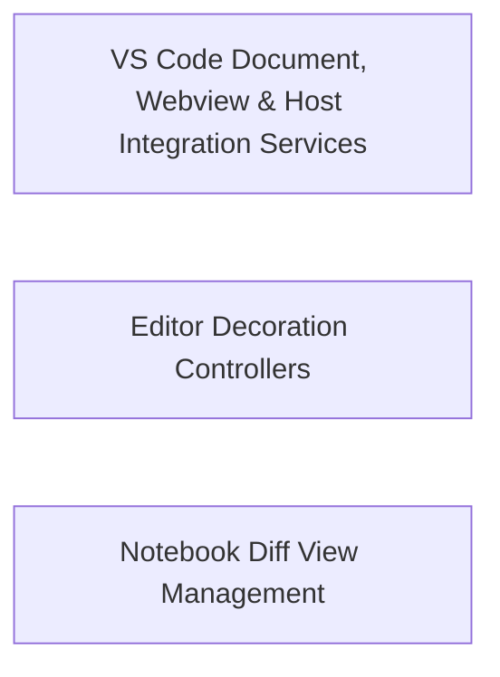

## Details

Provides VS Code editor managers, webview providers, document and notebook diff utilities, and commit message generation helpers.

### VS Code Document, Webview & Host Integration Services
Provides VS Code sidebar webview hosting, text document editing, streaming text updates, tab management, and extension host integration utilities.

**Related Classes/Methods**:

- `src.hosts.vscode.DocumentOperationManager.DocumentOperationManager`:8-181
- `src.hosts.vscode.StreamingTextUpdater.StreamingTextUpdater`:11-87
- `src.hosts.vscode.VscodeWebviewProvider.VscodeDiracWebviewProvider`:16-221

**Source Files:**

- `src/hosts/vscode/DocumentOperationManager.ts`
  - `src.hosts.vscode.DocumentOperationManager.DocumentOperationManager` (L8-L181) - Class
  - `src.hosts.vscode.DocumentOperationManager.DocumentOperationManager.saveDocument` (L9-L25) - Method
  - `src.hosts.vscode.DocumentOperationManager.DocumentOperationManager.applyAndSaveSilently` (L27-L64) - Method
  - `src.hosts.vscode.DocumentOperationManager.DocumentOperationManager.applyAndSaveBatchSilently` (L66-L137) - Method
  - `src.hosts.vscode.DocumentOperationManager.DocumentOperationManager.applyAndSaveBatchSilently.documents.map() callback` (L100-L108) - Function
  - `src.hosts.vscode.DocumentOperationManager.DocumentOperationManager.computeResults` (L139-L150) - Method
  - `src.hosts.vscode.DocumentOperationManager.DocumentOperationManager.format` (L152-L180) - Method
  - `src.hosts.vscode.DocumentOperationManager.DocumentOperationManager.format.editor` (L167-L167) - Class
  - `src.hosts.vscode.DocumentOperationManager.DocumentOperationManager.format.editor.vscode.window.visibleTextEditors.find() callback` (L167-L167) - Function
- `src/hosts/vscode/StreamingTextUpdater.ts`
  - `src.hosts.vscode.StreamingTextUpdater.countTrailingNewlines` (L3-L9) - Function
  - `src.hosts.vscode.StreamingTextUpdater.StreamingTextUpdater` (L11-L87) - Class
  - `src.hosts.vscode.StreamingTextUpdater.StreamingTextUpdater.constructor` (L12-L12) - Constructor
  - `src.hosts.vscode.StreamingTextUpdater.StreamingTextUpdater.replaceText` (L14-L40) - Method
  - `src.hosts.vscode.StreamingTextUpdater.StreamingTextUpdater.fixTrailingNewlines` (L42-L57) - Method
  - `src.hosts.vscode.StreamingTextUpdater.StreamingTextUpdater.scrollEditorToLine` (L59-L62) - Method
  - `src.hosts.vscode.StreamingTextUpdater.StreamingTextUpdater.scrollAnimation` (L64-L73) - Method
  - `src.hosts.vscode.StreamingTextUpdater.StreamingTextUpdater.truncateDocument` (L75-L82) - Method
  - `src.hosts.vscode.StreamingTextUpdater.StreamingTextUpdater.lineCount` (L84-L86) - Method
- `src/hosts/vscode/TabManager.ts`
  - `src.hosts.vscode.TabManager.TabManagerOptions` (L8-L10) - Interface
  - `src.hosts.vscode.TabManager.TabManager` (L12-L137) - Class
  - `src.hosts.vscode.TabManager.TabManager.closeTab` (L13-L21) - Method
  - `src.hosts.vscode.TabManager.TabManager.openDiffEditor` (L23-L37) - Method
  - `src.hosts.vscode.TabManager.TabManager.closeExistingTabsForPath` (L39-L53) - Method
  - `src.hosts.vscode.TabManager.TabManager.closeExistingTabsForPath.tabs` (L41-L43) - Class
  - `src.hosts.vscode.TabManager.TabManager.closeExistingTabsForPath.tabs.vscode.window.tabGroups.all.flatMap() callback` (L42-L42) - Function
  - `src.hosts.vscode.TabManager.TabManager.closeExistingTabsForPath.tabs.filter() callback` (L43-L43) - Function
  - `src.hosts.vscode.TabManager.TabManager.closeExistingDiffTab` (L55-L72) - Method
  - `src.hosts.vscode.TabManager.TabManager.closeExistingDiffTab.diffTab` (L56-L63) - Class
  - `src.hosts.vscode.TabManager.TabManager.closeExistingDiffTab.diffTab.vscode.window.tabGroups.all.flatMap() callback` (L57-L57) - Function
  - `src.hosts.vscode.TabManager.TabManager.closeExistingDiffTab.diffTab.find() callback` (L59-L62) - Function
  - `src.hosts.vscode.TabManager.TabManager.waitForActiveEditor` (L74-L106) - Method
  - `src.hosts.vscode.TabManager.TabManager.waitForActiveEditor.<function>` (L80-L105) - Function
  - `src.hosts.vscode.TabManager.TabManager.waitForActiveEditor.<function>.disposable` (L83-L88) - Class
  - `src.hosts.vscode.TabManager.TabManager.waitForActiveEditor.<function>.disposable.vscode.window.onDidChangeActiveTextEditor() callback` (L83-L88) - Function
  - `src.hosts.vscode.TabManager.TabManager.waitForActiveEditor.<function>.setTimeout() callback` (L101-L104) - Function
  - `src.hosts.vscode.TabManager.TabManager.closeAllDiffViews` (L108-L118) - Method
  - `src.hosts.vscode.TabManager.TabManager.closeAllDiffViews.tabs` (L109-L111) - Class
  - `src.hosts.vscode.TabManager.TabManager.closeAllDiffViews.tabs.vscode.window.tabGroups.all.flatMap() callback` (L110-L110) - Function
  - `src.hosts.vscode.TabManager.TabManager.closeAllDiffViews.tabs.filter() callback` (L111-L111) - Function
  - `src.hosts.vscode.TabManager.TabManager.closeTabsByScheme` (L120-L136) - Method
  - `src.hosts.vscode.TabManager.TabManager.closeTabsByScheme.allTabs` (L121-L127) - Class
  - `src.hosts.vscode.TabManager.TabManager.closeTabsByScheme.allTabs.vscode.window.tabGroups.all.flatMap() callback` (L122-L122) - Function
  - `src.hosts.vscode.TabManager.TabManager.closeTabsByScheme.allTabs.filter() callback` (L124-L126) - Function
- `src/hosts/vscode/VscodeWebviewProvider.ts`
  - `src.hosts.vscode.VscodeWebviewProvider.VscodeDiracWebviewProvider` (L16-L221) - Class
  - `src.hosts.vscode.VscodeWebviewProvider.VscodeDiracWebviewProvider.getWebviewUrl` (L24-L30) - Method
  - `src.hosts.vscode.VscodeWebviewProvider.VscodeDiracWebviewProvider.getCspSource` (L32-L37) - Method
  - `src.hosts.vscode.VscodeWebviewProvider.VscodeDiracWebviewProvider.getInjectedConfig` (L45-L49) - Method
  - `src.hosts.vscode.VscodeWebviewProvider.VscodeDiracWebviewProvider.isVisible` (L51-L53) - Method
  - `src.hosts.vscode.VscodeWebviewProvider.VscodeDiracWebviewProvider.getWebview` (L55-L57) - Method
  - `src.hosts.vscode.VscodeWebviewProvider.VscodeDiracWebviewProvider.resolveWebviewView` (L65-L136) - Method
  - `src.hosts.vscode.VscodeWebviewProvider.VscodeDiracWebviewProvider.resolveWebviewView.webviewView.onDidChangeVisibility() callback` (L93-L98) - Function
  - `src.hosts.vscode.VscodeWebviewProvider.VscodeDiracWebviewProvider.resolveWebviewView.webviewView.onDidDispose() callback` (L106-L108) - Function
  - `src.hosts.vscode.VscodeWebviewProvider.VscodeDiracWebviewProvider.resolveWebviewView.vscode.workspace.onDidChangeConfiguration() callback` (L115-L125) - Function
  - `src.hosts.vscode.VscodeWebviewProvider.VscodeDiracWebviewProvider.setWebviewMessageListener` (L162-L170) - Method
  - `src.hosts.vscode.VscodeWebviewProvider.VscodeDiracWebviewProvider.setWebviewMessageListener.webview.onDidReceiveMessage() callback` (L164-L166) - Function
  - `src.hosts.vscode.VscodeWebviewProvider.VscodeDiracWebviewProvider.handleWebviewMessage` (L178-L198) - Method
  - `src.hosts.vscode.VscodeWebviewProvider.VscodeDiracWebviewProvider.postMessageToWebview` (L206-L208) - Method
  - `src.hosts.vscode.VscodeWebviewProvider.VscodeDiracWebviewProvider.dispose` (L210-L220) - Method
- `src/hosts/vscode/commandUtils.ts`
  - `src.hosts.vscode.commandUtils.findMatchingNotebookCell` (L17-L45) - Function
  - `src.hosts.vscode.commandUtils.getContextForCommand` (L53-L104) - Function
  - `src.hosts.vscode.commandUtils.showWebview` (L106-L110) - Function
- `src/hosts/vscode/commit-message-generator.ts`
  - `src.hosts.vscode.commit-message-generator.getGitDiffStagedFirst` (L22-L28) - Function
  - `src.hosts.vscode.commit-message-generator.generateCommitMsg` (L51-L83) - Function
  - `src.hosts.vscode.commit-message-generator.orchestrateWorkspaceCommitMsgGeneration` (L85-L123) - Function
  - `src.hosts.vscode.commit-message-generator.filterForReposWithChanges` (L125-L140) - Function
  - `src.hosts.vscode.commit-message-generator.promptRepoSelection` (L142-L159) - Function
  - `src.hosts.vscode.commit-message-generator.promptRepoSelection.repoItems` (L144-L148) - Class
  - `src.hosts.vscode.commit-message-generator.promptRepoSelection.repoItems.repos.map() callback` (L144-L148) - Function
  - `src.hosts.vscode.commit-message-generator.generateCommitMsgForRepository` (L161-L178) - Function
  - `src.hosts.vscode.commit-message-generator.generateCommitMsgForRepository.vscode.window.withProgress() callback` (L176-L176) - Function
  - `src.hosts.vscode.commit-message-generator.createConfiguredCommitMessageStream` (L180-L203) - Function
  - `src.hosts.vscode.commit-message-generator.performCommitMsgGeneration` (L205-L262) - Function
  - `src.hosts.vscode.commit-message-generator.abortCommitGeneration` (L264-L267) - Function
  - `src.hosts.vscode.commit-message-generator.extractCommitMessage` (L274-L280) - Function
- `src/hosts/vscode/host-capabilities.ts`
  - `src.hosts.vscode.host-capabilities.vscodeHostCapabilities` (L12-L24) - Class
  - `src.hosts.vscode.host-capabilities.vscodeHostCapabilities.openWalkthrough` (L13-L18) - Method
  - `src.hosts.vscode.host-capabilities.vscodeHostCapabilities.listVsCodeLmModels` (L20-L20) - Method
  - `src.hosts.vscode.host-capabilities.vscodeHostCapabilities.createVsCodeLmHandler` (L21-L21) - Method
  - `src.hosts.vscode.host-capabilities.vscodeHostCapabilities.getWorkspaceConfig` (L22-L22) - Method
- `src/hosts/vscode/iconUtils.ts`
  - `src.hosts.vscode.iconUtils.getDiracIconUri` (L4-L6) - Function
- `src/hosts/vscode/python.ts`
  - `src.hosts.vscode.python.PythonApi` (L6-L11) - Interface
  - `src.hosts.vscode.python.getPythonApi` (L16-L27) - Function
  - `src.hosts.vscode.python.getPythonEnvironmentVariables` (L34-L84) - Function
- `src/hosts/vscode/vscode-lm-format.ts`
  - `src.hosts.vscode.vscode-lm-format.asObjectSafe` (L10-L32) - Function
  - `src.hosts.vscode.vscode-lm-format.imagePlaceholder` (L37-L41) - Function
  - `src.hosts.vscode.vscode-lm-format.convertToolResultContent` (L44-L54) - Function
  - `src.hosts.vscode.vscode-lm-format.convertToolResultContent.content.map() callback` (L49-L52) - Function
  - `src.hosts.vscode.vscode-lm-format.convertVsCodeLmUserMessage` (L57-L80) - Function
  - `src.hosts.vscode.vscode-lm-format.convertVsCodeLmUserMessage.contentParts` (L71-L78) - Class
  - `src.hosts.vscode.vscode-lm-format.convertVsCodeLmUserMessage.contentParts.toolMessages.map() callback` (L72-L72) - Function
  - `src.hosts.vscode.vscode-lm-format.convertVsCodeLmUserMessage.contentParts.nonToolMessages.map() callback` (L73-L76) - Function
  - `src.hosts.vscode.vscode-lm-format.convertVsCodeLmAssistantMessage` (L83-L106) - Function
  - `src.hosts.vscode.vscode-lm-format.convertVsCodeLmAssistantMessage.contentParts` (L97-L104) - Class
  - `src.hosts.vscode.vscode-lm-format.convertVsCodeLmAssistantMessage.contentParts.toolMessages.map() callback` (L98-L98) - Function
  - `src.hosts.vscode.vscode-lm-format.convertVsCodeLmAssistantMessage.contentParts.nonToolMessages.map() callback` (L99-L102) - Function
  - `src.hosts.vscode.vscode-lm-format.convertToVsCodeLmMessages` (L108-L130) - Function
  - `src.hosts.vscode.vscode-lm-format.convertToAnthropicRole` (L132-L143) - Function
  - `src.hosts.vscode.vscode-lm-format.convertToAnthropicMessage` (L145-L195) - Function
  - `src.hosts.vscode.vscode-lm-format.convertToAnthropicMessage.content.vsCodeLmMessage.content.map() callback` (L157-L177) - Function
  - `src.hosts.vscode.vscode-lm-format.convertToAnthropicMessage.content.filter() callback` (L178-L178) - Function
- `src/hosts/vscode/vscode-to-file-migration.ts`
  - `src.hosts.vscode.vscode-to-file-migration.MigrationResult` (L56-L62) - Interface
  - `src.hosts.vscode.vscode-to-file-migration.exportVSCodeStorageToSharedFiles` (L78-L205) - Function
  - `src.hosts.vscode.vscode-to-file-migration.migrateGlobalStorageFolders` (L210-L264) - Function
  - `src.hosts.vscode.vscode-to-file-migration.migrateGlobalStorageFolders.filter` (L239-L239) - Method
  - `src.hosts.vscode.vscode-to-file-migration.mergeTaskHistory` (L266-L271) - Function

### Editor Decoration Controllers
Manages active-line and faded-overlay text editor decorations during streaming edits in VS Code.

**Related Classes/Methods**:

- `src.hosts.vscode.DecorationControllerManager.DecorationControllerManager`:4-38
- `src.hosts.vscode.DecorationController.DecorationController`:18-78

**Source Files:**

- `src/hosts/vscode/DecorationController.ts`
  - `src.hosts.vscode.DecorationController.DecorationController` (L18-L78) - Class
  - `src.hosts.vscode.DecorationController.DecorationController.constructor` (L23-L26) - Constructor
  - `src.hosts.vscode.DecorationController.DecorationController.getDecoration` (L28-L35) - Method
  - `src.hosts.vscode.DecorationController.DecorationController.addLines` (L37-L52) - Method
  - `src.hosts.vscode.DecorationController.DecorationController.clear` (L54-L57) - Method
  - `src.hosts.vscode.DecorationController.DecorationController.updateOverlayAfterLine` (L59-L72) - Method
  - `src.hosts.vscode.DecorationController.DecorationController.updateOverlayAfterLine.ranges.filter() callback` (L61-L61) - Function
  - `src.hosts.vscode.DecorationController.DecorationController.setActiveLine` (L74-L77) - Method
- `src/hosts/vscode/DecorationControllerManager.ts`
  - `src.hosts.vscode.DecorationControllerManager.DecorationControllerManager` (L4-L38) - Class
  - `src.hosts.vscode.DecorationControllerManager.DecorationControllerManager.constructor` (L8-L8) - Constructor
  - `src.hosts.vscode.DecorationControllerManager.DecorationControllerManager.initialize` (L10-L14) - Method
  - `src.hosts.vscode.DecorationControllerManager.DecorationControllerManager.fadedOverlayController` (L16-L18) - Method
  - `src.hosts.vscode.DecorationControllerManager.DecorationControllerManager.activeLineController` (L20-L22) - Method
  - `src.hosts.vscode.DecorationControllerManager.DecorationControllerManager.updateAfterReplace` (L24-L27) - Method
  - `src.hosts.vscode.DecorationControllerManager.DecorationControllerManager.clearAll` (L29-L32) - Method
  - `src.hosts.vscode.DecorationControllerManager.DecorationControllerManager.reset` (L34-L37) - Method

### Notebook Diff View Management
Manages specialized Jupyter notebook `.ipynb` diff views and editor switching within VS Code.

**Related Classes/Methods**:

- `src.hosts.vscode.NotebookDiffManager.NotebookDiffManager`:5-42
- `src.hosts.vscode.NotebookDiffView.NotebookDiffView`:13-119

**Source Files:**

- `src/hosts/vscode/NotebookDiffManager.ts`
  - `src.hosts.vscode.NotebookDiffManager.NotebookDiffManager` (L5-L42) - Class
  - `src.hosts.vscode.NotebookDiffManager.NotebookDiffManager.isNotebookFile` (L8-L10) - Method
  - `src.hosts.vscode.NotebookDiffManager.NotebookDiffManager.switchToSpecializedEditor` (L12-L21) - Method
  - `src.hosts.vscode.NotebookDiffManager.NotebookDiffManager.showFileForNotebook` (L23-L30) - Method
  - `src.hosts.vscode.NotebookDiffManager.NotebookDiffManager.cleanup` (L32-L37) - Method
  - `src.hosts.vscode.NotebookDiffManager.NotebookDiffManager.reset` (L39-L41) - Method
- `src/hosts/vscode/NotebookDiffView.ts`
  - `src.hosts.vscode.NotebookDiffView.NotebookDiffView` (L13-L119) - Class
  - `src.hosts.vscode.NotebookDiffView.NotebookDiffView.open` (L23-L39) - Method
  - `src.hosts.vscode.NotebookDiffView.NotebookDiffView.createDiffView` (L41-L70) - Method
  - `src.hosts.vscode.NotebookDiffView.NotebookDiffView.setupFileWatcher` (L72-L84) - Method
  - `src.hosts.vscode.NotebookDiffView.NotebookDiffView.setupFileWatcher.tempFileWatcher.onDidChange() callback` (L81-L83) - Function
  - `src.hosts.vscode.NotebookDiffView.NotebookDiffView.syncToEditor` (L86-L102) - Method
  - `src.hosts.vscode.NotebookDiffView.NotebookDiffView.cleanup` (L104-L118) - Method

### [FAQ](https://github.com/CodeBoarding/GeneratedOnBoardings/tree/main?tab=readme-ov-file#faq)