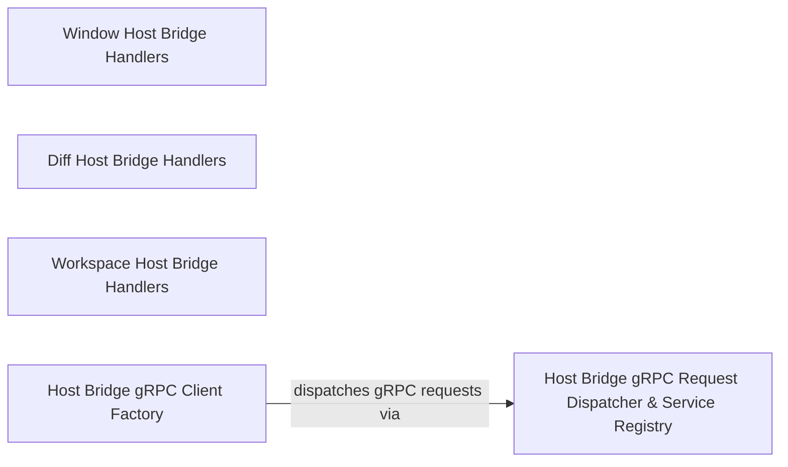

## Details

Implements VS Code gRPC host-bridge services and handlers for workspace, window, and diff operations.

### Window Host Bridge Handlers
Implements VS Code window RPC handlers for managing editors, tabs, file and save dialogs, input boxes, settings, and user notifications.

**Related Classes/Methods**:

- `src.hosts.vscode.hostbridge.window.openFile.openFile`:4-7
- `src.hosts.vscode.hostbridge.window.getActiveEditor.getActiveEditor`:5-8
- `src.hosts.vscode.hostbridge.window.showMessage.showMessage`:6-26

**Source Files:**

- `src/hosts/vscode/hostbridge/window/getActiveEditor.ts`
  - `src.hosts.vscode.hostbridge.window.getActiveEditor.getActiveEditor` (L5-L8) - Function
- `src/hosts/vscode/hostbridge/window/getOpenTabs.ts`
  - `src.hosts.vscode.hostbridge.window.getOpenTabs.getOpenTabs` (L4-L11) - Function
  - `src.hosts.vscode.hostbridge.window.getOpenTabs.getOpenTabs.openTabPaths` (L5-L8) - Class
  - `src.hosts.vscode.hostbridge.window.getOpenTabs.getOpenTabs.openTabPaths.window.tabGroups.all.flatMap() callback` (L6-L6) - Function
  - `src.hosts.vscode.hostbridge.window.getOpenTabs.getOpenTabs.openTabPaths.map() callback` (L7-L7) - Function
- `src/hosts/vscode/hostbridge/window/getVisibleTabs.ts`
  - `src.hosts.vscode.hostbridge.window.getVisibleTabs.getVisibleTabs` (L4-L8) - Function
  - `src.hosts.vscode.hostbridge.window.getVisibleTabs.getVisibleTabs.visibleTabPaths` (L5-L5) - Class
  - `src.hosts.vscode.hostbridge.window.getVisibleTabs.getVisibleTabs.visibleTabPaths.window.visibleTextEditors.map() callback` (L5-L5) - Function
- `src/hosts/vscode/hostbridge/window/openFile.ts`
  - `src.hosts.vscode.hostbridge.window.openFile.openFile` (L4-L7) - Function
- `src/hosts/vscode/hostbridge/window/openSettings.ts`
  - `src.hosts.vscode.hostbridge.window.openSettings.openSettings` (L4-L8) - Function
- `src/hosts/vscode/hostbridge/window/showInputBox.ts`
  - `src.hosts.vscode.hostbridge.window.showInputBox.showInputBox` (L4-L11) - Function
- `src/hosts/vscode/hostbridge/window/showMessage.ts`
  - `src.hosts.vscode.hostbridge.window.showMessage.showMessage` (L6-L26) - Function
- `src/hosts/vscode/hostbridge/window/showOpenDialogue.ts`
  - `src.hosts.vscode.hostbridge.window.showOpenDialogue.showOpenDialogue` (L4-L27) - Function
  - `src.hosts.vscode.hostbridge.window.showOpenDialogue.showOpenDialogue.paths.selectedResources.map() callback` (L25-L25) - Function
- `src/hosts/vscode/hostbridge/window/showSaveDialog.ts`
  - `src.hosts.vscode.hostbridge.window.showSaveDialog.showSaveDialog` (L4-L25) - Function
  - `src.hosts.vscode.hostbridge.window.showSaveDialog.showSaveDialog.forEach() callback` (L15-L17) - Function
- `src/hosts/vscode/hostbridge/window/showTextDocument.ts`
  - `src.hosts.vscode.hostbridge.window.showTextDocument.showTextDocument` (L5-L46) - Function
  - `src.hosts.vscode.hostbridge.window.showTextDocument.showTextDocument.existingTab` (L13-L15) - Class
  - `src.hosts.vscode.hostbridge.window.showTextDocument.showTextDocument.existingTab.group.tabs.find() callback` (L14-L14) - Function
  - `src.hosts.vscode.hostbridge.window.showTextDocument.showTextDocument.tabColumn` (L18-L18) - Class
  - `src.hosts.vscode.hostbridge.window.showTextDocument.showTextDocument.tabColumn.vscode.window.tabGroups.all.find() callback` (L18-L18) - Function

### Diff Host Bridge Handlers
Provides host bridge diff service RPC handlers for opening, scrolling, closing, and editing diff views and documents in VS Code.

**Related Classes/Methods**:

- `src.hosts.vscode.hostbridge.diff.openDiff.openDiff`:3-5
- `src.hosts.vscode.hostbridge.diff.openMultiFileDiff.openMultiFileDiff`:7-33
- `src.hosts.vscode.hostbridge.diff.saveDocument.saveDocument`:3-5

**Source Files:**

- `src/hosts/vscode/hostbridge/diff/closeAllDiffs.ts`
  - `src.hosts.vscode.hostbridge.diff.closeAllDiffs.closeAllDiffs` (L3-L5) - Function
- `src/hosts/vscode/hostbridge/diff/getDocumentText.ts`
  - `src.hosts.vscode.hostbridge.diff.getDocumentText.getDocumentText` (L3-L5) - Function
- `src/hosts/vscode/hostbridge/diff/openDiff.ts`
  - `src.hosts.vscode.hostbridge.diff.openDiff.openDiff` (L3-L5) - Function
- `src/hosts/vscode/hostbridge/diff/openMultiFileDiff.ts`
  - `src.hosts.vscode.hostbridge.diff.openMultiFileDiff.openMultiFileDiff` (L7-L33) - Function
  - `src.hosts.vscode.hostbridge.diff.openMultiFileDiff.openMultiFileDiff.request.diffs.map() callback` (L12-L26) - Function
- `src/hosts/vscode/hostbridge/diff/replaceText.ts`
  - `src.hosts.vscode.hostbridge.diff.replaceText.replaceText` (L3-L5) - Function
- `src/hosts/vscode/hostbridge/diff/saveDocument.ts`
  - `src.hosts.vscode.hostbridge.diff.saveDocument.saveDocument` (L3-L5) - Function
- `src/hosts/vscode/hostbridge/diff/scrollDiff.ts`
  - `src.hosts.vscode.hostbridge.diff.scrollDiff.scrollDiff` (L3-L5) - Function
- `src/hosts/vscode/hostbridge/diff/truncateDocument.ts`
  - `src.hosts.vscode.hostbridge.diff.truncateDocument.truncateDocument` (L3-L5) - Function

### Workspace Host Bridge Handlers
Implements VS Code workspace RPC handlers for opening folders, sidebar and explorer panels, terminal execution, and workspace diagnostics preparation.

**Related Classes/Methods**:

- `src.hosts.vscode.hostbridge.workspace.executeCommandInTerminal.executeCommandInTerminal`:11-42
- `src.hosts.vscode.hostbridge.workspace.openFolder.openFolder`:5-16
- `src.hosts.vscode.hostbridge.workspace.prepareDiagnostics.prepareDiagnostics`:4-19

**Source Files:**

- `src/hosts/vscode/hostbridge/workspace/executeCommandInTerminal.ts`
  - `src.hosts.vscode.hostbridge.workspace.executeCommandInTerminal.executeCommandInTerminal` (L11-L42) - Function
- `src/hosts/vscode/hostbridge/workspace/openDiracSidebarPanel.ts`
  - `src.hosts.vscode.hostbridge.workspace.openDiracSidebarPanel.openDiracSidebarPanel` (L5-L8) - Function
- `src/hosts/vscode/hostbridge/workspace/openFolder.ts`
  - `src.hosts.vscode.hostbridge.workspace.openFolder.openFolder` (L5-L16) - Function
- `src/hosts/vscode/hostbridge/workspace/openInFileExplorerPanel.ts`
  - `src.hosts.vscode.hostbridge.workspace.openInFileExplorerPanel.openInFileExplorerPanel` (L5-L8) - Function
- `src/hosts/vscode/hostbridge/workspace/openProblemsPanel.ts`
  - `src.hosts.vscode.hostbridge.workspace.openProblemsPanel.openProblemsPanel` (L4-L7) - Function
- `src/hosts/vscode/hostbridge/workspace/openTerminalPanel.ts`
  - `src.hosts.vscode.hostbridge.workspace.openTerminalPanel.openTerminalPanel` (L4-L7) - Function
- `src/hosts/vscode/hostbridge/workspace/prepareDiagnostics.ts`
  - `src.hosts.vscode.hostbridge.workspace.prepareDiagnostics.prepareDiagnostics` (L4-L19) - Function
  - `src.hosts.vscode.hostbridge.workspace.prepareDiagnostics.prepareDiagnostics.request.filePaths.map() callback` (L7-L13) - Function

### Host Bridge gRPC Request Dispatcher & Service Registry
Dispatches unary and streaming host bridge gRPC requests, tracks active streaming requests for cancellation, and provides the service method registry.

**Related Classes/Methods**:

- `src.hosts.vscode.hostbridge-grpc-handler.GrpcHandler`:18-165
- `src.hosts.vscode.hostbridge-grpc-handler.GrpcHandler.dispatchGrpcMethod`:30-93
- `src.hosts.vscode.hostbridge-grpc-service.ServiceRegistry`:23-116

**Source Files:**

- `src/hosts/vscode/hostbridge-grpc-handler.ts`
  - `src.hosts.vscode.hostbridge-grpc-handler.GrpcHandler` (L18-L165) - Class
  - `src.hosts.vscode.hostbridge-grpc-handler.GrpcHandler.constructor` (L19-L19) - Constructor
  - `src.hosts.vscode.hostbridge-grpc-handler.GrpcHandler.dispatchGrpcMethod` (L30-L93) - Method
  - `src.hosts.vscode.hostbridge-grpc-handler.GrpcHandler.dispatchGrpcMethod.requestRegistry.registerRequest() callback` (L68-L74) - Function
  - `src.hosts.vscode.hostbridge-grpc-handler.GrpcHandler.handleUnaryRequest` (L95-L99) - Method
  - `src.hosts.vscode.hostbridge-grpc-handler.GrpcHandler.cancelRequest` (L106-L126) - Method
  - `src.hosts.vscode.hostbridge-grpc-handler.GrpcHandler.handleStreamingRequest` (L135-L157) - Method
  - `src.hosts.vscode.hostbridge-grpc-handler.GrpcHandler.getServiceHandlerConfig` (L159-L164) - Method
  - `src.hosts.vscode.hostbridge-grpc-handler.HostServiceHandlerConfig` (L170-L178) - Interface
  - `src.hosts.vscode.hostbridge-grpc-handler.getRequestRegistry` (L184-L186) - Function
- `src/hosts/vscode/hostbridge-grpc-service.ts`
  - `src.hosts.vscode.hostbridge-grpc-service.MethodMetadata` (L16-L18) - Interface
  - `src.hosts.vscode.hostbridge-grpc-service.ServiceRegistry` (L23-L116) - Class
  - `src.hosts.vscode.hostbridge-grpc-service.ServiceRegistry.constructor` (L33-L35) - Constructor
  - `src.hosts.vscode.hostbridge-grpc-service.ServiceRegistry.registerMethod` (L43-L53) - Method
  - `src.hosts.vscode.hostbridge-grpc-service.ServiceRegistry.isStreamingMethod` (L60-L62) - Method
  - `src.hosts.vscode.hostbridge-grpc-service.ServiceRegistry.getStreamingHandler` (L69-L71) - Method
  - `src.hosts.vscode.hostbridge-grpc-service.ServiceRegistry.dispatchGrpcMethod` (L79-L90) - Method
  - `src.hosts.vscode.hostbridge-grpc-service.ServiceRegistry.handleStreamingRequest` (L99-L115) - Method
  - `src.hosts.vscode.hostbridge-grpc-service.createServiceRegistry` (L123-L140) - Function
  - `src.hosts.vscode.hostbridge-grpc-service.createServiceRegistry.registerMethod` (L130-L131) - Method
  - `src.hosts.vscode.hostbridge-grpc-service.createServiceRegistry.dispatchGrpcMethod` (L133-L133) - Method
  - `src.hosts.vscode.hostbridge-grpc-service.createServiceRegistry.handleStreamingRequest` (L135-L136) - Method
  - `src.hosts.vscode.hostbridge-grpc-service.createServiceRegistry.isStreamingMethod` (L138-L138) - Method
- `src/hosts/vscode/hostbridge/testing/getWebviewHtml.ts`
  - `src.hosts.vscode.hostbridge.testing.getWebviewHtml.getWebviewHtml` (L3-L5) - Function

### Host Bridge gRPC Client Factory
Constructs typed gRPC clients from protobuf service definitions that route unary and streaming calls through the host bridge gRPC handler.

**Related Classes/Methods**:

- `src.hosts.vscode.hostbridge.client.host-grpc-client-base.createGrpcClient`:34-96

**Source Files:**

- `src/hosts/vscode/hostbridge/client/host-grpc-client-base.ts`
  - `src.hosts.vscode.hostbridge.client.host-grpc-client-base.createGrpcClient` (L34-L96) - Function
  - `src.hosts.vscode.hostbridge.client.host-grpc-client-base.createGrpcClient.forEach() callback` (L38-L94) - Function
  - `src.hosts.vscode.hostbridge.client.host-grpc-client-base.forEach() callback.[methodKey]` (L44-L74) - Function
  - `src.hosts.vscode.hostbridge.client.host-grpc-client-base.createGrpcClient.forEach() callback.[methodKey].<function>` (L49-L73) - Function
  - `src.hosts.vscode.hostbridge.client.host-grpc-client-base.createGrpcClient.forEach() callback.[methodKey]` (L77-L92) - Function

### [FAQ](https://github.com/CodeBoarding/GeneratedOnBoardings/tree/main?tab=readme-ov-file#faq)