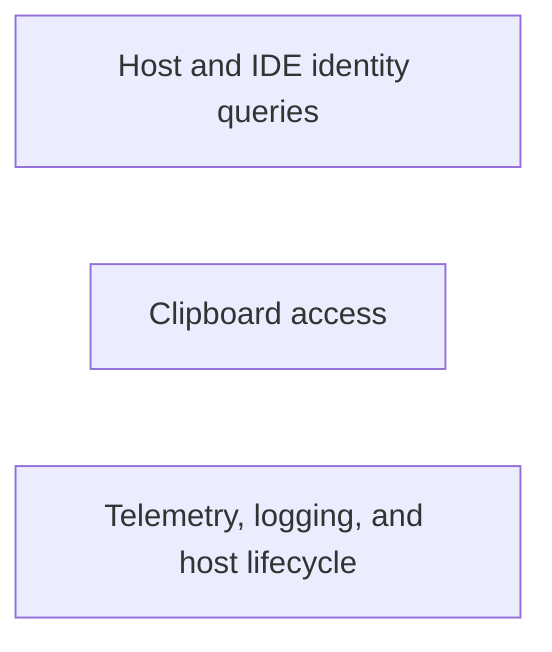

## Details

Implements environment-specific hostbridge operations for the VS Code host, including clipboard access, debug logging, version retrieval, telemetry settings, and shutdown handling.

### Host and IDE identity queries
Provides the host application version and the IDE redirect URI for auth callbacks.

**Related Classes/Methods**:

- `src.hosts.vscode.hostbridge.env.getHostVersion.getHostVersion`:7-14
- `src.hosts.vscode.hostbridge.env.getIdeRedirectUri.getIdeRedirectUri`:4-13

**Source Files:**

- `src/hosts/vscode/hostbridge/env/getHostVersion.ts`
  - `src.hosts.vscode.hostbridge.env.getHostVersion.getHostVersion` (L7-L14) - Function
- `src/hosts/vscode/hostbridge/env/getIdeRedirectUri.ts`
  - `src.hosts.vscode.hostbridge.env.getIdeRedirectUri.getIdeRedirectUri` (L4-L13) - Function
- `src/hosts/vscode/hostbridge/env/getTelemetrySettings.ts`
  - `src.hosts.vscode.hostbridge.env.getTelemetrySettings.getTelemetrySettings` (L6-L14) - Function

### Clipboard access
Reads and writes plain text through the VSCode clipboard API.

**Related Classes/Methods**:

- `src.hosts.vscode.hostbridge.env.clipboardReadText.clipboardReadText`:4-7
- `src.hosts.vscode.hostbridge.env.clipboardWriteText.clipboardWriteText`:4-7

**Source Files:**

- `src/hosts/vscode/hostbridge/env/clipboardReadText.ts`
  - `src.hosts.vscode.hostbridge.env.clipboardReadText.clipboardReadText` (L4-L7) - Function
- `src/hosts/vscode/hostbridge/env/clipboardWriteText.ts`
  - `src.hosts.vscode.hostbridge.env.clipboardWriteText.clipboardWriteText` (L4-L7) - Function

### Telemetry, logging, and host lifecycle
Subscribes to telemetry setting changes, appends debug logs to the Dirac output channel, opens external URLs, and handles shutdown.

**Related Classes/Methods**:

- `src.hosts.vscode.hostbridge.env.subscribeToTelemetrySettings.subscribeToTelemetrySettings`:9-20
- `src.hosts.vscode.hostbridge.env.debugLog.debugLog`:7-10
- `src.hosts.vscode.hostbridge.env.openExternal.openExternal`:4-9
- `src.hosts.vscode.hostbridge.env.shutdown.shutdown`:3-9

**Source Files:**

- `src/hosts/vscode/hostbridge/env/debugLog.ts`
  - `src.hosts.vscode.hostbridge.env.debugLog.debugLog` (L7-L10) - Function
  - `src.hosts.vscode.hostbridge.env.debugLog.registerDiracOutputChannel` (L13-L16) - Function
- `src/hosts/vscode/hostbridge/env/openExternal.ts`
  - `src.hosts.vscode.hostbridge.env.openExternal.openExternal` (L4-L9) - Function
- `src/hosts/vscode/hostbridge/env/shutdown.ts`
  - `src.hosts.vscode.hostbridge.env.shutdown.shutdown` (L3-L9) - Function
- `src/hosts/vscode/hostbridge/env/subscribeToTelemetrySettings.ts`
  - `src.hosts.vscode.hostbridge.env.subscribeToTelemetrySettings.subscribeToTelemetrySettings` (L9-L20) - Function
  - `src.hosts.vscode.hostbridge.env.subscribeToTelemetrySettings.subscribeToTelemetrySettings.vscode.env.onDidChangeTelemetryEnabled() callback` (L14-L19) - Function

### [FAQ](https://github.com/CodeBoarding/GeneratedOnBoardings/tree/main?tab=readme-ov-file#faq)