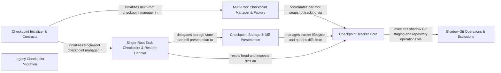

## Details

Manages Git-backed workspace checkpoints, multi-root tracking, storage lifecycle, diff presentation, and state restoration.

### Checkpoint Storage & Diff Presentation
Manages checkpoint tracker state, storage persistence, and multifile diff presentation for single-root task checkpoints.

**Related Classes/Methods**:

- `src.integrations.checkpoints.CheckpointStorageManager.CheckpointStorageManager`:29-226
- `src.integrations.checkpoints.CheckpointDiffPresenter.CheckpointDiffPresenter`:28-175

**Source Files:**

- `src/integrations/checkpoints/CheckpointDiffPresenter.ts`
  - `src.integrations.checkpoints.CheckpointDiffPresenter.CheckpointDiffConfig` (L12-L15) - Interface
  - `src.integrations.checkpoints.CheckpointDiffPresenter.CheckpointDiffServices` (L16-L19) - Interface
  - `src.integrations.checkpoints.CheckpointDiffPresenter.CheckpointDiffPresenter` (L28-L175) - Class
  - `src.integrations.checkpoints.CheckpointDiffPresenter.CheckpointDiffPresenter.constructor` (L33-L37) - Constructor
  - `src.integrations.checkpoints.CheckpointDiffPresenter.CheckpointDiffPresenter.setEnabled` (L39-L41) - Method
  - `src.integrations.checkpoints.CheckpointDiffPresenter.CheckpointDiffPresenter.presentMultifileDiff` (L48-L174) - Method
  - `src.integrations.checkpoints.CheckpointDiffPresenter.CheckpointDiffPresenter.presentMultifileDiff.messageIndex` (L64-L64) - Class
  - `src.integrations.checkpoints.CheckpointDiffPresenter.CheckpointDiffPresenter.presentMultifileDiff.messageIndex.diracMessages.findIndex() callback` (L64-L64) - Function
  - `src.integrations.checkpoints.CheckpointDiffPresenter.CheckpointDiffPresenter.presentMultifileDiff.lastTaskCompletedMessageCheckpointHash` (L115-L118) - Class
  - `src.integrations.checkpoints.CheckpointDiffPresenter.CheckpointDiffPresenter.presentMultifileDiff.lastTaskCompletedMessageCheckpointHash.findLast() callback` (L117-L117) - Function
  - `src.integrations.checkpoints.CheckpointDiffPresenter.CheckpointDiffPresenter.presentMultifileDiff.firstCheckpointMessageCheckpointHash` (L121-L123) - Class
  - `src.integrations.checkpoints.CheckpointDiffPresenter.CheckpointDiffPresenter.presentMultifileDiff.firstCheckpointMessageCheckpointHash.find() callback` (L123-L123) - Function
  - `src.integrations.checkpoints.CheckpointDiffPresenter.CheckpointDiffPresenter.presentMultifileDiff.diffs.changedFiles.map() callback` (L154-L158) - Function
  - `src.integrations.checkpoints.CheckpointDiffPresenter.presentMultifileDiff.diffs` (L154-L158) - Class
- `src/integrations/checkpoints/CheckpointStorageManager.ts`
  - `src.integrations.checkpoints.CheckpointStorageManager.CheckpointStorageConfig` (L9-L12) - Interface
  - `src.integrations.checkpoints.CheckpointStorageManager.CheckpointStorageServices` (L13-L17) - Interface
  - `src.integrations.checkpoints.CheckpointStorageManager.CheckpointStorageCallbacks` (L18-L20) - Interface
  - `src.integrations.checkpoints.CheckpointStorageManager.CheckpointStorageManager` (L29-L226) - Class
  - `src.integrations.checkpoints.CheckpointStorageManager.CheckpointStorageManager.constructor` (L38-L42) - Constructor
  - `src.integrations.checkpoints.CheckpointStorageManager.CheckpointStorageManager.setEnabled` (L44-L46) - Method
  - `src.integrations.checkpoints.CheckpointStorageManager.CheckpointStorageManager.isEnabled` (L48-L50) - Method
  - `src.integrations.checkpoints.CheckpointStorageManager.CheckpointStorageManager.getTracker` (L52-L54) - Method
  - `src.integrations.checkpoints.CheckpointStorageManager.CheckpointStorageManager.setTracker` (L56-L58) - Method
  - `src.integrations.checkpoints.CheckpointStorageManager.CheckpointStorageManager.getErrorMessage` (L60-L62) - Method
  - `src.integrations.checkpoints.CheckpointStorageManager.CheckpointStorageManager.getInitPromise` (L64-L66) - Method
  - `src.integrations.checkpoints.CheckpointStorageManager.CheckpointStorageManager.setInitPromise` (L68-L70) - Method
  - `src.integrations.checkpoints.CheckpointStorageManager.CheckpointStorageManager.checkpointTrackerCheckAndInit` (L76-L88) - Method
  - `src.integrations.checkpoints.CheckpointStorageManager.CheckpointStorageManager.initializeCheckpointTracker` (L93-L137) - Method
  - `src.integrations.checkpoints.CheckpointStorageManager.CheckpointStorageManager.initializeCheckpointTracker.setTimeout() callback` (L98-L105) - Function
  - `src.integrations.checkpoints.CheckpointStorageManager.CheckpointStorageManager.setCheckpointManagerErrorMessage` (L142-L150) - Method
  - `src.integrations.checkpoints.CheckpointStorageManager.CheckpointStorageManager.commit` (L156-L175) - Method
  - `src.integrations.checkpoints.CheckpointStorageManager.CheckpointStorageManager.getWorkspacePath` (L180-L198) - Method
  - `src.integrations.checkpoints.CheckpointStorageManager.CheckpointStorageManager.ensureTrackerInitialized` (L203-L225) - Method
- `src/integrations/checkpoints/DiffContentProvider.ts`
  - `src.integrations.checkpoints.DiffContentProvider.DiffEntry` (L6-L11) - Interface
  - `src.integrations.checkpoints.DiffContentProvider.normalizeWhitespace` (L18-L20) - Function
  - `src.integrations.checkpoints.DiffContentProvider.isExcluded` (L25-L35) - Function
  - `src.integrations.checkpoints.DiffContentProvider.isExcluded.exclusions.some() callback` (L26-L34) - Function
  - `src.integrations.checkpoints.DiffContentProvider.hasExtension` (L40-L44) - Function
  - `src.integrations.checkpoints.DiffContentProvider.isDotfile` (L49-L53) - Function
  - `src.integrations.checkpoints.DiffContentProvider.getExtension` (L58-L62) - Function
  - `src.integrations.checkpoints.DiffContentProvider.DiffContentProvider` (L74-L175) - Class
  - `src.integrations.checkpoints.DiffContentProvider.DiffContentProvider.constructor` (L75-L81) - Constructor
  - `src.integrations.checkpoints.DiffContentProvider.DiffContentProvider.cleanCommitHash` (L84-L86) - Method
  - `src.integrations.checkpoints.DiffContentProvider.DiffContentProvider.prepareDiff` (L89-L107) - Method
  - `src.integrations.checkpoints.DiffContentProvider.DiffContentProvider.computeDiffSet` (L110-L161) - Method
  - `src.integrations.checkpoints.DiffContentProvider.DiffContentProvider.computeDiffSet.isBinary` (L124-L124) - Class
  - `src.integrations.checkpoints.DiffContentProvider.DiffContentProvider.computeDiffSet.isBinary.catch() callback` (L124-L124) - Function
  - `src.integrations.checkpoints.DiffContentProvider.DiffContentProvider.computeDiffCount` (L164-L174) - Method

### Checkpoint Tracker Core
Tracks workspace file snapshots, computes diffs, and coordinates shadow Git repository state with file locking utilities.

**Related Classes/Methods**:

- `src.integrations.checkpoints.CheckpointTracker.CheckpointTracker`:59-527
- `src.integrations.checkpoints.CheckpointTracker.CheckpointTracker.commit`:220-283
- `src.integrations.checkpoints.CheckpointTracker.CheckpointTracker.resetHead`:344-390

**Source Files:**

- `src/integrations/checkpoints/CheckpointLockUtils.ts`
  - `src.integrations.checkpoints.CheckpointLockUtils.tryAcquireCheckpointLockWithRetry` (L18-L26) - Function
  - `src.integrations.checkpoints.CheckpointLockUtils.releaseCheckpointLock` (L35-L37) - Function
- `src/integrations/checkpoints/CheckpointTracker.ts`
  - `src.integrations.checkpoints.CheckpointTracker.normalizeWhitespace` (L20-L22) - Function
  - `src.integrations.checkpoints.CheckpointTracker.CheckpointTracker` (L59-L527) - Class
  - `src.integrations.checkpoints.CheckpointTracker.CheckpointTracker.cleanCommitHash` (L70-L72) - Method
  - `src.integrations.checkpoints.CheckpointTracker.CheckpointTracker.sendCheckpointSubscriptionEvent` (L81-L97) - Method
  - `src.integrations.checkpoints.CheckpointTracker.CheckpointTracker.constructor` (L107-L112) - Constructor
  - `src.integrations.checkpoints.CheckpointTracker.CheckpointTracker.create` (L136-L190) - Method
  - `src.integrations.checkpoints.CheckpointTracker.CheckpointTracker.commit` (L220-L283) - Method
  - `src.integrations.checkpoints.CheckpointTracker.CheckpointTracker.getShadowGitConfigWorkTree` (L308-L320) - Method
  - `src.integrations.checkpoints.CheckpointTracker.CheckpointTracker.resetHead` (L344-L390) - Method
  - `src.integrations.checkpoints.CheckpointTracker.CheckpointTracker.getDiffSet` (L392-L497) - Method
  - `src.integrations.checkpoints.CheckpointTracker.CheckpointTracker.getDiffSet.isExcluded` (L427-L435) - Class
  - `src.integrations.checkpoints.CheckpointTracker.CheckpointTracker.getDiffSet.isExcluded.exclusions.some() callback` (L427-L435) - Function
  - `src.integrations.checkpoints.CheckpointTracker.CheckpointTracker.getDiffSet.isBinary` (L449-L449) - Class
  - `src.integrations.checkpoints.CheckpointTracker.CheckpointTracker.getDiffSet.isBinary.catch() callback` (L449-L449) - Function
  - `src.integrations.checkpoints.CheckpointTracker.CheckpointTracker.getDiffCount` (L507-L526) - Method
- `src/integrations/checkpoints/CheckpointUtils.ts`
  - `src.integrations.checkpoints.CheckpointUtils.getShadowGitPath` (L21-L26) - Function
  - `src.integrations.checkpoints.CheckpointUtils.validateWorkspacePath` (L45-L70) - Function
  - `src.integrations.checkpoints.CheckpointUtils.getWorkingDirectory` (L88-L96) - Function
  - `src.integrations.checkpoints.CheckpointUtils.hashWorkingDir` (L104-L115) - Function

### Shadow Git Operations & Exclusions
Executes shadow Git repository operations and manages file exclusion rules for checkpoint snapshots.

**Related Classes/Methods**:

- `src.integrations.checkpoints.CheckpointGitOperations.GitOperations`:29-258
- `src.integrations.checkpoints.CheckpointGitOperations.GitOperations.addCheckpointFiles`:202-257

**Source Files:**

- `src/integrations/checkpoints/CheckpointExclusions.ts`
  - `src.integrations.checkpoints.CheckpointExclusions.getBuildArtifactPatterns` (L76-L106) - Function
  - `src.integrations.checkpoints.CheckpointExclusions.getMediaFilePatterns` (L112-L154) - Function
  - `src.integrations.checkpoints.CheckpointExclusions.getCacheFilePatterns` (L160-L183) - Function
  - `src.integrations.checkpoints.CheckpointExclusions.getConfigFilePatterns` (L189-L191) - Function
  - `src.integrations.checkpoints.CheckpointExclusions.getLargeDataFilePatterns` (L197-L214) - Function
  - `src.integrations.checkpoints.CheckpointExclusions.getDatabaseFilePatterns` (L220-L243) - Function
  - `src.integrations.checkpoints.CheckpointExclusions.getGeospatialPatterns` (L249-L279) - Function
  - `src.integrations.checkpoints.CheckpointExclusions.getLogFilePatterns` (L285-L287) - Function
  - `src.integrations.checkpoints.CheckpointExclusions.getLfsPatterns` (L311-L325) - Class
  - `src.integrations.checkpoints.CheckpointExclusions.getLfsPatterns.filter() callback` (L318-L318) - Function
  - `src.integrations.checkpoints.CheckpointExclusions.getLfsPatterns.map() callback` (L319-L319) - Function
- `src/integrations/checkpoints/CheckpointGitOperations.ts`
  - `src.integrations.checkpoints.CheckpointGitOperations.CheckpointAddResult` (L12-L14) - Interface
  - `src.integrations.checkpoints.CheckpointGitOperations.GitOperations` (L29-L258) - Class
  - `src.integrations.checkpoints.CheckpointGitOperations.GitOperations.constructor` (L38-L40) - Constructor
  - `src.integrations.checkpoints.CheckpointGitOperations.GitOperations.initShadowGit` (L61-L117) - Method
  - `src.integrations.checkpoints.CheckpointGitOperations.GitOperations.initShadowGit.catch() callback` (L65-L67) - Function
  - `src.integrations.checkpoints.CheckpointGitOperations.GitOperations.getShadowGitConfigWorkTree` (L128-L137) - Method
  - `src.integrations.checkpoints.CheckpointGitOperations.GitOperations.renameNestedGitRepos` (L150-L200) - Method
  - `src.integrations.checkpoints.CheckpointGitOperations.GitOperations.renameNestedGitRepos.nestedGitCache.map() callback` (L169-L169) - Function
  - `src.integrations.checkpoints.CheckpointGitOperations.GitOperations.renameNestedGitRepos.gitPaths.map() callback` (L174-L195) - Function
  - `src.integrations.checkpoints.CheckpointGitOperations.GitOperations.addCheckpointFiles` (L202-L257) - Method
  - `src.integrations.checkpoints.CheckpointGitOperations.GitOperations.addCheckpointFiles.filesToStage` (L212-L212) - Class
  - `src.integrations.checkpoints.CheckpointGitOperations.GitOperations.addCheckpointFiles.filesToStage.status.files.map() callback` (L212-L212) - Function
  - `src.integrations.checkpoints.CheckpointGitOperations.GitOperations.addCheckpointFiles.retryWithBackoff() callback` (L244-L244) - Function
  - `src.integrations.checkpoints.CheckpointGitOperations.GitOperations.addCheckpointFiles.onRetry` (L248-L252) - Method
  - `src.integrations.checkpoints.CheckpointGitOperations.GitOperations.addCheckpointFiles.catch() callback` (L253-L255) - Function

### Multi-Root Checkpoint Manager & Factory
Instantiates checkpoint managers via factory logic and coordinates checkpoint tracking across multi-root workspace folders.

**Related Classes/Methods**:

- `src.integrations.checkpoints.MultiRootCheckpointManager.MultiRootCheckpointManager`:44-319
- `src.integrations.checkpoints.MultiRootCheckpointManager.MultiRootCheckpointManager.saveCheckpoint`:133-183

**Source Files:**

- `src/integrations/checkpoints/MultiRootCheckpointManager.ts`
  - `src.integrations.checkpoints.MultiRootCheckpointManager.MultiRootCheckpointManager` (L44-L319) - Class
  - `src.integrations.checkpoints.MultiRootCheckpointManager.MultiRootCheckpointManager.constructor` (L49-L54) - Constructor
  - `src.integrations.checkpoints.MultiRootCheckpointManager.MultiRootCheckpointManager.setEnabled` (L56-L58) - Method
  - `src.integrations.checkpoints.MultiRootCheckpointManager.MultiRootCheckpointManager.isEnabled` (L60-L62) - Method
  - `src.integrations.checkpoints.MultiRootCheckpointManager.MultiRootCheckpointManager.initialize` (L68-L81) - Method
  - `src.integrations.checkpoints.MultiRootCheckpointManager.MultiRootCheckpointManager.doInitialize` (L83-L127) - Method
  - `src.integrations.checkpoints.MultiRootCheckpointManager.MultiRootCheckpointManager.doInitialize.initPromises` (L94-L109) - Class
  - `src.integrations.checkpoints.MultiRootCheckpointManager.MultiRootCheckpointManager.doInitialize.initPromises.roots.map() callback` (L94-L109) - Function
  - `src.integrations.checkpoints.MultiRootCheckpointManager.MultiRootCheckpointManager.doInitialize.successCount` (L112-L112) - Class
  - `src.integrations.checkpoints.MultiRootCheckpointManager.MultiRootCheckpointManager.doInitialize.successCount.results.filter() callback` (L112-L112) - Function
  - `src.integrations.checkpoints.MultiRootCheckpointManager.MultiRootCheckpointManager.saveCheckpoint` (L133-L183) - Method
  - `src.integrations.checkpoints.MultiRootCheckpointManager.MultiRootCheckpointManager.saveCheckpoint.commitPromises` (L146-L159) - Class
  - `src.integrations.checkpoints.MultiRootCheckpointManager.MultiRootCheckpointManager.saveCheckpoint.commitPromises.map() callback` (L146-L159) - Function
  - `src.integrations.checkpoints.MultiRootCheckpointManager.saveCheckpoint.commitPromises.map() callback.rootName` (L150-L150) - Class
  - `src.integrations.checkpoints.MultiRootCheckpointManager.saveCheckpoint.commitPromises.map() callback.rootName.find() callback` (L150-L150) - Function
  - `src.integrations.checkpoints.MultiRootCheckpointManager.MultiRootCheckpointManager.saveCheckpoint.commitPromises.map() callback.rootName` (L155-L155) - Class
  - `src.integrations.checkpoints.MultiRootCheckpointManager.MultiRootCheckpointManager.saveCheckpoint.commitPromises.map() callback.rootName.find() callback` (L155-L155) - Function
  - `src.integrations.checkpoints.MultiRootCheckpointManager.MultiRootCheckpointManager.saveCheckpoint.then() callback` (L165-L179) - Function
  - `src.integrations.checkpoints.MultiRootCheckpointManager.MultiRootCheckpointManager.saveCheckpoint.then() callback.successful` (L166-L166) - Class
  - `src.integrations.checkpoints.MultiRootCheckpointManager.MultiRootCheckpointManager.saveCheckpoint.then() callback.successful.results.filter() callback` (L166-L166) - Function
  - `src.integrations.checkpoints.MultiRootCheckpointManager.MultiRootCheckpointManager.saveCheckpoint.catch() callback` (L180-L182) - Function
  - `src.integrations.checkpoints.MultiRootCheckpointManager.MultiRootCheckpointManager.restoreCheckpoint` (L190-L212) - Method
  - `src.integrations.checkpoints.MultiRootCheckpointManager.MultiRootCheckpointManager.doesLatestTaskCompletionHaveNewChanges` (L218-L237) - Method
  - `src.integrations.checkpoints.MultiRootCheckpointManager.MultiRootCheckpointManager.doesLatestTaskCompletionHaveNewChanges.rootName` (L229-L229) - Class
  - `src.integrations.checkpoints.MultiRootCheckpointManager.MultiRootCheckpointManager.doesLatestTaskCompletionHaveNewChanges.rootName.find() callback` (L229-L229) - Function
  - `src.integrations.checkpoints.MultiRootCheckpointManager.MultiRootCheckpointManager.commit` (L243-L275) - Method
  - `src.integrations.checkpoints.MultiRootCheckpointManager.commit.commitPromises.map() callback` (L252-L256) - Function
  - `src.integrations.checkpoints.MultiRootCheckpointManager.commit.commitPromises` (L252-L257) - Class
  - `src.integrations.checkpoints.MultiRootCheckpointManager.commit.commitPromises.map() callback.catch() callback` (L253-L256) - Function
  - `src.integrations.checkpoints.MultiRootCheckpointManager.MultiRootCheckpointManager.commit.commitPromises.map() callback` (L263-L267) - Function
  - `src.integrations.checkpoints.MultiRootCheckpointManager.MultiRootCheckpointManager.commit.commitPromises` (L263-L268) - Class
  - `src.integrations.checkpoints.MultiRootCheckpointManager.MultiRootCheckpointManager.commit.commitPromises.map() callback.catch() callback` (L264-L267) - Function
  - `src.integrations.checkpoints.MultiRootCheckpointManager.MultiRootCheckpointManager.presentMultifileDiff` (L281-L318) - Method
- `src/integrations/checkpoints/factory.ts`
  - `src.integrations.checkpoints.factory.shouldUseMultiRoot` (L13-L23) - Function
  - `src.integrations.checkpoints.factory.buildCheckpointManager` (L56-L106) - Function

### Single-Root Task Checkpoint & Restore Handler
Orchestrates single-root task checkpoint lifecycle operations and handles workspace and task state restoration.

**Related Classes/Methods**:

- `src.integrations.checkpoints.index.TaskCheckpointManager.checkpointTrackerCheckAndInit`:322-324
- `src.integrations.checkpoints.CheckpointRestoreHandler.CheckpointRestoreHandler.restoreCheckpoint`:87-224

**Source Files:**

- `src/integrations/checkpoints/CheckpointRestoreHandler.ts`
  - `src.integrations.checkpoints.CheckpointRestoreHandler.CheckpointRestoreConfig` (L19-L22) - Interface
  - `src.integrations.checkpoints.CheckpointRestoreHandler.CheckpointRestoreServices` (L30-L35) - Interface
  - `src.integrations.checkpoints.CheckpointRestoreHandler.CheckpointRestoreCallbacks` (L36-L40) - Interface
  - `src.integrations.checkpoints.CheckpointRestoreHandler.CheckpointRestoreResult` (L42-L45) - Interface
  - `src.integrations.checkpoints.CheckpointRestoreHandler.CheckpointRestoreHandler` (L54-L328) - Class
  - `src.integrations.checkpoints.CheckpointRestoreHandler.CheckpointRestoreHandler.constructor` (L62-L74) - Constructor
  - `src.integrations.checkpoints.CheckpointRestoreHandler.CheckpointRestoreHandler.setEnabled` (L76-L78) - Method
  - `src.integrations.checkpoints.CheckpointRestoreHandler.CheckpointRestoreHandler.getConversationHistoryDeletedRange` (L80-L82) - Method
  - `src.integrations.checkpoints.CheckpointRestoreHandler.CheckpointRestoreHandler.restoreCheckpoint` (L87-L224) - Method
  - `src.integrations.checkpoints.CheckpointRestoreHandler.CheckpointRestoreHandler.restoreCheckpoint.messageIndex` (L94-L94) - Class
  - `src.integrations.checkpoints.CheckpointRestoreHandler.CheckpointRestoreHandler.restoreCheckpoint.messageIndex.diracMessages.findIndex() callback` (L94-L94) - Function
  - `src.integrations.checkpoints.CheckpointRestoreHandler.CheckpointRestoreHandler.restoreCheckpoint.lastHashIndex` (L95-L95) - Class
  - `src.integrations.checkpoints.CheckpointRestoreHandler.CheckpointRestoreHandler.restoreCheckpoint.lastHashIndex.findLastIndex() callback` (L95-L95) - Function
  - `src.integrations.checkpoints.CheckpointRestoreHandler.CheckpointRestoreHandler.handleSuccessfulRestore` (L229-L327) - Method
  - `src.integrations.checkpoints.CheckpointRestoreHandler.CheckpointRestoreHandler.handleSuccessfulRestore.checkpointMessages` (L311-L311) - Class
  - `src.integrations.checkpoints.CheckpointRestoreHandler.CheckpointRestoreHandler.handleSuccessfulRestore.checkpointMessages.filter() callback` (L311-L311) - Function
  - `src.integrations.checkpoints.CheckpointRestoreHandler.CheckpointRestoreHandler.handleSuccessfulRestore.currentMessageIndex` (L312-L312) - Class
  - `src.integrations.checkpoints.CheckpointRestoreHandler.CheckpointRestoreHandler.handleSuccessfulRestore.currentMessageIndex.checkpointMessages.findIndex() callback` (L312-L312) - Function
- `src/integrations/checkpoints/index.ts`
  - `src.integrations.checkpoints.index.CheckpointManagerTask` (L24-L26) - Interface
  - `src.integrations.checkpoints.index.CheckpointManagerConfig` (L27-L29) - Interface
  - `src.integrations.checkpoints.index.CheckpointManagerServices` (L30-L36) - Interface
  - `src.integrations.checkpoints.index.CheckpointManagerCallbacks` (L37-L43) - Interface
  - `src.integrations.checkpoints.index.CheckpointManagerInternalState` (L44-L49) - Interface
  - `src.integrations.checkpoints.index.CheckpointRestoreStateUpdate` (L50-L53) - Interface
  - `src.integrations.checkpoints.index.TaskCheckpointManager` (L62-L350) - Class
  - `src.integrations.checkpoints.index.TaskCheckpointManager.constructor` (L73-L125) - Constructor
  - `src.integrations.checkpoints.index.TaskCheckpointManager.setEnabled` (L127-L132) - Method
  - `src.integrations.checkpoints.index.TaskCheckpointManager.isEnabled` (L134-L136) - Method
  - `src.integrations.checkpoints.index.TaskCheckpointManager.saveCheckpoint` (L139-L226) - Method
  - `src.integrations.checkpoints.index.TaskCheckpointManager.saveCheckpoint.then() callback` (L185-L190) - Function
  - `src.integrations.checkpoints.index.TaskCheckpointManager.saveCheckpoint.catch() callback` (L191-L196) - Function
  - `src.integrations.checkpoints.index.TaskCheckpointManager.saveCheckpoint.lastCompletionResultMessage` (L201-L204) - Class
  - `src.integrations.checkpoints.index.TaskCheckpointManager.saveCheckpoint.lastCompletionResultMessage.findLast() callback` (L203-L203) - Function
  - `src.integrations.checkpoints.index.TaskCheckpointManager.restoreCheckpoint` (L229-L237) - Method
  - `src.integrations.checkpoints.index.TaskCheckpointManager.presentMultifileDiff` (L240-L242) - Method
  - `src.integrations.checkpoints.index.TaskCheckpointManager.commit` (L245-L247) - Method
  - `src.integrations.checkpoints.index.TaskCheckpointManager.doesLatestTaskCompletionHaveNewChanges` (L250-L317) - Method
  - `src.integrations.checkpoints.index.TaskCheckpointManager.doesLatestTaskCompletionHaveNewChanges.messageIndex` (L255-L258) - Class
  - `src.integrations.checkpoints.index.TaskCheckpointManager.doesLatestTaskCompletionHaveNewChanges.messageIndex.findLastIndex() callback` (L257-L257) - Function
  - `src.integrations.checkpoints.index.TaskCheckpointManager.doesLatestTaskCompletionHaveNewChanges.lastTaskCompletedMessageCheckpointHash` (L296-L299) - Class
  - `src.integrations.checkpoints.index.TaskCheckpointManager.doesLatestTaskCompletionHaveNewChanges.lastTaskCompletedMessageCheckpointHash.findLast() callback` (L298-L298) - Function
  - `src.integrations.checkpoints.index.TaskCheckpointManager.doesLatestTaskCompletionHaveNewChanges.firstCheckpointMessageCheckpointHash` (L300-L302) - Class
  - `src.integrations.checkpoints.index.TaskCheckpointManager.doesLatestTaskCompletionHaveNewChanges.firstCheckpointMessageCheckpointHash.find() callback` (L302-L302) - Function
  - `src.integrations.checkpoints.index.TaskCheckpointManager.checkpointTrackerCheckAndInit` (L322-L324) - Method
  - `src.integrations.checkpoints.index.TaskCheckpointManager.setCheckpointTracker` (L327-L329) - Method
  - `src.integrations.checkpoints.index.TaskCheckpointManager.setcheckpointManagerErrorMessage` (L332-L334) - Method
  - `src.integrations.checkpoints.index.TaskCheckpointManager.updateConversationHistoryDeletedRange` (L337-L339) - Method
  - `src.integrations.checkpoints.index.TaskCheckpointManager.getCurrentState` (L342-L349) - Method
  - `src.integrations.checkpoints.index.createTaskCheckpointManager` (L353-L361) - Function

### Checkpoint Initializer & Contracts
Defines shared checkpoint manager interfaces and initializes single-root or multi-root checkpoint trackers on demand.

**Related Classes/Methods**:

- `src.integrations.checkpoints.initializer.ensureCheckpointInitialized`:9-39

**Source Files:**

- `src/integrations/checkpoints/initializer.ts`
  - `src.integrations.checkpoints.initializer.ensureCheckpointInitialized` (L9-L39) - Function
- `src/integrations/checkpoints/types.ts`
  - `src.integrations.checkpoints.types.ICheckpointManager` (L5-L25) - Interface
  - `src.integrations.checkpoints.types.ICheckpointManager.setEnabled` (L7-L7) - Method
  - `src.integrations.checkpoints.types.ICheckpointManager.isEnabled` (L8-L8) - Method
  - `src.integrations.checkpoints.types.ICheckpointManager.saveCheckpoint` (L10-L10) - Method
  - `src.integrations.checkpoints.types.ICheckpointManager.restoreCheckpoint` (L12-L12) - Method
  - `src.integrations.checkpoints.types.ICheckpointManager.doesLatestTaskCompletionHaveNewChanges` (L14-L14) - Method
  - `src.integrations.checkpoints.types.ICheckpointManager.commit` (L16-L16) - Method
  - `src.integrations.checkpoints.types.ICheckpointManager.presentMultifileDiff` (L18-L18) - Method
  - `src.integrations.checkpoints.types.ICheckpointManager.initialize` (L21-L21) - Method
  - `src.integrations.checkpoints.types.ICheckpointManager.checkpointTrackerCheckAndInit` (L24-L24) - Method

### Legacy Checkpoint Migration
Cleans up legacy per-task checkpoint directories when migrating to the shadow Git checkpoint storage layout.

**Related Classes/Methods**:

- `src.integrations.checkpoints.CheckpointMigration.cleanupLegacyCheckpoints`:13-69

**Source Files:**

- `src/integrations/checkpoints/CheckpointMigration.ts`
  - `src.integrations.checkpoints.CheckpointMigration.cleanupLegacyCheckpoints` (L13-L69) - Function
  - `src.integrations.checkpoints.CheckpointMigration.cleanupLegacyCheckpoints.folderStats` (L29-L35) - Class
  - `src.integrations.checkpoints.CheckpointMigration.cleanupLegacyCheckpoints.folderStats.taskFolders.map() callback` (L30-L34) - Function
  - `src.integrations.checkpoints.CheckpointMigration.cleanupLegacyCheckpoints.folderStats.sort() callback` (L38-L38) - Function

### [FAQ](https://github.com/CodeBoarding/GeneratedOnBoardings/tree/main?tab=readme-ov-file#faq)