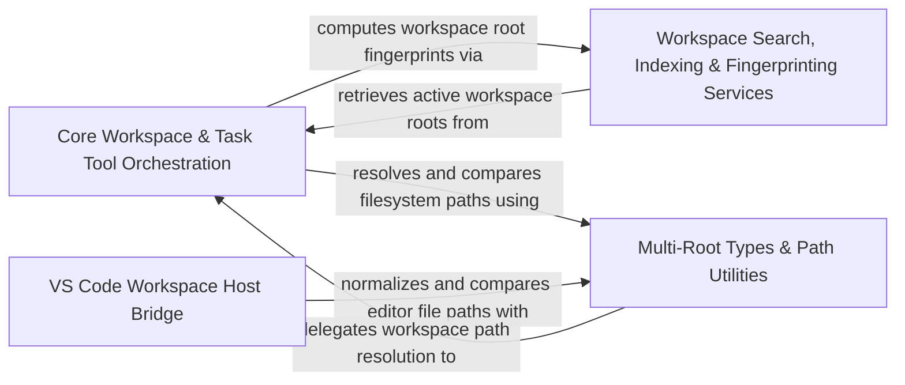

## Details

Manages multi-root workspace resolution, file context tracking, task controller dispatch, tool registry lifecycle, and subagent execution.

### Core Workspace & Task Tool Orchestration [[Expand]](./Core_Workspace_Task_Tool_Orchestration.md)
Orchestrates core workspace root resolution, context and mention loading, hook discovery, tool registry lifecycle, and subagent execution within task workflows.

**Related Classes/Methods**:

- `src.core.workspace.WorkspaceRootManager.WorkspaceRootManager`:17-249
- `src.core.workspace.WorkspaceResolver.WorkspaceResolver`:23-256
- `src.core.context.context-tracking.FileContextTracker.FileContextTracker`:32-321
- `src.core.task.tools.adapters.traits.WorkspaceTraitBuilder.buildWorkspaceTrait.fingerprintWorkspace`:36-39

**Source Files:**

- `src/core/context/context-tracking/FileContextTracker.ts`
  - `src.core.context.context-tracking.FileContextTracker.FileContextStateStore` (L12-L16) - Interface
  - `src.core.context.context-tracking.FileContextTracker.FileContextStateStore.getWorkspaceStateKey` (L13-L13) - Method
  - `src.core.context.context-tracking.FileContextTracker.FileContextStateStore.setWorkspaceState` (L14-L14) - Method
  - `src.core.context.context-tracking.FileContextTracker.FileContextStateStore.getAllWorkspaceStateEntries` (L15-L15) - Method
  - `src.core.context.context-tracking.FileContextTracker.FileContextTracker` (L32-L321) - Class
  - `src.core.context.context-tracking.FileContextTracker.FileContextTracker.constructor` (L42-L49) - Constructor
  - `src.core.context.context-tracking.FileContextTracker.FileContextTracker.setupFileWatcher` (L54-L100) - Method
  - `src.core.context.context-tracking.FileContextTracker.FileContextTracker.setupFileWatcher.watcher.on("error") callback` (L76-L85) - Function
  - `src.core.context.context-tracking.FileContextTracker.FileContextTracker.setupFileWatcher.watcher.on("error") callback.catch() callback` (L82-L83) - Function
  - `src.core.context.context-tracking.FileContextTracker.FileContextTracker.setupFileWatcher.watcher.on("change") callback` (L86-L95) - Function
  - `src.core.context.context-tracking.FileContextTracker.FileContextTracker.trackFileContext` (L106-L122) - Method
  - `src.core.context.context-tracking.FileContextTracker.FileContextTracker.addFileToFileContextTracker` (L129-L174) - Method
  - `src.core.context.context-tracking.FileContextTracker.FileContextTracker.addFileToFileContextTracker.updateTaskMetadata() callback` (L131-L170) - Function
  - `src.core.context.context-tracking.FileContextTracker.FileContextTracker.addFileToFileContextTracker.updateTaskMetadata() callback.metadata.files_in_context.forEach() callback` (L134-L136) - Function
  - `src.core.context.context-tracking.FileContextTracker.FileContextTracker.addFileToFileContextTracker.updateTaskMetadata() callback.getLatestDateForField.relevantEntries` (L139-L141) - Class
  - `src.core.context.context-tracking.FileContextTracker.FileContextTracker.addFileToFileContextTracker.updateTaskMetadata() callback.getLatestDateForField.relevantEntries.metadata.files_in_context.filter() callback` (L140-L140) - Function
  - `src.core.context.context-tracking.FileContextTracker.FileContextTracker.addFileToFileContextTracker.updateTaskMetadata() callback.getLatestDateForField.relevantEntries.sort() callback` (L141-L141) - Function
  - `src.core.context.context-tracking.FileContextTracker.FileContextTracker.getAndClearRecentlyModifiedFiles` (L179-L183) - Method
  - `src.core.context.context-tracking.FileContextTracker.FileContextTracker.markFileAsEditedByDirac` (L188-L190) - Method
  - `src.core.context.context-tracking.FileContextTracker.FileContextTracker.dispose` (L195-L199) - Method
  - `src.core.context.context-tracking.FileContextTracker.FileContextTracker.detectFilesEditedAfterMessage` (L205-L243) - Method
  - `src.core.context.context-tracking.FileContextTracker.FileContextTracker.storePendingFileContextWarning` (L248-L255) - Method
  - `src.core.context.context-tracking.FileContextTracker.FileContextTracker.retrievePendingFileContextWarning` (L260-L269) - Method
  - `src.core.context.context-tracking.FileContextTracker.FileContextTracker.retrieveAndClearPendingFileContextWarning` (L274-L285) - Method
  - `src.core.context.context-tracking.FileContextTracker.FileContextTracker.cleanupOrphanedWarnings` (L291-L320) - Method
  - `src.core.context.context-tracking.FileContextTracker.FileContextTracker.cleanupOrphanedWarnings.existingTaskIds` (L295-L295) - Class
  - `src.core.context.context-tracking.FileContextTracker.FileContextTracker.cleanupOrphanedWarnings.existingTaskIds.taskHistory.map() callback` (L295-L295) - Function
  - `src.core.context.context-tracking.FileContextTracker.FileContextTracker.cleanupOrphanedWarnings.pendingWarningKeys` (L297-L297) - Class
  - `src.core.context.context-tracking.FileContextTracker.FileContextTracker.cleanupOrphanedWarnings.pendingWarningKeys.allStateKeys.filter() callback` (L297-L297) - Function
- `src/core/context/instructions/user-instructions/rule-conditionals.ts`
  - `src.core.context.instructions.user-instructions.rule-conditionals.toPosix` (L34-L36) - Function
  - `src.core.context.instructions.user-instructions.rule-conditionals.isNonEmptyStringArray` (L38-L40) - Function
  - `src.core.context.instructions.user-instructions.rule-conditionals.isNonEmptyStringArray.value.every() callback` (L39-L39) - Function
  - `src.core.context.instructions.user-instructions.rule-conditionals.evaluatePathsConditional` (L42-L75) - Class
  - `src.core.context.instructions.user-instructions.rule-conditionals.evaluatePathsConditional.patterns` (L48-L48) - Class
  - `src.core.context.instructions.user-instructions.rule-conditionals.evaluatePathsConditional.patterns.frontmatterValue.map() callback` (L48-L48) - Function
  - `src.core.context.instructions.user-instructions.rule-conditionals.evaluatePathsConditional.candidatePaths` (L59-L59) - Class
  - `src.core.context.instructions.user-instructions.rule-conditionals.evaluatePathsConditional.candidatePaths.map() callback` (L59-L59) - Function
  - `src.core.context.instructions.user-instructions.rule-conditionals.evaluatePathsConditional.candidatePaths.some() callback` (L69-L69) - Function
  - `src.core.context.instructions.user-instructions.rule-conditionals.evaluateRuleConditionals` (L81-L106) - Function
  - `src.core.context.instructions.user-instructions.rule-conditionals.extractPathLikeStrings` (L112-L156) - Function
  - `src.core.context.instructions.user-instructions.rule-conditionals.extractSymbolLikeStrings` (L163-L266) - Function
  - `src.core.context.instructions.user-instructions.rule-conditionals.toWorkspaceRelativePosixPath` (L272-L277) - Function
- `src/core/controller/historyItemWorkspace.ts`
  - `src.core.controller.historyItemWorkspace.historyItemBelongsToWorkspace` (L5-L9) - Function
- `src/core/controller/task/TaskController.ts`
  - `src.core.controller.task.TaskController.ITaskControllerDependencies` (L36-L60) - Interface
  - `src.core.controller.task.TaskController.TaskController` (L64-L495) - Class
  - `src.core.controller.task.TaskController.TaskController.taskRunPromise` (L76-L78) - Method
  - `src.core.controller.task.TaskController.TaskController.constructor` (L80-L92) - Constructor
  - `src.core.controller.task.TaskController.TaskController.task` (L98-L100) - Method
  - `src.core.controller.task.TaskController.TaskController.workspaceManager` (L106-L108) - Method
  - `src.core.controller.task.TaskController.TaskController.backgroundCommandRunning` (L110-L112) - Method
  - `src.core.controller.task.TaskController.TaskController.backgroundCommandTaskId` (L114-L116) - Method
  - `src.core.controller.task.TaskController.TaskController.onTaskReplaced` (L118-L121) - Method
  - `src.core.controller.task.TaskController.TaskController.prepareTaskForFollowUp` (L124-L150) - Method
  - `src.core.controller.task.TaskController.TaskController.prepareTaskForFollowUp.pWaitFor() callback` (L131-L135) - Function
  - `src.core.controller.task.TaskController.TaskController.reconstructionInitializationOptions` (L152-L162) - Method
  - `src.core.controller.task.TaskController.TaskController.runTaskWithReplacement` (L164-L195) - Method
  - `src.core.controller.task.TaskController.TaskController.runTaskWithReplacement.map() callback` (L193-L193) - Function
  - `src.core.controller.task.TaskController.TaskController.trackTaskRun` (L197-L200) - Method
  - `src.core.controller.task.TaskController.TaskController.trackTaskRun.run.catch() callback` (L199-L199) - Function
  - `src.core.controller.task.TaskController.TaskController.startHistoricalTaskAndWaitForRestore` (L202-L255) - Method
  - `src.core.controller.task.TaskController.TaskController.startHistoricalTaskAndWaitForRestore.taskRun` (L211-L214) - Class
  - `src.core.controller.task.TaskController.TaskController.startHistoricalTaskAndWaitForRestore.taskRun.task.resumeTaskFromHistory() callback` (L211-L214) - Function
  - `src.core.controller.task.TaskController.startHistoricalTaskAndWaitForRestore.taskRun.then() callback` (L218-L225) - Function
  - `src.core.controller.task.TaskController.TaskController.startHistoricalTaskAndWaitForRestore.taskRun.then() callback` (L226-L226) - Function
  - `src.core.controller.task.TaskController.TaskController.startHistoricalTaskAndWaitForRestore.abort.catch() callback` (L240-L241) - Function
  - `src.core.controller.task.TaskController.TaskController.initTask` (L257-L366) - Method
  - `src.core.controller.task.TaskController.TaskController.initTask.updateTaskHistory` (L325-L325) - Method
  - `src.core.controller.task.TaskController.TaskController.initTask.postStateToWebview` (L326-L326) - Method
  - `src.core.controller.task.TaskController.TaskController.initTask.postPresentationToWebview` (L327-L327) - Method
  - `src.core.controller.task.TaskController.TaskController.initTask.reinitExistingTaskFromId` (L328-L328) - Method
  - `src.core.controller.task.TaskController.TaskController.initTask.cancelTask` (L329-L329) - Method
  - `src.core.controller.task.TaskController.TaskController.initTask.enqueuePreRequestSteeringMessages` (L350-L350) - Method
  - `src.core.controller.task.TaskController.TaskController.reinitExistingTaskFromId` (L368-L385) - Method
  - `src.core.controller.task.TaskController.TaskController.cancelTask` (L387-L453) - Method
  - `src.core.controller.task.TaskController.TaskController.cancelTask.pWaitFor() callback` (L411-L414) - Function
  - `src.core.controller.task.TaskController.TaskController.cancelTask.catch() callback` (L418-L420) - Function
  - `src.core.controller.task.TaskController.TaskController.updateBackgroundCommandState` (L455-L463) - Method
  - `src.core.controller.task.TaskController.TaskController.cancelBackgroundCommand` (L465-L471) - Method
  - `src.core.controller.task.TaskController.TaskController.clearTask` (L473-L494) - Method
- `src/core/controller/workspace/WorkspaceController.ts`
  - `src.core.controller.workspace.WorkspaceController.WorkspaceController` (L10-L39) - Class
  - `src.core.controller.workspace.WorkspaceController.WorkspaceController.constructor` (L13-L18) - Constructor
  - `src.core.controller.workspace.WorkspaceController.WorkspaceController.ensureWorkspaceManager` (L20-L34) - Method
  - `src.core.controller.workspace.WorkspaceController.WorkspaceController.getWorkspaceManager` (L36-L38) - Method
- `src/core/hooks/HookConfigBuilder.ts`
  - `src.core.hooks.HookConfigBuilder.HookConfigBuilder` (L14-L59) - Class
  - `src.core.hooks.HookConfigBuilder.HookConfigBuilder.determineScriptSource` (L16-L20) - Method
  - `src.core.hooks.HookConfigBuilder.HookConfigBuilder.determineScriptSource.containingDir` (L17-L17) - Class
  - `src.core.hooks.HookConfigBuilder.HookConfigBuilder.determineScriptSource.containingDir.hooksDirs.find() callback` (L17-L17) - Function
  - `src.core.hooks.HookConfigBuilder.HookConfigBuilder.determineHookCwd` (L23-L44) - Method
  - `src.core.hooks.HookConfigBuilder.HookConfigBuilder.determineHookCwd.containingDir` (L29-L29) - Class
  - `src.core.hooks.HookConfigBuilder.HookConfigBuilder.determineHookCwd.containingDir.hooksDirs.find() callback` (L29-L29) - Function
  - `src.core.hooks.HookConfigBuilder.HookConfigBuilder.determineHookCwd.workspaceRoot` (L36-L39) - Class
  - `src.core.hooks.HookConfigBuilder.HookConfigBuilder.determineHookCwd.workspaceRoot.workspaceRoots.find() callback` (L36-L39) - Function
  - `src.core.hooks.HookConfigBuilder.HookConfigBuilder.categorizeHookScripts` (L47-L58) - Method
  - `src.core.hooks.HookConfigBuilder.HookConfigBuilder.categorizeHookScripts.containingDir` (L53-L53) - Class
  - `src.core.hooks.HookConfigBuilder.HookConfigBuilder.categorizeHookScripts.containingDir.hooksDirs.find() callback` (L53-L53) - Function
- `src/core/hooks/HookDiscoveryCache.ts`
  - `src.core.hooks.HookDiscoveryCache.HookCacheEntry` (L13-L16) - Interface
  - `src.core.hooks.HookDiscoveryCache.Disposable` (L21-L23) - Interface
  - `src.core.hooks.HookDiscoveryCache.Disposable.dispose` (L22-L22) - Method
  - `src.core.hooks.HookDiscoveryCache.FileWatcher` (L28-L32) - Interface
  - `src.core.hooks.HookDiscoveryCache.FileWatcher.onDidCreate` (L29-L29) - Method
  - `src.core.hooks.HookDiscoveryCache.FileWatcher.onDidChange` (L30-L30) - Method
  - `src.core.hooks.HookDiscoveryCache.FileWatcher.onDidDelete` (L31-L31) - Method
  - `src.core.hooks.HookDiscoveryCache.ExtensionContext` (L37-L39) - Interface
  - `src.core.hooks.HookDiscoveryCache.HookDiscoveryCache` (L51-L330) - Class
  - `src.core.hooks.HookDiscoveryCache.HookDiscoveryCache.constructor` (L74-L74) - Constructor
  - `src.core.hooks.HookDiscoveryCache.HookDiscoveryCache.getInstance` (L76-L81) - Method
  - `src.core.hooks.HookDiscoveryCache.HookDiscoveryCache.initialize` (L86-L103) - Method
  - `src.core.hooks.HookDiscoveryCache.HookDiscoveryCache.initialize.onWorkspaceFoldersChanged() callback` (L97-L100) - Function
  - `src.core.hooks.HookDiscoveryCache.HookDiscoveryCache.get` (L108-L147) - Method
  - `src.core.hooks.HookDiscoveryCache.HookDiscoveryCache.get.telemetryService.safeCapture("HookDiscoveryCache.get") callback` (L141-L141) - Function
  - `src.core.hooks.HookDiscoveryCache.HookDiscoveryCache.scan` (L152-L201) - Method
  - `src.core.hooks.HookDiscoveryCache.HookDiscoveryCache.scan.scanPromise` (L161-L195) - Class
  - `src.core.hooks.HookDiscoveryCache.HookDiscoveryCache.scan.scanPromise.<function>` (L161-L195) - Function
  - `src.core.hooks.HookDiscoveryCache.HookDiscoveryCache.scan.scanPromise.<function>.scriptPromises` (L173-L173) - Class
  - `src.core.hooks.HookDiscoveryCache.HookDiscoveryCache.scan.scanPromise.<function>.scriptPromises.hooksDirs.map() callback` (L173-L173) - Function
  - `src.core.hooks.HookDiscoveryCache.HookDiscoveryCache.scan.scanPromise.<function>.scripts` (L176-L176) - Class
  - `src.core.hooks.HookDiscoveryCache.HookDiscoveryCache.scan.scanPromise.<function>.scripts.results.filter() callback` (L176-L176) - Function
  - `src.core.hooks.HookDiscoveryCache.HookDiscoveryCache.ensureWatcher` (L206-L254) - Method
  - `src.core.hooks.HookDiscoveryCache.HookDiscoveryCache.invalidateDirectory` (L259-L270) - Method
  - `src.core.hooks.HookDiscoveryCache.HookDiscoveryCache.invalidateDirectory.entry.scriptPaths.some() callback` (L263-L263) - Function
  - `src.core.hooks.HookDiscoveryCache.HookDiscoveryCache.invalidateAll` (L275-L279) - Method
  - `src.core.hooks.HookDiscoveryCache.HookDiscoveryCache.getStats` (L284-L290) - Method
  - `src.core.hooks.HookDiscoveryCache.HookDiscoveryCache.log` (L295-L299) - Method
  - `src.core.hooks.HookDiscoveryCache.HookDiscoveryCache.dispose` (L304-L319) - Method
  - `src.core.hooks.HookDiscoveryCache.HookDiscoveryCache.resetForTesting` (L324-L329) - Method
- `src/core/hooks/hook-factory.ts`
  - `src.core.hooks.hook-factory.Hooks` (L35-L63) - Interface
  - `src.core.hooks.hook-factory.HookModelInputContext` (L65-L68) - Interface
  - `src.core.hooks.hook-factory.HookRunner` (L83-L116) - Class
  - `src.core.hooks.hook-factory.HookRunner.constructor` (L84-L84) - Constructor
  - `src.core.hooks.hook-factory.HookRunner.run` (L87-L90) - Method
  - `src.core.hooks.hook-factory.HookRunner.[exec]` (L92-L92) - Method
  - `src.core.hooks.hook-factory.HookRunner.completeParams` (L95-L115) - Method
  - `src.core.hooks.hook-factory.completeParams.workspaceRoots` (L96-L99) - Class
  - `src.core.hooks.hook-factory.HookRunner.completeParams.workspaceRoots.map() callback` (L99-L99) - Function
  - `src.core.hooks.hook-factory.NoOpRunner` (L119-L123) - Class
  - `src.core.hooks.hook-factory.NoOpRunner.[exec]` (L120-L122) - Method
  - `src.core.hooks.hook-factory.StdioHookRunner` (L136-L259) - Class
  - `src.core.hooks.hook-factory.StdioHookRunner.constructor` (L137-L148) - Constructor
  - `src.core.hooks.hook-factory.StdioHookRunner.[exec]` (L150-L258) - Method
  - `src.core.hooks.hook-factory.StdioHookRunner.[exec].hookProcess.on("line") callback` (L185-L188) - Function
  - `src.core.hooks.hook-factory.CombinedHookRunner` (L262-L287) - Class
  - `src.core.hooks.hook-factory.CombinedHookRunner.constructor` (L263-L268) - Constructor
  - `src.core.hooks.hook-factory.CombinedHookRunner.[exec]` (L270-L286) - Method
  - `src.core.hooks.hook-factory.CombinedHookRunner.[exec].results` (L272-L272) - Class
  - `src.core.hooks.hook-factory.CombinedHookRunner.[exec].results.runners.map() callback` (L272-L272) - Function
  - `src.core.hooks.hook-factory.CombinedHookRunner.[exec].cancel.results.some() callback` (L275-L275) - Function
  - `src.core.hooks.hook-factory.[exec].cancel` (L275-L275) - Class
  - `src.core.hooks.hook-factory.[exec].contextModification` (L276-L279) - Class
  - `src.core.hooks.hook-factory.CombinedHookRunner.[exec].contextModification.results.map() callback` (L277-L277) - Function
  - `src.core.hooks.hook-factory.CombinedHookRunner.[exec].contextModification.filter() callback` (L278-L278) - Function
  - `src.core.hooks.hook-factory.[exec].errorMessage` (L280-L283) - Class
  - `src.core.hooks.hook-factory.CombinedHookRunner.[exec].errorMessage.results.map() callback` (L281-L281) - Function
  - `src.core.hooks.hook-factory.CombinedHookRunner.[exec].errorMessage.filter() callback` (L282-L282) - Function
  - `src.core.hooks.hook-factory.HookFactory` (L289-L352) - Class
  - `src.core.hooks.hook-factory.HookFactory.getHookInfo` (L291-L295) - Method
  - `src.core.hooks.hook-factory.HookFactory.hasHook` (L298-L301) - Method
  - `src.core.hooks.hook-factory.HookFactory.create` (L304-L306) - Method
  - `src.core.hooks.hook-factory.HookFactory.createWithStreaming` (L312-L351) - Method
  - `src.core.hooks.hook-factory.HookFactory.createWithStreaming.telemetryService.safeCapture("HookFactory.createWithStreaming.discovery") callback` (L330-L330) - Function
  - `src.core.hooks.hook-factory.HookFactory.createWithStreaming.runners` (L343-L347) - Class
  - `src.core.hooks.hook-factory.HookFactory.createWithStreaming.runners.scripts.map() callback` (L343-L347) - Function
- `src/core/hooks/utils.ts`
  - `src.core.hooks.utils.isValidHookType` (L34-L36) - Function
  - `src.core.hooks.utils.resolveHooksDirectory` (L48-L71) - Function
  - `src.core.hooks.utils.resolveHooksDirectory.targetWorkspace` (L61-L61) - Class
  - `src.core.hooks.utils.resolveHooksDirectory.targetWorkspace.workspacePaths.paths.find() callback` (L61-L61) - Function
  - `src.core.hooks.utils.resolveExistingHookPath` (L95-L105) - Function
  - `src.core.hooks.utils.isRegularFile` (L107-L114) - Function
- `src/core/mentions/file-mention.ts`
  - `src.core.mentions.file-mention.FileMentionContext` (L11-L15) - Interface
  - `src.core.mentions.file-mention.WorkspaceSearchResult` (L20-L25) - Interface
  - `src.core.mentions.file-mention.expandFileMention` (L27-L34) - Function
  - `src.core.mentions.file-mention.expandMultiRootFileMention` (L37-L56) - Function
  - `src.core.mentions.file-mention.expandMultiRootFileMention.successful` (L46-L46) - Class
  - `src.core.mentions.file-mention.expandMultiRootFileMention.successful.results.filter() callback` (L46-L46) - Function
  - `src.core.mentions.file-mention.expandMultiRootFileMention.successful.reduce() callback` (L53-L53) - Function
  - `src.core.mentions.file-mention.reportMultiRootNotFound` (L58-L68) - Function
  - `src.core.mentions.file-mention.reportMultiRootNotFound.errorMsg` (L65-L65) - Class
  - `src.core.mentions.file-mention.reportMultiRootNotFound.errorMsg.results.map() callback` (L65-L65) - Function
  - `src.core.mentions.file-mention.appendSingleWorkspaceResult` (L70-L79) - Function
  - `src.core.mentions.file-mention.expandHintedWorkspaceFileMention` (L82-L106) - Function
  - `src.core.mentions.file-mention.expandSingleRootFileMention` (L109-L126) - Function
  - `src.core.mentions.file-mention.searchAllWorkspaces` (L128-L139) - Function
  - `src.core.mentions.file-mention.searchAllWorkspaces.roots.map() callback` (L130-L137) - Function
  - `src.core.mentions.file-mention.trackFileContextIfFile` (L141-L143) - Function
  - `src.core.mentions.file-mention.formatContentBlock` (L145-L149) - Function
  - `src.core.mentions.file-mention.formatErrorBlock` (L151-L153) - Function
  - `src.core.mentions.file-mention.classifyError` (L155-L159) - Function
  - `src.core.mentions.file-mention.getFileOrFolderContent` (L161-L171) - Function
  - `src.core.mentions.file-mention.readFileContent` (L173-L176) - Function
  - `src.core.mentions.file-mention.readFileContent.catch() callback` (L174-L174) - Function
  - `src.core.mentions.file-mention.readFolderContent` (L178-L195) - Function
  - `src.core.mentions.file-mention.readFolderContent.entries.forEach() callback` (L182-L192) - Function
  - `src.core.mentions.file-mention.readFolderContent.fileContents` (L193-L193) - Class
  - `src.core.mentions.file-mention.readFolderContent.fileContents.filter() callback` (L193-L193) - Function
  - `src.core.mentions.file-mention.readNestedFile` (L197-L205) - Function
  - `src.core.mentions.file-mention.readNestedFile.catch() callback` (L199-L199) - Function
- `src/core/mentions/keyword-mention.ts`
  - `src.core.mentions.keyword-mention.expandProblemsMention` (L8-L17) - Function
  - `src.core.mentions.keyword-mention.expandTerminalMention` (L19-L32) - Function
  - `src.core.mentions.keyword-mention.expandGitChangesMention` (L34-L43) - Function
  - `src.core.mentions.keyword-mention.expandGitCommitMention` (L45-L54) - Function
  - `src.core.mentions.keyword-mention.isGitCommitMention` (L56-L58) - Function
  - `src.core.mentions.keyword-mention.getWorkspaceProblems` (L60-L67) - Function
- `src/core/mentions/mention-parsers.ts`
  - `src.core.mentions.mention-parsers.isGitCommitHash` (L5-L7) - Function
  - `src.core.mentions.mention-parsers.parseWorkspaceMention` (L10-L16) - Function
  - `src.core.mentions.mention-parsers.isFileMention` (L18-L20) - Function
  - `src.core.mentions.mention-parsers.getFilePathFromMention` (L22-L27) - Function
  - `src.core.mentions.mention-parsers.getWorkspaceHintFromMention` (L29-L31) - Function
  - `src.core.mentions.mention-parsers.replaceMentionPlaceholders` (L34-L39) - Function
  - `src.core.mentions.mention-parsers.replaceMentionPlaceholders.text.replace() callback` (L35-L38) - Function
  - `src.core.mentions.mention-parsers.formatInlinePlaceholder` (L41-L49) - Function
  - `src.core.mentions.mention-parsers.formatFilePlaceholder` (L51-L57) - Function
- `src/core/security/WorkspaceCodeApproval.ts`
  - `src.core.security.WorkspaceCodeApproval.WorkspaceCodeSnapshot` (L10-L15) - Interface
  - `src.core.security.WorkspaceCodeApproval.inside` (L21-L24) - Function
  - `src.core.security.WorkspaceCodeApproval.fingerprint` (L26-L48) - Function
  - `src.core.security.WorkspaceCodeApproval.grantsPath` (L50-L54) - Function
  - `src.core.security.WorkspaceCodeApproval.readGrants` (L56-L63) - Function
  - `src.core.security.WorkspaceCodeApproval.approvedWorkspaceCode` (L66-L100) - Function
  - `src.core.security.WorkspaceCodeApproval.approvedWorkspaceCode.approvalMutex.withLock() callback` (L72-L99) - Function
- `src/core/task/EnvironmentManager.ts`
  - `src.core.task.EnvironmentManager.isCodeFile` (L59-L61) - Function
  - `src.core.task.EnvironmentManager.readDirEntries` (L63-L69) - Function
  - `src.core.task.EnvironmentManager.EnvironmentManagerDependencies` (L71-L83) - Interface
  - `src.core.task.EnvironmentManager.EnvironmentManager` (L85-L277) - Class
  - `src.core.task.EnvironmentManager.EnvironmentManager.constructor` (L88-L90) - Constructor
  - `src.core.task.EnvironmentManager.EnvironmentManager.setApi` (L92-L94) - Method
  - `src.core.task.EnvironmentManager.EnvironmentManager.cwd` (L96-L98) - Method
  - `src.core.task.EnvironmentManager.EnvironmentManager.terminalManager` (L99-L101) - Method
  - `src.core.task.EnvironmentManager.EnvironmentManager.taskState` (L102-L104) - Method
  - `src.core.task.EnvironmentManager.EnvironmentManager.fileContextTracker` (L105-L107) - Method
  - `src.core.task.EnvironmentManager.EnvironmentManager.api` (L108-L110) - Method
  - `src.core.task.EnvironmentManager.EnvironmentManager.messageStateHandler` (L111-L113) - Method
  - `src.core.task.EnvironmentManager.EnvironmentManager.workspaceManager` (L114-L116) - Method
  - `src.core.task.EnvironmentManager.EnvironmentManager.getEnvironmentDetails` (L118-L172) - Method
  - `src.core.task.EnvironmentManager.EnvironmentManager.getEnvironmentDetails.fileStats.sort() callback` (L145-L145) - Function
  - `src.core.task.EnvironmentManager.EnvironmentManager.formatWorkspaceRootsSection` (L174-L200) - Method
  - `src.core.task.EnvironmentManager.EnvironmentManager.getPrimaryWorkspaceName` (L202-L210) - Method
  - `src.core.task.EnvironmentManager.EnvironmentManager.getGitIgnoredNames` (L212-L232) - Method
  - `src.core.task.EnvironmentManager.EnvironmentManager.walkCodeFiles` (L234-L262) - Method
  - `src.core.task.EnvironmentManager.EnvironmentManager.relativeTime` (L264-L276) - Method
- `src/core/task/context/MentionContextLoader.ts`
  - `src.core.task.context.MentionContextLoader.EnrichContextResult` (L9-L15) - Interface
  - `src.core.task.context.MentionContextLoader.MentionContextLoader` (L17-L119) - Class
  - `src.core.task.context.MentionContextLoader.MentionContextLoader.constructor` (L18-L21) - Constructor
  - `src.core.task.context.MentionContextLoader.MentionContextLoader.enrichContext` (L24-L74) - Method
  - `src.core.task.context.MentionContextLoader.MentionContextLoader.handleReloadTools` (L77-L108) - Method
  - `src.core.task.context.MentionContextLoader.MentionContextLoader.handleReloadTools.reloadResponse` (L84-L105) - Class
  - `src.core.task.context.MentionContextLoader.MentionContextLoader.handleReloadTools.reloadResponse.ToolRegistry.withExclusiveAccess() callback` (L84-L105) - Function
  - `src.core.task.context.MentionContextLoader.MentionContextLoader.handleReloadTools.reloadResponse.ToolRegistry.withExclusiveAccess() callback.userTools` (L86-L86) - Class
  - `src.core.task.context.MentionContextLoader.MentionContextLoader.handleReloadTools.reloadResponse.ToolRegistry.withExclusiveAccess() callback.userTools.allTools.filter() callback` (L86-L86) - Function
  - `src.core.task.context.MentionContextLoader.MentionContextLoader.handleReloadTools.reloadResponse.ToolRegistry.withExclusiveAccess() callback.userToolSummary` (L88-L96) - Class
  - `src.core.task.context.MentionContextLoader.MentionContextLoader.handleReloadTools.reloadResponse.ToolRegistry.withExclusiveAccess() callback.userToolSummary.userTools.map() callback` (L92-L93) - Function
  - `src.core.task.context.MentionContextLoader.MentionContextLoader.handleReloadTools.reloadResponse.ToolRegistry.withExclusiveAccess() callback.userToolSummary.userTools.map() callback.enabledTools.some() callback` (L93-L93) - Function
  - `src.core.task.context.MentionContextLoader.MentionContextLoader.urlContentFetcher` (L110-L112) - Method
  - `src.core.task.context.MentionContextLoader.MentionContextLoader.fileContextTracker` (L113-L115) - Method
  - `src.core.task.context.MentionContextLoader.MentionContextLoader.workspaceManager` (L116-L118) - Method
- `src/core/task/tools/adapters/traits/WorkspaceTraitBuilder.ts`
  - `src.core.task.tools.adapters.traits.WorkspaceTraitBuilder.buildWorkspaceTrait` (L13-L48) - Function
  - `src.core.task.tools.adapters.traits.WorkspaceTraitBuilder.buildWorkspaceTrait.resolvePath` (L15-L18) - Method
  - `src.core.task.tools.adapters.traits.WorkspaceTraitBuilder.buildWorkspaceTrait.readFile` (L19-L19) - Method
  - `src.core.task.tools.adapters.traits.WorkspaceTraitBuilder.buildWorkspaceTrait.readTextFileWindow` (L20-L20) - Method
  - `src.core.task.tools.adapters.traits.WorkspaceTraitBuilder.buildWorkspaceTrait.countTextFileLines` (L21-L21) - Method
  - `src.core.task.tools.adapters.traits.WorkspaceTraitBuilder.buildWorkspaceTrait.readRichFile` (L22-L25) - Method
  - `src.core.task.tools.adapters.traits.WorkspaceTraitBuilder.buildWorkspaceTrait.getFileInfo` (L27-L34) - Method
  - `src.core.task.tools.adapters.traits.WorkspaceTraitBuilder.buildWorkspaceTrait.listFiles` (L35-L35) - Method
  - `src.core.task.tools.adapters.traits.WorkspaceTraitBuilder.buildWorkspaceTrait.fingerprintWorkspace` (L36-L39) - Method
  - `src.core.task.tools.adapters.traits.WorkspaceTraitBuilder.buildWorkspaceTrait.fingerprintWorkspace.workspaceRoots` (L37-L37) - Class
  - `src.core.task.tools.adapters.traits.WorkspaceTraitBuilder.buildWorkspaceTrait.fingerprintWorkspace.workspaceRoots.map() callback` (L37-L37) - Function
  - `src.core.task.tools.adapters.traits.WorkspaceTraitBuilder.buildWorkspaceTrait.writeFile` (L40-L41) - Method
  - `src.core.task.tools.adapters.traits.WorkspaceTraitBuilder.buildWorkspaceTrait.writeFile.config.callbacks.withMutationAuthorization() callback` (L41-L41) - Function
  - `src.core.task.tools.adapters.traits.WorkspaceTraitBuilder.buildWorkspaceTrait.saveOpenDocumentIfDirty` (L42-L46) - Method
  - `src.core.task.tools.adapters.traits.WorkspaceTraitBuilder.buildWorkspaceTrait.saveOpenDocumentIfDirty.config.callbacks.withMutationAuthorization() callback` (L43-L45) - Function
- `src/core/task/tools/autoApprove.ts`
  - `src.core.task.tools.autoApprove.AutoApprove` (L15-L229) - Class
  - `src.core.task.tools.autoApprove.AutoApprove.constructor` (L22-L28) - Constructor
  - `src.core.task.tools.autoApprove.AutoApprove.setting` (L30-L33) - Method
  - `src.core.task.tools.autoApprove.AutoApprove.getWorkspaceInfo` (L39-L54) - Method
  - `src.core.task.tools.autoApprove.AutoApprove.shouldAutoApproveTool` (L58-L124) - Method
  - `src.core.task.tools.autoApprove.AutoApprove.resolveToolPathPermission` (L126-L162) - Method
  - `src.core.task.tools.autoApprove.AutoApprove.shouldAutoApproveToolWithPath` (L164-L199) - Method
  - `src.core.task.tools.autoApprove.AutoApprove.isCommandAutoApproved` (L201-L212) - Method
  - `src.core.task.tools.autoApprove.AutoApprove.isCommandAutoApproved.areCommandSegmentsApproved() callback` (L208-L211) - Function
  - `src.core.task.tools.autoApprove.AutoApprove.isUnrestrictedAutoApprove` (L218-L220) - Method
  - `src.core.task.tools.autoApprove.AutoApprove.shouldAutoApproveWithRules` (L225-L228) - Method
- `src/core/task/tools/context/DiracContext.ts`
  - `src.core.task.tools.context.DiracContext.DiracContext` (L39-L388) - Class
  - `src.core.task.tools.context.DiracContext.DiracContext.constructor` (L53-L63) - Constructor
  - `src.core.task.tools.context.DiracContext.DiracContext.withStateLock` (L65-L67) - Method
  - `src.core.task.tools.context.DiracContext.DiracContext.loadTaskData` (L69-L86) - Method
  - `src.core.task.tools.context.DiracContext.DiracContext.loadTaskData.replayOperationRecords() callback` (L74-L84) - Function
  - `src.core.task.tools.context.DiracContext.DiracContext.applyOperation` (L88-L118) - Method
  - `src.core.task.tools.context.DiracContext.DiracContext.applyOperation.documentIndex` (L111-L111) - Class
  - `src.core.task.tools.context.DiracContext.DiracContext.applyOperation.documentIndex.anchorState.documents.findIndex() callback` (L111-L111) - Function
  - `src.core.task.tools.context.DiracContext.DiracContext.ensureAnchorStateLoaded` (L120-L125) - Method
  - `src.core.task.tools.context.DiracContext.DiracContext.queueOperation` (L127-L139) - Method
  - `src.core.task.tools.context.DiracContext.DiracContext.snapshotTaskData` (L141-L145) - Method
  - `src.core.task.tools.context.DiracContext.DiracContext.queueAnchorOperations` (L147-L165) - Method
  - `src.core.task.tools.context.DiracContext.DiracContext.saveInternal` (L167-L196) - Method
  - `src.core.task.tools.context.DiracContext.DiracContext.load` (L198-L200) - Method
  - `src.core.task.tools.context.DiracContext.DiracContext.load.withStateLock() callback` (L199-L199) - Function
  - `src.core.task.tools.context.DiracContext.DiracContext.ensureAnchorState` (L202-L207) - Method
  - `src.core.task.tools.context.DiracContext.DiracContext.ensureAnchorState.withStateLock() callback` (L203-L206) - Function
  - `src.core.task.tools.context.DiracContext.DiracContext.markAnchorStateDirty` (L209-L212) - Method
  - `src.core.task.tools.context.DiracContext.DiracContext.save` (L214-L216) - Method
  - `src.core.task.tools.context.DiracContext.DiracContext.save.withStateLock() callback` (L215-L215) - Function
  - `src.core.task.tools.context.DiracContext.DiracContext.readBaseline` (L218-L268) - Method
  - `src.core.task.tools.context.DiracContext.DiracContext.readBaseline.replayOperationRecords() callback` (L238-L265) - Function
  - `src.core.task.tools.context.DiracContext.DiracContext.baselineRecords` (L270-L296) - Method
  - `src.core.task.tools.context.DiracContext.DiracContext.replaceTaskValue` (L298-L304) - Method
  - `src.core.task.tools.context.DiracContext.DiracContext.task.get` (L307-L312) - Method
  - `src.core.task.tools.context.DiracContext.DiracContext.task.get.withStateLock() callback` (L308-L312) - Function
  - `src.core.task.tools.context.DiracContext.DiracContext.task.getEntry` (L313-L318) - Method
  - `src.core.task.tools.context.DiracContext.DiracContext.task.getEntry.withStateLock() callback` (L314-L318) - Function
  - `src.core.task.tools.context.DiracContext.DiracContext.task.getEntries` (L319-L328) - Method
  - `src.core.task.tools.context.DiracContext.DiracContext.task.getEntries.withStateLock() callback` (L320-L328) - Function
  - `src.core.task.tools.context.DiracContext.DiracContext.task.set` (L329-L331) - Method
  - `src.core.task.tools.context.DiracContext.DiracContext.task.set.withStateLock() callback` (L330-L330) - Function
  - `src.core.task.tools.context.DiracContext.DiracContext.task.update` (L332-L338) - Method
  - `src.core.task.tools.context.DiracContext.DiracContext.task.update.withStateLock() callback` (L333-L337) - Function
  - `src.core.task.tools.context.DiracContext.DiracContext.task.updateEntries` (L339-L360) - Method
  - `src.core.task.tools.context.DiracContext.DiracContext.task.updateEntries.withStateLock() callback` (L340-L359) - Function
  - `src.core.task.tools.context.DiracContext.DiracContext.workspace.get` (L364-L364) - Method
  - `src.core.task.tools.context.DiracContext.DiracContext.workspace.set` (L365-L367) - Method
  - `src.core.task.tools.context.DiracContext.DiracContext.resetTaskContext` (L370-L380) - Method
  - `src.core.task.tools.context.DiracContext.DiracContext.resetTaskContext.withStateLock() callback` (L371-L379) - Function
  - `src.core.task.tools.context.DiracContext.DiracContext.global.get` (L383-L383) - Method
  - `src.core.task.tools.context.DiracContext.DiracContext.global.set` (L384-L386) - Method
  - `src.core.task.tools.context.DiracContext.isPlainRecord` (L390-L392) - Function
- `src/core/task/tools/discovery/ToolDiscoveryService.ts`
  - `src.core.task.tools.discovery.ToolDiscoveryService.ToolManifest` (L10-L14) - Interface
  - `src.core.task.tools.discovery.ToolDiscoveryService.DualToolManifest` (L16-L19) - Interface
  - `src.core.task.tools.discovery.ToolDiscoveryService.ToolDiscoveryService` (L21-L113) - Class
  - `src.core.task.tools.discovery.ToolDiscoveryService.ToolDiscoveryService.scanBuiltinTools` (L26-L63) - Method
  - `src.core.task.tools.discovery.ToolDiscoveryService.ToolDiscoveryService.scanUserToolDirectory` (L69-L102) - Method
  - `src.core.task.tools.discovery.ToolDiscoveryService.ToolDiscoveryService.scanUserToolDirectory.entries` (L74-L74) - Class
  - `src.core.task.tools.discovery.ToolDiscoveryService.ToolDiscoveryService.scanUserToolDirectory.entries.sort() callback` (L74-L74) - Function
  - `src.core.task.tools.discovery.ToolDiscoveryService.ToolDiscoveryService.scanUserToolDirectory.then() callback` (L94-L94) - Function
  - `src.core.task.tools.discovery.ToolDiscoveryService.ToolDiscoveryService.scanGlobalUserTools` (L104-L107) - Method
  - `src.core.task.tools.discovery.ToolDiscoveryService.ToolDiscoveryService.scanWorkspaceTools` (L109-L112) - Method
- `src/core/task/tools/interfaces/IToolEnvironment.ts`
  - `src.core.task.tools.interfaces.IToolEnvironment.ICardHandle` (L39-L89) - Interface
  - `src.core.task.tools.interfaces.IToolEnvironment.ICardHandle.update` (L63-L63) - Method
  - `src.core.task.tools.interfaces.IToolEnvironment.ICardHandle.waitForInteraction` (L69-L77) - Method
  - `src.core.task.tools.interfaces.IToolEnvironment.ICardHandle.appendBody` (L83-L83) - Method
  - `src.core.task.tools.interfaces.IToolEnvironment.ICardHandle.finalize` (L88-L88) - Method
  - `src.core.task.tools.interfaces.IToolEnvironment.CardParams` (L91-L99) - Interface
  - `src.core.task.tools.interfaces.IToolEnvironment.IUITrait` (L101-L123) - Interface
  - `src.core.task.tools.interfaces.IToolEnvironment.IUITrait.createCard` (L106-L106) - Method
  - `src.core.task.tools.interfaces.IToolEnvironment.IUITrait.createManualInteractionCard` (L109-L109) - Method
  - `src.core.task.tools.interfaces.IToolEnvironment.IUITrait.upsertText` (L114-L114) - Method
  - `src.core.task.tools.interfaces.IToolEnvironment.IUITrait.streamText` (L119-L119) - Method
  - `src.core.task.tools.interfaces.IToolEnvironment.IUITrait.publishState` (L122-L122) - Method
  - `src.core.task.tools.interfaces.IToolEnvironment.IInteractionTrait` (L125-L147) - Interface
  - `src.core.task.tools.interfaces.IToolEnvironment.IInteractionTrait.askPermission` (L130-L142) - Method
  - `src.core.task.tools.interfaces.IToolEnvironment.PermissionPreview` (L149-L154) - Interface
  - `src.core.task.tools.interfaces.IToolEnvironment.ITelemetryTrait` (L156-L165) - Interface
  - `src.core.task.tools.interfaces.IToolEnvironment.ITelemetryTrait.captureCustomMetadata` (L161-L161) - Method
  - `src.core.task.tools.interfaces.IToolEnvironment.ITelemetryTrait.captureTaskCompleted` (L162-L162) - Method
  - `src.core.task.tools.interfaces.IToolEnvironment.ITelemetryTrait.captureOptionSelected` (L163-L163) - Method
  - `src.core.task.tools.interfaces.IToolEnvironment.ITelemetryTrait.captureOptionsIgnored` (L164-L164) - Method
  - `src.core.task.tools.interfaces.IToolEnvironment.SystemCommandResult` (L167-L175) - Interface
  - `src.core.task.tools.interfaces.IToolEnvironment.ISystemTrait` (L177-L216) - Interface
  - `src.core.task.tools.interfaces.IToolEnvironment.ISystemTrait.executeCommand` (L181-L181) - Method
  - `src.core.task.tools.interfaces.IToolEnvironment.ISystemTrait.searchFiles` (L186-L196) - Method
  - `src.core.task.tools.interfaces.IToolEnvironment.ISystemTrait.getSystemInfo` (L201-L207) - Method
  - `src.core.task.tools.interfaces.IToolEnvironment.ISystemTrait.openUrl` (L212-L212) - Method
  - `src.core.task.tools.interfaces.IToolEnvironment.ISystemTrait.showNotification` (L215-L215) - Method
  - `src.core.task.tools.interfaces.IToolEnvironment.IBrowserTrait` (L218-L224) - Interface
  - `src.core.task.tools.interfaces.IToolEnvironment.IBrowserTrait.launch` (L219-L219) - Method
  - `src.core.task.tools.interfaces.IToolEnvironment.IBrowserTrait.click` (L220-L220) - Method
  - `src.core.task.tools.interfaces.IToolEnvironment.IBrowserTrait.type` (L221-L221) - Method
  - `src.core.task.tools.interfaces.IToolEnvironment.IBrowserTrait.scroll` (L222-L222) - Method
  - `src.core.task.tools.interfaces.IToolEnvironment.IBrowserTrait.close` (L223-L223) - Method
  - `src.core.task.tools.interfaces.IToolEnvironment.ISkillsTrait` (L226-L230) - Interface
  - `src.core.task.tools.interfaces.IToolEnvironment.ISkillsTrait.getAvailableSkills` (L227-L227) - Method
  - `src.core.task.tools.interfaces.IToolEnvironment.ISkillsTrait.getSkillContent` (L228-L228) - Method
  - `src.core.task.tools.interfaces.IToolEnvironment.ISkillsTrait.listSupportingFiles` (L229-L229) - Method
  - `src.core.task.tools.interfaces.IToolEnvironment.IWorkspaceTrait` (L232-L272) - Interface
  - `src.core.task.tools.interfaces.IToolEnvironment.IWorkspaceTrait.resolvePath` (L237-L237) - Method
  - `src.core.task.tools.interfaces.IToolEnvironment.IWorkspaceTrait.listFiles` (L241-L241) - Method
  - `src.core.task.tools.interfaces.IToolEnvironment.IWorkspaceTrait.readFile` (L245-L245) - Method
  - `src.core.task.tools.interfaces.IToolEnvironment.IWorkspaceTrait.readTextFileWindow` (L247-L247) - Method
  - `src.core.task.tools.interfaces.IToolEnvironment.IWorkspaceTrait.countTextFileLines` (L249-L249) - Method
  - `src.core.task.tools.interfaces.IToolEnvironment.IWorkspaceTrait.readRichFile` (L253-L253) - Method
  - `src.core.task.tools.interfaces.IToolEnvironment.IWorkspaceTrait.formatAttachedFiles` (L255-L255) - Method
  - `src.core.task.tools.interfaces.IToolEnvironment.IWorkspaceTrait.getFileInfo` (L259-L259) - Method
  - `src.core.task.tools.interfaces.IToolEnvironment.IWorkspaceTrait.fingerprintWorkspace` (L262-L262) - Method
  - `src.core.task.tools.interfaces.IToolEnvironment.IWorkspaceTrait.writeFile` (L267-L267) - Method
  - `src.core.task.tools.interfaces.IToolEnvironment.IWorkspaceTrait.saveOpenDocumentIfDirty` (L271-L271) - Method
  - `src.core.task.tools.interfaces.IToolEnvironment.SaveResult` (L274-L278) - Interface
  - `src.core.task.tools.interfaces.IToolEnvironment.IEditorTrait` (L280-L307) - Interface
  - `src.core.task.tools.interfaces.IToolEnvironment.IEditorTrait.readText` (L282-L282) - Method
  - `src.core.task.tools.interfaces.IToolEnvironment.IEditorTrait.showReview` (L284-L284) - Method
  - `src.core.task.tools.interfaces.IToolEnvironment.IEditorTrait.hideReview` (L286-L286) - Method
  - `src.core.task.tools.interfaces.IToolEnvironment.IEditorTrait.open` (L288-L288) - Method
  - `src.core.task.tools.interfaces.IToolEnvironment.IEditorTrait.update` (L290-L290) - Method
  - `src.core.task.tools.interfaces.IToolEnvironment.IEditorTrait.saveChanges` (L292-L292) - Method
  - `src.core.task.tools.interfaces.IToolEnvironment.IEditorTrait.applyAndSaveSilently` (L294-L294) - Method
  - `src.core.task.tools.interfaces.IToolEnvironment.IEditorTrait.applyAndSaveBatchSilently` (L296-L296) - Method
  - `src.core.task.tools.interfaces.IToolEnvironment.IEditorTrait.revertChanges` (L298-L298) - Method
  - `src.core.task.tools.interfaces.IToolEnvironment.IEditorTrait.reset` (L300-L300) - Method
  - `src.core.task.tools.interfaces.IToolEnvironment.IEditorTrait.scrollToFirstDiff` (L302-L302) - Method
  - `src.core.task.tools.interfaces.IToolEnvironment.IEditorTrait.undoUserEdits` (L304-L304) - Method
  - `src.core.task.tools.interfaces.IToolEnvironment.IEditorTrait.format` (L306-L306) - Method
  - `src.core.task.tools.interfaces.IToolEnvironment.ISourceAstTrait` (L309-L316) - Interface
  - `src.core.task.tools.interfaces.IToolEnvironment.ISourceAstTrait.outline` (L310-L310) - Method
  - `src.core.task.tools.interfaces.IToolEnvironment.ISourceAstTrait.implementations` (L311-L311) - Method
  - `src.core.task.tools.interfaces.IToolEnvironment.ISourceAstTrait.occurrences` (L312-L312) - Method
  - `src.core.task.tools.interfaces.IToolEnvironment.ISourceAstTrait.planRename` (L313-L313) - Method
  - `src.core.task.tools.interfaces.IToolEnvironment.ISourceAstTrait.planReplacements` (L314-L314) - Method
  - `src.core.task.tools.interfaces.IToolEnvironment.ISourceAstTrait.getAnchorFingerprint` (L315-L315) - Method
  - `src.core.task.tools.interfaces.IToolEnvironment.IOrchestrationTrait` (L318-L401) - Interface
  - `src.core.task.tools.interfaces.IToolEnvironment.IOrchestrationTrait.runSubagent` (L319-L334) - Method
  - `src.core.task.tools.interfaces.IToolEnvironment.IOrchestrationTrait.runHook` (L339-L339) - Method
  - `src.core.task.tools.interfaces.IToolEnvironment.IOrchestrationTrait.switchToActMode` (L344-L344) - Method
  - `src.core.task.tools.interfaces.IToolEnvironment.IOrchestrationTrait.saveCheckpoint` (L349-L349) - Method
  - `src.core.task.tools.interfaces.IToolEnvironment.IOrchestrationTrait.commitAttemptCompletion` (L351-L351) - Method
  - `src.core.task.tools.interfaces.IToolEnvironment.IOrchestrationTrait.getHistory` (L356-L356) - Method
  - `src.core.task.tools.interfaces.IToolEnvironment.IOrchestrationTrait.getCurrentTurnUserRequests` (L358-L358) - Method
  - `src.core.task.tools.interfaces.IToolEnvironment.IOrchestrationTrait.setTruncationRange` (L363-L363) - Method
  - `src.core.task.tools.interfaces.IToolEnvironment.IOrchestrationTrait.getNextTruncationRange` (L368-L368) - Method
  - `src.core.task.tools.interfaces.IToolEnvironment.IOrchestrationTrait.updateMessage` (L369-L369) - Method
  - `src.core.task.tools.interfaces.IToolEnvironment.IOrchestrationTrait.getTaskState` (L374-L374) - Method
  - `src.core.task.tools.interfaces.IToolEnvironment.IOrchestrationTrait.setTaskState` (L382-L382) - Method
  - `src.core.task.tools.interfaces.IToolEnvironment.IOrchestrationTrait.commitCompletionResponse` (L385-L385) - Method
  - `src.core.task.tools.interfaces.IToolEnvironment.IOrchestrationTrait.requestTaskReplacement` (L388-L388) - Method
  - `src.core.task.tools.interfaces.IToolEnvironment.IOrchestrationTrait.activateSkill` (L391-L391) - Method
  - `src.core.task.tools.interfaces.IToolEnvironment.IOrchestrationTrait.doesLatestTaskCompletionHaveNewChanges` (L396-L396) - Method
  - `src.core.task.tools.interfaces.IToolEnvironment.IOrchestrationTrait.resetTransientState` (L398-L398) - Method
  - `src.core.task.tools.interfaces.IToolEnvironment.IOrchestrationTrait.notifyContextCompacted` (L400-L400) - Method
  - `src.core.task.tools.interfaces.IToolEnvironment.IResponseObserverTrait` (L405-L407) - Interface
  - `src.core.task.tools.interfaces.IToolEnvironment.IResponseObserverTrait.recordResponse` (L406-L406) - Method
  - `src.core.task.tools.interfaces.IToolEnvironment.TranscriptPage` (L409-L412) - Interface
  - `src.core.task.tools.interfaces.IToolEnvironment.IGoalTrait` (L414-L436) - Interface
  - `src.core.task.tools.interfaces.IToolEnvironment.IGoalTrait.startTask` (L415-L415) - Method
  - `src.core.task.tools.interfaces.IToolEnvironment.IGoalTrait.listTasks` (L416-L421) - Method
  - `src.core.task.tools.interfaces.IToolEnvironment.IGoalTrait.sendTaskMessage` (L422-L422) - Method
  - `src.core.task.tools.interfaces.IToolEnvironment.IGoalTrait.cancelTask` (L423-L423) - Method
  - `src.core.task.tools.interfaces.IToolEnvironment.IGoalTrait.readTaskTranscript` (L424-L424) - Method
  - `src.core.task.tools.interfaces.IToolEnvironment.IGoalTrait.resolveTaskInteraction` (L425-L430) - Method
  - `src.core.task.tools.interfaces.IToolEnvironment.IGoalTrait.waitForEvents` (L431-L431) - Method
  - `src.core.task.tools.interfaces.IToolEnvironment.IGoalTrait.startVerification` (L432-L432) - Method
  - `src.core.task.tools.interfaces.IToolEnvironment.IGoalTrait.replaceObjective` (L433-L433) - Method
  - `src.core.task.tools.interfaces.IToolEnvironment.IGoalTrait.blockGoal` (L434-L434) - Method
  - `src.core.task.tools.interfaces.IToolEnvironment.IGoalTrait.commitCompletion` (L435-L435) - Method
  - `src.core.task.tools.interfaces.IToolEnvironment.IDiagnosticsTrait` (L438-L457) - Interface
  - `src.core.task.tools.interfaces.IToolEnvironment.IDiagnosticsTrait.prepare` (L442-L442) - Method
  - `src.core.task.tools.interfaces.IToolEnvironment.IDiagnosticsTrait.getRaw` (L447-L447) - Method
  - `src.core.task.tools.interfaces.IToolEnvironment.IDiagnosticsTrait.formatProblems` (L452-L456) - Method
  - `src.core.task.tools.interfaces.IToolEnvironment.ILoggingTrait` (L459-L466) - Interface
  - `src.core.task.tools.interfaces.IToolEnvironment.ILoggingTrait.error` (L460-L460) - Method
  - `src.core.task.tools.interfaces.IToolEnvironment.ILoggingTrait.warn` (L461-L461) - Method
  - `src.core.task.tools.interfaces.IToolEnvironment.ILoggingTrait.info` (L462-L462) - Method
  - `src.core.task.tools.interfaces.IToolEnvironment.ILoggingTrait.debug` (L463-L463) - Method
  - `src.core.task.tools.interfaces.IToolEnvironment.ILoggingTrait.log` (L464-L464) - Method
  - `src.core.task.tools.interfaces.IToolEnvironment.ILoggingTrait.trace` (L465-L465) - Method
  - `src.core.task.tools.interfaces.IToolEnvironment.IAnchorTrait` (L468-L472) - Interface
  - `src.core.task.tools.interfaces.IToolEnvironment.IAnchorTrait.reconcile` (L469-L469) - Method
  - `src.core.task.tools.interfaces.IToolEnvironment.IAnchorTrait.getDocumentFingerprint` (L470-L470) - Method
  - `src.core.task.tools.interfaces.IToolEnvironment.IAnchorTrait.clear` (L471-L471) - Method
  - `src.core.task.tools.interfaces.IToolEnvironment.ConversationCondensationResult` (L478-L484) - Interface
  - `src.core.task.tools.interfaces.IToolEnvironment.IConversationCondensationTrait` (L486-L496) - Interface
  - `src.core.task.tools.interfaces.IToolEnvironment.IConversationCondensationTrait.isAvailable` (L487-L487) - Method
  - `src.core.task.tools.interfaces.IToolEnvironment.IConversationCondensationTrait.condenseConversation` (L488-L495) - Method
  - `src.core.task.tools.interfaces.IToolEnvironment.IToolEnvironment` (L498-L528) - Interface
- `src/core/task/tools/modules/execute_command/ExecuteCommandTool.ts`
  - `src.core.task.tools.modules.execute_command.ExecuteCommandTool.CommandApprovalRequirement` (L19-L22) - Interface
  - `src.core.task.tools.modules.execute_command.ExecuteCommandTool.NormalizedCommand` (L24-L28) - Interface
  - `src.core.task.tools.modules.execute_command.ExecuteCommandTool.WorkspaceHintMatch` (L30-L33) - Interface
  - `src.core.task.tools.modules.execute_command.ExecuteCommandTool.parseWorkspaceHint` (L35-L42) - Function
  - `src.core.task.tools.modules.execute_command.ExecuteCommandTool.ExecuteCommandTool` (L74-L410) - Class
  - `src.core.task.tools.modules.execute_command.ExecuteCommandTool.ExecuteCommandTool.constructor` (L75-L81) - Constructor
  - `src.core.task.tools.modules.execute_command.ExecuteCommandTool.ExecuteCommandTool.spec` (L83-L85) - Method
  - `src.core.task.tools.modules.execute_command.ExecuteCommandTool.ExecuteCommandTool.supportedSurfaces` (L87-L89) - Method
  - `src.core.task.tools.modules.execute_command.ExecuteCommandTool.ExecuteCommandTool.processCall` (L91-L124) - Method
  - `src.core.task.tools.modules.execute_command.ExecuteCommandTool.ExecuteCommandTool.validateCommands` (L126-L143) - Method
  - `src.core.task.tools.modules.execute_command.ExecuteCommandTool.ExecuteCommandTool.getCommandApprovalRequirement` (L145-L172) - Method
  - `src.core.task.tools.modules.execute_command.ExecuteCommandTool.ExecuteCommandTool.getCommandApprovalRequirement.permissionResults` (L153-L159) - Class
  - `src.core.task.tools.modules.execute_command.ExecuteCommandTool.ExecuteCommandTool.getCommandApprovalRequirement.permissionResults.commands.map() callback` (L153-L159) - Function
  - `src.core.task.tools.modules.execute_command.ExecuteCommandTool.ExecuteCommandTool.getCommandApprovalRequirement.permissionResults.some() callback` (L160-L160) - Function
  - `src.core.task.tools.modules.execute_command.ExecuteCommandTool.ExecuteCommandTool.getCommandApprovalRequirement.requiresApproval` (L167-L170) - Class
  - `src.core.task.tools.modules.execute_command.ExecuteCommandTool.ExecuteCommandTool.getCommandApprovalRequirement.requiresApproval.permissionResults.some() callback` (L167-L170) - Function
  - `src.core.task.tools.modules.execute_command.ExecuteCommandTool.ExecuteCommandTool.requestApproval` (L174-L230) - Method
  - `src.core.task.tools.modules.execute_command.ExecuteCommandTool.ExecuteCommandTool.requestApproval.card.rawInput.commands.commands.map() callback` (L193-L193) - Function
  - `src.core.task.tools.modules.execute_command.ExecuteCommandTool.ExecuteCommandTool.requestApproval.card.body.commands.map() callback` (L196-L200) - Function
  - `src.core.task.tools.modules.execute_command.ExecuteCommandTool.ExecuteCommandTool.permissionCardLabel` (L232-L234) - Method
  - `src.core.task.tools.modules.execute_command.ExecuteCommandTool.ExecuteCommandTool.resolvePermissionCard` (L236-L249) - Method
  - `src.core.task.tools.modules.execute_command.ExecuteCommandTool.ExecuteCommandTool.executeCommands` (L251-L273) - Method
  - `src.core.task.tools.modules.execute_command.ExecuteCommandTool.ExecuteCommandTool.executeSingleCommand` (L275-L359) - Method
  - `src.core.task.tools.modules.execute_command.ExecuteCommandTool.ExecuteCommandTool.normalizeCommands` (L361-L383) - Method
  - `src.core.task.tools.modules.execute_command.ExecuteCommandTool.ExecuteCommandTool.normalizeCommands.args.commands.forEach() callback` (L364-L368) - Function
  - `src.core.task.tools.modules.execute_command.ExecuteCommandTool.ExecuteCommandTool.stripWorkspaceHint` (L385-L387) - Method
  - `src.core.task.tools.modules.execute_command.ExecuteCommandTool.ExecuteCommandTool.wrapScript` (L389-L409) - Method
- `src/core/task/tools/modules/search_files/index.ts`
  - `src.core.task.tools.modules.search_files.index.SearchFilesArgs` (L15-L21) - Interface
  - `src.core.task.tools.modules.search_files.index.SearchPathInfo` (L23-L27) - Interface
  - `src.core.task.tools.modules.search_files.index.SearchExecutionResult` (L29-L36) - Interface
  - `src.core.task.tools.modules.search_files.index.SearchFilesTool` (L76-L450) - Class
  - `src.core.task.tools.modules.search_files.index.SearchFilesTool.spec` (L77-L79) - Method
  - `src.core.task.tools.modules.search_files.index.SearchFilesTool.supportedSurfaces` (L81-L83) - Method
  - `src.core.task.tools.modules.search_files.index.SearchFilesTool.processCall` (L85-L201) - Method
  - `src.core.task.tools.modules.search_files.index.SearchFilesTool.processCall.failedResults` (L139-L139) - Class
  - `src.core.task.tools.modules.search_files.index.SearchFilesTool.processCall.failedResults.searchResults.filter() callback` (L139-L139) - Function
  - `src.core.task.tools.modules.search_files.index.SearchFilesTool.resolveSearchPaths` (L203-L258) - Method
  - `src.core.task.tools.modules.search_files.index.SearchFilesTool.resolveSearchPaths.root` (L222-L222) - Class
  - `src.core.task.tools.modules.search_files.index.SearchFilesTool.resolveSearchPaths.root.workspaceRoots.find() callback` (L222-L222) - Function
  - `src.core.task.tools.modules.search_files.index.SearchFilesTool.resolveSearchPaths.allPaths.forEach() callback` (L227-L233) - Function
  - `src.core.task.tools.modules.search_files.index.SearchFilesTool.executeSearch` (L260-L338) - Method
  - `src.core.task.tools.modules.search_files.index.SearchFilesTool.executeSearch.searchPromises` (L272-L333) - Class
  - `src.core.task.tools.modules.search_files.index.SearchFilesTool.executeSearch.searchPromises.allSearchPaths.map() callback` (L272-L333) - Function
  - `src.core.task.tools.modules.search_files.index.SearchFilesTool.executeSearch.searchPromises.allSearchPaths.map() callback.deadline.run(`checking ${absolutePath}`) callback` (L279-L279) - Function
  - `src.core.task.tools.modules.search_files.index.SearchFilesTool.executeSearch.searchPromises.allSearchPaths.map() callback.results.deadline.run(`searching ${absolutePath}`) callback` (L291-L298) - Function
  - `src.core.task.tools.modules.search_files.index.SearchFilesTool.executeSearch.searchPromises.allSearchPaths.map() callback.results` (L291-L299) - Class
  - `src.core.task.tools.modules.search_files.index.SearchFilesTool.parseSearchResultCount` (L340-L361) - Method
  - `src.core.task.tools.modules.search_files.index.SearchFilesTool.parseSearchResultCount.firstLine` (L341-L344) - Class
  - `src.core.task.tools.modules.search_files.index.SearchFilesTool.parseSearchResultCount.firstLine.find() callback` (L343-L343) - Function
  - `src.core.task.tools.modules.search_files.index.SearchFilesTool.formatSearchResults` (L363-L406) - Method
  - `src.core.task.tools.modules.search_files.index.SearchFilesTool.formatSearchResults.failedResults` (L367-L367) - Class
  - `src.core.task.tools.modules.search_files.index.SearchFilesTool.formatSearchResults.failedResults.searchResults.filter() callback` (L367-L367) - Function
  - `src.core.task.tools.modules.search_files.index.SearchFilesTool.formatSearchFailureMessage` (L408-L417) - Method
  - `src.core.task.tools.modules.search_files.index.SearchFilesTool.formatSearchFailureMessage.details` (L409-L414) - Class
  - `src.core.task.tools.modules.search_files.index.SearchFilesTool.formatSearchFailureMessage.details.failedResults.map() callback` (L410-L413) - Function
  - `src.core.task.tools.modules.search_files.index.SearchFilesTool.captureTelemetry` (L419-L435) - Method
  - `src.core.task.tools.modules.search_files.index.SearchFilesTool.updateMistakeCount` (L437-L449) - Method
  - `src.core.task.tools.modules.search_files.index.SearchFilesTool.updateMistakeCount.allFailed` (L440-L440) - Class
  - `src.core.task.tools.modules.search_files.index.SearchFilesTool.updateMistakeCount.allFailed.searchResults.every() callback` (L440-L440) - Function
- `src/core/task/tools/registry/ToolRegistry.ts`
  - `src.core.task.tools.registry.ToolRegistry.ToolAuthorization` (L22-L25) - Interface
  - `src.core.task.tools.registry.ToolRegistry.UserToolReplacementResult` (L27-L31) - Interface
  - `src.core.task.tools.registry.ToolRegistry.resolveToolAuthorization` (L33-L53) - Function
  - `src.core.task.tools.registry.ToolRegistry.resolveToolAuthorization.identifiers.some() callback` (L36-L36) - Function
  - `src.core.task.tools.registry.ToolRegistry.resolveToolAuthorization.supportedOperations` (L40-L40) - Class
  - `src.core.task.tools.registry.ToolRegistry.resolveToolAuthorization.supportedOperations.identifiers.flatMap() callback` (L40-L40) - Function
  - `src.core.task.tools.registry.ToolRegistry.operations` (L45-L51) - Class
  - `src.core.task.tools.registry.ToolRegistry.resolveToolAuthorization.operations.supportedOperations.filter() callback` (L47-L48) - Function
  - `src.core.task.tools.registry.ToolRegistry.resolveToolAuthorization.operations.supportedOperations.filter() callback.identifiers.some() callback` (L48-L48) - Function
  - `src.core.task.tools.registry.ToolRegistry.scopeToolSpec` (L55-L69) - Function
  - `src.core.task.tools.registry.ToolRegistry.scopeToolSpec.parameters.spec.parameters.map() callback` (L65-L66) - Function
  - `src.core.task.tools.registry.ToolRegistry.ToolRegistry` (L71-L680) - Class
  - `src.core.task.tools.registry.ToolRegistry.ToolRegistry.getInstance` (L82-L87) - Method
  - `src.core.task.tools.registry.ToolRegistry.ToolRegistry.withExclusiveAccess` (L90-L92) - Method
  - `src.core.task.tools.registry.ToolRegistry.ToolRegistry.withExclusiveAccess.accessMutex.withLock() callback` (L91-L91) - Function
  - `src.core.task.tools.registry.ToolRegistry.ToolRegistry.resetInstance` (L95-L97) - Method
  - `src.core.task.tools.registry.ToolRegistry.ToolRegistry.register` (L99-L105) - Method
  - `src.core.task.tools.registry.ToolRegistry.ToolRegistry.getVersion` (L107-L109) - Method
  - `src.core.task.tools.registry.ToolRegistry.ToolRegistry.registerBuiltin` (L111-L113) - Method
  - `src.core.task.tools.registry.ToolRegistry.ToolRegistry.registerUserTool` (L115-L125) - Method
  - `src.core.task.tools.registry.ToolRegistry.ToolRegistry.replaceUserTool` (L131-L133) - Method
  - `src.core.task.tools.registry.ToolRegistry.ToolRegistry.replaceUserToolWithResult` (L136-L158) - Method
  - `src.core.task.tools.registry.ToolRegistry.ToolRegistry.reconcileWorkspaceUserTools` (L161-L188) - Method
  - `src.core.task.tools.registry.ToolRegistry.ToolRegistry.reconcileTaskTools` (L190-L205) - Method
  - `src.core.task.tools.registry.ToolRegistry.ToolRegistry.hasBuiltinTools` (L207-L209) - Method
  - `src.core.task.tools.registry.ToolRegistry.ToolRegistry.enable` (L211-L214) - Method
  - `src.core.task.tools.registry.ToolRegistry.ToolRegistry.disable` (L216-L219) - Method
  - `src.core.task.tools.registry.ToolRegistry.ToolRegistry.isEnabled` (L221-L230) - Method
  - `src.core.task.tools.registry.ToolRegistry.ToolRegistry.getEnabledTools` (L232-L235) - Method
  - `src.core.task.tools.registry.ToolRegistry.ToolRegistry.getEnabledTools.tools.filter() callback` (L234-L234) - Function
  - `src.core.task.tools.registry.ToolRegistry.ToolRegistry.getEnabledSpecs` (L237-L241) - Method
  - `src.core.task.tools.registry.ToolRegistry.ToolRegistry.getEnabledSpecs.map() callback` (L239-L239) - Function
  - `src.core.task.tools.registry.ToolRegistry.ToolRegistry.getEnabledSpecs.filter() callback` (L240-L240) - Function
  - `src.core.task.tools.registry.ToolRegistry.ToolRegistry.getEnabledSpecsForSubagent` (L243-L249) - Method
  - `src.core.task.tools.registry.ToolRegistry.getEnabledSpecsForSubagent.map() callback` (L245-L245) - Function
  - `src.core.task.tools.registry.ToolRegistry.getEnabledSpecsForSubagent.filter() callback` (L246-L246) - Function
  - `src.core.task.tools.registry.ToolRegistry.ToolRegistry.getEnabledSpecsForSubagent.map() callback` (L247-L247) - Function
  - `src.core.task.tools.registry.ToolRegistry.ToolRegistry.getEnabledSpecsForSubagent.filter() callback` (L248-L248) - Function
  - `src.core.task.tools.registry.ToolRegistry.ToolRegistry.getAllTools` (L251-L258) - Method
  - `src.core.task.tools.registry.ToolRegistry.ToolRegistry.getKnownUserToolIds` (L260-L269) - Method
  - `src.core.task.tools.registry.ToolRegistry.ToolRegistry.getConfigurableTools` (L271-L275) - Method
  - `src.core.task.tools.registry.ToolRegistry.ToolRegistry.getConfigurableTools.tools.filter() callback` (L274-L274) - Function
  - `src.core.task.tools.registry.ToolRegistry.ToolRegistry.resolveSkillDependencyTools` (L277-L304) - Method
  - `src.core.task.tools.registry.ToolRegistry.ToolRegistry.resolveSkillDependencyTools.tool` (L288-L291) - Class
  - `src.core.task.tools.registry.ToolRegistry.ToolRegistry.resolveSkillDependencyTools.tool.scopedTools.find() callback` (L289-L290) - Function
  - `src.core.task.tools.registry.ToolRegistry.ToolRegistry.getToolsBySource` (L306-L308) - Method
  - `src.core.task.tools.registry.ToolRegistry.ToolRegistry.getToolsBySource.filter() callback` (L307-L307) - Function
  - `src.core.task.tools.registry.ToolRegistry.ToolRegistry.createEnabledTools` (L310-L312) - Method
  - `src.core.task.tools.registry.ToolRegistry.ToolRegistry.createEnabledTools.map() callback` (L311-L311) - Function
  - `src.core.task.tools.registry.ToolRegistry.ToolRegistry.createEnabledToolsForSubagent` (L314-L319) - Method
  - `src.core.task.tools.registry.ToolRegistry.createEnabledToolsForSubagent.map() callback` (L316-L316) - Function
  - `src.core.task.tools.registry.ToolRegistry.ToolRegistry.createEnabledToolsForSubagent.filter() callback` (L317-L317) - Function
  - `src.core.task.tools.registry.ToolRegistry.ToolRegistry.createEnabledToolsForSubagent.map() callback` (L318-L318) - Function
  - `src.core.task.tools.registry.ToolRegistry.ToolRegistry.rollbackUserToolReplacement` (L322-L344) - Method
  - `src.core.task.tools.registry.ToolRegistry.ToolRegistry.isToolAllowed` (L346-L359) - Method
  - `src.core.task.tools.registry.ToolRegistry.ToolRegistry.scopeToolForSubagent` (L361-L397) - Method
  - `src.core.task.tools.registry.ToolRegistry.ToolRegistry.scopeToolForSubagent.factory` (L376-L395) - Method
  - `src.core.task.tools.registry.ToolRegistry.ToolRegistry.scopeToolForSubagent.factory.scopedTool` (L378-L390) - Class
  - `src.core.task.tools.registry.ToolRegistry.ToolRegistry.scopeToolForSubagent.factory.scopedTool.spec` (L379-L379) - Method
  - `src.core.task.tools.registry.ToolRegistry.ToolRegistry.scopeToolForSubagent.factory.scopedTool.supportedSurfaces` (L380-L380) - Method
  - `src.core.task.tools.registry.ToolRegistry.ToolRegistry.scopeToolForSubagent.factory.scopedTool.processCall` (L381-L389) - Method
  - `src.core.task.tools.registry.ToolRegistry.ToolRegistry.scopeToolForSubagent.factory.bufferPartialToolUse` (L392-L392) - Function
  - `src.core.task.tools.registry.ToolRegistry.ToolRegistry.loadToggles` (L399-L409) - Method
  - `src.core.task.tools.registry.ToolRegistry.ToolRegistry.loadToggles.legacyNames.some() callback` (L402-L402) - Function
  - `src.core.task.tools.registry.ToolRegistry.ToolRegistry.loadToggles.legacyNames.every() callback` (L403-L403) - Function
  - `src.core.task.tools.registry.ToolRegistry.ToolRegistry.loadToggles.filter() callback` (L407-L407) - Function
  - `src.core.task.tools.registry.ToolRegistry.ToolRegistry.getToggles` (L411-L417) - Method
  - `src.core.task.tools.registry.ToolRegistry.ToolRegistry.clearUserTools` (L424-L427) - Method
  - `src.core.task.tools.registry.ToolRegistry.ToolRegistry.removeUserTool` (L430-L440) - Method
  - `src.core.task.tools.registry.ToolRegistry.ToolRegistry.removeTaskTools` (L442-L446) - Method
  - `src.core.task.tools.registry.ToolRegistry.ToolRegistry.toggleAndPersist` (L449-L456) - Method
  - `src.core.task.tools.registry.ToolRegistry.ToolRegistry.registerSharedUserTool` (L458-L480) - Method
  - `src.core.task.tools.registry.ToolRegistry.ToolRegistry.replaceSharedUserTool` (L482-L511) - Method
  - `src.core.task.tools.registry.ToolRegistry.ToolRegistry.workspaceToolsForRoot` (L513-L519) - Method
  - `src.core.task.tools.registry.ToolRegistry.ToolRegistry.workspaceToolsForModule` (L521-L527) - Method
  - `src.core.task.tools.registry.ToolRegistry.ToolRegistry.workspaceKey` (L529-L531) - Method
  - `src.core.task.tools.registry.ToolRegistry.ToolRegistry.registerTaskTool` (L533-L544) - Method
  - `src.core.task.tools.registry.ToolRegistry.ToolRegistry.replaceTaskTool` (L546-L558) - Method
  - `src.core.task.tools.registry.ToolRegistry.ToolRegistry.overlayTaskTools` (L560-L568) - Method
  - `src.core.task.tools.registry.ToolRegistry.ToolRegistry.overlayTaskTools.tools` (L561-L561) - Class
  - `src.core.task.tools.registry.ToolRegistry.ToolRegistry.overlayTaskTools.tools.sharedTools.map() callback` (L561-L561) - Function
  - `src.core.task.tools.registry.ToolRegistry.ToolRegistry.isEnabledTool` (L570-L577) - Method
  - `src.core.task.tools.registry.ToolRegistry.ToolRegistry.findToolByCollision` (L579-L581) - Method
  - `src.core.task.tools.registry.ToolRegistry.ToolRegistry.findToolByCollision.find() callback` (L580-L580) - Function
  - `src.core.task.tools.registry.ToolRegistry.ToolRegistry.registerUserToolInto` (L583-L607) - Method
  - `src.core.task.tools.registry.ToolRegistry.ToolRegistry.registerUserToolInto.existing` (L588-L588) - Class
  - `src.core.task.tools.registry.ToolRegistry.ToolRegistry.registerUserToolInto.existing.find() callback` (L588-L588) - Function
  - `src.core.task.tools.registry.ToolRegistry.ToolRegistry.sameToolInventory` (L610-L617) - Method
  - `src.core.task.tools.registry.ToolRegistry.ToolRegistry.sameDiscoveredTool` (L619-L636) - Method
  - `src.core.task.tools.registry.ToolRegistry.ToolRegistry.getTool` (L638-L648) - Method
  - `src.core.task.tools.registry.ToolRegistry.ToolRegistry.assertConfigurable` (L650-L656) - Method
  - `src.core.task.tools.registry.ToolRegistry.ToolRegistry.findToolByIdOrName` (L658-L660) - Method
  - `src.core.task.tools.registry.ToolRegistry.ToolRegistry.findToolByIdOrName.find() callback` (L659-L659) - Function
  - `src.core.task.tools.registry.ToolRegistry.ToolRegistry.collidesWithBuiltin` (L662-L667) - Method
  - `src.core.task.tools.registry.ToolRegistry.collidesWithBuiltin.some() callback` (L664-L664) - Function
  - `src.core.task.tools.registry.ToolRegistry.ToolRegistry.collidesWithBuiltin.some() callback` (L665-L665) - Function
  - `src.core.task.tools.registry.ToolRegistry.ToolRegistry.toolIdentifiers` (L670-L672) - Method
  - `src.core.task.tools.registry.ToolRegistry.ToolRegistry.toolsCollide` (L674-L678) - Method
  - `src.core.task.tools.registry.ToolRegistry.ToolRegistry.toolsCollide.some() callback` (L677-L677) - Function
- `src/core/task/tools/registry/refreshToolRegistry.ts`
  - `src.core.task.tools.registry.refreshToolRegistry.RefreshToolRegistryOptions` (L7-L12) - Interface
  - `src.core.task.tools.registry.refreshToolRegistry.registerBuiltinTools` (L14-L17) - Function
  - `src.core.task.tools.registry.refreshToolRegistry.refreshToolRegistryForWorkspace` (L26-L45) - Function
  - `src.core.task.tools.registry.refreshToolRegistry.refreshToolRegistryForWorkspace.ToolRegistry.withExclusiveAccess() callback` (L30-L44) - Function
  - `src.core.task.tools.registry.refreshToolRegistry.refreshTaskTools` (L48-L57) - Function
  - `src.core.task.tools.registry.refreshToolRegistry.refreshTaskTools.taskTools` (L52-L55) - Class
  - `src.core.task.tools.registry.refreshToolRegistry.refreshTaskTools.taskTools.map() callback` (L52-L55) - Function
  - `src.core.task.tools.registry.refreshToolRegistry.refreshTaskTools.ToolRegistry.withExclusiveAccess() callback` (L56-L56) - Function
- `src/core/task/tools/runtime/ToolSnapshotManager.ts`
  - `src.core.task.tools.runtime.ToolSnapshotManager.ToolSnapshotManagerOptions` (L16-L25) - Interface
  - `src.core.task.tools.runtime.ToolSnapshotManager.ToolSnapshotManager` (L27-L192) - Class
  - `src.core.task.tools.runtime.ToolSnapshotManager.ToolSnapshotManager.constructor` (L35-L35) - Constructor
  - `src.core.task.tools.runtime.ToolSnapshotManager.ToolSnapshotManager.markDirty` (L37-L45) - Method
  - `src.core.task.tools.runtime.ToolSnapshotManager.ToolSnapshotManager.getActiveSnapshot` (L47-L49) - Method
  - `src.core.task.tools.runtime.ToolSnapshotManager.ToolSnapshotManager.activateSnapshot` (L51-L53) - Method
  - `src.core.task.tools.runtime.ToolSnapshotManager.ToolSnapshotManager.getSnapshotForRequest` (L55-L117) - Method
  - `src.core.task.tools.runtime.ToolSnapshotManager.ToolSnapshotManager.getSnapshotForRequest.captureSnapshot.effectiveTools` (L75-L77) - Class
  - `src.core.task.tools.runtime.ToolSnapshotManager.ToolSnapshotManager.getSnapshotForRequest.captureSnapshot.effectiveTools.filter() callback` (L76-L76) - Function
  - `src.core.task.tools.runtime.ToolSnapshotManager.ToolSnapshotManager.getSnapshotForRequest.captureSnapshot.dynamicSubagentToolNames` (L80-L84) - Class
  - `src.core.task.tools.runtime.ToolSnapshotManager.ToolSnapshotManager.getSnapshotForRequest.captureSnapshot.dynamicSubagentToolNames.promptVisibleSpecs.filter() callback` (L82-L82) - Function
  - `src.core.task.tools.runtime.ToolSnapshotManager.ToolSnapshotManager.getSnapshotForRequest.captureSnapshot.dynamicSubagentToolNames.map() callback` (L83-L83) - Function
  - `src.core.task.tools.runtime.ToolSnapshotManager.ToolSnapshotManager.getSnapshotForRequest.captureSnapshot.executableToolNames` (L87-L87) - Class
  - `src.core.task.tools.runtime.ToolSnapshotManager.ToolSnapshotManager.getSnapshotForRequest.captureSnapshot.executableToolNames.effectiveTools.map() callback` (L87-L87) - Function
  - `src.core.task.tools.runtime.ToolSnapshotManager.ToolSnapshotManager.getSnapshotForRequest.captureSnapshot.snapshot.activeSkillIds.activeSkills.map() callback` (L95-L95) - Function
  - `src.core.task.tools.runtime.ToolSnapshotManager.ToolSnapshotManager.getInventorySnapshot` (L119-L156) - Method
  - `src.core.task.tools.runtime.ToolSnapshotManager.getInventorySnapshot.enabledTools` (L131-L133) - Class
  - `src.core.task.tools.runtime.ToolSnapshotManager.ToolSnapshotManager.getInventorySnapshot.enabledTools.filter() callback` (L132-L132) - Function
  - `src.core.task.tools.runtime.ToolSnapshotManager.ToolSnapshotManager.getInventorySnapshot.executableToolNames.enabledTools.map() callback` (L136-L136) - Function
  - `src.core.task.tools.runtime.ToolSnapshotManager.getInventorySnapshot.executableToolNames` (L136-L136) - Class
  - `src.core.task.tools.runtime.ToolSnapshotManager.ToolSnapshotManager.getInventorySnapshot.toolIds` (L152-L152) - Class
  - `src.core.task.tools.runtime.ToolSnapshotManager.ToolSnapshotManager.getInventorySnapshot.toolIds.enabledTools.map() callback` (L152-L152) - Function
  - `src.core.task.tools.runtime.ToolSnapshotManager.ToolSnapshotManager.mergeTools` (L158-L162) - Method
  - `src.core.task.tools.runtime.ToolSnapshotManager.ToolSnapshotManager.mergeTools.tools` (L159-L159) - Class
  - `src.core.task.tools.runtime.ToolSnapshotManager.ToolSnapshotManager.mergeTools.tools.baseTools.map() callback` (L159-L159) - Function
  - `src.core.task.tools.runtime.ToolSnapshotManager.ToolSnapshotManager.buildCoordinator` (L164-L175) - Method
  - `src.core.task.tools.runtime.ToolSnapshotManager.ToolSnapshotManager.validateInventoryCoordinator` (L177-L183) - Method
  - `src.core.task.tools.runtime.ToolSnapshotManager.ToolSnapshotManager.buildPromptVisibleSpecs` (L185-L191) - Method
  - `src.core.task.tools.runtime.ToolSnapshotManager.ToolSnapshotManager.buildPromptVisibleSpecs.contextFilteredSpecs` (L186-L188) - Class
  - `src.core.task.tools.runtime.ToolSnapshotManager.ToolSnapshotManager.buildPromptVisibleSpecs.contextFilteredSpecs.enabledTools.map() callback` (L187-L187) - Function
  - `src.core.task.tools.runtime.ToolSnapshotManager.ToolSnapshotManager.buildPromptVisibleSpecs.contextFilteredSpecs.filter() callback` (L188-L188) - Function
- `src/core/task/tools/subagent/SubagentContextBuilder.ts`
  - `src.core.task.tools.subagent.SubagentContextBuilder.SubagentContextBuilder` (L17-L139) - Class
  - `src.core.task.tools.subagent.SubagentContextBuilder.SubagentContextBuilder.constructor` (L18-L23) - Constructor
  - `src.core.task.tools.subagent.SubagentContextBuilder.SubagentContextBuilder.buildContext` (L26-L68) - Method
  - `src.core.task.tools.subagent.SubagentContextBuilder.SubagentContextBuilder.buildContext.context.workspaceRoots.map() callback` (L61-L61) - Function
  - `src.core.task.tools.subagent.SubagentContextBuilder.SubagentContextBuilder.appendExecutionDeadline` (L71-L76) - Method
  - `src.core.task.tools.subagent.SubagentContextBuilder.SubagentContextBuilder.resolveSkills` (L78-L88) - Method
  - `src.core.task.tools.subagent.SubagentContextBuilder.SubagentContextBuilder.resolveSkills.configuredSkillNames.map() callback` (L82-L86) - Function
  - `src.core.task.tools.subagent.SubagentContextBuilder.SubagentContextBuilder.resolveSkills.configuredSkillNames.map() callback.skill` (L83-L83) - Class
  - `src.core.task.tools.subagent.SubagentContextBuilder.SubagentContextBuilder.resolveSkills.configuredSkillNames.map() callback.skill.availableSkills.find() callback` (L83-L83) - Function
  - `src.core.task.tools.subagent.SubagentContextBuilder.SubagentContextBuilder.resolveSkills.filter() callback` (L87-L87) - Function
  - `src.core.task.tools.subagent.SubagentContextBuilder.SubagentContextBuilder.buildSubagentRequestSnapshot` (L90-L123) - Method
  - `src.core.task.tools.subagent.SubagentContextBuilder.SubagentContextBuilder.buildSubagentRequestSnapshot.activeSkills` (L94-L94) - Class
  - `src.core.task.tools.subagent.SubagentContextBuilder.SubagentContextBuilder.buildSubagentRequestSnapshot.activeSkills.baseConfig.taskState.availableSkills.filter() callback` (L94-L94) - Function
  - `src.core.task.tools.subagent.SubagentContextBuilder.SubagentContextBuilder.buildSubagentRequestSnapshot.allowedEnabledTools` (L103-L105) - Class
  - `src.core.task.tools.subagent.SubagentContextBuilder.SubagentContextBuilder.buildSubagentRequestSnapshot.allowedEnabledTools.enabledTools.map() callback` (L104-L104) - Function
  - `src.core.task.tools.subagent.SubagentContextBuilder.SubagentContextBuilder.buildSubagentRequestSnapshot.allowedEnabledTools.filter() callback` (L105-L105) - Function
  - `src.core.task.tools.subagent.SubagentContextBuilder.SubagentContextBuilder.buildSubagentRequestSnapshot.contextFilteredSpecs` (L106-L108) - Class
  - `src.core.task.tools.subagent.SubagentContextBuilder.SubagentContextBuilder.buildSubagentRequestSnapshot.contextFilteredSpecs.allowedEnabledTools.map() callback` (L107-L107) - Function
  - `src.core.task.tools.subagent.SubagentContextBuilder.SubagentContextBuilder.buildSubagentRequestSnapshot.contextFilteredSpecs.filter() callback` (L108-L108) - Function
  - `src.core.task.tools.subagent.SubagentContextBuilder.SubagentContextBuilder.buildSubagentRequestSnapshot.promptVisibleSpecs` (L109-L111) - Class
  - `src.core.task.tools.subagent.SubagentContextBuilder.SubagentContextBuilder.buildSubagentRequestSnapshot.promptVisibleSpecs.filter() callback` (L110-L110) - Function
  - `src.core.task.tools.subagent.SubagentContextBuilder.SubagentContextBuilder.buildSubagentRequestSnapshot.snapshot` (L114-L120) - Class
  - `src.core.task.tools.subagent.SubagentContextBuilder.SubagentContextBuilder.buildSubagentRequestSnapshot.snapshot.activeSkills.map() callback` (L118-L118) - Function
  - `src.core.task.tools.subagent.SubagentContextBuilder.SubagentContextBuilder.mergeTools` (L125-L129) - Method
  - `src.core.task.tools.subagent.SubagentContextBuilder.SubagentContextBuilder.mergeTools.tools` (L126-L126) - Class
  - `src.core.task.tools.subagent.SubagentContextBuilder.SubagentContextBuilder.mergeTools.tools.baseTools.map() callback` (L126-L126) - Function
  - `src.core.task.tools.subagent.SubagentContextBuilder.SubagentContextBuilder.buildSubagentCoordinator` (L130-L134) - Method
  - `src.core.task.tools.subagent.SubagentContextBuilder.SubagentContextBuilder.isDiscoveredToolAllowed` (L136-L138) - Method
  - `src.core.task.tools.subagent.SubagentContextBuilder.subagentToolSnapshot` (L141-L159) - Function
  - `src.core.task.tools.subagent.SubagentContextBuilder.subagentToolSnapshot.executableToolNames.promptVisibleSpecs.map() callback` (L156-L156) - Function
- `src/core/task/tools/subagent/SubagentRunner.ts`
  - `src.core.task.tools.subagent.SubagentRunner.SubagentContextState` (L54-L56) - Interface
  - `src.core.task.tools.subagent.SubagentRunner.SubagentRunner` (L58-L950) - Class
  - `src.core.task.tools.subagent.SubagentRunner.SubagentRunner.constructor` (L76-L115) - Constructor
  - `src.core.task.tools.subagent.SubagentRunner.SubagentRunner.constructor.recordToolCall` (L94-L102) - Method
  - `src.core.task.tools.subagent.SubagentRunner.SubagentRunner.constructor.recordToolResult` (L103-L110) - Method
  - `src.core.task.tools.subagent.SubagentRunner.SubagentRunner.constructor.recordProgress` (L111-L111) - Method
  - `src.core.task.tools.subagent.SubagentRunner.SubagentRunner.constructor.markActivity` (L112-L112) - Method
  - `src.core.task.tools.subagent.SubagentRunner.SubagentRunner.getRuntimeProgress` (L117-L122) - Method
  - `src.core.task.tools.subagent.SubagentRunner.SubagentRunner.getDiagnosticDetails` (L124-L126) - Method
  - `src.core.task.tools.subagent.SubagentRunner.SubagentRunner.enterPhase` (L128-L130) - Method
  - `src.core.task.tools.subagent.SubagentRunner.SubagentRunner.markActivity` (L132-L134) - Method
  - `src.core.task.tools.subagent.SubagentRunner.SubagentRunner.startHeartbeat` (L136-L138) - Method
  - `src.core.task.tools.subagent.SubagentRunner.SubagentRunner.recordTranscript` (L140-L142) - Method
  - `src.core.task.tools.subagent.SubagentRunner.SubagentRunner.recordDiagnostic` (L144-L150) - Method
  - `src.core.task.tools.subagent.SubagentRunner.SubagentRunner.recordTerminal` (L152-L165) - Method
  - `src.core.task.tools.subagent.SubagentRunner.SubagentRunner.isAllowedTool` (L167-L169) - Method
  - `src.core.task.tools.subagent.SubagentRunner.SubagentRunner.abort` (L171-L185) - Method
  - `src.core.task.tools.subagent.SubagentRunner.SubagentRunner.requestWrapUp` (L187-L200) - Method
  - `src.core.task.tools.subagent.SubagentRunner.SubagentRunner.beginWrapUp` (L202-L211) - Method
  - `src.core.task.tools.subagent.SubagentRunner.SubagentRunner.stopActiveWork` (L213-L234) - Method
  - `src.core.task.tools.subagent.SubagentRunner.SubagentRunner.phaseForStatus` (L236-L238) - Method
  - `src.core.task.tools.subagent.SubagentRunner.SubagentRunner.shouldAbort` (L240-L242) - Method
  - `src.core.task.tools.subagent.SubagentRunner.SubagentRunner.getWorkspaceMetadataEnvironmentBlock` (L244-L265) - Method
  - `src.core.task.tools.subagent.SubagentRunner.SubagentRunner.run` (L267-L373) - Method
  - `src.core.task.tools.subagent.SubagentRunner.SubagentRunner.run.scheduleWrapUp` (L312-L322) - Class
  - `src.core.task.tools.subagent.SubagentRunner.SubagentRunner.run.scheduleWrapUp.setTimeout() callback` (L316-L319) - Function
  - `src.core.task.tools.subagent.SubagentRunner.SubagentRunner.run.parentAbortPoll` (L325-L329) - Class
  - `src.core.task.tools.subagent.SubagentRunner.SubagentRunner.run.parentAbortPoll.setInterval() callback` (L325-L329) - Function
  - `src.core.task.tools.subagent.SubagentRunner.SubagentRunner.run.executionPromise.catch() callback` (L332-L334) - Function
  - `src.core.task.tools.subagent.SubagentRunner.SubagentRunner.run.outcome` (L341-L344) - Class
  - `src.core.task.tools.subagent.SubagentRunner.SubagentRunner.run.outcome.executionPromise.then() callback` (L342-L342) - Function
  - `src.core.task.tools.subagent.SubagentRunner.SubagentRunner.run.outcome.terminationPromise.then() callback` (L343-L343) - Function
  - `src.core.task.tools.subagent.SubagentRunner.SubagentRunner.run.terminalProgress` (L359-L361) - Class
  - `src.core.task.tools.subagent.SubagentRunner.SubagentRunner.run.terminalProgress.then() callback` (L360-L360) - Function
  - `src.core.task.tools.subagent.SubagentRunner.SubagentRunner.run.terminalProgress.catch() callback` (L361-L361) - Function
  - `src.core.task.tools.subagent.SubagentRunner.SubagentRunner.executeRun` (L375-L739) - Method
  - `src.core.task.tools.subagent.SubagentRunner.SubagentRunner.executeRun.activeApiAbort` (L410-L410) - Function
  - `src.core.task.tools.subagent.SubagentRunner.SubagentRunner.executeRun.nativeFinalizedToolCalls` (L588-L596) - Class
  - `src.core.task.tools.subagent.SubagentRunner.SubagentRunner.executeRun.nativeFinalizedToolCalls.map() callback` (L588-L596) - Function
  - `src.core.task.tools.subagent.SubagentRunner.SubagentRunner.executeRun.fallbackNonNativeToolCalls` (L598-L601) - Class
  - `src.core.task.tools.subagent.SubagentRunner.SubagentRunner.executeRun.fallbackNonNativeToolCalls.nativeFinalizedToolCalls.map() callback` (L598-L601) - Function
  - `src.core.task.tools.subagent.SubagentRunner.SubagentRunner.executeRun.toolCalls.finalizedToolCalls.map() callback` (L686-L686) - Function
  - `src.core.task.tools.subagent.SubagentRunner.SubagentRunner.reportAbortResult` (L741-L749) - Method
  - `src.core.task.tools.subagent.SubagentRunner.SubagentRunner.toTerminalProgressUpdate` (L751-L753) - Method
  - `src.core.task.tools.subagent.SubagentRunner.SubagentRunner.drainProgressUpdates` (L755-L757) - Method
  - `src.core.task.tools.subagent.SubagentRunner.SubagentRunner.createSubagentTaskConfig` (L759-L794) - Method
  - `src.core.task.tools.subagent.SubagentRunner.SubagentRunner.createSubagentTaskConfig.permissionDecisionBinding` (L772-L774) - Method
  - `src.core.task.tools.subagent.SubagentRunner.SubagentRunner.createSubagentTaskConfig.callbacks.executeCommandTool` (L779-L791) - Method
  - `src.core.task.tools.subagent.SubagentRunner.SubagentRunner.shouldRetryInitialStreamError` (L796-L808) - Method
  - `src.core.task.tools.subagent.SubagentRunner.SubagentRunner.compactConversationForContextWindow` (L810-L846) - Method
  - `src.core.task.tools.subagent.SubagentRunner.SubagentRunner.shouldCompactBeforeNextRequest` (L848-L860) - Method
  - `src.core.task.tools.subagent.SubagentRunner.SubagentRunner.createMessageWithInitialChunkRetry` (L862-L946) - Method
  - `src.core.task.tools.subagent.SubagentRunner.SubagentRunner.createMessageWithInitialChunkRetry.truncatedConversation` (L874-L876) - Class
  - `src.core.task.tools.subagent.SubagentRunner.SubagentRunner.createMessageWithInitialChunkRetry.truncatedConversation.map() callback` (L876-L876) - Function
- `src/core/workspace/MigrationReporter.ts`
  - `src.core.workspace.MigrationReporter.UsageStats` (L11-L15) - Interface
  - `src.core.workspace.MigrationReporter.ReportOptions` (L20-L25) - Interface
  - `src.core.workspace.MigrationReporter.MigrationReporter` (L30-L167) - Class
  - `src.core.workspace.MigrationReporter.MigrationReporter.generateReport` (L45-L58) - Method
  - `src.core.workspace.MigrationReporter.MigrationReporter.generateSummary` (L65-L72) - Method
  - `src.core.workspace.MigrationReporter.MigrationReporter.generateSummary.totalCalls` (L66-L66) - Class
  - `src.core.workspace.MigrationReporter.MigrationReporter.generateSummary.totalCalls.entries.reduce() callback` (L66-L66) - Function
  - `src.core.workspace.MigrationReporter.MigrationReporter.prepareEntries` (L77-L85) - Method
  - `src.core.workspace.MigrationReporter.MigrationReporter.prepareEntries.entries.sort() callback` (L81-L81) - Function
  - `src.core.workspace.MigrationReporter.MigrationReporter.generateHeader` (L90-L95) - Method
  - `src.core.workspace.MigrationReporter.MigrationReporter.generateComponentDetails` (L100-L118) - Method
  - `src.core.workspace.MigrationReporter.MigrationReporter.generateComponentDetails.entries.forEach() callback` (L103-L115) - Function
  - `src.core.workspace.MigrationReporter.MigrationReporter.generateComponentDetails.entries.forEach() callback.stats.examples.forEach() callback` (L110-L112) - Function
  - `src.core.workspace.MigrationReporter.MigrationReporter.generateHighUsageSection` (L123-L139) - Method
  - `src.core.workspace.MigrationReporter.MigrationReporter.generateHighUsageSection.highUsageComponents` (L124-L126) - Class
  - `src.core.workspace.MigrationReporter.MigrationReporter.generateHighUsageSection.highUsageComponents.entries.filter() callback` (L125-L125) - Function
  - `src.core.workspace.MigrationReporter.MigrationReporter.generateHighUsageSection.highUsageComponents.map() callback` (L126-L126) - Function
  - `src.core.workspace.MigrationReporter.MigrationReporter.generateHighUsageSection.highUsageComponents.forEach() callback` (L134-L136) - Function
  - `src.core.workspace.MigrationReporter.MigrationReporter.generateJsonReport` (L146-L149) - Method
  - `src.core.workspace.MigrationReporter.MigrationReporter.generateCsvReport` (L156-L166) - Method
  - `src.core.workspace.MigrationReporter.MigrationReporter.generateCsvReport.entries.forEach() callback` (L160-L163) - Function
- `src/core/workspace/WorkspacePathAdapter.ts`
  - `src.core.workspace.WorkspacePathAdapter.WorkspaceAdapterConfig` (L15-L19) - Interface
  - `src.core.workspace.WorkspacePathAdapter.WorkspacePathAdapter` (L21-L222) - Class
  - `src.core.workspace.WorkspacePathAdapter.WorkspacePathAdapter.constructor` (L22-L22) - Constructor
  - `src.core.workspace.WorkspacePathAdapter.WorkspacePathAdapter.resolvePath` (L31-L86) - Method
  - `src.core.workspace.WorkspacePathAdapter.WorkspacePathAdapter.resolvePath.roots.find() callback` (L59-L59) - Function
  - `src.core.workspace.WorkspacePathAdapter.WorkspacePathAdapter.getAllPossiblePaths` (L95-L104) - Method
  - `src.core.workspace.WorkspacePathAdapter.WorkspacePathAdapter.getAllPossiblePaths.map() callback` (L103-L103) - Function
  - `src.core.workspace.WorkspacePathAdapter.WorkspacePathAdapter.getWorkspaceForPath` (L112-L136) - Method
  - `src.core.workspace.WorkspacePathAdapter.WorkspacePathAdapter.getRelativePath` (L144-L157) - Method
  - `src.core.workspace.WorkspacePathAdapter.WorkspacePathAdapter.isMultiRootEnabled` (L164-L166) - Method
  - `src.core.workspace.WorkspacePathAdapter.WorkspacePathAdapter.getWorkspaceRoots` (L173-L190) - Method
  - `src.core.workspace.WorkspacePathAdapter.WorkspacePathAdapter.getWorkspaceRoots.map() callback` (L186-L189) - Function
  - `src.core.workspace.WorkspacePathAdapter.WorkspacePathAdapter.getPrimaryWorkspace` (L197-L221) - Method
  - `src.core.workspace.WorkspacePathAdapter.createWorkspacePathAdapter` (L230-L232) - Function
- `src/core/workspace/WorkspaceResolver.ts`
  - `src.core.workspace.WorkspaceResolver.WorkspaceResolver` (L23-L256) - Class
  - `src.core.workspace.WorkspaceResolver.WorkspaceResolver.constructor` (L28-L30) - Constructor
  - `src.core.workspace.WorkspaceResolver.WorkspaceResolver.trackUsage` (L37-L53) - Method
  - `src.core.workspace.WorkspaceResolver.WorkspaceResolver.resolveWorkspacePath` (L64-L76) - Method
  - `src.core.workspace.WorkspaceResolver.WorkspaceResolver.resolveSingleRootPath` (L86-L97) - Method
  - `src.core.workspace.WorkspaceResolver.WorkspaceResolver.resolveMultiRootPath` (L106-L117) - Method
  - `src.core.workspace.WorkspaceResolver.WorkspaceResolver.resolveAbsolutePath` (L126-L135) - Method
  - `src.core.workspace.WorkspaceResolver.WorkspaceResolver.resolveAbsolutePath.matchingRoot` (L130-L130) - Class
  - `src.core.workspace.WorkspaceResolver.WorkspaceResolver.resolveAbsolutePath.matchingRoot.workspaceRoots.find() callback` (L130-L130) - Function
  - `src.core.workspace.WorkspaceResolver.WorkspaceResolver.resolveRelativePath` (L144-L158) - Method
  - `src.core.workspace.WorkspaceResolver.WorkspaceResolver.selectBestRoot` (L168-L200) - Method
  - `src.core.workspace.WorkspaceResolver.WorkspaceResolver.selectBestRoot.selectedRoot` (L194-L194) - Class
  - `src.core.workspace.WorkspaceResolver.WorkspaceResolver.selectBestRoot.selectedRoot.candidateRoots.find() callback` (L194-L194) - Function
  - `src.core.workspace.WorkspaceResolver.WorkspaceResolver.getMigrationReport` (L206-L208) - Method
  - `src.core.workspace.WorkspaceResolver.WorkspaceResolver.getUsageStats` (L214-L216) - Method
  - `src.core.workspace.WorkspaceResolver.WorkspaceResolver.clearUsageStats` (L221-L223) - Method
  - `src.core.workspace.WorkspaceResolver.WorkspaceResolver.exportUsageData` (L228-L230) - Method
  - `src.core.workspace.WorkspaceResolver.WorkspaceResolver.getBasename` (L240-L255) - Method
  - `src.core.workspace.WorkspaceResolver.createWorkspaceResolver` (L259-L261) - Function
  - `src.core.workspace.WorkspaceResolver.WorkspacePathResult` (L267-L271) - Interface
  - `src.core.workspace.WorkspaceResolver.WorkspaceConfig` (L276-L280) - Interface
  - `src.core.workspace.WorkspaceResolver.resolveWorkspacePath` (L290-L336) - Function
  - `src.core.workspace.WorkspaceResolver.isWorkspaceTraceEnabled` (L341-L343) - Function
  - `src.core.workspace.WorkspaceResolver.getWorkspaceBasename` (L349-L351) - Function
- `src/core/workspace/WorkspaceRootManager.ts`
  - `src.core.workspace.WorkspaceRootManager.WorkspaceContext` (L11-L15) - Interface
  - `src.core.workspace.WorkspaceRootManager.WorkspaceRootManager` (L17-L249) - Class
  - `src.core.workspace.WorkspaceRootManager.WorkspaceRootManager.constructor` (L21-L24) - Constructor
  - `src.core.workspace.WorkspaceRootManager.WorkspaceRootManager.fromLegacyCwd` (L29-L42) - Method
  - `src.core.workspace.WorkspaceRootManager.WorkspaceRootManager.detectVcs` (L47-L65) - Method
  - `src.core.workspace.WorkspaceRootManager.WorkspaceRootManager.getRoots` (L70-L72) - Method
  - `src.core.workspace.WorkspaceRootManager.WorkspaceRootManager.getPrimaryRoot` (L77-L79) - Method
  - `src.core.workspace.WorkspaceRootManager.WorkspaceRootManager.getPrimaryIndex` (L84-L86) - Method
  - `src.core.workspace.WorkspaceRootManager.WorkspaceRootManager.setPrimaryIndex` (L91-L95) - Method
  - `src.core.workspace.WorkspaceRootManager.WorkspaceRootManager.resolvePathToRoot` (L100-L111) - Method
  - `src.core.workspace.WorkspaceRootManager.WorkspaceRootManager.resolvePathToRoot.sortedRoots` (L102-L102) - Class
  - `src.core.workspace.WorkspaceRootManager.WorkspaceRootManager.resolvePathToRoot.sortedRoots.sort() callback` (L102-L102) - Function
  - `src.core.workspace.WorkspaceRootManager.WorkspaceRootManager.getRootByName` (L116-L118) - Method
  - `src.core.workspace.WorkspaceRootManager.WorkspaceRootManager.getRootByName.roots.find() callback` (L117-L117) - Function
  - `src.core.workspace.WorkspaceRootManager.WorkspaceRootManager.getRootByIndex` (L123-L125) - Method
  - `src.core.workspace.WorkspaceRootManager.WorkspaceRootManager.isPathInWorkspace` (L130-L132) - Method
  - `src.core.workspace.WorkspaceRootManager.WorkspaceRootManager.getRelativePathFromRoot` (L137-L144) - Method
  - `src.core.workspace.WorkspaceRootManager.WorkspaceRootManager.createContext` (L149-L155) - Method
  - `src.core.workspace.WorkspaceRootManager.WorkspaceRootManager.toJSON` (L160-L165) - Method
  - `src.core.workspace.WorkspaceRootManager.WorkspaceRootManager.fromJSON` (L170-L172) - Method
  - `src.core.workspace.WorkspaceRootManager.WorkspaceRootManager.getSummary` (L177-L191) - Method
  - `src.core.workspace.WorkspaceRootManager.WorkspaceRootManager.getSummary.roots.filter() callback` (L188-L188) - Function
  - `src.core.workspace.WorkspaceRootManager.WorkspaceRootManager.getSummary.map() callback` (L189-L189) - Function
  - `src.core.workspace.WorkspaceRootManager.WorkspaceRootManager.isSingleRoot` (L196-L198) - Method
  - `src.core.workspace.WorkspaceRootManager.WorkspaceRootManager.getSingleRoot` (L204-L209) - Method
  - `src.core.workspace.WorkspaceRootManager.WorkspaceRootManager.updateCommitHashes` (L214-L221) - Method
  - `src.core.workspace.WorkspaceRootManager.WorkspaceRootManager.buildWorkspacesJson` (L226-L248) - Method
  - `src.core.workspace.WorkspaceRootManager.createLegacyWorkspaceRoot` (L252-L258) - Function
- `src/core/workspace/detection.ts`
  - `src.core.workspace.detection.detectVcs` (L11-L18) - Function
  - `src.core.workspace.detection.detectWorkspaceRoots` (L24-L52) - Function
- `src/core/workspace/multi-root-utils.ts`
  - `src.core.workspace.multi-root-utils.isMultiRootEnabled` (L11-L14) - Function
- `src/core/workspace/setup.ts`
  - `src.core.workspace.setup.setupWorkspaceManager` (L20-L108) - Function
  - `src.core.workspace.setup.setupWorkspaceManager.roots.map() callback` (L43-L43) - Function
- `src/core/workspace/utils/parseWorkspaceInlinePath.ts`
  - `src.core.workspace.utils.parseWorkspaceInlinePath.ParsedWorkspacePath` (L14-L25) - Interface
  - `src.core.workspace.utils.parseWorkspaceInlinePath.parseWorkspaceInlinePath` (L33-L55) - Function
  - `src.core.workspace.utils.parseWorkspaceInlinePath.hasWorkspaceHint` (L63-L65) - Function
  - `src.core.workspace.utils.parseWorkspaceInlinePath.addWorkspaceHint` (L74-L78) - Function
  - `src.core.workspace.utils.parseWorkspaceInlinePath.removeWorkspaceHint` (L86-L89) - Function
  - `src.core.workspace.utils.parseWorkspaceInlinePath.parseMultipleWorkspacePaths` (L98-L100) - Function
  - `src.core.workspace.utils.parseWorkspaceInlinePath.parseMultipleWorkspacePaths.paths.map() callback` (L99-L99) - Function
- `src/core/workspace/utils/workspace-detection.ts`
  - `src.core.workspace.utils.workspace-detection.isMultiRootWorkspace` (L20-L28) - Function

### Workspace Search, Indexing & Fingerprinting Services
Provides workspace-level services for multi-root file searching, symbol indexing, workspace fingerprinting, and telemetry.

**Related Classes/Methods**:

- `src.services.workspace.WorkspaceFingerprint.fingerprintWorkspaceRoots`:74-87
- `src.services.search.file-search.searchWorkspaceFilesMultiroot`:214-294

**Source Files:**

- `src/services/search/file-search.ts`
  - `src.services.search.file-search.executeRipgrepForFiles` (L17-L98) - Function
  - `src.services.search.file-search.executeRipgrepForFiles.<function>` (L23-L97) - Function
  - `src.services.search.file-search.executeRipgrepForFiles.<function>.rl.on("line") callback` (L44-L69) - Function
  - `src.services.search.file-search.executeRipgrepForFiles.<function>.rgProcess.stderr.on("data") callback` (L73-L75) - Function
  - `src.services.search.file-search.executeRipgrepForFiles.<function>.rl.on("close") callback` (L78-L93) - Function
  - `src.services.search.file-search.executeRipgrepForFiles.<function>.rl.on("close") callback.dirResults` (L85-L89) - Class
  - `src.services.search.file-search.executeRipgrepForFiles.<function>.rl.on("close") callback.dirResults.Array.from() callback` (L85-L89) - Function
  - `src.services.search.file-search.executeRipgrepForFiles.<function>.rgProcess.on("error") callback` (L96-L96) - Function
  - `src.services.search.file-search.getActiveFiles` (L101-L105) - Function
  - `src.services.search.file-search.searchWorkspaceFiles` (L107-L190) - Function
  - `src.services.search.file-search.searchWorkspaceFiles.activeFiles.some() callback` (L137-L137) - Function
  - `src.services.search.file-search.searchWorkspaceFiles.addWorkspaceName` (L144-L145) - Class
  - `src.services.search.file-search.searchWorkspaceFiles.addWorkspaceName.items.map() callback` (L145-L145) - Function
  - `src.services.search.file-search.combinedItems.filter() callback` (L148-L148) - Function
  - `src.services.search.file-search.searchWorkspaceFiles.combinedItems.filter() callback` (L151-L151) - Function
  - `src.services.search.file-search.searchWorkspaceFiles.fzf` (L160-L164) - Class
  - `src.services.search.file-search.searchWorkspaceFiles.fzf.selector` (L161-L161) - Method
  - `src.services.search.file-search.searchWorkspaceFiles.verifiedResultsPromises` (L169-L183) - Class
  - `src.services.search.file-search.searchWorkspaceFiles.verifiedResultsPromises.filteredResults.map() callback` (L170-L182) - Function
  - `src.services.search.file-search.searchWorkspaceFilesMultiroot` (L214-L294) - Function
  - `src.services.search.file-search.searchWorkspaceFilesMultiroot.targetWorkspace` (L232-L232) - Class
  - `src.services.search.file-search.searchWorkspaceFilesMultiroot.targetWorkspace.workspaceRoots.find() callback` (L232-L232) - Function
  - `src.services.search.file-search.searchWorkspaceFilesMultiroot.searchPromises` (L244-L252) - Class
  - `src.services.search.file-search.searchWorkspaceFilesMultiroot.searchPromises.workspacesToSearch.map() callback` (L244-L252) - Function
  - `src.services.search.file-search.searchWorkspaceFilesMultiroot.flatResults.map() callback` (L263-L271) - Function
  - `src.services.search.file-search.searchWorkspaceFilesMultiroot.fzf` (L277-L280) - Class
  - `src.services.search.file-search.searchWorkspaceFilesMultiroot.fzf.selector` (L278-L278) - Method
  - `src.services.search.file-search.searchWorkspaceFilesMultiroot.map() callback` (L284-L284) - Function
- `src/services/symbol-index/SymbolIndexEligibility.ts`
  - `src.services.symbol-index.SymbolIndexEligibility.GitResult` (L79-L83) - Interface
  - `src.services.symbol-index.SymbolIndexEligibility.SymbolIndexControlPaths` (L85-L89) - Interface
  - `src.services.symbol-index.SymbolIndexEligibility.SymbolIndexEligibilityResult` (L91-L93) - Interface
  - `src.services.symbol-index.SymbolIndexEligibility.SymbolIndexEligibility` (L95-L383) - Class
  - `src.services.symbol-index.SymbolIndexEligibility.SymbolIndexEligibility.constructor` (L101-L104) - Constructor
  - `src.services.symbol-index.SymbolIndexEligibility.SymbolIndexEligibility.admitsRelativePath` (L106-L117) - Method
  - `src.services.symbol-index.SymbolIndexEligibility.SymbolIndexEligibility.admitsRelativePath.segments.some() callback` (L111-L111) - Function
  - `src.services.symbol-index.SymbolIndexEligibility.SymbolIndexEligibility.admitsAbsolutePath` (L119-L121) - Method
  - `src.services.symbol-index.SymbolIndexEligibility.SymbolIndexEligibility.excludesAbsolutePath` (L123-L128) - Method
  - `src.services.symbol-index.SymbolIndexEligibility.SymbolIndexEligibility.excludesAbsolutePath.some() callback` (L126-L126) - Function
  - `src.services.symbol-index.SymbolIndexEligibility.SymbolIndexEligibility.isControlPath` (L130-L144) - Method
  - `src.services.symbol-index.SymbolIndexEligibility.SymbolIndexEligibility.prepareControlPaths` (L146-L168) - Method
  - `src.services.symbol-index.SymbolIndexEligibility.SymbolIndexEligibility.enumerate` (L170-L176) - Method
  - `src.services.symbol-index.SymbolIndexEligibility.SymbolIndexEligibility.isGitWorkspace` (L178-L183) - Method
  - `src.services.symbol-index.SymbolIndexEligibility.SymbolIndexEligibility.filterAbsolutePaths` (L185-L212) - Method
  - `src.services.symbol-index.SymbolIndexEligibility.SymbolIndexEligibility.filterAbsolutePaths.input` (L196-L196) - Class
  - `src.services.symbol-index.SymbolIndexEligibility.SymbolIndexEligibility.filterAbsolutePaths.input.map() callback` (L196-L196) - Function
  - `src.services.symbol-index.SymbolIndexEligibility.SymbolIndexEligibility.filterAbsolutePaths.ignoredPaths` (L202-L208) - Class
  - `src.services.symbol-index.SymbolIndexEligibility.SymbolIndexEligibility.filterAbsolutePaths.ignoredPaths.map() callback` (L207-L207) - Function
  - `src.services.symbol-index.SymbolIndexEligibility.SymbolIndexEligibility.filterAbsolutePaths.filter() callback` (L210-L210) - Function
  - `src.services.symbol-index.SymbolIndexEligibility.SymbolIndexEligibility.filterAbsolutePaths.map() callback` (L210-L210) - Function
  - `src.services.symbol-index.SymbolIndexEligibility.SymbolIndexEligibility.enumerateGitPaths` (L214-L225) - Method
  - `src.services.symbol-index.SymbolIndexEligibility.SymbolIndexEligibility.resolveGitDirectory` (L227-L231) - Method
  - `src.services.symbol-index.SymbolIndexEligibility.SymbolIndexEligibility.resolveGitControlPaths` (L233-L254) - Method
  - `src.services.symbol-index.SymbolIndexEligibility.SymbolIndexEligibility.resolveGitControlPaths.map() callback` (L252-L252) - Function
  - `src.services.symbol-index.SymbolIndexEligibility.SymbolIndexEligibility.resolveConfiguredGitControlPaths` (L256-L269) - Method
  - `src.services.symbol-index.SymbolIndexEligibility.SymbolIndexEligibility.resolveStandardGlobalGitControlPaths` (L271-L290) - Method
  - `src.services.symbol-index.SymbolIndexEligibility.SymbolIndexEligibility.enumerateNonGitPaths` (L292-L310) - Method
  - `src.services.symbol-index.SymbolIndexEligibility.SymbolIndexEligibility.getExternalControlPaths` (L312-L314) - Method
  - `src.services.symbol-index.SymbolIndexEligibility.SymbolIndexEligibility.getExternalControlPaths.filter() callback` (L313-L313) - Function
  - `src.services.symbol-index.SymbolIndexEligibility.SymbolIndexEligibility.isInsideProjectRoot` (L316-L319) - Method
  - `src.services.symbol-index.SymbolIndexEligibility.SymbolIndexEligibility.isRelativePathWithinRoot` (L321-L328) - Method
  - `src.services.symbol-index.SymbolIndexEligibility.SymbolIndexEligibility.resolveControlPath` (L330-L332) - Method
  - `src.services.symbol-index.SymbolIndexEligibility.SymbolIndexEligibility.runGit` (L334-L382) - Method
  - `src.services.symbol-index.SymbolIndexEligibility.SymbolIndexEligibility.runGit.<function>` (L335-L381) - Function
  - `src.services.symbol-index.SymbolIndexEligibility.SymbolIndexEligibility.runGit.<function>.timer` (L346-L349) - Class
  - `src.services.symbol-index.SymbolIndexEligibility.SymbolIndexEligibility.runGit.<function>.timer.setTimeout() callback` (L346-L349) - Function
  - `src.services.symbol-index.SymbolIndexEligibility.SymbolIndexEligibility.runGit.<function>.child.stdout.on("data") callback` (L369-L369) - Function
  - `src.services.symbol-index.SymbolIndexEligibility.SymbolIndexEligibility.runGit.<function>.child.stderr.on("data") callback` (L370-L370) - Function
  - `src.services.symbol-index.SymbolIndexEligibility.SymbolIndexEligibility.runGit.<function>.child.on("error") callback` (L371-L371) - Function
  - `src.services.symbol-index.SymbolIndexEligibility.SymbolIndexEligibility.runGit.<function>.child.on("close") callback` (L372-L377) - Function
  - `src.services.symbol-index.SymbolIndexEligibility.SymbolIndexEligibility.runGit.<function>.child.stdin.on("error") callback` (L379-L379) - Function
- `src/services/symbol-index/SymbolIndexRuntime.ts`
  - `src.services.symbol-index.SymbolIndexRuntime.SymbolIndexWatcherEvent` (L8-L11) - Interface
  - `src.services.symbol-index.SymbolIndexRuntime.SymbolIndexRuntimeDependencies` (L13-L19) - Interface
  - `src.services.symbol-index.SymbolIndexRuntime.SymbolIndexRuntimeDependencies.admitsPath` (L14-L14) - Method
  - `src.services.symbol-index.SymbolIndexRuntime.SymbolIndexRuntimeDependencies.excludesPath` (L15-L15) - Method
  - `src.services.symbol-index.SymbolIndexRuntime.SymbolIndexRuntimeDependencies.isControlPath` (L16-L16) - Method
  - `src.services.symbol-index.SymbolIndexRuntime.SymbolIndexRuntimeDependencies.applyWatcherEvents` (L17-L17) - Method
  - `src.services.symbol-index.SymbolIndexRuntime.SymbolIndexRuntimeDependencies.requestReconciliation` (L18-L18) - Method
  - `src.services.symbol-index.SymbolIndexRuntime.ExternalControlWatcher` (L27-L30) - Interface
  - `src.services.symbol-index.SymbolIndexRuntime.SymbolIndexRuntime` (L35-L371) - Class
  - `src.services.symbol-index.SymbolIndexRuntime.SymbolIndexRuntime.constructor` (L56-L63) - Constructor
  - `src.services.symbol-index.SymbolIndexRuntime.SymbolIndexRuntime.refreshExternalControlPaths` (L65-L98) - Method
  - `src.services.symbol-index.SymbolIndexRuntime.SymbolIndexRuntime.dispose` (L100-L110) - Method
  - `src.services.symbol-index.SymbolIndexRuntime.SymbolIndexRuntime.startWorkspaceWatcher` (L112-L122) - Method
  - `src.services.symbol-index.SymbolIndexRuntime.SymbolIndexRuntime.startWorkspaceWatcher.watcher.watchFactory() callback` (L114-L115) - Function
  - `src.services.symbol-index.SymbolIndexRuntime.SymbolIndexRuntime.startWorkspaceWatcher.watcher` (L114-L116) - Class
  - `src.services.symbol-index.SymbolIndexRuntime.SymbolIndexRuntime.startWorkspaceWatcher.watcher.on("error") callback` (L118-L118) - Function
  - `src.services.symbol-index.SymbolIndexRuntime.SymbolIndexRuntime.startExternalControlWatcher` (L124-L137) - Method
  - `src.services.symbol-index.SymbolIndexRuntime.SymbolIndexRuntime.startExternalControlWatcher.watcher.watchFactory() callback` (L126-L128) - Function
  - `src.services.symbol-index.SymbolIndexRuntime.startExternalControlWatcher.watcher` (L126-L128) - Class
  - `src.services.symbol-index.SymbolIndexRuntime.SymbolIndexRuntime.startExternalControlWatcher.watcher.on("error") callback` (L130-L130) - Function
  - `src.services.symbol-index.SymbolIndexRuntime.SymbolIndexRuntime.recordWorkspaceChange` (L139-L166) - Method
  - `src.services.symbol-index.SymbolIndexRuntime.SymbolIndexRuntime.recordExternalControlChange` (L168-L181) - Method
  - `src.services.symbol-index.SymbolIndexRuntime.SymbolIndexRuntime.queueFileEvent` (L183-L198) - Method
  - `src.services.symbol-index.SymbolIndexRuntime.SymbolIndexRuntime.queueFileEvent.setTimeout() callback` (L197-L197) - Function
  - `src.services.symbol-index.SymbolIndexRuntime.SymbolIndexRuntime.coalesceEventKind` (L200-L207) - Method
  - `src.services.symbol-index.SymbolIndexRuntime.SymbolIndexRuntime.flushEvents` (L209-L215) - Method
  - `src.services.symbol-index.SymbolIndexRuntime.SymbolIndexRuntime.flushEvents.finally() callback` (L211-L213) - Function
  - `src.services.symbol-index.SymbolIndexRuntime.SymbolIndexRuntime.drainEventBatches` (L217-L232) - Method
  - `src.services.symbol-index.SymbolIndexRuntime.SymbolIndexRuntime.drainEventBatches.events` (L220-L220) - Class
  - `src.services.symbol-index.SymbolIndexRuntime.SymbolIndexRuntime.drainEventBatches.events.map() callback` (L220-L220) - Function
  - `src.services.symbol-index.SymbolIndexRuntime.SymbolIndexRuntime.disableLiveWatching` (L234-L253) - Method
  - `src.services.symbol-index.SymbolIndexRuntime.SymbolIndexRuntime.disableExternalControlWatcher` (L255-L271) - Method
  - `src.services.symbol-index.SymbolIndexRuntime.SymbolIndexRuntime.scheduleExternalControlRetryReset` (L272-L283) - Method
  - `src.services.symbol-index.SymbolIndexRuntime.SymbolIndexRuntime.scheduleExternalControlRetryReset.timer` (L275-L280) - Class
  - `src.services.symbol-index.SymbolIndexRuntime.SymbolIndexRuntime.scheduleExternalControlRetryReset.timer.setTimeout() callback` (L275-L280) - Function
  - `src.services.symbol-index.SymbolIndexRuntime.SymbolIndexRuntime.clearExternalControlRetryReset` (L285-L289) - Method
  - `src.services.symbol-index.SymbolIndexRuntime.SymbolIndexRuntime.scheduleExternalControlWatcherRetry` (L291-L309) - Method
  - `src.services.symbol-index.SymbolIndexRuntime.SymbolIndexRuntime.scheduleExternalControlWatcherRetry.timer` (L301-L306) - Class
  - `src.services.symbol-index.SymbolIndexRuntime.SymbolIndexRuntime.scheduleExternalControlWatcherRetry.timer.setTimeout() callback` (L301-L306) - Function
  - `src.services.symbol-index.SymbolIndexRuntime.SymbolIndexRuntime.clearExternalControlRetry` (L311-L317) - Method
  - `src.services.symbol-index.SymbolIndexRuntime.SymbolIndexRuntime.clearAllExternalControlRetries` (L319-L325) - Method
  - `src.services.symbol-index.SymbolIndexRuntime.SymbolIndexRuntime.closeAllWatchers` (L327-L334) - Method
  - `src.services.symbol-index.SymbolIndexRuntime.SymbolIndexRuntime.isInsideProjectRoot` (L336-L342) - Method
  - `src.services.symbol-index.SymbolIndexRuntime.SymbolIndexRuntime.requestFullReconciliation` (L344-L347) - Method
  - `src.services.symbol-index.SymbolIndexRuntime.SymbolIndexRuntime.requestReconciliationSafely` (L349-L356) - Method
  - `src.services.symbol-index.SymbolIndexRuntime.SymbolIndexRuntime.schedulePeriodicReconciliation` (L358-L370) - Method
  - `src.services.symbol-index.SymbolIndexRuntime.SymbolIndexRuntime.schedulePeriodicReconciliation.setTimeout() callback` (L360-L368) - Function
- `src/services/telemetry/WorkspaceTelemetry.ts`
  - `src.services.telemetry.WorkspaceTelemetry.WorkspaceTelemetry` (L11-L139) - Class
  - `src.services.telemetry.WorkspaceTelemetry.WorkspaceTelemetry.constructor` (L18-L18) - Constructor
  - `src.services.telemetry.WorkspaceTelemetry.WorkspaceTelemetry.captureWorkspaceInitialized` (L20-L42) - Method
  - `src.services.telemetry.WorkspaceTelemetry.WorkspaceTelemetry.captureWorkspaceInitError` (L44-L54) - Method
  - `src.services.telemetry.WorkspaceTelemetry.WorkspaceTelemetry.captureMultiRootCheckpoint` (L56-L76) - Method
  - `src.services.telemetry.WorkspaceTelemetry.WorkspaceTelemetry.captureWorkspacePathResolved` (L78-L99) - Method
  - `src.services.telemetry.WorkspaceTelemetry.WorkspaceTelemetry.captureWorkspaceSearchPattern` (L101-L120) - Method
  - `src.services.telemetry.WorkspaceTelemetry.WorkspaceTelemetry.captureWorktreeViewOpened` (L122-L124) - Method
  - `src.services.telemetry.WorkspaceTelemetry.WorkspaceTelemetry.captureWorktreeCreated` (L126-L131) - Method
  - `src.services.telemetry.WorkspaceTelemetry.WorkspaceTelemetry.captureWorktreeMergeAttempted` (L133-L138) - Method
- `src/services/workspace/WorkspaceFingerprint.ts`
  - `src.services.workspace.WorkspaceFingerprint.compareNames` (L31-L35) - Function
  - `src.services.workspace.WorkspaceFingerprint.fingerprintFile` (L37-L41) - Function
  - `src.services.workspace.WorkspaceFingerprint.appendDirectoryFingerprint` (L43-L71) - Function
  - `src.services.workspace.WorkspaceFingerprint.appendDirectoryFingerprint.entries.sort() callback` (L50-L50) - Function
  - `src.services.workspace.WorkspaceFingerprint.fingerprintWorkspaceRoots` (L74-L87) - Function
  - `src.services.workspace.WorkspaceFingerprint.fingerprintWorkspaceRoots.roots` (L75-L75) - Class
  - `src.services.workspace.WorkspaceFingerprint.fingerprintWorkspaceRoots.roots.workspaceRoots.map() callback` (L75-L75) - Function

### VS Code Workspace Host Bridge
Implements VS Code host bridge handlers for workspace path retrieval, document saving, and diagnostic collection.

**Related Classes/Methods**:

- `src.hosts.vscode.hostbridge.workspace.getDiagnostics.convertToFileDiagnostics`:24-45
- `src.hosts.vscode.hostbridge.workspace.saveOpenDocumentIfDirty.saveOpenDocumentIfDirty`:5-12

**Source Files:**

- `src/hosts/vscode/hostbridge/workspace/getDiagnostics.ts`
  - `src.hosts.vscode.hostbridge.workspace.getDiagnostics.getDiagnostics` (L8-L22) - Function
  - `src.hosts.vscode.hostbridge.workspace.getDiagnostics.getDiagnostics.request.filePaths.map() callback` (L11-L14) - Function
  - `src.hosts.vscode.hostbridge.workspace.getDiagnostics.convertToFileDiagnostics` (L24-L45) - Function
  - `src.hosts.vscode.hostbridge.workspace.getDiagnostics.convertToFileDiagnostics.filePath.<function>` (L32-L38) - Function
  - `src.hosts.vscode.hostbridge.workspace.getDiagnostics.convertToFileDiagnostics.filePath.<function>.folder` (L33-L33) - Class
  - `src.hosts.vscode.hostbridge.workspace.getDiagnostics.convertToFileDiagnostics.filePath.<function>.folder.workspaceFolders.find() callback` (L33-L33) - Function
  - `src.hosts.vscode.hostbridge.workspace.getDiagnostics.convertVscodeDiagnostics` (L47-L49) - Function
  - `src.hosts.vscode.hostbridge.workspace.getDiagnostics.convertVscodeDiagnostic` (L51-L67) - Function
  - `src.hosts.vscode.hostbridge.workspace.getDiagnostics.convertSeverity` (L70-L84) - Function
- `src/hosts/vscode/hostbridge/workspace/getWorkspacePaths.ts`
  - `src.hosts.vscode.hostbridge.workspace.getWorkspacePaths.getWorkspacePaths` (L3-L6) - Function
  - `src.hosts.vscode.hostbridge.workspace.getWorkspacePaths.getWorkspacePaths.paths.vscode.workspace.workspaceFolders.map() callback` (L4-L4) - Function
  - `src.hosts.vscode.hostbridge.workspace.getWorkspacePaths.paths` (L4-L4) - Class
- `src/hosts/vscode/hostbridge/workspace/saveOpenDocumentIfDirty.ts`
  - `src.hosts.vscode.hostbridge.workspace.saveOpenDocumentIfDirty.saveOpenDocumentIfDirty` (L5-L12) - Function
  - `src.hosts.vscode.hostbridge.workspace.saveOpenDocumentIfDirty.saveOpenDocumentIfDirty.existingDocument` (L6-L6) - Class
  - `src.hosts.vscode.hostbridge.workspace.saveOpenDocumentIfDirty.saveOpenDocumentIfDirty.existingDocument.vscode.workspace.textDocuments.find() callback` (L6-L6) - Function

### Multi-Root Types & Path Utilities
Defines shared multi-root workspace types and cross-platform path normalization, comparison, and working directory utilities.

**Related Classes/Methods**:

- `src.utils.path.getCwd`:106-109
- `src.utils.path.arePathsEqual`:55-70
- `src.utils.path.getReadablePath`:83-103

**Source Files:**

- `src/shared/multi-root/types.ts`
  - `src.shared.multi-root.types.VcsType` (L5-L9) - Enum
  - `src.shared.multi-root.types.WorkspaceRoot` (L11-L16) - Interface
- `src/utils/path.ts`
  - `src.utils.path.toPosixPath` (L31-L40) - Function
  - `src.utils.path.global.String` (L45-L47) - Interface
  - `src.utils.path.global.String.toPosix` (L46-L46) - Method
  - `src.utils.path.toPosix` (L50-L52) - Function
  - `src.utils.path.arePathsEqual` (L55-L70) - Function
  - `src.utils.path.normalizePath` (L72-L81) - Function
  - `src.utils.path.getReadablePath` (L83-L103) - Function
  - `src.utils.path.getCwd` (L106-L109) - Function
  - `src.utils.path.getDesktopDir` (L111-L114) - Function
  - `src.utils.path.getWorkspacePath` (L118-L131) - Function
  - `src.utils.path.isLocatedInWorkspace` (L133-L147) - Function
  - `src.utils.path.isLocatedInPath` (L150-L173) - Function
  - `src.utils.path.asRelativePath` (L175-L183) - Function

### [FAQ](https://github.com/CodeBoarding/GeneratedOnBoardings/tree/main?tab=readme-ov-file#faq)