```mermaid
graph LR
    Core_Agent_Engine_Tool_Modules["Core Agent Engine & Tool Modules"]
    CLI_ACP_Agent_Runtime["CLI & ACP Agent Runtime"]
    Shared_Domain_Types_Utilities["Shared Domain Types & Utilities"]
    Host_Platform_VS_Code_Extension_Bridge["Host Platform & VS Code Extension Bridge"]
    Application_Controller_Browser_Standalone_Services["Application Controller, Browser & Standalone Services"]
    Workspace_Tool_Registry_Subagent_Execution["Workspace, Tool Registry & Subagent Execution"]
    Code_Intelligence_Error_Platform_Services["Code Intelligence, Error & Platform Services"]
    Editor_Terminal_External_Tool_Integrations["Editor, Terminal & External Tool Integrations"]
    State_Conversation_Storage["State & Conversation Storage"]
    Task_Lifecycle_Checkpoint_Management["Task Lifecycle & Checkpoint Management"]
    Build_Codegen_Maintenance_Scripts["Build, Codegen & Maintenance Scripts"]
    System_Git_Cost_Utilities["System, Git & Cost Utilities"]
    Root_Test_Setup_Model_Catalog_Updater["Root Test Setup & Model Catalog Updater"]
    Third_Party_Type_Declarations["Third-Party Type Declarations"]
    Core_Agent_Engine_Tool_Modules -- "drives task execution and tool orchestration in" --> Task_Lifecycle_Checkpoint_Management
    Core_Agent_Engine_Tool_Modules -- "computes API costs and executes filesystem/git helpers via" --> System_Git_Cost_Utilities
    Core_Agent_Engine_Tool_Modules -- "builds API handlers and configures CLI/Unbiased runtime via" --> CLI_ACP_Agent_Runtime
    Core_Agent_Engine_Tool_Modules -- "uses shared types, proto conversions, and logging from" --> Shared_Domain_Types_Utilities
    Core_Agent_Engine_Tool_Modules -- "invokes host capabilities and image resolvers via" --> Host_Platform_VS_Code_Extension_Bridge
    Core_Agent_Engine_Tool_Modules -- "queries controller state, feature flags, and telemetry in" --> Application_Controller_Browser_Standalone_Services
    Core_Agent_Engine_Tool_Modules -- "resolves workspace paths, tools, and subagents through" --> Workspace_Tool_Registry_Subagent_Execution
    Core_Agent_Engine_Tool_Modules -- "uses AST, search, header, and error services from" --> Code_Intelligence_Error_Platform_Services
    Core_Agent_Engine_Tool_Modules -- "delegates external model, editor, and terminal operations to" --> Editor_Terminal_External_Tool_Integrations
    Core_Agent_Engine_Tool_Modules -- "reads and writes state and conversation storage via" --> State_Conversation_Storage
    Core_Agent_Engine_Tool_Modules -- "evaluates glob patterns typed by" --> Third_Party_Type_Declarations
    Task_Lifecycle_Checkpoint_Management -- "invokes context management, request builders, and tool modules in" --> Core_Agent_Engine_Tool_Modules
    Task_Lifecycle_Checkpoint_Management -- "uses filesystem, retry, and model helpers from" --> System_Git_Cost_Utilities
    Task_Lifecycle_Checkpoint_Management -- "manages ACP terminals and Unbiased API handlers in" --> CLI_ACP_Agent_Runtime
    Task_Lifecycle_Checkpoint_Management -- "uses logging and context-management helpers from" --> Shared_Domain_Types_Utilities
    Task_Lifecycle_Checkpoint_Management -- "interacts with host UI and terminal managers in" --> Host_Platform_VS_Code_Extension_Bridge
    Task_Lifecycle_Checkpoint_Management -- "coordinates task state, locks, and telemetry with" --> Application_Controller_Browser_Standalone_Services
    Task_Lifecycle_Checkpoint_Management -- "manages file context trackers and tool registries in" --> Workspace_Tool_Registry_Subagent_Execution
    Task_Lifecycle_Checkpoint_Management -- "reports errors and telemetry events via" --> Code_Intelligence_Error_Platform_Services
    Task_Lifecycle_Checkpoint_Management -- "controls editor diff views and terminal command executors in" --> Editor_Terminal_External_Tool_Integrations
    Task_Lifecycle_Checkpoint_Management -- "reads and persists conversation history and task state in" --> State_Conversation_Storage
    Build_Codegen_Maintenance_Scripts -- "generates and inspects system prompts from" --> Core_Agent_Engine_Tool_Modules
    Build_Codegen_Maintenance_Scripts -- "runs conformance tests against Unbiased auth in" --> CLI_ACP_Agent_Runtime
    Build_Codegen_Maintenance_Scripts -- "loads Tree-sitter language parsers from" --> Code_Intelligence_Error_Platform_Services
    System_Git_Cost_Utilities -- "uses shared model types, error helpers, and logging from" --> Shared_Domain_Types_Utilities
    System_Git_Cost_Utilities -- "delegates host environment operations to" --> Host_Platform_VS_Code_Extension_Bridge
    System_Git_Cost_Utilities -- "invokes browser, worktree, and anchor state helpers in" --> Application_Controller_Browser_Standalone_Services
    System_Git_Cost_Utilities -- "resolves workspace paths via" --> Workspace_Tool_Registry_Subagent_Execution
    CLI_ACP_Agent_Runtime -- "invokes core API providers, permissions, and controller handlers in" --> Core_Agent_Engine_Tool_Modules
    CLI_ACP_Agent_Runtime -- "manages and steers tasks and checkpoints in" --> Task_Lifecycle_Checkpoint_Management
    CLI_ACP_Agent_Runtime -- "uses git worktree and environment utilities from" --> System_Git_Cost_Utilities
    CLI_ACP_Agent_Runtime -- "uses shared types, proto conversions, and logging from" --> Shared_Domain_Types_Utilities
    CLI_ACP_Agent_Runtime -- "initializes external host providers and adapters in" --> Host_Platform_VS_Code_Extension_Bridge
    CLI_ACP_Agent_Runtime -- "dispatches controller actions and telemetry through" --> Application_Controller_Browser_Standalone_Services
    CLI_ACP_Agent_Runtime -- "accesses workspace paths and tool registries in" --> Workspace_Tool_Registry_Subagent_Execution
    CLI_ACP_Agent_Runtime -- "initializes symbol indexing and error reporting in" --> Code_Intelligence_Error_Platform_Services
    CLI_ACP_Agent_Runtime -- "uses file access and OAuth integrations from" --> Editor_Terminal_External_Tool_Integrations
    CLI_ACP_Agent_Runtime -- "reads and updates persisted configuration and state in" --> State_Conversation_Storage
    Shared_Domain_Types_Utilities -- "references path utilities in" --> Workspace_Tool_Registry_Subagent_Execution
    Shared_Domain_Types_Utilities -- "builds HTTP headers via" --> Code_Intelligence_Error_Platform_Services
    Shared_Domain_Types_Utilities -- "validates storage types and blob storage with" --> State_Conversation_Storage
    Shared_Domain_Types_Utilities -- "queries host provider paths from" --> Host_Platform_VS_Code_Extension_Bridge
    Host_Platform_VS_Code_Extension_Bridge -- "manages workspace trackers and hook caches in" --> Workspace_Tool_Registry_Subagent_Execution
    Host_Platform_VS_Code_Extension_Bridge -- "uses logging and shared types from" --> Shared_Domain_Types_Utilities
    Host_Platform_VS_Code_Extension_Bridge -- "initializes and dispatches commands to core services in" --> Core_Agent_Engine_Tool_Modules
    Host_Platform_VS_Code_Extension_Bridge -- "uses filesystem, git, and environment helpers from" --> System_Git_Cost_Utilities
    Host_Platform_VS_Code_Extension_Bridge -- "builds API handlers and migrates storage state via" --> CLI_ACP_Agent_Runtime
    Host_Platform_VS_Code_Extension_Bridge -- "initializes controller, webview, and telemetry services in" --> Application_Controller_Browser_Standalone_Services
    Host_Platform_VS_Code_Extension_Bridge -- "bridges host diff views, comment reviews, and terminals with" --> Editor_Terminal_External_Tool_Integrations
    Host_Platform_VS_Code_Extension_Bridge -- "initializes and accesses state storage in" --> State_Conversation_Storage
    Host_Platform_VS_Code_Extension_Bridge -- "initializes error, symbol index, and release note services in" --> Code_Intelligence_Error_Platform_Services
    Host_Platform_VS_Code_Extension_Bridge -- "orchestrates goal tasks and checkpoints via" --> Task_Lifecycle_Checkpoint_Management
    Application_Controller_Browser_Standalone_Services -- "delegates state, auth, UI, and goal operations to" --> Core_Agent_Engine_Tool_Modules
    Application_Controller_Browser_Standalone_Services -- "manages active tasks, message state, and checkpoints in" --> Task_Lifecycle_Checkpoint_Management
    Application_Controller_Browser_Standalone_Services -- "uses shell, filesystem, and retry utilities from" --> System_Git_Cost_Utilities
    Application_Controller_Browser_Standalone_Services -- "uses logging and shared types from" --> Shared_Domain_Types_Utilities
    Application_Controller_Browser_Standalone_Services -- "coordinates goal loops and host capabilities with" --> Host_Platform_VS_Code_Extension_Bridge
    Application_Controller_Browser_Standalone_Services -- "delegates task and workspace management to" --> Workspace_Tool_Registry_Subagent_Execution
    Application_Controller_Browser_Standalone_Services -- "reads and persists controller state and task history via" --> State_Conversation_Storage
    Application_Controller_Browser_Standalone_Services -- "dispatches telemetry events and initializes banners in" --> Code_Intelligence_Error_Platform_Services
    Application_Controller_Browser_Standalone_Services -- "integrates Codex usage tracking and diff providers from" --> Editor_Terminal_External_Tool_Integrations
    Application_Controller_Browser_Standalone_Services -- "checks CLI installation and webview state in" --> CLI_ACP_Agent_Runtime
    Application_Controller_Browser_Standalone_Services -- "matches file globs using declarations in" --> Third_Party_Type_Declarations
    Workspace_Tool_Registry_Subagent_Execution -- "invokes task state, hooks, and tool modules in" --> Core_Agent_Engine_Tool_Modules
    Workspace_Tool_Registry_Subagent_Execution -- "instantiates and controls task lifecycles in" --> Task_Lifecycle_Checkpoint_Management
    Workspace_Tool_Registry_Subagent_Execution -- "uses git, retry, and cost utilities from" --> System_Git_Cost_Utilities
    Workspace_Tool_Registry_Subagent_Execution -- "uses file watcher helpers and logging from" --> Shared_Domain_Types_Utilities
    Workspace_Tool_Registry_Subagent_Execution -- "accesses host workspace and file watchers in" --> Host_Platform_VS_Code_Extension_Bridge
    Workspace_Tool_Registry_Subagent_Execution -- "coordinates workspace setup and telemetry with" --> Application_Controller_Browser_Standalone_Services
    Workspace_Tool_Registry_Subagent_Execution -- "uses symbol indexing and error transformation in" --> Code_Intelligence_Error_Platform_Services
    Workspace_Tool_Registry_Subagent_Execution -- "extracts file text and workspace diagnostics via" --> Editor_Terminal_External_Tool_Integrations
    Workspace_Tool_Registry_Subagent_Execution -- "persists task metadata and reads configuration from" --> State_Conversation_Storage
    Workspace_Tool_Registry_Subagent_Execution -- "evaluates path conditionals using declarations in" --> Third_Party_Type_Declarations
    Code_Intelligence_Error_Platform_Services -- "uses shared logging and banner types from" --> Shared_Domain_Types_Utilities
    Code_Intelligence_Error_Platform_Services -- "queries host environment and registry info from" --> Host_Platform_VS_Code_Extension_Bridge
    Code_Intelligence_Error_Platform_Services -- "queries feature flags and posts banner updates via" --> Application_Controller_Browser_Standalone_Services
    Code_Intelligence_Error_Platform_Services -- "persists banner and telemetry state in" --> State_Conversation_Storage
    Code_Intelligence_Error_Platform_Services -- "queries workspace detection and path helpers in" --> Workspace_Tool_Registry_Subagent_Execution
    Code_Intelligence_Error_Platform_Services -- "checks context window errors and resolves AST paths with" --> Core_Agent_Engine_Tool_Modules
    Code_Intelligence_Error_Platform_Services -- "resolves binaries and hashes source lines via" --> System_Git_Cost_Utilities
    Code_Intelligence_Error_Platform_Services -- "reads and updates CLI memento storage in" --> CLI_ACP_Agent_Runtime
    Editor_Terminal_External_Tool_Integrations -- "uses filesystem and external URL utilities from" --> System_Git_Cost_Utilities
    Editor_Terminal_External_Tool_Integrations -- "uses shared logging, network, and error utilities from" --> Shared_Domain_Types_Utilities
    Editor_Terminal_External_Tool_Integrations -- "invokes host diff views, terminals, and workspace diagnostics in" --> Host_Platform_VS_Code_Extension_Bridge
    Editor_Terminal_External_Tool_Integrations -- "delegates ACP file and terminal operations to" --> CLI_ACP_Agent_Runtime
    Editor_Terminal_External_Tool_Integrations -- "uses standalone terminals and response formatting from" --> Application_Controller_Browser_Standalone_Services
    Editor_Terminal_External_Tool_Integrations -- "resolves workspace paths and CWD via" --> Workspace_Tool_Registry_Subagent_Execution
    Editor_Terminal_External_Tool_Integrations -- "streams terminal command output to task messengers in" --> Task_Lifecycle_Checkpoint_Management
    Editor_Terminal_External_Tool_Integrations -- "uses Tree-sitter parsers and header utilities from" --> Code_Intelligence_Error_Platform_Services
    Editor_Terminal_External_Tool_Integrations -- "stores OAuth tokens and filters message metadata via" --> State_Conversation_Storage
    State_Conversation_Storage -- "manages goal records and task history reconstruction with" --> Core_Agent_Engine_Tool_Modules
    State_Conversation_Storage -- "checks file paths and writes storage files via" --> System_Git_Cost_Utilities
    State_Conversation_Storage -- "reads global state from CLI memento adapter in" --> CLI_ACP_Agent_Runtime
    State_Conversation_Storage -- "uses shared history item models and logging from" --> Shared_Domain_Types_Utilities
    State_Conversation_Storage -- "resolves global storage directories and environment metadata via" --> Host_Platform_VS_Code_Extension_Bridge
    State_Conversation_Storage -- "initializes distinct IDs and emits user telemetry via" --> Code_Intelligence_Error_Platform_Services
    State_Conversation_Storage -- "acquires file locks typed by" --> Third_Party_Type_Declarations
    State_Conversation_Storage -- "reports storage errors to telemetry in" --> Application_Controller_Browser_Standalone_Services
    click Core_Agent_Engine_Tool_Modules href "./Core_Agent_Engine_Tool_Modules.md" "Details"
    click CLI_ACP_Agent_Runtime href "./CLI_ACP_Agent_Runtime.md" "Details"
    click Shared_Domain_Types_Utilities href "./Shared_Domain_Types_Utilities.md" "Details"
    click Host_Platform_VS_Code_Extension_Bridge href "./Host_Platform_VS_Code_Extension_Bridge.md" "Details"
    click Application_Controller_Browser_Standalone_Services href "./Application_Controller_Browser_Standalone_Services.md" "Details"
    click Workspace_Tool_Registry_Subagent_Execution href "./Workspace_Tool_Registry_Subagent_Execution.md" "Details"
    click Code_Intelligence_Error_Platform_Services href "./Code_Intelligence_Error_Platform_Services.md" "Details"
    click Editor_Terminal_External_Tool_Integrations href "./Editor_Terminal_External_Tool_Integrations.md" "Details"
    click State_Conversation_Storage href "./State_Conversation_Storage.md" "Details"
    click Task_Lifecycle_Checkpoint_Management href "./Task_Lifecycle_Checkpoint_Management.md" "Details"
    click Build_Codegen_Maintenance_Scripts href "./Build_Codegen_Maintenance_Scripts.md" "Details"
    click System_Git_Cost_Utilities href "./System_Git_Cost_Utilities.md" "Details"
```

## Details

The Dirac codebase is an AI coding agent platform that runs across a VS Code extension, standalone core service, and terminal CLI/ACP client. User commands and sessions enter through the Host Platform or CLI runtime, are coordinated by the Application Controller and Workspace/Task controllers, and drive the Task Lifecycle & Checkpoint Management loop, which invokes the Core Agent Engine, LLM providers, tool modules, code intelligence services, and editor/terminal integrations while persisting conversation state and history via the Storage layer.

### Core Agent Engine & Tool Modules [[Expand]](./Core_Agent_Engine_Tool_Modules.md)
Implements LLM API providers, system prompts, context management, controller RPC handlers, permissions, hooks, and agent tool modules.

**Related Classes/Methods**:

- `src.core.api.providers.anthropic.AnthropicHandler`:41-301
- `src.core.context.context-management.ContextManager.ContextManager`:8-402
- `src.core.permissions.CommandPermissionController.CommandPermissionController`:29-319
- `src.core.prompts.system-prompt.index.getSystemPrompt`:16-20

**Source Files:**

- `src/core/api/ApiConfigurationError.ts`
  - `src.core.api.ApiConfigurationError.ApiConfigurationErrorCode` (L1-L12) - Enum
  - `src.core.api.ApiConfigurationError.ApiConfigurationError` (L14-L28) - Class
  - `src.core.api.ApiConfigurationError.ApiConfigurationError.constructor` (L15-L23) - Constructor
  - `src.core.api.ApiConfigurationError.ApiConfigurationError.toDisplayMessage` (L25-L27) - Method
- `src/core/api/ApiRequestRetryPolicy.ts`
  - `src.core.api.ApiRequestRetryPolicy.getApiRequestRetryDelay` (L5-L7) - Function
- `src/core/api/adapters/index.ts`
  - `src.core.api.adapters.index.transformToolCallMessages` (L12-L47) - Function
- `src/core/api/modelProviderSelection.ts`
  - `src.core.api.modelProviderSelection.modelProviderSelectionUpdates` (L45-L86) - Function
- `src/core/api/openrouter/openrouter-endpoints.ts`
  - `src.core.api.openrouter.openrouter-endpoints.OpenRouterEndpoint` (L7-L18) - Interface
  - `src.core.api.openrouter.openrouter-endpoints.OpenRouterRawEndpoint` (L40-L53) - Interface
  - `src.core.api.openrouter.openrouter-endpoints.getOpenRouterEndpoints` (L60-L78) - Function
  - `src.core.api.openrouter.openrouter-endpoints.getOpenRouterEndpoints.request` (L73-L75) - Class
  - `src.core.api.openrouter.openrouter-endpoints.getOpenRouterEndpoints.request.finally() callback` (L73-L75) - Function
  - `src.core.api.openrouter.openrouter-endpoints.fetchOpenRouterEndpoints` (L80-L108) - Function
  - `src.core.api.openrouter.openrouter-endpoints.buildOpenRouterEndpointsUrl` (L110-L120) - Function
  - `src.core.api.openrouter.openrouter-endpoints.parseOpenRouterEndpoints` (L122-L147) - Function
  - `src.core.api.openrouter.openrouter-endpoints.parseEndpointPricing` (L149-L165) - Function
  - `src.core.api.openrouter.openrouter-endpoints.parseEndpointPricingValue` (L167-L173) - Function
  - `src.core.api.openrouter.openrouter-endpoints.formatEndpointFetchError` (L175-L181) - Function
- `src/core/api/providers/aihubmix.ts`
  - `src.core.api.providers.aihubmix.AIhubmixHandlerOptions` (L15-L22) - Interface
  - `src.core.api.providers.aihubmix.AIhubmixHandler` (L24-L331) - Class
  - `src.core.api.providers.aihubmix.AIhubmixHandler.constructor` (L30-L37) - Constructor
  - `src.core.api.providers.aihubmix.AIhubmixHandler.ensureAnthropicClient` (L39-L58) - Method
  - `src.core.api.providers.aihubmix.AIhubmixHandler.ensureOpenaiClient` (L60-L79) - Method
  - `src.core.api.providers.aihubmix.AIhubmixHandler.ensureGeminiClient` (L81-L104) - Method
  - `src.core.api.providers.aihubmix.AIhubmixHandler.routeModel` (L106-L118) - Method
  - `src.core.api.providers.aihubmix.AIhubmixHandler.fixToolChoice` (L120-L125) - Method
  - `src.core.api.providers.aihubmix.AIhubmixHandler.createMessage` (L128-L148) - Method
  - `src.core.api.providers.aihubmix.AIhubmixHandler.createAnthropicMessage` (L150-L203) - Method
  - `src.core.api.providers.aihubmix.AIhubmixHandler.createOpenaiResponseMessage` (L205-L248) - Method
  - `src.core.api.providers.aihubmix.AIhubmixHandler.createOpenaiResponseMessage.input` (L209-L222) - Class
  - `src.core.api.providers.aihubmix.AIhubmixHandler.createOpenaiResponseMessage.input.map() callback` (L209-L222) - Function
  - `src.core.api.providers.aihubmix.createOpenaiResponseMessage.input.map() callback.content` (L212-L220) - Class
  - `src.core.api.providers.aihubmix.AIhubmixHandler.createOpenaiResponseMessage.input.map() callback.content.contentArray.filter() callback` (L213-L213) - Function
  - `src.core.api.providers.aihubmix.AIhubmixHandler.createOpenaiResponseMessage.input.map() callback.content.map() callback` (L214-L220) - Function
  - `src.core.api.providers.aihubmix.AIhubmixHandler.createOpenaiMessage` (L250-L287) - Method
  - `src.core.api.providers.aihubmix.AIhubmixHandler.createGeminiMessage` (L289-L319) - Method
  - `src.core.api.providers.aihubmix.AIhubmixHandler.requireModelId` (L321-L326) - Method
  - `src.core.api.providers.aihubmix.AIhubmixHandler.getModel` (L328-L330) - Method
- `src/core/api/providers/anthropic.ts`
  - `src.core.api.providers.anthropic.AnthropicHandlerOptions` (L32-L39) - Interface
  - `src.core.api.providers.anthropic.AnthropicHandler` (L41-L301) - Class
  - `src.core.api.providers.anthropic.AnthropicHandler.constructor` (L46-L48) - Constructor
  - `src.core.api.providers.anthropic.AnthropicHandler.shouldUseFastMode` (L50-L56) - Method
  - `src.core.api.providers.anthropic.AnthropicHandler.ensureClient` (L58-L78) - Method
  - `src.core.api.providers.anthropic.AnthropicHandler.createMessage` (L81-L171) - Method
  - `src.core.api.providers.anthropic.AnthropicHandler.parseAnthropicChunk` (L173-L201) - Method
  - `src.core.api.providers.anthropic.AnthropicHandler.parseAnthropicMessageStart` (L203-L215) - Method
  - `src.core.api.providers.anthropic.AnthropicHandler.parseAnthropicContentBlockStart` (L217-L251) - Method
  - `src.core.api.providers.anthropic.AnthropicHandler.parseAnthropicContentBlockDelta` (L253-L284) - Method
  - `src.core.api.providers.anthropic.AnthropicHandler.getModel` (L286-L300) - Method
- `src/core/api/providers/baseten.ts`
  - `src.core.api.providers.baseten.BasetenHandlerOptions` (L14-L19) - Interface
  - `src.core.api.providers.baseten.BasetenHandler` (L21-L172) - Class
  - `src.core.api.providers.baseten.BasetenHandler.constructor` (L25-L27) - Constructor
  - `src.core.api.providers.baseten.BasetenHandler.ensureClient` (L29-L46) - Method
  - `src.core.api.providers.baseten.BasetenHandler.getOptimalMaxTokens` (L51-L59) - Method
  - `src.core.api.providers.baseten.BasetenHandler.getModel` (L61-L87) - Method
  - `src.core.api.providers.baseten.BasetenHandler.yieldUsage` (L89-L102) - Method
  - `src.core.api.providers.baseten.BasetenHandler.createMessage` (L105-L159) - Method
  - `src.core.api.providers.baseten.BasetenHandler.supportsTools` (L164-L171) - Method
- `src/core/api/providers/bedrock-client.ts`
  - `src.core.api.providers.bedrock-client.AwsBedrockClientOptions` (L9-L19) - Interface
  - `src.core.api.providers.bedrock-client.resolveRegion` (L29-L31) - Function
  - `src.core.api.providers.bedrock-client.resolveAwsCredentials` (L34-L57) - Function
  - `src.core.api.providers.bedrock-client.createBedrockClient` (L59-L82) - Function
- `src/core/api/providers/bedrock-converse-utils.ts`
  - `src.core.api.providers.bedrock-converse-utils.estimateTokenCount` (L28-L30) - Function
  - `src.core.api.providers.bedrock-converse-utils.extractNonStreamingContent` (L33-L44) - Function
  - `src.core.api.providers.bedrock-converse-utils.formatConverseError` (L47-L53) - Function
  - `src.core.api.providers.bedrock-converse-utils.prepareSystemMessages` (L56-L64) - Function
  - `src.core.api.providers.bedrock-converse-utils.chunkText` (L69-L75) - Function
  - `src.core.api.providers.bedrock-converse-utils.mapDiracToolsToBedrockToolConfig` (L81-L103) - Function
  - `src.core.api.providers.bedrock-converse-utils.mapDiracToolsToBedrockToolConfig.bedrockTools` (L86-L93) - Class
  - `src.core.api.providers.bedrock-converse-utils.mapDiracToolsToBedrockToolConfig.bedrockTools.map() callback` (L86-L93) - Function
  - `src.core.api.providers.bedrock-converse-utils.processImageContent` (L106-L126) - Function
  - `src.core.api.providers.bedrock-converse-utils.applyCacheControlToMessages` (L132-L143) - Function
  - `src.core.api.providers.bedrock-converse-utils.applyCacheControlToMessages.messages.map() callback` (L137-L142) - Function
  - `src.core.api.providers.bedrock-converse-utils.appendCachePoint` (L145-L150) - Function
  - `src.core.api.providers.bedrock-converse-utils.formatMessagesForConverseAPI` (L153-L167) - Function
  - `src.core.api.providers.bedrock-converse-utils.formatMessagesForConverseAPI.messages.map() callback` (L154-L166) - Function
  - `src.core.api.providers.bedrock-converse-utils.formatMessagesForConverseAPI.messages.map() callback.message.content.map() callback` (L162-L162) - Function
  - `src.core.api.providers.bedrock-converse-utils.formatMessagesForConverseAPI.messages.map() callback.filter() callback` (L163-L163) - Function
  - `src.core.api.providers.bedrock-converse-utils.mapMessageContentBlock` (L169-L188) - Function
  - `src.core.api.providers.bedrock-converse-utils.mapToolResultContent` (L191-L200) - Function
  - `src.core.api.providers.bedrock-converse-utils.mapToolResultContent.content.flatMap() callback` (L197-L197) - Function
  - `src.core.api.providers.bedrock-converse-utils.mapToolResultContentBlock` (L202-L211) - Function
  - `src.core.api.providers.bedrock-converse-utils.getInferenceConfig` (L214-L230) - Function
- `src/core/api/providers/bedrock-stream-parser.ts`
  - `src.core.api.providers.bedrock-stream-parser.ThinkingResponseFields` (L15-L17) - Interface
  - `src.core.api.providers.bedrock-stream-parser.ReasoningStartFields` (L25-L29) - Interface
  - `src.core.api.providers.bedrock-stream-parser.ReasoningDeltaFields` (L32-L39) - Interface
  - `src.core.api.providers.bedrock-stream-parser.BedrockStreamParser` (L41-L203) - Class
  - `src.core.api.providers.bedrock-stream-parser.BedrockStreamParser.parseChunk` (L45-L51) - Method
  - `src.core.api.providers.bedrock-stream-parser.BedrockStreamParser.handleMetadata` (L53-L58) - Method
  - `src.core.api.providers.bedrock-stream-parser.BedrockStreamParser.parseThinkingResponse` (L60-L67) - Method
  - `src.core.api.providers.bedrock-stream-parser.BedrockStreamParser.buildUsageChunk` (L69-L82) - Method
  - `src.core.api.providers.bedrock-stream-parser.BedrockStreamParser.handleContentBlockStart` (L84-L94) - Method
  - `src.core.api.providers.bedrock-stream-parser.BedrockStreamParser.blockStartType` (L101-L106) - Method
  - `src.core.api.providers.bedrock-stream-parser.BedrockStreamParser.handleThinkingBlockStart` (L108-L119) - Method
  - `src.core.api.providers.bedrock-stream-parser.BedrockStreamParser.handleRedactedThinkingBlockStart` (L121-L128) - Method
  - `src.core.api.providers.bedrock-stream-parser.BedrockStreamParser.handleContentBlockDelta` (L130-L136) - Method
  - `src.core.api.providers.bedrock-stream-parser.BedrockStreamParser.parseDelta` (L138-L159) - Method
  - `src.core.api.providers.bedrock-stream-parser.BedrockStreamParser.parseToolUseDelta` (L161-L171) - Method
  - `src.core.api.providers.bedrock-stream-parser.BedrockStreamParser.parseTextDelta` (L173-L177) - Method
  - `src.core.api.providers.bedrock-stream-parser.BedrockStreamParser.handleContentBlockStop` (L179-L185) - Method
  - `src.core.api.providers.bedrock-stream-parser.BedrockStreamParser.handleStreamError` (L187-L202) - Method
  - `src.core.api.providers.bedrock-stream-parser.ContentBlockStartFields` (L206-L213) - Interface
- `src/core/api/providers/bedrock.ts`
  - `src.core.api.providers.bedrock.AwsBedrockHandlerOptions` (L44-L62) - Interface
  - `src.core.api.providers.bedrock.BedrockMessageConfig` (L64-L71) - Interface
  - `src.core.api.providers.bedrock.AwsBedrockHandler` (L87-L630) - Class
  - `src.core.api.providers.bedrock.AwsBedrockHandler.constructor` (L91-L93) - Constructor
  - `src.core.api.providers.bedrock.AwsBedrockHandler.createMessage` (L95-L103) - Method
  - `src.core.api.providers.bedrock.AwsBedrockHandler.createMessageWithSignal` (L106-L151) - Method
  - `src.core.api.providers.bedrock.AwsBedrockHandler.abort` (L153-L155) - Method
  - `src.core.api.providers.bedrock.AwsBedrockHandler.getModel` (L157-L198) - Method
  - `src.core.api.providers.bedrock.AwsBedrockHandler.getRegion` (L206-L208) - Method
  - `src.core.api.providers.bedrock.AwsBedrockHandler.getAwsCredentials` (L211-L213) - Method
  - `src.core.api.providers.bedrock.AwsBedrockHandler.getBedrockClient` (L215-L217) - Method
  - `src.core.api.providers.bedrock.AwsBedrockHandler.getModelId` (L223-L245) - Method
  - `src.core.api.providers.bedrock.AwsBedrockHandler.createDeepseekMessage` (L252-L384) - Method
  - `src.core.api.providers.bedrock.AwsBedrockHandler.formatDeepseekR1Prompt` (L391-L421) - Method
  - `src.core.api.providers.bedrock.AwsBedrockHandler.formatDeepseekR1Prompt.message.content.filter() callback` (L410-L410) - Function
  - `src.core.api.providers.bedrock.AwsBedrockHandler.formatDeepseekR1Prompt.map() callback` (L411-L411) - Function
  - `src.core.api.providers.bedrock.AwsBedrockHandler.estimateInputTokens` (L427-L432) - Method
  - `src.core.api.providers.bedrock.AwsBedrockHandler.executeConverseStream` (L448-L465) - Method
  - `src.core.api.providers.bedrock.AwsBedrockHandler.prepareConverseInputs` (L471-L494) - Method
  - `src.core.api.providers.bedrock.AwsBedrockHandler.prepareConverseInputs.messages.forEach() callback` (L482-L484) - Function
  - `src.core.api.providers.bedrock.AwsBedrockHandler.createAnthropicMessage` (L500-L535) - Method
  - `src.core.api.providers.bedrock.AwsBedrockHandler.createNovaMessage` (L541-L557) - Method
  - `src.core.api.providers.bedrock.AwsBedrockHandler.createOpenAIMessage` (L563-L565) - Method
  - `src.core.api.providers.bedrock.AwsBedrockHandler.createQwenMessage` (L571-L573) - Method
  - `src.core.api.providers.bedrock.AwsBedrockHandler.createNonStreamingConverseMessage` (L578-L629) - Method
- `src/core/api/providers/cerebras.ts`
  - `src.core.api.providers.cerebras.CerebrasHandlerOptions` (L19-L22) - Interface
  - `src.core.api.providers.cerebras.CerebrasHandler` (L30-L234) - Class
  - `src.core.api.providers.cerebras.CerebrasHandler.constructor` (L34-L36) - Constructor
  - `src.core.api.providers.cerebras.CerebrasHandler.ensureClient` (L38-L63) - Method
  - `src.core.api.providers.cerebras.CerebrasHandler.createMessage` (L70-L159) - Method
  - `src.core.api.providers.cerebras.CerebrasHandler.parseCerebrasReasoningContent` (L163-L177) - Method
  - `src.core.api.providers.cerebras.CerebrasHandler.getModel` (L179-L195) - Method
  - `src.core.api.providers.cerebras.CerebrasHandler.getRateLimits` (L206-L222) - Method
  - `src.core.api.providers.cerebras.CerebrasHandler.calculateCost` (L224-L233) - Method
- `src/core/api/providers/claude-code.ts`
  - `src.core.api.providers.claude-code.ClaudeCodeHandlerOptions` (L15-L19) - Interface
  - `src.core.api.providers.claude-code.ClaudeCodeHandler` (L21-L181) - Class
  - `src.core.api.providers.claude-code.ClaudeCodeHandler.constructor` (L24-L26) - Constructor
  - `src.core.api.providers.claude-code.ClaudeCodeHandler.createMessage` (L33-L89) - Method
  - `src.core.api.providers.claude-code.ClaudeCodeHandler.checkAssistantError` (L92-L107) - Method
  - `src.core.api.providers.claude-code.ClaudeCodeHandler.yieldAssistantContent` (L110-L127) - Method
  - `src.core.api.providers.claude-code.ClaudeCodeHandler.yieldToolUse` (L130-L159) - Method
  - `src.core.api.providers.claude-code.ClaudeCodeHandler.attemptParse` (L161-L167) - Method
  - `src.core.api.providers.claude-code.ClaudeCodeHandler.getModel` (L169-L180) - Method
- `src/core/api/providers/deepseek.ts`
  - `src.core.api.providers.deepseek.DeepSeekHandlerOptions` (L17-L21) - Interface
  - `src.core.api.providers.deepseek.DeepSeekHandler` (L23-L192) - Class
  - `src.core.api.providers.deepseek.DeepSeekHandler.constructor` (L28-L30) - Constructor
  - `src.core.api.providers.deepseek.DeepSeekHandler.ensureClient` (L32-L49) - Method
  - `src.core.api.providers.deepseek.DeepSeekHandler.yieldUsage` (L51-L54) - Method
  - `src.core.api.providers.deepseek.DeepSeekHandler.createMessage` (L56-L64) - Method
  - `src.core.api.providers.deepseek.DeepSeekHandler.createMessageWithRetry` (L67-L175) - Method
  - `src.core.api.providers.deepseek.DeepSeekHandler.createMessageWithRetry.deepSeekMessages` (L96-L105) - Class
  - `src.core.api.providers.deepseek.DeepSeekHandler.createMessageWithRetry.deepSeekMessages.openAiMessages.map() callback` (L96-L105) - Function
  - `src.core.api.providers.deepseek.DeepSeekHandler.createMessageWithRetry.deepSeekTools` (L107-L118) - Class
  - `src.core.api.providers.deepseek.DeepSeekHandler.createMessageWithRetry.deepSeekTools.tools.map() callback` (L107-L118) - Function
  - `src.core.api.providers.deepseek.DeepSeekHandler.abort` (L177-L179) - Method
  - `src.core.api.providers.deepseek.DeepSeekHandler.getModel` (L181-L191) - Method
- `src/core/api/providers/dify.ts`
  - `src.core.api.providers.dify.DifyHandlerOptions` (L9-L12) - Interface
  - `src.core.api.providers.dify.DifyRequestFile` (L14-L19) - Interface
  - `src.core.api.providers.dify.DifyMessageInput` (L21-L24) - Interface
  - `src.core.api.providers.dify.DifyFileResponse` (L27-L35) - Interface
  - `src.core.api.providers.dify.DifyMessage` (L37-L54) - Interface
  - `src.core.api.providers.dify.DifyHistoryResponse` (L56-L60) - Interface
  - `src.core.api.providers.dify.DifyConversation` (L62-L70) - Interface
  - `src.core.api.providers.dify.DifyConversationsResponse` (L72-L76) - Interface
  - `src.core.api.providers.dify.DifyConversationResponse` (L78-L86) - Interface
  - `src.core.api.providers.dify.DifyHandler` (L88-L626) - Class
  - `src.core.api.providers.dify.DifyHandler.constructor` (L96-L107) - Constructor
  - `src.core.api.providers.dify.DifyHandler.createMessage` (L109-L212) - Method
  - `src.core.api.providers.dify.DifyHandler.createMessage.response.headers.forEach() callback` (L137-L139) - Function
  - `src.core.api.providers.dify.DifyHandler.parseDifySseEvent` (L215-L264) - Method
  - `src.core.api.providers.dify.DifyHandler.parseDifyDirectJson` (L267-L294) - Method
  - `src.core.api.providers.dify.DifyHandler.convertMessagesToInput` (L296-L315) - Method
  - `src.core.api.providers.dify.DifyHandler.convertMessagesToInput.lastUserMessage` (L297-L297) - Class
  - `src.core.api.providers.dify.DifyHandler.convertMessagesToInput.lastUserMessage.messages.filter() callback` (L297-L297) - Function
  - `src.core.api.providers.dify.DifyHandler.collectMessageContent` (L317-L352) - Method
  - `src.core.api.providers.dify.DifyHandler.convertImageToDifyFile` (L354-L369) - Method
  - `src.core.api.providers.dify.DifyHandler.getModel` (L371-L384) - Method
  - `src.core.api.providers.dify.DifyHandler.uploadFile` (L395-L413) - Method
  - `src.core.api.providers.dify.DifyHandler.stopGeneration` (L421-L432) - Method
  - `src.core.api.providers.dify.DifyHandler.getConversationHistory` (L442-L463) - Method
  - `src.core.api.providers.dify.DifyHandler.getConversations` (L473-L498) - Method
  - `src.core.api.providers.dify.DifyHandler.deleteConversation` (L506-L517) - Method
  - `src.core.api.providers.dify.DifyHandler.renameConversation` (L527-L550) - Method
  - `src.core.api.providers.dify.DifyHandler.submitMessageFeedback` (L560-L581) - Method
  - `src.core.api.providers.dify.DifyHandler.getCurrentConversationId` (L587-L589) - Method
  - `src.core.api.providers.dify.DifyHandler.setConversationId` (L595-L597) - Method
  - `src.core.api.providers.dify.DifyHandler.resetConversation` (L602-L605) - Method
  - `src.core.api.providers.dify.DifyHandler.abort` (L607-L610) - Method
  - `src.core.api.providers.dify.DifyHandler.jsonHeaders` (L612-L617) - Method
  - `src.core.api.providers.dify.DifyHandler.headers` (L619-L625) - Method
- `src/core/api/providers/doubao.ts`
  - `src.core.api.providers.doubao.DoubaoHandlerOptions` (L12-L15) - Interface
  - `src.core.api.providers.doubao.DoubaoHandler` (L17-L100) - Class
  - `src.core.api.providers.doubao.DoubaoHandler.constructor` (L20-L22) - Constructor
  - `src.core.api.providers.doubao.DoubaoHandler.ensureClient` (L24-L39) - Method
  - `src.core.api.providers.doubao.DoubaoHandler.getModel` (L41-L51) - Method
  - `src.core.api.providers.doubao.DoubaoHandler.createMessage` (L54-L99) - Method
- `src/core/api/providers/fireworks.ts`
  - `src.core.api.providers.fireworks.FireworksHandlerOptions` (L14-L19) - Interface
  - `src.core.api.providers.fireworks.FireworksHandler` (L21-L116) - Class
  - `src.core.api.providers.fireworks.FireworksHandler.constructor` (L25-L27) - Constructor
  - `src.core.api.providers.fireworks.FireworksHandler.ensureClient` (L29-L44) - Method
  - `src.core.api.providers.fireworks.FireworksHandler.createMessage` (L47-L103) - Method
  - `src.core.api.providers.fireworks.FireworksHandler.getModel` (L105-L115) - Method
- `src/core/api/providers/gemini.ts`
  - `src.core.api.providers.gemini.GeminiHandlerOptions` (L25-L37) - Interface
  - `src.core.api.providers.gemini.mapReasoningEffortToGeminiThinkingLevel` (L39-L53) - Function
  - `src.core.api.providers.gemini.getGeminiMaxOutputTokens` (L55-L61) - Function
  - `src.core.api.providers.gemini.GeminiHandler` (L83-L647) - Class
  - `src.core.api.providers.gemini.GeminiHandler.constructor` (L88-L91) - Constructor
  - `src.core.api.providers.gemini.GeminiHandler.ensureClient` (L93-L139) - Method
  - `src.core.api.providers.gemini.GeminiHandler.createMessage` (L151-L161) - Method
  - `src.core.api.providers.gemini.GeminiHandler.createMessageWithSignal` (L168-L421) - Method
  - `src.core.api.providers.gemini.GeminiHandler.createMessageWithSignal.tools.requestConfig.tools.map() callback` (L267-L267) - Function
  - `src.core.api.providers.gemini.GeminiHandler.createMessageWithSignal.lastGroundingMetadata.groundingChunks.forEach() callback` (L337-L341) - Function
  - `src.core.api.providers.gemini.GeminiHandler.createMessageWithSignal.detail` (L366-L368) - Class
  - `src.core.api.providers.gemini.GeminiHandler.createMessageWithSignal.detail.responseBody.error.details.find() callback` (L367-L367) - Function
  - `src.core.api.providers.gemini.GeminiHandler.createMessageWithSignal.isRateLimit` (L386-L386) - Class
  - `src.core.api.providers.gemini.GeminiHandler.createMessageWithSignal.isRateLimit.rateLimitPatterns.some() callback` (L386-L386) - Function
  - `src.core.api.providers.gemini.GeminiHandler.abort` (L423-L425) - Method
  - `src.core.api.providers.gemini.GeminiHandler.parseGeminiPart` (L428-L457) - Method
  - `src.core.api.providers.gemini.GeminiHandler.nextToolCallId` (L460-L464) - Method
  - `src.core.api.providers.gemini.GeminiHandler.calculateCost` (L476-L539) - Method
  - `src.core.api.providers.gemini.GeminiHandler.calculateCost.tier` (L501-L501) - Class
  - `src.core.api.providers.gemini.GeminiHandler.calculateCost.tier.info.tiers.find() callback` (L501-L501) - Function
  - `src.core.api.providers.gemini.GeminiHandler.getModel` (L544-L554) - Method
  - `src.core.api.providers.gemini.GeminiHandler.countTokens` (L559-L588) - Method
  - `src.core.api.providers.gemini.GeminiHandler.countTokens.geminiContent` (L565-L570) - Class
  - `src.core.api.providers.gemini.GeminiHandler.countTokens.geminiContent.content.map() callback` (L565-L570) - Function
  - `src.core.api.providers.gemini.GeminiHandler.estimateTokens` (L593-L613) - Method
  - `src.core.api.providers.gemini.GeminiHandler.estimateTokens.totalChars` (L595-L610) - Class
  - `src.core.api.providers.gemini.GeminiHandler.estimateTokens.totalChars.content.reduce() callback` (L595-L610) - Function
  - `src.core.api.providers.gemini.GeminiHandler.parseRetryDelay` (L615-L638) - Method
  - `src.core.api.providers.gemini.GeminiHandler.attemptParse` (L640-L646) - Method
- `src/core/api/providers/github-copilot.ts`
  - `src.core.api.providers.github-copilot.GithubCopilotHandler` (L24-L215) - Class
  - `src.core.api.providers.github-copilot.GithubCopilotHandler.constructor` (L28-L31) - Constructor
  - `src.core.api.providers.github-copilot.GithubCopilotHandler.createMessage` (L33-L110) - Method
  - `src.core.api.providers.github-copilot.GithubCopilotHandler.createMessage.models.find() callback` (L44-L44) - Function
  - `src.core.api.providers.github-copilot.GithubCopilotHandler.createMessage.anthropicTools` (L59-L68) - Class
  - `src.core.api.providers.github-copilot.GithubCopilotHandler.createMessage.anthropicTools.map() callback` (L60-L67) - Function
  - `src.core.api.providers.github-copilot.GithubCopilotHandler.createMessage.messages.messages.map() callback` (L75-L75) - Function
  - `src.core.api.providers.github-copilot.GithubCopilotHandler.parseAnthropicStreamEvent` (L113-L153) - Method
  - `src.core.api.providers.github-copilot.GithubCopilotHandler.parseOpenAiStreamEvent` (L156-L162) - Method
  - `src.core.api.providers.github-copilot.GithubCopilotHandler.handleStream` (L164-L204) - Method
  - `src.core.api.providers.github-copilot.GithubCopilotHandler.getModel` (L206-L214) - Method
- `src/core/api/providers/groq.ts`
  - `src.core.api.providers.groq.GroqHandlerOptions` (L15-L20) - Interface
  - `src.core.api.providers.groq.GroqUsage` (L23-L27) - Interface
  - `src.core.api.providers.groq.GroqModelFamily` (L30-L40) - Interface
  - `src.core.api.providers.groq.GroqHandler` (L91-L322) - Class
  - `src.core.api.providers.groq.GroqHandler.constructor` (L95-L97) - Constructor
  - `src.core.api.providers.groq.GroqHandler.ensureClient` (L99-L116) - Method
  - `src.core.api.providers.groq.GroqHandler.yieldUsage` (L118-L141) - Method
  - `src.core.api.providers.groq.GroqHandler.detectModelFamily` (L146-L177) - Method
  - `src.core.api.providers.groq.GroqHandler.getOptimalMaxTokens` (L182-L195) - Method
  - `src.core.api.providers.groq.GroqHandler.createMessage` (L198-L265) - Method
  - `src.core.api.providers.groq.GroqHandler.supportsImages` (L270-L273) - Method
  - `src.core.api.providers.groq.GroqHandler.supportsTools` (L278-L282) - Method
  - `src.core.api.providers.groq.GroqHandler.getModel` (L287-L313) - Method
  - `src.core.api.providers.groq.GroqHandler.getModelFamily` (L318-L321) - Method
- `src/core/api/providers/huawei-cloud-maas.ts`
  - `src.core.api.providers.huawei-cloud-maas.HuaweiCloudMaaSHandlerOptions` (L12-L16) - Interface
  - `src.core.api.providers.huawei-cloud-maas.HuaweiCloudMaaSHandler` (L18-L142) - Class
  - `src.core.api.providers.huawei-cloud-maas.HuaweiCloudMaaSHandler.constructor` (L21-L23) - Constructor
  - `src.core.api.providers.huawei-cloud-maas.HuaweiCloudMaaSHandler.ensureClient` (L25-L40) - Method
  - `src.core.api.providers.huawei-cloud-maas.HuaweiCloudMaaSHandler.getModel` (L42-L61) - Method
  - `src.core.api.providers.huawei-cloud-maas.HuaweiCloudMaaSHandler.createMessage` (L64-L141) - Method
- `src/core/api/providers/huggingface.ts`
  - `src.core.api.providers.huggingface.HuggingFaceHandlerOptions` (L13-L17) - Interface
  - `src.core.api.providers.huggingface.HuggingFaceHandler` (L19-L111) - Class
  - `src.core.api.providers.huggingface.HuggingFaceHandler.constructor` (L24-L26) - Constructor
  - `src.core.api.providers.huggingface.HuggingFaceHandler.ensureClient` (L28-L44) - Method
  - `src.core.api.providers.huggingface.HuggingFaceHandler.yieldUsage` (L46-L65) - Method
  - `src.core.api.providers.huggingface.HuggingFaceHandler.createMessage` (L68-L96) - Method
  - `src.core.api.providers.huggingface.HuggingFaceHandler.getModel` (L98-L110) - Method
- `src/core/api/providers/litellm.ts`
  - `src.core.api.providers.litellm.LiteLlmHandlerOptions` (L18-L26) - Interface
  - `src.core.api.providers.litellm.LiteLlmChatCompletionCreateParams` (L32-L34) - Interface
  - `src.core.api.providers.litellm.LiteLlmModelInfoResponse` (L36-L52) - Interface
  - `src.core.api.providers.litellm.fetchLiteLlmModelsInfo` (L60-L100) - Function
  - `src.core.api.providers.litellm.LiteLlmHandler` (L102-L382) - Class
  - `src.core.api.providers.litellm.LiteLlmHandler.constructor` (L109-L111) - Constructor
  - `src.core.api.providers.litellm.LiteLlmHandler.ensureClient` (L113-L128) - Method
  - `src.core.api.providers.litellm.LiteLlmHandler.modelInfo` (L130-L138) - Method
  - `src.core.api.providers.litellm.LiteLlmHandler.modelInfo.modelInfo.data.find() callback` (L137-L137) - Function
  - `src.core.api.providers.litellm.LiteLlmHandler.fetchModelsInfo` (L140-L156) - Method
  - `src.core.api.providers.litellm.LiteLlmHandler.getModelCostInfo` (L158-L184) - Method
  - `src.core.api.providers.litellm.LiteLlmHandler.calculateCost` (L186-L210) - Method
  - `src.core.api.providers.litellm.LiteLlmHandler.createMessage` (L213-L320) - Method
  - `src.core.api.providers.litellm.LiteLlmHandler.createMessage.userMsgIndices` (L254-L257) - Class
  - `src.core.api.providers.litellm.LiteLlmHandler.createMessage.userMsgIndices.formattedMessages.reduce() callback` (L255-L255) - Function
  - `src.core.api.providers.litellm.LiteLlmHandler.createMessage.enhancedMessages` (L263-L299) - Class
  - `src.core.api.providers.litellm.LiteLlmHandler.createMessage.enhancedMessages.formattedMessages.map() callback` (L263-L299) - Function
  - `src.core.api.providers.litellm.LiteLlmHandler.createMessage.enhancedMessages.formattedMessages.map() callback.content.message.content.map() callback` (L282-L288) - Function
  - `src.core.api.providers.litellm.LiteLlmHandler.parseLiteLlmChunk` (L323-L344) - Method
  - `src.core.api.providers.litellm.LiteLlmHandler.parseLiteLlmUsage` (L347-L366) - Method
  - `src.core.api.providers.litellm.LiteLlmHandler.getModel` (L368-L381) - Method
- `src/core/api/providers/lmstudio.ts`
  - `src.core.api.providers.lmstudio.LmStudioHandlerOptions` (L13-L17) - Interface
  - `src.core.api.providers.lmstudio.LmStudioHandler` (L19-L105) - Class
  - `src.core.api.providers.lmstudio.LmStudioHandler.constructor` (L23-L25) - Constructor
  - `src.core.api.providers.lmstudio.LmStudioHandler.ensureClient` (L27-L40) - Method
  - `src.core.api.providers.lmstudio.LmStudioHandler.createMessage` (L43-L92) - Method
  - `src.core.api.providers.lmstudio.LmStudioHandler.getModel` (L94-L104) - Method
- `src/core/api/providers/minimax.ts`
  - `src.core.api.providers.minimax.MinimaxHandlerOptions` (L14-L19) - Interface
  - `src.core.api.providers.minimax.MinimaxHandler` (L21-L117) - Class
  - `src.core.api.providers.minimax.MinimaxHandler.constructor` (L26-L28) - Constructor
  - `src.core.api.providers.minimax.MinimaxHandler.ensureClient` (L30-L51) - Method
  - `src.core.api.providers.minimax.MinimaxHandler.createMessage` (L53-L61) - Method
  - `src.core.api.providers.minimax.MinimaxHandler.createMessageWithRetry` (L64-L103) - Method
  - `src.core.api.providers.minimax.MinimaxHandler.abort` (L105-L107) - Method
  - `src.core.api.providers.minimax.MinimaxHandler.getModel` (L109-L116) - Method
  - `src.core.api.providers.minimax.handleStreamChunk` (L122-L137) - Function
  - `src.core.api.providers.minimax.handleMessageStart` (L139-L148) - Function
  - `src.core.api.providers.minimax.handleMessageDelta` (L150-L152) - Function
  - `src.core.api.providers.minimax.handleContentBlockStart` (L154-L169) - Function
  - `src.core.api.providers.minimax.handleToolUseStart` (L171-L177) - Function
  - `src.core.api.providers.minimax.handleTextBlockStart` (L179-L183) - Function
  - `src.core.api.providers.minimax.handleContentBlockDelta` (L185-L196) - Function
  - `src.core.api.providers.minimax.handleSignatureDelta` (L198-L202) - Function
  - `src.core.api.providers.minimax.handleInputJsonDelta` (L204-L214) - Function
  - `src.core.api.providers.minimax.resetToolCall` (L216-L220) - Function
- `src/core/api/providers/mistral.ts`
  - `src.core.api.providers.mistral.MistralHandlerOptions` (L16-L19) - Interface
  - `src.core.api.providers.mistral.MistralHandler` (L21-L162) - Class
  - `src.core.api.providers.mistral.MistralHandler.constructor` (L25-L27) - Constructor
  - `src.core.api.providers.mistral.MistralHandler.ensureClient` (L29-L82) - Method
  - `src.core.api.providers.mistral.ensureClient.httpClient` (L40-L71) - Class
  - `src.core.api.providers.mistral.MistralHandler.ensureClient.httpClient.fetcher` (L41-L70) - Method
  - `src.core.api.providers.mistral.MistralHandler.ensureClient.httpClient.fetcher.forEach() callback` (L44-L48) - Function
  - `src.core.api.providers.mistral.MistralHandler.createMessage` (L85-L149) - Method
  - `src.core.api.providers.mistral.MistralHandler.createMessage.stream` (L88-L109) - Class
  - `src.core.api.providers.mistral.MistralHandler.createMessage.stream.catch() callback` (L101-L109) - Function
  - `src.core.api.providers.mistral.MistralHandler.createMessage.delta.toolCalls.map() callback` (L115-L126) - Function
  - `src.core.api.providers.mistral.MistralHandler.createMessage.delta.content.map() callback` (L133-L133) - Function
  - `src.core.api.providers.mistral.MistralHandler.getModel` (L151-L161) - Method
- `src/core/api/providers/moonshot.ts`
  - `src.core.api.providers.moonshot.MoonshotHandlerOptions` (L13-L17) - Interface
  - `src.core.api.providers.moonshot.MoonshotUsage` (L20-L22) - Interface
  - `src.core.api.providers.moonshot.MoonshotHandler` (L24-L137) - Class
  - `src.core.api.providers.moonshot.MoonshotHandler.constructor` (L28-L28) - Constructor
  - `src.core.api.providers.moonshot.MoonshotHandler.ensureClient` (L30-L46) - Method
  - `src.core.api.providers.moonshot.MoonshotHandler.createMessage` (L48-L56) - Method
  - `src.core.api.providers.moonshot.MoonshotHandler.createMessageWithRetry` (L59-L122) - Method
  - `src.core.api.providers.moonshot.MoonshotHandler.abort` (L124-L126) - Method
  - `src.core.api.providers.moonshot.MoonshotHandler.getModel` (L128-L136) - Method
- `src/core/api/providers/nebius.ts`
  - `src.core.api.providers.nebius.NebiusHandlerOptions` (L15-L18) - Interface
  - `src.core.api.providers.nebius.NebiusHandler` (L20-L112) - Class
  - `src.core.api.providers.nebius.NebiusHandler.constructor` (L23-L23) - Constructor
  - `src.core.api.providers.nebius.NebiusHandler.ensureClient` (L25-L40) - Method
  - `src.core.api.providers.nebius.NebiusHandler.createMessage` (L43-L95) - Method
  - `src.core.api.providers.nebius.NebiusHandler.getModel` (L97-L111) - Method
- `src/core/api/providers/nousresearch.ts`
  - `src.core.api.providers.nousresearch.NousResearchHandlerOptions` (L12-L15) - Interface
  - `src.core.api.providers.nousresearch.NousResearchHandler` (L17-L102) - Class
  - `src.core.api.providers.nousresearch.NousResearchHandler.constructor` (L21-L23) - Constructor
  - `src.core.api.providers.nousresearch.NousResearchHandler.ensureClient` (L25-L40) - Method
  - `src.core.api.providers.nousresearch.NousResearchHandler.createMessage` (L43-L91) - Method
  - `src.core.api.providers.nousresearch.NousResearchHandler.getModel` (L93-L101) - Method
- `src/core/api/providers/openai-codex.ts`
  - `src.core.api.providers.openai-codex.isWebSearchTool` (L58-L60) - Function
  - `src.core.api.providers.openai-codex.OpenAiCodexHandlerOptions` (L62-L65) - Interface
  - `src.core.api.providers.openai-codex.CodexRequestBodyOptions` (L67-L71) - Interface
  - `src.core.api.providers.openai-codex.OpenAiCodexHandler` (L83-L665) - Class
  - `src.core.api.providers.openai-codex.OpenAiCodexHandler.isCurrentModelResponse` (L96-L102) - Method
  - `src.core.api.providers.openai-codex.OpenAiCodexHandler.createRequestConfiguration` (L104-L134) - Method
  - `src.core.api.providers.openai-codex.OpenAiCodexHandler.createRequestConfiguration.tools.tools.map() callback` (L115-L126) - Function
  - `src.core.api.providers.openai-codex.OpenAiCodexHandler.canContinueWebsocketResponse` (L136-L149) - Method
  - `src.core.api.providers.openai-codex.OpenAiCodexHandler.canContinueWebsocketResponse.latestAssistantMessage` (L142-L142) - Class
  - `src.core.api.providers.openai-codex.OpenAiCodexHandler.canContinueWebsocketResponse.latestAssistantMessage.find() callback` (L142-L142) - Function
  - `src.core.api.providers.openai-codex.OpenAiCodexHandler.recordWebsocketContinuationAnchor` (L151-L157) - Method
  - `src.core.api.providers.openai-codex.OpenAiCodexHandler.clearWebsocketContinuationAnchor` (L159-L161) - Method
  - `src.core.api.providers.openai-codex.OpenAiCodexHandler.constructor` (L163-L166) - Constructor
  - `src.core.api.providers.openai-codex.OpenAiCodexHandler.supportsNativeWebSearch` (L168-L170) - Method
  - `src.core.api.providers.openai-codex.OpenAiCodexHandler.shouldEnableParallelToolCalling` (L172-L174) - Method
  - `src.core.api.providers.openai-codex.OpenAiCodexHandler.resolveServiceTier` (L176-L182) - Method
  - `src.core.api.providers.openai-codex.OpenAiCodexHandler.createCodexClient` (L184-L186) - Method
  - `src.core.api.providers.openai-codex.OpenAiCodexHandler.compactConversation` (L188-L253) - Method
  - `src.core.api.providers.openai-codex.OpenAiCodexHandler.compactConversation.opaqueItem` (L230-L230) - Class
  - `src.core.api.providers.openai-codex.OpenAiCodexHandler.compactConversation.opaqueItem.output.find() callback` (L230-L230) - Function
  - `src.core.api.providers.openai-codex.OpenAiCodexHandler.createMessage` (L255-L345) - Method
  - `src.core.api.providers.openai-codex.OpenAiCodexHandler.createMessage.functionCallOutputs` (L302-L302) - Class
  - `src.core.api.providers.openai-codex.OpenAiCodexHandler.createMessage.functionCallOutputs.input.filter() callback` (L302-L302) - Function
  - `src.core.api.providers.openai-codex.OpenAiCodexHandler.useWebsocketMode` (L347-L352) - Method
  - `src.core.api.providers.openai-codex.OpenAiCodexHandler.buildRequestBody` (L354-L420) - Method
  - `src.core.api.providers.openai-codex.OpenAiCodexHandler.buildRequestBody.tools.map() callback` (L395-L415) - Function
  - `src.core.api.providers.openai-codex.OpenAiCodexHandler.executeRequest` (L422-L522) - Method
  - `src.core.api.providers.openai-codex.executeRequest.createResponseStreamWebsocket() callback` (L460-L462) - Function
  - `src.core.api.providers.openai-codex.OpenAiCodexHandler.executeRequest.createResponseStreamWebsocket() callback` (L486-L488) - Function
  - `src.core.api.providers.openai-codex.OpenAiCodexHandler.createResponseStreamHttp` (L524-L582) - Method
  - `src.core.api.providers.openai-codex.OpenAiCodexHandler.createResponseStreamHttp.onRateLimits` (L554-L554) - Method
  - `src.core.api.providers.openai-codex.OpenAiCodexHandler.createResponseStreamWebsocket` (L583-L602) - Method
  - `src.core.api.providers.openai-codex.OpenAiCodexHandler.createResponseStreamWebsocket.onRateLimits` (L599-L599) - Method
  - `src.core.api.providers.openai-codex.OpenAiCodexHandler.closeResponsesWebsocket` (L604-L607) - Method
  - `src.core.api.providers.openai-codex.OpenAiCodexHandler.makeCodexRequest` (L608-L645) - Method
  - `src.core.api.providers.openai-codex.OpenAiCodexHandler.makeCodexRequest.errorBody` (L630-L630) - Class
  - `src.core.api.providers.openai-codex.OpenAiCodexHandler.makeCodexRequest.errorBody.catch() callback` (L630-L630) - Function
  - `src.core.api.providers.openai-codex.OpenAiCodexHandler.makeCodexRequest.onRateLimits` (L643-L643) - Method
  - `src.core.api.providers.openai-codex.OpenAiCodexHandler.abort` (L646-L650) - Method
  - `src.core.api.providers.openai-codex.OpenAiCodexHandler.getModel` (L652-L664) - Method
- `src/core/api/providers/openai-native.ts`
  - `src.core.api.providers.openai-native.OpenAiNativeHandlerOptions` (L42-L48) - Interface
  - `src.core.api.providers.openai-native.OpenAiNativeHandler` (L50-L401) - Class
  - `src.core.api.providers.openai-native.OpenAiNativeHandler.getResponsesWsManager` (L56-L63) - Method
  - `src.core.api.providers.openai-native.OpenAiNativeHandler.useWebsocketMode` (L65-L70) - Method
  - `src.core.api.providers.openai-native.OpenAiNativeHandler.isCurrentModelResponse` (L73-L79) - Method
  - `src.core.api.providers.openai-native.OpenAiNativeHandler.constructor` (L80-L82) - Constructor
  - `src.core.api.providers.openai-native.OpenAiNativeHandler.shouldEnableParallelToolCalling` (L84-L86) - Method
  - `src.core.api.providers.openai-native.OpenAiNativeHandler.resolveServiceTier` (L88-L94) - Method
  - `src.core.api.providers.openai-native.OpenAiNativeHandler.ensureClient` (L96-L110) - Method
  - `src.core.api.providers.openai-native.OpenAiNativeHandler.yieldUsage` (L112-L115) - Method
  - `src.core.api.providers.openai-native.OpenAiNativeHandler.compactConversation` (L117-L160) - Method
  - `src.core.api.providers.openai-native.OpenAiNativeHandler.compactConversation.opaqueItem` (L151-L151) - Class
  - `src.core.api.providers.openai-native.OpenAiNativeHandler.compactConversation.opaqueItem.output.find() callback` (L151-L151) - Function
  - `src.core.api.providers.openai-native.OpenAiNativeHandler.createMessage` (L164-L181) - Method
  - `src.core.api.providers.openai-native.OpenAiNativeHandler.createCompletionStream` (L183-L257) - Method
  - `src.core.api.providers.openai-native.OpenAiNativeHandler.createResponseStream` (L259-L372) - Method
  - `src.core.api.providers.openai-native.OpenAiNativeHandler.createResponseStream.catch() callback` (L276-L276) - Function
  - `src.core.api.providers.openai-native.OpenAiNativeHandler.createResponseStream.functionCallOutputs` (L319-L319) - Class
  - `src.core.api.providers.openai-native.OpenAiNativeHandler.createResponseStream.functionCallOutputs.input.filter() callback` (L319-L319) - Function
  - `src.core.api.providers.openai-native.OpenAiNativeHandler.createResponseStreamHttp` (L374-L381) - Method
  - `src.core.api.providers.openai-native.OpenAiNativeHandler.abort` (L383-L387) - Method
  - `src.core.api.providers.openai-native.OpenAiNativeHandler.getModel` (L389-L400) - Method
- `src/core/api/providers/openai-responses-compatible.ts`
  - `src.core.api.providers.openai-responses-compatible.OpenAiResponsesCompatibleHandlerOptions` (L14-L21) - Interface
  - `src.core.api.providers.openai-responses-compatible.OpenAiResponsesCompatibleHandler` (L23-L90) - Class
  - `src.core.api.providers.openai-responses-compatible.OpenAiResponsesCompatibleHandler.constructor` (L28-L30) - Constructor
  - `src.core.api.providers.openai-responses-compatible.OpenAiResponsesCompatibleHandler.shouldEnableParallelToolCalling` (L32-L34) - Method
  - `src.core.api.providers.openai-responses-compatible.OpenAiResponsesCompatibleHandler.ensureClient` (L36-L52) - Method
  - `src.core.api.providers.openai-responses-compatible.OpenAiResponsesCompatibleHandler.createMessage` (L55-L77) - Method
  - `src.core.api.providers.openai-responses-compatible.OpenAiResponsesCompatibleHandler.abort` (L79-L82) - Method
  - `src.core.api.providers.openai-responses-compatible.OpenAiResponsesCompatibleHandler.getModel` (L84-L89) - Method
- `src/core/api/providers/openai-responses-utils.ts`
  - `src.core.api.providers.openai-responses-utils.WebSearchChatTool` (L12-L18) - Interface
  - `src.core.api.providers.openai-responses-utils.getOpenAIServiceTier` (L22-L34) - Function
  - `src.core.api.providers.openai-responses-utils.normalizeOpenAIServiceTier` (L36-L40) - Function
  - `src.core.api.providers.openai-responses-utils.isWebSearchTool` (L42-L44) - Function
  - `src.core.api.providers.openai-responses-utils.ResponsesWebsocketOptions` (L46-L51) - Interface
  - `src.core.api.providers.openai-responses-utils.yieldUsage` (L53-L83) - Function
  - `src.core.api.providers.openai-responses-utils.mapResponseTools` (L85-L111) - Function
  - `src.core.api.providers.openai-responses-utils.mapResponseTools.mapped` (L86-L108) - Class
  - `src.core.api.providers.openai-responses-utils.mapResponseTools.mapped.map() callback` (L86-L108) - Function
  - `src.core.api.providers.openai-responses-utils.mapResponseTools.mapped.filter() callback` (L110-L110) - Function
  - `src.core.api.providers.openai-responses-utils.buildResponseCreateParams` (L113-L149) - Function
  - `src.core.api.providers.openai-responses-utils.parseSseResponse` (L151-L185) - Function
  - `src.core.api.providers.openai-responses-utils.ProcessResponsesEventsOptions` (L186-L189) - Interface
  - `src.core.api.providers.openai-responses-utils.FunctionCallStreamState` (L191-L196) - Interface
  - `src.core.api.providers.openai-responses-utils.processResponsesEvents` (L198-L212) - Function
  - `src.core.api.providers.openai-responses-utils.processResponseEvent` (L214-L281) - Function
  - `src.core.api.providers.openai-responses-utils.handleOutputItemAdded` (L284-L304) - Function
  - `src.core.api.providers.openai-responses-utils.handleOutputItemDone` (L307-L322) - Function
  - `src.core.api.providers.openai-responses-utils.handleFunctionCallArgumentsDelta` (L325-L340) - Function
  - `src.core.api.providers.openai-responses-utils.handleFunctionCallArgumentsDone` (L343-L357) - Function
  - `src.core.api.providers.openai-responses-utils.ResponsesWebsocketManager` (L359-L560) - Class
  - `src.core.api.providers.openai-responses-utils.ResponsesWebsocketManager.constructor` (L364-L364) - Constructor
  - `src.core.api.providers.openai-responses-utils.ResponsesWebsocketManager.ensureWebsocket` (L366-L425) - Method
  - `src.core.api.providers.openai-responses-utils.ResponsesWebsocketManager.ensureWebsocket.readyPromise` (L388-L409) - Class
  - `src.core.api.providers.openai-responses-utils.ResponsesWebsocketManager.ensureWebsocket.readyPromise.<function>` (L388-L409) - Function
  - `src.core.api.providers.openai-responses-utils.ResponsesWebsocketManager.close` (L427-L437) - Method
  - `src.core.api.providers.openai-responses-utils.ResponsesWebsocketManager.createResponseEvents` (L439-L559) - Method
  - `src.core.api.providers.openai-responses-utils.shouldRetryWithFullContext` (L562-L597) - Function
- `src/core/api/providers/openai.ts`
  - `src.core.api.providers.openai.OpenAiHandlerOptions` (L19-L28) - Interface
  - `src.core.api.providers.openai.OpenAiHandler` (L30-L270) - Class
  - `src.core.api.providers.openai.OpenAiHandler.constructor` (L35-L37) - Constructor
  - `src.core.api.providers.openai.OpenAiHandler.shouldEnableParallelToolCalling` (L39-L41) - Method
  - `src.core.api.providers.openai.OpenAiHandler.getAzureAudienceScope` (L43-L48) - Method
  - `src.core.api.providers.openai.OpenAiHandler.ensureClient` (L50-L109) - Method
  - `src.core.api.providers.openai.OpenAiHandler.createMessage` (L111-L120) - Method
  - `src.core.api.providers.openai.OpenAiHandler.createMessageWithSignal` (L123-L258) - Method
  - `src.core.api.providers.openai.OpenAiHandler.createMessageWithSignal.isReasoningModelFamily` (L143-L144) - Class
  - `src.core.api.providers.openai.OpenAiHandler.createMessageWithSignal.isReasoningModelFamily.some() callback` (L144-L144) - Function
  - `src.core.api.providers.openai.OpenAiHandler.abort` (L260-L262) - Method
  - `src.core.api.providers.openai.OpenAiHandler.getModel` (L264-L269) - Method
- `src/core/api/providers/openrouter.ts`
  - `src.core.api.providers.openrouter.OpenRouterHandlerOptions` (L19-L29) - Interface
  - `src.core.api.providers.openrouter.OpenRouterHandler` (L34-L310) - Class
  - `src.core.api.providers.openrouter.OpenRouterHandler.constructor` (L40-L42) - Constructor
  - `src.core.api.providers.openrouter.OpenRouterHandler.ensureClient` (L44-L64) - Method
  - `src.core.api.providers.openrouter.OpenRouterHandler.createMessage` (L66-L75) - Method
  - `src.core.api.providers.openrouter.OpenRouterHandler.createMessageWithSignal` (L78-L217) - Method
  - `src.core.api.providers.openrouter.OpenRouterHandler.getApiStreamUsage` (L219-L262) - Method
  - `src.core.api.providers.openrouter.OpenRouterHandler.getApiStreamUsage.hasProviderUsage` (L231-L237) - Class
  - `src.core.api.providers.openrouter.OpenRouterHandler.getApiStreamUsage.hasProviderUsage.some() callback` (L237-L237) - Function
  - `src.core.api.providers.openrouter.OpenRouterHandler.fetchGenerationDetails` (L265-L291) - Method
  - `src.core.api.providers.openrouter.OpenRouterHandler.shouldEstimateCost` (L293-L295) - Method
  - `src.core.api.providers.openrouter.OpenRouterHandler.abort` (L297-L299) - Method
  - `src.core.api.providers.openrouter.OpenRouterHandler.getModel` (L301-L309) - Method
- `src/core/api/providers/qwen-code.ts`
  - `src.core.api.providers.qwen-code.QwenOAuthCredentials` (L24-L30) - Interface
  - `src.core.api.providers.qwen-code.QwenCodeHandlerOptions` (L32-L35) - Interface
  - `src.core.api.providers.qwen-code.getQwenCachedCredentialPath` (L37-L46) - Function
  - `src.core.api.providers.qwen-code.objectToUrlEncoded` (L48-L52) - Function
  - `src.core.api.providers.qwen-code.objectToUrlEncoded.map() callback` (L50-L50) - Function
  - `src.core.api.providers.qwen-code.QwenCodeHandler` (L54-L266) - Class
  - `src.core.api.providers.qwen-code.QwenCodeHandler.constructor` (L59-L61) - Constructor
  - `src.core.api.providers.qwen-code.QwenCodeHandler.ensureClient` (L63-L76) - Method
  - `src.core.api.providers.qwen-code.QwenCodeHandler.loadCachedQwenCredentials` (L78-L89) - Method
  - `src.core.api.providers.qwen-code.QwenCodeHandler.refreshAccessToken` (L91-L134) - Method
  - `src.core.api.providers.qwen-code.QwenCodeHandler.isTokenValid` (L136-L142) - Method
  - `src.core.api.providers.qwen-code.QwenCodeHandler.ensureAuthenticated` (L144-L157) - Method
  - `src.core.api.providers.qwen-code.QwenCodeHandler.getBaseUrl` (L159-L165) - Method
  - `src.core.api.providers.qwen-code.QwenCodeHandler.callApiWithRetry` (L167-L180) - Method
  - `src.core.api.providers.qwen-code.QwenCodeHandler.createMessage` (L183-L238) - Method
  - `src.core.api.providers.qwen-code.QwenCodeHandler.createMessage.stream` (L208-L208) - Class
  - `src.core.api.providers.qwen-code.QwenCodeHandler.createMessage.stream.callApiWithRetry() callback` (L208-L208) - Function
  - `src.core.api.providers.qwen-code.QwenCodeHandler.parseQwenContent` (L242-L253) - Method
  - `src.core.api.providers.qwen-code.QwenCodeHandler.getModel` (L255-L265) - Method
- `src/core/api/providers/qwen.ts`
  - `src.core.api.providers.qwen.QwenHandlerOptions` (L24-L29) - Interface
  - `src.core.api.providers.qwen.QwenHandler` (L31-L159) - Class
  - `src.core.api.providers.qwen.QwenHandler.constructor` (L35-L41) - Constructor
  - `src.core.api.providers.qwen.QwenHandler.useChinaApi` (L43-L45) - Method
  - `src.core.api.providers.qwen.QwenHandler.ensureClient` (L47-L64) - Method
  - `src.core.api.providers.qwen.QwenHandler.getModel` (L66-L84) - Method
  - `src.core.api.providers.qwen.QwenHandler.createMessage` (L87-L158) - Method
- `src/core/api/providers/requesty.ts`
  - `src.core.api.providers.requesty.RequestyHandlerOptions` (L15-L22) - Interface
  - `src.core.api.providers.requesty.RequestyUsage` (L26-L32) - Interface
  - `src.core.api.providers.requesty.RequestyHandler` (L34-L164) - Class
  - `src.core.api.providers.requesty.RequestyHandler.constructor` (L38-L40) - Constructor
  - `src.core.api.providers.requesty.RequestyHandler.ensureClient` (L42-L61) - Method
  - `src.core.api.providers.requesty.RequestyHandler.createMessage` (L64-L151) - Method
  - `src.core.api.providers.requesty.RequestyHandler.getModel` (L153-L163) - Method
- `src/core/api/providers/sambanova.ts`
  - `src.core.api.providers.sambanova.SambanovaHandlerOptions` (L14-L17) - Interface
  - `src.core.api.providers.sambanova.SambanovaHandler` (L19-L117) - Class
  - `src.core.api.providers.sambanova.SambanovaHandler.constructor` (L23-L25) - Constructor
  - `src.core.api.providers.sambanova.SambanovaHandler.ensureClient` (L27-L42) - Method
  - `src.core.api.providers.sambanova.SambanovaHandler.createMessage` (L45-L104) - Method
  - `src.core.api.providers.sambanova.SambanovaHandler.getModel` (L106-L116) - Method
- `src/core/api/providers/together.ts`
  - `src.core.api.providers.together.TogetherHandlerOptions` (L15-L18) - Interface
  - `src.core.api.providers.together.TogetherHandler` (L20-L115) - Class
  - `src.core.api.providers.together.TogetherHandler.constructor` (L24-L26) - Constructor
  - `src.core.api.providers.together.TogetherHandler.ensureClient` (L28-L43) - Method
  - `src.core.api.providers.together.TogetherHandler.createMessage` (L46-L107) - Method
  - `src.core.api.providers.together.TogetherHandler.getModel` (L109-L114) - Method
- `src/core/api/providers/types.ts`
  - `src.core.api.providers.types.LanguageModelChatSelector` (L4-L9) - Interface
- `src/core/api/providers/vercel-ai-gateway.ts`
  - `src.core.api.providers.vercel-ai-gateway.VercelAIGatewayHandlerOptions` (L14-L20) - Interface
  - `src.core.api.providers.vercel-ai-gateway.VercelAIGatewayHandler` (L24-L149) - Class
  - `src.core.api.providers.vercel-ai-gateway.VercelAIGatewayHandler.constructor` (L28-L30) - Constructor
  - `src.core.api.providers.vercel-ai-gateway.VercelAIGatewayHandler.ensureClient` (L32-L51) - Method
  - `src.core.api.providers.vercel-ai-gateway.VercelAIGatewayHandler.createMessage` (L54-L141) - Method
  - `src.core.api.providers.vercel-ai-gateway.VercelAIGatewayHandler.getModel` (L143-L148) - Method
- `src/core/api/providers/vertex.ts`
  - `src.core.api.providers.vertex.VertexHandlerOptions` (L25-L34) - Interface
  - `src.core.api.providers.vertex.VertexHandler` (L36-L276) - Class
  - `src.core.api.providers.vertex.VertexHandler.constructor` (L42-L44) - Constructor
  - `src.core.api.providers.vertex.VertexHandler.ensureGeminiHandler` (L46-L59) - Method
  - `src.core.api.providers.vertex.VertexHandler.ensureAnthropicClient` (L61-L87) - Method
  - `src.core.api.providers.vertex.VertexHandler.createMessage` (L89-L98) - Method
  - `src.core.api.providers.vertex.VertexHandler.createMessageWithSignal` (L101-L167) - Method
  - `src.core.api.providers.vertex.VertexHandler.abort` (L169-L172) - Method
  - `src.core.api.providers.vertex.VertexHandler.parseVertexChunk` (L175-L195) - Method
  - `src.core.api.providers.vertex.VertexHandler.parseVertexMessageStart` (L197-L206) - Method
  - `src.core.api.providers.vertex.VertexHandler.parseVertexContentBlockStart` (L208-L231) - Method
  - `src.core.api.providers.vertex.VertexHandler.parseVertexContentBlockDelta` (L233-L263) - Method
  - `src.core.api.providers.vertex.VertexHandler.getModel` (L265-L275) - Method
- `src/core/api/providers/wandb.ts`
  - `src.core.api.providers.wandb.WandbHandlerOptions` (L13-L16) - Interface
  - `src.core.api.providers.wandb.WandbHandler` (L18-L101) - Class
  - `src.core.api.providers.wandb.WandbHandler.constructor` (L21-L21) - Constructor
  - `src.core.api.providers.wandb.WandbHandler.ensureClient` (L23-L38) - Method
  - `src.core.api.providers.wandb.WandbHandler.createMessage` (L41-L91) - Method
  - `src.core.api.providers.wandb.WandbHandler.getModel` (L93-L100) - Method
- `src/core/api/providers/xai.ts`
  - `src.core.api.providers.xai.XAIHandlerOptions` (L16-L20) - Interface
  - `src.core.api.providers.xai.XAIHandler` (L22-L123) - Class
  - `src.core.api.providers.xai.XAIHandler.constructor` (L26-L28) - Constructor
  - `src.core.api.providers.xai.XAIHandler.ensureClient` (L30-L45) - Method
  - `src.core.api.providers.xai.XAIHandler.createMessage` (L48-L110) - Method
  - `src.core.api.providers.xai.XAIHandler.getModel` (L112-L122) - Method
- `src/core/api/providers/zai.ts`
  - `src.core.api.providers.zai.ZAiHandlerOptions` (L22-L27) - Interface
  - `src.core.api.providers.zai.ZAiHandler` (L29-L166) - Class
  - `src.core.api.providers.zai.ZAiHandler.constructor` (L33-L35) - Constructor
  - `src.core.api.providers.zai.ZAiHandler.useChinaApi` (L37-L39) - Method
  - `src.core.api.providers.zai.ZAiHandler.ensureClient` (L41-L61) - Method
  - `src.core.api.providers.zai.ZAiHandler.getModel` (L63-L78) - Method
  - `src.core.api.providers.zai.ZAiHandler.createMessage` (L80-L88) - Method
  - `src.core.api.providers.zai.ZAiHandler.createMessageWithRetry` (L91-L161) - Method
  - `src.core.api.providers.zai.ZAiHandler.abort` (L163-L165) - Method
- `src/core/api/retry.ts`
  - `src.core.api.retry.RetryOptions` (L5-L10) - Interface
  - `src.core.api.retry.RetriableError` (L19-L29) - Class
  - `src.core.api.retry.RetriableError.constructor` (L23-L28) - Constructor
  - `src.core.api.retry.withRetry` (L31-L99) - Function
  - `src.core.api.retry.withRetry.<function>` (L34-L98) - Function
  - `src.core.api.retry.withRetry.<function>.value` (L37-L95) - Function
- `src/core/api/transform/anthropic-format.ts`
  - `src.core.api.transform.anthropic-format.sanitizeAnthropicMessages` (L14-L43) - Function
  - `src.core.api.transform.anthropic-format.sanitizeAnthropicMessages.userMsgIndices` (L22-L27) - Class
  - `src.core.api.transform.anthropic-format.sanitizeAnthropicMessages.userMsgIndices.diracMessages.reduce() callback` (L22-L27) - Function
  - `src.core.api.transform.anthropic-format.sanitizeAnthropicMessages.diracMessages.map() callback` (L33-L42) - Function
  - `src.core.api.transform.anthropic-format.addCacheControl` (L58-L90) - Function
- `src/core/api/transform/gemini-format.ts`
  - `src.core.api.transform.gemini-format.supportsMultimodalFunctionResponses` (L5-L8) - Function
  - `src.core.api.transform.gemini-format.convertAnthropicMessagesToGemini` (L10-L32) - Function
  - `src.core.api.transform.gemini-format.convertAnthropicMessagesToGemini.messages.map() callback` (L24-L31) - Function
  - `src.core.api.transform.gemini-format.convertImageBlockToGemini` (L34-L45) - Function
  - `src.core.api.transform.gemini-format.convertToolResultToGemini` (L47-L81) - Function
  - `src.core.api.transform.gemini-format.convertToolResultToGemini.textResult` (L53-L59) - Class
  - `src.core.api.transform.gemini-format.convertToolResultToGemini.textResult.nestedContent.filter() callback` (L57-L57) - Function
  - `src.core.api.transform.gemini-format.convertToolResultToGemini.textResult.map() callback` (L58-L58) - Function
  - `src.core.api.transform.gemini-format.convertToolResultToGemini.imageParts` (L60-L60) - Class
  - `src.core.api.transform.gemini-format.convertToolResultToGemini.imageParts.nestedContent.filter() callback` (L60-L60) - Function
  - `src.core.api.transform.gemini-format.convertAnthropicContentToGemini` (L83-L137) - Function
  - `src.core.api.transform.gemini-format.convertAnthropicContentToGemini.content.flatMap() callback` (L94-L136) - Function
  - `src.core.api.transform.gemini-format.convertAnthropicMessageToGemini` (L139-L144) - Function
  - `src.core.api.transform.gemini-format.unescapeGeminiContent` (L146-L148) - Function
  - `src.core.api.transform.gemini-format.convertGeminiResponseToAnthropic` (L150-L199) - Function
- `src/core/api/transform/mistral-format.ts`
  - `src.core.api.transform.mistral-format.MistralToolCall` (L7-L15) - Interface
  - `src.core.api.transform.mistral-format.hashMistralToolCallId` (L28-L30) - Function
  - `src.core.api.transform.mistral-format.createMistralToolCallIdMap` (L32-L64) - Function
  - `src.core.api.transform.mistral-format.convertMistralImageBlock` (L66-L70) - Function
  - `src.core.api.transform.mistral-format.convertMistralToolResultContent` (L72-L82) - Function
  - `src.core.api.transform.mistral-format.convertMistralToolResultContent.content` (L76-L80) - Class
  - `src.core.api.transform.mistral-format.convertMistralToolResultContent.content.part.content.flatMap() callback` (L76-L80) - Function
  - `src.core.api.transform.mistral-format.convertMistralUserMessages` (L84-L109) - Function
  - `src.core.api.transform.mistral-format.convertMistralAssistantMessage` (L111-L136) - Function
  - `src.core.api.transform.mistral-format.convertMistralAssistantMessage.text` (L115-L118) - Class
  - `src.core.api.transform.mistral-format.convertMistralAssistantMessage.text.map() callback` (L117-L117) - Function
  - `src.core.api.transform.mistral-format.convertMistralAssistantMessage.toolCalls` (L119-L129) - Class
  - `src.core.api.transform.mistral-format.convertMistralAssistantMessage.toolCalls.content.filter() callback` (L120-L120) - Function
  - `src.core.api.transform.mistral-format.convertMistralAssistantMessage.toolCalls.map() callback` (L121-L129) - Function
  - `src.core.api.transform.mistral-format.convertToMistralMessages` (L138-L166) - Function
- `src/core/api/transform/openai-format.ts`
  - `src.core.api.transform.openai-format.isOpenAIResponseToolId` (L28-L30) - Function
  - `src.core.api.transform.openai-format.transformToolCallIdForNativeApi` (L43-L58) - Function
  - `src.core.api.transform.openai-format.imageBlockToImageUrl` (L61-L65) - Function
  - `src.core.api.transform.openai-format.convertToolResultContent` (L68-L86) - Function
  - `src.core.api.transform.openai-format.convertToolResultContent.toolMessage.content.map() callback` (L77-L83) - Function
  - `src.core.api.transform.openai-format.convertUserMessage` (L89-L131) - Function
  - `src.core.api.transform.openai-format.convertUserMessage.content.nonToolMessages.map() callback` (L125-L128) - Function
  - `src.core.api.transform.openai-format.collectReasoningDetails` (L134-L161) - Function
  - `src.core.api.transform.openai-format.collectReasoningDetails.validDetails` (L151-L153) - Class
  - `src.core.api.transform.openai-format.collectReasoningDetails.validDetails.toolDetails.filter() callback` (L152-L152) - Function
  - `src.core.api.transform.openai-format.convertAssistantMessage` (L164-L227) - Function
  - `src.core.api.transform.openai-format.convertAssistantMessage.contentText` (L199-L206) - Class
  - `src.core.api.transform.openai-format.convertAssistantMessage.contentText.nonToolMessages.map() callback` (L202-L203) - Function
  - `src.core.api.transform.openai-format.convertAssistantMessage.tool_calls.toolMessages.map() callback` (L208-L212) - Function
  - `src.core.api.transform.openai-format.tool_calls` (L208-L212) - Class
  - `src.core.api.transform.openai-format.convertToOpenAiMessages` (L240-L260) - Function
  - `src.core.api.transform.openai-format.consolidateReasoningDetails` (L273-L348) - Function
  - `src.core.api.transform.openai-format.convertToAnthropicMessage` (L355-L437) - Function
  - `src.core.api.transform.openai-format.convertToAnthropicMessage.functionCalls` (L399-L401) - Class
  - `src.core.api.transform.openai-format.convertToAnthropicMessage.functionCalls.openAiMessage.tool_calls.filter() callback` (L400-L400) - Function
  - `src.core.api.transform.openai-format.convertToAnthropicMessage.functionCalls.map() callback` (L405-L423) - Function
  - `src.core.api.transform.openai-format.sanitizeGeminiMessages` (L439-L486) - Function
- `src/core/api/transform/openai-response-format.ts`
  - `src.core.api.transform.openai-response-format.OpenAIResponsesInputOptions` (L105-L108) - Interface
  - `src.core.api.transform.openai-response-format.convertToOpenAIResponsesInput` (L110-L152) - Function
  - `src.core.api.transform.openai-response-format.seedToolCallIdsFromAssistantTurn` (L154-L162) - Function
  - `src.core.api.transform.openai-response-format.getPartCallId` (L165-L169) - Function
  - `src.core.api.transform.openai-response-format.convertAssistantTurnItems` (L174-L272) - Function
  - `src.core.api.transform.openai-response-format.convertAssistantTurnItems.sortedIds` (L252-L256) - Class
  - `src.core.api.transform.openai-response-format.convertAssistantTurnItems.sortedIds.itemOrder.sort() callback` (L252-L256) - Function
  - `src.core.api.transform.openai-response-format.convertImageBlockToResponsesInput` (L274-L286) - Function
  - `src.core.api.transform.openai-response-format.convertToolResultContentToResponsesOutput` (L288-L299) - Function
  - `src.core.api.transform.openai-response-format.convertToolResultContentToResponsesOutput.content.map() callback` (L294-L298) - Function
  - `src.core.api.transform.openai-response-format.convertUserTurnItems` (L303-L337) - Function
- `src/core/api/transform/openai-usage.ts`
  - `src.core.api.transform.openai-usage.formatOpenAiCompatibleUsage` (L10-L63) - Function
- `src/core/api/transform/openrouter-stream.ts`
  - `src.core.api.transform.openrouter-stream.OpenRouterRoutingOptions` (L10-L14) - Interface
  - `src.core.api.transform.openrouter-stream.OpenRouterProviderRequest` (L16-L20) - Interface
  - `src.core.api.transform.openrouter-stream.buildOpenRouterProvider` (L22-L30) - Function
  - `src.core.api.transform.openrouter-stream.createOpenRouterStream` (L32-L87) - Function
  - `src.core.api.transform.openrouter-stream.buildOpenRouterSystemMessage` (L89-L104) - Function
  - `src.core.api.transform.openrouter-stream.addCacheControlToRecentUserMessages` (L106-L123) - Function
  - `src.core.api.transform.openrouter-stream.addCacheControlToRecentUserMessages.recentUserMessages` (L107-L107) - Class
  - `src.core.api.transform.openrouter-stream.addCacheControlToRecentUserMessages.recentUserMessages.messages.filter() callback` (L107-L107) - Function
  - `src.core.api.transform.openrouter-stream.addCacheControlToRecentUserMessages.lastTextPart` (L114-L114) - Class
  - `src.core.api.transform.openrouter-stream.addCacheControlToRecentUserMessages.lastTextPart.message.content.filter() callback` (L114-L114) - Function
  - `src.core.api.transform.openrouter-stream.buildOpenRouterReasoning` (L125-L134) - Function
- `src/core/api/transform/r1-format.ts`
  - `src.core.api.transform.r1-format.addReasoningContent` (L15-L56) - Function
  - `src.core.api.transform.r1-format.addReasoningContent.msg.content.filter() callback` (L29-L29) - Function
  - `src.core.api.transform.r1-format.addReasoningContent.map() callback` (L30-L30) - Function
  - `src.core.api.transform.r1-format.addReasoningContent.msg.content.some() callback` (L32-L32) - Function
  - `src.core.api.transform.r1-format.addReasoningContent.openAiMessages.map() callback` (L42-L55) - Function
  - `src.core.api.transform.r1-format.convertR1Content` (L63-L101) - Function
  - `src.core.api.transform.r1-format.convertR1Content.content.forEach() callback` (L74-L92) - Function
  - `src.core.api.transform.r1-format.mergeR1Message` (L104-L122) - Function
  - `src.core.api.transform.r1-format.convertToR1Format` (L124-L155) - Function
  - `src.core.api.transform.r1-format.convertToR1Format.messages.reduce() callback` (L128-L154) - Function
- `src/core/api/transform/stream.ts`
  - `src.core.api.transform.stream.ApiStreamTextChunk` (L4-L18) - Interface
  - `src.core.api.transform.stream.ApiStreamUsageChunk` (L20-L38) - Interface
  - `src.core.api.transform.stream.ApiStreamToolCallsChunk` (L40-L54) - Interface
  - `src.core.api.transform.stream.ApiStreamToolCall` (L56-L76) - Interface
  - `src.core.api.transform.stream.ApiStreamThinkingChunk` (L78-L104) - Interface
- `src/core/api/transform/tool-call-processor.ts`
  - `src.core.api.transform.tool-call-processor.ToolCallDelta` (L7-L13) - Interface
  - `src.core.api.transform.tool-call-processor.ToolCallProcessor` (L20-L138) - Class
  - `src.core.api.transform.tool-call-processor.ToolCallProcessor.constructor` (L23-L25) - Constructor
  - `src.core.api.transform.tool-call-processor.ToolCallProcessor.processToolCallDeltas` (L32-L112) - Method
  - `src.core.api.transform.tool-call-processor.ToolCallProcessor.processToolCallDeltas.candidates` (L65-L65) - Class
  - `src.core.api.transform.tool-call-processor.ToolCallProcessor.processToolCallDeltas.candidates.filter() callback` (L65-L65) - Function
  - `src.core.api.transform.tool-call-processor.ToolCallProcessor.processToolCallDeltas.candidateIds` (L74-L74) - Class
  - `src.core.api.transform.tool-call-processor.ToolCallProcessor.processToolCallDeltas.candidateIds.candidates.map() callback` (L74-L74) - Function
  - `src.core.api.transform.tool-call-processor.ToolCallProcessor.getOrCreateToolCallState` (L114-L123) - Method
  - `src.core.api.transform.tool-call-processor.ToolCallProcessor.reset` (L128-L130) - Method
  - `src.core.api.transform.tool-call-processor.ToolCallProcessor.getState` (L135-L137) - Method
  - `src.core.api.transform.tool-call-processor.WebSearchChatTool` (L141-L147) - Interface
  - `src.core.api.transform.tool-call-processor.isWebSearchTool` (L150-L152) - Function
  - `src.core.api.transform.tool-call-processor.getOpenAIToolParams` (L154-L182) - Function
  - `src.core.api.transform.tool-call-processor.getOpenAIToolParams.mappedTools` (L161-L175) - Class
  - `src.core.api.transform.tool-call-processor.getOpenAIToolParams.mappedTools.map() callback` (L161-L175) - Function
- `src/core/api/transform/vercel-ai-gateway-stream.ts`
  - `src.core.api.transform.vercel-ai-gateway-stream.createVercelAIGatewayStream` (L11-L141) - Function
  - `src.core.api.transform.vercel-ai-gateway-stream.createVercelAIGatewayStream.lastTwoUserMessages` (L53-L53) - Class
  - `src.core.api.transform.vercel-ai-gateway-stream.createVercelAIGatewayStream.lastTwoUserMessages.openAiMessages.filter() callback` (L53-L53) - Function
  - `src.core.api.transform.vercel-ai-gateway-stream.createVercelAIGatewayStream.lastTwoUserMessages.forEach() callback` (L54-L69) - Function
  - `src.core.api.transform.vercel-ai-gateway-stream.createVercelAIGatewayStream.lastTwoUserMessages.forEach() callback.lastTextPart` (L60-L60) - Class
  - `src.core.api.transform.vercel-ai-gateway-stream.createVercelAIGatewayStream.lastTwoUserMessages.forEach() callback.lastTextPart.msg.content.filter() callback` (L60-L60) - Function
- `src/core/api/types.ts`
  - `src.core.api.types.ApiHandler` (L19-L33) - Interface
  - `src.core.api.types.ApiHandler.createMessage` (L20-L25) - Method
  - `src.core.api.types.ApiHandler.compactConversation` (L26-L26) - Method
  - `src.core.api.types.ApiHandler.supportsNativeWebSearch` (L27-L27) - Method
  - `src.core.api.types.ApiHandler.shouldEstimateCost` (L29-L29) - Method
  - `src.core.api.types.ApiHandler.getModel` (L30-L30) - Method
  - `src.core.api.types.ApiHandler.getApiStreamUsage` (L31-L31) - Method
  - `src.core.api.types.ApiHandler.abort` (L32-L32) - Method
  - `src.core.api.types.ApiHandlerModel` (L35-L38) - Interface
  - `src.core.api.types.ApiProviderInfo` (L40-L46) - Interface
  - `src.core.api.types.SingleCompletionHandler` (L48-L50) - Interface
  - `src.core.api.types.SingleCompletionHandler.completePrompt` (L49-L49) - Method
- `src/core/api/utils/messages_api_support.ts`
  - `src.core.api.utils.messages_api_support.handleAnthropicMessagesApiStreamResponse` (L7-L120) - Function
  - `src.core.api.utils.messages_api_support.convertOpenAIToolsToAnthropicTools` (L122-L150) - Function
- `src/core/api/utils/responses_api_support.ts`
  - `src.core.api.utils.responses_api_support.handleResponsesApiStreamResponse` (L7-L176) - Function
- `src/core/assistant-message/index.ts`
  - `src.core.assistant-message.index.TextStreamContent` (L7-L13) - Interface
  - `src.core.assistant-message.index.ToolUse` (L80-L99) - Interface
  - `src.core.assistant-message.index.ReasoningStreamContent` (L101-L127) - Interface
- `src/core/assistant-message/parse-assistant-message.ts`
  - `src.core.assistant-message.parse-assistant-message.parseAssistantMessageV2` (L11-L113) - Function
- `src/core/commands/reconstructTaskHistory.ts`
  - `src.core.commands.reconstructTaskHistory.TaskReconstructionResult` (L22-L27) - Interface
  - `src.core.commands.reconstructTaskHistory.reconstructTaskHistory` (L35-L88) - Function
  - `src.core.commands.reconstructTaskHistory.reconstructTaskHistory.result` (L57-L57) - Class
  - `src.core.commands.reconstructTaskHistory.reconstructTaskHistory.result.withTaskHistoryInventoryLock() callback` (L57-L57) - Function
  - `src.core.commands.reconstructTaskHistory.performTaskHistoryReconstruction` (L90-L151) - Function
  - `src.core.commands.reconstructTaskHistory.performTaskHistoryReconstruction.goalOwnedDirectoryIds` (L112-L112) - Class
  - `src.core.commands.reconstructTaskHistory.performTaskHistoryReconstruction.goalOwnedDirectoryIds.goals.flatMap() callback` (L112-L112) - Function
  - `src.core.commands.reconstructTaskHistory.performTaskHistoryReconstruction.goalOwnedDirectoryIds.goals.flatMap() callback.goal.children.map() callback` (L112-L112) - Function
  - `src.core.commands.reconstructTaskHistory.performTaskHistoryReconstruction.ordinaryTaskIds` (L113-L113) - Class
  - `src.core.commands.reconstructTaskHistory.performTaskHistoryReconstruction.ordinaryTaskIds.taskIds.filter() callback` (L113-L113) - Function
  - `src.core.commands.reconstructTaskHistory.performTaskHistoryReconstruction.reconstructedItems.sort() callback` (L145-L145) - Function
  - `src.core.commands.reconstructTaskHistory.initialGoalDisplayText` (L153-L162) - Function
  - `src.core.commands.reconstructTaskHistory.initialGoalDisplayText.initialUserMessage` (L154-L159) - Class
  - `src.core.commands.reconstructTaskHistory.initialGoalDisplayText.initialUserMessage.messages.find() callback` (L155-L158) - Function
  - `src.core.commands.reconstructTaskHistory.backupExistingTaskHistory` (L164-L178) - Function
  - `src.core.commands.reconstructTaskHistory.scanTaskDirectories` (L180-L189) - Function
  - `src.core.commands.reconstructTaskHistory.scanTaskDirectories.entries.filter() callback` (L185-L185) - Function
  - `src.core.commands.reconstructTaskHistory.scanTaskDirectories.map() callback` (L185-L185) - Function
  - `src.core.commands.reconstructTaskHistory.reconstructTaskHistoryItem` (L191-L225) - Function
  - `src.core.commands.reconstructTaskHistory.TaskInfo` (L227-L239) - Interface
  - `src.core.commands.reconstructTaskHistory.extractTaskInformation` (L241-L298) - Function
  - `src.core.commands.reconstructTaskHistory.extractTaskInformation.firstUserMessage` (L243-L245) - Class
  - `src.core.commands.reconstructTaskHistory.extractTaskInformation.firstUserMessage.diracMessages.find() callback` (L244-L244) - Function
- `src/core/context/context-management/ContextManager.ts`
  - `src.core.context.context-management.ContextManager.ContextManager` (L8-L402) - Class
  - `src.core.context.context-management.ContextManager.ContextManager.constructor` (L14-L14) - Constructor
  - `src.core.context.context-management.ContextManager.ContextManager.getTextFromBlock` (L21-L32) - Method
  - `src.core.context.context-management.ContextManager.ContextManager.setTextInBlock` (L39-L52) - Method
  - `src.core.context.context-management.ContextManager.ContextManager.shouldCompactContextWindow` (L57-L81) - Method
  - `src.core.context.context-management.ContextManager.ContextManager.getContextTelemetryData` (L87-L128) - Method
  - `src.core.context.context-management.ContextManager.ContextManager.getContextTelemetryData.apiReqIndices` (L101-L103) - Class
  - `src.core.context.context-management.ContextManager.ContextManager.getContextTelemetryData.apiReqIndices.diracMessages.map() callback` (L102-L102) - Function
  - `src.core.context.context-management.ContextManager.ContextManager.getContextTelemetryData.apiReqIndices.filter() callback` (L103-L103) - Function
  - `src.core.context.context-management.ContextManager.ContextManager.getNewContextMessagesAndMetadata` (L133-L184) - Method
  - `src.core.context.context-management.ContextManager.ContextManager.getNextTruncationRange` (L189-L229) - Method
  - `src.core.context.context-management.ContextManager.ContextManager.getTruncatedMessages` (L234-L239) - Method
  - `src.core.context.context-management.ContextManager.ContextManager.getAndAlterTruncatedMessages` (L244-L258) - Method
  - `src.core.context.context-management.ContextManager.ContextManager.applyContextHistoryUpdates` (L259-L283) - Method
  - `src.core.context.context-management.ContextManager.ContextManager.applyContextHistoryUpdates.hasToolResults` (L271-L271) - Class
  - `src.core.context.context-management.ContextManager.ContextManager.applyContextHistoryUpdates.hasToolResults.firstMessageAfterTruncation.content.some() callback` (L271-L271) - Function
  - `src.core.context.context-management.ContextManager.ContextManager.applyContextHistoryUpdates.filter() callback` (L277-L277) - Function
  - `src.core.context.context-management.ContextManager.ContextManager.ensureToolResultsFollowToolUse` (L289-L401) - Method
  - `src.core.context.context-management.ContextManager.ContextManager.ensureToolResultsFollowToolUse.hasToolResults` (L293-L293) - Class
  - `src.core.context.context-management.ContextManager.ContextManager.ensureToolResultsFollowToolUse.hasToolResults.firstMessage.content.some() callback` (L293-L293) - Function
  - `src.core.context.context-management.ContextManager.ContextManager.ensureToolResultsFollowToolUse.filter() callback` (L297-L297) - Function
- `src/core/context/context-management/context-error-handling.ts`
  - `src.core.context.context-management.context-error-handling.isRecord` (L4-L6) - Function
  - `src.core.context.context-management.context-error-handling.narrow` (L9-L11) - Function
  - `src.core.context.context-management.context-error-handling.checkContextWindowExceededError` (L13-L23) - Function
  - `src.core.context.context-management.context-error-handling.checkIsOpenAIResponsesContextWindowError` (L25-L48) - Function
  - `src.core.context.context-management.context-error-handling.checkIsOpenAIResponsesContextWindowError.codes.some() callback` (L37-L37) - Function
  - `src.core.context.context-management.context-error-handling.checkIsOpenAIResponsesContextWindowError.messages` (L41-L43) - Class
  - `src.core.context.context-management.context-error-handling.checkIsOpenAIResponsesContextWindowError.messages.filter() callback` (L42-L42) - Function
  - `src.core.context.context-management.context-error-handling.checkIsOpenAIResponsesContextWindowError.messages.map() callback` (L43-L43) - Function
  - `src.core.context.context-management.context-error-handling.checkIsOpenAIResponsesContextWindowError.messages.some() callback` (L44-L44) - Function
  - `src.core.context.context-management.context-error-handling.checkIsOpenRouterContextWindowError` (L50-L77) - Function
  - `src.core.context.context-management.context-error-handling.checkIsOpenRouterContextWindowError.CONTEXT_ERROR_PATTERNS.some() callback` (L73-L73) - Function
  - `src.core.context.context-management.context-error-handling.checkIsOpenAIContextWindowError` (L82-L95) - Function
  - `src.core.context.context-management.context-error-handling.checkIsOpenAIContextWindowError.KNOWN_CONTEXT_ERROR_SUBSTRINGS.some() callback` (L90-L90) - Function
  - `src.core.context.context-management.context-error-handling.checkIsAnthropicContextWindowError` (L97-L105) - Function
  - `src.core.context.context-management.context-error-handling.checkIsCerebrasContextWindowError` (L107-L118) - Function
  - `src.core.context.context-management.context-error-handling.checkIsBedrockContextWindowError` (L120-L162) - Function
  - `src.core.context.context-management.context-error-handling.checkIsBedrockContextWindowError.BEDROCK_CONTEXT_PATTERNS.some() callback` (L158-L158) - Function
  - `src.core.context.context-management.context-error-handling.checkIsVercelContextWindowError` (L164-L221) - Function
  - `src.core.context.context-management.context-error-handling.checkIsVercelContextWindowError.messages` (L178-L185) - Class
  - `src.core.context.context-management.context-error-handling.checkIsVercelContextWindowError.messages.filter() callback` (L185-L185) - Function
  - `src.core.context.context-management.context-error-handling.checkIsVercelContextWindowError.messages.map() callback` (L216-L216) - Function
  - `src.core.context.context-management.context-error-handling.checkIsVercelContextWindowError.some() callback` (L217-L217) - Function
  - `src.core.context.context-management.context-error-handling.checkIsVercelContextWindowError.some() callback.CONTEXT_ERROR_PATTERNS.some() callback` (L217-L217) - Function
- `src/core/context/context-management/context-window-utils.ts`
  - `src.core.context.context-management.context-window-utils.getContextWindowInfo` (L9-L17) - Function
- `src/core/context/context-tracking/ContextTrackerTypes.ts`
  - `src.core.context.context-tracking.ContextTrackerTypes.FileMetadataEntry` (L2-L9) - Interface
  - `src.core.context.context-tracking.ContextTrackerTypes.ModelMetadataEntry` (L11-L22) - Interface
  - `src.core.context.context-tracking.ContextTrackerTypes.EnvironmentMetadataEntry` (L24-L32) - Interface
  - `src.core.context.context-tracking.ContextTrackerTypes.TaskMetadata` (L34-L39) - Interface
- `src/core/context/context-tracking/EnvironmentContextTracker.ts`
  - `src.core.context.context-tracking.EnvironmentContextTracker.EnvironmentContextTracker` (L4-L36) - Class
  - `src.core.context.context-tracking.EnvironmentContextTracker.EnvironmentContextTracker.constructor` (L7-L9) - Constructor
  - `src.core.context.context-tracking.EnvironmentContextTracker.EnvironmentContextTracker.recordEnvironment` (L11-L24) - Method
  - `src.core.context.context-tracking.EnvironmentContextTracker.EnvironmentContextTracker.recordEnvironment.updateTaskMetadata() callback` (L18-L23) - Function
  - `src.core.context.context-tracking.EnvironmentContextTracker.EnvironmentContextTracker.isSameEnvironment` (L26-L35) - Method
- `src/core/context/context-tracking/ModelContextTracker.ts`
  - `src.core.context.context-tracking.ModelContextTracker.ModelContextTracker` (L3-L32) - Class
  - `src.core.context.context-tracking.ModelContextTracker.ModelContextTracker.constructor` (L6-L8) - Constructor
  - `src.core.context.context-tracking.ModelContextTracker.ModelContextTracker.recordModelUsage` (L10-L31) - Method
  - `src.core.context.context-tracking.ModelContextTracker.ModelContextTracker.recordModelUsage.updateTaskMetadata() callback` (L11-L30) - Function
- `src/core/context/instructions/user-instructions/RuleContextBuilder.ts`
  - `src.core.context.instructions.user-instructions.RuleContextBuilder.RuleContextBuilder` (L33-L127) - Class
  - `src.core.context.instructions.user-instructions.RuleContextBuilder.RuleContextBuilder.buildEvaluationContext` (L40-L44) - Method
  - `src.core.context.instructions.user-instructions.RuleContextBuilder.RuleContextBuilder.getRulePathContext` (L46-L84) - Method
  - `src.core.context.instructions.user-instructions.RuleContextBuilder.RuleContextBuilder.getRulePathContext.lastUserMessage` (L50-L52) - Class
  - `src.core.context.instructions.user-instructions.RuleContextBuilder.RuleContextBuilder.getRulePathContext.lastUserMessage.find() callback` (L52-L52) - Function
  - `src.core.context.instructions.user-instructions.RuleContextBuilder.RuleContextBuilder.getRulePathContext.roots` (L57-L57) - Class
  - `src.core.context.instructions.user-instructions.RuleContextBuilder.RuleContextBuilder.getRulePathContext.roots.map() callback` (L57-L57) - Function
  - `src.core.context.instructions.user-instructions.RuleContextBuilder.RuleContextBuilder.pathsFromToolInput` (L86-L109) - Method
  - `src.core.context.instructions.user-instructions.RuleContextBuilder.RuleContextBuilder.isRecord` (L111-L113) - Method
  - `src.core.context.instructions.user-instructions.RuleContextBuilder.RuleContextBuilder.normalizePaths` (L115-L126) - Method
- `src/core/context/instructions/user-instructions/dirac-rules.ts`
  - `src.core.context.instructions.user-instructions.dirac-rules.refreshDiracRulesToggles` (L169-L197) - Function
- `src/core/context/instructions/user-instructions/external-rules.ts`
  - `src.core.context.instructions.user-instructions.external-rules.refreshExternalRulesToggles` (L20-L67) - Function
  - `src.core.context.instructions.user-instructions.external-rules.findAgentsMdFiles` (L143-L165) - Function
  - `src.core.context.instructions.user-instructions.external-rules.findAgentsMdFiles.allFilePaths` (L156-L156) - Class
  - `src.core.context.instructions.user-instructions.external-rules.findAgentsMdFiles.allFilePaths.allFiles.map() callback` (L156-L156) - Function
  - `src.core.context.instructions.user-instructions.external-rules.findAgentsMdFiles.allFilePaths.filter() callback` (L157-L160) - Function
  - `src.core.context.instructions.user-instructions.external-rules.getLocalAgentsRules.combinedContent` (L186-L201) - Class
  - `src.core.context.instructions.user-instructions.external-rules.getLocalAgentsRules.combinedContent.agentsMdFiles.map() callback` (L187-L200) - Function
  - `src.core.context.instructions.user-instructions.external-rules.getLocalAgentsRules.combinedContent.then() callback` (L201-L201) - Function
- `src/core/context/instructions/user-instructions/rule-helpers.ts`
  - `src.core.context.instructions.user-instructions.rule-helpers.readDirectoryRecursive` (L16-L38) - Function
  - `src.core.context.instructions.user-instructions.rule-helpers.synchronizeRuleToggles` (L43-L107) - Function
  - `src.core.context.instructions.user-instructions.rule-helpers.synchronizeRemoteRuleToggles` (L113-L137) - Function
  - `src.core.context.instructions.user-instructions.rule-helpers.synchronizeRemoteRuleToggles.existingRuleNames` (L120-L120) - Class
  - `src.core.context.instructions.user-instructions.rule-helpers.synchronizeRemoteRuleToggles.existingRuleNames.remoteRules.map() callback` (L120-L120) - Function
  - `src.core.context.instructions.user-instructions.rule-helpers.combineRuleToggles` (L142-L144) - Function
  - `src.core.context.instructions.user-instructions.rule-helpers.getRuleFilesTotalContentWithMetadata.parts` (L197-L236) - Class
  - `src.core.context.instructions.user-instructions.rule-helpers.getRuleFilesTotalContentWithMetadata.parts.rulesFilePaths.map() callback` (L198-L235) - Function
  - `src.core.context.instructions.user-instructions.rule-helpers.getRuleFilesTotalContentWithMetadata.errors.filter() callback` (L238-L238) - Function
  - `src.core.context.instructions.user-instructions.rule-helpers.getRuleFilesTotalContentWithMetadata.errors.parts.map() callback` (L238-L238) - Function
  - `src.core.context.instructions.user-instructions.rule-helpers.getRuleFilesTotalContentWithMetadata.content.parts.map() callback` (L242-L242) - Function
  - `src.core.context.instructions.user-instructions.rule-helpers.getRuleFilesTotalContentWithMetadata.activatedConditionalRules.parts.map() callback` (L246-L246) - Function
  - `src.core.context.instructions.user-instructions.rule-helpers.getRuleFilesTotalContentWithMetadata.activatedConditionalRules.filter() callback` (L247-L247) - Function
  - `src.core.context.instructions.user-instructions.rule-helpers.getRemoteRulesTotalContentWithMetadata` (L252-L295) - Function
  - `src.core.context.instructions.user-instructions.rule-helpers.ensureLocalDiracDirExists` (L303-L348) - Function
  - `src.core.context.instructions.user-instructions.rule-helpers.catch() callback` (L317-L318) - Function
  - `src.core.context.instructions.user-instructions.rule-helpers.ensureLocalDiracDirExists.catch() callback` (L325-L329) - Function
  - `src.core.context.instructions.user-instructions.rule-helpers.deleteRuleFile` (L409-L478) - Function
- `src/core/context/instructions/user-instructions/skills.ts`
  - `src.core.context.instructions.user-instructions.skills.scanSkillsDirectory` (L172-L199) - Function
  - `src.core.context.instructions.user-instructions.skills.scanSkillsDirectory.stats` (L184-L184) - Class
  - `src.core.context.instructions.user-instructions.skills.scanSkillsDirectory.stats.catch() callback` (L184-L184) - Function
  - `src.core.context.instructions.user-instructions.skills.loadSkillMetadata` (L204-L249) - Function
  - `src.core.context.instructions.user-instructions.skills.loadSkillMetadata.resolvedPath` (L211-L211) - Class
  - `src.core.context.instructions.user-instructions.skills.loadSkillMetadata.resolvedPath.catch() callback` (L211-L211) - Function
  - `src.core.context.instructions.user-instructions.skills.discoverSkills` (L256-L270) - Function
  - `src.core.context.instructions.user-instructions.skills.getAvailableSkills` (L275-L289) - Function
  - `src.core.context.instructions.user-instructions.skills.listSupportingFiles` (L297-L324) - Function
  - `src.core.context.instructions.user-instructions.skills.files.filter() callback` (L308-L308) - Function
  - `src.core.context.instructions.user-instructions.skills.listSupportingFiles.files.filter() callback` (L317-L317) - Function
  - `src.core.context.instructions.user-instructions.skills.getSkillContent` (L326-L351) - Function
  - `src.core.context.instructions.user-instructions.skills.getSkillContent.skill` (L327-L327) - Class
  - `src.core.context.instructions.user-instructions.skills.getSkillContent.skill.availableSkills.find() callback` (L327-L327) - Function
  - `src.core.context.instructions.user-instructions.skills.getOrDiscoverSkills` (L357-L369) - Function
- `src/core/context/instructions/user-instructions/workflows.ts`
  - `src.core.context.instructions.user-instructions.workflows.refreshWorkflowToggles` (L10-L33) - Function
- `src/core/controller/auth/AuthController.ts`
  - `src.core.controller.auth.AuthController.AuthControllerDependencies` (L16-L20) - Interface
  - `src.core.controller.auth.AuthController.AuthControllerDependencies.postStateToWebview` (L18-L18) - Method
  - `src.core.controller.auth.AuthController.AuthController` (L22-L105) - Class
  - `src.core.controller.auth.AuthController.AuthController.constructor` (L23-L23) - Constructor
  - `src.core.controller.auth.AuthController.AuthController.completeOpenRouterAuth` (L25-L53) - Method
  - `src.core.controller.auth.AuthController.AuthController.completeGithubLogin` (L55-L87) - Method
  - `src.core.controller.auth.AuthController.AuthController.completeGithubLogin.then() callback` (L70-L76) - Function
  - `src.core.controller.auth.AuthController.AuthController.completeGithubLogin.catch() callback` (L77-L79) - Function
  - `src.core.controller.auth.AuthController.AuthController.completeRequestyAuth` (L89-L104) - Method
- `src/core/controller/commands/addToDirac.ts`
  - `src.core.controller.commands.addToDirac.addToDirac` (L13-L51) - Function
- `src/core/controller/commands/explainWithDirac.ts`
  - `src.core.controller.commands.explainWithDirac.explainWithDirac` (L9-L37) - Function
- `src/core/controller/commands/fixWithDirac.ts`
  - `src.core.controller.commands.fixWithDirac.fixWithDirac` (L8-L21) - Function
- `src/core/controller/commands/improveWithDirac.ts`
  - `src.core.controller.commands.improveWithDirac.improveWithDirac` (L10-L50) - Function
- `src/core/controller/file/copyToClipboard.ts`
  - `src.core.controller.file.copyToClipboard.copyToClipboard` (L12-L22) - Function
- `src/core/controller/file/createHook.ts`
  - `src.core.controller.file.createHook.createHook` (L10-L56) - Function
- `src/core/controller/file/createRuleFile.ts`
  - `src.core.controller.file.createRuleFile.createRuleFile` (L20-L75) - Function
- `src/core/controller/file/createSkillFile.ts`
  - `src.core.controller.file.createSkillFile.createSkillFile` (L38-L111) - Function
- `src/core/controller/file/deleteHook.ts`
  - `src.core.controller.file.deleteHook.deleteHook` (L8-L33) - Function
- `src/core/controller/file/deleteRuleFile.ts`
  - `src.core.controller.file.deleteRuleFile.deleteRuleFile` (L16-L56) - Function
- `src/core/controller/file/deleteSkillFile.ts`
  - `src.core.controller.file.deleteSkillFile.deleteSkillFile` (L14-L63) - Function
- `src/core/controller/file/getRelativePaths.ts`
  - `src.core.controller.file.getRelativePaths.getRelativePaths` (L15-L25) - Function
  - `src.core.controller.file.getRelativePaths.getRelativePath` (L27-L41) - Function
- `src/core/controller/file/ifFileExistsRelativePath.ts`
  - `src.core.controller.file.ifFileExistsRelativePath.ifFileExistsRelativePath` (L13-L41) - Function
- `src/core/controller/file/openDiskConversationHistory.ts`
  - `src.core.controller.file.openDiskConversationHistory.openDiskConversationHistory` (L11-L17) - Function
- `src/core/controller/file/openFile.ts`
  - `src.core.controller.file.openFile.openFile` (L19-L29) - Function
  - `src.core.controller.file.openFile.openRemoteFile` (L36-L70) - Function
  - `src.core.controller.file.openFile.openRemoteFile.item` (L53-L53) - Class
  - `src.core.controller.file.openFile.openRemoteFile.item.items.find() callback` (L53-L53) - Function
- `src/core/controller/file/openFileRelativePath.ts`
  - `src.core.controller.file.openFileRelativePath.openFileRelativePath` (L14-L36) - Function
- `src/core/controller/file/openImage.ts`
  - `src.core.controller.file.openImage.openImage` (L11-L16) - Function
- `src/core/controller/file/openMention.ts`
  - `src.core.controller.file.openMention.openMention` (L11-L14) - Function
- `src/core/controller/file/refreshHooks.ts`
  - `src.core.controller.file.refreshHooks.refreshHooks` (L9-L69) - Function
  - `src.core.controller.file.refreshHooks.isExecutable` (L71-L85) - Function
- `src/core/controller/file/refreshRules.ts`
  - `src.core.controller.file.refreshRules.refreshRules` (L16-L39) - Function
- `src/core/controller/file/refreshSkills.ts`
  - `src.core.controller.file.refreshSkills.scanSkillsDirectory` (L15-L76) - Function
  - `src.core.controller.file.refreshSkills.scanSkillsDirectory.stats` (L27-L27) - Class
  - `src.core.controller.file.refreshSkills.scanSkillsDirectory.stats.catch() callback` (L27-L27) - Function
  - `src.core.controller.file.refreshSkills.scanSkillsDirectory.resolvedPath` (L32-L32) - Class
  - `src.core.controller.file.refreshSkills.scanSkillsDirectory.resolvedPath.catch() callback` (L32-L32) - Function
  - `src.core.controller.file.refreshSkills.refreshSkills` (L81-L152) - Function
- `src/core/controller/file/searchCommits.ts`
  - `src.core.controller.file.searchCommits.searchCommits` (L14-L28) - Function
- `src/core/controller/file/searchFiles.ts`
  - `src.core.controller.file.searchFiles.searchFiles` (L7-L18) - Function
- `src/core/controller/file/searchFilesHelpers.ts`
  - `src.core.controller.file.searchFilesHelpers.runSearch` (L17-L32) - Function
  - `src.core.controller.file.searchFilesHelpers.toRelativePath` (L34-L42) - Function
  - `src.core.controller.file.searchFilesHelpers.prioritizeActiveFile` (L44-L61) - Function
  - `src.core.controller.file.searchFilesHelpers.prioritizeActiveFile.idx` (L51-L51) - Class
  - `src.core.controller.file.searchFilesHelpers.prioritizeActiveFile.idx.results.findIndex() callback` (L51-L51) - Function
  - `src.core.controller.file.searchFilesHelpers.handleSearchError` (L71-L77) - Function
- `src/core/controller/file/selectFiles.ts`
  - `src.core.controller.file.selectFiles.selectFiles` (L12-L21) - Function
- `src/core/controller/file/toggleAgentsRule.ts`
  - `src.core.controller.file.toggleAgentsRule.toggleAgentsRule` (L12-L34) - Function
- `src/core/controller/file/toggleCursorRule.ts`
  - `src.core.controller.file.toggleCursorRule.toggleCursorRule` (L12-L34) - Function
- `src/core/controller/file/toggleDiracRule.ts`
  - `src.core.controller.file.toggleDiracRule.toggleDiracRule` (L14-L68) - Function
- `src/core/controller/file/toggleHook.ts`
  - `src.core.controller.file.toggleHook.toggleHook` (L8-L41) - Function
- `src/core/controller/file/toggleSkill.ts`
  - `src.core.controller.file.toggleSkill.toggleSkill` (L11-L40) - Function
- `src/core/controller/file/toggleWindsurfRule.ts`
  - `src.core.controller.file.toggleWindsurfRule.toggleWindsurfRule` (L12-L30) - Function
- `src/core/controller/file/toggleWorkflow.ts`
  - `src.core.controller.file.toggleWorkflow.toggleWorkflow` (L11-L53) - Function
- `src/core/controller/goal/pauseGoal.ts`
  - `src.core.controller.goal.pauseGoal.pauseGoal` (L5-L8) - Function
- `src/core/controller/goal/resumeGoal.ts`
  - `src.core.controller.goal.resumeGoal.resumeGoal` (L5-L8) - Function
- `src/core/controller/goal/selectGoal.ts`
  - `src.core.controller.goal.selectGoal.selectGoal` (L5-L8) - Function
- `src/core/controller/goal/sendGoalMessage.ts`
  - `src.core.controller.goal.sendGoalMessage.sendGoalMessage` (L5-L8) - Function
- `src/core/controller/goal/steerGoal.ts`
  - `src.core.controller.goal.steerGoal.steerGoal` (L5-L8) - Function
- `src/core/controller/goal/stopGoal.ts`
  - `src.core.controller.goal.stopGoal.stopGoal` (L5-L8) - Function
- `src/core/controller/grpc-handler.ts`
  - `src.core.controller.grpc-handler.withRecordingMiddleware` (L24-L38) - Function
  - `src.core.controller.grpc-handler.withRecordingMiddleware.<function>` (L25-L37) - Function
  - `src.core.controller.grpc-handler.recordRequest` (L43-L49) - Function
  - `src.core.controller.grpc-handler.handleGrpcRequest` (L54-L69) - Function
  - `src.core.controller.grpc-handler.handleUnaryRequest` (L76-L106) - Function
  - `src.core.controller.grpc-handler.handleStreamingRequest` (L114-L153) - Function
  - `src.core.controller.grpc-handler.handleGrpcRequestCancel` (L160-L176) - Function
  - `src.core.controller.grpc-handler.getRequestRegistry` (L185-L187) - Function
  - `src.core.controller.grpc-handler.getHandler` (L189-L200) - Function
- `src/core/controller/grpc-recorder/grpc-recorder.builder.ts`
  - `src.core.controller.grpc-recorder.grpc-recorder.builder.GrpcRecorderBuilder` (L16-L76) - Class
  - `src.core.controller.grpc-recorder.grpc-recorder.builder.GrpcRecorderBuilder.withLogFileHandler` (L22-L25) - Method
  - `src.core.controller.grpc-recorder.grpc-recorder.builder.GrpcRecorderBuilder.enableIf` (L27-L30) - Method
  - `src.core.controller.grpc-recorder.grpc-recorder.builder.GrpcRecorderBuilder.withFilters` (L32-L35) - Method
  - `src.core.controller.grpc-recorder.grpc-recorder.builder.GrpcRecorderBuilder.withPostRecordHooks` (L37-L40) - Method
  - `src.core.controller.grpc-recorder.grpc-recorder.builder.GrpcRecorderBuilder.getRecorder` (L48-L56) - Method
  - `src.core.controller.grpc-recorder.grpc-recorder.builder.GrpcRecorderBuilder.build` (L58-L75) - Method
  - `src.core.controller.grpc-recorder.grpc-recorder.builder.filtersFromEnv` (L78-L86) - Function
  - `src.core.controller.grpc-recorder.grpc-recorder.builder.testFilters` (L88-L106) - Function
  - `src.core.controller.grpc-recorder.grpc-recorder.builder.hooksFromEnv` (L108-L116) - Function
- `src/core/controller/grpc-recorder/grpc-recorder.ts`
  - `src.core.controller.grpc-recorder.grpc-recorder.GrpcRecorderNoops` (L14-L25) - Class
  - `src.core.controller.grpc-recorder.grpc-recorder.GrpcRecorderNoops.recordRequest` (L15-L15) - Method
  - `src.core.controller.grpc-recorder.grpc-recorder.GrpcRecorderNoops.recordResponse` (L16-L16) - Method
  - `src.core.controller.grpc-recorder.grpc-recorder.GrpcRecorderNoops.recordError` (L17-L17) - Method
  - `src.core.controller.grpc-recorder.grpc-recorder.GrpcRecorderNoops.getSessionLog` (L18-L23) - Method
  - `src.core.controller.grpc-recorder.grpc-recorder.GrpcRecorderNoops.cleanupSyntheticEntries` (L24-L24) - Method
  - `src.core.controller.grpc-recorder.grpc-recorder.IRecorder` (L27-L33) - Interface
  - `src.core.controller.grpc-recorder.grpc-recorder.IRecorder.recordRequest` (L28-L28) - Method
  - `src.core.controller.grpc-recorder.grpc-recorder.IRecorder.recordResponse` (L29-L29) - Method
  - `src.core.controller.grpc-recorder.grpc-recorder.IRecorder.recordError` (L30-L30) - Method
  - `src.core.controller.grpc-recorder.grpc-recorder.IRecorder.getSessionLog` (L31-L31) - Method
  - `src.core.controller.grpc-recorder.grpc-recorder.IRecorder.cleanupSyntheticEntries` (L32-L32) - Method
  - `src.core.controller.grpc-recorder.grpc-recorder.GrpcRecorder` (L44-L226) - Class
  - `src.core.controller.grpc-recorder.grpc-recorder.GrpcRecorder.constructor` (L48-L61) - Constructor
  - `src.core.controller.grpc-recorder.grpc-recorder.GrpcRecorder.constructor.catch() callback` (L58-L60) - Function
  - `src.core.controller.grpc-recorder.grpc-recorder.GrpcRecorder.builder` (L63-L65) - Method
  - `src.core.controller.grpc-recorder.grpc-recorder.GrpcRecorder.recordRequest` (L76-L100) - Method
  - `src.core.controller.grpc-recorder.grpc-recorder.GrpcRecorder.getSessionLog` (L102-L104) - Method
  - `src.core.controller.grpc-recorder.grpc-recorder.GrpcRecorder.recordResponse` (L118-L147) - Method
  - `src.core.controller.grpc-recorder.grpc-recorder.GrpcRecorder.recordResponse.catch() callback` (L146-L146) - Function
  - `src.core.controller.grpc-recorder.grpc-recorder.GrpcRecorder.runHooks` (L149-L154) - Method
  - `src.core.controller.grpc-recorder.grpc-recorder.GrpcRecorder.cleanupSyntheticEntries` (L156-L169) - Method
  - `src.core.controller.grpc-recorder.grpc-recorder.GrpcRecorder.cleanupSyntheticEntries.sessionLog.entries.filter() callback` (L158-L158) - Function
  - `src.core.controller.grpc-recorder.grpc-recorder.GrpcRecorder.recordError` (L182-L199) - Method
  - `src.core.controller.grpc-recorder.grpc-recorder.GrpcRecorder.flushLogAsync` (L201-L207) - Method
  - `src.core.controller.grpc-recorder.grpc-recorder.GrpcRecorder.flushLogAsync.setImmediate() callback` (L202-L206) - Function
  - `src.core.controller.grpc-recorder.grpc-recorder.GrpcRecorder.flushLogAsync.setImmediate() callback.catch() callback` (L203-L205) - Function
  - `src.core.controller.grpc-recorder.grpc-recorder.GrpcRecorder.getStats` (L209-L221) - Method
  - `src.core.controller.grpc-recorder.grpc-recorder.GrpcRecorder.getStats.pendingRequests.sessionLog.entries.filter() callback` (L211-L211) - Function
  - `src.core.controller.grpc-recorder.grpc-recorder.getStats.pendingRequests` (L211-L211) - Class
  - `src.core.controller.grpc-recorder.grpc-recorder.GrpcRecorder.getStats.completedRequests.sessionLog.entries.filter() callback` (L212-L212) - Function
  - `src.core.controller.grpc-recorder.grpc-recorder.getStats.completedRequests` (L212-L212) - Class
  - `src.core.controller.grpc-recorder.grpc-recorder.GrpcRecorder.getStats.errorRequests.sessionLog.entries.filter() callback` (L213-L213) - Function
  - `src.core.controller.grpc-recorder.grpc-recorder.getStats.errorRequests` (L213-L213) - Class
  - `src.core.controller.grpc-recorder.grpc-recorder.GrpcRecorder.shouldFilter` (L223-L225) - Method
  - `src.core.controller.grpc-recorder.grpc-recorder.GrpcRecorder.shouldFilter.requestFilters.some() callback` (L224-L224) - Function
- `src/core/controller/grpc-recorder/log-file-handler.ts`
  - `src.core.controller.grpc-recorder.log-file-handler.LogFileHandlerNoops` (L9-L12) - Class
  - `src.core.controller.grpc-recorder.log-file-handler.LogFileHandlerNoops.initialize` (L10-L10) - Method
  - `src.core.controller.grpc-recorder.log-file-handler.LogFileHandlerNoops.write` (L11-L11) - Method
  - `src.core.controller.grpc-recorder.log-file-handler.ILogFileHandler` (L14-L17) - Interface
  - `src.core.controller.grpc-recorder.log-file-handler.ILogFileHandler.initialize` (L15-L15) - Method
  - `src.core.controller.grpc-recorder.log-file-handler.ILogFileHandler.write` (L16-L16) - Method
  - `src.core.controller.grpc-recorder.log-file-handler.LogFileHandler` (L26-L58) - Class
  - `src.core.controller.grpc-recorder.log-file-handler.LogFileHandler.constructor` (L29-L34) - Constructor
  - `src.core.controller.grpc-recorder.log-file-handler.LogFileHandler.getFilePath` (L36-L38) - Method
  - `src.core.controller.grpc-recorder.log-file-handler.LogFileHandler.getFileName` (L40-L48) - Method
  - `src.core.controller.grpc-recorder.log-file-handler.LogFileHandler.initialize` (L50-L53) - Method
  - `src.core.controller.grpc-recorder.log-file-handler.LogFileHandler.write` (L55-L57) - Method
- `src/core/controller/grpc-recorder/test-hooks.ts`
  - `src.core.controller.grpc-recorder.test-hooks.testHooks` (L9-L38) - Function
  - `src.core.controller.grpc-recorder.test-hooks.testHooks.<function>` (L11-L36) - Function
- `src/core/controller/grpc-recorder/types.ts`
  - `src.core.controller.grpc-recorder.types.GrpcLogEntry` (L7-L24) - Interface
  - `src.core.controller.grpc-recorder.types.SessionStats` (L26-L31) - Interface
  - `src.core.controller.grpc-recorder.types.GrpcSessionLog` (L33-L37) - Interface
- `src/core/controller/grpc-request-registry.ts`
  - `src.core.controller.grpc-request-registry.RequestInfo` (L7-L27) - Interface
  - `src.core.controller.grpc-request-registry.GrpcRequestRegistry` (L33-L123) - Class
  - `src.core.controller.grpc-request-registry.GrpcRequestRegistry.registerRequest` (L46-L58) - Method
  - `src.core.controller.grpc-request-registry.GrpcRequestRegistry.cancelRequest` (L65-L77) - Method
  - `src.core.controller.grpc-request-registry.GrpcRequestRegistry.getRequestInfo` (L84-L86) - Method
  - `src.core.controller.grpc-request-registry.GrpcRequestRegistry.hasRequest` (L93-L95) - Method
  - `src.core.controller.grpc-request-registry.GrpcRequestRegistry.getAllRequests` (L101-L103) - Method
  - `src.core.controller.grpc-request-registry.GrpcRequestRegistry.cleanupStaleRequests` (L110-L122) - Method
- `src/core/controller/grpc-service.ts`
  - `src.core.controller.grpc-service.MethodMetadata` (L23-L25) - Interface
  - `src.core.controller.grpc-service.ServiceRegistry` (L30-L127) - Class
  - `src.core.controller.grpc-service.ServiceRegistry.constructor` (L40-L43) - Constructor
  - `src.core.controller.grpc-service.ServiceRegistry.registerMethod` (L51-L61) - Method
  - `src.core.controller.grpc-service.ServiceRegistry.isStreamingMethod` (L68-L70) - Method
  - `src.core.controller.grpc-service.ServiceRegistry.getStreamingHandler` (L77-L79) - Method
  - `src.core.controller.grpc-service.ServiceRegistry.dispatchGrpcMethod` (L88-L99) - Method
  - `src.core.controller.grpc-service.ServiceRegistry.handleStreamingRequest` (L109-L126) - Method
  - `src.core.controller.grpc-service.createServiceRegistry` (L134-L157) - Function
  - `src.core.controller.grpc-service.createServiceRegistry.registerMethod` (L141-L142) - Method
  - `src.core.controller.grpc-service.createServiceRegistry.dispatchGrpcMethod` (L144-L145) - Method
  - `src.core.controller.grpc-service.createServiceRegistry.handleStreamingRequest` (L147-L153) - Method
  - `src.core.controller.grpc-service.createServiceRegistry.isStreamingMethod` (L155-L155) - Method
- `src/core/controller/index-initializer.ts`
  - `src.core.controller.index-initializer.InitializerConfig` (L19-L26) - Interface
  - `src.core.controller.index-initializer.Initializer` (L32-L121) - Class
  - `src.core.controller.index-initializer.Initializer.constructor` (L33-L33) - Constructor
  - `src.core.controller.index-initializer.Initializer.createConfig` (L39-L120) - Method
  - `src.core.controller.index-initializer.createConfig.authController` (L52-L58) - Class
  - `src.core.controller.index-initializer.Initializer.createConfig.authController.postStateToWebview` (L54-L54) - Method
  - `src.core.controller.index-initializer.Initializer.createConfig.authController.task` (L55-L57) - Method
  - `src.core.controller.index-initializer.createConfig.taskController` (L61-L85) - Class
  - `src.core.controller.index-initializer.Initializer.createConfig.taskController.postStateToWebview` (L70-L70) - Method
  - `src.core.controller.index-initializer.Initializer.createConfig.taskController.postPresentationToWebview` (L71-L71) - Method
  - `src.core.controller.index-initializer.Initializer.createConfig.taskController.updateTaskHistory` (L72-L72) - Method
  - `src.core.controller.index-initializer.Initializer.createConfig.taskController.deleteTaskFromState` (L73-L73) - Method
  - `src.core.controller.index-initializer.Initializer.createConfig.taskController.getTaskWithId` (L74-L74) - Method
  - `src.core.controller.index-initializer.Initializer.createConfig.taskController.clearTaskSettings` (L75-L75) - Method
  - `src.core.controller.index-initializer.Initializer.createConfig.taskController.toggleActModeForYoloMode` (L76-L76) - Method
  - `src.core.controller.index-initializer.createConfig.stateController` (L87-L96) - Class
  - `src.core.controller.index-initializer.Initializer.createConfig.stateController.task` (L89-L91) - Method
  - `src.core.controller.index-initializer.Initializer.createConfig.stateController.postStateToWebviewFn` (L93-L93) - Method
  - `src.core.controller.index-initializer.Initializer.createConfig.stateController.cancelTaskFn` (L94-L94) - Method
  - `src.core.controller.index-initializer.Initializer.createConfig.stateController.captureModeSwitchFn` (L95-L95) - Method
  - `src.core.controller.index-initializer.Initializer.createConfig.onPersistenceError` (L99-L104) - Method
  - `src.core.controller.index-initializer.Initializer.createConfig.onSyncExternalChange` (L105-L107) - Method
- `src/core/controller/models/apiConfigurationPersistence.ts`
  - `src.core.controller.models.apiConfigurationPersistence.PersistenceSnapshot` (L6-L11) - Interface
  - `src.core.controller.models.apiConfigurationPersistence.capturePersistenceSnapshot` (L13-L32) - Function
  - `src.core.controller.models.apiConfigurationPersistence.restorePersistenceSnapshot` (L34-L46) - Function
  - `src.core.controller.models.apiConfigurationPersistence.persistApiConfigurationAndMode` (L49-L74) - Function
  - `src.core.controller.models.apiConfigurationPersistence.persistApiConfigurationPatch` (L77-L79) - Function
- `src/core/controller/models/apiConfigurationTransaction.ts`
  - `src.core.controller.models.apiConfigurationTransaction.commitWorkingConfigurationUpdate` (L35-L45) - Function
  - `src.core.controller.models.apiConfigurationTransaction.applyApiConfigurationTransaction` (L54-L77) - Function
- `src/core/controller/models/authenticateOpenAiCodex.ts`
  - `src.core.controller.models.authenticateOpenAiCodex.authenticateOpenAiCodex` (L8-L46) - Function
  - `src.core.controller.models.authenticateOpenAiCodex.authenticateOpenAiCodex.registerRequest() callback` (L18-L18) - Function
  - `src.core.controller.models.authenticateOpenAiCodex.authenticateOpenAiCodex.openAiCodexOAuthManager.authenticate() callback` (L32-L34) - Function
- `src/core/controller/models/fetchAndCacheModels.ts`
  - `src.core.controller.models.fetchAndCacheModels.FetchAndCacheModelsConfig` (L13-L28) - Interface
  - `src.core.controller.models.fetchAndCacheModels.fetchAndCacheModels` (L38-L60) - Function
  - `src.core.controller.models.fetchAndCacheModels.doFetchAndCacheModels` (L62-L134) - Function
  - `src.core.controller.models.fetchAndCacheModels.buildErrorMessage` (L136-L147) - Function
  - `src.core.controller.models.fetchAndCacheModels.readCachedModels` (L149-L157) - Function
- `src/core/controller/models/fetchOpenRouterModelRankings.ts`
  - `src.core.controller.models.fetchOpenRouterModelRankings.OpenRouterRankingBucket` (L12-L15) - Interface
  - `src.core.controller.models.fetchOpenRouterModelRankings.fetchOpenRouterModelRankings` (L17-L33) - Function
  - `src.core.controller.models.fetchOpenRouterModelRankings.parseRankingBucket` (L35-L49) - Function
  - `src.core.controller.models.fetchOpenRouterModelRankings.getRankedCanonicalSlugs` (L51-L57) - Function
  - `src.core.controller.models.fetchOpenRouterModelRankings.getRankedCanonicalSlugs.filter() callback` (L53-L53) - Function
  - `src.core.controller.models.fetchOpenRouterModelRankings.getRankedCanonicalSlugs.sort() callback` (L54-L54) - Function
  - `src.core.controller.models.fetchOpenRouterModelRankings.getRankedCanonicalSlugs.map() callback` (L56-L56) - Function
- `src/core/controller/models/getAihubmixModels.ts`
  - `src.core.controller.models.getAihubmixModels.getAihubmixModels` (L14-L74) - Function
- `src/core/controller/models/getLmStudioModels.ts`
  - `src.core.controller.models.getLmStudioModels.getLmStudioModels` (L12-L29) - Function
  - `src.core.controller.models.getLmStudioModels.getLmStudioModels.models` (L22-L22) - Class
  - `src.core.controller.models.getLmStudioModels.getLmStudioModels.models.data.data.map() callback` (L22-L22) - Function
- `src/core/controller/models/getOpenRouterEndpoints.ts`
  - `src.core.controller.models.getOpenRouterEndpoints.getOpenRouterEndpoints` (L10-L38) - Function
  - `src.core.controller.models.getOpenRouterEndpoints.getOpenRouterEndpoints.endpoints.result.endpoints.map() callback` (L17-L29) - Function
- `src/core/controller/models/getVsCodeLmModels.ts`
  - `src.core.controller.models.getVsCodeLmModels.getVsCodeLmModels` (L14-L26) - Function
- `src/core/controller/models/refreshBasetenModelsRpc.ts`
  - `src.core.controller.models.refreshBasetenModelsRpc.refreshBasetenModelsRpc` (L13-L21) - Function
- `src/core/controller/models/refreshGithubCopilotModels.ts`
  - `src.core.controller.models.refreshGithubCopilotModels.refreshGithubCopilotModels` (L7-L28) - Function
- `src/core/controller/models/refreshGroqModels.ts`
  - `src.core.controller.models.refreshGroqModels.refreshGroqModels` (L15-L40) - Function
  - `src.core.controller.models.refreshGroqModels.refreshGroqModels.validateApiKey` (L25-L27) - Method
  - `src.core.controller.models.refreshGroqModels.refreshGroqModels.onError` (L31-L38) - Method
  - `src.core.controller.models.refreshGroqModels.parseGroqResponse` (L42-L60) - Function
  - `src.core.controller.models.refreshGroqModels.getGroqStaticModels` (L62-L78) - Function
  - `src.core.controller.models.refreshGroqModels.isValidChatModel` (L81-L85) - Function
  - `src.core.controller.models.refreshGroqModels.isValidChatModel.some() callback` (L83-L83) - Function
  - `src.core.controller.models.refreshGroqModels.detectImageSupport` (L88-L92) - Function
  - `src.core.controller.models.refreshGroqModels.generateModelDescription` (L95-L103) - Function
- `src/core/controller/models/refreshGroqModelsRpc.ts`
  - `src.core.controller.models.refreshGroqModelsRpc.refreshGroqModelsRpc` (L13-L21) - Function
- `src/core/controller/models/refreshHuggingFaceModels.ts`
  - `src.core.controller.models.refreshHuggingFaceModels.RouterProvider` (L13-L18) - Interface
  - `src.core.controller.models.refreshHuggingFaceModels.RouterModel` (L20-L24) - Interface
  - `src.core.controller.models.refreshHuggingFaceModels.parseHuggingFaceRouterModels` (L27-L49) - Function
  - `src.core.controller.models.refreshHuggingFaceModels.parseHuggingFaceRouterModels.providers` (L30-L30) - Class
  - `src.core.controller.models.refreshHuggingFaceModels.parseHuggingFaceRouterModels.providers.rawModel.providers.filter() callback` (L30-L30) - Function
  - `src.core.controller.models.refreshHuggingFaceModels.parseHuggingFaceRouterModels.contextLengths` (L33-L35) - Class
  - `src.core.controller.models.refreshHuggingFaceModels.parseHuggingFaceRouterModels.contextLengths.providers.map() callback` (L34-L34) - Function
  - `src.core.controller.models.refreshHuggingFaceModels.parseHuggingFaceRouterModels.contextLengths.filter() callback` (L35-L35) - Function
  - `src.core.controller.models.refreshHuggingFaceModels.parseHuggingFaceRouterModels.description.providers.map() callback` (L45-L45) - Function
  - `src.core.controller.models.refreshHuggingFaceModels.getHuggingFaceModels` (L52-L87) - Function
  - `src.core.controller.models.refreshHuggingFaceModels.getHuggingFaceModels.filter() callback` (L71-L71) - Function
  - `src.core.controller.models.refreshHuggingFaceModels.getHuggingFaceModels.map() callback` (L72-L82) - Function
  - `src.core.controller.models.refreshHuggingFaceModels.refreshHuggingFaceModels` (L90-L110) - Function
  - `src.core.controller.models.refreshHuggingFaceModels.refreshHuggingFaceModels.models.map() callback` (L97-L107) - Function
- `src/core/controller/models/refreshLiteLlmModels.ts`
  - `src.core.controller.models.refreshLiteLlmModels.refreshLiteLlmModels` (L14-L84) - Function
- `src/core/controller/models/refreshLiteLlmModelsRpc.ts`
  - `src.core.controller.models.refreshLiteLlmModelsRpc.refreshLiteLlmModelsRpc` (L13-L21) - Function
- `src/core/controller/models/refreshOpenAiCodexUsage.ts`
  - `src.core.controller.models.refreshOpenAiCodexUsage.refreshOpenAiCodexUsage` (L8-L15) - Function
- `src/core/controller/models/refreshOpenAiModels.ts`
  - `src.core.controller.models.refreshOpenAiModels.refreshOpenAiModels` (L15-L47) - Function
  - `src.core.controller.models.refreshOpenAiModels.refreshOpenAiModels.modelsArray` (L35-L35) - Class
  - `src.core.controller.models.refreshOpenAiModels.refreshOpenAiModels.modelsArray.response.data.data.map() callback` (L35-L35) - Function
- `src/core/controller/models/refreshOpenRouterModels.ts`
  - `src.core.controller.models.refreshOpenRouterModels.OpenRouterRawModelInfo` (L29-L60) - Interface
  - `src.core.controller.models.refreshOpenRouterModels.refreshOpenRouterModels` (L62-L72) - Function
  - `src.core.controller.models.refreshOpenRouterModels.refreshOpenRouterModels.readCacheFromController` (L69-L69) - Method
  - `src.core.controller.models.refreshOpenRouterModels.parseOpenRouterResponse` (L74-L104) - Function
  - `src.core.controller.models.refreshOpenRouterModels.parseOpenRouterPrice` (L106-L111) - Function
  - `src.core.controller.models.refreshOpenRouterModels.supportsImageInput` (L113-L117) - Function
- `src/core/controller/models/refreshOpenRouterModelsRpc.ts`
  - `src.core.controller.models.refreshOpenRouterModelsRpc.refreshOpenRouterModelsRpc` (L13-L21) - Function
- `src/core/controller/models/refreshRequestyModels.ts`
  - `src.core.controller.models.refreshRequestyModels.refreshRequestyModels` (L16-L57) - Function
- `src/core/controller/models/refreshVercelAiGatewayModels.ts`
  - `src.core.controller.models.refreshVercelAiGatewayModels.deriveThinkingConfig` (L12-L20) - Function
  - `src.core.controller.models.refreshVercelAiGatewayModels.deriveTemperature` (L23-L33) - Function
  - `src.core.controller.models.refreshVercelAiGatewayModels.refreshVercelAiGatewayModels` (L40-L47) - Function
  - `src.core.controller.models.refreshVercelAiGatewayModels.parseVercelResponse` (L49-L68) - Function
- `src/core/controller/models/refreshVercelAiGatewayModelsRpc.ts`
  - `src.core.controller.models.refreshVercelAiGatewayModelsRpc.refreshVercelAiGatewayModelsRpc` (L13-L21) - Function
- `src/core/controller/models/signOutOpenAiCodex.ts`
  - `src.core.controller.models.signOutOpenAiCodex.signOutOpenAiCodex` (L13-L27) - Function
- `src/core/controller/models/subscribeToLiteLlmModels.ts`
  - `src.core.controller.models.subscribeToLiteLlmModels.subscribeToLiteLlmModels` (L17-L35) - Function
  - `src.core.controller.models.subscribeToLiteLlmModels.sendLiteLlmModelsEvent` (L41-L57) - Function
  - `src.core.controller.models.subscribeToLiteLlmModels.sendLiteLlmModelsEvent.promises` (L43-L54) - Class
  - `src.core.controller.models.subscribeToLiteLlmModels.sendLiteLlmModelsEvent.promises.map() callback` (L43-L54) - Function
- `src/core/controller/models/subscribeToOpenRouterModels.ts`
  - `src.core.controller.models.subscribeToOpenRouterModels.subscribeToOpenRouterModels` (L17-L35) - Function
  - `src.core.controller.models.subscribeToOpenRouterModels.sendOpenRouterModelsEvent` (L41-L58) - Function
  - `src.core.controller.models.subscribeToOpenRouterModels.sendOpenRouterModelsEvent.promises` (L43-L55) - Class
  - `src.core.controller.models.subscribeToOpenRouterModels.sendOpenRouterModelsEvent.promises.map() callback` (L43-L55) - Function
- `src/core/controller/models/updateApiConfiguration.ts`
  - `src.core.controller.models.updateApiConfiguration.parseFieldMask` (L16-L35) - Function
  - `src.core.controller.models.updateApiConfiguration.getAlternateModeField` (L42-L50) - Function
  - `src.core.controller.models.updateApiConfiguration.updateApiConfiguration` (L58-L166) - Function
  - `src.core.controller.models.updateApiConfiguration.updateApiConfiguration.map() callback` (L119-L122) - Function
  - `src.core.controller.models.updateApiConfiguration.updateApiConfiguration.applyApiConfigurationTransaction() callback` (L153-L153) - Function
- `src/core/controller/models/updateApiConfigurationPartial.ts`
  - `src.core.controller.models.updateApiConfigurationPartial.updateApiConfigurationPartial` (L19-L56) - Function
  - `src.core.controller.models.updateApiConfigurationPartial.updateApiConfigurationPartial.explicitPatch` (L43-L45) - Class
  - `src.core.controller.models.updateApiConfigurationPartial.updateApiConfigurationPartial.explicitPatch.request.updateMask.map() callback` (L44-L44) - Function
- `src/core/controller/models/updateApiConfigurationProto.ts`
  - `src.core.controller.models.updateApiConfigurationProto.updateApiConfigurationProto` (L15-L42) - Function
- `src/core/controller/slash/condense.ts`
  - `src.core.controller.slash.condense.condense` (L8-L14) - Function
- `src/core/controller/slash/getAvailableSlashCommands.ts`
  - `src.core.controller.slash.getAvailableSlashCommands.getAvailableSlashCommands` (L10-L104) - Function
  - `src.core.controller.slash.getAvailableSlashCommands.fullPathToFileName` (L106-L109) - Function
- `src/core/controller/state/StateController.ts`
  - `src.core.controller.state.StateController.StateControllerDependencies` (L12-L19) - Interface
  - `src.core.controller.state.StateController.StateControllerDependencies.task` (L14-L14) - Method
  - `src.core.controller.state.StateController.StateController` (L21-L103) - Class
  - `src.core.controller.state.StateController.StateController.constructor` (L29-L36) - Constructor
  - `src.core.controller.state.StateController.StateController.constructor.getTask` (L31-L31) - Function
  - `src.core.controller.state.StateController.StateController.updateTelemetrySetting` (L38-L55) - Method
  - `src.core.controller.state.StateController.StateController.toggleActModeForYoloMode` (L57-L67) - Method
  - `src.core.controller.state.StateController.StateController.togglePlanActMode` (L69-L98) - Method
  - `src.core.controller.state.StateController.StateController.getTelemetrySetting` (L100-L102) - Method
- `src/core/controller/state/StatePublicationQueue.ts`
  - `src.core.controller.state.StatePublicationQueue.PublicationCompletion` (L3-L7) - Interface
  - `src.core.controller.state.StatePublicationQueue.StatePublicationQueue` (L9-L64) - Class
  - `src.core.controller.state.StatePublicationQueue.StatePublicationQueue.constructor` (L18-L22) - Constructor
  - `src.core.controller.state.StatePublicationQueue.StatePublicationQueue.requestPublication` (L24-L34) - Method
  - `src.core.controller.state.StatePublicationQueue.StatePublicationQueue.drainPublications` (L36-L63) - Method
  - `src.core.controller.state.StatePublicationQueue.createPublicationCompletion` (L66-L74) - Function
- `src/core/controller/state/activateModelProviderPreset.ts`
  - `src.core.controller.state.activateModelProviderPreset.activateModelProviderPreset` (L5-L9) - Function
- `src/core/controller/state/captureOnboardingProgress.ts`
  - `src.core.controller.state.captureOnboardingProgress.captureOnboardingProgress` (L13-L26) - Function
- `src/core/controller/state/dismissBanner.ts`
  - `src.core.controller.state.dismissBanner.dismissBanner` (L13-L26) - Function
- `src/core/controller/state/flushPendingState.ts`
  - `src.core.controller.state.flushPendingState.flushPendingState` (L10-L18) - Function
- `src/core/controller/state/getAvailableTerminalProfiles.ts`
  - `src.core.controller.state.getAvailableTerminalProfiles.getAvailableTerminalProfiles` (L5-L19) - Function
  - `src.core.controller.state.getAvailableTerminalProfiles.getAvailableTerminalProfiles.profiles.profiles.map() callback` (L12-L17) - Function
- `src/core/controller/state/getLatestState.ts`
  - `src.core.controller.state.getLatestState.getLatestState` (L11-L22) - Function
- `src/core/controller/state/getProcessInfo.ts`
  - `src.core.controller.state.getProcessInfo.getProcessInfo` (L11-L20) - Function
- `src/core/controller/state/persistModeSelection.ts`
  - `src.core.controller.state.persistModeSelection.persistModeSelection` (L5-L23) - Function
- `src/core/controller/state/reasoningEffort.ts`
  - `src.core.controller.state.reasoningEffort.normalizeOpenaiReasoningEffort` (L8-L29) - Function
- `src/core/controller/state/resetState.ts`
  - `src.core.controller.state.resetState.resetState` (L17-L55) - Function
- `src/core/controller/state/setWelcomeViewCompleted.ts`
  - `src.core.controller.state.setWelcomeViewCompleted.setWelcomeViewCompleted` (L12-L25) - Function
- `src/core/controller/state/settingsApiConfig.ts`
  - `src.core.controller.state.settingsApiConfig.applyApiConfiguration` (L9-L28) - Function
  - `src.core.controller.state.settingsApiConfig.applyApiConfiguration.commitWorkingConfigurationUpdate() callback` (L15-L15) - Function
  - `src.core.controller.state.settingsApiConfig.applyApiConfiguration.applyApiConfigurationTransaction() callback` (L25-L25) - Function
- `src/core/controller/state/settingsTerminalProfile.ts`
  - `src.core.controller.state.settingsTerminalProfile.notifyTerminalProfileChange` (L6-L17) - Function
  - `src.core.controller.state.settingsTerminalProfile.TerminalProfileChangeResult` (L19-L22) - Interface
  - `src.core.controller.state.settingsTerminalProfile.applyDefaultTerminalProfileToActiveTask` (L25-L33) - Function
  - `src.core.controller.state.settingsTerminalProfile.applyDefaultTerminalProfileWithRollback` (L36-L52) - Function
  - `src.core.controller.state.settingsTerminalProfile.setDefaultTerminalProfile` (L55-L59) - Function
- `src/core/controller/state/settingsWebview.ts`
  - `src.core.controller.state.settingsWebview.buildWebviewSettingsPatch` (L13-L60) - Function
  - `src.core.controller.state.settingsWebview.buildWebviewSettingsPatch.filter() callback` (L36-L37) - Function
  - `src.core.controller.state.settingsWebview.persistWebviewSettingsPatch` (L63-L65) - Function
  - `src.core.controller.state.settingsWebview.applySimpleSettings` (L68-L70) - Function
  - `src.core.controller.state.settingsWebview.normalizeVscodeTerminalExecutionMode` (L73-L77) - Function
- `src/core/controller/state/subscribeToState.ts`
  - `src.core.controller.state.subscribeToState.subscribeToState` (L14-L38) - Function
  - `src.core.controller.state.subscribeToState.subscribeToState.initialDelivery` (L29-L31) - Class
  - `src.core.controller.state.subscribeToState.subscribeToState.initialDelivery.enqueueSubscriptionDelivery() callback` (L29-L31) - Function
  - `src.core.controller.state.subscribeToState.sendStateUpdate` (L40-L70) - Function
  - `src.core.controller.state.subscribeToState.sendStateUpdate.promises` (L58-L67) - Class
  - `src.core.controller.state.subscribeToState.sendStateUpdate.promises.map() callback` (L58-L67) - Function
  - `src.core.controller.state.subscribeToState.sendStateUpdate.promises.map() callback.enqueueSubscriptionDelivery() callback` (L60-L61) - Function
  - `src.core.controller.state.subscribeToState.enqueueSubscriptionDelivery` (L72-L80) - Function
  - `src.core.controller.state.subscribeToState.sendStateToSubscription` (L82-L90) - Function
  - `src.core.controller.state.subscribeToState.recordStateSizeTelemetry` (L92-L94) - Function
- `src/core/controller/state/testOtelConnection.ts`
  - `src.core.controller.state.testOtelConnection.testOtelConnection` (L17-L52) - Function
  - `src.core.controller.state.testOtelConnection.testOtelConnection.otelProvider` (L20-L20) - Class
  - `src.core.controller.state.testOtelConnection.testOtelConnection.otelProvider.providers.find() callback` (L20-L20) - Function
- `src/core/controller/state/testPromptUploading.ts`
  - `src.core.controller.state.testPromptUploading.testPromptUploading` (L14-L45) - Function
- `src/core/controller/state/toggleFavoriteModel.ts`
  - `src.core.controller.state.toggleFavoriteModel.toggleFavoriteModel` (L12-L41) - Function
  - `src.core.controller.state.toggleFavoriteModel.toggleFavoriteModel.updatedFavorites` (L23-L25) - Class
  - `src.core.controller.state.toggleFavoriteModel.toggleFavoriteModel.updatedFavorites.favoritedModelIds.filter() callback` (L24-L24) - Function
- `src/core/controller/state/togglePlanActModeProto.ts`
  - `src.core.controller.state.togglePlanActModeProto.togglePlanActModeProto` (L13-L35) - Function
- `src/core/controller/state/trackBannerEvent.ts`
  - `src.core.controller.state.trackBannerEvent.trackBannerEvent` (L13-L28) - Function
- `src/core/controller/state/updateAutoApprovalSettings.ts`
  - `src.core.controller.state.updateAutoApprovalSettings.mergeAutoApprovalSettings` (L11-L23) - Function
  - `src.core.controller.state.updateAutoApprovalSettings.updateAutoApprovalSettings` (L26-L65) - Function
  - `src.core.controller.state.updateAutoApprovalSettings.updateAutoApprovalSettings.autoApprovalSettingsMutex.withLock() callback` (L27-L64) - Function
  - `src.core.controller.state.updateAutoApprovalSettings.updateAutoApprovalSettings.autoApprovalSettingsMutex.withLock() callback.activeTaskPatch` (L34-L44) - Class
  - `src.core.controller.state.updateAutoApprovalSettings.updateAutoApprovalSettings.autoApprovalSettingsMutex.withLock() callback.activeTaskPatch.<function>` (L35-L43) - Function
  - `src.core.controller.state.updateAutoApprovalSettings.updateAutoApprovalSettings.autoApprovalSettingsMutex.withLock() callback.commitWorkingConfigurationUpdate() callback` (L48-L59) - Function
- `src/core/controller/state/updateInfoBannerVersion.ts`
  - `src.core.controller.state.updateInfoBannerVersion.updateInfoBannerVersion` (L10-L17) - Function
- `src/core/controller/state/updateModelBannerVersion.ts`
  - `src.core.controller.state.updateModelBannerVersion.updateModelBannerVersion` (L10-L17) - Function
- `src/core/controller/state/updateSettings.ts`
  - `src.core.controller.state.updateSettings.capturePersistedSettings` (L25-L39) - Function
  - `src.core.controller.state.updateSettings.capturePersistedSettings.map() callback` (L30-L37) - Function
  - `src.core.controller.state.updateSettings.restoreSettingsPersistence` (L41-L50) - Function
  - `src.core.controller.state.updateSettings.persistCombinedWebviewUpdate` (L52-L84) - Function
  - `src.core.controller.state.updateSettings.persistCombinedWebviewUpdate.persistApiConfigurationAndMode() callback` (L67-L74) - Function
  - `src.core.controller.state.updateSettings.buildCombinedWebviewPatches` (L86-L141) - Function
  - `src.core.controller.state.updateSettings.normalizeRequestedToolToggles` (L143-L155) - Function
  - `src.core.controller.state.updateSettings.normalizeRequestedToolToggles.ToolRegistry.withExclusiveAccess() callback` (L146-L154) - Function
  - `src.core.controller.state.updateSettings.requestAddressesActiveTask` (L157-L172) - Function
  - `src.core.controller.state.updateSettings.commitWebviewSettings` (L174-L219) - Function
  - `src.core.controller.state.updateSettings.commitWebviewSettings.persist` (L195-L215) - Class
  - `src.core.controller.state.updateSettings.commitWebviewSettings.persist.persistUpdate` (L198-L209) - Method
  - `src.core.controller.state.updateSettings.commitWebviewSettings.persist.ToolRegistry.withExclusiveAccess() callback` (L214-L214) - Function
  - `src.core.controller.state.updateSettings.publishSettingTelemetry` (L221-L236) - Function
  - `src.core.controller.state.updateSettings.updateSettings` (L239-L265) - Function
- `src/core/controller/state/updateTelemetrySetting.ts`
  - `src.core.controller.state.updateTelemetrySetting.updateTelemetrySetting` (L12-L16) - Function
- `src/core/controller/state/updateTerminalConnectionTimeout.ts`
  - `src.core.controller.state.updateTerminalConnectionTimeout.updateTerminalConnectionTimeout` (L4-L17) - Function
- `src/core/controller/state/updateTerminalReuseEnabled.ts`
  - `src.core.controller.state.updateTerminalReuseEnabled.updateTerminalReuseEnabled` (L4-L17) - Function
- `src/core/controller/task/askResponse.ts`
  - `src.core.controller.task.askResponse.askResponse` (L14-L77) - Function
- `src/core/controller/task/cancelBackgroundCommand.ts`
  - `src.core.controller.task.cancelBackgroundCommand.cancelBackgroundCommand` (L4-L10) - Function
- `src/core/controller/task/cancelTask.ts`
  - `src.core.controller.task.cancelTask.cancelTask` (L10-L13) - Function
- `src/core/controller/task/clearTask.ts`
  - `src.core.controller.task.clearTask.clearTask` (L10-L15) - Function
- `src/core/controller/task/deleteAllTaskHistory.ts`
  - `src.core.controller.task.deleteAllTaskHistory.deleteAllTaskHistory` (L20-L109) - Function
  - `src.core.controller.task.deleteAllTaskHistory.deleteAllTaskHistory.initialTaskHistory.some() callback` (L42-L42) - Function
  - `src.core.controller.task.deleteAllTaskHistory.deleteAllTaskHistory.withTaskHistoryInventoryLock() callback` (L49-L104) - Function
  - `src.core.controller.task.deleteAllTaskHistory.deleteAllTaskHistory.withTaskHistoryInventoryLock() callback.favoritedTasks` (L55-L55) - Class
  - `src.core.controller.task.deleteAllTaskHistory.deleteAllTaskHistory.withTaskHistoryInventoryLock() callback.favoritedTasks.currentTaskHistory.filter() callback` (L55-L55) - Function
  - `src.core.controller.task.deleteAllTaskHistory.confirmDeleteAllTasks` (L111-L124) - Function
  - `src.core.controller.task.deleteAllTaskHistory.cleanupRunFiles` (L129-L141) - Function
  - `src.core.controller.task.deleteAllTaskHistory.cleanupRunFiles.preservedDirectoryIds` (L130-L130) - Class
  - `src.core.controller.task.deleteAllTaskHistory.cleanupRunFiles.preservedDirectoryIds.preservedItems.map() callback` (L130-L130) - Function
  - `src.core.controller.task.deleteAllTaskHistory.cleanupRunFiles.map() callback` (L140-L140) - Function
  - `src.core.controller.task.deleteAllTaskHistory.cleanupRunFiles.taskDirectoryIds.filter() callback` (L140-L140) - Function
- `src/core/controller/task/deleteTasksWithIds.ts`
  - `src.core.controller.task.deleteTasksWithIds.deleteTasksWithIds` (L20-L46) - Function
  - `src.core.controller.task.deleteTasksWithIds.deleteTasksWithIds.withTaskHistoryInventoryLock() callback` (L41-L43) - Function
  - `src.core.controller.task.deleteTasksWithIds.deleteTaskWithId` (L53-L82) - Function
  - `src.core.controller.task.deleteTasksWithIds.deleteTaskWithId.historyItem` (L55-L55) - Class
  - `src.core.controller.task.deleteTasksWithIds.deleteTaskWithId.historyItem.find() callback` (L55-L55) - Function
- `src/core/controller/task/executeQuickWin.ts`
  - `src.core.controller.task.executeQuickWin.executeQuickWin` (L26-L36) - Function
- `src/core/controller/task/getTaskHistory.ts`
  - `src.core.controller.task.getTaskHistory.historyItemToTaskItem` (L8-L41) - Function
  - `src.core.controller.task.getTaskHistory.getTaskHistory` (L49-L111) - Function
  - `src.core.controller.task.getTaskHistory.getTaskHistory.filteredTasks` (L60-L65) - Class
  - `src.core.controller.task.getTaskHistory.getTaskHistory.filteredTasks.taskHistory.filter() callback` (L60-L65) - Function
  - `src.core.controller.task.getTaskHistory.getTaskHistory.filteredTasks.filter() callback` (L71-L74) - Function
  - `src.core.controller.task.getTaskHistory.filteredTasks.sort() callback` (L82-L94) - Function
  - `src.core.controller.task.getTaskHistory.getTaskHistory.filteredTasks.sort() callback` (L97-L97) - Function
  - `src.core.controller.task.getTaskHistory.historyCost` (L113-L115) - Function
  - `src.core.controller.task.getTaskHistory.historyTokens` (L117-L120) - Function
- `src/core/controller/task/getTotalTasksSize.ts`
  - `src.core.controller.task.getTotalTasksSize.getTotalTasksSize` (L11-L14) - Function
- `src/core/controller/task/newTask.ts`
  - `src.core.controller.task.newTask.newTask` (L16-L79) - Function
  - `src.core.controller.task.newTask.newTask.filteredTaskSettings` (L21-L75) - Class
  - `src.core.controller.task.newTask.newTask.filteredTaskSettings.filter() callback` (L74-L74) - Function
- `src/core/controller/task/showTaskWithId.ts`
  - `src.core.controller.task.showTaskWithId.goalHistoryItemToTaskResponse` (L8-L18) - Function
  - `src.core.controller.task.showTaskWithId.showTaskWithId` (L26-L88) - Function
  - `src.core.controller.task.showTaskWithId.showTaskWithId.historyItem` (L32-L32) - Class
  - `src.core.controller.task.showTaskWithId.showTaskWithId.historyItem.taskHistory.find() callback` (L32-L32) - Function
- `src/core/controller/task/steerTask.ts`
  - `src.core.controller.task.steerTask.steerTask` (L5-L16) - Function
- `src/core/controller/task/taskCompletionViewChanges.ts`
  - `src.core.controller.task.taskCompletionViewChanges.taskCompletionViewChanges` (L13-L30) - Function
  - `src.core.controller.task.taskCompletionViewChanges.taskCompletionViewChanges.message` (L17-L20) - Class
  - `src.core.controller.task.taskCompletionViewChanges.taskCompletionViewChanges.message.findLast() callback` (L19-L19) - Function
- `src/core/controller/task/taskFeedback.ts`
  - `src.core.controller.task.taskFeedback.taskFeedback` (L12-L29) - Function
- `src/core/controller/task/toggleTaskFavorite.ts`
  - `src.core.controller.task.toggleTaskFavorite.toggleTaskFavorite` (L5-L21) - Function
  - `src.core.controller.task.toggleTaskFavorite.toggleTaskFavorite.taskIndex` (L11-L11) - Class
  - `src.core.controller.task.toggleTaskFavorite.toggleTaskFavorite.taskIndex.history.findIndex() callback` (L11-L11) - Function
- `src/core/controller/ui/UiController.ts`
  - `src.core.controller.ui.UiController.getStateToPostToWebview` (L17-L108) - Function
  - `src.core.controller.ui.UiController.currentTaskItem` (L77-L77) - Class
  - `src.core.controller.ui.UiController.getStateToPostToWebview.currentTaskItem.find() callback` (L77-L77) - Function
- `src/core/controller/ui/assembleAuthState.ts`
  - `src.core.controller.ui.assembleAuthState.assembleAuthState` (L7-L36) - Function
- `src/core/controller/ui/assembleModelState.ts`
  - `src.core.controller.ui.assembleModelState.assembleModelState` (L6-L75) - Function
- `src/core/controller/ui/assembleRuntimeState.ts`
  - `src.core.controller.ui.assembleRuntimeState.assembleRuntimeState` (L10-L22) - Function
- `src/core/controller/ui/assembleToolState.ts`
  - `src.core.controller.ui.assembleToolState.assembleToolState` (L7-L25) - Function
  - `src.core.controller.ui.assembleToolState.assembleToolState.ToolRegistry.withExclusiveAccess() callback` (L14-L24) - Function
  - `src.core.controller.ui.assembleToolState.ToolRegistry.withExclusiveAccess() callback.availableTools` (L15-L22) - Class
  - `src.core.controller.ui.assembleToolState.assembleToolState.ToolRegistry.withExclusiveAccess() callback.availableTools.map() callback` (L15-L22) - Function
- `src/core/controller/ui/discoverAvailableSkills.ts`
  - `src.core.controller.ui.discoverAvailableSkills.discoverAvailableSkills` (L5-L22) - Function
  - `src.core.controller.ui.discoverAvailableSkills.discoverAvailableSkills.providerSkills.filter() callback` (L16-L21) - Function
- `src/core/controller/ui/getWebviewHtml.ts`
  - `src.core.controller.ui.getWebviewHtml.getWebviewHtml` (L11-L14) - Function
- `src/core/controller/ui/githubCopilotLogin.ts`
  - `src.core.controller.ui.githubCopilotLogin.githubCopilotLogin` (L10-L13) - Function
- `src/core/controller/ui/initializeWebview.ts`
  - `src.core.controller.ui.initializeWebview.initializeWebview` (L42-L56) - Function
  - `src.core.controller.ui.initializeWebview.then() callback` (L46-L46) - Function
  - `src.core.controller.ui.initializeWebview.initializeWebview.then() callback` (L48-L48) - Function
  - `src.core.controller.ui.initializeWebview.postCachedOpenRouterModels` (L59-L69) - Function
  - `src.core.controller.ui.initializeWebview.refreshLiteLlmIfConfigured` (L72-L76) - Function
  - `src.core.controller.ui.initializeWebview.syncTelemetrySetting` (L78-L82) - Function
  - `src.core.controller.ui.initializeWebview.syncTelemetrySetting.then() callback` (L81-L81) - Function
  - `src.core.controller.ui.initializeWebview.syncProviderModelInfo` (L85-L102) - Function
  - `src.core.controller.ui.initializeWebview.updateCurrentModeModel` (L104-L117) - Function
- `src/core/controller/ui/onDidShowAnnouncement.ts`
  - `src.core.controller.ui.onDidShowAnnouncement.onDidShowAnnouncement` (L14-L27) - Function
- `src/core/controller/ui/openUrl.ts`
  - `src.core.controller.ui.openUrl.openUrl` (L13-L22) - Function
- `src/core/controller/ui/openWalkthrough.ts`
  - `src.core.controller.ui.openWalkthrough.openWalkthrough` (L14-L24) - Function
- `src/core/controller/ui/processTaskHistory.ts`
  - `src.core.controller.ui.processTaskHistory.processTaskHistory` (L5-L10) - Function
  - `src.core.controller.ui.processTaskHistory.processTaskHistory.taskHistory.filter() callback` (L7-L7) - Function
  - `src.core.controller.ui.processTaskHistory.processTaskHistory.sort() callback` (L8-L8) - Function
- `src/core/controller/ui/scrollToSettings.ts`
  - `src.core.controller.ui.scrollToSettings.scrollToSettings` (L10-L15) - Function
- `src/core/controller/ui/setTerminalExecutionMode.ts`
  - `src.core.controller.ui.setTerminalExecutionMode.setTerminalExecutionMode` (L10-L24) - Function
- `src/core/controller/ui/subscribeToAccountButtonClicked.ts`
  - `src.core.controller.ui.subscribeToAccountButtonClicked.subscribeToAccountButtonClicked` (L16-L34) - Function
  - `src.core.controller.ui.subscribeToAccountButtonClicked.sendAccountButtonClickedEvent` (L39-L56) - Function
  - `src.core.controller.ui.subscribeToAccountButtonClicked.sendAccountButtonClickedEvent.promises` (L41-L53) - Class
  - `src.core.controller.ui.subscribeToAccountButtonClicked.sendAccountButtonClickedEvent.promises.map() callback` (L41-L53) - Function
- `src/core/controller/ui/subscribeToAddToInput.ts`
  - `src.core.controller.ui.subscribeToAddToInput.subscribeToAddToInput` (L16-L34) - Function
  - `src.core.controller.ui.subscribeToAddToInput.sendAddToInputEvent` (L40-L59) - Function
  - `src.core.controller.ui.subscribeToAddToInput.sendAddToInputEvent.promises` (L42-L56) - Class
  - `src.core.controller.ui.subscribeToAddToInput.sendAddToInputEvent.promises.map() callback` (L42-L56) - Function
- `src/core/controller/ui/subscribeToChatButtonClicked.ts`
  - `src.core.controller.ui.subscribeToChatButtonClicked.subscribeToChatButtonClicked` (L16-L34) - Function
  - `src.core.controller.ui.subscribeToChatButtonClicked.sendChatButtonClickedEvent` (L39-L56) - Function
  - `src.core.controller.ui.subscribeToChatButtonClicked.sendChatButtonClickedEvent.promises` (L41-L53) - Class
  - `src.core.controller.ui.subscribeToChatButtonClicked.sendChatButtonClickedEvent.promises.map() callback` (L41-L53) - Function
- `src/core/controller/ui/subscribeToHistoryButtonClicked.ts`
  - `src.core.controller.ui.subscribeToHistoryButtonClicked.subscribeToHistoryButtonClicked` (L16-L34) - Function
  - `src.core.controller.ui.subscribeToHistoryButtonClicked.sendHistoryButtonClickedEvent` (L39-L56) - Function
  - `src.core.controller.ui.subscribeToHistoryButtonClicked.sendHistoryButtonClickedEvent.promises` (L41-L53) - Class
  - `src.core.controller.ui.subscribeToHistoryButtonClicked.sendHistoryButtonClickedEvent.promises.map() callback` (L41-L53) - Function
- `src/core/controller/ui/subscribeToRelinquishControl.ts`
  - `src.core.controller.ui.subscribeToRelinquishControl.subscribeToRelinquishControl` (L16-L34) - Function
  - `src.core.controller.ui.subscribeToRelinquishControl.sendRelinquishControlEvent` (L39-L56) - Function
  - `src.core.controller.ui.subscribeToRelinquishControl.sendRelinquishControlEvent.promises` (L41-L53) - Class
  - `src.core.controller.ui.subscribeToRelinquishControl.sendRelinquishControlEvent.promises.map() callback` (L41-L53) - Function
- `src/core/controller/ui/subscribeToSettingsButtonClicked.ts`
  - `src.core.controller.ui.subscribeToSettingsButtonClicked.subscribeToSettingsButtonClicked` (L16-L34) - Function
  - `src.core.controller.ui.subscribeToSettingsButtonClicked.sendSettingsButtonClickedEvent` (L39-L52) - Function
  - `src.core.controller.ui.subscribeToSettingsButtonClicked.sendSettingsButtonClickedEvent.promises` (L41-L49) - Class
  - `src.core.controller.ui.subscribeToSettingsButtonClicked.sendSettingsButtonClickedEvent.promises.map() callback` (L41-L49) - Function
- `src/core/controller/ui/subscribeToShowWebview.ts`
  - `src.core.controller.ui.subscribeToShowWebview.subscribeToShowWebview` (L17-L35) - Function
  - `src.core.controller.ui.subscribeToShowWebview.sendShowWebviewEvent` (L41-L58) - Function
  - `src.core.controller.ui.subscribeToShowWebview.sendShowWebviewEvent.promises` (L43-L55) - Class
  - `src.core.controller.ui.subscribeToShowWebview.sendShowWebviewEvent.promises.map() callback` (L43-L55) - Function
- `src/core/controller/ui/subscribeToWorktreesButtonClicked.ts`
  - `src.core.controller.ui.subscribeToWorktreesButtonClicked.subscribeToWorktreesButtonClicked` (L16-L39) - Function
  - `src.core.controller.ui.subscribeToWorktreesButtonClicked.sendWorktreesButtonClickedEvent` (L44-L61) - Function
  - `src.core.controller.ui.subscribeToWorktreesButtonClicked.sendWorktreesButtonClickedEvent.promises` (L46-L58) - Class
  - `src.core.controller.ui.subscribeToWorktreesButtonClicked.sendWorktreesButtonClickedEvent.promises.map() callback` (L46-L58) - Function
- `src/core/controller/web/checkIsImageUrl.ts`
  - `src.core.controller.web.checkIsImageUrl.checkIsImageUrl` (L13-L30) - Function
- `src/core/controller/web/fetchOpenGraphData.ts`
  - `src.core.controller.web.fetchOpenGraphData.fetchOpenGraphData` (L14-L27) - Function
- `src/core/controller/worktree/checkoutBranch.ts`
  - `src.core.controller.worktree.checkoutBranch.checkoutBranch` (L13-L46) - Function
- `src/core/controller/worktree/createWorktree.ts`
  - `src.core.controller.worktree.createWorktree.createWorktree` (L15-L66) - Function
- `src/core/controller/worktree/createWorktreeInclude.ts`
  - `src.core.controller.worktree.createWorktreeInclude.createWorktreeInclude` (L14-L40) - Function
- `src/core/controller/worktree/deleteWorktree.ts`
  - `src.core.controller.worktree.deleteWorktree.deleteWorktree` (L19-L73) - Function
- `src/core/controller/worktree/getAvailableBranches.ts`
  - `src.core.controller.worktree.getAvailableBranches.getAvailableBranches` (L14-L40) - Function
- `src/core/controller/worktree/getWorktreeDefaults.ts`
  - `src.core.controller.worktree.getWorktreeDefaults.generateRandomSuffix` (L12-L19) - Function
  - `src.core.controller.worktree.getWorktreeDefaults.getWorktreeDefaults` (L27-L49) - Function
- `src/core/controller/worktree/getWorktreeIncludeStatus.ts`
  - `src.core.controller.worktree.getWorktreeIncludeStatus.getWorktreeIncludeStatus` (L14-L48) - Function
- `src/core/controller/worktree/listWorktrees.ts`
  - `src.core.controller.worktree.listWorktrees.listWorktrees` (L16-L90) - Function
  - `src.core.controller.worktree.listWorktrees.listWorktrees.worktrees.result.worktrees.map() callback` (L63-L72) - Function
- `src/core/controller/worktree/mergeWorktree.ts`
  - `src.core.controller.worktree.mergeWorktree.mergeWorktree` (L12-L76) - Function
  - `src.core.controller.worktree.mergeWorktree.mergeWorktree.targetPath` (L20-L20) - Class
  - `src.core.controller.worktree.mergeWorktree.mergeWorktree.targetPath.worktrees.find() callback` (L20-L20) - Function
  - `src.core.controller.worktree.mergeWorktree.mergeWorktree.sourceBranch.catch() callback` (L28-L28) - Function
  - `src.core.controller.worktree.mergeWorktree.mergeWorktree.sourceStatus` (L32-L32) - Class
  - `src.core.controller.worktree.mergeWorktree.mergeWorktree.sourceStatus.catch() callback` (L32-L32) - Function
  - `src.core.controller.worktree.mergeWorktree.mergeWorktree.targetStatus` (L35-L35) - Class
  - `src.core.controller.worktree.mergeWorktree.mergeWorktree.targetStatus.catch() callback` (L35-L35) - Function
  - `src.core.controller.worktree.mergeWorktree.mergeWorktree.diffResult` (L47-L47) - Class
  - `src.core.controller.worktree.mergeWorktree.mergeWorktree.diffResult.catch() callback` (L47-L47) - Function
  - `src.core.controller.worktree.mergeWorktree.catch() callback` (L50-L50) - Function
  - `src.core.controller.worktree.mergeWorktree.mergeWorktree.catch() callback` (L66-L66) - Function
- `src/core/controller/worktree/switchWorktree.ts`
  - `src.core.controller.worktree.switchWorktree.switchWorktree` (L13-L47) - Function
- `src/core/controller/worktree/trackWorktreeViewOpened.ts`
  - `src.core.controller.worktree.trackWorktreeViewOpened.trackWorktreeViewOpened` (L12-L16) - Function
- `src/core/goal/GoalAccounting.ts`
  - `src.core.goal.GoalAccounting.calculateGoalAccounting` (L13-L23) - Function
  - `src.core.goal.GoalAccounting.calculateGoalAccounting.snapshots.some() callback` (L19-L19) - Function
  - `src.core.goal.GoalAccounting.calculateGoalAccounting.snapshots.reduce() callback` (L20-L20) - Function
  - `src.core.goal.GoalAccounting.replaceGoalAccountingSource` (L26-L30) - Function
- `src/core/goal/GoalCoordinatorEnvironment.ts`
  - `src.core.goal.GoalCoordinatorEnvironment.GoalCoordinatorInteractionOwner` (L12-L14) - Interface
  - `src.core.goal.GoalCoordinatorEnvironment.GoalCoordinatorInteractionOwner.duringUserInteraction` (L13-L13) - Method
  - `src.core.goal.GoalCoordinatorEnvironment.GoalCoordinatorCardHandle` (L16-L31) - Class
  - `src.core.goal.GoalCoordinatorEnvironment.GoalCoordinatorCardHandle.constructor` (L17-L19) - Constructor
  - `src.core.goal.GoalCoordinatorEnvironment.GoalCoordinatorCardHandle.waitForInteraction` (L21-L30) - Method
  - `src.core.goal.GoalCoordinatorEnvironment.GoalCoordinatorCardHandle.waitForInteraction.interactionOwner.duringUserInteraction() callback` (L29-L29) - Function
  - `src.core.goal.GoalCoordinatorEnvironment.GoalCoordinatorToolEnvironment` (L33-L93) - Class
  - `src.core.goal.GoalCoordinatorEnvironment.GoalCoordinatorToolEnvironment.constructor` (L54-L84) - Constructor
  - `src.core.goal.GoalCoordinatorEnvironment.GoalCoordinatorToolEnvironment.getCustomMetadata` (L86-L88) - Method
  - `src.core.goal.GoalCoordinatorEnvironment.GoalCoordinatorToolEnvironment.getCreatedCards` (L90-L92) - Method
  - `src.core.goal.GoalCoordinatorEnvironment.GoalCoordinatorToolEnvironmentFactory` (L95-L111) - Class
  - `src.core.goal.GoalCoordinatorEnvironment.GoalCoordinatorToolEnvironmentFactory.constructor` (L96-L99) - Constructor
  - `src.core.goal.GoalCoordinatorEnvironment.GoalCoordinatorToolEnvironmentFactory.create` (L101-L110) - Method
- `src/core/goal/GoalHistory.ts`
  - `src.core.goal.GoalHistory.createGoalHistoryItem` (L5-L28) - Function
  - `src.core.goal.GoalHistory.objectivePreview` (L30-L33) - Function
- `src/core/goal/GoalLifecycle.ts`
  - `src.core.goal.GoalLifecycle.assertTransitionTime` (L19-L25) - Function
  - `src.core.goal.GoalLifecycle.goalActiveDurationAt` (L27-L31) - Function
  - `src.core.goal.GoalLifecycle.goalWallDurationAt` (L33-L37) - Function
  - `src.core.goal.GoalLifecycle.applyGoalStatusTransition` (L43-L64) - Function
  - `src.core.goal.GoalLifecycle.interruptNonterminalGoalChildren` (L67-L79) - Function
- `src/core/goal/GoalStore.ts`
  - `src.core.goal.GoalStore.GoalStartupReconciliationFailure` (L17-L20) - Interface
  - `src.core.goal.GoalStore.GoalStartupReconciliationReport` (L22-L25) - Interface
  - `src.core.goal.GoalStore.GoalLifecycleSnapshot` (L27-L33) - Interface
  - `src.core.goal.GoalStore.goalLock` (L35-L42) - Function
  - `src.core.goal.GoalStore.withGoalLock` (L44-L51) - Function
  - `src.core.goal.GoalStore.goalStatePath` (L53-L55) - Function
  - `src.core.goal.GoalStore.lifecycleSnapshot` (L57-L65) - Function
  - `src.core.goal.GoalStore.assertLifecycleUnchanged` (L67-L78) - Function
  - `src.core.goal.GoalStore.assertClockTime` (L80-L82) - Function
  - `src.core.goal.GoalStore.readGoalRecord` (L84-L90) - Function
  - `src.core.goal.GoalStore.containsCurrentGoalRecord` (L92-L99) - Function
  - `src.core.goal.GoalStore.isSupersededGoalRecord` (L101-L105) - Function
  - `src.core.goal.GoalStore.writeGoalRecord` (L107-L110) - Function
  - `src.core.goal.GoalStore.GoalStore` (L112-L241) - Class
  - `src.core.goal.GoalStore.GoalStore.constructor` (L113-L113) - Constructor
  - `src.core.goal.GoalStore.GoalStore.create` (L115-L145) - Method
  - `src.core.goal.GoalStore.GoalStore.create.withGoalLock() callback` (L118-L144) - Function
  - `src.core.goal.GoalStore.GoalStore.read` (L147-L149) - Method
  - `src.core.goal.GoalStore.GoalStore.read.withGoalLock() callback` (L148-L148) - Function
  - `src.core.goal.GoalStore.GoalStore.list` (L151-L159) - Method
  - `src.core.goal.GoalStore.GoalStore.list.records` (L157-L157) - Class
  - `src.core.goal.GoalStore.GoalStore.list.records.goalIds.map() callback` (L157-L157) - Function
  - `src.core.goal.GoalStore.GoalStore.list.records.sort() callback` (L158-L158) - Function
  - `src.core.goal.GoalStore.GoalStore.update` (L161-L174) - Method
  - `src.core.goal.GoalStore.GoalStore.update.withGoalLock() callback` (L162-L173) - Function
  - `src.core.goal.GoalStore.GoalStore.transition` (L176-L191) - Method
  - `src.core.goal.GoalStore.GoalStore.transition.withGoalLock() callback` (L177-L190) - Function
  - `src.core.goal.GoalStore.GoalStore.delete` (L194-L198) - Method
  - `src.core.goal.GoalStore.GoalStore.delete.withGoalLock() callback` (L195-L197) - Function
  - `src.core.goal.GoalStore.GoalStore.reconcileOnStartup` (L200-L240) - Method
  - `src.core.goal.GoalStore.GoalStore.reconcileOnStartup.record` (L217-L233) - Class
  - `src.core.goal.GoalStore.GoalStore.reconcileOnStartup.record.withGoalLock() callback` (L217-L233) - Function
  - `src.core.goal.GoalStore.GoalStore.reconcileOnStartup.records.records.sort() callback` (L239-L239) - Function
- `src/core/goal/GoalTaskEnvironment.ts`
  - `src.core.goal.GoalTaskEnvironment.GoalChildInteractionResult` (L23-L31) - Interface
  - `src.core.goal.GoalTaskEnvironment.GoalChildSurfaceOwner` (L33-L42) - Interface
  - `src.core.goal.GoalTaskEnvironment.GoalChildSurfaceOwner.recordActivity` (L35-L35) - Method
  - `src.core.goal.GoalTaskEnvironment.GoalChildSurfaceOwner.recordResponse` (L36-L36) - Method
  - `src.core.goal.GoalTaskEnvironment.GoalChildSurfaceOwner.waitForInteraction` (L37-L41) - Method
  - `src.core.goal.GoalTaskEnvironment.GoalChildCardHandle` (L44-L97) - Class
  - `src.core.goal.GoalTaskEnvironment.GoalChildCardHandle.constructor` (L45-L52) - Constructor
  - `src.core.goal.GoalTaskEnvironment.GoalChildCardHandle.update` (L54-L58) - Method
  - `src.core.goal.GoalTaskEnvironment.GoalChildCardHandle.waitForInteraction` (L60-L65) - Method
  - `src.core.goal.GoalTaskEnvironment.GoalChildCardHandle.appendBody` (L67-L71) - Method
  - `src.core.goal.GoalTaskEnvironment.GoalChildCardHandle.finalize` (L73-L76) - Method
  - `src.core.goal.GoalTaskEnvironment.GoalChildCardHandle.currentParams` (L78-L96) - Method
  - `src.core.goal.GoalTaskEnvironment.GoalChildToolEnvironment` (L99-L186) - Class
  - `src.core.goal.GoalTaskEnvironment.GoalChildToolEnvironment.constructor` (L120-L177) - Constructor
  - `src.core.goal.GoalTaskEnvironment.GoalChildToolEnvironment.constructor.captureTaskCompleted` (L140-L140) - Method
  - `src.core.goal.GoalTaskEnvironment.GoalChildToolEnvironment.constructor.showNotification` (L141-L141) - Method
  - `src.core.goal.GoalTaskEnvironment.GoalChildToolEnvironment.constructor.createCard` (L144-L148) - Method
  - `src.core.goal.GoalTaskEnvironment.GoalChildToolEnvironment.constructor.createManualInteractionCard` (L149-L153) - Method
  - `src.core.goal.GoalTaskEnvironment.GoalChildToolEnvironment.constructor.publishState` (L154-L154) - Method
  - `src.core.goal.GoalTaskEnvironment.GoalChildToolEnvironment.constructor.askPermission` (L157-L157) - Method
  - `src.core.goal.GoalTaskEnvironment.GoalChildToolEnvironment.constructor.askPermission.askPermissionOnCard() callback` (L157-L157) - Function
  - `src.core.goal.GoalTaskEnvironment.GoalChildToolEnvironment.constructor.recordResponse` (L161-L174) - Method
  - `src.core.goal.GoalTaskEnvironment.GoalChildToolEnvironment.getCustomMetadata` (L179-L181) - Method
  - `src.core.goal.GoalTaskEnvironment.GoalChildToolEnvironment.getCreatedCards` (L183-L185) - Method
  - `src.core.goal.GoalTaskEnvironment.GoalChildToolEnvironmentFactory` (L188-L207) - Class
  - `src.core.goal.GoalTaskEnvironment.GoalChildToolEnvironmentFactory.constructor` (L189-L193) - Constructor
  - `src.core.goal.GoalTaskEnvironment.GoalChildToolEnvironmentFactory.create` (L195-L206) - Method
- `src/core/goal/GoalTaskFactory.ts`
  - `src.core.goal.GoalTaskFactory.GoalTaskBaseConstruction` (L17-L26) - Interface
  - `src.core.goal.GoalTaskFactory.GoalTaskFactoryDependencies` (L33-L40) - Interface
  - `src.core.goal.GoalTaskFactory.GoalTaskFactory` (L43-L133) - Class
  - `src.core.goal.GoalTaskFactory.GoalTaskFactory.constructor` (L44-L44) - Constructor
  - `src.core.goal.GoalTaskFactory.GoalTaskFactory.create` (L46-L104) - Method
  - `src.core.goal.GoalTaskFactory.GoalTaskFactory.create.params` (L58-L97) - Class
  - `src.core.goal.GoalTaskFactory.GoalTaskFactory.create.params.updateTaskHistory` (L60-L63) - Method
  - `src.core.goal.GoalTaskFactory.GoalTaskFactory.create.params.reinitExistingTaskFromId` (L68-L70) - Method
  - `src.core.goal.GoalTaskFactory.GoalTaskFactory.create.params.cancelTask` (L71-L73) - Method
  - `src.core.goal.GoalTaskFactory.GoalTaskFactory.workingConfiguration` (L106-L132) - Method
- `src/core/goal/validateGoalRecord.ts`
  - `src.core.goal.validateGoalRecord.invalid` (L28-L30) - Function
  - `src.core.goal.validateGoalRecord.recordAt` (L32-L37) - Function
  - `src.core.goal.validateGoalRecord.assertKnownKeys` (L39-L43) - Function
  - `src.core.goal.validateGoalRecord.assertKnownKeys.unknown` (L41-L41) - Class
  - `src.core.goal.validateGoalRecord.assertKnownKeys.unknown.find() callback` (L41-L41) - Function
  - `src.core.goal.validateGoalRecord.stringAt` (L45-L48) - Function
  - `src.core.goal.validateGoalRecord.optionalStringAt` (L50-L52) - Function
  - `src.core.goal.validateGoalRecord.booleanAt` (L54-L56) - Function
  - `src.core.goal.validateGoalRecord.optionalBooleanAt` (L58-L60) - Function
  - `src.core.goal.validateGoalRecord.finiteNumberAt` (L62-L65) - Function
  - `src.core.goal.validateGoalRecord.nonnegativeNumberAt` (L67-L71) - Function
  - `src.core.goal.validateGoalRecord.optionalNonnegativeNumberAt` (L73-L75) - Function
  - `src.core.goal.validateGoalRecord.nonnegativeIntegerAt` (L77-L81) - Function
  - `src.core.goal.validateGoalRecord.positiveIntegerAt` (L83-L87) - Function
  - `src.core.goal.validateGoalRecord.optionalTimestampAt` (L89-L91) - Function
  - `src.core.goal.validateGoalRecord.enumAt` (L93-L96) - Function
  - `src.core.goal.validateGoalRecord.arrayAt` (L98-L101) - Function
  - `src.core.goal.validateGoalRecord.assertJsonValue` (L103-L117) - Function
  - `src.core.goal.validateGoalRecord.assertJsonValue.value.forEach() callback` (L110-L112) - Function
  - `src.core.goal.validateGoalRecord.validateCard` (L119-L203) - Function
  - `src.core.goal.validateGoalRecord.validateCard.forEach() callback` (L184-L193) - Function
  - `src.core.goal.validateGoalRecord.validatePendingInteraction` (L205-L212) - Function
  - `src.core.goal.validateGoalRecord.validateChild` (L214-L266) - Function
  - `src.core.goal.validateGoalRecord.assertGoalAccounting` (L268-L286) - Function
  - `src.core.goal.validateGoalRecord.validateEvent` (L288-L302) - Function
  - `src.core.goal.validateGoalRecord.assertGoalRecord` (L304-L418) - Function
  - `src.core.goal.validateGoalRecord.assertGoalRecord.accountingFields.some() callback` (L369-L369) - Function
  - `src.core.goal.validateGoalRecord.assertGoalRecord.forEach() callback` (L395-L400) - Function
  - `src.core.goal.validateGoalRecord.assertGoalRecord.events.forEach() callback` (L404-L417) - Function
- `src/core/hooks/HookError.ts`
  - `src.core.hooks.HookError.HookErrorType` (L4-L13) - Enum
  - `src.core.hooks.HookError.HookErrorInfo` (L19-L32) - Interface
  - `src.core.hooks.HookError.HookExecutionError` (L38-L123) - Class
  - `src.core.hooks.HookError.HookExecutionError.constructor` (L39-L45) - Constructor
  - `src.core.hooks.HookError.HookExecutionError.isHookError` (L50-L52) - Method
  - `src.core.hooks.HookError.HookExecutionError.timeout` (L57-L77) - Method
  - `src.core.hooks.HookError.HookExecutionError.validation` (L82-L89) - Method
  - `src.core.hooks.HookError.HookExecutionError.execution` (L94-L108) - Method
  - `src.core.hooks.HookError.HookExecutionError.cancellation` (L113-L122) - Method
- `src/core/hooks/HookLaunchConfig.ts`
  - `src.core.hooks.HookLaunchConfig.HookLaunchConfig` (L4-L9) - Interface
  - `src.core.hooks.HookLaunchConfig.resetHookLaunchConfigCacheForTesting` (L16-L19) - Function
  - `src.core.hooks.HookLaunchConfig.shouldRefreshWindowsLauncherCache` (L21-L23) - Function
  - `src.core.hooks.HookLaunchConfig.getHookLaunchConfig` (L37-L47) - Function
  - `src.core.hooks.HookLaunchConfig.getWindowsHookLaunchConfig` (L50-L72) - Function
  - `src.core.hooks.HookLaunchConfig.getWindowsHookLaunchConfig.catch() callback` (L57-L61) - Function
- `src/core/hooks/HookOutputParser.ts`
  - `src.core.hooks.HookOutputParser.HookOutputParser` (L14-L98) - Class
  - `src.core.hooks.HookOutputParser.HookOutputParser.constructor` (L28-L28) - Constructor
  - `src.core.hooks.HookOutputParser.HookOutputParser.parseOutput` (L31-L45) - Method
  - `src.core.hooks.HookOutputParser.HookOutputParser.emitRemainingBuffer` (L48-L54) - Method
  - `src.core.hooks.HookOutputParser.HookOutputParser.getStdout` (L56-L58) - Method
  - `src.core.hooks.HookOutputParser.HookOutputParser.getStderr` (L60-L62) - Method
  - `src.core.hooks.HookOutputParser.HookOutputParser.getUnretrievedOutput` (L65-L69) - Method
  - `src.core.hooks.HookOutputParser.HookOutputParser.exceedsSizeLimit` (L71-L73) - Method
  - `src.core.hooks.HookOutputParser.HookOutputParser.emitTruncationMarker` (L75-L80) - Method
  - `src.core.hooks.HookOutputParser.HookOutputParser.trackSize` (L82-L85) - Method
  - `src.core.hooks.HookOutputParser.HookOutputParser.emitLines` (L88-L97) - Method
- `src/core/hooks/HookProcess.ts`
  - `src.core.hooks.HookProcess.HookProcess` (L22-L313) - Class
  - `src.core.hooks.HookProcess.HookProcess.constructor` (L33-L41) - Constructor
  - `src.core.hooks.HookProcess.HookProcess.run` (L47-L208) - Method
  - `src.core.hooks.HookProcess.HookProcess.run.<function>` (L50-L203) - Function
  - `src.core.hooks.HookProcess.HookProcess.run.<function>.<function>` (L97-L202) - Function
  - `src.core.hooks.HookProcess.HookProcess.run.<function>.<function>.setTimeout() callback` (L111-L120) - Function
  - `src.core.hooks.HookProcess.HookProcess.run.<function>.<function>.childProcess.stdout.on("data") callback` (L123-L130) - Function
  - `src.core.hooks.HookProcess.HookProcess.run.<function>.<function>.childProcess.stderr.on("data") callback` (L133-L140) - Function
  - `src.core.hooks.HookProcess.HookProcess.run.<function>.<function>.childProcess.on("close") callback` (L143-L169) - Function
  - `src.core.hooks.HookProcess.HookProcess.run.<function>.<function>.childProcess.on("error") callback` (L172-L186) - Function
  - `src.core.hooks.HookProcess.HookProcess.safeUnregister` (L214-L219) - Method
  - `src.core.hooks.HookProcess.HookProcess.getUnretrievedOutput` (L224-L226) - Method
  - `src.core.hooks.HookProcess.HookProcess.getStdout` (L231-L233) - Method
  - `src.core.hooks.HookProcess.HookProcess.getStderr` (L238-L240) - Method
  - `src.core.hooks.HookProcess.HookProcess.getExitCode` (L245-L247) - Method
  - `src.core.hooks.HookProcess.HookProcess.hasCompleted` (L252-L254) - Method
  - `src.core.hooks.HookProcess.HookProcess.terminate` (L261-L312) - Method
- `src/core/hooks/HookProcessRegistry.ts`
  - `src.core.hooks.HookProcessRegistry.HookProcessRegistry` (L17-L64) - Class
  - `src.core.hooks.HookProcessRegistry.HookProcessRegistry.register` (L24-L26) - Method
  - `src.core.hooks.HookProcessRegistry.HookProcessRegistry.unregister` (L32-L34) - Method
  - `src.core.hooks.HookProcessRegistry.HookProcessRegistry.terminateAll` (L40-L47) - Method
  - `src.core.hooks.HookProcessRegistry.HookProcessRegistry.terminateAll.processes.map() callback` (L44-L44) - Function
  - `src.core.hooks.HookProcessRegistry.HookProcessRegistry.getActiveCount` (L53-L55) - Method
  - `src.core.hooks.HookProcessRegistry.HookProcessRegistry.resetForTesting` (L61-L63) - Method
- `src/core/hooks/HookRegistry.ts`
  - `src.core.hooks.HookRegistry.isExpectedHookError` (L13-L19) - Function
  - `src.core.hooks.HookRegistry.HookRegistry` (L28-L88) - Class
  - `src.core.hooks.HookRegistry.HookRegistry.isGlobalHooksDir` (L30-L32) - Method
  - `src.core.hooks.HookRegistry.HookRegistry.findHookScripts` (L35-L42) - Method
  - `src.core.hooks.HookRegistry.HookRegistry.findHookInHooksDir` (L45-L49) - Method
  - `src.core.hooks.HookRegistry.HookRegistry.findWindowsHook` (L52-L55) - Method
  - `src.core.hooks.HookRegistry.HookRegistry.isHookFile` (L58-L66) - Method
  - `src.core.hooks.HookRegistry.HookRegistry.findUnixHook` (L69-L78) - Method
  - `src.core.hooks.HookRegistry.HookRegistry.handleHookDiscoveryError` (L81-L87) - Method
- `src/core/hooks/HookResponseParser.ts`
  - `src.core.hooks.HookResponseParser.validateHookOutput` (L11-L72) - Function
  - `src.core.hooks.HookResponseParser.HookResponseParser` (L78-L157) - Class
  - `src.core.hooks.HookResponseParser.HookResponseParser.parse` (L80-L88) - Method
  - `src.core.hooks.HookResponseParser.HookResponseParser.createValidatedOutput` (L91-L98) - Method
  - `src.core.hooks.HookResponseParser.HookResponseParser.extractJsonFromMixedOutput` (L101-L128) - Method
  - `src.core.hooks.HookResponseParser.HookResponseParser.parseExtractedJson` (L131-L143) - Method
  - `src.core.hooks.HookResponseParser.HookResponseParser.truncateContextModification` (L146-L156) - Method
- `src/core/hooks/HookTelemetryRecorder.ts`
  - `src.core.hooks.HookTelemetryRecorder.HookTelemetryContext` (L10-L14) - Interface
  - `src.core.hooks.HookTelemetryRecorder.HookTelemetryRecorder` (L20-L210) - Class
  - `src.core.hooks.HookTelemetryRecorder.HookTelemetryRecorder.captureStarted` (L22-L31) - Method
  - `src.core.hooks.HookTelemetryRecorder.HookTelemetryRecorder.captureStarted.telemetryService.safeCapture("HookFactory.exec.started") callback` (L24-L28) - Function
  - `src.core.hooks.HookTelemetryRecorder.HookTelemetryRecorder.captureCompleted` (L34-L46) - Method
  - `src.core.hooks.HookTelemetryRecorder.HookTelemetryRecorder.captureNoJson` (L49-L62) - Method
  - `src.core.hooks.HookTelemetryRecorder.HookTelemetryRecorder.captureNoJson.telemetryService.safeCapture("HookFactory.exec.completed.noJson") callback` (L51-L59) - Function
  - `src.core.hooks.HookTelemetryRecorder.HookTelemetryRecorder.captureHookError` (L65-L92) - Method
  - `src.core.hooks.HookTelemetryRecorder.HookTelemetryRecorder.captureTimeout` (L95-L106) - Method
  - `src.core.hooks.HookTelemetryRecorder.HookTelemetryRecorder.captureCancellation` (L109-L111) - Method
  - `src.core.hooks.HookTelemetryRecorder.HookTelemetryRecorder.captureGenericError` (L114-L132) - Method
  - `src.core.hooks.HookTelemetryRecorder.HookTelemetryRecorder.captureCancelCompleted` (L134-L154) - Method
  - `src.core.hooks.HookTelemetryRecorder.HookTelemetryRecorder.captureCancelCompleted.telemetryService.safeCapture("HookFactory.exec.completed.cancel") callback` (L142-L151) - Function
  - `src.core.hooks.HookTelemetryRecorder.HookTelemetryRecorder.captureSuccessCompleted` (L156-L176) - Method
  - `src.core.hooks.HookTelemetryRecorder.HookTelemetryRecorder.captureSuccessCompleted.telemetryService.safeCapture("HookFactory.exec.completed.success") callback` (L164-L173) - Function
  - `src.core.hooks.HookTelemetryRecorder.HookTelemetryRecorder.captureCancelled` (L178-L187) - Method
  - `src.core.hooks.HookTelemetryRecorder.HookTelemetryRecorder.captureCancelled.telemetryService.safeCapture() callback` (L180-L184) - Function
  - `src.core.hooks.HookTelemetryRecorder.HookTelemetryRecorder.captureFailed` (L189-L209) - Method
  - `src.core.hooks.HookTelemetryRecorder.HookTelemetryRecorder.captureFailed.telemetryService.safeCapture() callback` (L201-L206) - Function
- `src/core/hooks/PreToolUseHookCancellationError.ts`
  - `src.core.hooks.PreToolUseHookCancellationError.PreToolUseHookCancellationError` (L5-L10) - Class
  - `src.core.hooks.PreToolUseHookCancellationError.PreToolUseHookCancellationError.constructor` (L6-L9) - Constructor
- `src/core/hooks/hook-executor.ts`
  - `src.core.hooks.hook-executor.HookExecutionOptions` (L12-L32) - Interface
  - `src.core.hooks.hook-executor.HookExecutionResult` (L34-L39) - Interface
  - `src.core.hooks.hook-executor.fromHookOutput` (L41-L53) - Function
  - `src.core.hooks.hook-executor.executeHook` (L59-L264) - Function
  - `src.core.hooks.hook-executor.updateHookMessage` (L269-L290) - Function
  - `src.core.hooks.hook-executor.reorderHookAndToolMessages` (L296-L335) - Function
- `src/core/hooks/hook-model-context.ts`
  - `src.core.hooks.hook-model-context.HookModelSelection` (L7-L9) - Interface
  - `src.core.hooks.hook-model-context.getHookModelContext` (L12-L17) - Function
- `src/core/hooks/hooks-utils.ts`
  - `src.core.hooks.hooks-utils.getHooksEnabledSafe` (L6-L8) - Function
- `src/core/hooks/precompact-executor.ts`
  - `src.core.hooks.precompact-executor.HookCancellationError` (L19-L27) - Class
  - `src.core.hooks.precompact-executor.HookCancellationError.constructor` (L22-L26) - Constructor
  - `src.core.hooks.precompact-executor.TokenUsage` (L32-L37) - Interface
  - `src.core.hooks.precompact-executor.extractTokenUsageFromMessage` (L44-L63) - Function
  - `src.core.hooks.precompact-executor.PreCompactContextFiles` (L68-L72) - Interface
  - `src.core.hooks.precompact-executor.writePreCompactContextFiles` (L80-L94) - Function
  - `src.core.hooks.precompact-executor.TaskStateForCancellation` (L99-L102) - Interface
  - `src.core.hooks.precompact-executor.TaskStateForCancellation.markStreamAbortFinished` (L101-L101) - Method
  - `src.core.hooks.precompact-executor.PreCompactHookParams` (L108-L160) - Interface
  - `src.core.hooks.precompact-executor.PreCompactHookResult` (L165-L168) - Interface
  - `src.core.hooks.precompact-executor.executePreCompactHookWithCleanup` (L180-L290) - Function
  - `src.core.hooks.precompact-executor.executePreCompactHookWithCleanup.previousApiReqIndex` (L200-L200) - Class
  - `src.core.hooks.precompact-executor.executePreCompactHookWithCleanup.previousApiReqIndex.findLastIndex() callback` (L200-L200) - Function
- `src/core/hooks/shell-escape.ts`
  - `src.core.hooks.shell-escape.escapeWindowsShellPath` (L19-L26) - Function
  - `src.core.hooks.shell-escape.escapeUnixShellPath` (L40-L45) - Function
  - `src.core.hooks.shell-escape.escapeShellPath` (L65-L67) - Function
- `src/core/hooks/templates.ts`
  - `src.core.hooks.templates.getHookTemplate` (L8-L26) - Function
  - `src.core.hooks.templates.getWindowsPowerShellTemplate` (L28-L47) - Function
  - `src.core.hooks.templates.getTaskStartTemplate` (L49-L91) - Function
  - `src.core.hooks.templates.getTaskResumeTemplate` (L93-L123) - Function
  - `src.core.hooks.templates.getTaskCancelTemplate` (L125-L155) - Function
  - `src.core.hooks.templates.getTaskCompleteTemplate` (L157-L188) - Function
  - `src.core.hooks.templates.getPreToolUseTemplate` (L190-L230) - Function
  - `src.core.hooks.templates.getPostToolUseTemplate` (L232-L280) - Function
  - `src.core.hooks.templates.getUserPromptSubmitTemplate` (L282-L314) - Function
  - `src.core.hooks.templates.getNotificationTemplate` (L316-L357) - Function
  - `src.core.hooks.templates.getPreCompactTemplate` (L359-L398) - Function
  - `src.core.hooks.templates.getDefaultTemplate` (L400-L424) - Function
- `src/core/locks/SqliteLockManager.ts`
  - `src.core.locks.SqliteLockManager.SqliteLockManager` (L9-L313) - Class
  - `src.core.locks.SqliteLockManager.SqliteLockManager.constructor` (L15-L18) - Constructor
  - `src.core.locks.SqliteLockManager.SqliteLockManager.create` (L20-L40) - Method
  - `src.core.locks.SqliteLockManager.SqliteLockManager.initializeDatabaseWithLock` (L42-L89) - Method
  - `src.core.locks.SqliteLockManager.SqliteLockManager.sleepSync` (L91-L97) - Method
  - `src.core.locks.SqliteLockManager.SqliteLockManager.cleanupStaleLockSync` (L99-L125) - Method
  - `src.core.locks.SqliteLockManager.SqliteLockManager.initializeDatabase` (L127-L146) - Method
  - `src.core.locks.SqliteLockManager.SqliteLockManager.persistDb` (L151-L158) - Method
  - `src.core.locks.SqliteLockManager.SqliteLockManager.registerInstance` (L163-L172) - Method
  - `src.core.locks.SqliteLockManager.SqliteLockManager.touchInstance` (L177-L181) - Method
  - `src.core.locks.SqliteLockManager.SqliteLockManager.unregisterInstance` (L186-L189) - Method
  - `src.core.locks.SqliteLockManager.SqliteLockManager.getInstanceByPort` (L194-L214) - Method
  - `src.core.locks.SqliteLockManager.SqliteLockManager.removeInstanceByAddress` (L219-L222) - Method
  - `src.core.locks.SqliteLockManager.SqliteLockManager.getFolderLockByTarget` (L227-L240) - Method
  - `src.core.locks.SqliteLockManager.SqliteLockManager.releaseFolderLockByTarget` (L245-L250) - Method
  - `src.core.locks.SqliteLockManager.SqliteLockManager.registerFolderLock` (L256-L281) - Method
  - `src.core.locks.SqliteLockManager.SqliteLockManager.cleanupOrphanedFolderLocks` (L287-L304) - Method
  - `src.core.locks.SqliteLockManager.SqliteLockManager.close` (L309-L312) - Method
- `src/core/locks/types.ts`
  - `src.core.locks.types.LockRow` (L3-L9) - Interface
  - `src.core.locks.types.SqliteLockManagerOptions` (L11-L14) - Interface
  - `src.core.locks.types.FolderLockOptions` (L16-L19) - Interface
  - `src.core.locks.types.FolderLockResult` (L21-L24) - Interface
  - `src.core.locks.types.FolderLockWithRetryResult` (L26-L30) - Interface
- `src/core/mentions/index.ts`
  - `src.core.mentions.index.openMention` (L21-L32) - Function
  - `src.core.mentions.index.getFileMentionFromPath` (L34-L38) - Function
  - `src.core.mentions.index.MentionExpansionContext` (L40-L46) - Interface
  - `src.core.mentions.index.parseMentions` (L48-L63) - Function
  - `src.core.mentions.index.expandMention` (L66-L76) - Function
  - `src.core.mentions.index.toFileContext` (L78-L80) - Function
- `src/core/models/modelProviderPresets.ts`
  - `src.core.models.modelProviderPresets.presetId` (L11-L13) - Function
  - `src.core.models.modelProviderPresets.openAiProfileName` (L15-L21) - Function
  - `src.core.models.modelProviderPresets.uniqueOpenAiProfileName` (L23-L28) - Function
  - `src.core.models.modelProviderPresets.uniqueOpenAiProfileName.profiles.some() callback` (L26-L26) - Function
  - `src.core.models.modelProviderPresets.upsertPreset` (L30-L34) - Function
  - `src.core.models.modelProviderPresets.upsertPreset.withoutPreset` (L32-L32) - Class
  - `src.core.models.modelProviderPresets.upsertPreset.withoutPreset.existing.filter() callback` (L32-L32) - Function
  - `src.core.models.modelProviderPresets.resolveOpenAiProfile` (L36-L68) - Function
  - `src.core.models.modelProviderPresets.resolveOpenAiProfile.profiles.some() callback` (L45-L45) - Function
  - `src.core.models.modelProviderPresets.resolveOpenAiProfile.matchingProfile` (L48-L50) - Class
  - `src.core.models.modelProviderPresets.resolveOpenAiProfile.matchingProfile.profiles.find() callback` (L49-L49) - Function
  - `src.core.models.modelProviderPresets.recordSuccessfulModelProviderPreset` (L70-L111) - Function
  - `src.core.models.modelProviderPresets.recordSavedOpenAiCompatibleProfileChanges` (L113-L147) - Function
  - `src.core.models.modelProviderPresets.recordSavedOpenAiCompatibleProfileChanges.profilesByName` (L119-L119) - Class
  - `src.core.models.modelProviderPresets.recordSavedOpenAiCompatibleProfileChanges.profilesByName.profiles.map() callback` (L119-L119) - Function
  - `src.core.models.modelProviderPresets.recordSavedOpenAiCompatibleProfileChanges.reconciledPresets` (L121-L124) - Class
  - `src.core.models.modelProviderPresets.recordSavedOpenAiCompatibleProfileChanges.reconciledPresets.presets.filter() callback` (L121-L124) - Function
  - `src.core.models.modelProviderPresets.recordSavedOpenAiCompatibleProfileChanges.selectedNames` (L129-L133) - Class
  - `src.core.models.modelProviderPresets.recordSavedOpenAiCompatibleProfileChanges.selectedNames.filter() callback` (L131-L131) - Function
  - `src.core.models.modelProviderPresets.recordSavedOpenAiCompatibleProfileChanges.previousProfile` (L136-L136) - Class
  - `src.core.models.modelProviderPresets.recordSavedOpenAiCompatibleProfileChanges.previousProfile.previousProfiles.find() callback` (L136-L136) - Function
  - `src.core.models.modelProviderPresets.modeUpdates` (L149-L166) - Function
  - `src.core.models.modelProviderPresets.activateModelProviderPreset` (L168-L194) - Function
  - `src.core.models.modelProviderPresets.activateModelProviderPreset.preset` (L170-L170) - Class
  - `src.core.models.modelProviderPresets.activateModelProviderPreset.preset.presets.find() callback` (L170-L170) - Function
  - `src.core.models.modelProviderPresets.activateModelProviderPreset.profile` (L174-L176) - Class
  - `src.core.models.modelProviderPresets.activateModelProviderPreset.profile.configuration.openAiCompatibleProfiles.find() callback` (L175-L175) - Function
  - `src.core.models.modelProviderPresets.activateModelProviderPreset.applyApiConfigurationTransaction() callback` (L189-L190) - Function
- `src/core/permissions/CommandParser.ts`
  - `src.core.permissions.CommandParser.ParsedCommand` (L8-L12) - Interface
  - `src.core.permissions.CommandParser.CommandParser` (L18-L116) - Class
  - `src.core.permissions.CommandParser.CommandParser.parseCommandSegments` (L20-L30) - Method
  - `src.core.permissions.CommandParser.CommandParser.processTokens` (L32-L86) - Method
  - `src.core.permissions.CommandParser.CommandParser.getTokenOp` (L89-L94) - Method
  - `src.core.permissions.CommandParser.CommandParser.extractSubshell` (L97-L115) - Method
- `src/core/permissions/CommandPermissionController.ts`
  - `src.core.permissions.CommandPermissionController.CommandPermissionController` (L29-L319) - Class
  - `src.core.permissions.CommandPermissionController.CommandPermissionController.constructor` (L38-L40) - Constructor
  - `src.core.permissions.CommandPermissionController.CommandPermissionController.initialize` (L43-L47) - Method
  - `src.core.permissions.CommandPermissionController.CommandPermissionController.setupFileWatcher` (L50-L86) - Method
  - `src.core.permissions.CommandPermissionController.CommandPermissionController.setupFileWatcher.watcher.on("error") callback` (L68-L75) - Function
  - `src.core.permissions.CommandPermissionController.CommandPermissionController.setupFileWatcher.watcher.on("error") callback.catch() callback` (L74-L74) - Function
  - `src.core.permissions.CommandPermissionController.CommandPermissionController.setupFileWatcher.watcher.on("all") callback` (L76-L81) - Function
  - `src.core.permissions.CommandPermissionController.CommandPermissionController.setupFileWatcher.watcher.on("all") callback.catch() callback` (L78-L80) - Function
  - `src.core.permissions.CommandPermissionController.CommandPermissionController.loadConfig` (L89-L98) - Method
  - `src.core.permissions.CommandPermissionController.CommandPermissionController.loadConfigFromFile` (L101-L113) - Method
  - `src.core.permissions.CommandPermissionController.CommandPermissionController.addRule` (L116-L127) - Method
  - `src.core.permissions.CommandPermissionController.CommandPermissionController.addRule.exists` (L121-L121) - Class
  - `src.core.permissions.CommandPermissionController.CommandPermissionController.addRule.exists.rules.some() callback` (L121-L121) - Function
  - `src.core.permissions.CommandPermissionController.CommandPermissionController.listRules` (L130-L133) - Method
  - `src.core.permissions.CommandPermissionController.CommandPermissionController.deleteRule` (L136-L150) - Method
  - `src.core.permissions.CommandPermissionController.deleteRule.rules` (L142-L144) - Class
  - `src.core.permissions.CommandPermissionController.CommandPermissionController.deleteRule.rules.currentConfig.rules.filter() callback` (L143-L143) - Function
  - `src.core.permissions.CommandPermissionController.CommandPermissionController.saveConfig` (L152-L171) - Method
  - `src.core.permissions.CommandPermissionController.CommandPermissionController.isConfigEmpty` (L173-L176) - Method
  - `src.core.permissions.CommandPermissionController.CommandPermissionController.parseConfigFromEnv` (L179-L194) - Method
  - `src.core.permissions.CommandPermissionController.CommandPermissionController.validateTool` (L196-L216) - Method
  - `src.core.permissions.CommandPermissionController.CommandPermissionController.matchToolRule` (L219-L246) - Method
  - `src.core.permissions.CommandPermissionController.CommandPermissionController.validateCommand` (L253-L275) - Method
  - `src.core.permissions.CommandPermissionController.CommandPermissionController.validateParsedCommand` (L278-L300) - Method
  - `src.core.permissions.CommandPermissionController.CommandPermissionController.toSegmentResult` (L303-L311) - Method
  - `src.core.permissions.CommandPermissionController.CommandPermissionController.dispose` (L314-L318) - Method
- `src/core/permissions/DangerousCharDetector.ts`
  - `src.core.permissions.DangerousCharDetector.DangerousCharDetector` (L25-L74) - Class
  - `src.core.permissions.DangerousCharDetector.DangerousCharDetector.detect` (L27-L73) - Method
- `src/core/permissions/PermissionRuleEvaluator.ts`
  - `src.core.permissions.PermissionRuleEvaluator.PermissionRuleEvaluator` (L9-L93) - Class
  - `src.core.permissions.PermissionRuleEvaluator.PermissionRuleEvaluator.matchesRule` (L11-L20) - Method
  - `src.core.permissions.PermissionRuleEvaluator.PermissionRuleEvaluator.matchesPattern` (L26-L37) - Method
  - `src.core.permissions.PermissionRuleEvaluator.PermissionRuleEvaluator.validateSingleCommand` (L40-L72) - Method
  - `src.core.permissions.PermissionRuleEvaluator.PermissionRuleEvaluator.checkRules` (L75-L92) - Method
- `src/core/permissions/UtilityPermissionDecisionService.ts`
  - `src.core.permissions.UtilityPermissionDecisionService.UtilityPermissionDecision` (L9-L12) - Interface
  - `src.core.permissions.UtilityPermissionDecisionService.UtilityPermissionRequest` (L14-L25) - Interface
  - `src.core.permissions.UtilityPermissionDecisionService.PermissionDecisionService` (L27-L29) - Interface
  - `src.core.permissions.UtilityPermissionDecisionService.PermissionDecisionService.decide` (L28-L28) - Method
  - `src.core.permissions.UtilityPermissionDecisionService.PermissionDecisionServiceBinding` (L31-L34) - Interface
  - `src.core.permissions.UtilityPermissionDecisionService.UtilityPermissionRequestRunner` (L36-L38) - Interface
  - `src.core.permissions.UtilityPermissionDecisionService.UtilityPermissionRequestRunner.run` (L37-L37) - Method
  - `src.core.permissions.UtilityPermissionDecisionService.UtilityPermissionDecisionService` (L69-L168) - Class
  - `src.core.permissions.UtilityPermissionDecisionService.UtilityPermissionDecisionService.constructor` (L70-L75) - Constructor
  - `src.core.permissions.UtilityPermissionDecisionService.UtilityPermissionDecisionService.decide` (L77-L102) - Method
  - `src.core.permissions.UtilityPermissionDecisionService.UtilityPermissionDecisionService.collectOutput` (L104-L119) - Method
  - `src.core.permissions.UtilityPermissionDecisionService.UtilityPermissionDecisionService.nextChunk` (L121-L142) - Method
  - `src.core.permissions.UtilityPermissionDecisionService.UtilityPermissionDecisionService.nextChunk.<function>` (L128-L141) - Function
  - `src.core.permissions.UtilityPermissionDecisionService.nextChunk.<function>.then() callback` (L132-L135) - Function
  - `src.core.permissions.UtilityPermissionDecisionService.UtilityPermissionDecisionService.nextChunk.<function>.then() callback` (L136-L139) - Function
  - `src.core.permissions.UtilityPermissionDecisionService.UtilityPermissionDecisionService.parseDecision` (L144-L163) - Method
  - `src.core.permissions.UtilityPermissionDecisionService.UtilityPermissionDecisionService.throwIfCancelled` (L165-L167) - Method
- `src/core/permissions/types.ts`
  - `src.core.permissions.types.ToolPermissionRule` (L6-L10) - Interface
  - `src.core.permissions.types.CommandPermissionConfig` (L12-L17) - Interface
  - `src.core.permissions.types.PermissionValidationResult` (L22-L36) - Interface
  - `src.core.permissions.types.ShellOperatorMatch` (L47-L50) - Interface
- `src/core/prompts/system-prompt/index.ts`
  - `src.core.prompts.system-prompt.index.getSystemPrompt` (L16-L20) - Function
- `src/core/prompts/system-prompt/registry/DiracToolSet.ts`
  - `src.core.prompts.system-prompt.registry.DiracToolSet.DiracToolSet` (L21-L136) - Class
  - `src.core.prompts.system-prompt.registry.DiracToolSet.DiracToolSet.constructor` (L22-L22) - Constructor
  - `src.core.prompts.system-prompt.registry.DiracToolSet.DiracToolSet.getDynamicSubagentToolSpecs` (L24-L54) - Method
  - `src.core.prompts.system-prompt.registry.DiracToolSet.DiracToolSet.getDynamicSubagentToolSpecs.agentConfigs.map() callback` (L30-L53) - Function
  - `src.core.prompts.system-prompt.registry.DiracToolSet.DiracToolSet.getDynamicSubagentToolSpecs.agentConfigs.map() callback.contextRequirements` (L34-L34) - Method
  - `src.core.prompts.system-prompt.registry.DiracToolSet.DiracToolSet.withDynamicSubagentToolSpecs` (L56-L70) - Method
  - `src.core.prompts.system-prompt.registry.DiracToolSet.DiracToolSet.withDynamicSubagentToolSpecs.contextualizedRegisteredTools` (L57-L57) - Class
  - `src.core.prompts.system-prompt.registry.DiracToolSet.DiracToolSet.withDynamicSubagentToolSpecs.contextualizedRegisteredTools.registeredTools.map() callback` (L57-L57) - Function
  - `src.core.prompts.system-prompt.registry.DiracToolSet.DiracToolSet.withDynamicSubagentToolSpecs.hasSubagentDispatcher` (L58-L58) - Class
  - `src.core.prompts.system-prompt.registry.DiracToolSet.DiracToolSet.withDynamicSubagentToolSpecs.hasSubagentDispatcher.contextualizedRegisteredTools.some() callback` (L58-L58) - Function
  - `src.core.prompts.system-prompt.registry.DiracToolSet.DiracToolSet.withDynamicSubagentToolSpecs.filteredRegistered` (L65-L67) - Class
  - `src.core.prompts.system-prompt.registry.DiracToolSet.DiracToolSet.withDynamicSubagentToolSpecs.filteredRegistered.contextualizedRegisteredTools.filter() callback` (L66-L66) - Function
  - `src.core.prompts.system-prompt.registry.DiracToolSet.DiracToolSet.withUtilityModelParameter` (L72-L103) - Method
  - `src.core.prompts.system-prompt.registry.DiracToolSet.DiracToolSet.withUtilityModelParameter.parameters.tool.parameters.map() callback` (L83-L101) - Function
  - `src.core.prompts.system-prompt.registry.DiracToolSet.DiracToolSet.convertSpecsToNativeTools` (L105-L112) - Method
  - `src.core.prompts.system-prompt.registry.DiracToolSet.DiracToolSet.convertSpecsToNativeTools.enabledTools` (L106-L106) - Class
  - `src.core.prompts.system-prompt.registry.DiracToolSet.DiracToolSet.convertSpecsToNativeTools.enabledTools.specs.filter() callback` (L106-L106) - Function
  - `src.core.prompts.system-prompt.registry.DiracToolSet.DiracToolSet.convertSpecsToNativeTools.enabledTools.map() callback` (L111-L111) - Function
  - `src.core.prompts.system-prompt.registry.DiracToolSet.DiracToolSet.getNativeConverter` (L117-L135) - Method
- `src/core/prompts/system-prompt/registry/PromptBuilder.ts`
  - `src.core.prompts.system-prompt.registry.PromptBuilder.PromptBuilder` (L7-L101) - Class
  - `src.core.prompts.system-prompt.registry.PromptBuilder.PromptBuilder.constructor` (L10-L12) - Constructor
  - `src.core.prompts.system-prompt.registry.PromptBuilder.PromptBuilder.build` (L14-L19) - Method
  - `src.core.prompts.system-prompt.registry.PromptBuilder.PromptBuilder.preparePlaceholders` (L21-L44) - Method
  - `src.core.prompts.system-prompt.registry.PromptBuilder.PromptBuilder.postProcess` (L46-L73) - Method
  - `src.core.prompts.system-prompt.registry.PromptBuilder.postProcess.replace() callback` (L59-L64) - Function
  - `src.core.prompts.system-prompt.registry.PromptBuilder.PromptBuilder.postProcess.replace() callback` (L65-L70) - Function
  - `src.core.prompts.system-prompt.registry.PromptBuilder.PromptBuilder.formatSkillsSection` (L75-L100) - Method
  - `src.core.prompts.system-prompt.registry.PromptBuilder.PromptBuilder.formatSkillsSection.filtered` (L76-L76) - Class
  - `src.core.prompts.system-prompt.registry.PromptBuilder.PromptBuilder.formatSkillsSection.filtered.skills.filter() callback` (L76-L76) - Function
  - `src.core.prompts.system-prompt.registry.PromptBuilder.PromptBuilder.formatSkillsSection.capabilitySkills` (L83-L83) - Class
  - `src.core.prompts.system-prompt.registry.PromptBuilder.PromptBuilder.formatSkillsSection.capabilitySkills.filtered.filter() callback` (L83-L83) - Function
  - `src.core.prompts.system-prompt.registry.PromptBuilder.PromptBuilder.formatSkillsSection.capabilityNames` (L84-L84) - Class
  - `src.core.prompts.system-prompt.registry.PromptBuilder.PromptBuilder.formatSkillsSection.capabilityNames.capabilitySkills.map() callback` (L84-L84) - Function
  - `src.core.prompts.system-prompt.registry.PromptBuilder.PromptBuilder.formatSkillsSection.projectSkills` (L85-L85) - Class
  - `src.core.prompts.system-prompt.registry.PromptBuilder.PromptBuilder.formatSkillsSection.projectSkills.filtered.filter() callback` (L85-L85) - Function
  - `src.core.prompts.system-prompt.registry.PromptBuilder.PromptBuilder.formatSkillsSection.builtinSkills` (L86-L86) - Class
  - `src.core.prompts.system-prompt.registry.PromptBuilder.PromptBuilder.formatSkillsSection.builtinSkills.filtered.filter() callback` (L86-L86) - Function
  - `src.core.prompts.system-prompt.registry.PromptBuilder.PromptBuilder.formatSkillsSection.globalSkills` (L87-L87) - Class
  - `src.core.prompts.system-prompt.registry.PromptBuilder.PromptBuilder.formatSkillsSection.globalSkills.filtered.filter() callback` (L87-L87) - Function
  - `src.core.prompts.system-prompt.registry.PromptBuilder.PromptBuilder.formatSkillsSection.displaySkills.forEach() callback` (L91-L93) - Function
- `src/core/prompts/system-prompt/registry/PromptRegistry.ts`
  - `src.core.prompts.system-prompt.registry.PromptRegistry.PromptRegistry` (L6-L70) - Class
  - `src.core.prompts.system-prompt.registry.PromptRegistry.PromptRegistry.constructor` (L12-L12) - Constructor
  - `src.core.prompts.system-prompt.registry.PromptRegistry.PromptRegistry.getInstance` (L14-L19) - Method
  - `src.core.prompts.system-prompt.registry.PromptRegistry.PromptRegistry.get` (L24-L36) - Method
  - `src.core.prompts.system-prompt.registry.PromptRegistry.PromptRegistry.computePromptFingerprint` (L38-L65) - Method
  - `src.core.prompts.system-prompt.registry.PromptRegistry.PromptRegistry.dispose` (L67-L69) - Method
- `src/core/prompts/system-prompt/spec.ts`
  - `src.core.prompts.system-prompt.spec.toolSpecFunctionDefinition` (L13-L128) - Function
  - `src.core.prompts.system-prompt.spec.shouldUseStrictToolSchemas` (L137-L145) - Function
  - `src.core.prompts.system-prompt.spec.toolSpecInputSchema` (L150-L227) - Function
  - `src.core.prompts.system-prompt.spec.toolSpecFunctionDeclarations` (L242-L353) - Function
  - `src.core.prompts.system-prompt.spec.openAIToolToAnthropic` (L358-L386) - Function
  - `src.core.prompts.system-prompt.spec.toOpenAIResponseTools` (L392-L406) - Function
  - `src.core.prompts.system-prompt.spec.toOpenAIResponseTools.openAITools.filter() callback` (L398-L398) - Function
  - `src.core.prompts.system-prompt.spec.toOpenAIResponseTools.map() callback` (L399-L405) - Function
  - `src.core.prompts.system-prompt.spec.toOpenAIResponsesAPITool` (L411-L442) - Function
  - `src.core.prompts.system-prompt.spec.resolveToolDescription` (L443-L445) - Function
  - `src.core.prompts.system-prompt.spec.replacer` (L450-L461) - Function
  - `src.core.prompts.system-prompt.spec.resolveInstruction` (L466-L471) - Function
- `src/core/prompts/system-prompt/templates/TemplateEngine.ts`
  - `src.core.prompts.system-prompt.templates.TemplateEngine.TemplateEngine` (L3-L91) - Class
  - `src.core.prompts.system-prompt.templates.TemplateEngine.TemplateEngine.resolve` (L7-L29) - Method
  - `src.core.prompts.system-prompt.templates.TemplateEngine.TemplateEngine.resolve.template.replace() callback` (L16-L28) - Function
  - `src.core.prompts.system-prompt.templates.TemplateEngine.TemplateEngine.validate` (L34-L45) - Method
  - `src.core.prompts.system-prompt.templates.TemplateEngine.TemplateEngine.extractPlaceholders` (L50-L65) - Method
  - `src.core.prompts.system-prompt.templates.TemplateEngine.TemplateEngine.getNestedValue` (L70-L76) - Method
  - `src.core.prompts.system-prompt.templates.TemplateEngine.TemplateEngine.getNestedValue.reduce() callback` (L71-L75) - Function
  - `src.core.prompts.system-prompt.templates.TemplateEngine.TemplateEngine.escape` (L81-L83) - Method
  - `src.core.prompts.system-prompt.templates.TemplateEngine.TemplateEngine.unescape` (L88-L90) - Method
- `src/core/prompts/system-prompt/templates/placeholders.ts`
  - `src.core.prompts.system-prompt.templates.placeholders.SystemPromptSection` (L1-L16) - Enum
  - `src.core.prompts.system-prompt.templates.placeholders.validateRequiredPlaceholders` (L57-L67) - Function
- `src/core/prompts/system-prompt/tools/init.ts`
  - `src.core.prompts.system-prompt.tools.init.registerDiracToolSets` (L9-L14) - Function
- `src/core/prompts/system-prompt/types.ts`
  - `src.core.prompts.system-prompt.types.SystemPromptContext` (L16-L59) - Interface
  - `src.core.prompts.system-prompt.types.isValidSystemPromptSection` (L64-L66) - Function
  - `src.core.prompts.system-prompt.types.isValidDiracDefaultTool` (L68-L70) - Function
- `src/core/slash-commands/BuiltinCommandExecutor.ts`
  - `src.core.slash-commands.BuiltinCommandExecutor.executeBuiltinCommand` (L9-L59) - Function
- `src/core/slash-commands/PermissionsCommandHandler.ts`
  - `src.core.slash-commands.PermissionsCommandHandler.handlePermissionsCommand` (L5-L48) - Function
- `src/core/slash-commands/SkillCommandExecutor.ts`
  - `src.core.slash-commands.SkillCommandExecutor.executeSkillCommand` (L9-L44) - Function
  - `src.core.slash-commands.SkillCommandExecutor.executeSkillCommand.skill` (L16-L16) - Class
  - `src.core.slash-commands.SkillCommandExecutor.executeSkillCommand.skill.availableSkills.find() callback` (L16-L16) - Function
- `src/core/slash-commands/WorkflowCommandExecutor.ts`
  - `src.core.slash-commands.WorkflowCommandExecutor.togglesToWorkflows` (L10-L14) - Function
  - `src.core.slash-commands.WorkflowCommandExecutor.togglesToWorkflows.filter() callback` (L12-L12) - Function
  - `src.core.slash-commands.WorkflowCommandExecutor.togglesToWorkflows.map() callback` (L13-L13) - Function
  - `src.core.slash-commands.WorkflowCommandExecutor.collectRemoteWorkflows` (L17-L23) - Function
  - `src.core.slash-commands.WorkflowCommandExecutor.collectRemoteWorkflows.remoteWorkflows.filter() callback` (L21-L21) - Function
  - `src.core.slash-commands.WorkflowCommandExecutor.collectRemoteWorkflows.map() callback` (L22-L22) - Function
  - `src.core.slash-commands.WorkflowCommandExecutor.collectEnabledWorkflows` (L26-L28) - Function
  - `src.core.slash-commands.WorkflowCommandExecutor.executeWorkflowCommand` (L31-L55) - Function
  - `src.core.slash-commands.WorkflowCommandExecutor.executeWorkflowCommand.workflow` (L38-L38) - Class
  - `src.core.slash-commands.WorkflowCommandExecutor.executeWorkflowCommand.workflow.enabledWorkflows.find() callback` (L38-L38) - Function
- `src/core/slash-commands/commandParser.ts`
  - `src.core.slash-commands.commandParser.findSlashCommandInTags` (L5-L19) - Function
  - `src.core.slash-commands.commandParser.removeSlashCommand` (L22-L26) - Function
- `src/core/slash-commands/commandRegistry.ts`
  - `src.core.slash-commands.commandRegistry.buildCommandReplacements` (L22-L36) - Function
- `src/core/slash-commands/index.ts`
  - `src.core.slash-commands.index.parseSlashCommands` (L20-L57) - Function
- `src/core/task/AssistantStreamManager.ts`
  - `src.core.task.AssistantStreamManager.AssistantStreamManager` (L4-L37) - Class
  - `src.core.task.AssistantStreamManager.AssistantStreamManager.constructor` (L8-L8) - Constructor
  - `src.core.task.AssistantStreamManager.AssistantStreamManager.handleChunk` (L15-L24) - Method
  - `src.core.task.AssistantStreamManager.AssistantStreamManager.pauseForToolCall` (L30-L36) - Method
- `src/core/task/ContextLoader.ts`
  - `src.core.task.ContextLoader.ContextLoader` (L14-L151) - Class
  - `src.core.task.ContextLoader.ContextLoader.constructor` (L18-L21) - Constructor
  - `src.core.task.ContextLoader.ContextLoader.loadContext` (L24-L107) - Method
  - `src.core.task.ContextLoader.ContextLoader.loadContext.parsedResults` (L89-L89) - Class
  - `src.core.task.ContextLoader.ContextLoader.loadContext.parsedResults.parsedTextMetadata.filter() callback` (L89-L89) - Function
  - `src.core.task.ContextLoader.ContextLoader.loadContext.needsDiracrulesFileCheck` (L90-L90) - Class
  - `src.core.task.ContextLoader.ContextLoader.loadContext.needsDiracrulesFileCheck.parsedResults.some() callback` (L90-L90) - Function
  - `src.core.task.ContextLoader.ContextLoader.loadContext.lastDirectResponse` (L91-L91) - Class
  - `src.core.task.ContextLoader.ContextLoader.loadContext.lastDirectResponse.find() callback` (L91-L91) - Function
  - `src.core.task.ContextLoader.ContextLoader.loadContext.directActions` (L92-L92) - Class
  - `src.core.task.ContextLoader.ContextLoader.loadContext.directActions.parsedResults.flatMap() callback` (L92-L92) - Function
  - `src.core.task.ContextLoader.ContextLoader.resolveAvailableSkills` (L110-L124) - Method
  - `src.core.task.ContextLoader.ContextLoader.resolveAvailableSkills.providerSkills.filter() callback` (L118-L123) - Function
  - `src.core.task.ContextLoader.ContextLoader.processContentBlock` (L128-L134) - Method
  - `src.core.task.ContextLoader.ContextLoader.processTextContent` (L138-L146) - Method
  - `src.core.task.ContextLoader.ContextLoader.hasUserContentTag` (L148-L150) - Method
  - `src.core.task.ContextLoader.ContextLoader.hasUserContentTag.USER_CONTENT_TAGS.some() callback` (L149-L149) - Function
- `src/core/task/HookManager.ts`
  - `src.core.task.HookManager.HookManager` (L13-L191) - Class
  - `src.core.task.HookManager.HookManager.constructor` (L14-L14) - Constructor
  - `src.core.task.HookManager.HookManager.setApi` (L16-L18) - Method
  - `src.core.task.HookManager.HookManager.setUlid` (L20-L22) - Method
  - `src.core.task.HookManager.HookManager.setActiveHookExecution` (L24-L28) - Method
  - `src.core.task.HookManager.HookManager.setActiveHookExecution.dependencies.withStateLock() callback` (L25-L27) - Function
  - `src.core.task.HookManager.HookManager.clearActiveHookExecution` (L30-L34) - Method
  - `src.core.task.HookManager.HookManager.clearActiveHookExecution.dependencies.withStateLock() callback` (L31-L33) - Function
  - `src.core.task.HookManager.HookManager.getActiveHookExecution` (L36-L40) - Method
  - `src.core.task.HookManager.HookManager.getActiveHookExecution.dependencies.withStateLock() callback` (L37-L39) - Function
  - `src.core.task.HookManager.HookManager.cancelHookExecution` (L42-L77) - Method
  - `src.core.task.HookManager.HookManager.shouldRunTaskCancelHook` (L79-L121) - Method
  - `src.core.task.HookManager.HookManager.handleHookCancellation` (L123-L138) - Method
  - `src.core.task.HookManager.HookManager.runUserPromptSubmitHook` (L140-L190) - Method
- `src/core/task/ITaskContext.ts`
  - `src.core.task.ITaskContext.ITaskContext` (L6-L21) - Interface
- `src/core/task/LocalConversationCompaction.ts`
  - `src.core.task.LocalConversationCompaction.LocalConversationCompactionDependencies` (L40-L54) - Interface
  - `src.core.task.LocalConversationCompaction.LocalConversationCompactionOptions` (L56-L60) - Interface
  - `src.core.task.LocalConversationCompaction.UtilityModelIdentity` (L62-L65) - Interface
  - `src.core.task.LocalConversationCompaction.LocalConversationCompaction` (L71-L325) - Class
  - `src.core.task.LocalConversationCompaction.LocalConversationCompaction.constructor` (L72-L72) - Constructor
  - `src.core.task.LocalConversationCompaction.LocalConversationCompaction.isAvailable` (L74-L85) - Method
  - `src.core.task.LocalConversationCompaction.LocalConversationCompaction.run` (L87-L195) - Method
  - `src.core.task.LocalConversationCompaction.LocalConversationCompaction.run.generateSummary() callback` (L132-L137) - Function
  - `src.core.task.LocalConversationCompaction.LocalConversationCompaction.throwIfCancelled` (L197-L199) - Method
  - `src.core.task.LocalConversationCompaction.LocalConversationCompaction.generateSummary` (L201-L224) - Method
  - `src.core.task.LocalConversationCompaction.LocalConversationCompaction.generateSummary.runner` (L208-L211) - Class
  - `src.core.task.LocalConversationCompaction.LocalConversationCompaction.generateSummary.runner.onUsage` (L210-L210) - Method
  - `src.core.task.LocalConversationCompaction.LocalConversationCompaction.generateSummary.service` (L213-L218) - Class
  - `src.core.task.LocalConversationCompaction.LocalConversationCompaction.generateSummary.service.getConversationHistoryDeletedRange` (L216-L216) - Method
  - `src.core.task.LocalConversationCompaction.LocalConversationCompaction.runPreCompactHook` (L226-L254) - Method
  - `src.core.task.LocalConversationCompaction.LocalConversationCompaction.applyCompaction` (L256-L292) - Method
  - `src.core.task.LocalConversationCompaction.LocalConversationCompaction.displayFailure` (L295-L305) - Method
  - `src.core.task.LocalConversationCompaction.LocalConversationCompaction.buildFailureBody` (L307-L310) - Method
  - `src.core.task.LocalConversationCompaction.LocalConversationCompaction.getConfiguredIdentity` (L312-L320) - Method
  - `src.core.task.LocalConversationCompaction.LocalConversationCompaction.formatIdentity` (L322-L324) - Method
- `src/core/task/ResponseProcessor.ts`
  - `src.core.task.ResponseProcessor.ResponseProcessor` (L14-L228) - Class
  - `src.core.task.ResponseProcessor.ResponseProcessor.constructor` (L20-L25) - Constructor
  - `src.core.task.ResponseProcessor.ResponseProcessor.setApi` (L27-L29) - Method
  - `src.core.task.ResponseProcessor.ResponseProcessor.resetStreamState` (L31-L33) - Method
  - `src.core.task.ResponseProcessor.ResponseProcessor.sanitizeModelQuirks` (L36-L38) - Method
  - `src.core.task.ResponseProcessor.pendingPresentationError` (L41-L43) - Method
  - `src.core.task.ResponseProcessor.ResponseProcessor.pendingPresentationError` (L44-L46) - Method
  - `src.core.task.ResponseProcessor.ResponseProcessor.consumeStream` (L48-L140) - Method
  - `src.core.task.ResponseProcessor.ResponseProcessor.consumeStream.catch() callback` (L114-L117) - Function
  - `src.core.task.ResponseProcessor.ResponseProcessor.routeAssistantResponse` (L142-L204) - Method
  - `src.core.task.ResponseProcessor.ResponseProcessor.handleEmptyAssistantResponse` (L206-L219) - Method
  - `src.core.task.ResponseProcessor.ResponseProcessor.presentAssistantMessage` (L221-L223) - Method
  - `src.core.task.ResponseProcessor.ResponseProcessor.syncStreamState` (L225-L227) - Method
- `src/core/task/StreamChunkCoordinator.ts`
  - `src.core.task.StreamChunkCoordinator.StreamChunkCoordinator` (L23-L119) - Class
  - `src.core.task.StreamChunkCoordinator.StreamChunkCoordinator.constructor` (L32-L38) - Constructor
  - `src.core.task.StreamChunkCoordinator.StreamChunkCoordinator.notifyWaiter` (L40-L45) - Method
  - `src.core.task.StreamChunkCoordinator.StreamChunkCoordinator.waitForData` (L47-L54) - Method
  - `src.core.task.StreamChunkCoordinator.StreamChunkCoordinator.closeIterator` (L56-L65) - Method
  - `src.core.task.StreamChunkCoordinator.StreamChunkCoordinator.startPump` (L67-L89) - Method
  - `src.core.task.StreamChunkCoordinator.StreamChunkCoordinator.startPump.<function>` (L68-L88) - Function
  - `src.core.task.StreamChunkCoordinator.StreamChunkCoordinator.nextChunk` (L91-L105) - Method
  - `src.core.task.StreamChunkCoordinator.StreamChunkCoordinator.stop` (L107-L111) - Method
  - `src.core.task.StreamChunkCoordinator.StreamChunkCoordinator.stop.pumpPromise.catch() callback` (L110-L110) - Function
  - `src.core.task.StreamChunkCoordinator.StreamChunkCoordinator.waitForCompletion` (L113-L118) - Method
- `src/core/task/StreamResponseHandler.ts`
  - `src.core.task.StreamResponseHandler.StreamResponseHandler` (L12-L100) - Class
  - `src.core.task.StreamResponseHandler.StreamResponseHandler.setRequestId` (L20-L22) - Method
  - `src.core.task.StreamResponseHandler.StreamResponseHandler.requestId` (L24-L26) - Method
  - `src.core.task.StreamResponseHandler.StreamResponseHandler.getParsedToolUseStates` (L28-L30) - Method
  - `src.core.task.StreamResponseHandler.StreamResponseHandler.getHandlers` (L32-L34) - Method
  - `src.core.task.StreamResponseHandler.StreamResponseHandler.recordId` (L37-L46) - Method
  - `src.core.task.StreamResponseHandler.StreamResponseHandler.processTextDelta` (L48-L59) - Method
  - `src.core.task.StreamResponseHandler.StreamResponseHandler.processReasoningDelta` (L61-L65) - Method
  - `src.core.task.StreamResponseHandler.StreamResponseHandler.processToolUseDelta` (L67-L71) - Method
  - `src.core.task.StreamResponseHandler.StreamResponseHandler.getOrderedBlocks` (L74-L90) - Method
  - `src.core.task.StreamResponseHandler.StreamResponseHandler.reset` (L92-L99) - Method
- `src/core/task/StreamingMetricsManager.ts`
  - `src.core.task.StreamingMetricsManager.StreamingMetrics` (L6-L14) - Interface
  - `src.core.task.StreamingMetricsManager.UsageMetricAvailability` (L16-L23) - Interface
  - `src.core.task.StreamingMetricsManager.UsageChunk` (L25-L33) - Interface
  - `src.core.task.StreamingMetricsManager.StreamingMetricsManager` (L43-L131) - Class
  - `src.core.task.StreamingMetricsManager.StreamingMetricsManager.constructor` (L61-L65) - Constructor
  - `src.core.task.StreamingMetricsManager.StreamingMetricsManager.updateFromChunk` (L68-L81) - Method
  - `src.core.task.StreamingMetricsManager.StreamingMetricsManager.updateApiReqMsgFromMetrics` (L84-L110) - Method
  - `src.core.task.StreamingMetricsManager.StreamingMetricsManager.getTotalCost` (L113-L125) - Method
  - `src.core.task.StreamingMetricsManager.StreamingMetricsManager.getMetrics` (L128-L130) - Method
- `src/core/task/TaskApiRequestAttempt.ts`
  - `src.core.task.TaskApiRequestAttempt.attemptApiRequest` (L15-L118) - Function
  - `src.core.task.TaskApiRequestAttempt.attemptApiRequest.firstChunk` (L75-L77) - Class
  - `src.core.task.TaskApiRequestAttempt.attemptApiRequest.firstChunk.finally() callback` (L75-L77) - Function
- `src/core/task/TaskConversationPersistence.ts`
  - `src.core.task.TaskConversationPersistence.TaskConversationPersistenceHooks` (L1-L4) - Interface
  - `src.core.task.TaskConversationPersistence.TaskConversationPersistenceHooks.onUserContentPersisted` (L2-L2) - Method
  - `src.core.task.TaskConversationPersistence.TaskConversationPersistenceHooks.onUserContentPersistenceFailed` (L3-L3) - Method
  - `src.core.task.TaskConversationPersistence.TaskConversationPersistence` (L9-L28) - Class
  - `src.core.task.TaskConversationPersistence.TaskConversationPersistence.constructor` (L12-L14) - Constructor
  - `src.core.task.TaskConversationPersistence.TaskConversationPersistence.persist` (L16-L21) - Method
  - `src.core.task.TaskConversationPersistence.TaskConversationPersistence.rollback` (L23-L27) - Method
- `src/core/task/TaskExecutionProfile.ts`
  - `src.core.task.TaskExecutionProfile.isToolAvailableToTaskProfile` (L20-L24) - Function
  - `src.core.task.TaskExecutionProfile.isDiscoveredToolAvailableToTaskProfile` (L26-L29) - Function
  - `src.core.task.TaskExecutionProfile.taskProfileSystemInstructions` (L31-L66) - Function
- `src/core/task/TaskLockUtils.ts`
  - `src.core.task.TaskLockUtils.tryAcquireTaskLockWithRetry` (L17-L25) - Function
  - `src.core.task.TaskLockUtils.releaseTaskLock` (L34-L36) - Function
- `src/core/task/TaskMistakeLimit.ts`
  - `src.core.task.TaskMistakeLimit.TaskMistakeLimitContext` (L13-L18) - Interface
  - `src.core.task.TaskMistakeLimit.handleMistakeLimitReached` (L20-L118) - Function
- `src/core/task/TaskPromptArtifacts.ts`
  - `src.core.task.TaskPromptArtifacts.realpathOrSelf` (L8-L10) - Function
  - `src.core.task.TaskPromptArtifacts.realpathOrSelf.catch() callback` (L9-L9) - Function
  - `src.core.task.TaskPromptArtifacts.TaskPromptArtifactsContext` (L12-L21) - Interface
  - `src.core.task.TaskPromptArtifacts.writePromptMetadataArtifacts` (L23-L141) - Function
  - `src.core.task.TaskPromptArtifacts.writePromptMetadataArtifacts.catch() callback` (L82-L82) - Function
- `src/core/task/TaskRequestBuilder.ts`
  - `src.core.task.TaskRequestBuilder.TaskRequestBuilderContext` (L44-L66) - Interface
  - `src.core.task.TaskRequestBuilder.buildApiRequestParams` (L68-L293) - Function
  - `src.core.task.TaskRequestBuilder.buildApiRequestParams.map() callback` (L146-L150) - Function
  - `src.core.task.TaskRequestBuilder.buildApiRequestParams.availableSkills` (L159-L164) - Class
  - `src.core.task.TaskRequestBuilder.buildApiRequestParams.availableSkills.providerSkills.filter() callback` (L159-L164) - Function
- `src/core/task/TaskRequestOutcome.ts`
  - `src.core.task.TaskRequestOutcome.TaskRequestOutcomeContext` (L25-L52) - Interface
  - `src.core.task.TaskRequestOutcome.handleApiRequestError` (L54-L211) - Function
  - `src.core.task.TaskRequestOutcome.processStreamResult` (L213-L300) - Function
  - `src.core.task.TaskRequestOutcome.processStreamResult.pWaitFor() callback` (L229-L229) - Function
  - `src.core.task.TaskRequestOutcome.processStreamResult.hasMutatingTools` (L230-L232) - Class
  - `src.core.task.TaskRequestOutcome.processStreamResult.hasMutatingTools.ctx.taskState.assistantMessageContent.some() callback` (L231-L231) - Function
  - `src.core.task.TaskRequestOutcome.processStreamResult.didToolUse` (L237-L237) - Class
  - `src.core.task.TaskRequestOutcome.processStreamResult.didToolUse.ctx.taskState.assistantMessageContent.some() callback` (L237-L237) - Function
  - `src.core.task.TaskRequestOutcome.persistApiStopReason` (L302-L309) - Function
- `src/core/task/TaskRunOutcome.ts`
  - `src.core.task.TaskRunOutcome.SerializedTaskError` (L1-L5) - Interface
  - `src.core.task.TaskRunOutcome.serializeTaskError` (L15-L19) - Function
  - `src.core.task.TaskRunOutcome.deserializeTaskError` (L21-L26) - Function
- `src/core/task/TaskState.ts`
  - `src.core.task.TaskState.CompletionVerificationFailure` (L11-L14) - Interface
  - `src.core.task.TaskState.TaskReplacementRequest` (L16-L20) - Interface
  - `src.core.task.TaskState.TaskState` (L22-L271) - Class
  - `src.core.task.TaskState.TaskState.isApiRequestActive` (L35-L37) - Method
  - `src.core.task.TaskState.TaskState.activeVoiceStreamId` (L38-L40) - Method
  - `src.core.task.TaskState.TaskState.isWaitingForFirstChunk` (L41-L43) - Method
  - `src.core.task.TaskState.TaskState.didCompleteReadingStream` (L44-L46) - Method
  - `src.core.task.TaskState.TaskState.taskFirstTokenTimeMs` (L49-L51) - Method
  - `src.core.task.TaskState.TaskState.recordFirstTokenAt` (L52-L54) - Method
  - `src.core.task.TaskState.TaskState.beginApiRequest` (L57-L59) - Method
  - `src.core.task.TaskState.TaskState.endApiRequest` (L61-L64) - Method
  - `src.core.task.TaskState.TaskState.beginFirstChunkWait` (L65-L67) - Method
  - `src.core.task.TaskState.TaskState.endFirstChunkWait` (L68-L70) - Method
  - `src.core.task.TaskState.TaskState.completeStreamRead` (L71-L73) - Method
  - `src.core.task.TaskState.TaskState.resetStreamRead` (L74-L76) - Method
  - `src.core.task.TaskState.TaskState.attachVoiceStream` (L77-L79) - Method
  - `src.core.task.TaskState.TaskState.detachVoiceStream` (L81-L84) - Method
  - `src.core.task.TaskState.TaskState.lastWaitingCardId` (L107-L109) - Method
  - `src.core.task.TaskState.TaskState.cancellationIntent` (L156-L158) - Method
  - `src.core.task.TaskState.TaskState.completionResponse` (L159-L161) - Method
  - `src.core.task.TaskState.TaskState.terminalError` (L162-L164) - Method
  - `src.core.task.TaskState.TaskState.runOutcome` (L165-L167) - Method
  - `src.core.task.TaskState.TaskState.captureCancellationIntent` (L170-L173) - Method
  - `src.core.task.TaskState.TaskState.settleRunOutcome` (L176-L183) - Method
  - `src.core.task.TaskState.TaskState.commitCompletionResponse` (L185-L187) - Method
  - `src.core.task.TaskState.TaskState.clearCompletionResponse` (L188-L190) - Method
  - `src.core.task.TaskState.abort` (L193-L195) - Method
  - `src.core.task.TaskState.TaskState.abort` (L197-L203) - Method
  - `src.core.task.TaskState.TaskState.abortSignal` (L205-L207) - Method
  - `src.core.task.TaskState.TaskState.didFinishAbortingStream` (L212-L214) - Method
  - `src.core.task.TaskState.TaskState.markStreamAbortFinished` (L215-L217) - Method
- `src/core/task/TaskSteering.ts`
  - `src.core.task.TaskSteering.TaskSteeringContext` (L18-L25) - Interface
  - `src.core.task.TaskSteering.canAcceptSteeringMessage` (L27-L32) - Function
  - `src.core.task.TaskSteering.enqueueSteeringMessage` (L34-L69) - Function
  - `src.core.task.TaskSteering.enqueueSteeringMessage.steeringMessage` (L38-L65) - Class
  - `src.core.task.TaskSteering.enqueueSteeringMessage.steeringMessage.ctx.withStateLock() callback` (L38-L65) - Function
  - `src.core.task.TaskSteering.claimSteeringMessages` (L71-L85) - Function
  - `src.core.task.TaskSteering.claimSteeringMessages.ctx.withStateLock() callback` (L72-L84) - Function
  - `src.core.task.TaskSteering.ctx.withStateLock() callback.messages` (L73-L75) - Class
  - `src.core.task.TaskSteering.claimSteeringMessages.ctx.withStateLock() callback.messages.ctx.taskState.steeringMessages.filter() callback` (L74-L74) - Function
  - `src.core.task.TaskSteering.claimSteeringMessages.ctx.withStateLock() callback.messages.messages.map() callback` (L83-L83) - Function
  - `src.core.task.TaskSteering.commitSteeringClaim` (L87-L115) - Function
  - `src.core.task.TaskSteering.commitSteeringClaim.claimedMessages` (L88-L97) - Class
  - `src.core.task.TaskSteering.commitSteeringClaim.claimedMessages.ctx.withStateLock() callback` (L88-L97) - Function
  - `src.core.task.TaskSteering.commitSteeringClaim.claimedMessages.ctx.withStateLock() callback.messages` (L89-L91) - Class
  - `src.core.task.TaskSteering.commitSteeringClaim.claimedMessages.ctx.withStateLock() callback.messages.ctx.taskState.steeringMessages.filter() callback` (L90-L90) - Function
  - `src.core.task.TaskSteering.commitSteeringClaim.claimedMessages.ctx.withStateLock() callback.messages.map() callback` (L96-L96) - Function
  - `src.core.task.TaskSteering.commitSteeringClaim.transcriptMessages` (L99-L106) - Class
  - `src.core.task.TaskSteering.commitSteeringClaim.transcriptMessages.claimedMessages.map() callback` (L99-L106) - Function
  - `src.core.task.TaskSteering.settleConsumedSteeringClaim` (L117-L136) - Function
  - `src.core.task.TaskSteering.settleConsumedSteeringClaim.claim.messages.map() callback` (L121-L121) - Function
  - `src.core.task.TaskSteering.rollbackSteeringClaim` (L138-L146) - Function
  - `src.core.task.TaskSteering.rollbackSteeringClaim.ctx.withStateLock() callback` (L139-L145) - Function
  - `src.core.task.TaskSteering.isSlashCommandSteeringMessage` (L148-L150) - Function
  - `src.core.task.TaskSteering.releaseSteeringClaimSuffix` (L152-L168) - Function
  - `src.core.task.TaskSteering.releaseSteeringClaimSuffix.retainedMessageIds` (L158-L158) - Class
  - `src.core.task.TaskSteering.releaseSteeringClaimSuffix.retainedMessageIds.retainedMessages.map() callback` (L158-L158) - Function
  - `src.core.task.TaskSteering.releaseSteeringClaimSuffix.ctx.withStateLock() callback` (L159-L166) - Function
  - `src.core.task.TaskSteering.appendQueuedSteeringToUserContent` (L170-L196) - Function
  - `src.core.task.TaskSteering.appendQueuedSteeringToUserContent.commandIndex` (L176-L176) - Class
  - `src.core.task.TaskSteering.appendQueuedSteeringToUserContent.commandIndex.steeringClaim.messages.findIndex() callback` (L176-L176) - Function
  - `src.core.task.TaskSteering.appendQueuedSteeringToUserContent.steeringMessageIds.steeringClaim.messages.map() callback` (L182-L182) - Function
  - `src.core.task.TaskSteering.appendQueuedSteeringToUserContent.steeringMessageIds.requestClaim.messages.map() callback` (L193-L193) - Function
  - `src.core.task.TaskSteering.appendQueuedSteeringToNextApiRequest` (L198-L237) - Function
  - `src.core.task.TaskSteering.appendQueuedSteeringToNextApiRequest.steeringClaim.messages.some() callback` (L204-L204) - Function
  - `src.core.task.TaskSteering.appendQueuedSteeringToNextApiRequest.messageIds` (L209-L209) - Class
  - `src.core.task.TaskSteering.appendQueuedSteeringToNextApiRequest.messageIds.steeringClaim.messages.map() callback` (L209-L209) - Function
  - `src.core.task.TaskSteering.commitAttemptCompletion` (L239-L256) - Function
  - `src.core.task.TaskSteering.commitAttemptCompletion.ctx.withStateLock() callback` (L243-L255) - Function
  - `src.core.task.TaskSteering.commitAttemptCompletion.ctx.withStateLock() callback.hasQueuedSteering` (L244-L246) - Class
  - `src.core.task.TaskSteering.commitAttemptCompletion.ctx.withStateLock() callback.hasQueuedSteering.ctx.taskState.steeringMessages.some() callback` (L245-L245) - Function
  - `src.core.task.TaskSteering.restoreQueuedSteeringFromTranscript` (L258-L267) - Function
- `src/core/task/TaskUserInput.ts`
  - `src.core.task.TaskUserInput.TaskUserInputContext` (L10-L12) - Interface
  - `src.core.task.TaskUserInput.waitForFollowUp` (L14-L49) - Function
  - `src.core.task.TaskUserInput.waitForFollowUp.pWaitFor() callback` (L23-L25) - Function
  - `src.core.task.TaskUserInput.clearAskResponse` (L51-L60) - Function
  - `src.core.task.TaskUserInput.submitCardResponse` (L62-L91) - Function
- `src/core/task/activateTaskSkill.ts`
  - `src.core.task.activateTaskSkill.activateTaskSkill` (L4-L9) - Function
  - `src.core.task.activateTaskSkill.activateTaskSkill.metadata` (L5-L7) - Class
  - `src.core.task.activateTaskSkill.activateTaskSkill.metadata.updateTaskMetadata() callback` (L5-L7) - Function
- `src/core/task/context/FileContextLoader.ts`
  - `src.core.task.context.FileContextLoader.PathMatch` (L26-L30) - Interface
  - `src.core.task.context.FileContextLoader.FileContextLoader` (L32-L337) - Class
  - `src.core.task.context.FileContextLoader.FileContextLoader.constructor` (L33-L33) - Constructor
  - `src.core.task.context.FileContextLoader.FileContextLoader.extractContext` (L36-L47) - Method
  - `src.core.task.context.FileContextLoader.FileContextLoader.getPathContext` (L50-L61) - Method
  - `src.core.task.context.FileContextLoader.FileContextLoader.getSymbolContext` (L64-L93) - Method
  - `src.core.task.context.FileContextLoader.FileContextLoader.scrubNoise` (L96-L102) - Method
  - `src.core.task.context.FileContextLoader.FileContextLoader.scrubNoise.scrubbed` (L97-L97) - Class
  - `src.core.task.context.FileContextLoader.FileContextLoader.scrubNoise.scrubbed.text.replace() callback` (L97-L97) - Function
  - `src.core.task.context.FileContextLoader.scrubNoise.scrubbed.replace() callback` (L98-L98) - Function
  - `src.core.task.context.FileContextLoader.FileContextLoader.scrubNoise.scrubbed.replace() callback` (L100-L100) - Function
  - `src.core.task.context.FileContextLoader.FileContextLoader.collectPaths` (L105-L130) - Method
  - `src.core.task.context.FileContextLoader.FileContextLoader.consumePath` (L133-L137) - Method
  - `src.core.task.context.FileContextLoader.FileContextLoader.resolveAbsolute` (L140-L151) - Method
  - `src.core.task.context.FileContextLoader.FileContextLoader.getPathMatches` (L154-L169) - Method
  - `src.core.task.context.FileContextLoader.FileContextLoader.collectSkeletons` (L172-L209) - Method
  - `src.core.task.context.FileContextLoader.FileContextLoader.collectSkeletons.sourceAst` (L174-L184) - Class
  - `src.core.task.context.FileContextLoader.FileContextLoader.collectSkeletons.sourceAst.resolvePath` (L176-L179) - Method
  - `src.core.task.context.FileContextLoader.FileContextLoader.collectSkeletons.sourceAst.validateAccess` (L180-L180) - Method
  - `src.core.task.context.FileContextLoader.FileContextLoader.collectSkeletons.sourceAst.reconcileAnchors` (L181-L181) - Method
  - `src.core.task.context.FileContextLoader.FileContextLoader.collectSkeletons.sourceAst.getAnchorFingerprint` (L182-L183) - Method
  - `src.core.task.context.FileContextLoader.FileContextLoader.collectSkeletons.callsByLine` (L190-L190) - Class
  - `src.core.task.context.FileContextLoader.FileContextLoader.collectSkeletons.callsByLine.file.definitions.map() callback` (L190-L190) - Function
  - `src.core.task.context.FileContextLoader.FileContextLoader.collectDirectoryLists` (L212-L234) - Method
  - `src.core.task.context.FileContextLoader.FileContextLoader.initSymbolResults` (L237-L243) - Method
  - `src.core.task.context.FileContextLoader.FileContextLoader.processSymbolPass` (L246-L269) - Method
  - `src.core.task.context.FileContextLoader.FileContextLoader.processLocation` (L272-L295) - Method
  - `src.core.task.context.FileContextLoader.FileContextLoader.readLineAt` (L298-L312) - Method
  - `src.core.task.context.FileContextLoader.FileContextLoader.assembleSymbolDefinitions` (L315-L336) - Method
- `src/core/task/lifecycle/TaskAbortManager.ts`
  - `src.core.task.lifecycle.TaskAbortManager.TaskAbortManager` (L10-L113) - Class
  - `src.core.task.lifecycle.TaskAbortManager.TaskAbortManager.constructor` (L11-L11) - Constructor
  - `src.core.task.lifecycle.TaskAbortManager.TaskAbortManager.abort` (L13-L26) - Method
  - `src.core.task.lifecycle.TaskAbortManager.TaskAbortManager.cancelActiveHook` (L28-L38) - Method
  - `src.core.task.lifecycle.TaskAbortManager.TaskAbortManager.cancelBackgroundCommand` (L40-L47) - Method
  - `src.core.task.lifecycle.TaskAbortManager.TaskAbortManager.runTaskCancelHook` (L49-L74) - Method
  - `src.core.task.lifecycle.TaskAbortManager.TaskAbortManager.saveStateAndPost` (L76-L83) - Method
  - `src.core.task.lifecycle.TaskAbortManager.TaskAbortManager.disposeResources` (L85-L93) - Method
  - `src.core.task.lifecycle.TaskAbortManager.TaskAbortManager.releaseLockIfNeeded` (L95-L104) - Method
  - `src.core.task.lifecycle.TaskAbortManager.TaskAbortManager.postFinalState` (L106-L112) - Method
- `src/core/task/recordUtilityModelUsage.ts`
  - `src.core.task.recordUtilityModelUsage.recordUtilityModelUsage` (L6-L33) - Function
- `src/core/task/response/EmptyResponseHandler.ts`
  - `src.core.task.response.EmptyResponseHandler.EmptyResponseHandler` (L14-L122) - Class
  - `src.core.task.response.EmptyResponseHandler.EmptyResponseHandler.constructor` (L15-L15) - Constructor
  - `src.core.task.response.EmptyResponseHandler.EmptyResponseHandler.handleEmptyResponse` (L17-L33) - Method
  - `src.core.task.response.EmptyResponseHandler.EmptyResponseHandler.createErrorCard` (L36-L40) - Method
  - `src.core.task.response.EmptyResponseHandler.EmptyResponseHandler.recordFailureInHistory` (L43-L59) - Method
  - `src.core.task.response.EmptyResponseHandler.EmptyResponseHandler.handleRetry` (L62-L65) - Method
  - `src.core.task.response.EmptyResponseHandler.EmptyResponseHandler.autoRetry` (L68-L84) - Method
  - `src.core.task.response.EmptyResponseHandler.EmptyResponseHandler.promptManualRetry` (L87-L121) - Method
- `src/core/task/response/ResponseFormatter.ts`
  - `src.core.task.response.ResponseFormatter.ResponseFormatter` (L3-L30) - Class
  - `src.core.task.response.ResponseFormatter.ResponseFormatter.sanitizeModelQuirks` (L5-L9) - Method
  - `src.core.task.response.ResponseFormatter.ResponseFormatter.trimTrailingCodeFence` (L12-L16) - Method
  - `src.core.task.response.ResponseFormatter.ResponseFormatter.trimIncompleteTag` (L19-L29) - Method
- `src/core/task/response/StreamStateSync.ts`
  - `src.core.task.response.StreamStateSync.StreamStateSync` (L8-L111) - Class
  - `src.core.task.response.StreamStateSync.StreamStateSync.constructor` (L9-L12) - Constructor
  - `src.core.task.response.StreamStateSync.StreamStateSync.syncStreamState` (L18-L31) - Method
  - `src.core.task.response.StreamStateSync.StreamStateSync.syncStreamState.taskState.assistantMessageContent.map() callback` (L20-L20) - Function
  - `src.core.task.response.StreamStateSync.StreamStateSync.buildContent` (L34-L38) - Method
  - `src.core.task.response.StreamStateSync.StreamStateSync.convertBlock` (L41-L54) - Method
  - `src.core.task.response.StreamStateSync.StreamStateSync.convertTextBlock` (L56-L76) - Method
  - `src.core.task.response.StreamStateSync.StreamStateSync.convertTextBlock.parsed.map() callback` (L58-L75) - Function
  - `src.core.task.response.StreamStateSync.StreamStateSync.convertToolUseBlock` (L78-L89) - Method
  - `src.core.task.response.StreamStateSync.StreamStateSync.convertThinkingBlock` (L91-L99) - Method
  - `src.core.task.response.StreamStateSync.StreamStateSync.convertRedactedThinkingBlock` (L101-L110) - Method
- `src/core/task/response/ToolCallExtractor.ts`
  - `src.core.task.response.ToolCallExtractor.ToolCallExtractor` (L7-L36) - Class
  - `src.core.task.response.ToolCallExtractor.ToolCallExtractor.constructor` (L8-L11) - Constructor
  - `src.core.task.response.ToolCallExtractor.ToolCallExtractor.processToolCallChunk` (L14-L31) - Method
  - `src.core.task.response.ToolCallExtractor.ToolCallExtractor.getParsedToolUseStates` (L33-L35) - Method
- `src/core/task/runtime/TaskRequestRuntime.ts`
  - `src.core.task.runtime.TaskRequestRuntime.TaskRequestRuntime` (L14-L19) - Interface
  - `src.core.task.runtime.TaskRequestRuntime.createTaskRequestRuntime` (L21-L27) - Function
  - `src.core.task.runtime.TaskRequestRuntime.bindToolSnapshotToRequestRuntime` (L29-L47) - Function
  - `src.core.task.runtime.TaskRequestRuntime.isTaskMutationAuthorized` (L54-L63) - Function
  - `src.core.task.runtime.TaskRequestRuntime.TaskMutationGate` (L65-L168) - Class
  - `src.core.task.runtime.TaskRequestRuntime.TaskMutationGate.withMutation` (L72-L87) - Method
  - `src.core.task.runtime.TaskRequestRuntime.TaskMutationGate.transitionFromMutation` (L89-L102) - Method
  - `src.core.task.runtime.TaskRequestRuntime.TaskMutationGate.retainMutationUntil` (L104-L113) - Method
  - `src.core.task.runtime.TaskRequestRuntime.retainMutationUntil.completion.then() callback` (L110-L110) - Function
  - `src.core.task.runtime.TaskRequestRuntime.TaskMutationGate.retainMutationUntil.completion.then() callback` (L111-L111) - Function
  - `src.core.task.runtime.TaskRequestRuntime.TaskMutationGate.withTransition` (L115-L123) - Method
  - `src.core.task.runtime.TaskRequestRuntime.TaskMutationGate.acquireMutation` (L125-L131) - Method
  - `src.core.task.runtime.TaskRequestRuntime.TaskMutationGate.releaseMutation` (L133-L136) - Method
  - `src.core.task.runtime.TaskRequestRuntime.TaskMutationGate.acquireTransition` (L138-L144) - Method
  - `src.core.task.runtime.TaskRequestRuntime.TaskMutationGate.acquireTransitionFromMutation` (L146-L152) - Method
  - `src.core.task.runtime.TaskRequestRuntime.TaskMutationGate.releaseTransition` (L154-L158) - Method
  - `src.core.task.runtime.TaskRequestRuntime.TaskMutationGate.startNextTransition` (L160-L167) - Method
  - `src.core.task.runtime.TaskRequestRuntime.assertTaskMutationAuthorized` (L170-L177) - Function
- `src/core/task/runtime/TaskRuntimeModelContext.ts`
  - `src.core.task.runtime.TaskRuntimeModelContext.getTaskHookModelContext` (L8-L27) - Function
- `src/core/task/runtime/TaskWorkingConfiguration.ts`
  - `src.core.task.runtime.TaskWorkingConfiguration.TaskExecutionOptions` (L21-L25) - Interface
  - `src.core.task.runtime.TaskWorkingConfiguration.TaskWorkingConfiguration` (L36-L42) - Interface
  - `src.core.task.runtime.TaskWorkingConfiguration.TaskWorkingConfigurationInput` (L44-L50) - Interface
  - `src.core.task.runtime.TaskWorkingConfiguration.TaskWorkingConfigurationPatch` (L56-L60) - Interface
  - `src.core.task.runtime.TaskWorkingConfiguration.cloneConfigurationValue` (L63-L65) - Function
  - `src.core.task.runtime.TaskWorkingConfiguration.deepFreezeConfiguration` (L68-L87) - Function
  - `src.core.task.runtime.TaskWorkingConfiguration.createTaskWorkingConfiguration` (L90-L104) - Function
  - `src.core.task.runtime.TaskWorkingConfiguration.buildTaskWorkingConfigurationUpdate` (L111-L149) - Function
- `src/core/task/steering.ts`
  - `src.core.task.steering.SteeringDeliveryState` (L4-L8) - Enum
  - `src.core.task.steering.SteeringMessage` (L10-L17) - Interface
  - `src.core.task.steering.SteeringClaim` (L19-L22) - Interface
  - `src.core.task.steering.collectDeliveredSteeringMessageIds` (L24-L35) - Function
  - `src.core.task.steering.restoreQueuedSteeringMessages` (L37-L56) - Function
  - `src.core.task.steering.restoreQueuedSteeringMessages.messages.flatMap() callback` (L41-L55) - Function
  - `src.core.task.steering.escapeXml` (L57-L66) - Function
  - `src.core.task.steering.escapeXml.value.replace() callback` (L65-L65) - Function
  - `src.core.task.steering.formatSteeringMessages` (L68-L77) - Function
  - `src.core.task.steering.formatSteeringMessages.formattedMessages` (L69-L69) - Class
  - `src.core.task.steering.formatSteeringMessages.formattedMessages.messages.map() callback` (L69-L69) - Function
- `src/core/task/stream/ReasoningHandler.ts`
  - `src.core.task.stream.ReasoningHandler.ReasoningHandler` (L5-L98) - Class
  - `src.core.task.stream.ReasoningHandler.ReasoningHandler.markAsComplete` (L9-L12) - Method
  - `src.core.task.stream.ReasoningHandler.ReasoningHandler.hasReasoning` (L14-L16) - Method
  - `src.core.task.stream.ReasoningHandler.ReasoningHandler.getLastReasoningId` (L17-L19) - Method
  - `src.core.task.stream.ReasoningHandler.ReasoningHandler.getReasoningBlock` (L21-L24) - Method
  - `src.core.task.stream.ReasoningHandler.ReasoningHandler.getRedactedThinkingForId` (L26-L28) - Method
  - `src.core.task.stream.ReasoningHandler.ReasoningHandler.processReasoningDelta` (L30-L49) - Method
  - `src.core.task.stream.ReasoningHandler.ReasoningHandler.getCurrentReasoning` (L51-L55) - Method
  - `src.core.task.stream.ReasoningHandler.ReasoningHandler.getAllReasoningBlocks` (L57-L64) - Method
  - `src.core.task.stream.ReasoningHandler.ReasoningHandler.getRedactedThinking` (L66-L70) - Method
  - `src.core.task.stream.ReasoningHandler.ReasoningHandler.reset` (L72-L75) - Method
  - `src.core.task.stream.ReasoningHandler.ReasoningHandler.mapToThinkingBlock` (L77-L97) - Method
- `src/core/task/stream/ToolUseHandler.ts`
  - `src.core.task.stream.ToolUseHandler.ToolUseHandler` (L11-L127) - Class
  - `src.core.task.stream.ToolUseHandler.ToolUseHandler.markAsComplete` (L14-L17) - Method
  - `src.core.task.stream.ToolUseHandler.ToolUseHandler.processToolUseDelta` (L19-L33) - Method
  - `src.core.task.stream.ToolUseHandler.ToolUseHandler.getFinalizedToolUse` (L35-L47) - Method
  - `src.core.task.stream.ToolUseHandler.ToolUseHandler.getAllFinalizedToolUses` (L49-L56) - Method
  - `src.core.task.stream.ToolUseHandler.ToolUseHandler.hasToolUse` (L58-L60) - Method
  - `src.core.task.stream.ToolUseHandler.ToolUseHandler.getParsedToolUseStates` (L62-L79) - Method
  - `src.core.task.stream.ToolUseHandler.ToolUseHandler.parsePendingInput` (L81-L89) - Method
  - `src.core.task.stream.ToolUseHandler.ToolUseHandler.createPendingToolUse` (L91-L110) - Method
  - `src.core.task.stream.ToolUseHandler.ToolUseHandler.createPendingToolUse.onValue` (L103-L105) - Function
  - `src.core.task.stream.ToolUseHandler.ToolUseHandler.createPendingToolUse.onError` (L106-L106) - Function
  - `src.core.task.stream.ToolUseHandler.ToolUseHandler.extractPartialJsonFields` (L113-L126) - Method
  - `src.core.task.stream.ToolUseHandler.ToolUseHandler.extractPartialJsonFields.replace() callback` (L117-L117) - Function
  - `src.core.task.stream.ToolUseHandler.ToolUseHandler.extractPartialJsonFields.map() callback` (L122-L122) - Function
  - `src.core.task.stream.ToolUseHandler.ToolUseHandler.extractPartialJsonFields.filter() callback` (L123-L123) - Function
- `src/core/task/stream/types.ts`
  - `src.core.task.stream.types.ParsedToolUseState` (L4-L11) - Interface
  - `src.core.task.stream.types.PendingToolUse` (L13-L22) - Interface
  - `src.core.task.stream.types.ToolUseDeltaBlock` (L24-L30) - Interface
  - `src.core.task.stream.types.ReasoningDelta` (L32-L38) - Interface
  - `src.core.task.stream.types.PendingReasoning` (L40-L47) - Interface
- `src/core/task/tools/ToolExecutorCoordinator.ts`
  - `src.core.task.tools.ToolExecutorCoordinator.PartialToolUseHandler` (L19-L21) - Interface
  - `src.core.task.tools.ToolExecutorCoordinator.PartialToolUseHandler.bufferPartialToolUse` (L20-L20) - Method
  - `src.core.task.tools.ToolExecutorCoordinator.ToolExecutorCoordinator` (L27-L219) - Class
  - `src.core.task.tools.ToolExecutorCoordinator.ToolExecutorCoordinator.constructor` (L28-L28) - Constructor
  - `src.core.task.tools.ToolExecutorCoordinator.ToolExecutorCoordinator.createEmptySibling` (L30-L32) - Method
  - `src.core.task.tools.ToolExecutorCoordinator.ToolExecutorCoordinator.bufferPartialToolUse` (L36-L42) - Method
  - `src.core.task.tools.ToolExecutorCoordinator.ToolExecutorCoordinator.registerModularTool` (L44-L50) - Method
  - `src.core.task.tools.ToolExecutorCoordinator.ToolExecutorCoordinator.has` (L52-L61) - Method
  - `src.core.task.tools.ToolExecutorCoordinator.ToolExecutorCoordinator.execute` (L63-L78) - Method
  - `src.core.task.tools.ToolExecutorCoordinator.ToolExecutorCoordinator.executeModularTool` (L80-L218) - Method
  - `src.core.task.tools.ToolExecutorCoordinator.ToolExecutorCoordinator.executeModularTool.nativeTool` (L83-L85) - Class
  - `src.core.task.tools.ToolExecutorCoordinator.ToolExecutorCoordinator.executeModularTool.nativeTool.requestSnapshot.nativeTools.find() callback` (L84-L84) - Function
  - `src.core.task.tools.ToolExecutorCoordinator.ToolExecutorCoordinator.executeModularTool.requestSpec` (L87-L87) - Class
  - `src.core.task.tools.ToolExecutorCoordinator.ToolExecutorCoordinator.executeModularTool.requestSpec.requestSnapshot.promptVisibleSpecs.find() callback` (L87-L87) - Function
  - `src.core.task.tools.ToolExecutorCoordinator.ToolExecutorCoordinator.executeModularTool.unfinalizedCards.map() callback` (L214-L214) - Function
- `src/core/task/tools/adapters/ApprovedPermissionCardHandle.ts`
  - `src.core.task.tools.adapters.ApprovedPermissionCardHandle.ApprovedPermissionCardHandle` (L8-L76) - Class
  - `src.core.task.tools.adapters.ApprovedPermissionCardHandle.ApprovedPermissionCardHandle.constructor` (L27-L43) - Constructor
  - `src.core.task.tools.adapters.ApprovedPermissionCardHandle.ApprovedPermissionCardHandle.update` (L45-L61) - Method
  - `src.core.task.tools.adapters.ApprovedPermissionCardHandle.ApprovedPermissionCardHandle.waitForInteraction` (L63-L66) - Method
  - `src.core.task.tools.adapters.ApprovedPermissionCardHandle.ApprovedPermissionCardHandle.waitForInteraction.action.actions.find() callback` (L64-L64) - Function
  - `src.core.task.tools.adapters.ApprovedPermissionCardHandle.waitForInteraction.action` (L64-L64) - Class
  - `src.core.task.tools.adapters.ApprovedPermissionCardHandle.ApprovedPermissionCardHandle.appendBody` (L68-L70) - Method
  - `src.core.task.tools.adapters.ApprovedPermissionCardHandle.ApprovedPermissionCardHandle.finalize` (L72-L75) - Method
- `src/core/task/tools/adapters/CardHandle.ts`
  - `src.core.task.tools.adapters.CardHandle.CardHandle` (L6-L110) - Class
  - `src.core.task.tools.adapters.CardHandle.CardHandle.constructor` (L7-L11) - Constructor
  - `src.core.task.tools.adapters.CardHandle.CardHandle.card` (L13-L15) - Method
  - `src.core.task.tools.adapters.CardHandle.CardHandle.id` (L17-L17) - Method
  - `src.core.task.tools.adapters.CardHandle.CardHandle.header` (L18-L18) - Method
  - `src.core.task.tools.adapters.CardHandle.CardHandle.toolName` (L19-L19) - Method
  - `src.core.task.tools.adapters.CardHandle.CardHandle.icon` (L20-L20) - Method
  - `src.core.task.tools.adapters.CardHandle.CardHandle.status` (L21-L21) - Method
  - `src.core.task.tools.adapters.CardHandle.CardHandle.renderType` (L22-L22) - Method
  - `src.core.task.tools.adapters.CardHandle.CardHandle.body` (L23-L23) - Method
  - `src.core.task.tools.adapters.CardHandle.CardHandle.rawInput` (L24-L24) - Method
  - `src.core.task.tools.adapters.CardHandle.CardHandle.rawOutput` (L25-L25) - Method
  - `src.core.task.tools.adapters.CardHandle.CardHandle.diffs` (L26-L26) - Method
  - `src.core.task.tools.adapters.CardHandle.CardHandle.locations` (L27-L27) - Method
  - `src.core.task.tools.adapters.CardHandle.CardHandle.requireApproval` (L28-L28) - Method
  - `src.core.task.tools.adapters.CardHandle.CardHandle.requireFeedback` (L29-L29) - Method
  - `src.core.task.tools.adapters.CardHandle.CardHandle.feedbackPlaceholder` (L30-L30) - Method
  - `src.core.task.tools.adapters.CardHandle.CardHandle.actions` (L31-L31) - Method
  - `src.core.task.tools.adapters.CardHandle.CardHandle.collapsed` (L32-L32) - Method
  - `src.core.task.tools.adapters.CardHandle.CardHandle.maxHeight` (L33-L33) - Method
  - `src.core.task.tools.adapters.CardHandle.CardHandle.cleanupStrategy` (L34-L34) - Method
  - `src.core.task.tools.adapters.CardHandle.CardHandle.do_not_auto_collapse` (L35-L35) - Method
  - `src.core.task.tools.adapters.CardHandle.CardHandle.startTime` (L36-L36) - Method
  - `src.core.task.tools.adapters.CardHandle.CardHandle.endTime` (L37-L37) - Method
  - `src.core.task.tools.adapters.CardHandle.CardHandle.outcome` (L38-L38) - Method
  - `src.core.task.tools.adapters.CardHandle.CardHandle.requiresUserInteraction` (L39-L45) - Method
  - `src.core.task.tools.adapters.CardHandle.CardHandle.approvedAction` (L47-L49) - Method
  - `src.core.task.tools.adapters.CardHandle.CardHandle.toData` (L51-L53) - Method
  - `src.core.task.tools.adapters.CardHandle.CardHandle.update` (L55-L57) - Method
  - `src.core.task.tools.adapters.CardHandle.CardHandle.appendBody` (L59-L61) - Method
  - `src.core.task.tools.adapters.CardHandle.CardHandle.finalize` (L62-L64) - Method
  - `src.core.task.tools.adapters.CardHandle.CardHandle.waitForInteraction` (L66-L109) - Method
  - `src.core.task.tools.adapters.CardHandle.CardHandle.waitForInteraction.isAction` (L91-L91) - Class
  - `src.core.task.tools.adapters.CardHandle.CardHandle.waitForInteraction.isAction.actions.some() callback` (L91-L91) - Function
- `src/core/task/tools/adapters/DelegatingCardHandle.ts`
  - `src.core.task.tools.adapters.DelegatingCardHandle.DelegatingCardHandle` (L5-L41) - Class
  - `src.core.task.tools.adapters.DelegatingCardHandle.DelegatingCardHandle.constructor` (L6-L6) - Constructor
  - `src.core.task.tools.adapters.DelegatingCardHandle.DelegatingCardHandle.collapsed` (L8-L8) - Method
  - `src.core.task.tools.adapters.DelegatingCardHandle.DelegatingCardHandle.id` (L9-L9) - Method
  - `src.core.task.tools.adapters.DelegatingCardHandle.DelegatingCardHandle.header` (L10-L10) - Method
  - `src.core.task.tools.adapters.DelegatingCardHandle.DelegatingCardHandle.icon` (L11-L11) - Method
  - `src.core.task.tools.adapters.DelegatingCardHandle.DelegatingCardHandle.renderType` (L12-L12) - Method
  - `src.core.task.tools.adapters.DelegatingCardHandle.DelegatingCardHandle.body` (L13-L13) - Method
  - `src.core.task.tools.adapters.DelegatingCardHandle.DelegatingCardHandle.rawInput` (L14-L14) - Method
  - `src.core.task.tools.adapters.DelegatingCardHandle.DelegatingCardHandle.rawOutput` (L15-L15) - Method
  - `src.core.task.tools.adapters.DelegatingCardHandle.DelegatingCardHandle.locations` (L16-L16) - Method
  - `src.core.task.tools.adapters.DelegatingCardHandle.DelegatingCardHandle.requireApproval` (L17-L17) - Method
  - `src.core.task.tools.adapters.DelegatingCardHandle.DelegatingCardHandle.requireFeedback` (L18-L18) - Method
  - `src.core.task.tools.adapters.DelegatingCardHandle.DelegatingCardHandle.feedbackPlaceholder` (L19-L19) - Method
  - `src.core.task.tools.adapters.DelegatingCardHandle.DelegatingCardHandle.actions` (L20-L20) - Method
  - `src.core.task.tools.adapters.DelegatingCardHandle.DelegatingCardHandle.maxHeight` (L21-L21) - Method
  - `src.core.task.tools.adapters.DelegatingCardHandle.DelegatingCardHandle.cleanupStrategy` (L22-L22) - Method
  - `src.core.task.tools.adapters.DelegatingCardHandle.DelegatingCardHandle.status` (L23-L23) - Method
  - `src.core.task.tools.adapters.DelegatingCardHandle.DelegatingCardHandle.requiresUserInteraction` (L24-L24) - Method
  - `src.core.task.tools.adapters.DelegatingCardHandle.DelegatingCardHandle.update` (L26-L28) - Method
  - `src.core.task.tools.adapters.DelegatingCardHandle.DelegatingCardHandle.waitForInteraction` (L30-L32) - Method
  - `src.core.task.tools.adapters.DelegatingCardHandle.DelegatingCardHandle.appendBody` (L34-L36) - Method
  - `src.core.task.tools.adapters.DelegatingCardHandle.DelegatingCardHandle.finalize` (L38-L40) - Method
- `src/core/task/tools/adapters/SurfaceAdapter.ts`
  - `src.core.task.tools.adapters.SurfaceAdapter.SurfaceAdapter` (L49-L191) - Class
  - `src.core.task.tools.adapters.SurfaceAdapter.SurfaceAdapter.constructor` (L70-L108) - Constructor
  - `src.core.task.tools.adapters.SurfaceAdapter.SurfaceAdapter.constructor.reconcile` (L88-L92) - Method
  - `src.core.task.tools.adapters.SurfaceAdapter.SurfaceAdapter.constructor.getDocumentFingerprint` (L93-L94) - Method
  - `src.core.task.tools.adapters.SurfaceAdapter.SurfaceAdapter.constructor.clear` (L95-L98) - Method
  - `src.core.task.tools.adapters.SurfaceAdapter.SurfaceAdapter.constructor.recordResponse` (L104-L104) - Method
  - `src.core.task.tools.adapters.SurfaceAdapter.SurfaceAdapter.getCustomMetadata` (L110-L112) - Method
  - `src.core.task.tools.adapters.SurfaceAdapter.SurfaceAdapter.createCard` (L114-L124) - Method
  - `src.core.task.tools.adapters.SurfaceAdapter.SurfaceAdapter.createManualInteractionCard` (L126-L136) - Method
  - `src.core.task.tools.adapters.SurfaceAdapter.SurfaceAdapter.locationsForTool` (L138-L147) - Method
  - `src.core.task.tools.adapters.SurfaceAdapter.SurfaceAdapter.pathFromToolArguments` (L149-L161) - Method
  - `src.core.task.tools.adapters.SurfaceAdapter.SurfaceAdapter.lineFromToolArguments` (L163-L170) - Method
  - `src.core.task.tools.adapters.SurfaceAdapter.SurfaceAdapter.executeCommand` (L172-L186) - Method
  - `src.core.task.tools.adapters.SurfaceAdapter.SurfaceAdapter.getCreatedCards` (L188-L190) - Method
  - `src.core.task.tools.adapters.SurfaceAdapter.SurfaceToolEnvironmentFactory` (L193-L197) - Class
  - `src.core.task.tools.adapters.SurfaceAdapter.SurfaceToolEnvironmentFactory.create` (L194-L196) - Method
- `src/core/task/tools/adapters/traits/ConversationCondensationTraitBuilder.ts`
  - `src.core.task.tools.adapters.traits.ConversationCondensationTraitBuilder.ConversationCondensationUnavailableError` (L12-L17) - Class
  - `src.core.task.tools.adapters.traits.ConversationCondensationTraitBuilder.ConversationCondensationUnavailableError.constructor` (L13-L16) - Constructor
  - `src.core.task.tools.adapters.traits.ConversationCondensationTraitBuilder.buildConversationCondensationTrait` (L19-L61) - Function
  - `src.core.task.tools.adapters.traits.ConversationCondensationTraitBuilder.buildConversationCondensationTrait.isAvailable` (L23-L33) - Method
  - `src.core.task.tools.adapters.traits.ConversationCondensationTraitBuilder.buildConversationCondensationTrait.condenseConversation` (L34-L59) - Method
  - `src.core.task.tools.adapters.traits.ConversationCondensationTraitBuilder.buildConversationCondensationTrait.condenseConversation.service` (L47-L49) - Class
  - `src.core.task.tools.adapters.traits.ConversationCondensationTraitBuilder.buildConversationCondensationTrait.condenseConversation.service.createConversationCondensationService() callback` (L47-L49) - Function
  - `src.core.task.tools.adapters.traits.ConversationCondensationTraitBuilder.createConversationCondensationService` (L63-L81) - Function
  - `src.core.task.tools.adapters.traits.ConversationCondensationTraitBuilder.createConversationCondensationService.runner` (L69-L72) - Class
  - `src.core.task.tools.adapters.traits.ConversationCondensationTraitBuilder.createConversationCondensationService.runner.onModelResolved` (L71-L71) - Method
  - `src.core.task.tools.adapters.traits.ConversationCondensationTraitBuilder.createConversationCondensationService.getConversationHistoryDeletedRange` (L78-L78) - Method
- `src/core/task/tools/adapters/traits/DiagnosticsTraitBuilder.ts`
  - `src.core.task.tools.adapters.traits.DiagnosticsTraitBuilder.buildDiagnosticsTrait` (L5-L17) - Function
  - `src.core.task.tools.adapters.traits.DiagnosticsTraitBuilder.buildDiagnosticsTrait.prepare` (L7-L9) - Method
  - `src.core.task.tools.adapters.traits.DiagnosticsTraitBuilder.buildDiagnosticsTrait.getRaw` (L10-L13) - Method
  - `src.core.task.tools.adapters.traits.DiagnosticsTraitBuilder.buildDiagnosticsTrait.formatProblems` (L14-L15) - Method
- `src/core/task/tools/adapters/traits/EditorTraitBuilder.ts`
  - `src.core.task.tools.adapters.traits.EditorTraitBuilder.buildEditorTrait` (L4-L38) - Function
  - `src.core.task.tools.adapters.traits.EditorTraitBuilder.buildEditorTrait.readText` (L14-L14) - Method
  - `src.core.task.tools.adapters.traits.EditorTraitBuilder.buildEditorTrait.showReview` (L15-L15) - Method
  - `src.core.task.tools.adapters.traits.EditorTraitBuilder.buildEditorTrait.hideReview` (L16-L16) - Method
  - `src.core.task.tools.adapters.traits.EditorTraitBuilder.buildEditorTrait.open` (L17-L17) - Method
  - `src.core.task.tools.adapters.traits.EditorTraitBuilder.buildEditorTrait.open.withMutationAuthorization() callback` (L17-L17) - Function
  - `src.core.task.tools.adapters.traits.EditorTraitBuilder.buildEditorTrait.update` (L18-L19) - Method
  - `src.core.task.tools.adapters.traits.EditorTraitBuilder.buildEditorTrait.update.withMutationAuthorization() callback` (L19-L19) - Function
  - `src.core.task.tools.adapters.traits.EditorTraitBuilder.buildEditorTrait.saveChanges` (L20-L21) - Method
  - `src.core.task.tools.adapters.traits.EditorTraitBuilder.buildEditorTrait.saveChanges.withMutationAuthorization() callback` (L21-L21) - Function
  - `src.core.task.tools.adapters.traits.EditorTraitBuilder.buildEditorTrait.applyAndSaveSilently` (L22-L25) - Method
  - `src.core.task.tools.adapters.traits.EditorTraitBuilder.buildEditorTrait.applyAndSaveSilently.withMutationAuthorization() callback` (L24-L24) - Function
  - `src.core.task.tools.adapters.traits.EditorTraitBuilder.buildEditorTrait.applyAndSaveBatchSilently` (L26-L31) - Method
  - `src.core.task.tools.adapters.traits.EditorTraitBuilder.buildEditorTrait.applyAndSaveBatchSilently.results` (L27-L27) - Class
  - `src.core.task.tools.adapters.traits.EditorTraitBuilder.buildEditorTrait.applyAndSaveBatchSilently.results.withMutationAuthorization() callback` (L27-L27) - Function
  - `src.core.task.tools.adapters.traits.EditorTraitBuilder.buildEditorTrait.revertChanges` (L32-L32) - Method
  - `src.core.task.tools.adapters.traits.EditorTraitBuilder.buildEditorTrait.revertChanges.withMutationAuthorization() callback` (L32-L32) - Function
  - `src.core.task.tools.adapters.traits.EditorTraitBuilder.buildEditorTrait.reset` (L33-L33) - Method
  - `src.core.task.tools.adapters.traits.EditorTraitBuilder.buildEditorTrait.scrollToFirstDiff` (L34-L34) - Method
  - `src.core.task.tools.adapters.traits.EditorTraitBuilder.buildEditorTrait.undoUserEdits` (L35-L35) - Method
  - `src.core.task.tools.adapters.traits.EditorTraitBuilder.buildEditorTrait.undoUserEdits.withMutationAuthorization() callback` (L35-L35) - Function
  - `src.core.task.tools.adapters.traits.EditorTraitBuilder.buildEditorTrait.format` (L36-L36) - Method
  - `src.core.task.tools.adapters.traits.EditorTraitBuilder.buildEditorTrait.format.withMutationAuthorization() callback` (L36-L36) - Function
- `src/core/task/tools/adapters/traits/LoggingTraitBuilder.ts`
  - `src.core.task.tools.adapters.traits.LoggingTraitBuilder.buildLoggingTrait` (L5-L14) - Function
  - `src.core.task.tools.adapters.traits.LoggingTraitBuilder.buildLoggingTrait.error` (L7-L7) - Method
  - `src.core.task.tools.adapters.traits.LoggingTraitBuilder.buildLoggingTrait.warn` (L8-L8) - Method
  - `src.core.task.tools.adapters.traits.LoggingTraitBuilder.buildLoggingTrait.info` (L9-L9) - Method
  - `src.core.task.tools.adapters.traits.LoggingTraitBuilder.buildLoggingTrait.debug` (L10-L10) - Method
  - `src.core.task.tools.adapters.traits.LoggingTraitBuilder.buildLoggingTrait.log` (L11-L11) - Method
  - `src.core.task.tools.adapters.traits.LoggingTraitBuilder.buildLoggingTrait.trace` (L12-L12) - Method
- `src/core/task/tools/adapters/traits/SkillsTraitBuilder.ts`
  - `src.core.task.tools.adapters.traits.SkillsTraitBuilder.buildSkillsTrait` (L7-L26) - Function
  - `src.core.task.tools.adapters.traits.SkillsTraitBuilder.buildSkillsTrait.getAvailableSkills` (L9-L22) - Method
  - `src.core.task.tools.adapters.traits.SkillsTraitBuilder.buildSkillsTrait.getAvailableSkills.providerSkills.filter() callback` (L16-L21) - Function
  - `src.core.task.tools.adapters.traits.SkillsTraitBuilder.buildSkillsTrait.getSkillContent` (L23-L23) - Method
  - `src.core.task.tools.adapters.traits.SkillsTraitBuilder.buildSkillsTrait.listSupportingFiles` (L24-L24) - Method
- `src/core/task/tools/adapters/traits/SourceAstTraitBuilder.ts`
  - `src.core.task.tools.adapters.traits.SourceAstTraitBuilder.buildSourceAstTrait` (L7-L43) - Function
  - `src.core.task.tools.adapters.traits.SourceAstTraitBuilder.buildSourceAstTrait.service` (L13-L24) - Class
  - `src.core.task.tools.adapters.traits.SourceAstTraitBuilder.buildSourceAstTrait.service.resolvePath` (L15-L20) - Method
  - `src.core.task.tools.adapters.traits.SourceAstTraitBuilder.buildSourceAstTrait.service.validateAccess` (L21-L21) - Method
  - `src.core.task.tools.adapters.traits.SourceAstTraitBuilder.buildSourceAstTrait.service.getAnchorFingerprint` (L23-L23) - Method
  - `src.core.task.tools.adapters.traits.SourceAstTraitBuilder.buildSourceAstTrait.outline` (L27-L30) - Method
  - `src.core.task.tools.adapters.traits.SourceAstTraitBuilder.buildSourceAstTrait.implementations` (L31-L34) - Method
  - `src.core.task.tools.adapters.traits.SourceAstTraitBuilder.buildSourceAstTrait.occurrences` (L35-L38) - Method
  - `src.core.task.tools.adapters.traits.SourceAstTraitBuilder.buildSourceAstTrait.planRename` (L39-L39) - Method
  - `src.core.task.tools.adapters.traits.SourceAstTraitBuilder.buildSourceAstTrait.planReplacements` (L40-L40) - Method
  - `src.core.task.tools.adapters.traits.SourceAstTraitBuilder.buildSourceAstTrait.getAnchorFingerprint` (L41-L41) - Method
- `src/core/task/tools/adapters/traits/SubagentUsagePublisher.ts`
  - `src.core.task.tools.adapters.traits.SubagentUsagePublisher.SubagentUsagePublisher` (L7-L63) - Class
  - `src.core.task.tools.adapters.traits.SubagentUsagePublisher.SubagentUsagePublisher.constructor` (L13-L17) - Constructor
  - `src.core.task.tools.adapters.traits.SubagentUsagePublisher.SubagentUsagePublisher.update` (L19-L23) - Method
  - `src.core.task.tools.adapters.traits.SubagentUsagePublisher.SubagentUsagePublisher.update.then() callback` (L22-L22) - Function
  - `src.core.task.tools.adapters.traits.SubagentUsagePublisher.SubagentUsagePublisher.finish` (L25-L29) - Method
  - `src.core.task.tools.adapters.traits.SubagentUsagePublisher.SubagentUsagePublisher.enqueue` (L31-L62) - Method
  - `src.core.task.tools.adapters.traits.SubagentUsagePublisher.SubagentUsagePublisher.enqueue.pending.then() callback` (L49-L60) - Function
- `src/core/task/tools/adapters/traits/SystemTraitBuilder.ts`
  - `src.core.task.tools.adapters.traits.SystemTraitBuilder.buildSystemTrait` (L12-L58) - Function
  - `src.core.task.tools.adapters.traits.SystemTraitBuilder.buildSystemTrait.executeCommand` (L17-L24) - Method
  - `src.core.task.tools.adapters.traits.SystemTraitBuilder.buildSystemTrait.executeCommand.config.callbacks.withMutationAuthorization() callback` (L19-L23) - Function
  - `src.core.task.tools.adapters.traits.SystemTraitBuilder.buildSystemTrait.searchFiles` (L25-L40) - Method
  - `src.core.task.tools.adapters.traits.SystemTraitBuilder.buildSystemTrait.searchFiles.regexSearchFiles() callback` (L37-L37) - Function
  - `src.core.task.tools.adapters.traits.SystemTraitBuilder.buildSystemTrait.getSystemInfo` (L41-L54) - Method
  - `src.core.task.tools.adapters.traits.SystemTraitBuilder.buildSystemTrait.openUrl` (L55-L55) - Method
  - `src.core.task.tools.adapters.traits.SystemTraitBuilder.buildSystemTrait.showNotification` (L56-L56) - Method
- `src/core/task/tools/adapters/traits/TelemetryTraitBuilder.ts`
  - `src.core.task.tools.adapters.traits.TelemetryTraitBuilder.buildTelemetryTrait` (L6-L20) - Function
  - `src.core.task.tools.adapters.traits.TelemetryTraitBuilder.buildTelemetryTrait.captureCustomMetadata` (L11-L13) - Method
  - `src.core.task.tools.adapters.traits.TelemetryTraitBuilder.buildTelemetryTrait.captureTaskCompleted` (L14-L14) - Method
  - `src.core.task.tools.adapters.traits.TelemetryTraitBuilder.buildTelemetryTrait.captureOptionSelected` (L15-L16) - Method
  - `src.core.task.tools.adapters.traits.TelemetryTraitBuilder.buildTelemetryTrait.captureOptionsIgnored` (L17-L18) - Method
- `src/core/task/tools/adapters/traits/UiTraitBuilder.ts`
  - `src.core.task.tools.adapters.traits.UiTraitBuilder.buildUiTrait` (L11-L28) - Function
  - `src.core.task.tools.adapters.traits.UiTraitBuilder.buildUiTrait.upsertText` (L19-L22) - Method
  - `src.core.task.tools.adapters.traits.UiTraitBuilder.buildUiTrait.streamText` (L23-L25) - Method
  - `src.core.task.tools.adapters.traits.UiTraitBuilder.buildUiTrait.publishState` (L26-L26) - Method
  - `src.core.task.tools.adapters.traits.UiTraitBuilder.buildInteractionTrait` (L30-L37) - Function
  - `src.core.task.tools.adapters.traits.UiTraitBuilder.buildInteractionTrait.askPermission` (L35-L35) - Method
  - `src.core.task.tools.adapters.traits.UiTraitBuilder.askPermissionOnCard` (L41-L77) - Function
  - `src.core.task.tools.adapters.traits.UiTraitBuilder.createCardFromMessenger` (L80-L116) - Function
  - `src.core.task.tools.adapters.traits.UiTraitBuilder.isUnrestrictedToolApproval` (L118-L120) - Function
  - `src.core.task.tools.adapters.traits.UiTraitBuilder.createUtilityPermissionRequest` (L122-L141) - Function
  - `src.core.task.tools.adapters.traits.UiTraitBuilder.publishPermissionApprovalCard` (L143-L167) - Function
  - `src.core.task.tools.adapters.traits.UiTraitBuilder.createManualInteractionCardFromMessenger` (L169-L176) - Function
  - `src.core.task.tools.adapters.traits.UiTraitBuilder.createDisplayedCardFromMessenger` (L179-L211) - Function
  - `src.core.task.tools.adapters.traits.UiTraitBuilder.createDisplayedCardFromMessenger.autoApprovedAction` (L186-L189) - Class
  - `src.core.task.tools.adapters.traits.UiTraitBuilder.createDisplayedCardFromMessenger.autoApprovedAction.params.actions.find() callback` (L188-L188) - Function
  - `src.core.task.tools.adapters.traits.UiTraitBuilder.createDisplayedCardFromMessenger.liveAutoApprovedAction` (L190-L195) - Class
  - `src.core.task.tools.adapters.traits.UiTraitBuilder.createDisplayedCardFromMessenger.liveAutoApprovedAction.<function>` (L191-L194) - Function
  - `src.core.task.tools.adapters.traits.UiTraitBuilder.createDisplayedCardFromMessenger.liveAutoApprovedAction.<function>.params.actions.find() callback` (L193-L193) - Function
- `src/core/task/tools/discovery/DiscoveredTool.ts`
  - `src.core.task.tools.discovery.DiscoveredTool.DiscoveredTool` (L19-L40) - Interface
- `src/core/task/tools/discovery/UserToolLoader.ts`
  - `src.core.task.tools.discovery.UserToolLoader.UserToolLoadResult` (L16-L19) - Interface
  - `src.core.task.tools.discovery.UserToolLoader.UserToolModule` (L40-L43) - Interface
  - `src.core.task.tools.discovery.UserToolLoader.UserToolLoader` (L45-L259) - Class
  - `src.core.task.tools.discovery.UserToolLoader.UserToolLoader.load` (L46-L49) - Method
  - `src.core.task.tools.discovery.UserToolLoader.UserToolLoader.describe` (L52-L77) - Method
  - `src.core.task.tools.discovery.UserToolLoader.UserToolLoader.describe.factory` (L68-L68) - Method
  - `src.core.task.tools.discovery.UserToolLoader.UserToolLoader.loadWithDiagnostics` (L79-L127) - Method
  - `src.core.task.tools.discovery.UserToolLoader.UserToolLoader.loadWithDiagnostics.nonAscii` (L95-L95) - Class
  - `src.core.task.tools.discovery.UserToolLoader.UserToolLoader.loadWithDiagnostics.nonAscii.filter() callback` (L95-L95) - Function
  - `src.core.task.tools.discovery.UserToolLoader.UserToolLoader.loadWithDiagnostics.nonAscii.map() callback` (L98-L98) - Function
  - `src.core.task.tools.discovery.UserToolLoader.UserToolLoader.readManifest` (L129-L148) - Method
  - `src.core.task.tools.discovery.UserToolLoader.UserToolLoader.compileTool` (L150-L190) - Method
  - `src.core.task.tools.discovery.UserToolLoader.UserToolLoader.compileTool.diagnostics` (L174-L174) - Class
  - `src.core.task.tools.discovery.UserToolLoader.UserToolLoader.compileTool.diagnostics.result.diagnostics.filter() callback` (L174-L174) - Function
  - `src.core.task.tools.discovery.UserToolLoader.UserToolLoader.compileTool.messages` (L176-L176) - Class
  - `src.core.task.tools.discovery.UserToolLoader.UserToolLoader.compileTool.messages.diagnostics.map() callback` (L176-L176) - Function
  - `src.core.task.tools.discovery.UserToolLoader.UserToolLoader.compileTool.catch() callback` (L186-L186) - Function
  - `src.core.task.tools.discovery.UserToolLoader.UserToolLoader.importCompiledTool` (L192-L204) - Method
  - `src.core.task.tools.discovery.UserToolLoader.UserToolLoader.validateModule` (L206-L216) - Method
  - `src.core.task.tools.discovery.UserToolLoader.UserToolLoader.hashToolSource` (L218-L228) - Method
  - `src.core.task.tools.discovery.UserToolLoader.UserToolLoader.purgeStaleCache` (L235-L254) - Method
  - `src.core.task.tools.discovery.UserToolLoader.UserToolLoader.purgeStaleCache.catch() callback` (L251-L251) - Function
  - `src.core.task.tools.discovery.UserToolLoader.UserToolLoader.getDiracHomePath` (L256-L258) - Method
- `src/core/task/tools/goal/GoalTaskActionCard.ts`
  - `src.core.task.tools.goal.GoalTaskActionCard.GoalTaskAction` (L7-L12) - Interface
  - `src.core.task.tools.goal.GoalTaskActionCard.GoalTaskAction.completed` (L9-L9) - Method
  - `src.core.task.tools.goal.GoalTaskActionCard.GoalTaskAction.operation` (L11-L11) - Method
  - `src.core.task.tools.goal.GoalTaskActionCard.runGoalTaskActionCard` (L15-L31) - Function
  - `src.core.task.tools.goal.GoalTaskActionCard.finalizeFailedGoalTaskAction` (L33-L54) - Function
  - `src.core.task.tools.goal.GoalTaskActionCard.goalTaskCardBody` (L56-L68) - Function
  - `src.core.task.tools.goal.GoalTaskActionCard.pendingGoalTaskCardBody` (L70-L77) - Function
  - `src.core.task.tools.goal.GoalTaskActionCard.goalTaskCardOutput` (L79-L81) - Function
- `src/core/task/tools/goal/GoalToolInput.ts`
  - `src.core.task.tools.goal.GoalToolInput.requireGoalTrait` (L18-L21) - Function
  - `src.core.task.tools.goal.GoalToolInput.requireArguments` (L23-L28) - Function
  - `src.core.task.tools.goal.GoalToolInput.requireNonEmptyString` (L30-L36) - Function
  - `src.core.task.tools.goal.GoalToolInput.optionalNonEmptyString` (L38-L45) - Function
  - `src.core.task.tools.goal.GoalToolInput.boundedLimit` (L47-L54) - Function
  - `src.core.task.tools.goal.GoalToolInput.optionalGoalChildRole` (L56-L63) - Function
  - `src.core.task.tools.goal.GoalToolInput.optionalGoalChildStatuses` (L65-L72) - Function
  - `src.core.task.tools.goal.GoalToolInput.optionalGoalChildStatuses.value.some() callback` (L68-L68) - Function
  - `src.core.task.tools.goal.GoalToolInput.goalToolJson` (L74-L76) - Function
- `src/core/task/tools/interfaces/IDiracContext.ts`
  - `src.core.task.tools.interfaces.IDiracContext.IDiracContext` (L1-L23) - Interface
  - `src.core.task.tools.interfaces.IDiracContext.IDiracContext.resetTaskContext` (L18-L18) - Method
  - `src.core.task.tools.interfaces.IDiracContext.IDiracContext.load` (L19-L19) - Method
  - `src.core.task.tools.interfaces.IDiracContext.IDiracContext.ensureAnchorState` (L20-L20) - Method
  - `src.core.task.tools.interfaces.IDiracContext.IDiracContext.markAnchorStateDirty` (L21-L21) - Method
  - `src.core.task.tools.interfaces.IDiracContext.IDiracContext.save` (L22-L22) - Method
- `src/core/task/tools/interfaces/IDiracTool.ts`
  - `src.core.task.tools.interfaces.IDiracTool.IDiracTool` (L7-L26) - Interface
  - `src.core.task.tools.interfaces.IDiracTool.IDiracTool.spec` (L12-L12) - Method
  - `src.core.task.tools.interfaces.IDiracTool.IDiracTool.supportedSurfaces` (L18-L18) - Method
  - `src.core.task.tools.interfaces.IDiracTool.IDiracTool.processCall` (L25-L25) - Method
- `src/core/task/tools/interfaces/ToolEnvironmentFactory.ts`
  - `src.core.task.tools.interfaces.ToolEnvironmentFactory.ToolExecutionEnvironment` (L4-L7) - Interface
  - `src.core.task.tools.interfaces.ToolEnvironmentFactory.ToolExecutionEnvironment.getCustomMetadata` (L5-L5) - Method
  - `src.core.task.tools.interfaces.ToolEnvironmentFactory.ToolExecutionEnvironment.getCreatedCards` (L6-L6) - Method
  - `src.core.task.tools.interfaces.ToolEnvironmentFactory.ToolEnvironmentFactory` (L9-L11) - Interface
  - `src.core.task.tools.interfaces.ToolEnvironmentFactory.ToolEnvironmentFactory.create` (L10-L10) - Method
- `src/core/task/tools/interfaces/ValidationResult.ts`
  - `src.core.task.tools.interfaces.ValidationResult.ValidationResult` (L1-L4) - Interface
- `src/core/task/tools/modules/block_goal/BlockGoalTool.ts`
  - `src.core.task.tools.modules.block_goal.BlockGoalTool.BlockGoalTool` (L20-L35) - Class
  - `src.core.task.tools.modules.block_goal.BlockGoalTool.BlockGoalTool.spec` (L21-L23) - Method
  - `src.core.task.tools.modules.block_goal.BlockGoalTool.BlockGoalTool.supportedSurfaces` (L25-L27) - Method
  - `src.core.task.tools.modules.block_goal.BlockGoalTool.BlockGoalTool.processCall` (L29-L34) - Method
- `src/core/task/tools/modules/block_goal/tool.ts`
  - `src.core.task.tools.modules.block_goal.tool.create` (L9-L11) - Function
- `src/core/task/tools/modules/cancel_task/CancelTaskTool.ts`
  - `src.core.task.tools.modules.cancel_task.CancelTaskTool.CancelTaskTool` (L38-L72) - Class
  - `src.core.task.tools.modules.cancel_task.CancelTaskTool.CancelTaskTool.spec` (L39-L41) - Method
  - `src.core.task.tools.modules.cancel_task.CancelTaskTool.CancelTaskTool.supportedSurfaces` (L43-L45) - Method
  - `src.core.task.tools.modules.cancel_task.CancelTaskTool.CancelTaskTool.processCall` (L47-L71) - Method
  - `src.core.task.tools.modules.cancel_task.CancelTaskTool.CancelTaskTool.processCall.task` (L53-L69) - Class
  - `src.core.task.tools.modules.cancel_task.CancelTaskTool.CancelTaskTool.processCall.task.operation` (L60-L60) - Method
  - `src.core.task.tools.modules.cancel_task.CancelTaskTool.CancelTaskTool.processCall.task.completed` (L61-L68) - Method
- `src/core/task/tools/modules/cancel_task/tool.ts`
  - `src.core.task.tools.modules.cancel_task.tool.create` (L9-L11) - Function
- `src/core/task/tools/modules/condense/CondenseTool.ts`
  - `src.core.task.tools.modules.condense.CondenseTool.CondenseTool` (L33-L322) - Class
  - `src.core.task.tools.modules.condense.CondenseTool.CondenseTool.spec` (L34-L36) - Method
  - `src.core.task.tools.modules.condense.CondenseTool.CondenseTool.supportedSurfaces` (L38-L40) - Method
  - `src.core.task.tools.modules.condense.CondenseTool.CondenseTool.processCall` (L42-L90) - Method
  - `src.core.task.tools.modules.condense.CondenseTool.CondenseTool.throwIfCancelled` (L92-L94) - Method
  - `src.core.task.tools.modules.condense.CondenseTool.CondenseTool.runPostCompactionEffects` (L96-L125) - Method
  - `src.core.task.tools.modules.condense.CondenseTool.CondenseTool.getSource` (L127-L129) - Method
  - `src.core.task.tools.modules.condense.CondenseTool.CondenseTool.consumeSource` (L131-L133) - Method
  - `src.core.task.tools.modules.condense.CondenseTool.CondenseTool.resolveContext` (L135-L162) - Method
  - `src.core.task.tools.modules.condense.CondenseTool.CondenseTool.requestUserApproval` (L164-L197) - Method
  - `src.core.task.tools.modules.condense.CondenseTool.CondenseTool.finalizeCancelledApproval` (L199-L203) - Method
  - `src.core.task.tools.modules.condense.CondenseTool.CondenseTool.displayCompletedSummary` (L205-L231) - Method
  - `src.core.task.tools.modules.condense.CondenseTool.CondenseTool.runPreCompactHook` (L233-L250) - Method
  - `src.core.task.tools.modules.condense.CondenseTool.CondenseTool.applyCompaction` (L252-L283) - Method
  - `src.core.task.tools.modules.condense.CondenseTool.CondenseTool.captureSuccessfulCondense` (L285-L299) - Method
  - `src.core.task.tools.modules.condense.CondenseTool.CondenseTool.captureToolUsage` (L301-L313) - Method
  - `src.core.task.tools.modules.condense.CondenseTool.CondenseTool.getContextTelemetry` (L315-L321) - Method
- `src/core/task/tools/modules/condense/tool.ts`
  - `src.core.task.tools.modules.condense.tool.create` (L7-L9) - Function
- `src/core/task/tools/modules/diagnostics_scan/index.ts`
  - `src.core.task.tools.modules.diagnostics_scan.index.DiagnosticsScanArgs` (L30-L32) - Interface
  - `src.core.task.tools.modules.diagnostics_scan.index.DiagnosticsScanTool` (L34-L205) - Class
  - `src.core.task.tools.modules.diagnostics_scan.index.DiagnosticsScanTool.spec` (L38-L40) - Method
  - `src.core.task.tools.modules.diagnostics_scan.index.DiagnosticsScanTool.supportedSurfaces` (L42-L44) - Method
  - `src.core.task.tools.modules.diagnostics_scan.index.DiagnosticsScanTool.processCall` (L46-L150) - Method
  - `src.core.task.tools.modules.diagnostics_scan.index.DiagnosticsScanTool.processCall.fileInfos.deadline.run("reading files for diagnostics") callback` (L69-L70) - Function
  - `src.core.task.tools.modules.diagnostics_scan.index.DiagnosticsScanTool.processCall.fileInfos` (L69-L71) - Class
  - `src.core.task.tools.modules.diagnostics_scan.index.DiagnosticsScanTool.processCall.fileInfos.deadline.run("reading files for diagnostics") callback.relPaths.map() callback` (L70-L70) - Function
  - `src.core.task.tools.modules.diagnostics_scan.index.DiagnosticsScanTool.processCall.errorResults` (L73-L73) - Class
  - `src.core.task.tools.modules.diagnostics_scan.index.DiagnosticsScanTool.processCall.errorResults.fileInfos.filter() callback` (L73-L73) - Function
  - `src.core.task.tools.modules.diagnostics_scan.index.DiagnosticsScanTool.processCall.errorResults.map() callback` (L73-L73) - Function
  - `src.core.task.tools.modules.diagnostics_scan.index.DiagnosticsScanTool.processCall.validFiles` (L74-L74) - Class
  - `src.core.task.tools.modules.diagnostics_scan.index.DiagnosticsScanTool.processCall.validFiles.fileInfos.filter() callback` (L74-L74) - Function
  - `src.core.task.tools.modules.diagnostics_scan.index.DiagnosticsScanTool.processCall.deadline.run("preparing diagnostics") callback` (L88-L88) - Function
  - `src.core.task.tools.modules.diagnostics_scan.index.DiagnosticsScanTool.processCall.deadline.run("preparing diagnostics") callback.validFiles.map() callback` (L88-L88) - Function
  - `src.core.task.tools.modules.diagnostics_scan.index.DiagnosticsScanTool.processCall.totalLines` (L91-L91) - Class
  - `src.core.task.tools.modules.diagnostics_scan.index.DiagnosticsScanTool.processCall.totalLines.validFiles.reduce() callback` (L91-L91) - Function
  - `src.core.task.tools.modules.diagnostics_scan.index.DiagnosticsScanTool.processCall.deadline.run("collecting diagnostics") callback` (L97-L98) - Function
  - `src.core.task.tools.modules.diagnostics_scan.index.DiagnosticsScanTool.processCall.deadline.run("collecting diagnostics") callback.validFiles.map() callback` (L98-L98) - Function
  - `src.core.task.tools.modules.diagnostics_scan.index.DiagnosticsScanTool.processCall.results` (L110-L112) - Class
  - `src.core.task.tools.modules.diagnostics_scan.index.DiagnosticsScanTool.processCall.results.validFiles.map() callback` (L110-L112) - Function
  - `src.core.task.tools.modules.diagnostics_scan.index.DiagnosticsScanTool.throwIfAborted` (L152-L156) - Method
  - `src.core.task.tools.modules.diagnostics_scan.index.DiagnosticsScanTool.readFileInfo` (L158-L171) - Method
  - `src.core.task.tools.modules.diagnostics_scan.index.DiagnosticsScanTool.hasDiagnostics` (L173-L189) - Method
  - `src.core.task.tools.modules.diagnostics_scan.index.DiagnosticsScanTool.hasDiagnostics.validFiles.some() callback` (L177-L188) - Function
  - `src.core.task.tools.modules.diagnostics_scan.index.DiagnosticsScanTool.hasDiagnostics.validFiles.some() callback.fileDiags` (L178-L180) - Class
  - `src.core.task.tools.modules.diagnostics_scan.index.DiagnosticsScanTool.hasDiagnostics.validFiles.some() callback.fileDiags.allDiagnostics.find() callback` (L179-L179) - Function
  - `src.core.task.tools.modules.diagnostics_scan.index.DiagnosticsScanTool.hasDiagnostics.validFiles.some() callback.fileDiags.diagnostics.some() callback` (L183-L185) - Function
  - `src.core.task.tools.modules.diagnostics_scan.index.DiagnosticsScanTool.interruptibleSleep` (L191-L204) - Method
  - `src.core.task.tools.modules.diagnostics_scan.index.DiagnosticsScanTool.interruptibleSleep.<function>` (L193-L203) - Function
  - `src.core.task.tools.modules.diagnostics_scan.index.DiagnosticsScanTool.interruptibleSleep.<function>.timer` (L198-L201) - Class
  - `src.core.task.tools.modules.diagnostics_scan.index.DiagnosticsScanTool.interruptibleSleep.<function>.timer.setTimeout() callback` (L198-L201) - Function
- `src/core/task/tools/modules/diagnostics_scan/tool.ts`
  - `src.core.task.tools.modules.diagnostics_scan.tool.create` (L7-L9) - Function
- `src/core/task/tools/modules/edit_ast/AstEditApplier.ts`
  - `src.core.task.tools.modules.edit_ast.AstEditApplier.AstEditFileApplyResult` (L8-L18) - Interface
  - `src.core.task.tools.modules.edit_ast.AstEditApplier.AstEditApplyResult` (L20-L27) - Interface
  - `src.core.task.tools.modules.edit_ast.AstEditApplier.AstEditApplier` (L30-L130) - Class
  - `src.core.task.tools.modules.edit_ast.AstEditApplier.AstEditApplier.apply` (L31-L125) - Method
  - `src.core.task.tools.modules.edit_ast.AstEditApplier.AstEditApplier.apply.fileDiagnostics` (L83-L88) - Class
  - `src.core.task.tools.modules.edit_ast.AstEditApplier.AstEditApplier.apply.fileDiagnostics.diagnostics.find() callback` (L84-L87) - Function
  - `src.core.task.tools.modules.edit_ast.AstEditApplier.apply.errorCount` (L89-L92) - Class
  - `src.core.task.tools.modules.edit_ast.AstEditApplier.AstEditApplier.apply.errorCount.fileDiagnostics.diagnostics.filter() callback` (L91-L91) - Function
  - `src.core.task.tools.modules.edit_ast.AstEditApplier.AstEditApplier.apply.savedFileCount.files.filter() callback` (L115-L115) - Function
  - `src.core.task.tools.modules.edit_ast.AstEditApplier.apply.savedFileCount` (L115-L115) - Class
  - `src.core.task.tools.modules.edit_ast.AstEditApplier.AstEditApplier.apply.diagnosticsErrorCount.files.reduce() callback` (L121-L121) - Function
  - `src.core.task.tools.modules.edit_ast.AstEditApplier.AstEditApplier.apply.diagnosticsFailureCount.files.filter() callback` (L122-L122) - Function
  - `src.core.task.tools.modules.edit_ast.AstEditApplier.AstEditApplier.errorMessage` (L127-L129) - Method
- `src/core/task/tools/modules/edit_ast/AstEditApproval.ts`
  - `src.core.task.tools.modules.edit_ast.AstEditApproval.AstEditApprovalResult` (L13-L18) - Interface
  - `src.core.task.tools.modules.edit_ast.AstEditApproval.AstEditApproval` (L21-L261) - Class
  - `src.core.task.tools.modules.edit_ast.AstEditApproval.AstEditApproval.constructor` (L22-L22) - Constructor
  - `src.core.task.tools.modules.edit_ast.AstEditApproval.AstEditApproval.request` (L24-L158) - Method
  - `src.core.task.tools.modules.edit_ast.AstEditApproval.request.plan.files.map() callback` (L63-L68) - Function
  - `src.core.task.tools.modules.edit_ast.AstEditApproval.AstEditApproval.request.plan.files.map() callback` (L99-L104) - Function
  - `src.core.task.tools.modules.edit_ast.AstEditApproval.AstEditApproval.resolvePermissionDisposition` (L160-L186) - Method
  - `src.core.task.tools.modules.edit_ast.AstEditApproval.AstEditApproval.createApprovalCard` (L188-L220) - Method
  - `src.core.task.tools.modules.edit_ast.AstEditApproval.AstEditApproval.createApprovalCard.locations.plan.files.map() callback` (L207-L207) - Function
  - `src.core.task.tools.modules.edit_ast.AstEditApproval.AstEditApproval.createApprovalCard.rawInput.targets.args.targets.map() callback` (L211-L211) - Function
  - `src.core.task.tools.modules.edit_ast.AstEditApproval.AstEditApproval.finalizeApprovalCard` (L222-L245) - Method
  - `src.core.task.tools.modules.edit_ast.AstEditApproval.AstEditApproval.updateProgressCards` (L247-L249) - Method
  - `src.core.task.tools.modules.edit_ast.AstEditApproval.AstEditApproval.finalizeProgressCards` (L251-L256) - Method
  - `src.core.task.tools.modules.edit_ast.AstEditApproval.AstEditApproval.errorMessage` (L258-L260) - Method
- `src/core/task/tools/modules/edit_ast/AstEditFormatter.ts`
  - `src.core.task.tools.modules.edit_ast.AstEditFormatter.AstEditFormatter` (L18-L138) - Class
  - `src.core.task.tools.modules.edit_ast.AstEditFormatter.AstEditFormatter.progressHeader` (L19-L22) - Method
  - `src.core.task.tools.modules.edit_ast.AstEditFormatter.AstEditFormatter.completedHeader` (L24-L27) - Method
  - `src.core.task.tools.modules.edit_ast.AstEditFormatter.AstEditFormatter.diffs` (L29-L35) - Method
  - `src.core.task.tools.modules.edit_ast.AstEditFormatter.AstEditFormatter.diffs.plan.files.map() callback` (L30-L34) - Function
  - `src.core.task.tools.modules.edit_ast.AstEditFormatter.AstEditFormatter.approvalHeader` (L37-L40) - Method
  - `src.core.task.tools.modules.edit_ast.AstEditFormatter.AstEditFormatter.approvalBody` (L42-L49) - Method
  - `src.core.task.tools.modules.edit_ast.AstEditFormatter.AstEditFormatter.approvalBody.plan.files.map() callback` (L47-L47) - Function
  - `src.core.task.tools.modules.edit_ast.AstEditFormatter.AstEditFormatter.approvalBody.plan.files.map() callback.file.changedSymbols.map() callback` (L47-L47) - Function
  - `src.core.task.tools.modules.edit_ast.AstEditFormatter.AstEditFormatter.invalidPlan` (L51-L63) - Method
  - `src.core.task.tools.modules.edit_ast.AstEditFormatter.AstEditFormatter.invalidPlan.plan.unchangedTargets.map() callback` (L56-L56) - Function
  - `src.core.task.tools.modules.edit_ast.AstEditFormatter.AstEditFormatter.formatResult` (L65-L85) - Method
  - `src.core.task.tools.modules.edit_ast.AstEditFormatter.AstEditFormatter.formatResult.applied.files.map() callback` (L75-L75) - Function
  - `src.core.task.tools.modules.edit_ast.AstEditFormatter.AstEditFormatter.formatResult.plan.unchangedTargets.map() callback` (L79-L79) - Function
  - `src.core.task.tools.modules.edit_ast.AstEditFormatter.AstEditFormatter.formatFailure` (L87-L89) - Method
  - `src.core.task.tools.modules.edit_ast.AstEditFormatter.AstEditFormatter.formatFileResult` (L91-L118) - Method
  - `src.core.task.tools.modules.edit_ast.AstEditFormatter.AstEditFormatter.formatFailures` (L120-L131) - Method
  - `src.core.task.tools.modules.edit_ast.AstEditFormatter.AstEditFormatter.formatFailures.failures.map() callback` (L122-L129) - Function
  - `src.core.task.tools.modules.edit_ast.AstEditFormatter.AstEditFormatter.formatFailures.failures.map() callback.candidates` (L123-L127) - Class
  - `src.core.task.tools.modules.edit_ast.AstEditFormatter.AstEditFormatter.formatFailures.failures.map() callback.candidates.failure.candidates.map() callback` (L125-L125) - Function
  - `src.core.task.tools.modules.edit_ast.AstEditFormatter.AstEditFormatter.symbolSummary` (L133-L137) - Method
- `src/core/task/tools/modules/edit_ast/EditAstTool.ts`
  - `src.core.task.tools.modules.edit_ast.EditAstTool.EditAstTool` (L59-L330) - Class
  - `src.core.task.tools.modules.edit_ast.EditAstTool.EditAstTool.spec` (L65-L67) - Method
  - `src.core.task.tools.modules.edit_ast.EditAstTool.EditAstTool.supportedSurfaces` (L69-L71) - Method
  - `src.core.task.tools.modules.edit_ast.EditAstTool.EditAstTool.processCall` (L73-L136) - Method
  - `src.core.task.tools.modules.edit_ast.EditAstTool.EditAstTool.processCall.catch() callback` (L122-L122) - Function
  - `src.core.task.tools.modules.edit_ast.EditAstTool.EditAstTool.completeAfterWrites` (L138-L182) - Method
  - `src.core.task.tools.modules.edit_ast.EditAstTool.EditAstTool.plan` (L184-L193) - Method
  - `src.core.task.tools.modules.edit_ast.EditAstTool.EditAstTool.plan.paths.args.targets.map() callback` (L187-L187) - Function
  - `src.core.task.tools.modules.edit_ast.EditAstTool.EditAstTool.createProgressCards` (L195-L219) - Method
  - `src.core.task.tools.modules.edit_ast.EditAstTool.EditAstTool.finalizeProgressCards` (L221-L273) - Method
  - `src.core.task.tools.modules.edit_ast.EditAstTool.EditAstTool.finalizeUnexpectedFailure` (L275-L290) - Method
  - `src.core.task.tools.modules.edit_ast.EditAstTool.EditAstTool.captureTelemetry` (L292-L320) - Method
  - `src.core.task.tools.modules.edit_ast.EditAstTool.EditAstTool.incrementMistake` (L322-L325) - Method
  - `src.core.task.tools.modules.edit_ast.EditAstTool.EditAstTool.errorMessage` (L327-L329) - Method
- `src/core/task/tools/modules/edit_ast/EditAstValidator.ts`
  - `src.core.task.tools.modules.edit_ast.EditAstValidator.EditAstArgs` (L5-L8) - Interface
  - `src.core.task.tools.modules.edit_ast.EditAstValidator.EditAstValidator` (L15-L83) - Class
  - `src.core.task.tools.modules.edit_ast.EditAstValidator.EditAstValidator.validate` (L16-L78) - Method
  - `src.core.task.tools.modules.edit_ast.EditAstValidator.validate.targets.some() callback` (L53-L53) - Function
  - `src.core.task.tools.modules.edit_ast.EditAstValidator.EditAstValidator.validate.targets.some() callback` (L56-L56) - Function
  - `src.core.task.tools.modules.edit_ast.EditAstValidator.EditAstValidator.isIdentifier` (L80-L82) - Method
- `src/core/task/tools/modules/edit_ast/tool.ts`
  - `src.core.task.tools.modules.edit_ast.tool.create` (L7-L9) - Function
- `src/core/task/tools/modules/edit_file/EditFileApplier.ts`
  - `src.core.task.tools.modules.edit_file.EditFileApplier.AppliedFileResult` (L13-L20) - Interface
  - `src.core.task.tools.modules.edit_file.EditFileApplier.EditFileApplier` (L23-L163) - Class
  - `src.core.task.tools.modules.edit_file.EditFileApplier.EditFileApplier.constructor` (L24-L24) - Constructor
  - `src.core.task.tools.modules.edit_file.EditFileApplier.EditFileApplier.applyAndSave` (L26-L120) - Method
  - `src.core.task.tools.modules.edit_file.EditFileApplier.EditFileApplier.applyAndSave.filesToApply` (L33-L36) - Class
  - `src.core.task.tools.modules.edit_file.EditFileApplier.EditFileApplier.applyAndSave.filesToApply.preparedBatches.map() callback` (L33-L36) - Function
  - `src.core.task.tools.modules.edit_file.EditFileApplier.applyAndSave.preparedBatches.map() callback` (L49-L52) - Function
  - `src.core.task.tools.modules.edit_file.EditFileApplier.EditFileApplier.applyAndSave.preparedBatches.map() callback` (L67-L116) - Function
  - `src.core.task.tools.modules.edit_file.EditFileApplier.EditFileApplier.applyAndSave.preparedBatches.map() callback.failureSummary` (L98-L100) - Class
  - `src.core.task.tools.modules.edit_file.EditFileApplier.EditFileApplier.applyAndSave.preparedBatches.map() callback.failureSummary.prepared.failedEdits.map() callback` (L99-L99) - Function
  - `src.core.task.tools.modules.edit_file.EditFileApplier.EditFileApplier.finalizeResults` (L122-L162) - Method
  - `src.core.task.tools.modules.edit_file.EditFileApplier.EditFileApplier.finalizeResults.paths` (L128-L128) - Class
  - `src.core.task.tools.modules.edit_file.EditFileApplier.EditFileApplier.finalizeResults.paths.preparedBatches.map() callback` (L128-L128) - Function
  - `src.core.task.tools.modules.edit_file.EditFileApplier.EditFileApplier.finalizeResults.fileDiagnostics` (L134-L134) - Class
  - `src.core.task.tools.modules.edit_file.EditFileApplier.EditFileApplier.finalizeResults.fileDiagnostics.rawDiagnostics.find() callback` (L134-L134) - Function
- `src/core/task/tools/modules/edit_file/EditFileApprovalFlow.ts`
  - `src.core.task.tools.modules.edit_file.EditFileApprovalFlow.EditFileApprovalFlow` (L11-L134) - Class
  - `src.core.task.tools.modules.edit_file.EditFileApprovalFlow.EditFileApprovalFlow.handle` (L12-L86) - Method
  - `src.core.task.tools.modules.edit_file.EditFileApprovalFlow.EditFileApprovalFlow.handle.totalRequestedEdits` (L24-L24) - Class
  - `src.core.task.tools.modules.edit_file.EditFileApprovalFlow.EditFileApprovalFlow.handle.totalRequestedEdits.preparedBatches.reduce() callback` (L24-L24) - Function
  - `src.core.task.tools.modules.edit_file.EditFileApprovalFlow.EditFileApprovalFlow.handle.aggregatedDiffs` (L27-L30) - Class
  - `src.core.task.tools.modules.edit_file.EditFileApprovalFlow.EditFileApprovalFlow.handle.aggregatedDiffs.preparedBatches.map() callback` (L28-L28) - Function
  - `src.core.task.tools.modules.edit_file.EditFileApprovalFlow.EditFileApprovalFlow.handle.aggregatedDiffs.filter() callback` (L29-L29) - Function
  - `src.core.task.tools.modules.edit_file.EditFileApprovalFlow.EditFileApprovalFlow.resolvePermissionDisposition` (L88-L115) - Method
  - `src.core.task.tools.modules.edit_file.EditFileApprovalFlow.EditFileApprovalFlow.showReview` (L117-L126) - Method
  - `src.core.task.tools.modules.edit_file.EditFileApprovalFlow.EditFileApprovalFlow.showReview.batches.map() callback` (L119-L124) - Function
  - `src.core.task.tools.modules.edit_file.EditFileApprovalFlow.EditFileApprovalFlow.finalizeBatchCards` (L128-L133) - Method
- `src/core/task/tools/modules/edit_file/EditFileBatchPreparer.ts`
  - `src.core.task.tools.modules.edit_file.EditFileBatchPreparer.EditFileBatchPreparer` (L20-L152) - Class
  - `src.core.task.tools.modules.edit_file.EditFileBatchPreparer.EditFileBatchPreparer.constructor` (L21-L24) - Constructor
  - `src.core.task.tools.modules.edit_file.EditFileBatchPreparer.EditFileBatchPreparer.prepare` (L26-L101) - Method
  - `src.core.task.tools.modules.edit_file.EditFileBatchPreparer.EditFileBatchPreparer.prepare.totalRequestedEdits.files.reduce() callback` (L29-L29) - Function
  - `src.core.task.tools.modules.edit_file.EditFileBatchPreparer.prepare.totalRequestedEdits` (L29-L29) - Class
  - `src.core.task.tools.modules.edit_file.EditFileBatchPreparer.EditFileBatchPreparer.prepare.failureMessages.prepared.failedEdits.map() callback` (L51-L52) - Function
  - `src.core.task.tools.modules.edit_file.EditFileBatchPreparer.EditFileBatchPreparer.prepare.failureMessages` (L51-L53) - Class
  - `src.core.task.tools.modules.edit_file.EditFileBatchPreparer.EditFileBatchPreparer.prepareEdits` (L103-L151) - Method
- `src/core/task/tools/modules/edit_file/EditFileFormatter.ts`
  - `src.core.task.tools.modules.edit_file.EditFileFormatter.EditFileFormatter` (L6-L32) - Class
  - `src.core.task.tools.modules.edit_file.EditFileFormatter.EditFileFormatter.generateDiff` (L8-L10) - Method
  - `src.core.task.tools.modules.edit_file.EditFileFormatter.EditFileFormatter.buildEditMessage` (L13-L31) - Method
  - `src.core.task.tools.modules.edit_file.EditFileFormatter.EditFileFormatter.buildEditMessage.totalRequestedEdits` (L14-L14) - Class
  - `src.core.task.tools.modules.edit_file.EditFileFormatter.EditFileFormatter.buildEditMessage.totalRequestedEdits.batches.reduce() callback` (L14-L14) - Function
  - `src.core.task.tools.modules.edit_file.EditFileFormatter.EditFileFormatter.buildEditMessage.diffs` (L15-L15) - Class
  - `src.core.task.tools.modules.edit_file.EditFileFormatter.EditFileFormatter.buildEditMessage.diffs.batches.map() callback` (L15-L15) - Function
  - `src.core.task.tools.modules.edit_file.EditFileFormatter.EditFileFormatter.buildEditMessage.editSummaries.batches.map() callback` (L22-L27) - Function
  - `src.core.task.tools.modules.edit_file.EditFileFormatter.EditFileFormatter.buildEditMessage.editSummaries.batches.map() callback.edits.b.prepared.appliedEdits.map() callback` (L24-L24) - Function
- `src/core/task/tools/modules/edit_file/EditFileTool.ts`
  - `src.core.task.tools.modules.edit_file.EditFileTool.EditFileArgs` (L20-L22) - Interface
  - `src.core.task.tools.modules.edit_file.EditFileTool.EditFileTool` (L106-L219) - Class
  - `src.core.task.tools.modules.edit_file.EditFileTool.EditFileTool.spec` (L115-L117) - Method
  - `src.core.task.tools.modules.edit_file.EditFileTool.EditFileTool.supportedSurfaces` (L119-L121) - Method
  - `src.core.task.tools.modules.edit_file.EditFileTool.EditFileTool.processCall` (L123-L218) - Method
  - `src.core.task.tools.modules.edit_file.EditFileTool.EditFileTool.processCall.catch() callback` (L180-L180) - Function
- `src/core/task/tools/modules/edit_file/EditFileValidator.ts`
  - `src.core.task.tools.modules.edit_file.EditFileValidator.fileEditsSchema.path.refine() callback` (L15-L15) - Function
  - `src.core.task.tools.modules.edit_file.EditFileValidator.EditFileValidator` (L22-L59) - Class
  - `src.core.task.tools.modules.edit_file.EditFileValidator.EditFileValidator.validateFiles` (L23-L53) - Method
  - `src.core.task.tools.modules.edit_file.EditFileValidator.EditFileValidator.fail` (L55-L58) - Method
- `src/core/task/tools/modules/edit_file/tool.ts`
  - `src.core.task.tools.modules.edit_file.tool.create` (L7-L9) - Function
- `src/core/task/tools/modules/edit_file/types.ts`
  - `src.core.task.tools.modules.edit_file.types.Edit` (L4-L9) - Interface
  - `src.core.task.tools.modules.edit_file.types.FileEdit` (L11-L14) - Interface
  - `src.core.task.tools.modules.edit_file.types.ResolvedEdit` (L16-L21) - Interface
  - `src.core.task.tools.modules.edit_file.types.FailedEdit` (L23-L27) - Interface
  - `src.core.task.tools.modules.edit_file.types.AppliedEdit` (L29-L37) - Interface
  - `src.core.task.tools.modules.edit_file.types.PreparedEdits` (L39-L51) - Interface
  - `src.core.task.tools.modules.edit_file.types.PreparedFileBatch` (L53-L61) - Interface
- `src/core/task/tools/modules/edit_file/utils/EditExecutor.ts`
  - `src.core.task.tools.modules.edit_file.utils.EditExecutor.EditExecutor` (L7-L196) - Class
  - `src.core.task.tools.modules.edit_file.utils.EditExecutor.EditExecutor.resolveEdits` (L8-L55) - Method
  - `src.core.task.tools.modules.edit_file.utils.EditExecutor.EditExecutor.resolveEdits.resolvedEdits.resolvedEdits.filter() callback` (L54-L54) - Function
  - `src.core.task.tools.modules.edit_file.utils.EditExecutor.EditExecutor.validateEdit` (L57-L70) - Method
  - `src.core.task.tools.modules.edit_file.utils.EditExecutor.EditExecutor.resolveAnchor` (L72-L109) - Method
  - `src.core.task.tools.modules.edit_file.utils.EditExecutor.EditExecutor.findConflicts` (L111-L123) - Method
  - `src.core.task.tools.modules.edit_file.utils.EditExecutor.EditExecutor.addConflict` (L125-L129) - Method
  - `src.core.task.tools.modules.edit_file.utils.EditExecutor.EditExecutor.editsConflict` (L131-L140) - Method
  - `src.core.task.tools.modules.edit_file.utils.EditExecutor.EditExecutor.insertionBoundary` (L142-L147) - Method
  - `src.core.task.tools.modules.edit_file.utils.EditExecutor.EditExecutor.applyEdits` (L149-L190) - Method
  - `src.core.task.tools.modules.edit_file.utils.EditExecutor.EditExecutor.applyEdits.sortedEdits` (L153-L153) - Class
  - `src.core.task.tools.modules.edit_file.utils.EditExecutor.EditExecutor.applyEdits.sortedEdits.sort() callback` (L153-L153) - Function
  - `src.core.task.tools.modules.edit_file.utils.EditExecutor.EditExecutor.applyEdits.appliedEdits.changes.map() callback` (L174-L188) - Function
  - `src.core.task.tools.modules.edit_file.utils.EditExecutor.applyEdits.appliedEdits` (L174-L188) - Class
  - `src.core.task.tools.modules.edit_file.utils.EditExecutor.EditExecutor.formatFailureMessage` (L192-L195) - Method
- `src/core/task/tools/modules/edit_file/utils/EditFormatter.ts`
  - `src.core.task.tools.modules.edit_file.utils.EditFormatter.EditFormatter` (L6-L158) - Class
  - `src.core.task.tools.modules.edit_file.utils.EditFormatter.EditFormatter.constructor` (L7-L7) - Constructor
  - `src.core.task.tools.modules.edit_file.utils.EditFormatter.EditFormatter.getAdditionOnlyDiffBlock` (L9-L40) - Method
  - `src.core.task.tools.modules.edit_file.utils.EditFormatter.EditFormatter.getDiffBlock` (L42-L72) - Method
  - `src.core.task.tools.modules.edit_file.utils.EditFormatter.EditFormatter.createResultsResponse` (L74-L157) - Method
  - `src.core.task.tools.modules.edit_file.utils.EditFormatter.EditFormatter.createResultsResponse.totalDiffLines` (L110-L110) - Class
  - `src.core.task.tools.modules.edit_file.utils.EditFormatter.EditFormatter.createResultsResponse.totalDiffLines.appliedDiffs.reduce() callback` (L110-L110) - Function
  - `src.core.task.tools.modules.edit_file.utils.EditFormatter.EditFormatter.createResultsResponse.addedBlankLineAtEof.resolvedEdits.some() callback` (L147-L152) - Function
  - `src.core.task.tools.modules.edit_file.utils.EditFormatter.EditFormatter.createResultsResponse.addedBlankLineAtEof` (L147-L153) - Class
- `src/core/task/tools/modules/execute_command/path-display.ts`
  - `src.core.task.tools.modules.execute_command.path-display.shortenCommandForDisplay` (L11-L32) - Function
  - `src.core.task.tools.modules.execute_command.path-display.shortenCommandForDisplay.command.replace() callback` (L16-L31) - Function
- `src/core/task/tools/modules/execute_command/tool.ts`
  - `src.core.task.tools.modules.execute_command.tool.create` (L8-L19) - Function
- `src/core/task/tools/modules/inspect_ast/InspectAstFormatter.ts`
  - `src.core.task.tools.modules.inspect_ast.InspectAstFormatter.ImplementationCacheRecord` (L18-L21) - Interface
  - `src.core.task.tools.modules.inspect_ast.InspectAstFormatter.InspectAstCacheStats` (L23-L26) - Interface
  - `src.core.task.tools.modules.inspect_ast.InspectAstFormatter.InspectAstSummary` (L28-L34) - Interface
  - `src.core.task.tools.modules.inspect_ast.InspectAstFormatter.FormattedInspectAstResult` (L36-L40) - Interface
  - `src.core.task.tools.modules.inspect_ast.InspectAstFormatter.implementationCacheKey` (L42-L45) - Function
  - `src.core.task.tools.modules.inspect_ast.InspectAstFormatter.formatLine` (L47-L49) - Function
  - `src.core.task.tools.modules.inspect_ast.InspectAstFormatter.describeDefinition` (L51-L55) - Function
  - `src.core.task.tools.modules.inspect_ast.InspectAstFormatter.summaryFromGroups` (L57-L67) - Function
  - `src.core.task.tools.modules.inspect_ast.InspectAstFormatter.summaryFromGroups.successCount.groups.filter() callback` (L58-L58) - Function
  - `src.core.task.tools.modules.inspect_ast.InspectAstFormatter.summaryFromGroups.issueCount.groups.reduce() callback` (L64-L64) - Function
  - `src.core.task.tools.modules.inspect_ast.InspectAstFormatter.InspectAstFormatter` (L70-L204) - Class
  - `src.core.task.tools.modules.inspect_ast.InspectAstFormatter.InspectAstFormatter.formatOutline` (L71-L86) - Method
  - `src.core.task.tools.modules.inspect_ast.InspectAstFormatter.InspectAstFormatter.formatOutline.sections` (L72-L84) - Class
  - `src.core.task.tools.modules.inspect_ast.InspectAstFormatter.InspectAstFormatter.formatOutline.sections.groups.map() callback` (L72-L84) - Function
  - `src.core.task.tools.modules.inspect_ast.InspectAstFormatter.InspectAstFormatter.formatOutline.sections.groups.map() callback.sourceLines` (L77-L77) - Class
  - `src.core.task.tools.modules.inspect_ast.InspectAstFormatter.InspectAstFormatter.formatOutline.sections.groups.map() callback.sourceLines.lines.map() callback` (L77-L77) - Function
  - `src.core.task.tools.modules.inspect_ast.InspectAstFormatter.InspectAstFormatter.formatOutline.sections.groups.map() callback.definitions.definitions.map() callback` (L78-L79) - Function
  - `src.core.task.tools.modules.inspect_ast.InspectAstFormatter.InspectAstFormatter.formatOutline.sections.groups.map() callback.definitions` (L78-L80) - Class
  - `src.core.task.tools.modules.inspect_ast.InspectAstFormatter.InspectAstFormatter.formatImplementations` (L88-L109) - Method
  - `src.core.task.tools.modules.inspect_ast.InspectAstFormatter.InspectAstFormatter.formatImplementations.sections` (L95-L107) - Class
  - `src.core.task.tools.modules.inspect_ast.InspectAstFormatter.InspectAstFormatter.formatImplementations.sections.groups.map() callback` (L95-L107) - Function
  - `src.core.task.tools.modules.inspect_ast.InspectAstFormatter.InspectAstFormatter.formatImplementations.sections.groups.map() callback.matches.group.matches.map() callback` (L100-L101) - Function
  - `src.core.task.tools.modules.inspect_ast.InspectAstFormatter.InspectAstFormatter.formatImplementations.sections.groups.map() callback.matches` (L100-L102) - Class
  - `src.core.task.tools.modules.inspect_ast.InspectAstFormatter.InspectAstFormatter.formatOccurrences` (L111-L146) - Method
  - `src.core.task.tools.modules.inspect_ast.InspectAstFormatter.InspectAstFormatter.formatOccurrences.sections` (L117-L144) - Class
  - `src.core.task.tools.modules.inspect_ast.InspectAstFormatter.InspectAstFormatter.formatOccurrences.sections.groups.map() callback` (L117-L144) - Function
  - `src.core.task.tools.modules.inspect_ast.InspectAstFormatter.InspectAstFormatter.formatImplementationMatch` (L148-L174) - Method
  - `src.core.task.tools.modules.inspect_ast.InspectAstFormatter.InspectAstFormatter.formatImplementationMatch.context` (L170-L170) - Class
  - `src.core.task.tools.modules.inspect_ast.InspectAstFormatter.InspectAstFormatter.formatImplementationMatch.context.map() callback` (L170-L170) - Function
  - `src.core.task.tools.modules.inspect_ast.InspectAstFormatter.InspectAstFormatter.formatImplementationMatch.implementation` (L171-L171) - Class
  - `src.core.task.tools.modules.inspect_ast.InspectAstFormatter.InspectAstFormatter.formatImplementationMatch.implementation.map() callback` (L171-L171) - Function
  - `src.core.task.tools.modules.inspect_ast.InspectAstFormatter.InspectAstFormatter.missingOccurrenceMessage` (L176-L180) - Method
  - `src.core.task.tools.modules.inspect_ast.InspectAstFormatter.InspectAstFormatter.formatFailure` (L182-L186) - Method
  - `src.core.task.tools.modules.inspect_ast.InspectAstFormatter.InspectAstFormatter.formatFailure.issues.map() callback` (L183-L183) - Function
  - `src.core.task.tools.modules.inspect_ast.InspectAstFormatter.InspectAstFormatter.appendIssueMessages` (L188-L191) - Method
  - `src.core.task.tools.modules.inspect_ast.InspectAstFormatter.InspectAstFormatter.document` (L193-L203) - Method
- `src/core/task/tools/modules/inspect_ast/InspectAstResultReducer.ts`
  - `src.core.task.tools.modules.inspect_ast.InspectAstResultReducer.InspectAstIssue` (L12-L16) - Interface
  - `src.core.task.tools.modules.inspect_ast.InspectAstResultReducer.InspectAstResultGroupBase` (L18-L23) - Interface
  - `src.core.task.tools.modules.inspect_ast.InspectAstResultReducer.InspectAstOutlineGroup` (L25-L29) - Interface
  - `src.core.task.tools.modules.inspect_ast.InspectAstResultReducer.InspectAstImplementationGroup` (L31-L35) - Interface
  - `src.core.task.tools.modules.inspect_ast.InspectAstResultReducer.InspectAstOccurrenceGroup` (L37-L41) - Interface
  - `src.core.task.tools.modules.inspect_ast.InspectAstResultReducer.InspectAstResultReducer` (L49-L248) - Class
  - `src.core.task.tools.modules.inspect_ast.InspectAstResultReducer.InspectAstResultReducer.reduceOutline` (L50-L94) - Method
  - `src.core.task.tools.modules.inspect_ast.InspectAstResultReducer.InspectAstResultReducer.reduceOutline.paths.map() callback` (L51-L93) - Function
  - `src.core.task.tools.modules.inspect_ast.InspectAstResultReducer.InspectAstResultReducer.reduceOutline.paths.map() callback.file.result.files.find() callback` (L52-L52) - Function
  - `src.core.task.tools.modules.inspect_ast.InspectAstResultReducer.reduceOutline.paths.map() callback.file` (L52-L52) - Class
  - `src.core.task.tools.modules.inspect_ast.InspectAstResultReducer.InspectAstResultReducer.reduceImplementations` (L96-L149) - Method
  - `src.core.task.tools.modules.inspect_ast.InspectAstResultReducer.InspectAstResultReducer.reduceImplementations.symbols.map() callback` (L101-L148) - Function
  - `src.core.task.tools.modules.inspect_ast.InspectAstResultReducer.InspectAstResultReducer.reduceImplementations.symbols.map() callback.targets` (L102-L102) - Class
  - `src.core.task.tools.modules.inspect_ast.InspectAstResultReducer.InspectAstResultReducer.reduceImplementations.symbols.map() callback.targets.result.targets.filter() callback` (L102-L102) - Function
  - `src.core.task.tools.modules.inspect_ast.InspectAstResultReducer.InspectAstResultReducer.reduceImplementations.symbols.map() callback.matches.targets.filter() callback` (L103-L104) - Function
  - `src.core.task.tools.modules.inspect_ast.InspectAstResultReducer.reduceImplementations.symbols.map() callback.matches` (L103-L105) - Class
  - `src.core.task.tools.modules.inspect_ast.InspectAstResultReducer.InspectAstResultReducer.reduceImplementations.symbols.map() callback.targets.some() callback` (L109-L109) - Function
  - `src.core.task.tools.modules.inspect_ast.InspectAstResultReducer.InspectAstResultReducer.reduceImplementations.symbols.map() callback.candidates` (L127-L131) - Class
  - `src.core.task.tools.modules.inspect_ast.InspectAstResultReducer.InspectAstResultReducer.reduceImplementations.symbols.map() callback.candidates.target.candidates.map() callback` (L128-L129) - Function
  - `src.core.task.tools.modules.inspect_ast.InspectAstResultReducer.InspectAstResultReducer.reduceOccurrences` (L151-L199) - Method
  - `src.core.task.tools.modules.inspect_ast.InspectAstResultReducer.InspectAstResultReducer.reduceOccurrences.symbols.map() callback` (L157-L198) - Function
  - `src.core.task.tools.modules.inspect_ast.InspectAstResultReducer.InspectAstResultReducer.reduceOccurrences.symbols.map() callback.targets` (L158-L158) - Class
  - `src.core.task.tools.modules.inspect_ast.InspectAstResultReducer.InspectAstResultReducer.reduceOccurrences.symbols.map() callback.targets.result.targets.filter() callback` (L158-L158) - Function
  - `src.core.task.tools.modules.inspect_ast.InspectAstResultReducer.InspectAstResultReducer.reduceOccurrences.symbols.map() callback.targets.some() callback` (L162-L162) - Function
  - `src.core.task.tools.modules.inspect_ast.InspectAstResultReducer.InspectAstResultReducer.reduceOccurrences.symbols.map() callback.occurrences.targets.flatMap() callback` (L188-L188) - Function
  - `src.core.task.tools.modules.inspect_ast.InspectAstResultReducer.reduceOccurrences.symbols.map() callback.occurrences` (L188-L188) - Class
  - `src.core.task.tools.modules.inspect_ast.InspectAstResultReducer.InspectAstResultReducer.occurrenceFailureReason` (L201-L205) - Method
  - `src.core.task.tools.modules.inspect_ast.InspectAstResultReducer.InspectAstResultReducer.uniqueImplementationMatches` (L207-L217) - Method
  - `src.core.task.tools.modules.inspect_ast.InspectAstResultReducer.InspectAstResultReducer.uniqueOccurrences` (L219-L238) - Method
  - `src.core.task.tools.modules.inspect_ast.InspectAstResultReducer.InspectAstResultReducer.uniqueOccurrences.sort() callback` (L232-L236) - Function
  - `src.core.task.tools.modules.inspect_ast.InspectAstResultReducer.InspectAstResultReducer.uniqueIssues` (L240-L247) - Method
- `src/core/task/tools/modules/inspect_ast/InspectAstTool.ts`
  - `src.core.task.tools.modules.inspect_ast.InspectAstTool.InspectCardRecord` (L80-L84) - Interface
  - `src.core.task.tools.modules.inspect_ast.InspectAstTool.InspectAstTool` (L108-L454) - Class
  - `src.core.task.tools.modules.inspect_ast.InspectAstTool.InspectAstTool.spec` (L112-L114) - Method
  - `src.core.task.tools.modules.inspect_ast.InspectAstTool.InspectAstTool.supportedSurfaces` (L116-L118) - Method
  - `src.core.task.tools.modules.inspect_ast.InspectAstTool.InspectAstTool.processCall` (L120-L161) - Method
  - `src.core.task.tools.modules.inspect_ast.InspectAstTool.InspectAstTool.processCall.catch() callback` (L125-L125) - Function
  - `src.core.task.tools.modules.inspect_ast.InspectAstTool.InspectAstTool.executeOperation` (L163-L247) - Method
  - `src.core.task.tools.modules.inspect_ast.InspectAstTool.InspectAstTool.executeOperation.result.deadline.run("inspecting source outlines") callback` (L169-L174) - Function
  - `src.core.task.tools.modules.inspect_ast.InspectAstTool.executeOperation.result` (L169-L174) - Class
  - `src.core.task.tools.modules.inspect_ast.InspectAstTool.InspectAstTool.executeOperation.result.deadline.run("inspecting symbol implementations") callback` (L185-L190) - Function
  - `src.core.task.tools.modules.inspect_ast.InspectAstTool.InspectAstTool.executeOperation.cacheKeys.groups.flatMap() callback` (L192-L193) - Function
  - `src.core.task.tools.modules.inspect_ast.InspectAstTool.InspectAstTool.executeOperation.cacheKeys` (L192-L194) - Class
  - `src.core.task.tools.modules.inspect_ast.InspectAstTool.InspectAstTool.executeOperation.deadline.run("loading implementation cache entries") callback` (L199-L200) - Function
  - `src.core.task.tools.modules.inspect_ast.InspectAstTool.executeOperation.formatted` (L207-L212) - Class
  - `src.core.task.tools.modules.inspect_ast.InspectAstTool.InspectAstTool.executeOperation.formatted.formatter.formatImplementations() callback` (L211-L211) - Function
  - `src.core.task.tools.modules.inspect_ast.InspectAstTool.InspectAstTool.executeOperation.cacheUpdates` (L213-L215) - Class
  - `src.core.task.tools.modules.inspect_ast.InspectAstTool.InspectAstTool.executeOperation.cacheUpdates.filter() callback` (L214-L214) - Function
  - `src.core.task.tools.modules.inspect_ast.InspectAstTool.InspectAstTool.executeOperation.deadline.run("saving the implementation cache") callback` (L218-L219) - Function
  - `src.core.task.tools.modules.inspect_ast.InspectAstTool.InspectAstTool.executeOperation.result.deadline.run(`finding symbol ${args.operation}`) callback` (L233-L239) - Function
  - `src.core.task.tools.modules.inspect_ast.InspectAstTool.InspectAstTool.createCards` (L249-L285) - Method
  - `src.core.task.tools.modules.inspect_ast.InspectAstTool.InspectAstTool.finalizeCards` (L287-L291) - Method
  - `src.core.task.tools.modules.inspect_ast.InspectAstTool.InspectAstTool.finalizeCard` (L293-L325) - Method
  - `src.core.task.tools.modules.inspect_ast.InspectAstTool.InspectAstTool.captureTelemetry` (L327-L350) - Method
  - `src.core.task.tools.modules.inspect_ast.InspectAstTool.InspectAstTool.captureTelemetry.symbolGroups.execution.groups.filter() callback` (L329-L330) - Function
  - `src.core.task.tools.modules.inspect_ast.InspectAstTool.InspectAstTool.captureTelemetry.symbolGroups` (L329-L331) - Class
  - `src.core.task.tools.modules.inspect_ast.InspectAstTool.InspectAstTool.incrementMistakeCount` (L352-L355) - Method
  - `src.core.task.tools.modules.inspect_ast.InspectAstTool.InspectAstTool.iconFor` (L357-L361) - Method
  - `src.core.task.tools.modules.inspect_ast.InspectAstTool.InspectAstTool.runningHeader` (L363-L368) - Method
  - `src.core.task.tools.modules.inspect_ast.InspectAstTool.InspectAstTool.completedHeader` (L370-L378) - Method
  - `src.core.task.tools.modules.inspect_ast.InspectAstTool.InspectAstTool.completedHeaderPaths` (L380-L388) - Method
  - `src.core.task.tools.modules.inspect_ast.InspectAstTool.InspectAstTool.completedHeaderPaths.group.matches.map() callback` (L383-L383) - Function
  - `src.core.task.tools.modules.inspect_ast.InspectAstTool.InspectAstTool.completedHeaderPaths.group.occurrences.map() callback` (L386-L386) - Function
  - `src.core.task.tools.modules.inspect_ast.InspectAstTool.InspectAstTool.pathLabel` (L390-L394) - Method
  - `src.core.task.tools.modules.inspect_ast.InspectAstTool.InspectAstTool.truncateHeaderPath` (L396-L402) - Method
  - `src.core.task.tools.modules.inspect_ast.InspectAstTool.InspectAstTool.countForGroup` (L404-L417) - Method
  - `src.core.task.tools.modules.inspect_ast.InspectAstTool.InspectAstTool.locationsForGroup` (L419-L439) - Method
  - `src.core.task.tools.modules.inspect_ast.InspectAstTool.InspectAstTool.locationsForGroup.locations.group.file.definitions.map() callback` (L421-L424) - Function
  - `src.core.task.tools.modules.inspect_ast.InspectAstTool.locationsForGroup.locations` (L421-L424) - Class
  - `src.core.task.tools.modules.inspect_ast.InspectAstTool.InspectAstTool.locationsForGroup.locations.group.matches.map() callback` (L428-L431) - Function
  - `src.core.task.tools.modules.inspect_ast.InspectAstTool.locationsForGroup.group.searchedPaths.map() callback` (L432-L432) - Function
  - `src.core.task.tools.modules.inspect_ast.InspectAstTool.InspectAstTool.locationsForGroup.locations` (L434-L437) - Class
  - `src.core.task.tools.modules.inspect_ast.InspectAstTool.InspectAstTool.locationsForGroup.locations.group.occurrences.map() callback` (L434-L437) - Function
  - `src.core.task.tools.modules.inspect_ast.InspectAstTool.InspectAstTool.locationsForGroup.group.searchedPaths.map() callback` (L438-L438) - Function
  - `src.core.task.tools.modules.inspect_ast.InspectAstTool.InspectAstTool.groupIdentity` (L441-L443) - Method
  - `src.core.task.tools.modules.inspect_ast.InspectAstTool.InspectAstTool.uniqueLocations` (L445-L449) - Method
  - `src.core.task.tools.modules.inspect_ast.InspectAstTool.InspectAstTool.errorMessage` (L451-L453) - Method
- `src/core/task/tools/modules/inspect_ast/InspectAstValidator.ts`
  - `src.core.task.tools.modules.inspect_ast.InspectAstValidator.InspectAstArgs` (L11-L16) - Interface
  - `src.core.task.tools.modules.inspect_ast.InspectAstValidator.NormalizedInspectAstArgs` (L18-L23) - Interface
  - `src.core.task.tools.modules.inspect_ast.InspectAstValidator.normalizeStrings` (L36-L39) - Function
  - `src.core.task.tools.modules.inspect_ast.InspectAstValidator.normalizeStrings.map() callback` (L38-L38) - Function
  - `src.core.task.tools.modules.inspect_ast.InspectAstValidator.normalizeStrings.values.filter() callback` (L38-L38) - Function
  - `src.core.task.tools.modules.inspect_ast.InspectAstValidator.InspectAstValidator` (L41-L82) - Class
  - `src.core.task.tools.modules.inspect_ast.InspectAstValidator.InspectAstValidator.normalize` (L42-L81) - Method
- `src/core/task/tools/modules/inspect_ast/tool.ts`
  - `src.core.task.tools.modules.inspect_ast.tool.create` (L7-L9) - Function
- `src/core/task/tools/modules/list_files/index.ts`
  - `src.core.task.tools.modules.list_files.index.ListFilesArgs` (L12-L15) - Interface
  - `src.core.task.tools.modules.list_files.index.ListFilesTool` (L40-L178) - Class
  - `src.core.task.tools.modules.list_files.index.ListFilesTool.spec` (L43-L45) - Method
  - `src.core.task.tools.modules.list_files.index.ListFilesTool.supportedSurfaces` (L47-L49) - Method
  - `src.core.task.tools.modules.list_files.index.ListFilesTool.processCall` (L51-L177) - Method
  - `src.core.task.tools.modules.list_files.index.ListFilesTool.processCall.deadline.run(`resolving ${relPath}`) callback` (L71-L71) - Function
  - `src.core.task.tools.modules.list_files.index.ListFilesTool.processCall.map() callback` (L135-L135) - Function
  - `src.core.task.tools.modules.list_files.index.ListFilesTool.processCall.isError` (L166-L166) - Class
  - `src.core.task.tools.modules.list_files.index.ListFilesTool.processCall.isError.results.find() callback` (L166-L166) - Function
- `src/core/task/tools/modules/list_files/tool.ts`
  - `src.core.task.tools.modules.list_files.tool.create` (L7-L9) - Function
- `src/core/task/tools/modules/list_skills/ListSkillsTool.ts`
  - `src.core.task.tools.modules.list_skills.ListSkillsTool.list_skills_spec` (L10-L16) - Class
  - `src.core.task.tools.modules.list_skills.ListSkillsTool.list_skills_spec.contextRequirements` (L15-L15) - Method
  - `src.core.task.tools.modules.list_skills.ListSkillsTool.ListSkillsTool` (L18-L82) - Class
  - `src.core.task.tools.modules.list_skills.ListSkillsTool.ListSkillsTool.spec` (L22-L24) - Method
  - `src.core.task.tools.modules.list_skills.ListSkillsTool.ListSkillsTool.supportedSurfaces` (L29-L31) - Method
  - `src.core.task.tools.modules.list_skills.ListSkillsTool.ListSkillsTool.processCall` (L33-L81) - Method
  - `src.core.task.tools.modules.list_skills.ListSkillsTool.ListSkillsTool.processCall.projectSkills` (L52-L52) - Class
  - `src.core.task.tools.modules.list_skills.ListSkillsTool.ListSkillsTool.processCall.projectSkills.skills.filter() callback` (L52-L52) - Function
  - `src.core.task.tools.modules.list_skills.ListSkillsTool.ListSkillsTool.processCall.builtinSkills` (L53-L53) - Class
  - `src.core.task.tools.modules.list_skills.ListSkillsTool.ListSkillsTool.processCall.builtinSkills.skills.filter() callback` (L53-L53) - Function
  - `src.core.task.tools.modules.list_skills.ListSkillsTool.ListSkillsTool.processCall.globalSkills` (L54-L54) - Class
  - `src.core.task.tools.modules.list_skills.ListSkillsTool.ListSkillsTool.processCall.globalSkills.skills.filter() callback` (L54-L54) - Function
  - `src.core.task.tools.modules.list_skills.ListSkillsTool.ListSkillsTool.processCall.sortedSkills.forEach() callback` (L58-L60) - Function
- `src/core/task/tools/modules/list_skills/tool.ts`
  - `src.core.task.tools.modules.list_skills.tool.create` (L7-L9) - Function
- `src/core/task/tools/modules/list_tasks/ListTasksTool.ts`
  - `src.core.task.tools.modules.list_tasks.ListTasksTool.ListTasksTool` (L56-L81) - Class
  - `src.core.task.tools.modules.list_tasks.ListTasksTool.ListTasksTool.spec` (L57-L59) - Method
  - `src.core.task.tools.modules.list_tasks.ListTasksTool.ListTasksTool.supportedSurfaces` (L61-L63) - Method
  - `src.core.task.tools.modules.list_tasks.ListTasksTool.ListTasksTool.processCall` (L65-L80) - Method
  - `src.core.task.tools.modules.list_tasks.ListTasksTool.ListTasksTool.processCall.result` (L73-L74) - Class
  - `src.core.task.tools.modules.list_tasks.ListTasksTool.ListTasksTool.processCall.result.deadline.run("listing contained tasks") callback` (L73-L74) - Function
- `src/core/task/tools/modules/list_tasks/tool.ts`
  - `src.core.task.tools.modules.list_tasks.tool.create` (L9-L11) - Function
- `src/core/task/tools/modules/new_task/NewTaskTool.ts`
  - `src.core.task.tools.modules.new_task.NewTaskTool.new_task_spec` (L17-L41) - Class
  - `src.core.task.tools.modules.new_task.NewTaskTool.new_task_spec.promptDescription` (L21-L24) - Method
  - `src.core.task.tools.modules.new_task.NewTaskTool.parameters.contextRequirements` (L29-L29) - Method
  - `src.core.task.tools.modules.new_task.NewTaskTool.new_task_spec.parameters.contextRequirements` (L36-L36) - Method
  - `src.core.task.tools.modules.new_task.NewTaskTool.NewTaskTool` (L43-L229) - Class
  - `src.core.task.tools.modules.new_task.NewTaskTool.NewTaskTool.spec` (L44-L46) - Method
  - `src.core.task.tools.modules.new_task.NewTaskTool.NewTaskTool.supportedSurfaces` (L48-L50) - Method
  - `src.core.task.tools.modules.new_task.NewTaskTool.NewTaskTool.processCall` (L52-L114) - Method
  - `src.core.task.tools.modules.new_task.NewTaskTool.NewTaskTool.resolvePreview` (L116-L178) - Method
  - `src.core.task.tools.modules.new_task.NewTaskTool.NewTaskTool.captureDismissal` (L180-L191) - Method
  - `src.core.task.tools.modules.new_task.NewTaskTool.NewTaskTool.finalizeInterruptedPreview` (L193-L199) - Method
  - `src.core.task.tools.modules.new_task.NewTaskTool.NewTaskTool.nonEmptyString` (L201-L205) - Method
  - `src.core.task.tools.modules.new_task.NewTaskTool.NewTaskTool.incrementMistakeCount` (L207-L209) - Method
  - `src.core.task.tools.modules.new_task.NewTaskTool.NewTaskTool.throwIfCancelled` (L211-L213) - Method
  - `src.core.task.tools.modules.new_task.NewTaskTool.NewTaskTool.generateTaskHandoff` (L215-L228) - Method
- `src/core/task/tools/modules/new_task/tool.ts`
  - `src.core.task.tools.modules.new_task.tool.create` (L7-L9) - Function
- `src/core/task/tools/modules/read_file/ReadFileTool.ts`
  - `src.core.task.tools.modules.read_file.ReadFileTool.ReadFileArgs` (L20-L25) - Interface
  - `src.core.task.tools.modules.read_file.ReadFileTool.LineRange` (L27-L30) - Interface
  - `src.core.task.tools.modules.read_file.ReadFileTool.TextSelection` (L32-L39) - Interface
  - `src.core.task.tools.modules.read_file.ReadFileTool.FullReadCacheRecord` (L41-L44) - Interface
  - `src.core.task.tools.modules.read_file.ReadFileTool.ReadFileTool` (L87-L471) - Class
  - `src.core.task.tools.modules.read_file.ReadFileTool.ReadFileTool.spec` (L88-L90) - Method
  - `src.core.task.tools.modules.read_file.ReadFileTool.ReadFileTool.supportedSurfaces` (L92-L94) - Method
  - `src.core.task.tools.modules.read_file.ReadFileTool.ReadFileTool.processCall` (L96-L153) - Method
  - `src.core.task.tools.modules.read_file.ReadFileTool.ReadFileTool.processCall.getFileHash.value` (L115-L116) - Class
  - `src.core.task.tools.modules.read_file.ReadFileTool.ReadFileTool.processCall.getFileHash.value.deadline.run("loading the file-read cache entry") callback` (L115-L116) - Function
  - `src.core.task.tools.modules.read_file.ReadFileTool.ReadFileTool.processCall.deadline.run("saving the file-read cache") callback` (L141-L142) - Function
  - `src.core.task.tools.modules.read_file.ReadFileTool.ReadFileTool.readFileContent` (L155-L247) - Method
  - `src.core.task.tools.modules.read_file.ReadFileTool.ReadFileTool.readFileContent.resolved` (L173-L173) - Class
  - `src.core.task.tools.modules.read_file.ReadFileTool.ReadFileTool.readFileContent.resolved.deadline.run(`resolving ${relPath}`) callback` (L173-L173) - Function
  - `src.core.task.tools.modules.read_file.ReadFileTool.ReadFileTool.readRawText` (L249-L347) - Method
  - `src.core.task.tools.modules.read_file.ReadFileTool.ReadFileTool.readRawText.window` (L263-L271) - Class
  - `src.core.task.tools.modules.read_file.ReadFileTool.ReadFileTool.readRawText.window.deadline.run(`streaming ${displayPath}`) callback` (L263-L271) - Function
  - `src.core.task.tools.modules.read_file.ReadFileTool.ReadFileTool.readRawText.clearUnsupportedState` (L279-L286) - Class
  - `src.core.task.tools.modules.read_file.ReadFileTool.ReadFileTool.readRawText.clearUnsupportedState.deadline.run("clearing unsupported source anchors") callback` (L282-L285) - Function
  - `src.core.task.tools.modules.read_file.ReadFileTool.ReadFileTool.readRawText.deadline.run("preparing source anchors") callback` (L323-L323) - Function
  - `src.core.task.tools.modules.read_file.ReadFileTool.ReadFileTool.readExtractedContent` (L349-L387) - Method
  - `src.core.task.tools.modules.read_file.ReadFileTool.ReadFileTool.readExtractedContent.fileContent` (L360-L361) - Class
  - `src.core.task.tools.modules.read_file.ReadFileTool.ReadFileTool.readExtractedContent.fileContent.deadline.run(`extracting ${displayPath}`) callback` (L360-L361) - Function
  - `src.core.task.tools.modules.read_file.ReadFileTool.ReadFileTool.selectionHeader` (L389-L393) - Method
  - `src.core.task.tools.modules.read_file.ReadFileTool.ReadFileTool.parseLineRange` (L395-L409) - Method
  - `src.core.task.tools.modules.read_file.ReadFileTool.ReadFileTool.selectionFromWindow` (L411-L422) - Method
  - `src.core.task.tools.modules.read_file.ReadFileTool.ReadFileTool.selectText` (L424-L445) - Method
  - `src.core.task.tools.modules.read_file.ReadFileTool.ReadFileTool.enforceSelectedByteCount` (L447-L453) - Method
  - `src.core.task.tools.modules.read_file.ReadFileTool.ReadFileTool.captureReadTelemetry` (L455-L462) - Method
  - `src.core.task.tools.modules.read_file.ReadFileTool.ReadFileTool.incrementMistakeCount` (L464-L466) - Method
  - `src.core.task.tools.modules.read_file.ReadFileTool.ReadFileTool.updateTaskState` (L468-L470) - Method
- `src/core/task/tools/modules/read_file/tool.ts`
  - `src.core.task.tools.modules.read_file.tool.create` (L7-L9) - Function
- `src/core/task/tools/modules/read_task_transcript/ReadTaskTranscriptTool.ts`
  - `src.core.task.tools.modules.read_task_transcript.ReadTaskTranscriptTool.ReadTaskTranscriptTool` (L45-L69) - Class
  - `src.core.task.tools.modules.read_task_transcript.ReadTaskTranscriptTool.ReadTaskTranscriptTool.spec` (L46-L48) - Method
  - `src.core.task.tools.modules.read_task_transcript.ReadTaskTranscriptTool.ReadTaskTranscriptTool.supportedSurfaces` (L50-L52) - Method
  - `src.core.task.tools.modules.read_task_transcript.ReadTaskTranscriptTool.ReadTaskTranscriptTool.processCall` (L54-L68) - Method
  - `src.core.task.tools.modules.read_task_transcript.ReadTaskTranscriptTool.ReadTaskTranscriptTool.processCall.result` (L61-L62) - Class
  - `src.core.task.tools.modules.read_task_transcript.ReadTaskTranscriptTool.ReadTaskTranscriptTool.processCall.result.deadline.run(`reading transcript for ${taskId}`) callback` (L61-L62) - Function
- `src/core/task/tools/modules/read_task_transcript/tool.ts`
  - `src.core.task.tools.modules.read_task_transcript.tool.create` (L9-L11) - Function
- `src/core/task/tools/modules/resolve_task_interaction/ResolveTaskInteractionTool.ts`
  - `src.core.task.tools.modules.resolve_task_interaction.ResolveTaskInteractionTool.ResolveTaskInteractionTool` (L48-L113) - Class
  - `src.core.task.tools.modules.resolve_task_interaction.ResolveTaskInteractionTool.ResolveTaskInteractionTool.spec` (L49-L51) - Method
  - `src.core.task.tools.modules.resolve_task_interaction.ResolveTaskInteractionTool.ResolveTaskInteractionTool.supportedSurfaces` (L53-L55) - Method
  - `src.core.task.tools.modules.resolve_task_interaction.ResolveTaskInteractionTool.ResolveTaskInteractionTool.processCall` (L57-L94) - Method
  - `src.core.task.tools.modules.resolve_task_interaction.ResolveTaskInteractionTool.ResolveTaskInteractionTool.processCall.result` (L74-L92) - Class
  - `src.core.task.tools.modules.resolve_task_interaction.ResolveTaskInteractionTool.ResolveTaskInteractionTool.processCall.result.operation` (L86-L86) - Method
  - `src.core.task.tools.modules.resolve_task_interaction.ResolveTaskInteractionTool.ResolveTaskInteractionTool.processCall.result.completed` (L87-L91) - Method
  - `src.core.task.tools.modules.resolve_task_interaction.ResolveTaskInteractionTool.ResolveTaskInteractionTool.requireResolution` (L96-L101) - Method
  - `src.core.task.tools.modules.resolve_task_interaction.ResolveTaskInteractionTool.ResolveTaskInteractionTool.resolveAnswer` (L103-L112) - Method
- `src/core/task/tools/modules/resolve_task_interaction/tool.ts`
  - `src.core.task.tools.modules.resolve_task_interaction.tool.create` (L9-L11) - Function
- `src/core/task/tools/modules/respond/CompletionResponseOperation.ts`
  - `src.core.task.tools.modules.respond.CompletionResponseOperation.CompletionResponseOperation` (L31-L318) - Class
  - `src.core.task.tools.modules.respond.CompletionResponseOperation.CompletionResponseOperation.execute` (L32-L95) - Method
  - `src.core.task.tools.modules.respond.CompletionResponseOperation.CompletionResponseOperation.handleDoubleCheckCompletion` (L97-L126) - Method
  - `src.core.task.tools.modules.respond.CompletionResponseOperation.CompletionResponseOperation.runVerificationSubagent` (L128-L282) - Method
  - `src.core.task.tools.modules.respond.CompletionResponseOperation.CompletionResponseOperation.runVerificationSubagent.cardPromise.then() callback` (L190-L190) - Function
  - `src.core.task.tools.modules.respond.CompletionResponseOperation.runVerificationSubagent.catch() callback` (L191-L191) - Function
  - `src.core.task.tools.modules.respond.CompletionResponseOperation.CompletionResponseOperation.runVerificationSubagent.enqueuePresentationUpdate` (L200-L209) - Class
  - `src.core.task.tools.modules.respond.CompletionResponseOperation.CompletionResponseOperation.runVerificationSubagent.enqueuePresentationUpdate.presentationUpdates.then() callback` (L202-L205) - Function
  - `src.core.task.tools.modules.respond.CompletionResponseOperation.CompletionResponseOperation.runVerificationSubagent.enqueuePresentationUpdate.catch() callback` (L206-L208) - Function
  - `src.core.task.tools.modules.respond.CompletionResponseOperation.CompletionResponseOperation.runVerificationSubagent.runCardOperation.observedOperation` (L212-L214) - Class
  - `src.core.task.tools.modules.respond.CompletionResponseOperation.CompletionResponseOperation.runVerificationSubagent.runCardOperation.observedOperation.operation.catch() callback` (L212-L214) - Function
  - `src.core.task.tools.modules.respond.CompletionResponseOperation.CompletionResponseOperation.runVerificationSubagent.runResult` (L220-L236) - Class
  - `src.core.task.tools.modules.respond.CompletionResponseOperation.CompletionResponseOperation.runVerificationSubagent.runResult.onUpdate` (L225-L235) - Method
  - `src.core.task.tools.modules.respond.CompletionResponseOperation.CompletionResponseOperation.runVerificationSubagent.runResult.onUpdate.enqueuePresentationUpdate() callback` (L234-L234) - Function
  - `src.core.task.tools.modules.respond.CompletionResponseOperation.CompletionResponseOperation.runVerificationSubagent.catch() callback` (L264-L264) - Function
  - `src.core.task.tools.modules.respond.CompletionResponseOperation.CompletionResponseOperation.recordVerificationFailure` (L284-L301) - Method
  - `src.core.task.tools.modules.respond.CompletionResponseOperation.CompletionResponseOperation.handleCompletionResult` (L303-L317) - Method
- `src/core/task/tools/modules/respond/CompletionVerificationContext.ts`
  - `src.core.task.tools.modules.respond.CompletionVerificationContext.normalizeInitialTask` (L9-L14) - Function
  - `src.core.task.tools.modules.respond.CompletionVerificationContext.earliestUserTask` (L16-L23) - Function
  - `src.core.task.tools.modules.respond.CompletionVerificationContext.earliestUserTask.firstUserMessage` (L17-L19) - Class
  - `src.core.task.tools.modules.respond.CompletionVerificationContext.earliestUserTask.firstUserMessage.history.find() callback` (L18-L18) - Function
  - `src.core.task.tools.modules.respond.CompletionVerificationContext.completionVerificationTaskPreview` (L26-L33) - Function
  - `src.core.task.tools.modules.respond.CompletionVerificationContext.formatPreviousVerificationFailures` (L35-L39) - Function
  - `src.core.task.tools.modules.respond.CompletionVerificationContext.formatPreviousVerificationFailures.failures` (L37-L37) - Class
  - `src.core.task.tools.modules.respond.CompletionVerificationContext.formatPreviousVerificationFailures.failures.reports.map() callback` (L37-L37) - Function
  - `src.core.task.tools.modules.respond.CompletionVerificationContext.completionVerificationCandidateFingerprint` (L41-L49) - Function
- `src/core/task/tools/modules/respond/PlanResponseOperation.ts`
  - `src.core.task.tools.modules.respond.PlanResponseOperation.presentPlanForApproval` (L16-L100) - Function
  - `src.core.task.tools.modules.respond.PlanResponseOperation.promptUserDecision` (L102-L117) - Function
  - `src.core.task.tools.modules.respond.PlanResponseOperation.patchLastPlanCard` (L119-L139) - Function
  - `src.core.task.tools.modules.respond.PlanResponseOperation.patchLastPlanCard.lastPlanMessageIndex` (L121-L124) - Class
  - `src.core.task.tools.modules.respond.PlanResponseOperation.patchLastPlanCard.lastPlanMessageIndex.findLastIndex() callback` (L123-L123) - Function
- `src/core/task/tools/modules/respond/ProgressResponseOperation.ts`
  - `src.core.task.tools.modules.respond.ProgressResponseOperation.presentProgressResponse` (L3-L9) - Function
- `src/core/task/tools/modules/respond/QuestionResponseOperation.ts`
  - `src.core.task.tools.modules.respond.QuestionResponseOperation.requestQuestionResponse` (L9-L89) - Function
  - `src.core.task.tools.modules.respond.QuestionResponseOperation.requestQuestionResponse.cardHandle.actions.options.map() callback` (L37-L37) - Function
- `src/core/task/tools/modules/respond/RespondTool.ts`
  - `src.core.task.tools.modules.respond.RespondTool.isLowVerbosityEnabled` (L22-L24) - Function
  - `src.core.task.tools.modules.respond.RespondTool.respondSpec` (L26-L58) - Class
  - `src.core.task.tools.modules.respond.RespondTool.respondSpec.promptDescription` (L31-L32) - Method
  - `src.core.task.tools.modules.respond.RespondTool.RespondTool` (L60-L91) - Class
  - `src.core.task.tools.modules.respond.RespondTool.RespondTool.spec` (L63-L65) - Method
  - `src.core.task.tools.modules.respond.RespondTool.RespondTool.supportedSurfaces` (L67-L69) - Method
  - `src.core.task.tools.modules.respond.RespondTool.RespondTool.processCall` (L71-L90) - Method
- `src/core/task/tools/modules/respond/ResponseArgumentsValidator.ts`
  - `src.core.task.tools.modules.respond.ResponseArgumentsValidator.ResponseArgumentsError` (L9-L14) - Class
  - `src.core.task.tools.modules.respond.ResponseArgumentsValidator.ResponseArgumentsError.constructor` (L10-L13) - Constructor
  - `src.core.task.tools.modules.respond.ResponseArgumentsValidator.validateResponseArguments` (L16-L28) - Function
  - `src.core.task.tools.modules.respond.ResponseArgumentsValidator.validateMode` (L30-L38) - Function
- `src/core/task/tools/modules/respond/tool.ts`
  - `src.core.task.tools.modules.respond.tool.create` (L7-L9) - Function
- `src/core/task/tools/modules/search_files/tool.ts`
  - `src.core.task.tools.modules.search_files.tool.create` (L7-L9) - Function
- `src/core/task/tools/modules/send_task_message/SendTaskMessageTool.ts`
  - `src.core.task.tools.modules.send_task_message.SendTaskMessageTool.SendTaskMessageTool` (L32-L62) - Class
  - `src.core.task.tools.modules.send_task_message.SendTaskMessageTool.SendTaskMessageTool.spec` (L33-L35) - Method
  - `src.core.task.tools.modules.send_task_message.SendTaskMessageTool.SendTaskMessageTool.supportedSurfaces` (L37-L39) - Method
  - `src.core.task.tools.modules.send_task_message.SendTaskMessageTool.SendTaskMessageTool.processCall` (L41-L61) - Method
  - `src.core.task.tools.modules.send_task_message.SendTaskMessageTool.SendTaskMessageTool.processCall.operation` (L53-L53) - Method
  - `src.core.task.tools.modules.send_task_message.SendTaskMessageTool.SendTaskMessageTool.processCall.completed` (L54-L58) - Method
- `src/core/task/tools/modules/send_task_message/tool.ts`
  - `src.core.task.tools.modules.send_task_message.tool.create` (L9-L11) - Function
- `src/core/task/tools/modules/start_task/StartTaskTool.ts`
  - `src.core.task.tools.modules.start_task.StartTaskTool.StartTaskTool` (L32-L62) - Class
  - `src.core.task.tools.modules.start_task.StartTaskTool.StartTaskTool.spec` (L33-L35) - Method
  - `src.core.task.tools.modules.start_task.StartTaskTool.StartTaskTool.supportedSurfaces` (L37-L39) - Method
  - `src.core.task.tools.modules.start_task.StartTaskTool.StartTaskTool.processCall` (L41-L61) - Method
  - `src.core.task.tools.modules.start_task.StartTaskTool.StartTaskTool.processCall.task` (L46-L59) - Class
  - `src.core.task.tools.modules.start_task.StartTaskTool.StartTaskTool.processCall.task.operation` (L53-L53) - Method
  - `src.core.task.tools.modules.start_task.StartTaskTool.StartTaskTool.processCall.task.completed` (L54-L58) - Method
- `src/core/task/tools/modules/start_task/tool.ts`
  - `src.core.task.tools.modules.start_task.tool.create` (L9-L11) - Function
- `src/core/task/tools/modules/update_goal/UpdateGoalTool.ts`
  - `src.core.task.tools.modules.update_goal.UpdateGoalTool.UpdateGoalTool` (L20-L34) - Class
  - `src.core.task.tools.modules.update_goal.UpdateGoalTool.UpdateGoalTool.spec` (L21-L23) - Method
  - `src.core.task.tools.modules.update_goal.UpdateGoalTool.UpdateGoalTool.supportedSurfaces` (L25-L27) - Method
  - `src.core.task.tools.modules.update_goal.UpdateGoalTool.UpdateGoalTool.processCall` (L29-L33) - Method
- `src/core/task/tools/modules/update_goal/tool.ts`
  - `src.core.task.tools.modules.update_goal.tool.create` (L9-L11) - Function
- `src/core/task/tools/modules/upsert_tool/UpsertTool.ts`
  - `src.core.task.tools.modules.upsert_tool.UpsertTool.PreparedTool` (L33-L41) - Interface
  - `src.core.task.tools.modules.upsert_tool.UpsertTool.ActivatedTool` (L43-L50) - Interface
  - `src.core.task.tools.modules.upsert_tool.UpsertTool.UpsertTool` (L52-L134) - Class
  - `src.core.task.tools.modules.upsert_tool.UpsertTool.UpsertTool.spec` (L53-L55) - Method
  - `src.core.task.tools.modules.upsert_tool.UpsertTool.UpsertTool.supportedSurfaces` (L57-L59) - Method
  - `src.core.task.tools.modules.upsert_tool.UpsertTool.UpsertTool.processCall` (L61-L133) - Method
  - `src.core.task.tools.modules.upsert_tool.UpsertTool.UpsertTool.processCall.updateProgress.body.progressLines.map() callback` (L79-L79) - Function
  - `src.core.task.tools.modules.upsert_tool.UpsertTool.UpsertTool.processCall.env.config.callbacks.withMutationAuthorization() callback` (L90-L114) - Function
  - `src.core.task.tools.modules.upsert_tool.UpsertTool.UpsertTool.processCall.env.config.callbacks.withMutationAuthorization() callback.env.config.callbacks.transitionFromMutation() callback` (L98-L112) - Function
  - `src.core.task.tools.modules.upsert_tool.UpsertTool.UpsertTool.processCall.env.config.callbacks.withMutationAuthorization() callback.env.config.callbacks.transitionFromMutation() callback.env.config.callbacks.commitEnabledToolToggles() callback` (L100-L101) - Function
  - `src.core.task.tools.modules.upsert_tool.UpsertTool.UpsertTool.processCall.successCount` (L128-L128) - Class
  - `src.core.task.tools.modules.upsert_tool.UpsertTool.UpsertTool.processCall.successCount.outcome.outcomeLines.filter() callback` (L128-L128) - Function
  - `src.core.task.tools.modules.upsert_tool.UpsertTool.ToolBuildOutcome` (L136-L139) - Interface
  - `src.core.task.tools.modules.upsert_tool.UpsertTool.buildAndActivateTools` (L141-L219) - Function
  - `src.core.task.tools.modules.upsert_tool.UpsertTool.buildAndActivateTools.buildResults` (L169-L186) - Class
  - `src.core.task.tools.modules.upsert_tool.UpsertTool.buildAndActivateTools.buildResults.prepared.map() callback` (L170-L184) - Function
  - `src.core.task.tools.modules.upsert_tool.UpsertTool.buildAndActivateTools.buildResults.prepared.map() callback.buildToolWithRepairs() callback` (L181-L181) - Function
  - `src.core.task.tools.modules.upsert_tool.UpsertTool.buildAndActivateTools.paramHint` (L212-L212) - Class
  - `src.core.task.tools.modules.upsert_tool.UpsertTool.buildAndActivateTools.paramHint.tool.parameters.map() callback` (L212-L212) - Function
  - `src.core.task.tools.modules.upsert_tool.UpsertTool.prepareTool` (L221-L250) - Function
  - `src.core.task.tools.modules.upsert_tool.UpsertTool.resolveToolDirectory` (L252-L273) - Function
  - `src.core.task.tools.modules.upsert_tool.UpsertTool.promoteAndActivateTool` (L275-L332) - Function
  - `src.core.task.tools.modules.upsert_tool.UpsertTool.promoteAndActivateTool.replacement.ToolRegistry.withExclusiveAccess() callback` (L297-L298) - Function
  - `src.core.task.tools.modules.upsert_tool.UpsertTool.promoteAndActivateTool.replacement` (L297-L299) - Class
  - `src.core.task.tools.modules.upsert_tool.UpsertTool.promoteAndActivateTool.registryVersion` (L328-L328) - Class
  - `src.core.task.tools.modules.upsert_tool.UpsertTool.promoteAndActivateTool.registryVersion.ToolRegistry.withExclusiveAccess() callback` (L328-L328) - Function
  - `src.core.task.tools.modules.upsert_tool.UpsertTool.commitActivatedTools` (L334-L348) - Function
  - `src.core.task.tools.modules.upsert_tool.UpsertTool.rollbackActivatedTools` (L350-L372) - Function
  - `src.core.task.tools.modules.upsert_tool.UpsertTool.rollbackActivatedTools.ToolRegistry.withExclusiveAccess() callback` (L354-L360) - Function
  - `src.core.task.tools.modules.upsert_tool.UpsertTool.validateToolDefinitions` (L375-L410) - Function
  - `src.core.task.tools.modules.upsert_tool.UpsertTool.validateToolDefinitions.errors.map() callback` (L408-L408) - Function
- `src/core/task/tools/modules/upsert_tool/builder-validation.ts`
  - `src.core.task.tools.modules.upsert_tool.builder-validation.StagedToolValidationResult` (L11-L14) - Interface
  - `src.core.task.tools.modules.upsert_tool.builder-validation.validateStagedTool` (L19-L52) - Function
  - `src.core.task.tools.modules.upsert_tool.builder-validation.validateSmokeArguments` (L54-L69) - Function
  - `src.core.task.tools.modules.upsert_tool.builder-validation.runSmokeHarness` (L71-L88) - Function
  - `src.core.task.tools.modules.upsert_tool.builder-validation.formatOutput` (L90-L95) - Function
  - `src.core.task.tools.modules.upsert_tool.builder-validation.errorMessage` (L97-L99) - Function
- `src/core/task/tools/modules/upsert_tool/constants.ts`
  - `src.core.task.tools.modules.upsert_tool.constants.ManifestData` (L162-L172) - Interface
  - `src.core.task.tools.modules.upsert_tool.constants.resolveTaskToolDir` (L174-L178) - Function
  - `src.core.task.tools.modules.upsert_tool.constants.buildManifest` (L180-L192) - Function
- `src/core/task/tools/modules/upsert_tool/scaffold-generator.ts`
  - `src.core.task.tools.modules.upsert_tool.scaffold-generator.buildScaffoldedToolSource` (L5-L38) - Function
  - `src.core.task.tools.modules.upsert_tool.scaffold-generator.buildScaffoldedToolSource.paramsArray` (L6-L16) - Class
  - `src.core.task.tools.modules.upsert_tool.scaffold-generator.buildScaffoldedToolSource.paramsArray.parameters.map() callback` (L8-L14) - Function
  - `src.core.task.tools.modules.upsert_tool.scaffold-generator.writeTestHarness` (L45-L147) - Function
- `src/core/task/tools/modules/upsert_tool/subagent-builder.ts`
  - `src.core.task.tools.modules.upsert_tool.subagent-builder.ToolBuildRequest` (L34-L41) - Interface
  - `src.core.task.tools.modules.upsert_tool.subagent-builder.buildToolWithRepairs` (L43-L80) - Function
  - `src.core.task.tools.modules.upsert_tool.subagent-builder.runBuilderSubagentAttempt` (L82-L217) - Function
  - `src.core.task.tools.modules.upsert_tool.subagent-builder.runBuilderSubagentAttempt.cardPromise.then() callback` (L108-L108) - Function
  - `src.core.task.tools.modules.upsert_tool.subagent-builder.catch() callback` (L109-L109) - Function
  - `src.core.task.tools.modules.upsert_tool.subagent-builder.runBuilderSubagentAttempt.enqueuePresentationUpdate` (L117-L126) - Class
  - `src.core.task.tools.modules.upsert_tool.subagent-builder.runBuilderSubagentAttempt.enqueuePresentationUpdate.presentationUpdates.then() callback` (L119-L122) - Function
  - `src.core.task.tools.modules.upsert_tool.subagent-builder.runBuilderSubagentAttempt.enqueuePresentationUpdate.catch() callback` (L123-L125) - Function
  - `src.core.task.tools.modules.upsert_tool.subagent-builder.runBuilderSubagentAttempt.runPresentationOperation.observedOperation` (L129-L131) - Class
  - `src.core.task.tools.modules.upsert_tool.subagent-builder.runBuilderSubagentAttempt.runPresentationOperation.observedOperation.operation.catch() callback` (L129-L131) - Function
  - `src.core.task.tools.modules.upsert_tool.subagent-builder.runBuilderSubagentAttempt.result` (L138-L175) - Class
  - `src.core.task.tools.modules.upsert_tool.subagent-builder.runBuilderSubagentAttempt.result.onUpdate` (L146-L174) - Method
  - `src.core.task.tools.modules.upsert_tool.subagent-builder.result.onUpdate.enqueuePresentationUpdate() callback` (L156-L156) - Function
  - `src.core.task.tools.modules.upsert_tool.subagent-builder.runBuilderSubagentAttempt.result.onUpdate.enqueuePresentationUpdate() callback` (L172-L172) - Function
  - `src.core.task.tools.modules.upsert_tool.subagent-builder.runBuilderSubagentAttempt.catch() callback` (L203-L203) - Function
  - `src.core.task.tools.modules.upsert_tool.subagent-builder.buildSubagentPrompt` (L219-L254) - Function
  - `src.core.task.tools.modules.upsert_tool.subagent-builder.summarizeError` (L256-L259) - Function
- `src/core/task/tools/modules/upsert_tool/tool-lifecycle.ts`
  - `src.core.task.tools.modules.upsert_tool.tool-lifecycle.ToolPromotion` (L5-L8) - Interface
  - `src.core.task.tools.modules.upsert_tool.tool-lifecycle.createToolStagingDirectory` (L10-L14) - Function
  - `src.core.task.tools.modules.upsert_tool.tool-lifecycle.discardStagedTool` (L16-L18) - Function
  - `src.core.task.tools.modules.upsert_tool.tool-lifecycle.promoteStagedTool` (L20-L40) - Function
  - `src.core.task.tools.modules.upsert_tool.tool-lifecycle.rollbackToolPromotion` (L42-L47) - Function
  - `src.core.task.tools.modules.upsert_tool.tool-lifecycle.commitToolPromotion` (L49-L53) - Function
  - `src.core.task.tools.modules.upsert_tool.tool-lifecycle.pathExists` (L55-L62) - Function
- `src/core/task/tools/modules/upsert_tool/tool.ts`
  - `src.core.task.tools.modules.upsert_tool.tool.create` (L13-L15) - Function
- `src/core/task/tools/modules/use_skill/UseSkillTool.ts`
  - `src.core.task.tools.modules.use_skill.UseSkillTool.UseSkillTool` (L24-L120) - Class
  - `src.core.task.tools.modules.use_skill.UseSkillTool.UseSkillTool.spec` (L25-L27) - Method
  - `src.core.task.tools.modules.use_skill.UseSkillTool.UseSkillTool.supportedSurfaces` (L29-L31) - Method
  - `src.core.task.tools.modules.use_skill.UseSkillTool.UseSkillTool.processCall` (L33-L119) - Method
  - `src.core.task.tools.modules.use_skill.UseSkillTool.UseSkillTool.processCall.availableSkills` (L50-L51) - Class
  - `src.core.task.tools.modules.use_skill.UseSkillTool.UseSkillTool.processCall.availableSkills.deadline.run("discovering available skills") callback` (L50-L51) - Function
  - `src.core.task.tools.modules.use_skill.UseSkillTool.UseSkillTool.processCall.skillContent` (L52-L53) - Class
  - `src.core.task.tools.modules.use_skill.UseSkillTool.UseSkillTool.processCall.skillContent.deadline.run(`loading skill ${skill_name}`) callback` (L52-L53) - Function
  - `src.core.task.tools.modules.use_skill.UseSkillTool.UseSkillTool.processCall.availableNames` (L56-L56) - Class
  - `src.core.task.tools.modules.use_skill.UseSkillTool.UseSkillTool.processCall.availableNames.availableSkills.map() callback` (L56-L56) - Function
  - `src.core.task.tools.modules.use_skill.UseSkillTool.UseSkillTool.processCall.globalCount` (L73-L73) - Class
  - `src.core.task.tools.modules.use_skill.UseSkillTool.UseSkillTool.processCall.globalCount.availableSkills.filter() callback` (L73-L73) - Function
  - `src.core.task.tools.modules.use_skill.UseSkillTool.UseSkillTool.processCall.projectCount` (L74-L74) - Class
  - `src.core.task.tools.modules.use_skill.UseSkillTool.UseSkillTool.processCall.projectCount.availableSkills.filter() callback` (L74-L74) - Function
  - `src.core.task.tools.modules.use_skill.UseSkillTool.UseSkillTool.processCall.docs.map() callback` (L91-L91) - Function
  - `src.core.task.tools.modules.use_skill.UseSkillTool.UseSkillTool.processCall.scripts.map() callback` (L94-L94) - Function
- `src/core/task/tools/modules/use_skill/tool.ts`
  - `src.core.task.tools.modules.use_skill.tool.create` (L7-L9) - Function
- `src/core/task/tools/modules/use_subagents/UseSubagentsTool.ts`
  - `src.core.task.tools.modules.use_subagents.UseSubagentsTool.SubagentRequest` (L29-L35) - Interface
  - `src.core.task.tools.modules.use_subagents.UseSubagentsTool.PresentationIssueContext` (L40-L49) - Interface
  - `src.core.task.tools.modules.use_subagents.UseSubagentsTool.SubagentPresentationIssue` (L51-L53) - Interface
  - `src.core.task.tools.modules.use_subagents.UseSubagentsTool.use_subagents_spec` (L55-L91) - Class
  - `src.core.task.tools.modules.use_subagents.UseSubagentsTool.use_subagents_spec.contextRequirements` (L59-L59) - Method
  - `src.core.task.tools.modules.use_subagents.UseSubagentsTool.UseSubagentsTool` (L93-L804) - Class
  - `src.core.task.tools.modules.use_subagents.UseSubagentsTool.UseSubagentsTool.spec` (L94-L96) - Method
  - `src.core.task.tools.modules.use_subagents.UseSubagentsTool.UseSubagentsTool.supportedSurfaces` (L98-L100) - Method
  - `src.core.task.tools.modules.use_subagents.UseSubagentsTool.UseSubagentsTool.processCall` (L102-L283) - Method
  - `src.core.task.tools.modules.use_subagents.UseSubagentsTool.UseSubagentsTool.processCall.reportPresentationIssue.correlation` (L123-L135) - Class
  - `src.core.task.tools.modules.use_subagents.UseSubagentsTool.UseSubagentsTool.processCall.reportPresentationIssue.correlation.filter() callback` (L134-L134) - Function
  - `src.core.task.tools.modules.use_subagents.UseSubagentsTool.UseSubagentsTool.processCall.entries.forEach() callback` (L139-L143) - Function
  - `src.core.task.tools.modules.use_subagents.UseSubagentsTool.UseSubagentsTool.processCall.cardPromise.then() callback` (L160-L160) - Function
  - `src.core.task.tools.modules.use_subagents.UseSubagentsTool.UseSubagentsTool.processCall.catch() callback` (L161-L162) - Function
  - `src.core.task.tools.modules.use_subagents.UseSubagentsTool.UseSubagentsTool.processCall.aggregatePresentation` (L174-L179) - Class
  - `src.core.task.tools.modules.use_subagents.UseSubagentsTool.UseSubagentsTool.processCall.aggregatePresentation.<function>` (L174-L179) - Function
  - `src.core.task.tools.modules.use_subagents.UseSubagentsTool.UseSubagentsTool.processCall.emitStatus` (L180-L195) - Class
  - `src.core.task.tools.modules.use_subagents.UseSubagentsTool.UseSubagentsTool.processCall.emitStatus.wrappingUpCount` (L183-L185) - Class
  - `src.core.task.tools.modules.use_subagents.UseSubagentsTool.UseSubagentsTool.processCall.emitStatus.wrappingUpCount.entries.filter() callback` (L184-L184) - Function
  - `src.core.task.tools.modules.use_subagents.UseSubagentsTool.UseSubagentsTool.processCall.emitStatus.aggregatePresentation.enqueue() callback` (L194-L194) - Function
  - `src.core.task.tools.modules.use_subagents.UseSubagentsTool.UseSubagentsTool.processCall.runAggregateOperation.observedOperation` (L202-L204) - Class
  - `src.core.task.tools.modules.use_subagents.UseSubagentsTool.UseSubagentsTool.processCall.runAggregateOperation.observedOperation.operation.catch() callback` (L202-L204) - Function
  - `src.core.task.tools.modules.use_subagents.UseSubagentsTool.UseSubagentsTool.processCall.runSubagents() callback` (L220-L222) - Function
  - `src.core.task.tools.modules.use_subagents.UseSubagentsTool.UseSubagentsTool.processCall.failures` (L224-L224) - Class
  - `src.core.task.tools.modules.use_subagents.UseSubagentsTool.UseSubagentsTool.processCall.failures.entries.filter() callback` (L224-L224) - Function
  - `src.core.task.tools.modules.use_subagents.UseSubagentsTool.UseSubagentsTool.processCall.cancellations` (L225-L225) - Class
  - `src.core.task.tools.modules.use_subagents.UseSubagentsTool.UseSubagentsTool.processCall.cancellations.entries.filter() callback` (L225-L225) - Function
  - `src.core.task.tools.modules.use_subagents.UseSubagentsTool.UseSubagentsTool.processCall.succeeded` (L271-L271) - Class
  - `src.core.task.tools.modules.use_subagents.UseSubagentsTool.UseSubagentsTool.processCall.succeeded.entries.filter() callback` (L271-L271) - Function
  - `src.core.task.tools.modules.use_subagents.UseSubagentsTool.UseSubagentsTool.processCall.subagentPresentationTimeoutCount.presentationIssues.filter() callback` (L279-L279) - Function
  - `src.core.task.tools.modules.use_subagents.UseSubagentsTool.UseSubagentsTool.validateExecution` (L285-L289) - Method
  - `src.core.task.tools.modules.use_subagents.UseSubagentsTool.UseSubagentsTool.resolveRequests` (L291-L314) - Method
  - `src.core.task.tools.modules.use_subagents.UseSubagentsTool.UseSubagentsTool.resolveRequests.args.subagents.map() callback` (L302-L313) - Function
  - `src.core.task.tools.modules.use_subagents.UseSubagentsTool.UseSubagentsTool.parseTaskTitle` (L316-L328) - Method
  - `src.core.task.tools.modules.use_subagents.UseSubagentsTool.UseSubagentsTool.deriveTaskTitle` (L330-L335) - Method
  - `src.core.task.tools.modules.use_subagents.UseSubagentsTool.UseSubagentsTool.parseOptions` (L337-L344) - Method
  - `src.core.task.tools.modules.use_subagents.UseSubagentsTool.UseSubagentsTool.initializeEntries` (L346-L371) - Method
  - `src.core.task.tools.modules.use_subagents.UseSubagentsTool.UseSubagentsTool.initializeEntries.requests.map() callback` (L351-L370) - Function
  - `src.core.task.tools.modules.use_subagents.UseSubagentsTool.UseSubagentsTool.calculateStatusPayload` (L373-L407) - Method
  - `src.core.task.tools.modules.use_subagents.UseSubagentsTool.calculateStatusPayload.completed` (L374-L379) - Class
  - `src.core.task.tools.modules.use_subagents.UseSubagentsTool.UseSubagentsTool.calculateStatusPayload.completed.entries.filter() callback` (L375-L378) - Function
  - `src.core.task.tools.modules.use_subagents.UseSubagentsTool.UseSubagentsTool.calculateStatusPayload.successes.entries.filter() callback` (L380-L380) - Function
  - `src.core.task.tools.modules.use_subagents.UseSubagentsTool.calculateStatusPayload.successes` (L380-L380) - Class
  - `src.core.task.tools.modules.use_subagents.UseSubagentsTool.UseSubagentsTool.calculateStatusPayload.failures.entries.filter() callback` (L381-L381) - Function
  - `src.core.task.tools.modules.use_subagents.UseSubagentsTool.calculateStatusPayload.failures` (L381-L381) - Class
  - `src.core.task.tools.modules.use_subagents.UseSubagentsTool.UseSubagentsTool.calculateStatusPayload.toolCalls.entries.reduce() callback` (L382-L382) - Function
  - `src.core.task.tools.modules.use_subagents.UseSubagentsTool.calculateStatusPayload.toolCalls` (L382-L382) - Class
  - `src.core.task.tools.modules.use_subagents.UseSubagentsTool.UseSubagentsTool.calculateStatusPayload.inputTokens.entries.reduce() callback` (L383-L383) - Function
  - `src.core.task.tools.modules.use_subagents.UseSubagentsTool.calculateStatusPayload.inputTokens` (L383-L383) - Class
  - `src.core.task.tools.modules.use_subagents.UseSubagentsTool.UseSubagentsTool.calculateStatusPayload.outputTokens.entries.reduce() callback` (L384-L384) - Function
  - `src.core.task.tools.modules.use_subagents.UseSubagentsTool.calculateStatusPayload.outputTokens` (L384-L384) - Class
  - `src.core.task.tools.modules.use_subagents.UseSubagentsTool.UseSubagentsTool.calculateStatusPayload.cacheWrites.entries.reduce() callback` (L385-L385) - Function
  - `src.core.task.tools.modules.use_subagents.UseSubagentsTool.calculateStatusPayload.cacheWrites` (L385-L385) - Class
  - `src.core.task.tools.modules.use_subagents.UseSubagentsTool.UseSubagentsTool.calculateStatusPayload.cacheReads.entries.reduce() callback` (L386-L386) - Function
  - `src.core.task.tools.modules.use_subagents.UseSubagentsTool.calculateStatusPayload.cacheReads` (L386-L386) - Class
  - `src.core.task.tools.modules.use_subagents.UseSubagentsTool.UseSubagentsTool.calculateStatusPayload.contextWindow.entries.reduce() callback` (L387-L387) - Function
  - `src.core.task.tools.modules.use_subagents.UseSubagentsTool.calculateStatusPayload.contextWindow` (L387-L387) - Class
  - `src.core.task.tools.modules.use_subagents.UseSubagentsTool.UseSubagentsTool.calculateStatusPayload.maxContextTokens.entries.reduce() callback` (L388-L388) - Function
  - `src.core.task.tools.modules.use_subagents.UseSubagentsTool.calculateStatusPayload.maxContextTokens` (L388-L388) - Class
  - `src.core.task.tools.modules.use_subagents.UseSubagentsTool.UseSubagentsTool.calculateStatusPayload.maxContextUsagePercentage.entries.reduce() callback` (L389-L389) - Function
  - `src.core.task.tools.modules.use_subagents.UseSubagentsTool.calculateStatusPayload.maxContextUsagePercentage` (L389-L389) - Class
  - `src.core.task.tools.modules.use_subagents.UseSubagentsTool.UseSubagentsTool.runSubagents` (L409-L716) - Method
  - `src.core.task.tools.modules.use_subagents.UseSubagentsTool.UseSubagentsTool.runSubagents.execution` (L427-L685) - Class
  - `src.core.task.tools.modules.use_subagents.UseSubagentsTool.UseSubagentsTool.runSubagents.execution.requests.map() callback` (L427-L685) - Function
  - `src.core.task.tools.modules.use_subagents.UseSubagentsTool.UseSubagentsTool.runSubagents.execution.requests.map() callback.runCardOperation.observedOperation` (L456-L458) - Class
  - `src.core.task.tools.modules.use_subagents.UseSubagentsTool.UseSubagentsTool.runSubagents.execution.requests.map() callback.runCardOperation.observedOperation.operation.catch() callback` (L456-L458) - Function
  - `src.core.task.tools.modules.use_subagents.UseSubagentsTool.UseSubagentsTool.runSubagents.execution.requests.map() callback.cardPromise.then() callback` (L491-L491) - Function
  - `src.core.task.tools.modules.use_subagents.UseSubagentsTool.UseSubagentsTool.runSubagents.execution.requests.map() callback.catch() callback` (L492-L492) - Function
  - `src.core.task.tools.modules.use_subagents.UseSubagentsTool.UseSubagentsTool.runSubagents.execution.requests.map() callback.runResult` (L507-L580) - Class
  - `src.core.task.tools.modules.use_subagents.UseSubagentsTool.UseSubagentsTool.runSubagents.execution.requests.map() callback.runResult.onUpdate` (L515-L579) - Method
  - `src.core.task.tools.modules.use_subagents.UseSubagentsTool.UseSubagentsTool.runSubagents.execution.requests.map() callback.runResult.onUpdate.presentation.enqueue() callback` (L578-L578) - Function
  - `src.core.task.tools.modules.use_subagents.UseSubagentsTool.UseSubagentsTool.runSubagents.results.forEach() callback` (L688-L715) - Function
  - `src.core.task.tools.modules.use_subagents.UseSubagentsTool.UseSubagentsTool.formatFinalResponse` (L718-L747) - Method
  - `src.core.task.tools.modules.use_subagents.UseSubagentsTool.UseSubagentsTool.formatFinalResponse.succeeded` (L719-L719) - Class
  - `src.core.task.tools.modules.use_subagents.UseSubagentsTool.UseSubagentsTool.formatFinalResponse.succeeded.entries.filter() callback` (L719-L719) - Function
  - `src.core.task.tools.modules.use_subagents.UseSubagentsTool.UseSubagentsTool.formatFinalResponse.failed` (L720-L720) - Class
  - `src.core.task.tools.modules.use_subagents.UseSubagentsTool.UseSubagentsTool.formatFinalResponse.failed.entries.filter() callback` (L720-L720) - Function
  - `src.core.task.tools.modules.use_subagents.UseSubagentsTool.UseSubagentsTool.formatFinalResponse.cancelled` (L721-L721) - Class
  - `src.core.task.tools.modules.use_subagents.UseSubagentsTool.UseSubagentsTool.formatFinalResponse.cancelled.entries.filter() callback` (L721-L721) - Function
  - `src.core.task.tools.modules.use_subagents.UseSubagentsTool.UseSubagentsTool.formatFinalResponse.totalToolCalls` (L722-L722) - Class
  - `src.core.task.tools.modules.use_subagents.UseSubagentsTool.UseSubagentsTool.formatFinalResponse.totalToolCalls.entries.reduce() callback` (L722-L722) - Function
  - `src.core.task.tools.modules.use_subagents.UseSubagentsTool.UseSubagentsTool.formatFinalResponse.maxContextTokens` (L723-L723) - Class
  - `src.core.task.tools.modules.use_subagents.UseSubagentsTool.UseSubagentsTool.formatFinalResponse.maxContextTokens.entries.reduce() callback` (L723-L723) - Function
  - `src.core.task.tools.modules.use_subagents.UseSubagentsTool.UseSubagentsTool.formatFinalResponse.contextWindow` (L724-L724) - Class
  - `src.core.task.tools.modules.use_subagents.UseSubagentsTool.UseSubagentsTool.formatFinalResponse.contextWindow.entries.reduce() callback` (L724-L724) - Function
  - `src.core.task.tools.modules.use_subagents.UseSubagentsTool.UseSubagentsTool.formatFinalResponse.maxContextUsagePercentage` (L725-L725) - Class
  - `src.core.task.tools.modules.use_subagents.UseSubagentsTool.UseSubagentsTool.formatFinalResponse.maxContextUsagePercentage.entries.reduce() callback` (L725-L725) - Function
  - `src.core.task.tools.modules.use_subagents.UseSubagentsTool.UseSubagentsTool.formatFinalResponse.totalCacheReads` (L726-L726) - Class
  - `src.core.task.tools.modules.use_subagents.UseSubagentsTool.UseSubagentsTool.formatFinalResponse.totalCacheReads.entries.reduce() callback` (L726-L726) - Function
  - `src.core.task.tools.modules.use_subagents.UseSubagentsTool.UseSubagentsTool.formatFinalResponse.totalCacheWrites` (L727-L727) - Class
  - `src.core.task.tools.modules.use_subagents.UseSubagentsTool.UseSubagentsTool.formatFinalResponse.totalCacheWrites.entries.reduce() callback` (L727-L727) - Function
  - `src.core.task.tools.modules.use_subagents.UseSubagentsTool.UseSubagentsTool.formatFinalResponse.entries.map() callback` (L739-L743) - Function
  - `src.core.task.tools.modules.use_subagents.UseSubagentsTool.UseSubagentsTool.formatFinalResponse.filter() callback` (L745-L745) - Function
  - `src.core.task.tools.modules.use_subagents.UseSubagentsTool.UseSubagentsTool.formatSubagentLiveState` (L748-L765) - Method
  - `src.core.task.tools.modules.use_subagents.UseSubagentsTool.UseSubagentsTool.formatSubagentLiveState.artifactPaths` (L753-L758) - Class
  - `src.core.task.tools.modules.use_subagents.UseSubagentsTool.UseSubagentsTool.formatSubagentLiveState.artifactPaths.filter() callback` (L757-L757) - Function
  - `src.core.task.tools.modules.use_subagents.UseSubagentsTool.UseSubagentsTool.formatSubagentLiveState.filter() callback` (L763-L763) - Function
  - `src.core.task.tools.modules.use_subagents.UseSubagentsTool.UseSubagentsTool.formatSubagentStatusMarkdown` (L767-L803) - Method
  - `src.core.task.tools.modules.use_subagents.UseSubagentsTool.UseSubagentsTool.formatSubagentStatusMarkdown.payload.items.forEach() callback` (L771-L787) - Function
  - `src.core.task.tools.modules.use_subagents.UseSubagentsTool.UseSubagentsTool.formatSubagentStatusMarkdown.artifactLinks` (L788-L799) - Class
  - `src.core.task.tools.modules.use_subagents.UseSubagentsTool.UseSubagentsTool.formatSubagentStatusMarkdown.artifactLinks.payload.items.map() callback` (L789-L798) - Function
  - `src.core.task.tools.modules.use_subagents.UseSubagentsTool.UseSubagentsTool.formatSubagentStatusMarkdown.artifactLinks.payload.items.map() callback.paths` (L791-L796) - Class
  - `src.core.task.tools.modules.use_subagents.UseSubagentsTool.UseSubagentsTool.formatSubagentStatusMarkdown.artifactLinks.payload.items.map() callback.paths.filter() callback` (L795-L795) - Function
  - `src.core.task.tools.modules.use_subagents.UseSubagentsTool.UseSubagentsTool.formatSubagentStatusMarkdown.artifactLinks.filter() callback` (L799-L799) - Function
  - `src.core.task.tools.modules.use_subagents.UseSubagentsTool.UseSubagentsTool.formatSubagentStatusMarkdown.payload.items.reduce() callback` (L801-L801) - Function
- `src/core/task/tools/modules/use_subagents/tool.ts`
  - `src.core.task.tools.modules.use_subagents.tool.create` (L7-L9) - Function
- `src/core/task/tools/modules/verify_goal/VerifyGoalTool.ts`
  - `src.core.task.tools.modules.verify_goal.VerifyGoalTool.VerifyGoalTool` (L26-L56) - Class
  - `src.core.task.tools.modules.verify_goal.VerifyGoalTool.VerifyGoalTool.spec` (L27-L29) - Method
  - `src.core.task.tools.modules.verify_goal.VerifyGoalTool.VerifyGoalTool.supportedSurfaces` (L31-L33) - Method
  - `src.core.task.tools.modules.verify_goal.VerifyGoalTool.VerifyGoalTool.processCall` (L35-L55) - Method
  - `src.core.task.tools.modules.verify_goal.VerifyGoalTool.VerifyGoalTool.processCall.task` (L40-L53) - Class
  - `src.core.task.tools.modules.verify_goal.VerifyGoalTool.VerifyGoalTool.processCall.task.operation` (L47-L47) - Method
  - `src.core.task.tools.modules.verify_goal.VerifyGoalTool.VerifyGoalTool.processCall.task.completed` (L48-L52) - Method
- `src/core/task/tools/modules/verify_goal/tool.ts`
  - `src.core.task.tools.modules.verify_goal.tool.create` (L9-L11) - Function
- `src/core/task/tools/modules/wait_for_goal_events/WaitForGoalEventsTool.ts`
  - `src.core.task.tools.modules.wait_for_goal_events.WaitForGoalEventsTool.WaitForGoalEventsTool` (L12-L25) - Class
  - `src.core.task.tools.modules.wait_for_goal_events.WaitForGoalEventsTool.WaitForGoalEventsTool.spec` (L13-L15) - Method
  - `src.core.task.tools.modules.wait_for_goal_events.WaitForGoalEventsTool.WaitForGoalEventsTool.supportedSurfaces` (L17-L19) - Method
  - `src.core.task.tools.modules.wait_for_goal_events.WaitForGoalEventsTool.WaitForGoalEventsTool.processCall` (L21-L24) - Method
- `src/core/task/tools/modules/wait_for_goal_events/tool.ts`
  - `src.core.task.tools.modules.wait_for_goal_events.tool.create` (L9-L11) - Function
- `src/core/task/tools/modules/write_to_file/WriteToFileTool.ts`
  - `src.core.task.tools.modules.write_to_file.WriteToFileTool.WriteFileArgs` (L15-L18) - Interface
  - `src.core.task.tools.modules.write_to_file.WriteToFileTool.BaseWriteFileTool` (L20-L323) - Class
  - `src.core.task.tools.modules.write_to_file.WriteToFileTool.BaseWriteFileTool.spec` (L21-L21) - Method
  - `src.core.task.tools.modules.write_to_file.WriteToFileTool.BaseWriteFileTool.supportedSurfaces` (L23-L25) - Method
  - `src.core.task.tools.modules.write_to_file.WriteToFileTool.BaseWriteFileTool.processCall` (L27-L88) - Method
  - `src.core.task.tools.modules.write_to_file.WriteToFileTool.BaseWriteFileTool.validateAndResolve` (L90-L139) - Method
  - `src.core.task.tools.modules.write_to_file.WriteToFileTool.BaseWriteFileTool.preprocessContent` (L141-L154) - Method
  - `src.core.task.tools.modules.write_to_file.WriteToFileTool.BaseWriteFileTool.awaitApprovalThenWriteFile` (L156-L269) - Method
  - `src.core.task.tools.modules.write_to_file.WriteToFileTool.BaseWriteFileTool.finalizeResults` (L271-L309) - Method
  - `src.core.task.tools.modules.write_to_file.WriteToFileTool.BaseWriteFileTool.finalizeResults.problemCount` (L283-L283) - Class
  - `src.core.task.tools.modules.write_to_file.WriteToFileTool.BaseWriteFileTool.finalizeResults.problemCount.diagnostics.reduce() callback` (L283-L283) - Function
  - `src.core.task.tools.modules.write_to_file.WriteToFileTool.BaseWriteFileTool.finalizeCardWithError` (L311-L322) - Method
  - `src.core.task.tools.modules.write_to_file.WriteToFileTool.WriteToFileTool` (L345-L349) - Class
  - `src.core.task.tools.modules.write_to_file.WriteToFileTool.WriteToFileTool.spec` (L346-L348) - Method
- `src/core/task/tools/modules/write_to_file/tool.ts`
  - `src.core.task.tools.modules.write_to_file.tool.create` (L7-L9) - Function
- `src/core/task/tools/runtime/ToolExecutionDeadline.ts`
  - `src.core.task.tools.runtime.ToolExecutionDeadline.ToolTimeoutError` (L5-L16) - Class
  - `src.core.task.tools.runtime.ToolExecutionDeadline.ToolTimeoutError.constructor` (L8-L15) - Constructor
  - `src.core.task.tools.runtime.ToolExecutionDeadline.ToolExecutionDeadlineOptions` (L18-L22) - Interface
  - `src.core.task.tools.runtime.ToolExecutionDeadline.ToolExecutionDeadline` (L25-L68) - Class
  - `src.core.task.tools.runtime.ToolExecutionDeadline.ToolExecutionDeadline.constructor` (L31-L38) - Constructor
  - `src.core.task.tools.runtime.ToolExecutionDeadline.ToolExecutionDeadline.run` (L40-L67) - Method
- `src/core/task/tools/runtime/ToolHookRunner.ts`
  - `src.core.task.tools.runtime.ToolHookRunner.ToolHookRunner` (L11-L90) - Class
  - `src.core.task.tools.runtime.ToolHookRunner.ToolHookRunner.constructor` (L12-L19) - Constructor
  - `src.core.task.tools.runtime.ToolHookRunner.ToolHookRunner.runPostToolUseHook` (L23-L68) - Method
  - `src.core.task.tools.runtime.ToolHookRunner.ToolHookRunner.addHookContextToConversation` (L71-L89) - Method
  - `src.core.task.tools.runtime.ToolHookRunner.ToolHookRunner.addHookContextToConversation.remainingLines` (L82-L82) - Class
  - `src.core.task.tools.runtime.ToolHookRunner.ToolHookRunner.addHookContextToConversation.remainingLines.filter() callback` (L82-L82) - Function
  - `src.core.task.tools.runtime.ToolHookRunner.ToolErrorHandler` (L93-L115) - Class
  - `src.core.task.tools.runtime.ToolHookRunner.ToolErrorHandler.constructor` (L94-L97) - Constructor
  - `src.core.task.tools.runtime.ToolHookRunner.ToolErrorHandler.handleError` (L100-L114) - Method
- `src/core/task/tools/runtime/ToolResultPusher.ts`
  - `src.core.task.tools.runtime.ToolResultPusher.ToolResultPusher` (L7-L32) - Class
  - `src.core.task.tools.runtime.ToolResultPusher.ToolResultPusher.constructor` (L8-L8) - Constructor
  - `src.core.task.tools.runtime.ToolResultPusher.ToolResultPusher.pushToolResult` (L10-L18) - Method
  - `src.core.task.tools.runtime.ToolResultPusher.ToolResultPusher.appendLoopWarning` (L21-L31) - Method
- `src/core/task/tools/runtime/ToolSelectionPolicy.ts`
  - `src.core.task.tools.runtime.ToolSelectionPolicy.applyToolSelectionPolicy` (L8-L35) - Function
  - `src.core.task.tools.runtime.ToolSelectionPolicy.applyToolSelectionPolicy.selectedIds` (L15-L15) - Class
  - `src.core.task.tools.runtime.ToolSelectionPolicy.applyToolSelectionPolicy.selectedIds.configuredEnabledTools.map() callback` (L15-L15) - Function
  - `src.core.task.tools.runtime.ToolSelectionPolicy.applyToolSelectionPolicy.configurableTools` (L16-L16) - Class
  - `src.core.task.tools.runtime.ToolSelectionPolicy.applyToolSelectionPolicy.configurableTools.allTools.filter() callback` (L16-L16) - Function
  - `src.core.task.tools.runtime.ToolSelectionPolicy.applyToolSelectionPolicy.configurableToolIds` (L17-L17) - Class
  - `src.core.task.tools.runtime.ToolSelectionPolicy.applyToolSelectionPolicy.configurableToolIds.configurableTools.map() callback` (L17-L17) - Function
  - `src.core.task.tools.runtime.ToolSelectionPolicy.applyToolSelectionPolicy.allTools.filter() callback` (L34-L34) - Function
- `src/core/task/tools/runtime/ToolSnapshot.ts`
  - `src.core.task.tools.runtime.ToolSnapshot.ToolInventorySnapshot` (L12-L19) - Interface
  - `src.core.task.tools.runtime.ToolSnapshot.ToolRequestSnapshot` (L21-L32) - Interface
  - `src.core.task.tools.runtime.ToolSnapshot.validateToolRequestSnapshot` (L34-L48) - Function
  - `src.core.task.tools.runtime.ToolSnapshot.validateToolRequestSnapshot.tool.exposure.authorizedSkillIds.some() callback` (L38-L38) - Function
- `src/core/task/tools/runtime/ToolTimeoutPresentation.ts`
  - `src.core.task.tools.runtime.ToolTimeoutPresentation.presentToolTimeout` (L5-L37) - Function
- `src/core/task/tools/runtime/assertValidToolResponse.ts`
  - `src.core.task.tools.runtime.assertValidToolResponse.invalidToolResponse` (L5-L7) - Function
  - `src.core.task.tools.runtime.assertValidToolResponse.assertValidImageSource` (L9-L33) - Function
  - `src.core.task.tools.runtime.assertValidToolResponse.assertValidToolResponse` (L35-L61) - Function
  - `src.core.task.tools.runtime.assertValidToolResponse.assertValidToolResponse.value.forEach() callback` (L41-L60) - Function
- `src/core/task/tools/runtime/normalizeOptionalToolParameters.ts`
  - `src.core.task.tools.runtime.normalizeOptionalToolParameters.normalizeSchemaValue` (L3-L23) - Function
  - `src.core.task.tools.runtime.normalizeOptionalToolParameters.normalizeSchemaValue.value.map() callback` (L5-L5) - Function
  - `src.core.task.tools.runtime.normalizeOptionalToolParameters.normalizeParameterValue` (L25-L39) - Function
  - `src.core.task.tools.runtime.normalizeOptionalToolParameters.normalizeParameterValue.value.map() callback` (L27-L27) - Function
  - `src.core.task.tools.runtime.normalizeOptionalToolParameters.normalizeOptionalToolParameters` (L41-L52) - Function
  - `src.core.task.tools.runtime.normalizeOptionalToolParameters.normalizeOptionalToolParameters.parameters` (L42-L42) - Class
  - `src.core.task.tools.runtime.normalizeOptionalToolParameters.normalizeOptionalToolParameters.parameters.map() callback` (L42-L42) - Function
- `src/core/task/tools/subagent/AgentConfigLoader.ts`
  - `src.core.task.tools.subagent.AgentConfigLoader.resolveToolAlias` (L39-L47) - Function
  - `src.core.task.tools.subagent.AgentConfigLoader.parseTools` (L49-L59) - Function
  - `src.core.task.tools.subagent.AgentConfigLoader.normalizeSkillName` (L61-L67) - Function
  - `src.core.task.tools.subagent.AgentConfigLoader.parseSkills` (L69-L76) - Function
  - `src.core.task.tools.subagent.AgentConfigLoader.parseAgentConfigFromYaml` (L78-L101) - Function
  - `src.core.task.tools.subagent.AgentConfigLoader.getAgentsConfigPath` (L107-L110) - Function
  - `src.core.task.tools.subagent.AgentConfigLoader.getLegacyAgentsConfigPath` (L115-L117) - Function
  - `src.core.task.tools.subagent.AgentConfigLoader.normalizeAgentName` (L119-L121) - Function
  - `src.core.task.tools.subagent.AgentConfigLoader.isYamlFile` (L123-L125) - Function
  - `src.core.task.tools.subagent.AgentConfigLoader.isExpectedMigrationError` (L127-L130) - Function
  - `src.core.task.tools.subagent.AgentConfigLoader.migrateLegacyAgentConfigs` (L132-L185) - Function
  - `src.core.task.tools.subagent.AgentConfigLoader.migrateLegacyAgentConfigs.entries.filter() callback` (L147-L147) - Function
  - `src.core.task.tools.subagent.AgentConfigLoader.migrateLegacyAgentConfigs.map() callback` (L148-L160) - Function
  - `src.core.task.tools.subagent.AgentConfigLoader.readAgentConfigsFromDisk` (L187-L229) - Function
  - `src.core.task.tools.subagent.AgentConfigLoader.readAgentConfigsFromDisk.yamlFiles` (L199-L203) - Class
  - `src.core.task.tools.subagent.AgentConfigLoader.readAgentConfigsFromDisk.yamlFiles.entries.filter() callback` (L200-L200) - Function
  - `src.core.task.tools.subagent.AgentConfigLoader.yamlFiles.map() callback` (L201-L201) - Function
  - `src.core.task.tools.subagent.AgentConfigLoader.readAgentConfigsFromDisk.yamlFiles.sort() callback` (L203-L203) - Function
  - `src.core.task.tools.subagent.AgentConfigLoader.readAgentConfigsFromDisk.yamlFiles.map() callback` (L207-L217) - Function
  - `src.core.task.tools.subagent.AgentConfigLoader.AgentConfigLoader` (L233-L472) - Class
  - `src.core.task.tools.subagent.AgentConfigLoader.AgentConfigLoader.constructor` (L247-L258) - Constructor
  - `src.core.task.tools.subagent.AgentConfigLoader.AgentConfigLoader.constructor.then() callback` (L251-L251) - Function
  - `src.core.task.tools.subagent.AgentConfigLoader.AgentConfigLoader.constructor.catch() callback` (L252-L254) - Function
  - `src.core.task.tools.subagent.AgentConfigLoader.AgentConfigLoader.constructor.finally() callback` (L255-L256) - Function
  - `src.core.task.tools.subagent.AgentConfigLoader.AgentConfigLoader.constructor.finally() callback.catch() callback` (L256-L256) - Function
  - `src.core.task.tools.subagent.AgentConfigLoader.AgentConfigLoader.getInstance` (L260-L265) - Method
  - `src.core.task.tools.subagent.AgentConfigLoader.AgentConfigLoader.resetInstanceForTests` (L270-L277) - Method
  - `src.core.task.tools.subagent.AgentConfigLoader.AgentConfigLoader.getConfigPath` (L279-L281) - Method
  - `src.core.task.tools.subagent.AgentConfigLoader.AgentConfigLoader.ready` (L283-L285) - Method
  - `src.core.task.tools.subagent.AgentConfigLoader.AgentConfigLoader.getCachedConfig` (L287-L292) - Method
  - `src.core.task.tools.subagent.AgentConfigLoader.AgentConfigLoader.getAllCachedConfigs` (L294-L296) - Method
  - `src.core.task.tools.subagent.AgentConfigLoader.AgentConfigLoader.getAllCachedConfigsWithToolNames` (L298-L307) - Method
  - `src.core.task.tools.subagent.AgentConfigLoader.AgentConfigLoader.resolveSubagentNameForTool` (L309-L320) - Method
  - `src.core.task.tools.subagent.AgentConfigLoader.AgentConfigLoader.isDynamicSubagentTool` (L322-L327) - Method
  - `src.core.task.tools.subagent.AgentConfigLoader.AgentConfigLoader.load` (L329-L335) - Method
  - `src.core.task.tools.subagent.AgentConfigLoader.AgentConfigLoader.watch` (L337-L413) - Method
  - `src.core.task.tools.subagent.AgentConfigLoader.AgentConfigLoader.watch.watcher.on("error") callback` (L360-L381) - Function
  - `src.core.task.tools.subagent.AgentConfigLoader.AgentConfigLoader.watch.watcher.on("error") callback.catch() callback` (L378-L379) - Function
  - `src.core.task.tools.subagent.AgentConfigLoader.AgentConfigLoader.watch.on("add") callback` (L382-L387) - Function
  - `src.core.task.tools.subagent.AgentConfigLoader.AgentConfigLoader.watch.on("change") callback` (L388-L393) - Function
  - `src.core.task.tools.subagent.AgentConfigLoader.AgentConfigLoader.watch.on("unlink") callback` (L394-L399) - Function
  - `src.core.task.tools.subagent.AgentConfigLoader.AgentConfigLoader.unwatch` (L415-L417) - Method
  - `src.core.task.tools.subagent.AgentConfigLoader.AgentConfigLoader.dispose` (L419-L424) - Method
  - `src.core.task.tools.subagent.AgentConfigLoader.AgentConfigLoader.reloadAndNotify` (L426-L435) - Method
  - `src.core.task.tools.subagent.AgentConfigLoader.AgentConfigLoader.notify` (L437-L445) - Method
  - `src.core.task.tools.subagent.AgentConfigLoader.AgentConfigLoader.rebuildDynamicToolMappings` (L447-L471) - Method
  - `src.core.task.tools.subagent.AgentConfigLoader.AgentConfigLoader.rebuildDynamicToolMappings.sortedConfigs` (L448-L448) - Class
  - `src.core.task.tools.subagent.AgentConfigLoader.AgentConfigLoader.rebuildDynamicToolMappings.sortedConfigs.sort() callback` (L448-L448) - Function
- `src/core/task/tools/subagent/LatestPresentationQueue.ts`
  - `src.core.task.tools.subagent.LatestPresentationQueue.LatestPresentationQueue` (L1-L39) - Class
  - `src.core.task.tools.subagent.LatestPresentationQueue.LatestPresentationQueue.constructor` (L7-L7) - Constructor
  - `src.core.task.tools.subagent.LatestPresentationQueue.LatestPresentationQueue.enqueue` (L9-L16) - Method
  - `src.core.task.tools.subagent.LatestPresentationQueue.LatestPresentationQueue.stopAcceptingUpdates` (L18-L21) - Method
  - `src.core.task.tools.subagent.LatestPresentationQueue.LatestPresentationQueue.waitForInFlightPresentation` (L23-L25) - Method
  - `src.core.task.tools.subagent.LatestPresentationQueue.LatestPresentationQueue.drainLatestPresentation` (L27-L38) - Method
- `src/core/task/tools/subagent/PresentationDeadline.ts`
  - `src.core.task.tools.subagent.PresentationDeadline.waitForPresentationOperation` (L7-L19) - Function
  - `src.core.task.tools.subagent.PresentationDeadline.waitForPresentationOperation.operation.then() callback` (L11-L11) - Function
  - `src.core.task.tools.subagent.PresentationDeadline.waitForPresentationOperation.<function>` (L12-L14) - Function
  - `src.core.task.tools.subagent.PresentationDeadline.waitForPresentationOperation.<function>.setTimeout() callback` (L13-L13) - Function
- `src/core/task/tools/subagent/SubagentAbortHandler.ts`
  - `src.core.task.tools.subagent.SubagentAbortHandler.SubagentAbortHandler` (L6-L22) - Class
  - `src.core.task.tools.subagent.SubagentAbortHandler.SubagentAbortHandler.constructor` (L7-L10) - Constructor
  - `src.core.task.tools.subagent.SubagentAbortHandler.SubagentAbortHandler.buildAbortResult` (L12-L21) - Method
- `src/core/task/tools/subagent/SubagentBuilder.ts`
  - `src.core.task.tools.subagent.SubagentBuilder.SubagentBuilderOptions` (L12-L18) - Interface
  - `src.core.task.tools.subagent.SubagentBuilder.SUBAGENT_DEFAULT_ALLOWED_TOOLS` (L20-L30) - Class
  - `src.core.task.tools.subagent.SubagentBuilder.SUBAGENT_DEFAULT_ALLOWED_TOOLS.filter() callback` (L22-L26) - Function
  - `src.core.task.tools.subagent.SubagentBuilder.SubagentBuilder` (L42-L121) - Class
  - `src.core.task.tools.subagent.SubagentBuilder.SubagentBuilder.constructor` (L48-L63) - Constructor
  - `src.core.task.tools.subagent.SubagentBuilder.SubagentBuilder.getRuntime` (L65-L67) - Method
  - `src.core.task.tools.subagent.SubagentBuilder.SubagentBuilder.getProviderId` (L69-L71) - Method
  - `src.core.task.tools.subagent.SubagentBuilder.SubagentBuilder.getAllowedTools` (L73-L75) - Method
  - `src.core.task.tools.subagent.SubagentBuilder.SubagentBuilder.getConfiguredSkills` (L77-L79) - Method
  - `src.core.task.tools.subagent.SubagentBuilder.SubagentBuilder.buildSystemPrompt` (L81-L85) - Method
  - `src.core.task.tools.subagent.SubagentBuilder.SubagentBuilder.resolveAllowedTools` (L87-L102) - Method
  - `src.core.task.tools.subagent.SubagentBuilder.SubagentBuilder.resolveAllowedTools.migrated` (L91-L94) - Class
  - `src.core.task.tools.subagent.SubagentBuilder.SubagentBuilder.resolveAllowedTools.migrated.sourceTools.map() callback` (L91-L94) - Function
  - `src.core.task.tools.subagent.SubagentBuilder.SubagentBuilder.buildAgentIdentitySystemPrefix` (L104-L120) - Method
- `src/core/task/tools/subagent/SubagentExecutionPolicy.ts`
  - `src.core.task.tools.subagent.SubagentExecutionPolicy.resolveSubagentTimeoutSeconds` (L3-L9) - Function
- `src/core/task/tools/subagent/SubagentRunHelpers.ts`
  - `src.core.task.tools.subagent.SubagentRunHelpers.createEmptyRequestUsageState` (L12-L20) - Function
  - `src.core.task.tools.subagent.SubagentRunHelpers.createEmptySubagentRunStats` (L22-L34) - Function
  - `src.core.task.tools.subagent.SubagentRunHelpers.serializeToolResult` (L36-L48) - Function
  - `src.core.task.tools.subagent.SubagentRunHelpers.serializeToolResult.result.map() callback` (L42-L46) - Function
  - `src.core.task.tools.subagent.SubagentRunHelpers.toToolUseParams` (L50-L56) - Function
  - `src.core.task.tools.subagent.SubagentRunHelpers.formatToolArgPreview` (L58-L65) - Function
  - `src.core.task.tools.subagent.SubagentRunHelpers.formatToolCallPreview` (L67-L78) - Function
  - `src.core.task.tools.subagent.SubagentRunHelpers.formatToolCallPreview.entries` (L68-L68) - Class
  - `src.core.task.tools.subagent.SubagentRunHelpers.formatToolCallPreview.entries.filter() callback` (L68-L68) - Function
  - `src.core.task.tools.subagent.SubagentRunHelpers.formatToolCallPreview.args` (L72-L75) - Class
  - `src.core.task.tools.subagent.SubagentRunHelpers.formatToolCallPreview.args.visibleEntries.map() callback` (L73-L73) - Function
  - `src.core.task.tools.subagent.SubagentRunHelpers.normalizeToolCallArguments` (L80-L90) - Function
  - `src.core.task.tools.subagent.SubagentRunHelpers.resolveToolUseId` (L92-L106) - Function
  - `src.core.task.tools.subagent.SubagentRunHelpers.toAssistantToolUseBlock` (L108-L117) - Function
  - `src.core.task.tools.subagent.SubagentRunHelpers.parseNonNativeToolCalls` (L119-L132) - Function
  - `src.core.task.tools.subagent.SubagentRunHelpers.parseNonNativeToolCalls.parsedBlocks.filter() callback` (L123-L123) - Function
  - `src.core.task.tools.subagent.SubagentRunHelpers.parseNonNativeToolCalls.map() callback` (L124-L131) - Function
  - `src.core.task.tools.subagent.SubagentRunHelpers.pushSubagentToolResultBlock` (L134-L156) - Function
  - `src.core.task.tools.subagent.SubagentRunHelpers.getBestEffortResult` (L158-L176) - Function
  - `src.core.task.tools.subagent.SubagentRunHelpers.getBestEffortResult.assistantTexts` (L159-L169) - Class
  - `src.core.task.tools.subagent.SubagentRunHelpers.getBestEffortResult.assistantTexts.conversation.filter() callback` (L160-L160) - Function
  - `src.core.task.tools.subagent.SubagentRunHelpers.getBestEffortResult.assistantTexts.flatMap() callback` (L161-L166) - Function
  - `src.core.task.tools.subagent.SubagentRunHelpers.assistantTexts.filter() callback` (L167-L167) - Function
  - `src.core.task.tools.subagent.SubagentRunHelpers.getBestEffortResult.assistantTexts.map() callback` (L168-L168) - Function
  - `src.core.task.tools.subagent.SubagentRunHelpers.getBestEffortResult.assistantTexts.filter() callback` (L169-L169) - Function
- `src/core/task/tools/subagent/SubagentRunProgress.ts`
  - `src.core.task.tools.subagent.SubagentRunProgress.SubagentRunProgress` (L12-L123) - Class
  - `src.core.task.tools.subagent.SubagentRunProgress.SubagentRunProgress.constructor` (L20-L23) - Constructor
  - `src.core.task.tools.subagent.SubagentRunProgress.SubagentRunProgress.getPaths` (L25-L27) - Method
  - `src.core.task.tools.subagent.SubagentRunProgress.SubagentRunProgress.beginExecution` (L29-L36) - Method
  - `src.core.task.tools.subagent.SubagentRunProgress.SubagentRunProgress.endExecution` (L38-L41) - Method
  - `src.core.task.tools.subagent.SubagentRunProgress.SubagentRunProgress.stopAcceptingUpdates` (L43-L45) - Method
  - `src.core.task.tools.subagent.SubagentRunProgress.SubagentRunProgress.discardQueuedUpdates` (L47-L49) - Method
  - `src.core.task.tools.subagent.SubagentRunProgress.SubagentRunProgress.enqueueExecutionProgress` (L51-L60) - Method
  - `src.core.task.tools.subagent.SubagentRunProgress.SubagentRunProgress.enqueueExecutionProgress.progressUpdates.then() callback` (L55-L58) - Function
  - `src.core.task.tools.subagent.SubagentRunProgress.SubagentRunProgress.enqueueExecutionProgress.catch() callback` (L59-L59) - Function
  - `src.core.task.tools.subagent.SubagentRunProgress.SubagentRunProgress.publishRuntimeState` (L62-L64) - Method
  - `src.core.task.tools.subagent.SubagentRunProgress.SubagentRunProgress.drainProgressUpdates` (L66-L80) - Method
  - `src.core.task.tools.subagent.SubagentRunProgress.SubagentRunProgress.drainProgressUpdates.progressUpdatesDrained` (L69-L74) - Class
  - `src.core.task.tools.subagent.SubagentRunProgress.SubagentRunProgress.drainProgressUpdates.progressUpdatesDrained.updates.then() callback` (L70-L70) - Function
  - `src.core.task.tools.subagent.SubagentRunProgress.SubagentRunProgress.drainProgressUpdates.progressUpdatesDrained.<function>` (L71-L73) - Function
  - `src.core.task.tools.subagent.SubagentRunProgress.SubagentRunProgress.drainProgressUpdates.progressUpdatesDrained.<function>.setTimeout() callback` (L72-L72) - Function
  - `src.core.task.tools.subagent.SubagentRunProgress.SubagentRunProgress.toTerminalProgressUpdate` (L82-L90) - Method
  - `src.core.task.tools.subagent.SubagentRunProgress.SubagentRunProgress.recordTranscript` (L92-L95) - Method
  - `src.core.task.tools.subagent.SubagentRunProgress.SubagentRunProgress.recordTranscript.catch() callback` (L94-L94) - Function
  - `src.core.task.tools.subagent.SubagentRunProgress.SubagentRunProgress.recordDiagnostic` (L97-L100) - Method
  - `src.core.task.tools.subagent.SubagentRunProgress.SubagentRunProgress.recordDiagnostic.catch() callback` (L99-L99) - Function
  - `src.core.task.tools.subagent.SubagentRunProgress.SubagentRunProgress.recordTerminal` (L102-L107) - Method
  - `src.core.task.tools.subagent.SubagentRunProgress.SubagentRunProgress.recordTerminal.catch() callback` (L106-L106) - Function
  - `src.core.task.tools.subagent.SubagentRunProgress.SubagentRunProgress.flush` (L109-L116) - Method
  - `src.core.task.tools.subagent.SubagentRunProgress.SubagentRunProgress.reportRecorderFailure` (L118-L122) - Method
- `src/core/task/tools/subagent/SubagentRunRecorder.ts`
  - `src.core.task.tools.subagent.SubagentRunRecorder.SubagentRunRecorderOptions` (L22-L33) - Interface
  - `src.core.task.tools.subagent.SubagentRunRecorder.SubagentRunArtifactPaths` (L35-L41) - Interface
  - `src.core.task.tools.subagent.SubagentRunRecorder.SubagentTranscriptEvent` (L43-L46) - Interface
  - `src.core.task.tools.subagent.SubagentRunRecorder.SubagentDiagnosticEvent` (L48-L52) - Interface
  - `src.core.task.tools.subagent.SubagentRunRecorder.SubagentRunRecorder` (L61-L146) - Class
  - `src.core.task.tools.subagent.SubagentRunRecorder.SubagentRunRecorder.constructor` (L66-L69) - Constructor
  - `src.core.task.tools.subagent.SubagentRunRecorder.SubagentRunRecorder.create` (L71-L85) - Method
  - `src.core.task.tools.subagent.SubagentRunRecorder.SubagentRunRecorder.getPaths` (L87-L89) - Method
  - `src.core.task.tools.subagent.SubagentRunRecorder.SubagentRunRecorder.recordTranscript` (L91-L94) - Method
  - `src.core.task.tools.subagent.SubagentRunRecorder.SubagentRunRecorder.recordDiagnostic` (L96-L102) - Method
  - `src.core.task.tools.subagent.SubagentRunRecorder.SubagentRunRecorder.recordTerminal` (L104-L111) - Method
  - `src.core.task.tools.subagent.SubagentRunRecorder.SubagentRunRecorder.flush` (L113-L119) - Method
  - `src.core.task.tools.subagent.SubagentRunRecorder.SubagentRunRecorder.flush.map() callback` (L116-L116) - Function
  - `src.core.task.tools.subagent.SubagentRunRecorder.SubagentRunRecorder.initialize` (L121-L128) - Method
  - `src.core.task.tools.subagent.SubagentRunRecorder.SubagentRunRecorder.append` (L130-L145) - Method
  - `src.core.task.tools.subagent.SubagentRunRecorder.SubagentRunRecorder.append.operation` (L132-L132) - Class
  - `src.core.task.tools.subagent.SubagentRunRecorder.SubagentRunRecorder.append.operation.previous.then() callback` (L132-L132) - Function
  - `src.core.task.tools.subagent.SubagentRunRecorder.SubagentRunRecorder.append.tail` (L133-L133) - Class
  - `src.core.task.tools.subagent.SubagentRunRecorder.SubagentRunRecorder.append.tail.operation.catch() callback` (L133-L133) - Function
  - `src.core.task.tools.subagent.SubagentRunRecorder.createRunId` (L148-L150) - Function
  - `src.core.task.tools.subagent.SubagentRunRecorder.slugify` (L152-L159) - Function
  - `src.core.task.tools.subagent.SubagentRunRecorder.terminalPhase` (L161-L165) - Function
  - `src.core.task.tools.subagent.SubagentRunRecorder.formatTranscriptHeader` (L167-L184) - Function
  - `src.core.task.tools.subagent.SubagentRunRecorder.formatDiagnosticsHeader` (L186-L199) - Function
  - `src.core.task.tools.subagent.SubagentRunRecorder.formatIndexRecord` (L201-L215) - Function
  - `src.core.task.tools.subagent.SubagentRunRecorder.relativePath` (L217-L219) - Function
  - `src.core.task.tools.subagent.SubagentRunRecorder.formatRecord` (L221-L224) - Function
  - `src.core.task.tools.subagent.SubagentRunRecorder.formatMetadata` (L226-L230) - Function
  - `src.core.task.tools.subagent.SubagentRunRecorder.chooseFence` (L232-L236) - Function
  - `src.core.task.tools.subagent.SubagentRunRecorder.chooseFence.width` (L234-L234) - Class
  - `src.core.task.tools.subagent.SubagentRunRecorder.chooseFence.width.matches.reduce() callback` (L234-L234) - Function
  - `src.core.task.tools.subagent.SubagentRunRecorder.jsonReplacer` (L238-L242) - Function
  - `src.core.task.tools.subagent.SubagentRunRecorder.redact` (L244-L259) - Function
  - `src.core.task.tools.subagent.SubagentRunRecorder.redact.value.map() callback` (L257-L257) - Function
  - `src.core.task.tools.subagent.SubagentRunRecorder.redact.map() callback` (L258-L258) - Function
  - `src.core.task.tools.subagent.SubagentRunRecorder.redactString` (L261-L263) - Function
  - `src.core.task.tools.subagent.SubagentRunRecorder.redactString.SECRET_VALUE_PATTERNS.reduce() callback` (L262-L262) - Function
- `src/core/task/tools/subagent/SubagentRunState.ts`
  - `src.core.task.tools.subagent.SubagentRunState.SubagentRunState` (L9-L139) - Class
  - `src.core.task.tools.subagent.SubagentRunState.SubagentRunState.constructor` (L20-L23) - Constructor
  - `src.core.task.tools.subagent.SubagentRunState.SubagentRunState.reset` (L25-L34) - Method
  - `src.core.task.tools.subagent.SubagentRunState.SubagentRunState.enterPhase` (L36-L62) - Method
  - `src.core.task.tools.subagent.SubagentRunState.SubagentRunState.markActivity` (L64-L72) - Method
  - `src.core.task.tools.subagent.SubagentRunState.SubagentRunState.startHeartbeat` (L74-L76) - Method
  - `src.core.task.tools.subagent.SubagentRunState.SubagentRunState.startHeartbeat.setInterval() callback` (L75-L75) - Function
  - `src.core.task.tools.subagent.SubagentRunState.SubagentRunState.stopHeartbeat` (L78-L83) - Method
  - `src.core.task.tools.subagent.SubagentRunState.SubagentRunState.heartbeat` (L85-L100) - Method
  - `src.core.task.tools.subagent.SubagentRunState.SubagentRunState.getRuntimeProgress` (L102-L119) - Method
  - `src.core.task.tools.subagent.SubagentRunState.SubagentRunState.getDiagnosticDetails` (L121-L132) - Method
  - `src.core.task.tools.subagent.SubagentRunState.SubagentRunState.phaseForStatus` (L134-L138) - Method
- `src/core/task/tools/subagent/SubagentRunTypes.ts`
  - `src.core.task.tools.subagent.SubagentRunTypes.SubagentRunResult` (L10-L15) - Interface
  - `src.core.task.tools.subagent.SubagentRunTypes.SubagentProgressUpdate` (L17-L32) - Interface
  - `src.core.task.tools.subagent.SubagentRunTypes.SubagentRunStats` (L34-L44) - Interface
  - `src.core.task.tools.subagent.SubagentRunTypes.SubagentRequestUsageState` (L46-L53) - Interface
  - `src.core.task.tools.subagent.SubagentRunTypes.SubagentUsageState` (L55-L58) - Interface
  - `src.core.task.tools.subagent.SubagentRunTypes.SubagentToolCall` (L60-L68) - Interface
- `src/core/task/tools/subagent/SubagentToolExecutor.ts`
  - `src.core.task.tools.subagent.SubagentToolExecutor.SubagentToolExecutionObserver` (L24-L29) - Interface
  - `src.core.task.tools.subagent.SubagentToolExecutor.SubagentToolExecutionObserver.recordToolCall` (L25-L25) - Method
  - `src.core.task.tools.subagent.SubagentToolExecutor.SubagentToolExecutionObserver.recordToolResult` (L26-L26) - Method
  - `src.core.task.tools.subagent.SubagentToolExecutor.SubagentToolExecutionObserver.recordProgress` (L27-L27) - Method
  - `src.core.task.tools.subagent.SubagentToolExecutor.SubagentToolExecutionObserver.markActivity` (L28-L28) - Method
  - `src.core.task.tools.subagent.SubagentToolExecutor.SubagentToolExecutor` (L33-L168) - Class
  - `src.core.task.tools.subagent.SubagentToolExecutor.SubagentToolExecutor.constructor` (L34-L38) - Constructor
  - `src.core.task.tools.subagent.SubagentToolExecutor.SubagentToolExecutor.executeToolCalls` (L41-L161) - Method
  - `src.core.task.tools.subagent.SubagentToolExecutor.SubagentToolExecutor.isResponseOperationAllowed` (L163-L167) - Method
  - `src.core.task.tools.subagent.SubagentToolExecutor.SubagentToolExecutor.isResponseOperationAllowed.spec` (L164-L164) - Class
  - `src.core.task.tools.subagent.SubagentToolExecutor.SubagentToolExecutor.isResponseOperationAllowed.spec.snapshot.promptVisibleSpecs.find() callback` (L164-L164) - Function
  - `src.core.task.tools.subagent.SubagentToolExecutor.SubagentToolExecutor.isResponseOperationAllowed.allowed` (L165-L165) - Class
  - `src.core.task.tools.subagent.SubagentToolExecutor.SubagentToolExecutor.isResponseOperationAllowed.allowed.spec.parameters.find() callback` (L165-L165) - Function
- `src/core/task/tools/subagent/SubagentToolName.ts`
  - `src.core.task.tools.subagent.SubagentToolName.sanitizeAgentName` (L4-L11) - Function
  - `src.core.task.tools.subagent.SubagentToolName.hashString` (L13-L20) - Function
  - `src.core.task.tools.subagent.SubagentToolName.trimToolNameToMax` (L22-L27) - Function
  - `src.core.task.tools.subagent.SubagentToolName.buildSubagentToolName` (L29-L41) - Function
  - `src.core.task.tools.subagent.SubagentToolName.isSubagentToolName` (L43-L45) - Function
- `src/core/task/tools/types/ToolSkippedByUserMessage.ts`
  - `src.core.task.tools.types.ToolSkippedByUserMessage.ToolSkippedByUserMessage` (L8-L17) - Class
  - `src.core.task.tools.types.ToolSkippedByUserMessage.ToolSkippedByUserMessage.constructor` (L9-L16) - Constructor
- `src/core/task/tools/types/UIHelpers.ts`
  - `src.core.task.tools.types.UIHelpers.StronglyTypedUIHelpers` (L11-L26) - Interface
  - `src.core.task.tools.types.UIHelpers.createUIHelpers` (L31-L56) - Function
  - `src.core.task.tools.types.UIHelpers.createUIHelpers.removeClosingTag` (L33-L33) - Method
  - `src.core.task.tools.types.UIHelpers.createUIHelpers.shouldAutoApproveTool` (L34-L34) - Method
  - `src.core.task.tools.types.UIHelpers.createUIHelpers.captureTelemetry` (L37-L50) - Method
  - `src.core.task.tools.types.UIHelpers.createUIHelpers.showNotificationIfEnabled` (L51-L53) - Method
  - `src.core.task.tools.types.UIHelpers.createUIHelpers.getConfig` (L54-L54) - Method
- `src/core/task/tools/utils/AiOutputTelemetry.ts`
  - `src.core.task.tools.utils.AiOutputTelemetry.getModelInfo` (L13-L17) - Function
  - `src.core.task.tools.utils.AiOutputTelemetry.captureAccepted` (L23-L47) - Function
  - `src.core.task.tools.utils.AiOutputTelemetry.captureRejected` (L53-L77) - Function
- `src/core/task/tools/utils/CommandSafetyChecker.ts`
  - `src.core.task.tools.utils.CommandSafetyChecker.splitByShellOperators` (L43-L94) - Function
  - `src.core.task.tools.utils.CommandSafetyChecker.containsRedirectionOutsideQuotes` (L101-L131) - Function
  - `src.core.task.tools.utils.CommandSafetyChecker.isSafeCommand` (L140-L222) - Function
  - `src.core.task.tools.utils.CommandSafetyChecker.isSafeCommand.parts.some() callback.dangerousFlags.some() callback` (L193-L193) - Function
  - `src.core.task.tools.utils.CommandSafetyChecker.parts.some() callback` (L193-L193) - Function
  - `src.core.task.tools.utils.CommandSafetyChecker.isSafeCommand.parts.some() callback` (L208-L211) - Function
- `src/core/task/tools/utils/CommandTimeoutUtils.ts`
  - `src.core.task.tools.utils.CommandTimeoutUtils.isLikelyLongRunningCommand` (L24-L27) - Function
  - `src.core.task.tools.utils.CommandTimeoutUtils.isLikelyLongRunningCommand.LONG_RUNNING_COMMAND_PATTERNS.some() callback` (L26-L26) - Function
  - `src.core.task.tools.utils.CommandTimeoutUtils.resolveCommandTimeoutSeconds` (L29-L35) - Function
- `src/core/task/tools/utils/DiagnosticFormatter.ts`
  - `src.core.task.tools.utils.DiagnosticFormatter.DiagnosticFormatter` (L4-L87) - Class
  - `src.core.task.tools.utils.DiagnosticFormatter.DiagnosticFormatter.formatSummary` (L8-L17) - Method
  - `src.core.task.tools.utils.DiagnosticFormatter.DiagnosticFormatter.formatSummary.errors` (L9-L9) - Class
  - `src.core.task.tools.utils.DiagnosticFormatter.DiagnosticFormatter.formatSummary.errors.diagnostics.filter() callback` (L9-L9) - Function
  - `src.core.task.tools.utils.DiagnosticFormatter.DiagnosticFormatter.formatSummary.warnings` (L10-L10) - Class
  - `src.core.task.tools.utils.DiagnosticFormatter.DiagnosticFormatter.formatSummary.warnings.diagnostics.filter() callback` (L10-L10) - Function
  - `src.core.task.tools.utils.DiagnosticFormatter.DiagnosticFormatter.formatDetailed` (L22-L86) - Method
  - `src.core.task.tools.utils.DiagnosticFormatter.DiagnosticFormatter.formatDetailed.fileDiags` (L31-L33) - Class
  - `src.core.task.tools.utils.DiagnosticFormatter.DiagnosticFormatter.formatDetailed.fileDiags.allDiagnostics.find() callback` (L32-L32) - Function
  - `src.core.task.tools.utils.DiagnosticFormatter.DiagnosticFormatter.formatDetailed.allProblems` (L35-L38) - Class
  - `src.core.task.tools.utils.DiagnosticFormatter.DiagnosticFormatter.formatDetailed.allProblems.fileDiags.diagnostics.filter() callback` (L37-L37) - Function
  - `src.core.task.tools.utils.DiagnosticFormatter.DiagnosticFormatter.formatDetailed.formattedProblems` (L57-L82) - Class
  - `src.core.task.tools.utils.DiagnosticFormatter.DiagnosticFormatter.formatDetailed.formattedProblems.sort() callback` (L58-L58) - Function
  - `src.core.task.tools.utils.DiagnosticFormatter.DiagnosticFormatter.formatDetailed.formattedProblems.map() callback` (L59-L81) - Function
  - `src.core.task.tools.utils.DiagnosticFormatter.DiagnosticFormatter.formatDetailed.formattedProblems.map() callback.map() callback` (L66-L79) - Function
  - `src.core.task.tools.utils.DiagnosticFormatter.DiagnosticFormatter.formatDetailed.formattedProblems.map() callback.map() callback.messages` (L70-L75) - Class
  - `src.core.task.tools.utils.DiagnosticFormatter.DiagnosticFormatter.formatDetailed.formattedProblems.map() callback.map() callback.messages.diags.map() callback` (L71-L74) - Function
- `src/core/task/tools/utils/FileProviderOperations.ts`
  - `src.core.task.tools.utils.FileProviderOperations.FileOpsResult` (L3-L9) - Interface
  - `src.core.task.tools.utils.FileProviderOperations.FileProviderOperations` (L14-L102) - Class
  - `src.core.task.tools.utils.FileProviderOperations.FileProviderOperations.constructor` (L15-L15) - Constructor
  - `src.core.task.tools.utils.FileProviderOperations.FileProviderOperations.openFile` (L17-L19) - Method
  - `src.core.task.tools.utils.FileProviderOperations.FileProviderOperations.saveChanges` (L24-L27) - Method
  - `src.core.task.tools.utils.FileProviderOperations.FileProviderOperations.createFile` (L33-L45) - Method
  - `src.core.task.tools.utils.FileProviderOperations.FileProviderOperations.modifyFile` (L51-L63) - Method
  - `src.core.task.tools.utils.FileProviderOperations.FileProviderOperations.deleteFile` (L70-L82) - Method
  - `src.core.task.tools.utils.FileProviderOperations.FileProviderOperations.moveFile` (L88-L97) - Method
  - `src.core.task.tools.utils.FileProviderOperations.FileProviderOperations.getFileContent` (L99-L101) - Method
- `src/core/task/tools/utils/ModelContentProcessor.ts`
  - `src.core.task.tools.utils.ModelContentProcessor.applyModelContentFixes` (L19-L35) - Function
  - `src.core.task.tools.utils.ModelContentProcessor.applyModelContentFixes.usesEscapedCharacters` (L24-L24) - Class
  - `src.core.task.tools.utils.ModelContentProcessor.applyModelContentFixes.usesEscapedCharacters.ESCAPED_CHARACTER_EXTENSIONS.some() callback` (L24-L24) - Function
- `src/core/task/tools/utils/PatchParser.ts`
  - `src.core.task.tools.utils.PatchParser.PatchParser` (L15-L210) - Class
  - `src.core.task.tools.utils.PatchParser.PatchParser.constructor` (L21-L24) - Constructor
  - `src.core.task.tools.utils.PatchParser.PatchParser.parse` (L26-L39) - Method
  - `src.core.task.tools.utils.PatchParser.PatchParser.addWarning` (L41-L46) - Method
  - `src.core.task.tools.utils.PatchParser.PatchParser.skipBeginSentinel` (L48-L52) - Method
  - `src.core.task.tools.utils.PatchParser.PatchParser.hasMoreLines` (L54-L56) - Method
  - `src.core.task.tools.utils.PatchParser.PatchParser.isEndMarker` (L58-L60) - Method
  - `src.core.task.tools.utils.PatchParser.PatchParser.parseNextAction` (L62-L74) - Method
  - `src.core.task.tools.utils.PatchParser.PatchParser.checkDuplicate` (L76-L80) - Method
  - `src.core.task.tools.utils.PatchParser.PatchParser.parseUpdate` (L82-L101) - Method
  - `src.core.task.tools.utils.PatchParser.PatchParser.parseUpdateFile` (L103-L172) - Method
  - `src.core.task.tools.utils.PatchParser.PatchParser.parseUpdateFile.stopMarkers.some() callback` (L116-L116) - Function
  - `src.core.task.tools.utils.PatchParser.PatchParser.parseDelete` (L174-L183) - Method
  - `src.core.task.tools.utils.PatchParser.PatchParser.parseAdd` (L185-L209) - Method
  - `src.core.task.tools.utils.PatchParser.PatchParser.parseAdd.stopMarkers.some() callback` (L197-L197) - Function
  - `src.core.task.tools.utils.PatchParser.calculateSimilarity` (L215-L224) - Function
  - `src.core.task.tools.utils.PatchParser.levenshteinDistance` (L229-L253) - Function
  - `src.core.task.tools.utils.PatchParser.findContext` (L259-L336) - Function
  - `src.core.task.tools.utils.PatchParser.findCore.segment.map() callback` (L286-L286) - Function
  - `src.core.task.tools.utils.PatchParser.findCore.ctx` (L289-L289) - Class
  - `src.core.task.tools.utils.PatchParser.findCore.ctx.context.map() callback` (L289-L289) - Function
  - `src.core.task.tools.utils.PatchParser.findContext.findCore.segment.map() callback` (L300-L300) - Function
  - `src.core.task.tools.utils.PatchParser.findContext.findCore.ctx` (L303-L303) - Class
  - `src.core.task.tools.utils.PatchParser.findContext.findCore.ctx.context.map() callback` (L303-L303) - Function
  - `src.core.task.tools.utils.PatchParser.peek` (L344-L427) - Function
  - `src.core.task.tools.utils.PatchParser.peek.stopMarkers.some() callback` (L363-L363) - Function
- `src/core/task/tools/utils/PathResolver.ts`
  - `src.core.task.tools.utils.PathResolver.PathResolver` (L8-L45) - Class
  - `src.core.task.tools.utils.PathResolver.PathResolver.constructor` (L9-L12) - Constructor
  - `src.core.task.tools.utils.PathResolver.PathResolver.resolve` (L14-L23) - Method
  - `src.core.task.tools.utils.PathResolver.PathResolver.validate` (L25-L27) - Method
  - `src.core.task.tools.utils.PathResolver.PathResolver.resolveAndValidate` (L29-L44) - Method
- `src/core/task/tools/utils/ToolConstants.ts`
  - `src.core.task.tools.utils.ToolConstants.removeClosingTag` (L125-L139) - Function
  - `src.core.task.tools.utils.ToolConstants.removeClosingTag.tagRegex` (L131-L137) - Class
  - `src.core.task.tools.utils.ToolConstants.removeClosingTag.tagRegex.map() callback` (L134-L134) - Function
- `src/core/task/tools/utils/ToolDisplayUtils.ts`
  - `src.core.task.tools.utils.ToolDisplayUtils.ToolDisplayUtils` (L8-L20) - Class
  - `src.core.task.tools.utils.ToolDisplayUtils.ToolDisplayUtils.getToolDescription` (L9-L11) - Method
  - `src.core.task.tools.utils.ToolDisplayUtils.ToolDisplayUtils.removeClosingTag` (L17-L19) - Method
- `src/core/task/tools/utils/ToolHookUtils.ts`
  - `src.core.task.tools.utils.ToolHookUtils.ToolHookUtils` (L10-L146) - Class
  - `src.core.task.tools.utils.ToolHookUtils.ToolHookUtils.runPreToolUseIfEnabled` (L22-L102) - Method
  - `src.core.task.tools.utils.ToolHookUtils.ToolHookUtils.addHookContextToConversation` (L112-L145) - Method
  - `src.core.task.tools.utils.ToolHookUtils.ToolHookUtils.addHookContextToConversation.remainingLines` (L137-L137) - Class
  - `src.core.task.tools.utils.ToolHookUtils.ToolHookUtils.addHookContextToConversation.remainingLines.filter() callback` (L137-L137) - Function
- `src/core/task/tools/utils/ToolResponseCombiner.ts`
  - `src.core.task.tools.utils.ToolResponseCombiner.ToolResponseCombiner` (L4-L34) - Class
  - `src.core.task.tools.utils.ToolResponseCombiner.ToolResponseCombiner.combine` (L10-L33) - Method
  - `src.core.task.tools.utils.ToolResponseCombiner.ToolResponseCombiner.combine.allAreStrings` (L14-L14) - Class
  - `src.core.task.tools.utils.ToolResponseCombiner.ToolResponseCombiner.combine.allAreStrings.responses.every() callback` (L14-L14) - Function
- `src/core/task/tools/utils/UserApprovedCommandMatcher.ts`
  - `src.core.task.tools.utils.UserApprovedCommandMatcher.isDescriptorRedirectBoundary` (L6-L8) - Function
  - `src.core.task.tools.utils.UserApprovedCommandMatcher.stripStderrToStdoutRedirects` (L10-L52) - Function
  - `src.core.task.tools.utils.UserApprovedCommandMatcher.hasUnsupportedShellSyntax` (L54-L86) - Function
  - `src.core.task.tools.utils.UserApprovedCommandMatcher.normalizeSingleCommand` (L88-L95) - Function
  - `src.core.task.tools.utils.UserApprovedCommandMatcher.matchesEntry` (L97-L102) - Function
  - `src.core.task.tools.utils.UserApprovedCommandMatcher.areParsedCommandSegmentsApproved` (L104-L116) - Function
  - `src.core.task.tools.utils.UserApprovedCommandMatcher.areParsedCommandSegmentsApproved.parsed.subshells.every() callback` (L115-L115) - Function
  - `src.core.task.tools.utils.UserApprovedCommandMatcher.isUserApprovedCommandSegment` (L118-L120) - Function
  - `src.core.task.tools.utils.UserApprovedCommandMatcher.isUserApprovedCommandSegment.entries.some() callback` (L119-L119) - Function
  - `src.core.task.tools.utils.UserApprovedCommandMatcher.areCommandSegmentsApproved` (L122-L126) - Function
- `src/core/task/tools/utils/index.ts`
  - `src.core.task.tools.utils.index.getTaskCompletionTelemetry` (L7-L21) - Function
- `src/core/task/tools/utils/lineDiffStats.ts`
  - `src.core.task.tools.utils.lineDiffStats.LineDiffStats` (L10-L14) - Interface
  - `src.core.task.tools.utils.lineDiffStats.countLines` (L20-L25) - Function
  - `src.core.task.tools.utils.lineDiffStats.computeLineDiffStats` (L37-L72) - Function
- `src/core/task/types/HookExecution.ts`
  - `src.core.task.types.HookExecution.HookExecution` (L5-L15) - Interface
- `src/core/task/types/api-conversation-manager.ts`
  - `src.core.task.types.api-conversation-manager.ApiConversationManagerDependencies` (L17-L61) - Interface
- `src/core/task/types/context-loader.ts`
  - `src.core.task.types.context-loader.ContextLoaderDependencies` (L12-L31) - Interface
- `src/core/task/types/hook-manager.ts`
  - `src.core.task.types.hook-manager.HookManagerDependencies` (L8-L21) - Interface
- `src/core/task/types/lifecycle-manager.ts`
  - `src.core.task.types.lifecycle-manager.LifecycleManagerDependencies` (L21-L48) - Interface
- `src/core/task/types/response-processor.ts`
  - `src.core.task.types.response-processor.ResponseProcessorDependencies` (L11-L27) - Interface
- `src/core/task/types/task-messenger.ts`
  - `src.core.task.types.task-messenger.TaskMessengerDependencies` (L7-L17) - Interface
- `src/core/task/utils/buildUserFeedbackContent.ts`
  - `src.core.task.utils.buildUserFeedbackContent.buildUserFeedbackContent` (L16-L42) - Function
- `src/core/task/utils/excerpt.ts`
  - `src.core.task.utils.excerpt.excerpt` (L8-L19) - Function
- `src/core/task/utils/extractUserPromptFromContent.ts`
  - `src.core.task.utils.extractUserPromptFromContent.extractUserPromptFromContent` (L12-L55) - Function
  - `src.core.task.utils.extractUserPromptFromContent.extractUserPromptFromContent.isSystemContent` (L29-L29) - Class
  - `src.core.task.utils.extractUserPromptFromContent.extractUserPromptFromContent.isSystemContent.SYSTEM_CONTENT_MARKERS.some() callback` (L29-L29) - Function
  - `src.core.task.utils.extractUserPromptFromContent.extractUserPromptFromContent.hasUserTag` (L36-L36) - Class
  - `src.core.task.utils.extractUserPromptFromContent.extractUserPromptFromContent.hasUserTag.USER_CONTENT_TAGS.some() callback` (L36-L36) - Function
  - `src.core.task.utils.extractUserPromptFromContent.extractFromUserContentTags` (L65-L84) - Function
- `src/core/task/utils/symbol-block.ts`
  - `src.core.task.utils.symbol-block.SymbolBlock` (L5-L8) - Interface
  - `src.core.task.utils.symbol-block.getSymbolStructuralBlock` (L11-L50) - Function
  - `src.core.task.utils.symbol-block.fallbackBlock` (L52-L54) - Function
  - `src.core.task.utils.symbol-block.findContainingDefinition` (L56-L77) - Function
  - `src.core.task.utils.symbol-block.isDefinitionNode` (L79-L83) - Function
  - `src.core.task.utils.symbol-block.isDefinitionNode.some() callback` (L80-L81) - Function
- `src/core/task/utils/ui-projector.ts`
  - `src.core.task.utils.ui-projector.projectUIActionState` (L15-L99) - Function
  - `src.core.task.utils.ui-projector.projectUIActionState.activeCardMessage` (L29-L40) - Class
  - `src.core.task.utils.ui-projector.projectUIActionState.activeCardMessage.state.waitingCardIds.map() callback` (L30-L31) - Function
  - `src.core.task.utils.ui-projector.projectUIActionState.activeCardMessage.state.waitingCardIds.map() callback.messages.find() callback` (L31-L31) - Function
  - `src.core.task.utils.ui-projector.projectUIActionState.activeCardMessage.find() callback` (L34-L39) - Function
  - `src.core.task.utils.ui-projector.mapCardActionToUIButton` (L101-L114) - Function
- `src/core/text-condensation/ConversationCondensationService.ts`
  - `src.core.text-condensation.ConversationCondensationService.ConversationCondensationServiceDependencies` (L7-L13) - Interface
  - `src.core.text-condensation.ConversationCondensationService.ConversationCondensationOptions` (L17-L21) - Interface
  - `src.core.text-condensation.ConversationCondensationService.ConversationCondensationService` (L27-L67) - Class
  - `src.core.text-condensation.ConversationCondensationService.ConversationCondensationService.constructor` (L30-L32) - Constructor
  - `src.core.text-condensation.ConversationCondensationService.ConversationCondensationService.condenseConversation` (L34-L46) - Method
  - `src.core.text-condensation.ConversationCondensationService.ConversationCondensationService.getConversationHistory` (L48-L56) - Method
  - `src.core.text-condensation.ConversationCondensationService.ConversationCondensationService.sourceStream` (L58-L60) - Method
  - `src.core.text-condensation.ConversationCondensationService.ConversationCondensationService.collect` (L62-L66) - Method
- `src/core/text-condensation/ConversationTextSerializer.ts`
  - `src.core.text-condensation.ConversationTextSerializer.ConversationTextSerializer` (L9-L88) - Class
  - `src.core.text-condensation.ConversationTextSerializer.ConversationTextSerializer.serialize` (L10-L12) - Method
  - `src.core.text-condensation.ConversationTextSerializer.ConversationTextSerializer.serialize.messages.map() callback` (L11-L11) - Function
  - `src.core.text-condensation.ConversationTextSerializer.ConversationTextSerializer.serializeMessage` (L14-L17) - Method
  - `src.core.text-condensation.ConversationTextSerializer.ConversationTextSerializer.serializeContent` (L19-L24) - Method
  - `src.core.text-condensation.ConversationTextSerializer.ConversationTextSerializer.serializeContent.blocks` (L22-L22) - Class
  - `src.core.text-condensation.ConversationTextSerializer.ConversationTextSerializer.serializeContent.blocks.content.map() callback` (L22-L22) - Function
  - `src.core.text-condensation.ConversationTextSerializer.ConversationTextSerializer.serializeContent.blocks.filter() callback` (L22-L22) - Function
  - `src.core.text-condensation.ConversationTextSerializer.ConversationTextSerializer.serializeBlock` (L26-L44) - Method
  - `src.core.text-condensation.ConversationTextSerializer.ConversationTextSerializer.serializeText` (L46-L48) - Method
  - `src.core.text-condensation.ConversationTextSerializer.ConversationTextSerializer.serializeToolUse` (L50-L53) - Method
  - `src.core.text-condensation.ConversationTextSerializer.ConversationTextSerializer.serializeToolResult` (L55-L59) - Method
  - `src.core.text-condensation.ConversationTextSerializer.ConversationTextSerializer.serializeToolResultContent` (L61-L65) - Method
  - `src.core.text-condensation.ConversationTextSerializer.ConversationTextSerializer.serializeToolResultContent.content.map() callback` (L64-L64) - Function
  - `src.core.text-condensation.ConversationTextSerializer.ConversationTextSerializer.serializeToolResultContent.filter() callback` (L64-L64) - Function
  - `src.core.text-condensation.ConversationTextSerializer.ConversationTextSerializer.getMediaType` (L67-L70) - Method
  - `src.core.text-condensation.ConversationTextSerializer.ConversationTextSerializer.stableJson` (L72-L74) - Method
  - `src.core.text-condensation.ConversationTextSerializer.ConversationTextSerializer.sortJson` (L76-L87) - Method
  - `src.core.text-condensation.ConversationTextSerializer.ConversationTextSerializer.sortJson.value.map() callback` (L78-L78) - Function
  - `src.core.text-condensation.ConversationTextSerializer.ConversationTextSerializer.sortJson.sort() callback` (L82-L82) - Function
  - `src.core.text-condensation.ConversationTextSerializer.ConversationTextSerializer.sortJson.map() callback` (L83-L83) - Function
- `src/core/text-condensation/CurrentTurnUserRequests.ts`
  - `src.core.text-condensation.CurrentTurnUserRequests.isTaskRequest` (L5-L7) - Function
  - `src.core.text-condensation.CurrentTurnUserRequests.getCurrentTurnUserRequests` (L10-L38) - Function
  - `src.core.text-condensation.CurrentTurnUserRequests.formatCurrentTurnUserRequests` (L41-L43) - Function
- `src/core/text-condensation/TextCondensationTemplateRegistry.ts`
  - `src.core.text-condensation.TextCondensationTemplateRegistry.TextCondensationTemplateRegistry` (L4-L31) - Class
  - `src.core.text-condensation.TextCondensationTemplateRegistry.TextCondensationTemplateRegistry.constructor` (L7-L9) - Constructor
  - `src.core.text-condensation.TextCondensationTemplateRegistry.TextCondensationTemplateRegistry.register` (L11-L16) - Method
  - `src.core.text-condensation.TextCondensationTemplateRegistry.TextCondensationTemplateRegistry.unregister` (L18-L20) - Method
  - `src.core.text-condensation.TextCondensationTemplateRegistry.TextCondensationTemplateRegistry.has` (L22-L24) - Method
  - `src.core.text-condensation.TextCondensationTemplateRegistry.TextCondensationTemplateRegistry.get` (L26-L30) - Method
- `src/core/text-condensation/TextCondenser.ts`
  - `src.core.text-condensation.TextCondenser.TextCondensationOptions` (L5-L8) - Interface
  - `src.core.text-condensation.TextCondenser.TextCondenser` (L10-L12) - Interface
  - `src.core.text-condensation.TextCondenser.TextCondenser.condense` (L11-L11) - Method
  - `src.core.text-condensation.TextCondenser.TextCondensationTemplateDefinition` (L14-L19) - Interface
  - `src.core.text-condensation.TextCondenser.TextCondensationTemplateDefinition.buildSourceMessage` (L17-L17) - Method
  - `src.core.text-condensation.TextCondenser.TextCondensationTemplateDefinition.validateOutput` (L18-L18) - Method
  - `src.core.text-condensation.TextCondenser.TextCondensationOutputError` (L21-L26) - Class
  - `src.core.text-condensation.TextCondenser.TextCondensationOutputError.constructor` (L22-L25) - Constructor
  - `src.core.text-condensation.TextCondenser.buildTextCondensationSourceMessage` (L28-L30) - Function
  - `src.core.text-condensation.TextCondenser.validateTextCondensationOutput` (L32-L36) - Function
- `src/core/text-condensation/UtilityModelTextCondenser.ts`
  - `src.core.text-condensation.UtilityModelTextCondenser.UtilityModelRequestRunner` (L11-L13) - Interface
  - `src.core.text-condensation.UtilityModelTextCondenser.UtilityModelRequestRunner.run` (L12-L12) - Method
  - `src.core.text-condensation.UtilityModelTextCondenser.UtilityModelTextCondenser` (L20-L75) - Class
  - `src.core.text-condensation.UtilityModelTextCondenser.UtilityModelTextCondenser.constructor` (L21-L24) - Constructor
  - `src.core.text-condensation.UtilityModelTextCondenser.UtilityModelTextCondenser.condense` (L26-L28) - Method
  - `src.core.text-condensation.UtilityModelTextCondenser.UtilityModelTextCondenser.stream` (L30-L43) - Method
  - `src.core.text-condensation.UtilityModelTextCondenser.UtilityModelTextCondenser.collectInput` (L45-L54) - Method
  - `src.core.text-condensation.UtilityModelTextCondenser.UtilityModelTextCondenser.collectOutput` (L56-L70) - Method
  - `src.core.text-condensation.UtilityModelTextCondenser.UtilityModelTextCondenser.throwIfCancelled` (L72-L74) - Method
- `src/core/text-condensation/UtilityTextCondensationAvailability.ts`
  - `src.core.text-condensation.UtilityTextCondensationAvailability.UtilityTextCondensationSettings` (L9-L15) - Interface
  - `src.core.text-condensation.UtilityTextCondensationAvailability.isUtilityModelUseCaseEnabled` (L19-L33) - Function
  - `src.core.text-condensation.UtilityTextCondensationAvailability.isUtilityTextCondensationAvailable` (L36-L46) - Function
- `src/core/text-condensation/templates/index.ts`
  - `src.core.text-condensation.templates.index.createDefaultTextCondensationTemplateRegistry` (L10-L12) - Function
- `src/core/text-condensation/templates/taskHandoffTemplate.ts`
  - `src.core.text-condensation.templates.taskHandoffTemplate.buildTaskHandoffIntentSource` (L9-L11) - Function
- `src/core/utility-model/UtilityModelRunner.ts`
  - `src.core.utility-model.UtilityModelRunner.UtilityModelRequest` (L11-L16) - Interface
  - `src.core.utility-model.UtilityModelRunner.UtilityModelUsageEvent` (L18-L21) - Interface
  - `src.core.utility-model.UtilityModelRunner.UtilityModelResolvedEvent` (L23-L26) - Interface
  - `src.core.utility-model.UtilityModelRunner.UtilityModelRetryEvent` (L28-L33) - Interface
  - `src.core.utility-model.UtilityModelRunner.UtilityModelRunnerOptions` (L35-L39) - Interface
  - `src.core.utility-model.UtilityModelRunner.BuildUtilityModelRunnerOptions` (L41-L43) - Interface
  - `src.core.utility-model.UtilityModelRunner.UtilityModelCancelledError` (L48-L53) - Class
  - `src.core.utility-model.UtilityModelRunner.UtilityModelCancelledError.constructor` (L49-L52) - Constructor
  - `src.core.utility-model.UtilityModelRunner.UtilityModelRunner` (L61-L147) - Class
  - `src.core.utility-model.UtilityModelRunner.UtilityModelRunner.constructor` (L62-L66) - Constructor
  - `src.core.utility-model.UtilityModelRunner.UtilityModelRunner.run` (L68-L70) - Method
  - `src.core.utility-model.UtilityModelRunner.UtilityModelRunner.stream` (L72-L105) - Method
  - `src.core.utility-model.UtilityModelRunner.UtilityModelRunner.collectAttempt` (L107-L132) - Method
  - `src.core.utility-model.UtilityModelRunner.UtilityModelRunner.waitForRetry` (L134-L142) - Method
  - `src.core.utility-model.UtilityModelRunner.UtilityModelRunner.throwIfCancelled` (L144-L146) - Method
  - `src.core.utility-model.UtilityModelRunner.createUtilityModelRunner` (L153-L163) - Function
  - `src.core.utility-model.UtilityModelRunner.createUtilityModelRunner.<function>` (L160-L160) - Function
- `src/core/utility-model/UtilityModelSelection.ts`
  - `src.core.utility-model.UtilityModelSelection.getConfiguredUtilityModelSelection` (L4-L12) - Function
- `src/core/webview/getNonce.ts`
  - `src.core.webview.getNonce.getNonce` (L9-L16) - Function

### CLI & ACP Agent Runtime [[Expand]](./CLI_ACP_Agent_Runtime.md)
Provides the terminal-based CLI interface, Agent Client Protocol (ACP) runtime, DiracAgent session management, and Unbiased provider integration.

**Related Classes/Methods**:

- `cli.src.agent.DiracAgent.DiracAgent`:176-2384
- `cli.src.acp.AcpTerminalManager.AcpTerminalManager`:390-1065
- `src.core.api.index.buildApiHandler`:623-645
- `src.core.api.providers.unbiased.UnbiasedHandler`:21-108

**Source Files:**

- `cli/acp-spawn-debug.mjs`
  - `cli.acp-spawn-debug.child.stdout.on("data") callback` (L13-L13) - Function
  - `cli.acp-spawn-debug.child.stderr.on("data") callback` (L14-L14) - Function
  - `cli.acp-spawn-debug.child.on("exit") callback` (L15-L15) - Function
  - `cli.acp-spawn-debug.setTimeout() callback` (L17-L20) - Function
- `cli/scripts/acp-probe.mts`
  - `cli.scripts.acp-probe.parseArgs` (L60-L144) - Function
  - `cli.scripts.acp-probe.printHelpAndExit` (L146-L151) - Function
  - `cli.scripts.acp-probe.tapStream` (L160-L191) - Function
  - `cli.scripts.acp-probe.tapStream.start` (L168-L189) - Method
  - `cli.scripts.acp-probe.tapWritable` (L196-L218) - Function
  - `cli.scripts.acp-probe.tapWritable.write` (L201-L210) - Method
  - `cli.scripts.acp-probe.tapWritable.close` (L211-L213) - Method
  - `cli.scripts.acp-probe.tapWritable.abort` (L214-L216) - Method
  - `cli.scripts.acp-probe.ProbeClient` (L220-L319) - Class
  - `cli.scripts.acp-probe.ProbeClient.constructor` (L230-L232) - Constructor
  - `cli.scripts.acp-probe.ProbeClient.bump` (L234-L237) - Method
  - `cli.scripts.acp-probe.ProbeClient.summary` (L239-L247) - Method
  - `cli.scripts.acp-probe.ProbeClient.sessionUpdate` (L249-L265) - Method
  - `cli.scripts.acp-probe.ProbeClient.requestPermission` (L267-L290) - Method
  - `cli.scripts.acp-probe.ProbeClient.requestPermission.reject` (L279-L279) - Class
  - `cli.scripts.acp-probe.ProbeClient.requestPermission.reject.params.options.find() callback` (L279-L279) - Function
  - `cli.scripts.acp-probe.ProbeClient.requestPermission.pick` (L284-L287) - Class
  - `cli.scripts.acp-probe.requestPermission.pick.params.options.find() callback` (L285-L285) - Function
  - `cli.scripts.acp-probe.ProbeClient.requestPermission.pick.params.options.find() callback` (L286-L286) - Function
  - `cli.scripts.acp-probe.ProbeClient.readTextFile` (L292-L303) - Method
  - `cli.scripts.acp-probe.ProbeClient.writeTextFile` (L305-L318) - Method
  - `cli.scripts.acp-probe.waitForIdle` (L321-L335) - Function
  - `cli.scripts.acp-probe.main` (L337-L573) - Function
  - `cli.scripts.acp-probe.main.child.on("exit") callback` (L352-L354) - Function
  - `cli.scripts.acp-probe.main.child.on("error") callback` (L355-L357) - Function
  - `cli.scripts.acp-probe.main.timeoutHandle` (L370-L375) - Class
  - `cli.scripts.acp-probe.main.timeoutHandle.setTimeout() callback` (L370-L375) - Function
  - `cli.scripts.acp-probe.main.timeoutHandle.setTimeout() callback.setTimeout() callback` (L373-L373) - Function
  - `cli.scripts.acp-probe.main.initRes.authMethods.map() callback` (L394-L394) - Function
  - `cli.scripts.acp-probe.echoed` (L432-L432) - Class
  - `cli.scripts.acp-probe.main.echoed.r.configOptions.find() callback` (L432-L432) - Function
  - `cli.scripts.acp-probe.echoed.res.configOptions.find() callback` (L473-L473) - Function
  - `cli.scripts.acp-probe.main.echoed` (L520-L520) - Class
  - `cli.scripts.acp-probe.main.echoed.res.configOptions.find() callback` (L520-L520) - Function
  - `cli.scripts.acp-probe.then() callback` (L575-L575) - Function
- `cli/scripts/update-brew-formula.mts`
  - `cli.scripts.update-brew-formula.PackageJson` (L17-L19) - Interface
  - `cli.scripts.update-brew-formula.Args` (L21-L26) - Interface
  - `cli.scripts.update-brew-formula.resolveFromRepoRoot` (L28-L30) - Function
  - `cli.scripts.update-brew-formula.parseArgs` (L32-L61) - Function
  - `cli.scripts.update-brew-formula.getPackageVersion` (L63-L66) - Function
  - `cli.scripts.update-brew-formula.packAndGetSHA256` (L68-L91) - Function
  - `cli.scripts.update-brew-formula.updateFormula` (L93-L104) - Function
  - `cli.scripts.update-brew-formula.main` (L106-L133) - Function
- `cli/src/acp/ACPHostBridgeClientProvider.ts`
  - `cli.src.acp.ACPHostBridgeClientProvider.invalidLegacyDiffOperation` (L27-L31) - Function
  - `cli.src.acp.ACPHostBridgeClientProvider.ACPDiffServiceClient` (L39-L111) - Class
  - `cli.src.acp.ACPHostBridgeClientProvider.ACPDiffServiceClient.constructor` (L40-L43) - Constructor
  - `cli.src.acp.ACPHostBridgeClientProvider.ACPDiffServiceClient.openDiff` (L45-L47) - Method
  - `cli.src.acp.ACPHostBridgeClientProvider.ACPDiffServiceClient.getDocumentText` (L49-L51) - Method
  - `cli.src.acp.ACPHostBridgeClientProvider.ACPDiffServiceClient.replaceText` (L53-L55) - Method
  - `cli.src.acp.ACPHostBridgeClientProvider.ACPDiffServiceClient.scrollDiff` (L57-L59) - Method
  - `cli.src.acp.ACPHostBridgeClientProvider.ACPDiffServiceClient.truncateDocument` (L61-L63) - Method
  - `cli.src.acp.ACPHostBridgeClientProvider.ACPDiffServiceClient.saveDocument` (L65-L67) - Method
  - `cli.src.acp.ACPHostBridgeClientProvider.ACPDiffServiceClient.closeAllDiffs` (L69-L71) - Method
  - `cli.src.acp.ACPHostBridgeClientProvider.ACPDiffServiceClient.openMultiFileDiff` (L73-L110) - Method
  - `cli.src.acp.ACPHostBridgeClientProvider.ACPDiffServiceClient.openMultiFileDiff.diffs` (L82-L92) - Class
  - `cli.src.acp.ACPHostBridgeClientProvider.ACPDiffServiceClient.openMultiFileDiff.diffs.request.diffs.map() callback` (L82-L92) - Function
  - `cli.src.acp.ACPHostBridgeClientProvider.ACPDiffServiceClient.openMultiFileDiff.content.diffs.map() callback` (L101-L101) - Function
  - `cli.src.acp.ACPHostBridgeClientProvider.ACPDiffServiceClient.openMultiFileDiff.locations.diffs.map() callback` (L102-L102) - Function
  - `cli.src.acp.ACPHostBridgeClientProvider.ACPEnvServiceClient` (L119-L196) - Class
  - `cli.src.acp.ACPHostBridgeClientProvider.ACPEnvServiceClient.constructor` (L122-L128) - Constructor
  - `cli.src.acp.ACPHostBridgeClientProvider.ACPEnvServiceClient.debugLog` (L130-L133) - Method
  - `cli.src.acp.ACPHostBridgeClientProvider.ACPEnvServiceClient.clipboardWriteText` (L135-L138) - Method
  - `cli.src.acp.ACPHostBridgeClientProvider.ACPEnvServiceClient.clipboardReadText` (L140-L143) - Method
  - `cli.src.acp.ACPHostBridgeClientProvider.ACPEnvServiceClient.getHostVersion` (L145-L152) - Method
  - `cli.src.acp.ACPHostBridgeClientProvider.ACPEnvServiceClient.getIdeRedirectUri` (L154-L157) - Method
  - `cli.src.acp.ACPHostBridgeClientProvider.ACPEnvServiceClient.getTelemetrySettings` (L159-L164) - Method
  - `cli.src.acp.ACPHostBridgeClientProvider.ACPEnvServiceClient.subscribeToTelemetrySettings` (L166-L178) - Method
  - `cli.src.acp.ACPHostBridgeClientProvider.ACPEnvServiceClient.shutdown` (L180-L185) - Method
  - `cli.src.acp.ACPHostBridgeClientProvider.ACPEnvServiceClient.openExternal` (L187-L195) - Method
  - `cli.src.acp.ACPHostBridgeClientProvider.ACPWindowServiceClient` (L204-L277) - Class
  - `cli.src.acp.ACPHostBridgeClientProvider.ACPWindowServiceClient.constructor` (L205-L205) - Constructor
  - `cli.src.acp.ACPHostBridgeClientProvider.ACPWindowServiceClient.showTextDocument` (L207-L214) - Method
  - `cli.src.acp.ACPHostBridgeClientProvider.ACPWindowServiceClient.showOpenDialogue` (L216-L221) - Method
  - `cli.src.acp.ACPHostBridgeClientProvider.ACPWindowServiceClient.showMessage` (L223-L231) - Method
  - `cli.src.acp.ACPHostBridgeClientProvider.ACPWindowServiceClient.showInputBox` (L233-L238) - Method
  - `cli.src.acp.ACPHostBridgeClientProvider.ACPWindowServiceClient.showSaveDialog` (L240-L245) - Method
  - `cli.src.acp.ACPHostBridgeClientProvider.ACPWindowServiceClient.openFile` (L247-L252) - Method
  - `cli.src.acp.ACPHostBridgeClientProvider.ACPWindowServiceClient.openSettings` (L254-L258) - Method
  - `cli.src.acp.ACPHostBridgeClientProvider.ACPWindowServiceClient.getOpenTabs` (L260-L264) - Method
  - `cli.src.acp.ACPHostBridgeClientProvider.ACPWindowServiceClient.getVisibleTabs` (L266-L270) - Method
  - `cli.src.acp.ACPHostBridgeClientProvider.ACPWindowServiceClient.getActiveEditor` (L272-L276) - Method
  - `cli.src.acp.ACPHostBridgeClientProvider.ACPWorkspaceServiceClient` (L285-L395) - Class
  - `cli.src.acp.ACPHostBridgeClientProvider.ACPWorkspaceServiceClient.constructor` (L289-L296) - Constructor
  - `cli.src.acp.ACPHostBridgeClientProvider.ACPWorkspaceServiceClient.getCwd` (L302-L304) - Method
  - `cli.src.acp.ACPHostBridgeClientProvider.ACPWorkspaceServiceClient.getWorkspacePaths` (L306-L313) - Method
  - `cli.src.acp.ACPHostBridgeClientProvider.ACPWorkspaceServiceClient.saveOpenDocumentIfDirty` (L315-L330) - Method
  - `cli.src.acp.ACPHostBridgeClientProvider.ACPWorkspaceServiceClient.getDiagnostics` (L332-L337) - Method
  - `cli.src.acp.ACPHostBridgeClientProvider.ACPWorkspaceServiceClient.openProblemsPanel` (L339-L344) - Method
  - `cli.src.acp.ACPHostBridgeClientProvider.ACPWorkspaceServiceClient.openInFileExplorerPanel` (L346-L353) - Method
  - `cli.src.acp.ACPHostBridgeClientProvider.ACPWorkspaceServiceClient.openDiracSidebarPanel` (L355-L362) - Method
  - `cli.src.acp.ACPHostBridgeClientProvider.ACPWorkspaceServiceClient.openTerminalPanel` (L364-L369) - Method
  - `cli.src.acp.ACPHostBridgeClientProvider.ACPWorkspaceServiceClient.executeCommandInTerminal` (L371-L383) - Method
  - `cli.src.acp.ACPHostBridgeClientProvider.ACPWorkspaceServiceClient.prepareDiagnostics` (L385-L387) - Method
  - `cli.src.acp.ACPHostBridgeClientProvider.ACPWorkspaceServiceClient.openFolder` (L389-L394) - Method
  - `cli.src.acp.ACPHostBridgeClientProvider.ACPHostBridgeClientProvider` (L404-L438) - Class
  - `cli.src.acp.ACPHostBridgeClientProvider.ACPHostBridgeClientProvider.constructor` (L420-L437) - Constructor
  - `cli.src.acp.ACPHostBridgeClientProvider.ACPHostBridgeClientProvider.constructor.sessionUpdateEmitter` (L428-L432) - Class
  - `cli.src.acp.ACPHostBridgeClientProvider.ACPHostBridgeClientProvider.constructor.sessionUpdateEmitter.<function>` (L431-L431) - Function
- `cli/src/acp/ACPTextFileAccess.ts`
  - `cli.src.acp.ACPTextFileAccess.ACPTextFileAccess` (L5-L42) - Class
  - `cli.src.acp.ACPTextFileAccess.ACPTextFileAccess.constructor` (L6-L11) - Constructor
  - `cli.src.acp.ACPTextFileAccess.ACPTextFileAccess.readText` (L13-L21) - Method
  - `cli.src.acp.ACPTextFileAccess.ACPTextFileAccess.writeText` (L23-L41) - Method
- `cli/src/acp/AcpAgent.ts`
  - `cli.src.acp.AcpAgent.permissionRuleFromParams` (L21-L41) - Function
  - `cli.src.acp.AcpAgent.worktreeIntegrationParams` (L43-L59) - Function
  - `cli.src.acp.AcpAgent.AcpAgent` (L69-L481) - Class
  - `cli.src.acp.AcpAgent.AcpAgent.constructor` (L84-L95) - Constructor
  - `cli.src.acp.AcpAgent.AcpAgent.requestPermission` (L98-L101) - Method
  - `cli.src.acp.AcpAgent.AcpAgent.assertConnected` (L103-L107) - Method
  - `cli.src.acp.AcpAgent.AcpAgent.connectionPermissionHandler` (L109-L118) - Method
  - `cli.src.acp.AcpAgent.AcpAgent.connectionPermissionHandler.<function>` (L110-L117) - Function
  - `cli.src.acp.AcpAgent.AcpAgent.connectionPermissionHandler.<function>.catch() callback` (L113-L116) - Function
  - `cli.src.acp.AcpAgent.AcpAgent.connectionElicitationHandler` (L120-L130) - Method
  - `cli.src.acp.AcpAgent.AcpAgent.connectionElicitationHandler.<function>` (L121-L129) - Function
  - `cli.src.acp.AcpAgent.AcpAgent.connectionElicitationHandler.<function>.catch() callback` (L125-L128) - Function
  - `cli.src.acp.AcpAgent.AcpAgent.subscribeToSessionEvents` (L132-L212) - Method
  - `cli.src.acp.AcpAgent.AcpAgent.subscribeToSessionEvents.subscribe` (L139-L142) - Class
  - `cli.src.acp.AcpAgent.AcpAgent.subscribeToSessionEvents.subscribe.cleanup.push() callback` (L141-L141) - Function
  - `cli.src.acp.AcpAgent.AcpAgent.subscribeToSessionEvents.forwardSessionUpdate` (L143-L153) - Class
  - `cli.src.acp.AcpAgent.AcpAgent.subscribeToSessionEvents.forwardSessionUpdate.subscribe() callback` (L144-L152) - Function
  - `cli.src.acp.AcpAgent.AcpAgent.subscribeToSessionEvents.forwardSessionUpdate.subscribe() callback.catch() callback` (L149-L151) - Function
  - `cli.src.acp.AcpAgent.AcpAgent.subscribeToSessionEvents.clientAnnotationListener` (L168-L177) - Class
  - `cli.src.acp.AcpAgent.AcpAgent.subscribeToSessionEvents.clientAnnotationListener.catch() callback` (L174-L176) - Function
  - `cli.src.acp.AcpAgent.subscribeToSessionEvents.cleanup.push() callback` (L179-L179) - Function
  - `cli.src.acp.AcpAgent.AcpAgent.subscribeToSessionEvents.pinnedMessagesListener` (L181-L190) - Class
  - `cli.src.acp.AcpAgent.AcpAgent.subscribeToSessionEvents.pinnedMessagesListener.catch() callback` (L187-L189) - Function
  - `cli.src.acp.AcpAgent.AcpAgent.subscribeToSessionEvents.steeringStatusListener` (L194-L203) - Class
  - `cli.src.acp.AcpAgent.AcpAgent.subscribeToSessionEvents.steeringStatusListener.catch() callback` (L200-L202) - Function
  - `cli.src.acp.AcpAgent.AcpAgent.subscribeToSessionEvents.cleanup.push() callback` (L208-L208) - Function
  - `cli.src.acp.AcpAgent.AcpAgent.removeSessionSubscription` (L214-L220) - Method
  - `cli.src.acp.AcpAgent.AcpAgent.ensureSessionSetupUpdates` (L229-L251) - Method
  - `cli.src.acp.AcpAgent.AcpAgent.ensureSessionSetupUpdates.publishPromise` (L240-L247) - Class
  - `cli.src.acp.AcpAgent.AcpAgent.ensureSessionSetupUpdates.publishPromise.then() callback` (L242-L244) - Function
  - `cli.src.acp.AcpAgent.AcpAgent.ensureSessionSetupUpdates.publishPromise.finally() callback` (L245-L247) - Function
  - `cli.src.acp.AcpAgent.AcpAgent.scheduleSessionSetupUpdates` (L253-L259) - Method
  - `cli.src.acp.AcpAgent.AcpAgent.scheduleSessionSetupUpdates.setImmediate() callback` (L254-L258) - Function
  - `cli.src.acp.AcpAgent.AcpAgent.scheduleSessionSetupUpdates.setImmediate() callback.catch() callback` (L255-L256) - Function
  - `cli.src.acp.AcpAgent.AcpAgent.initialize` (L265-L268) - Method
  - `cli.src.acp.AcpAgent.AcpAgent.extMethod` (L270-L334) - Method
  - `cli.src.acp.AcpAgent.AcpAgent.extNotification` (L337-L346) - Method
  - `cli.src.acp.AcpAgent.AcpAgent.newSession` (L348-L355) - Method
  - `cli.src.acp.AcpAgent.AcpAgent.loadSession` (L357-L365) - Method
  - `cli.src.acp.AcpAgent.AcpAgent.unstable_resumeSession` (L367-L373) - Method
  - `cli.src.acp.AcpAgent.AcpAgent.unstable_listSessions` (L375-L378) - Method
  - `cli.src.acp.AcpAgent.AcpAgent.listProviders` (L380-L384) - Method
  - `cli.src.acp.AcpAgent.AcpAgent.setProvider` (L386-L389) - Method
  - `cli.src.acp.AcpAgent.AcpAgent.disableProvider` (L391-L394) - Method
  - `cli.src.acp.AcpAgent.AcpAgent.unstable_listProviders` (L396-L398) - Method
  - `cli.src.acp.AcpAgent.AcpAgent.unstable_setProvider` (L400-L402) - Method
  - `cli.src.acp.AcpAgent.AcpAgent.unstable_disableProvider` (L404-L406) - Method
  - `cli.src.acp.AcpAgent.AcpAgent.closeSession` (L408-L416) - Method
  - `cli.src.acp.AcpAgent.AcpAgent.deleteSession` (L418-L426) - Method
  - `cli.src.acp.AcpAgent.AcpAgent.prompt` (L428-L434) - Method
  - `cli.src.acp.AcpAgent.AcpAgent.cancel` (L436-L439) - Method
  - `cli.src.acp.AcpAgent.AcpAgent.setSessionMode` (L441-L444) - Method
  - `cli.src.acp.AcpAgent.AcpAgent.setSessionConfigOption` (L446-L449) - Method
  - `cli.src.acp.AcpAgent.AcpAgent.authenticate` (L451-L454) - Method
  - `cli.src.acp.AcpAgent.AcpAgent.logout` (L456-L460) - Method
  - `cli.src.acp.AcpAgent.AcpAgent.disconnect` (L463-L475) - Method
  - `cli.src.acp.AcpAgent.AcpAgent.shutdown` (L477-L480) - Method
- `cli/src/acp/AcpTerminalManager.ts`
  - `cli.src.acp.AcpTerminalManager.TerminalEnvVariable` (L36-L39) - Interface
  - `cli.src.acp.AcpTerminalManager.CreateTerminalOptions` (L44-L55) - Interface
  - `cli.src.acp.AcpTerminalManager.TerminalOutputResult` (L60-L71) - Interface
  - `cli.src.acp.AcpTerminalManager.TerminalExitStatus` (L76-L81) - Interface
  - `cli.src.acp.AcpTerminalManager.TerminalWaitResult` (L86-L95) - Interface
  - `cli.src.acp.AcpTerminalManager.TerminalOperationResult` (L100-L105) - Interface
  - `cli.src.acp.AcpTerminalManager.ManagedTerminal` (L110-L131) - Interface
  - `cli.src.acp.AcpTerminalManager.AcpTerminalProcess` (L141-L282) - Class
  - `cli.src.acp.AcpTerminalManager.AcpTerminalProcess.constructor` (L154-L158) - Constructor
  - `cli.src.acp.AcpTerminalManager.AcpTerminalProcess.updateTerminalId` (L161-L163) - Method
  - `cli.src.acp.AcpTerminalManager.AcpTerminalProcess.continue` (L165-L169) - Method
  - `cli.src.acp.AcpTerminalManager.AcpTerminalProcess.getUnretrievedOutput` (L171-L175) - Method
  - `cli.src.acp.AcpTerminalManager.AcpTerminalProcess.terminate` (L177-L180) - Method
  - `cli.src.acp.AcpTerminalManager.AcpTerminalProcess.cleanup` (L186-L196) - Method
  - `cli.src.acp.AcpTerminalManager.AcpTerminalProcess.stopPolling` (L198-L203) - Method
  - `cli.src.acp.AcpTerminalManager.AcpTerminalProcess.run` (L209-L271) - Method
  - `cli.src.acp.AcpTerminalManager.AcpTerminalProcess.run.setInterval() callback` (L213-L255) - Function
  - `cli.src.acp.AcpTerminalManager.AcpTerminalProcess.run.then() callback` (L258-L270) - Function
  - `cli.src.acp.AcpTerminalManager.AcpTerminalProcess.run.then() callback.setTimeout() callback` (L262-L268) - Function
  - `cli.src.acp.AcpTerminalManager.AcpTerminalProcess.setHot` (L273-L281) - Method
  - `cli.src.acp.AcpTerminalManager.AcpTerminalProcess.setHot.setTimeout() callback` (L278-L280) - Function
  - `cli.src.acp.AcpTerminalManager.AcpTerminal` (L292-L340) - Class
  - `cli.src.acp.AcpTerminalManager.AcpTerminal.constructor` (L307-L318) - Constructor
  - `cli.src.acp.AcpTerminalManager.AcpTerminal.sendText` (L320-L324) - Method
  - `cli.src.acp.AcpTerminalManager.AcpTerminal.show` (L326-L328) - Method
  - `cli.src.acp.AcpTerminalManager.AcpTerminal.hide` (L330-L332) - Method
  - `cli.src.acp.AcpTerminalManager.AcpTerminal.dispose` (L334-L339) - Method
  - `cli.src.acp.AcpTerminalManager.AcpTerminal.dispose.catch() callback` (L336-L338) - Function
  - `cli.src.acp.AcpTerminalManager.mergePromise` (L350-L375) - Function
  - `cli.src.acp.AcpTerminalManager.mergePromise.descriptors` (L352-L355) - Class
  - `cli.src.acp.AcpTerminalManager.mergePromise.descriptors.map() callback` (L352-L355) - Function
  - `cli.src.acp.AcpTerminalManager.AcpTerminalManager` (L390-L1065) - Class
  - `cli.src.acp.AcpTerminalManager.AcpTerminalManager.constructor` (L421-L429) - Constructor
  - `cli.src.acp.AcpTerminalManager.AcpTerminalManager.runCommand` (L441-L479) - Method
  - `cli.src.acp.AcpTerminalManager.AcpTerminalManager.runCommand.process.once("completed") callback` (L457-L460) - Function
  - `cli.src.acp.AcpTerminalManager.AcpTerminalManager.runCommand.process.once("error") callback` (L462-L465) - Function
  - `cli.src.acp.AcpTerminalManager.AcpTerminalManager.runCommand.promise` (L468-L472) - Class
  - `cli.src.acp.AcpTerminalManager.AcpTerminalManager.runCommand.promise.<function>` (L468-L472) - Function
  - `cli.src.acp.AcpTerminalManager.AcpTerminalManager.runCommand.promise.<function>.process.once("continue") callback` (L469-L469) - Function
  - `cli.src.acp.AcpTerminalManager.AcpTerminalManager.runCommand.promise.<function>.process.once("completed") callback` (L470-L470) - Function
  - `cli.src.acp.AcpTerminalManager.AcpTerminalManager.runCommand.promise.<function>.process.once("error") callback` (L471-L471) - Function
  - `cli.src.acp.AcpTerminalManager.AcpTerminalManager.runCommandInternal` (L484-L520) - Method
  - `cli.src.acp.AcpTerminalManager.AcpTerminalManager.getOrCreateTerminal` (L527-L587) - Method
  - `cli.src.acp.AcpTerminalManager.AcpTerminalManager.getTerminals` (L594-L607) - Method
  - `cli.src.acp.AcpTerminalManager.AcpTerminalManager.getUnretrievedOutput` (L614-L617) - Method
  - `cli.src.acp.AcpTerminalManager.AcpTerminalManager.isProcessHot` (L624-L627) - Method
  - `cli.src.acp.AcpTerminalManager.AcpTerminalManager.disposeAll` (L632-L645) - Method
  - `cli.src.acp.AcpTerminalManager.AcpTerminalManager.disposeAll.catch() callback` (L634-L636) - Function
  - `cli.src.acp.AcpTerminalManager.AcpTerminalManager.setShellIntegrationTimeout` (L651-L653) - Method
  - `cli.src.acp.AcpTerminalManager.AcpTerminalManager.setTerminalReuseEnabled` (L659-L661) - Method
  - `cli.src.acp.AcpTerminalManager.AcpTerminalManager.setTerminalOutputLineLimit` (L667-L669) - Method
  - `cli.src.acp.AcpTerminalManager.AcpTerminalManager.setDefaultTerminalProfile` (L676-L678) - Method
  - `cli.src.acp.AcpTerminalManager.AcpTerminalManager.processOutput` (L686-L696) - Method
  - `cli.src.acp.AcpTerminalManager.AcpTerminalManager.canUseTerminal` (L705-L707) - Method
  - `cli.src.acp.AcpTerminalManager.AcpTerminalManager.createTerminal` (L715-L758) - Method
  - `cli.src.acp.AcpTerminalManager.AcpTerminalManager.createTerminal.options.env.map() callback` (L733-L733) - Function
  - `cli.src.acp.AcpTerminalManager.AcpTerminalManager.getOutput` (L766-L824) - Method
  - `cli.src.acp.AcpTerminalManager.AcpTerminalManager.waitForExit` (L832-L871) - Method
  - `cli.src.acp.AcpTerminalManager.AcpTerminalManager.kill` (L884-L919) - Method
  - `cli.src.acp.AcpTerminalManager.AcpTerminalManager.release` (L931-L965) - Method
  - `cli.src.acp.AcpTerminalManager.AcpTerminalManager.getTerminal` (L973-L975) - Method
  - `cli.src.acp.AcpTerminalManager.AcpTerminalManager.getActiveTerminals` (L980-L982) - Method
  - `cli.src.acp.AcpTerminalManager.AcpTerminalManager.getActiveTerminals.filter() callback` (L981-L981) - Function
  - `cli.src.acp.AcpTerminalManager.AcpTerminalManager.getActiveTerminalCount` (L987-L989) - Method
  - `cli.src.acp.AcpTerminalManager.AcpTerminalManager.releaseAll` (L996-L1005) - Method
  - `cli.src.acp.AcpTerminalManager.AcpTerminalManager.releaseAll.releasePromises` (L1001-L1001) - Class
  - `cli.src.acp.AcpTerminalManager.AcpTerminalManager.releaseAll.releasePromises.activeTerminals.map() callback` (L1001-L1001) - Function
  - `cli.src.acp.AcpTerminalManager.AcpTerminalManager.executeCommand` (L1016-L1056) - Method
  - `cli.src.acp.AcpTerminalManager.AcpTerminalManager.getSessionId` (L1062-L1064) - Method
- `cli/src/acp/acp-session-pins.ts`
  - `cli.src.acp.acp-session-pins.readSessionPinsMap` (L15-L21) - Function
  - `cli.src.acp.acp-session-pins.writeSessionPinsMap` (L23-L26) - Function
  - `cli.src.acp.acp-session-pins.pinSessionMessage` (L29-L34) - Function
  - `cli.src.acp.acp-session-pins.pinSessionMessage.pins.filter() callback` (L32-L32) - Function
  - `cli.src.acp.acp-session-pins.unpinSessionMessage` (L37-L48) - Function
  - `cli.src.acp.acp-session-pins.unpinSessionMessage.updatedPins` (L40-L40) - Class
  - `cli.src.acp.acp-session-pins.unpinSessionMessage.updatedPins.pins.filter() callback` (L40-L40) - Function
  - `cli.src.acp.acp-session-pins.getPinnedSessionMessages` (L51-L53) - Function
  - `cli.src.acp.acp-session-pins.deletePinnedSessionMessages` (L56-L60) - Function
- `cli/src/acp/acp-session-runtime-config.ts`
  - `cli.src.acp.acp-session-runtime-config.isModeScopedApiHandlerKey` (L31-L38) - Function
  - `cli.src.acp.acp-session-runtime-config.legacyRuntimeConfigPath` (L71-L73) - Function
  - `cli.src.acp.acp-session-runtime-config.sessionRuntimeConfigPath` (L75-L77) - Function
  - `cli.src.acp.acp-session-runtime-config.readLegacyRuntimeConfig` (L79-L84) - Function
  - `cli.src.acp.acp-session-runtime-config.readPersistedRuntimeConfig` (L86-L99) - Function
  - `cli.src.acp.acp-session-runtime-config.writePersistedRuntimeConfig` (L101-L107) - Function
  - `cli.src.acp.acp-session-runtime-config.copyTaskRuntimeSettings` (L109-L121) - Function
  - `cli.src.acp.acp-session-runtime-config.getSessionRuntimeConfig` (L123-L146) - Function
  - `cli.src.acp.acp-session-runtime-config.setSessionRuntimeConfig` (L148-L156) - Function
  - `cli.src.acp.acp-session-runtime-config.deleteSessionRuntimeConfig` (L158-L160) - Function
- `cli/src/acp/acp-session-tasks.ts`
  - `cli.src.acp.acp-session-tasks.readSessionTasksMap` (L7-L14) - Function
  - `cli.src.acp.acp-session-tasks.writeSessionTasksMap` (L16-L19) - Function
  - `cli.src.acp.acp-session-tasks.recordTaskForSession` (L26-L31) - Function
  - `cli.src.acp.acp-session-tasks.getLatestTaskIdForSession` (L37-L41) - Function
  - `cli.src.acp.acp-session-tasks.deleteTasksForSession` (L44-L48) - Function
- `cli/src/acp/acp-session-updates.ts`
  - `cli.src.acp.acp-session-updates.maximumJournalBytes` (L52-L61) - Function
  - `cli.src.acp.acp-session-updates.digestFor` (L63-L65) - Function
  - `cli.src.acp.acp-session-updates.journalFilePath` (L67-L69) - Function
  - `cli.src.acp.acp-session-updates.legacyIsolatedJournalPath` (L71-L73) - Function
  - `cli.src.acp.acp-session-updates.sessionLockDirectory` (L75-L77) - Function
  - `cli.src.acp.acp-session-updates.isObject` (L79-L81) - Function
  - `cli.src.acp.acp-session-updates.malformedJournalError` (L83-L89) - Function
  - `cli.src.acp.acp-session-updates.validatePersistedUpdate` (L91-L108) - Function
  - `cli.src.acp.acp-session-updates.validateUpdateArray` (L110-L139) - Function
  - `cli.src.acp.acp-session-updates.validateLegacyUpdates` (L141-L143) - Function
  - `cli.src.acp.acp-session-updates.parseJournalJson` (L145-L151) - Function
  - `cli.src.acp.acp-session-updates.leadingJsonObjectEnd` (L153-L194) - Function
  - `cli.src.acp.acp-session-updates.parseLegacyJournalJson` (L196-L210) - Function
  - `cli.src.acp.acp-session-updates.processIsAlive` (L214-L224) - Function
  - `cli.src.acp.acp-session-updates.removeAbandonedLock` (L226-L250) - Function
  - `cli.src.acp.acp-session-updates.acquireLock` (L252-L278) - Function
  - `cli.src.acp.acp-session-updates.withLock` (L280-L287) - Function
  - `cli.src.acp.acp-session-updates.serializeRow` (L291-L293) - Function
  - `cli.src.acp.acp-session-updates.readJournalEntries` (L300-L330) - Function
  - `cli.src.acp.acp-session-updates.readLastSequence` (L339-L390) - Function
  - `cli.src.acp.acp-session-updates.fsyncDirectory` (L392-L404) - Function
  - `cli.src.acp.acp-session-updates.atomicWriteRows` (L406-L431) - Function
  - `cli.src.acp.acp-session-updates.appendRow` (L438-L448) - Function
  - `cli.src.acp.acp-session-updates.compactIfNeeded` (L460-L482) - Function
  - `cli.src.acp.acp-session-updates.compactIfNeeded.lengths` (L467-L467) - Class
  - `cli.src.acp.acp-session-updates.compactIfNeeded.lengths.entries.map() callback` (L467-L467) - Function
  - `cli.src.acp.acp-session-updates.compactIfNeeded.total` (L468-L468) - Class
  - `cli.src.acp.acp-session-updates.compactIfNeeded.total.lengths.reduce() callback` (L468-L468) - Function
  - `cli.src.acp.acp-session-updates.readLegacySessionUpdatesMap` (L486-L503) - Function
  - `cli.src.acp.acp-session-updates.finalizeLegacyJournalMigration` (L505-L513) - Function
  - `cli.src.acp.acp-session-updates.currentUpdatesFromLegacy` (L515-L517) - Function
  - `cli.src.acp.acp-session-updates.currentUpdatesFromLegacy.updates.filter() callback` (L516-L516) - Function
  - `cli.src.acp.acp-session-updates.migrateLegacyIsolatedJournal` (L527-L552) - Function
  - `cli.src.acp.acp-session-updates.archiveLegacyIsolatedJournal` (L554-L558) - Function
  - `cli.src.acp.acp-session-updates.migrateLegacySession` (L560-L569) - Function
  - `cli.src.acp.acp-session-updates.migrateLegacySession.withLock() callback` (L561-L568) - Function
  - `cli.src.acp.acp-session-updates.migrateLegacyJournal` (L571-L582) - Function
  - `cli.src.acp.acp-session-updates.migrateLegacyJournal.withLock() callback` (L574-L581) - Function
  - `cli.src.acp.acp-session-updates.appendSessionEntry` (L592-L606) - Function
  - `cli.src.acp.acp-session-updates.appendSessionEntry.withLock() callback` (L597-L605) - Function
  - `cli.src.acp.acp-session-updates.recordSessionUpdate` (L612-L626) - Function
  - `cli.src.acp.acp-session-updates.recordSessionUpdate.appendSessionEntry() callback` (L613-L625) - Function
  - `cli.src.acp.acp-session-updates.recordClientAnnotation` (L629-L643) - Function
  - `cli.src.acp.acp-session-updates.recordClientAnnotation.appendSessionEntry() callback` (L630-L642) - Function
  - `cli.src.acp.acp-session-updates.getSessionUpdates` (L646-L653) - Function
  - `cli.src.acp.acp-session-updates.getSessionUpdates.withLock() callback` (L648-L652) - Function
  - `cli.src.acp.acp-session-updates.deleteSessionUpdates` (L656-L669) - Function
  - `cli.src.acp.acp-session-updates.deleteSessionUpdates.withLock() callback` (L658-L668) - Function
- `cli/src/acp/acp-session-worktrees.ts`
  - `cli.src.acp.acp-session-worktrees.readSessionWorktrees` (L17-L23) - Function
  - `cli.src.acp.acp-session-worktrees.writeSessionWorktrees` (L25-L28) - Function
  - `cli.src.acp.acp-session-worktrees.setSessionWorktree` (L31-L35) - Function
  - `cli.src.acp.acp-session-worktrees.getSessionWorktree` (L38-L40) - Function
  - `cli.src.acp.acp-session-worktrees.deleteSessionWorktree` (L43-L47) - Function
- `cli/src/acp/active-session.ts`
  - `cli.src.acp.active-session.requireActiveAcpSessionId` (L3-L9) - Function
- `cli/src/acp/detachedServer.ts`
  - `cli.src.acp.detachedServer.DetachedAcpServer` (L12-L14) - Interface
  - `cli.src.acp.detachedServer.DetachedAcpServer.close` (L13-L13) - Method
  - `cli.src.acp.detachedServer.listenForDetachedAcp` (L20-L147) - Function
  - `cli.src.acp.detachedServer.listenForDetachedAcp.deliverPermission` (L43-L63) - Class
  - `cli.src.acp.detachedServer.listenForDetachedAcp.deliverPermission.then() callback` (L52-L57) - Function
  - `cli.src.acp.detachedServer.listenForDetachedAcp.deliverPermission.catch() callback` (L58-L62) - Function
  - `cli.src.acp.detachedServer.listenForDetachedAcp.server` (L83-L117) - Class
  - `cli.src.acp.detachedServer.listenForDetachedAcp.server.net.createServer() callback` (L83-L117) - Function
  - `cli.src.acp.detachedServer.listenForDetachedAcp.server.net.createServer() callback.<function>` (L90-L100) - Function
  - `cli.src.acp.detachedServer.listenForDetachedAcp.server.net.createServer() callback.queueMicrotask() callback` (L106-L106) - Function
  - `cli.src.acp.detachedServer.listenForDetachedAcp.server.net.createServer() callback.socket.once("close") callback` (L108-L116) - Function
  - `cli.src.acp.detachedServer.listenForDetachedAcp.<function>` (L119-L125) - Function
  - `cli.src.acp.detachedServer.listenForDetachedAcp.<function>.server.listen() callback` (L121-L124) - Function
  - `cli.src.acp.detachedServer.listenForDetachedAcp.close` (L128-L145) - Method
  - `cli.src.acp.detachedServer.listenForDetachedAcp.close.<function>` (L139-L140) - Function
  - `cli.src.acp.detachedServer.listenForDetachedAcp.close.<function>.server.close() callback` (L140-L140) - Function
- `cli/src/acp/index.ts`
  - `cli.src.acp.index.redirectConsoleToStderr` (L55-L61) - Function
  - `cli.src.acp.index.redirectConsoleToStderr.log` (L56-L56) - Function
  - `cli.src.acp.index.redirectConsoleToStderr.info` (L57-L57) - Function
  - `cli.src.acp.index.redirectConsoleToStderr.warn` (L58-L58) - Function
  - `cli.src.acp.index.redirectConsoleToStderr.debug` (L59-L59) - Function
  - `cli.src.acp.index.restoreConsole` (L66-L72) - Function
  - `cli.src.acp.index.AcpModeOptions` (L74-L101) - Interface
  - `cli.src.acp.index.runAcpMode` (L115-L199) - Function
  - `cli.src.acp.index.runAcpMode.unsubscribeDebugLogger` (L121-L123) - Class
  - `cli.src.acp.index.runAcpMode.unsubscribeDebugLogger.Logger.subscribe() callback` (L122-L122) - Function
  - `cli.src.acp.index.runAcpMode.<function>` (L141-L157) - Function
  - `cli.src.acp.index.runAcpMode.process.stdin.on("error") callback` (L193-L196) - Function
  - `cli.src.acp.index.runDetachedAcpMode` (L201-L236) - Function
  - `cli.src.acp.index.disposeAcpModeLogging` (L238-L242) - Function
- `cli/src/acp/streamUtils.ts`
  - `cli.src.acp.streamUtils.nodeToWebWritable` (L22-L36) - Function
  - `cli.src.acp.streamUtils.nodeToWebWritable.write` (L24-L34) - Method
  - `cli.src.acp.streamUtils.nodeToWebWritable.write.<function>` (L25-L33) - Function
  - `cli.src.acp.streamUtils.nodeToWebWritable.write.<function>.nodeStream.write() callback` (L26-L32) - Function
  - `cli.src.acp.streamUtils.nodeToWebReadable` (L46-L56) - Function
  - `cli.src.acp.streamUtils.nodeToWebReadable.start` (L48-L54) - Method
  - `cli.src.acp.streamUtils.nodeToWebReadable.start.nodeStream.on("data") callback` (L49-L51) - Function
  - `cli.src.acp.streamUtils.nodeToWebReadable.start.nodeStream.on("end") callback` (L52-L52) - Function
  - `cli.src.acp.streamUtils.nodeToWebReadable.start.nodeStream.on("error") callback` (L53-L53) - Function
  - `cli.src.acp.streamUtils.createResilientNdJsonStream` (L66-L118) - Function
  - `cli.src.acp.streamUtils.readable` (L73-L104) - Class
  - `cli.src.acp.streamUtils.createResilientNdJsonStream.readable.start` (L74-L103) - Method
  - `cli.src.acp.streamUtils.writable` (L106-L115) - Class
  - `cli.src.acp.streamUtils.createResilientNdJsonStream.writable.write` (L107-L114) - Method
  - `cli.src.acp.streamUtils.parseJsonRpcFrame` (L120-L131) - Function
- `cli/src/agent/AcpAuthenticationManager.ts`
  - `cli.src.agent.AcpAuthenticationManager.terminalSetupArgs` (L18-L24) - Function
  - `cli.src.agent.AcpAuthenticationManager.supportsLegacyTerminalAuth` (L26-L28) - Function
  - `cli.src.agent.AcpAuthenticationManager.AcpAuthenticationManager` (L30-L115) - Class
  - `cli.src.agent.AcpAuthenticationManager.AcpAuthenticationManager.constructor` (L33-L33) - Constructor
  - `cli.src.agent.AcpAuthenticationManager.AcpAuthenticationManager.listAuthenticationMethods` (L35-L86) - Method
  - `cli.src.agent.AcpAuthenticationManager.AcpAuthenticationManager.authenticate` (L88-L102) - Method
  - `cli.src.agent.AcpAuthenticationManager.AcpAuthenticationManager.logout` (L104-L109) - Method
  - `cli.src.agent.AcpAuthenticationManager.AcpAuthenticationManager.shutdown` (L111-L114) - Method
- `cli/src/agent/AcpProviderSetup.ts`
  - `cli.src.agent.AcpProviderSetup.providerOptions` (L21-L30) - Function
  - `cli.src.agent.AcpProviderSetup.providerOptions.filter() callback` (L23-L23) - Function
  - `cli.src.agent.AcpProviderSetup.providerOptions.map() callback` (L24-L29) - Function
  - `cli.src.agent.AcpProviderSetup.escapeHtml` (L32-L34) - Function
  - `cli.src.agent.AcpProviderSetup.escapeHtml.value.replace() callback` (L33-L33) - Function
  - `cli.src.agent.AcpProviderSetup.setupPage` (L36-L82) - Function
  - `cli.src.agent.AcpProviderSetup.setupPage.selectedProvider` (L42-L42) - Class
  - `cli.src.agent.AcpProviderSetup.setupPage.selectedProvider.providers.find() callback` (L42-L42) - Function
  - `cli.src.agent.AcpProviderSetup.setupPage.options` (L43-L48) - Class
  - `cli.src.agent.AcpProviderSetup.setupPage.options.providers.map() callback` (L45-L46) - Function
  - `cli.src.agent.AcpProviderSetup.resultPage` (L84-L86) - Function
  - `cli.src.agent.AcpProviderSetup.sendHtml` (L88-L97) - Function
  - `cli.src.agent.AcpProviderSetup.readRequestBody` (L99-L106) - Function
  - `cli.src.agent.AcpProviderSetup.listenOnLoopback` (L108-L117) - Function
  - `cli.src.agent.AcpProviderSetup.listenOnLoopback.<function>` (L109-L115) - Function
  - `cli.src.agent.AcpProviderSetup.listenOnLoopback.<function>.server.listen("127.0.0.1") callback` (L111-L114) - Function
  - `cli.src.agent.AcpProviderSetup.closeServer` (L119-L122) - Function
  - `cli.src.agent.AcpProviderSetup.closeServer.<function>` (L121-L121) - Function
  - `cli.src.agent.AcpProviderSetup.closeServer.<function>.server.close() callback` (L121-L121) - Function
  - `cli.src.agent.AcpProviderSetup.AcpProviderSetup` (L124-L220) - Class
  - `cli.src.agent.AcpProviderSetup.AcpProviderSetup.authenticate` (L129-L155) - Method
  - `cli.src.agent.AcpProviderSetup.AcpProviderSetup.authenticate.server` (L135-L137) - Class
  - `cli.src.agent.AcpProviderSetup.AcpProviderSetup.authenticate.server.http.createServer() callback` (L135-L137) - Function
  - `cli.src.agent.AcpProviderSetup.AcpProviderSetup.authenticate.completion` (L139-L141) - Class
  - `cli.src.agent.AcpProviderSetup.AcpProviderSetup.authenticate.completion.<function>` (L139-L141) - Function
  - `cli.src.agent.AcpProviderSetup.AcpProviderSetup.authenticate.timeout` (L142-L142) - Class
  - `cli.src.agent.AcpProviderSetup.AcpProviderSetup.authenticate.timeout.setTimeout() callback` (L142-L142) - Function
  - `cli.src.agent.AcpProviderSetup.AcpProviderSetup.cancel` (L157-L159) - Method
  - `cli.src.agent.AcpProviderSetup.AcpProviderSetup.handleRequest` (L161-L211) - Method
  - `cli.src.agent.AcpProviderSetup.AcpProviderSetup.settleActiveSetup` (L213-L219) - Method
- `cli/src/agent/DiracAgent.ts`
  - `cli.src.agent.DiracAgent.summarizeSessionTitle` (L113-L118) - Function
  - `cli.src.agent.DiracAgent.workspaceCheckpointsFromMessages` (L127-L137) - Function
  - `cli.src.agent.DiracAgent.workspaceCheckpointsFromMessages.messages.filter() callback` (L129-L129) - Function
  - `cli.src.agent.DiracAgent.workspaceCheckpointsFromMessages.map() callback` (L130-L135) - Function
  - `cli.src.agent.DiracAgent.worktreeProvisioningRequest` (L143-L160) - Function
  - `cli.src.agent.DiracAgent.DiracAgent` (L176-L2384) - Class
  - `cli.src.agent.DiracAgent.DiracAgent.shutdown` (L177-L186) - Method
  - `cli.src.agent.DiracAgent.DiracAgent.releaseSessionResources` (L189-L212) - Method
  - `cli.src.agent.DiracAgent.DiracAgent.deleteSessionResources` (L215-L244) - Method
  - `cli.src.agent.DiracAgent.DiracAgent.deleteSessionResources.withTaskHistoryInventoryLock() callback` (L229-L238) - Function
  - `cli.src.agent.DiracAgent.DiracAgent.provisionSessionWorktree` (L247-L282) - Method
  - `cli.src.agent.DiracAgent.DiracAgent.integrateSessionWorktree` (L285-L336) - Method
  - `cli.src.agent.DiracAgent.DiracAgent.unbindPromptTask` (L371-L373) - Method
  - `cli.src.agent.DiracAgent.DiracAgent.releasePromptSteeringOwnership` (L375-L378) - Method
  - `cli.src.agent.DiracAgent.DiracAgent.createTaskMessageBridge` (L380-L392) - Method
  - `cli.src.agent.DiracAgent.DiracAgent.createTaskMessageBridge.getSession` (L382-L382) - Method
  - `cli.src.agent.DiracAgent.DiracAgent.createTaskMessageBridge.getController` (L383-L383) - Method
  - `cli.src.agent.DiracAgent.DiracAgent.createTaskMessageBridge.requestPermission` (L384-L384) - Method
  - `cli.src.agent.DiracAgent.DiracAgent.createTaskMessageBridge.emitSessionUpdate` (L385-L385) - Method
  - `cli.src.agent.DiracAgent.DiracAgent.createTaskMessageBridge.persistPermissionRule` (L386-L386) - Method
  - `cli.src.agent.DiracAgent.DiracAgent.createTaskMessageBridge.getClientCapabilities` (L387-L387) - Method
  - `cli.src.agent.DiracAgent.DiracAgent.createTaskMessageBridge.requestElicitation` (L388-L388) - Method
  - `cli.src.agent.DiracAgent.DiracAgent.createTaskMessageBridge.emitSteeringStatus` (L389-L390) - Method
  - `cli.src.agent.DiracAgent.DiracAgent.bridgeForSession` (L394-L401) - Method
  - `cli.src.agent.DiracAgent.DiracAgent.queueWhisper` (L404-L438) - Method
  - `cli.src.agent.DiracAgent.DiracAgent.bufferWhisper` (L440-L444) - Method
  - `cli.src.agent.DiracAgent.DiracAgent.recordClientAnnotation` (L447-L460) - Method
  - `cli.src.agent.DiracAgent.DiracAgent.pinMessage` (L463-L480) - Method
  - `cli.src.agent.DiracAgent.DiracAgent.unpinMessage` (L482-L492) - Method
  - `cli.src.agent.DiracAgent.DiracAgent.listPinnedMessages` (L494-L497) - Method
  - `cli.src.agent.DiracAgent.DiracAgent.pinnedContentFromMessage` (L498-L502) - Method
  - `cli.src.agent.DiracAgent.DiracAgent.pinnedContextForSession` (L503-L511) - Method
  - `cli.src.agent.DiracAgent.DiracAgent.pinnedContextForSession.pins.map() callback` (L508-L508) - Function
  - `cli.src.agent.DiracAgent.DiracAgent.pinnedContextInitializationOptions` (L513-L521) - Method
  - `cli.src.agent.DiracAgent.DiracAgent.pinnedContextInitializationOptions.onContextCompacted` (L516-L516) - Method
  - `cli.src.agent.DiracAgent.DiracAgent.pinnedContextInitializationOptions.switchToActMode` (L517-L517) - Method
  - `cli.src.agent.DiracAgent.DiracAgent.pinnedContextInitializationOptions.enqueueSteeringMessages` (L518-L518) - Method
  - `cli.src.agent.DiracAgent.DiracAgent.activePromptInitializationOptions` (L523-L527) - Method
  - `cli.src.agent.DiracAgent.DiracAgent.bindPromptTask` (L529-L547) - Method
  - `cli.src.agent.DiracAgent.DiracAgent.emitSteeringStatus` (L549-L551) - Method
  - `cli.src.agent.DiracAgent.DiracAgent.applyPinnedContext` (L553-L565) - Method
  - `cli.src.agent.DiracAgent.DiracAgent.applyPinnedContext.task.setContextCompactionObserver() callback` (L564-L564) - Function
  - `cli.src.agent.DiracAgent.DiracAgent.emitPinnedMessagesUpdate` (L566-L571) - Method
  - `cli.src.agent.DiracAgent.DiracAgent.listWorkspaceCheckpoints` (L574-L594) - Method
  - `cli.src.agent.DiracAgent.DiracAgent.restoreWorkspaceCheckpoint` (L597-L605) - Method
  - `cli.src.agent.DiracAgent.DiracAgent.constructor` (L663-L671) - Constructor
  - `cli.src.agent.DiracAgent.DiracAgent.applyStartupProviderInfrastructure` (L673-L704) - Method
  - `cli.src.agent.DiracAgent.DiracAgent.createStartupSessionOverrides` (L706-L820) - Method
  - `cli.src.agent.DiracAgent.DiracAgent.createStartupSessionOverrides.profile` (L746-L746) - Class
  - `cli.src.agent.DiracAgent.DiracAgent.createStartupSessionOverrides.profile.profiles.find() callback` (L746-L746) - Function
  - `cli.src.agent.DiracAgent.DiracAgent.isStartupProviderConfigured` (L822-L826) - Method
  - `cli.src.agent.DiracAgent.DiracAgent.initializeSessionOverrides` (L828-L832) - Method
  - `cli.src.agent.DiracAgent.DiracAgent.persistSessionOverrides` (L834-L840) - Method
  - `cli.src.agent.DiracAgent.DiracAgent.writeSessionRuntimeConfig` (L842-L849) - Method
  - `cli.src.agent.DiracAgent.DiracAgent.runSessionRuntimeMutation` (L851-L874) - Method
  - `cli.src.agent.DiracAgent.DiracAgent.runSessionRuntimeMutation.mutationTail` (L859-L859) - Class
  - `cli.src.agent.DiracAgent.DiracAgent.runSessionRuntimeMutation.mutationTail.previousMutation.then() callback` (L859-L859) - Function
  - `cli.src.agent.DiracAgent.DiracAgent.resolveSessionTaskRuntime` (L876-L893) - Method
  - `cli.src.agent.DiracAgent.DiracAgent.refreshSessionProviderRuntime` (L895-L907) - Method
  - `cli.src.agent.DiracAgent.DiracAgent.commitClientSessionRuntime` (L909-L925) - Method
  - `cli.src.agent.DiracAgent.DiracAgent.commitClientSessionRuntime.applyActivePromptRuntime() callback` (L922-L922) - Function
  - `cli.src.agent.DiracAgent.DiracAgent.applyActivePromptRuntime` (L927-L939) - Method
  - `cli.src.agent.DiracAgent.DiracAgent.refreshTaskRuntime` (L941-L947) - Method
  - `cli.src.agent.DiracAgent.DiracAgent.replaceSessionRuntimeConfig` (L949-L967) - Method
  - `cli.src.agent.DiracAgent.DiracAgent.setPermissionHandler` (L978-L980) - Method
  - `cli.src.agent.DiracAgent.DiracAgent.setElicitationHandler` (L983-L985) - Method
  - `cli.src.agent.DiracAgent.DiracAgent.requestElicitation` (L987-L1009) - Method
  - `cli.src.agent.DiracAgent.DiracAgent.requestElicitation.<function>` (L993-L1008) - Function
  - `cli.src.agent.DiracAgent.DiracAgent.persistPermissionRule` (L1015-L1035) - Method
  - `cli.src.agent.DiracAgent.DiracAgent.listPermissionRules` (L1038-L1045) - Method
  - `cli.src.agent.DiracAgent.DiracAgent.listPermissionRules.withSessionPermissionController() callback` (L1044-L1044) - Function
  - `cli.src.agent.DiracAgent.DiracAgent.deletePermissionRule` (L1048-L1056) - Method
  - `cli.src.agent.DiracAgent.DiracAgent.deletePermissionRule.withSessionPermissionController() callback` (L1055-L1055) - Function
  - `cli.src.agent.DiracAgent.DiracAgent.activePermissionTaskForSession` (L1058-L1064) - Method
  - `cli.src.agent.DiracAgent.DiracAgent.withSessionPermissionController` (L1066-L1082) - Method
  - `cli.src.agent.DiracAgent.DiracAgent.permissionTaskForSession` (L1084-L1090) - Method
  - `cli.src.agent.DiracAgent.DiracAgent.permissionRuleToolName` (L1092-L1097) - Method
  - `cli.src.agent.DiracAgent.DiracAgent.requestPermission` (L1099-L1117) - Method
  - `cli.src.agent.DiracAgent.DiracAgent.requestPermission.<function>` (L1107-L1116) - Function
  - `cli.src.agent.DiracAgent.DiracAgent.emitterForSession` (L1128-L1135) - Method
  - `cli.src.agent.DiracAgent.DiracAgent.initialize` (L1143-L1215) - Method
  - `cli.src.agent.DiracAgent.DiracAgent.initializeHostProvider` (L1227-L1269) - Method
  - `cli.src.agent.DiracAgent.initializeHostProvider.HostProvider.initialize("cli") callback` (L1243-L1243) - Function
  - `cli.src.agent.DiracAgent.DiracAgent.initializeHostProvider.HostProvider.initialize("cli") callback` (L1267-L1267) - Function
  - `cli.src.agent.DiracAgent.DiracAgent.newSession` (L1277-L1337) - Method
  - `cli.src.agent.DiracAgent.DiracAgent.loadSession` (L1345-L1452) - Method
  - `cli.src.agent.DiracAgent.DiracAgent.loadSession.runSessionRuntimeMutation() callback` (L1349-L1356) - Function
  - `cli.src.agent.DiracAgent.DiracAgent.loadSession.some() callback` (L1382-L1386) - Function
  - `cli.src.agent.DiracAgent.DiracAgent.unstable_resumeSession` (L1460-L1466) - Method
  - `cli.src.agent.DiracAgent.DiracAgent.publishSessionSetupUpdates` (L1472-L1485) - Method
  - `cli.src.agent.DiracAgent.DiracAgent.setSessionConfigOption` (L1487-L1547) - Method
  - `cli.src.agent.DiracAgent.DiracAgent.setSessionConfigOption.runSessionRuntimeMutation() callback` (L1502-L1546) - Function
  - `cli.src.agent.DiracAgent.DiracAgent.prompt` (L1563-L1845) - Method
  - `cli.src.agent.DiracAgent.DiracAgent.prompt.activeOverrides` (L1576-L1590) - Class
  - `cli.src.agent.DiracAgent.DiracAgent.prompt.activeOverrides.runSessionRuntimeMutation() callback` (L1576-L1590) - Function
  - `cli.src.agent.DiracAgent.DiracAgent.prompt.removeTaskReplacementListener` (L1656-L1677) - Class
  - `cli.src.agent.DiracAgent.DiracAgent.prompt.removeTaskReplacementListener.controller.onTaskReplaced() callback` (L1656-L1677) - Function
  - `cli.src.agent.DiracAgent.DiracAgent.prompt.waitingCard` (L1736-L1745) - Class
  - `cli.src.agent.DiracAgent.DiracAgent.prompt.waitingCard.find() callback` (L1740-L1743) - Function
  - `cli.src.agent.DiracAgent.DiracAgent.cancel` (L1853-L1931) - Method
  - `cli.src.agent.DiracAgent.DiracAgent.closeSession` (L1934-L1937) - Method
  - `cli.src.agent.DiracAgent.DiracAgent.deleteSession` (L1939-L1942) - Method
  - `cli.src.agent.DiracAgent.DiracAgent.setSessionMode` (L1944-L1951) - Method
  - `cli.src.agent.DiracAgent.DiracAgent.applySessionMode` (L1953-L1974) - Method
  - `cli.src.agent.DiracAgent.DiracAgent.applySessionMode.runSessionRuntimeMutation() callback` (L1961-L1973) - Function
  - `cli.src.agent.DiracAgent.DiracAgent.switchSessionToActMode` (L1976-L1997) - Method
  - `cli.src.agent.DiracAgent.DiracAgent.switchSessionToActMode.runSessionRuntimeMutation() callback` (L1977-L1996) - Function
  - `cli.src.agent.DiracAgent.DiracAgent.listProviders` (L1999-L2001) - Method
  - `cli.src.agent.DiracAgent.DiracAgent.setProvider` (L2003-L2006) - Method
  - `cli.src.agent.DiracAgent.DiracAgent.disableProvider` (L2008-L2011) - Method
  - `cli.src.agent.DiracAgent.DiracAgent.unstable_listProviders` (L2013-L2016) - Method
  - `cli.src.agent.DiracAgent.DiracAgent.unstable_setProvider` (L2018-L2020) - Method
  - `cli.src.agent.DiracAgent.DiracAgent.unstable_disableProvider` (L2022-L2024) - Method
  - `cli.src.agent.DiracAgent.DiracAgent.publishProviderConfigChanges` (L2026-L2028) - Method
  - `cli.src.agent.DiracAgent.DiracAgent.publishProviderConfigChanges.map() callback` (L2027-L2027) - Function
  - `cli.src.agent.DiracAgent.DiracAgent.authenticate` (L2030-L2034) - Method
  - `cli.src.agent.DiracAgent.DiracAgent.logout` (L2036-L2039) - Method
  - `cli.src.agent.DiracAgent.DiracAgent.emitCurrentModeUpdate` (L2041-L2053) - Method
  - `cli.src.agent.DiracAgent.DiracAgent.persistAndSendSessionUpdate` (L2055-L2062) - Method
  - `cli.src.agent.DiracAgent.DiracAgent.emitSessionUpdate` (L2064-L2074) - Method
  - `cli.src.agent.DiracAgent.DiracAgent.persistSessionUpdate` (L2088-L2108) - Method
  - `cli.src.agent.DiracAgent.DiracAgent.getNormalizedConfigOptions` (L2110-L2117) - Method
  - `cli.src.agent.DiracAgent.DiracAgent.emitConfigOptionsUpdate` (L2119-L2128) - Method
  - `cli.src.agent.DiracAgent.DiracAgent.emitConfigOptionsUpdate.runSessionRuntimeMutation() callback` (L2121-L2127) - Function
  - `cli.src.agent.DiracAgent.DiracAgent.replayLoadedSessionHistory` (L2134-L2207) - Method
  - `cli.src.agent.DiracAgent.DiracAgent.replayLoadedSessionHistory.hasPersistedUsageUpdate` (L2164-L2167) - Class
  - `cli.src.agent.DiracAgent.DiracAgent.replayLoadedSessionHistory.hasPersistedUsageUpdate.persistedUpdates.some() callback` (L2165-L2166) - Function
  - `cli.src.agent.DiracAgent.DiracAgent.emitPlanFromMessage` (L2209-L2214) - Method
  - `cli.src.agent.DiracAgent.DiracAgent.planFromMessage` (L2216-L2240) - Method
  - `cli.src.agent.DiracAgent.DiracAgent.planFromMessage.numberedItems` (L2225-L2230) - Class
  - `cli.src.agent.DiracAgent.planFromMessage.numberedItems.map() callback` (L2227-L2227) - Function
  - `cli.src.agent.DiracAgent.DiracAgent.planFromMessage.numberedItems.filter() callback` (L2228-L2228) - Function
  - `cli.src.agent.DiracAgent.DiracAgent.planFromMessage.numberedItems.map() callback` (L2229-L2229) - Function
  - `cli.src.agent.DiracAgent.DiracAgent.planFromMessage.entries.planItems.map() callback` (L2233-L2237) - Function
  - `cli.src.agent.DiracAgent.planFromMessage.entries` (L2233-L2237) - Class
  - `cli.src.agent.DiracAgent.DiracAgent.planStatusFromCard` (L2242-L2246) - Method
  - `cli.src.agent.DiracAgent.DiracAgent.planTextFromCard` (L2248-L2255) - Method
  - `cli.src.agent.DiracAgent.DiracAgent.sendAvailableCommands` (L2257-L2299) - Method
  - `cli.src.agent.DiracAgent.DiracAgent.sendAvailableCommands.cliOnlyNames` (L2263-L2263) - Class
  - `cli.src.agent.DiracAgent.DiracAgent.sendAvailableCommands.cliOnlyNames.CLI_ONLY_COMMANDS.map() callback` (L2263-L2263) - Function
  - `cli.src.agent.DiracAgent.DiracAgent.sendAvailableCommands.vscodeOnlyNames` (L2264-L2264) - Class
  - `cli.src.agent.DiracAgent.DiracAgent.sendAvailableCommands.vscodeOnlyNames.VSCODE_ONLY_COMMANDS.map() callback` (L2264-L2264) - Function
  - `cli.src.agent.DiracAgent.DiracAgent.sendAvailableCommands.filteredCommands` (L2266-L2268) - Class
  - `cli.src.agent.DiracAgent.DiracAgent.sendAvailableCommands.filteredCommands.response.commands.filter() callback` (L2267-L2267) - Function
  - `cli.src.agent.DiracAgent.DiracAgent.sendAvailableCommands.availableCommands.filteredCommands.map() callback` (L2271-L2277) - Function
  - `cli.src.agent.DiracAgent.sendAvailableCommands.availableCommands` (L2271-L2277) - Class
  - `cli.src.agent.DiracAgent.DiracAgent.sendAvailableCommands.availableCommands.some() callback` (L2280-L2280) - Function
  - `cli.src.agent.DiracAgent.DiracAgent.sendAvailableCommands.commands.availableCommands.map() callback` (L2294-L2294) - Function
  - `cli.src.agent.DiracAgent.DiracAgent.setSessionTitleFromFirstExchange` (L2301-L2308) - Method
  - `cli.src.agent.DiracAgent.DiracAgent.emitSessionInfoUpdate` (L2310-L2316) - Method
  - `cli.src.agent.DiracAgent.DiracAgent.unstable_listSessions` (L2318-L2320) - Method
  - `cli.src.agent.DiracAgent.DiracAgent.unstable_listSessions_internal` (L2322-L2343) - Method
  - `cli.src.agent.DiracAgent.DiracAgent.unstable_listSessions_internal.persistedSessions.map() callback` (L2323-L2324) - Function
  - `cli.src.agent.DiracAgent.DiracAgent.unstable_listSessions_internal.persistedSessions` (L2323-L2325) - Class
  - `cli.src.agent.DiracAgent.DiracAgent.unstable_listSessions_internal.persistedSessionIds` (L2326-L2326) - Class
  - `cli.src.agent.DiracAgent.DiracAgent.unstable_listSessions_internal.persistedSessionIds.persistedSessions.map() callback` (L2326-L2326) - Function
  - `cli.src.agent.DiracAgent.DiracAgent.unstable_listSessions_internal.activeOnlySessions` (L2327-L2336) - Class
  - `cli.src.agent.DiracAgent.unstable_listSessions_internal.activeOnlySessions.filter() callback` (L2328-L2328) - Function
  - `cli.src.agent.DiracAgent.DiracAgent.unstable_listSessions_internal.activeOnlySessions.filter() callback` (L2329-L2329) - Function
  - `cli.src.agent.DiracAgent.DiracAgent.unstable_listSessions_internal.activeOnlySessions.map() callback` (L2330-L2335) - Function
  - `cli.src.agent.DiracAgent.DiracAgent.unstable_listSessions_internal.activeOnlySessions.sort() callback` (L2336-L2336) - Function
  - `cli.src.agent.DiracAgent.DiracAgent.unstable_listSessions_internal.sessions.sort() callback` (L2339-L2340) - Function
  - `cli.src.agent.DiracAgent.DiracAgent.checkpointRestore` (L2351-L2383) - Method
  - `cli.src.agent.DiracAgent.DiracAgent.checkpointRestore.pWaitFor() callback` (L2368-L2368) - Function
  - `cli.src.agent.DiracAgent.DiracAgent.checkpointRestore.catch() callback` (L2370-L2373) - Function
- `cli/src/agent/DiracSessionEmitter.ts`
  - `cli.src.agent.DiracSessionEmitter.DiracSessionEmitter` (L39-L139) - Class
  - `cli.src.agent.DiracSessionEmitter.DiracSessionEmitter.constructor` (L48-L52) - Constructor
  - `cli.src.agent.DiracSessionEmitter.DiracSessionEmitter.on` (L64-L74) - Method
  - `cli.src.agent.DiracSessionEmitter.DiracSessionEmitter.once` (L76-L85) - Method
  - `cli.src.agent.DiracSessionEmitter.DiracSessionEmitter.off` (L94-L97) - Method
  - `cli.src.agent.DiracSessionEmitter.DiracSessionEmitter.emit` (L106-L110) - Method
  - `cli.src.agent.DiracSessionEmitter.DiracSessionEmitter.removeAllListeners` (L121-L128) - Method
  - `cli.src.agent.DiracSessionEmitter.DiracSessionEmitter.listenerCount` (L136-L138) - Method
- `cli/src/agent/browserActionTranslator.ts`
  - `cli.src.agent.browserActionTranslator.getBrowserActionKind` (L38-L43) - Function
- `cli/src/agent/diffUtils.ts`
  - `cli.src.agent.diffUtils.parseUnifiedDiff` (L16-L86) - Function
- `cli/src/agent/messageTranslator.ts`
  - `cli.src.agent.messageTranslator.generateToolCallId` (L58-L60) - Function
  - `cli.src.agent.messageTranslator.parseWebSearchMarkerText` (L72-L78) - Function
  - `cli.src.agent.messageTranslator.toolNameForCard` (L80-L84) - Function
  - `cli.src.agent.messageTranslator.toolKindForCard` (L86-L98) - Function
  - `cli.src.agent.messageTranslator.TranslateMessageOptions` (L103-L114) - Interface
  - `cli.src.agent.messageTranslator.translateMessage` (L124-L154) - Function
  - `cli.src.agent.messageTranslator.translateMarkdownMessage` (L159-L228) - Function
  - `cli.src.agent.messageTranslator.translateWebSearchMarkerMessage` (L236-L269) - Function
  - `cli.src.agent.messageTranslator.translateCardMessage` (L274-L396) - Function
  - `cli.src.agent.messageTranslator.translateCardMessage.locations.card.locations.map() callback` (L311-L314) - Function
  - `cli.src.agent.messageTranslator.content` (L318-L318) - Class
  - `cli.src.agent.messageTranslator.translateCardMessage.content.card.diffs.map() callback` (L318-L318) - Function
  - `cli.src.agent.messageTranslator.translateMessages` (L405-L418) - Function
  - `cli.src.agent.messageTranslator.createSessionState` (L423-L429) - Function
- `cli/src/agent/permissionHandler.ts`
  - `cli.src.agent.permissionHandler.InteractionHandlerResult` (L16-L25) - Interface
  - `cli.src.agent.permissionHandler.handlePermissionResponse` (L34-L87) - Function
- `cli/src/agent/promptContent.ts`
  - `cli.src.agent.promptContent.parsePromptContent` (L9-L24) - Function
  - `cli.src.agent.promptContent.textContent` (L10-L13) - Class
  - `cli.src.agent.promptContent.parsePromptContent.textContent.prompt.filter() callback` (L11-L11) - Function
  - `cli.src.agent.promptContent.parsePromptContent.textContent.map() callback` (L12-L12) - Function
  - `cli.src.agent.promptContent.imageContent` (L15-L17) - Class
  - `cli.src.agent.promptContent.parsePromptContent.imageContent.prompt.filter() callback` (L16-L16) - Function
  - `cli.src.agent.promptContent.parsePromptContent.imageContent.map() callback` (L17-L17) - Function
  - `cli.src.agent.promptContent.fileResources` (L19-L21) - Class
  - `cli.src.agent.promptContent.parsePromptContent.fileResources.prompt.filter() callback` (L20-L20) - Function
  - `cli.src.agent.promptContent.parsePromptContent.fileResources.map() callback` (L21-L21) - Function
- `cli/src/agent/providerConfiguration.ts`
  - `cli.src.agent.providerConfiguration.normalizedBaseUrl` (L20-L26) - Function
  - `cli.src.agent.providerConfiguration.headerValue` (L28-L31) - Function
  - `cli.src.agent.providerConfiguration.headerValue.entry` (L29-L29) - Class
  - `cli.src.agent.providerConfiguration.headerValue.entry.find() callback` (L29-L29) - Function
  - `cli.src.agent.providerConfiguration.bearerToken` (L33-L39) - Function
  - `cli.src.agent.providerConfiguration.headersWithoutAuthentication` (L41-L48) - Function
  - `cli.src.agent.providerConfiguration.headersWithoutAuthentication.filter() callback` (L43-L46) - Function
  - `cli.src.agent.providerConfiguration.ProviderConfigurationManager` (L56-L188) - Class
  - `cli.src.agent.providerConfiguration.ProviderConfigurationManager.listProviders` (L57-L77) - Method
  - `cli.src.agent.providerConfiguration.ProviderConfigurationManager.listProviders.providers.map() callback` (L63-L75) - Function
  - `cli.src.agent.providerConfiguration.ProviderConfigurationManager.setProvider` (L79-L114) - Method
  - `cli.src.agent.providerConfiguration.ProviderConfigurationManager.disableProvider` (L116-L138) - Method
  - `cli.src.agent.providerConfiguration.ProviderConfigurationManager.isProviderEnabled` (L140-L142) - Method
  - `cli.src.agent.providerConfiguration.ProviderConfigurationManager.assertProviderEnabled` (L144-L152) - Method
  - `cli.src.agent.providerConfiguration.ProviderConfigurationManager.currentApiType` (L154-L160) - Method
  - `cli.src.agent.providerConfiguration.ProviderConfigurationManager.currentBaseUrl` (L162-L170) - Method
  - `cli.src.agent.providerConfiguration.ProviderConfigurationManager.disabledProviderIds` (L172-L174) - Method
  - `cli.src.agent.providerConfiguration.ProviderConfigurationManager.setDisabled` (L176-L181) - Method
  - `cli.src.agent.providerConfiguration.ProviderConfigurationManager.setApiType` (L183-L187) - Method
- `cli/src/agent/public-types.ts`
  - `cli.src.agent.public-types.DiracAgentOptions` (L88-L115) - Interface
  - `cli.src.agent.public-types.AcpAgentOptions` (L120-L147) - Interface
  - `cli.src.agent.public-types.DiracAcpSession` (L157-L182) - Interface
  - `cli.src.agent.public-types.AcpSessionStatus` (L191-L198) - Enum
  - `cli.src.agent.public-types.AcpSessionState` (L203-L228) - Interface
  - `cli.src.agent.public-types.DiracAgentCapabilities` (L237-L249) - Interface
  - `cli.src.agent.public-types.DiracAgentInfo` (L254-L258) - Interface
  - `cli.src.agent.public-types.TranslatedMessage` (L268-L277) - Interface
- `cli/src/agent/questionCard.ts`
  - `cli.src.agent.questionCard.isFollowupQuestionCard` (L9-L17) - Function
- `cli/src/agent/review.ts`
  - `cli.src.agent.review.ReviewFinding` (L50-L56) - Interface
  - `cli.src.agent.review.ReviewDiffFile` (L58-L62) - Interface
  - `cli.src.agent.review.ReviewContext` (L64-L69) - Interface
  - `cli.src.agent.review.ReviewCommandHandlerOptions` (L71-L77) - Interface
  - `cli.src.agent.review.ReviewModelInput` (L79-L82) - Interface
  - `cli.src.agent.review.ReviewCommandHandlerDependencies` (L84-L87) - Interface
  - `cli.src.agent.review.DiffFileSpec` (L89-L94) - Interface
  - `cli.src.agent.review.parseReviewCommand` (L96-L130) - Function
  - `cli.src.agent.review.formatReviewFindings` (L132-L155) - Function
  - `cli.src.agent.review.formatReviewFindings.sorted` (L137-L147) - Class
  - `cli.src.agent.review.formatReviewFindings.sorted.sort() callback` (L137-L147) - Function
  - `cli.src.agent.review.formatReviewFindings.sorted.map() callback` (L150-L153) - Function
  - `cli.src.agent.review.handleAcpReviewCommand` (L157-L230) - Function
  - `cli.src.agent.review.handleAcpReviewCommand.content.context.files.map() callback` (L203-L208) - Function
  - `cli.src.agent.review.handleAcpReviewCommand.locations.context.files.map() callback` (L209-L209) - Function
  - `cli.src.agent.review.collectReviewContextFromGit` (L232-L276) - Function
  - `cli.src.agent.review.specs.map() callback` (L250-L255) - Function
  - `cli.src.agent.review.collectReviewContextFromGit.specs.map() callback` (L266-L271) - Function
  - `cli.src.agent.review.runReviewModelOnDiff` (L278-L332) - Function
  - `cli.src.agent.review.runReviewModelOnDiff.changedFiles` (L283-L283) - Class
  - `cli.src.agent.review.runReviewModelOnDiff.changedFiles.input.context.files.map() callback` (L283-L283) - Function
  - `cli.src.agent.review.disableThinking` (L334-L340) - Function
  - `cli.src.agent.review.parseReviewFindings` (L342-L361) - Function
  - `cli.src.agent.review.parseReviewFindings.findings.map() callback` (L356-L356) - Function
  - `cli.src.agent.review.parseReviewFindings.filter() callback` (L357-L357) - Function
  - `cli.src.agent.review.normalizeFinding` (L363-L386) - Function
  - `cli.src.agent.review.stripCodeFence` (L388-L391) - Function
  - `cli.src.agent.review.buildReviewContext` (L393-L423) - Function
  - `cli.src.agent.review.gitText` (L425-L431) - Function
  - `cli.src.agent.review.readBufferForSpec` (L433-L454) - Function
  - `cli.src.agent.review.looksBinary` (L456-L458) - Function
  - `cli.src.agent.review.hasGitRevision` (L460-L467) - Function
  - `cli.src.agent.review.collectWorktreeSpecs` (L469-L498) - Function
  - `cli.src.agent.review.collectWorktreeSpecs.map() callback` (L471-L476) - Function
  - `cli.src.agent.review.collectWorktreeSpecs.specs` (L479-L486) - Class
  - `cli.src.agent.review.collectWorktreeSpecs.specs.map() callback` (L481-L486) - Function
  - `cli.src.agent.review.resolveCommitParent` (L500-L506) - Function
  - `cli.src.agent.review.parseNameStatus` (L508-L531) - Function
  - `cli.src.agent.review.parseNameStatus.parts` (L509-L509) - Class
  - `cli.src.agent.review.parseNameStatus.parts.filter() callback` (L509-L509) - Function
  - `cli.src.agent.review.collectPaths` (L533-L537) - Function
  - `cli.src.agent.review.collectPaths.filter() callback` (L536-L536) - Function
  - `cli.src.agent.review.buildUnifiedDiffText` (L539-L549) - Function
  - `cli.src.agent.review.buildUnifiedDiffText.files.map() callback` (L541-L547) - Function
- `cli/src/agent/sessionConfig.ts`
  - `cli.src.agent.sessionConfig.REASONING_EFFORT_OPTIONS` (L43-L46) - Class
  - `cli.src.agent.sessionConfig.REASONING_EFFORT_OPTIONS.OPENAI_REASONING_EFFORT_OPTIONS.map() callback` (L43-L46) - Function
  - `cli.src.agent.sessionConfig.ACP_INFERENCE_SPEED_OPTIONS` (L48-L51) - Class
  - `cli.src.agent.sessionConfig.ACP_INFERENCE_SPEED_OPTIONS.INFERENCE_SPEED_OPTIONS.map() callback` (L48-L51) - Function
  - `cli.src.agent.sessionConfig.getThinkingBudgetOptions` (L55-L62) - Function
  - `cli.src.agent.sessionConfig.getThinkingBudgetOptions.validTiers` (L57-L57) - Class
  - `cli.src.agent.sessionConfig.getThinkingBudgetOptions.validTiers.STANDARD_THINKING_BUDGET_TIERS.filter() callback` (L57-L57) - Function
  - `cli.src.agent.sessionConfig.getThinkingBudgetOptions.validTiers.map() callback` (L60-L60) - Function
  - `cli.src.agent.sessionConfig.SessionConfigManager` (L64-L617) - Class
  - `cli.src.agent.sessionConfig.SessionConfigManager.constructor` (L65-L65) - Constructor
  - `cli.src.agent.sessionConfig.SessionConfigManager.computeCurrentAcpModeId` (L67-L69) - Method
  - `cli.src.agent.sessionConfig.SessionConfigManager.getSessionMode` (L71-L73) - Method
  - `cli.src.agent.sessionConfig.SessionConfigManager.getSessionModeState` (L75-L84) - Method
  - `cli.src.agent.sessionConfig.SessionConfigManager.getSessionModeState.availableModes.ACP_MODE_OPTIONS.map() callback` (L77-L81) - Function
  - `cli.src.agent.sessionConfig.SessionConfigManager.normalizeSessionConfig` (L86-L123) - Method
  - `cli.src.agent.sessionConfig.SessionConfigManager.normalizeSessionConfig.providers` (L94-L96) - Class
  - `cli.src.agent.sessionConfig.SessionConfigManager.normalizeSessionConfig.providers.filter() callback` (L95-L95) - Function
  - `cli.src.agent.sessionConfig.SessionConfigManager.getSessionConfigOptions` (L125-L253) - Method
  - `cli.src.agent.sessionConfig.SessionConfigManager.getSessionConfigOptions.setModeScopedSessionState() callback` (L156-L159) - Function
  - `cli.src.agent.sessionConfig.SessionConfigManager.getSessionConfigOptions.options.currentCatalog.modelIds.map() callback` (L225-L225) - Function
  - `cli.src.agent.sessionConfig.SessionConfigManager.getSessionConfigOptions.options.ACP_INFERENCE_SPEED_OPTIONS.filter() callback` (L238-L238) - Function
  - `cli.src.agent.sessionConfig.SessionConfigManager.applyProviderConfigOption` (L255-L287) - Method
  - `cli.src.agent.sessionConfig.SessionConfigManager.applyModelConfigOption` (L289-L311) - Method
  - `cli.src.agent.sessionConfig.SessionConfigManager.applyReasoningEffortConfigOption` (L313-L322) - Method
  - `cli.src.agent.sessionConfig.SessionConfigManager.applyReasoningEffortConfigOption.REASONING_EFFORT_OPTIONS.some() callback` (L314-L314) - Function
  - `cli.src.agent.sessionConfig.SessionConfigManager.applyReasoningEffortConfigOption.setModeScopedSessionState() callback` (L318-L321) - Function
  - `cli.src.agent.sessionConfig.SessionConfigManager.applyInferenceSpeedConfigOption` (L324-L351) - Method
  - `cli.src.agent.sessionConfig.SessionConfigManager.applyThinkingBudgetConfigOption` (L353-L363) - Method
  - `cli.src.agent.sessionConfig.SessionConfigManager.applyThinkingBudgetConfigOption.setModeScopedSessionState() callback` (L359-L362) - Function
  - `cli.src.agent.sessionConfig.SessionConfigManager.applyProviderAndModel` (L365-L419) - Method
  - `cli.src.agent.sessionConfig.SessionConfigManager.applyProviderAndModel.setModeScopedSessionState() callback` (L375-L418) - Function
  - `cli.src.agent.sessionConfig.SessionConfigManager.modelSupportsFastMode` (L421-L423) - Method
  - `cli.src.agent.sessionConfig.SessionConfigManager.getCurrentModeModelId` (L425-L429) - Method
  - `cli.src.agent.sessionConfig.SessionConfigManager.assertTaskRuntimeAvailable` (L431-L454) - Method
  - `cli.src.agent.sessionConfig.SessionConfigManager.getProviderOptions` (L456-L482) - Method
  - `cli.src.agent.sessionConfig.SessionConfigManager.getProviderOptions.catalogs` (L463-L478) - Class
  - `cli.src.agent.sessionConfig.SessionConfigManager.getProviderOptions.catalogs.map() callback` (L464-L477) - Function
  - `cli.src.agent.sessionConfig.SessionConfigManager.getProviderOptions.catalogs.filter() callback` (L480-L480) - Function
  - `cli.src.agent.sessionConfig.SessionConfigManager.getProviderOptions.map() callback` (L481-L481) - Function
  - `cli.src.agent.sessionConfig.SessionConfigManager.getProviderModelCatalog` (L484-L517) - Method
  - `cli.src.agent.sessionConfig.SessionConfigManager.getProviderModelCatalog.modelIds.candidates.filter() callback` (L507-L507) - Function
  - `cli.src.agent.sessionConfig.getProviderModelCatalog.modelIds` (L507-L507) - Class
  - `cli.src.agent.sessionConfig.SessionConfigManager.getProviderModelCandidates` (L519-L558) - Method
  - `cli.src.agent.sessionConfig.SessionConfigManager.getProviderModelCandidates.<function>` (L527-L554) - Function
  - `cli.src.agent.sessionConfig.getProviderModelCandidates.<function>.sort() callback` (L532-L532) - Function
  - `cli.src.agent.sessionConfig.SessionConfigManager.getProviderModelCandidates.<function>.sort() callback` (L544-L544) - Function
  - `cli.src.agent.sessionConfig.SessionConfigManager.getInferenceConfiguration` (L560-L562) - Method
  - `cli.src.agent.sessionConfig.SessionConfigManager.isModelAcceptedByInference` (L564-L571) - Method
  - `cli.src.agent.sessionConfig.SessionConfigManager.resolveInferenceModelId` (L573-L584) - Method
  - `cli.src.agent.sessionConfig.SessionConfigManager.isProviderEnabled` (L586-L588) - Method
  - `cli.src.agent.sessionConfig.SessionConfigManager.withCurrentSelectOption` (L590-L597) - Method
  - `cli.src.agent.sessionConfig.SessionConfigManager.withCurrentSelectOption.options.some() callback` (L595-L595) - Function
  - `cli.src.agent.sessionConfig.SessionConfigManager.assertModelAvailable` (L599-L606) - Method
  - `cli.src.agent.sessionConfig.SessionConfigManager.setModeScopedSessionState` (L608-L616) - Method
- `cli/src/agent/sessionHistory.ts`
  - `cli.src.agent.sessionHistory.getHistoryItemSessionId` (L12-L14) - Function
  - `cli.src.agent.sessionHistory.getHistoryItemCwd` (L16-L25) - Function
  - `cli.src.agent.sessionHistory.historyItemToSessionInfo` (L27-L38) - Function
  - `cli.src.agent.sessionHistory.getTaskHistory` (L40-L42) - Function
  - `cli.src.agent.sessionHistory.resolveHistorySession` (L44-L61) - Function
  - `cli.src.agent.sessionHistory.historyItem` (L46-L49) - Class
  - `cli.src.agent.sessionHistory.historyItem.taskHistory.find() callback` (L47-L47) - Function
  - `cli.src.agent.sessionHistory.resolveHistorySession.historyItem.sort() callback` (L48-L48) - Function
  - `cli.src.agent.sessionHistory.resolveHistorySession.historyItem.taskHistory.filter() callback` (L48-L48) - Function
  - `cli.src.agent.sessionHistory.resolveHistorySession.historyItem.taskHistory.find() callback` (L49-L49) - Function
  - `cli.src.agent.sessionHistory.listLatestConversationHistoryItems` (L63-L81) - Function
  - `cli.src.agent.sessionHistory.listLatestConversationHistoryItems.sort() callback` (L80-L80) - Function
  - `cli.src.agent.sessionHistory.getTaskIdsForSession` (L85-L89) - Function
  - `cli.src.agent.sessionHistory.getTaskIdsForSession.filter() callback` (L87-L87) - Function
  - `cli.src.agent.sessionHistory.getTaskIdsForSession.map() callback` (L88-L88) - Function
- `cli/src/agent/taskMessageBridge.ts`
  - `cli.src.agent.taskMessageBridge.TaskMessageBridge` (L68-L1259) - Class
  - `cli.src.agent.taskMessageBridge.TaskMessageBridge.constructor` (L120-L129) - Constructor
  - `cli.src.agent.taskMessageBridge.TaskMessageBridge.queueMessageWork` (L131-L147) - Method
  - `cli.src.agent.taskMessageBridge.queueMessageWork.queued.catch() callback` (L138-L138) - Function
  - `cli.src.agent.taskMessageBridge.TaskMessageBridge.queueMessageWork.queued.catch() callback` (L139-L146) - Function
  - `cli.src.agent.taskMessageBridge.TaskMessageBridge.clearPromptState` (L149-L156) - Method
  - `cli.src.agent.taskMessageBridge.TaskMessageBridge.promptResponse` (L159-L162) - Method
  - `cli.src.agent.taskMessageBridge.TaskMessageBridge.restoreUsage` (L164-L173) - Method
  - `cli.src.agent.taskMessageBridge.TaskMessageBridge.sessionTokenUsage` (L175-L212) - Method
  - `cli.src.agent.taskMessageBridge.TaskMessageBridge.cumulativeCost` (L214-L222) - Method
  - `cli.src.agent.taskMessageBridge.TaskMessageBridge.emitContextUsage` (L224-L233) - Method
  - `cli.src.agent.taskMessageBridge.TaskMessageBridge.usageSnapshotFromMessage` (L235-L287) - Method
  - `cli.src.agent.taskMessageBridge.TaskMessageBridge.recordUsage` (L289-L314) - Method
  - `cli.src.agent.taskMessageBridge.TaskMessageBridge.invalidatePendingInteractions` (L316-L318) - Method
  - `cli.src.agent.taskMessageBridge.TaskMessageBridge.waitForMessageWork` (L320-L322) - Method
  - `cli.src.agent.taskMessageBridge.TaskMessageBridge.cancelInFlightToolCalls` (L325-L349) - Method
  - `cli.src.agent.taskMessageBridge.TaskMessageBridge.subscribeToTaskMessages` (L351-L432) - Method
  - `cli.src.agent.taskMessageBridge.TaskMessageBridge.subscribeToTaskMessages.onDiracMessagesChanged` (L367-L381) - Class
  - `cli.src.agent.taskMessageBridge.TaskMessageBridge.subscribeToTaskMessages.onDiracMessagesChanged.queueMessageWork() callback` (L369-L376) - Function
  - `cli.src.agent.taskMessageBridge.TaskMessageBridge.subscribeToTaskMessages.cleanupFunctions.push() callback` (L393-L400) - Function
  - `cli.src.agent.taskMessageBridge.subscribeToTaskMessages.taskRunPromise.then() callback` (L409-L420) - Function
  - `cli.src.agent.taskMessageBridge.TaskMessageBridge.subscribeToTaskMessages.taskRunPromise.then() callback.queueMessageWork() callback` (L411-L415) - Function
  - `cli.src.agent.taskMessageBridge.TaskMessageBridge.subscribeToTaskMessages.taskRunPromise.then() callback` (L421-L429) - Function
  - `cli.src.agent.taskMessageBridge.TaskMessageBridge.replayTaskMessages` (L434-L470) - Method
  - `cli.src.agent.taskMessageBridge.TaskMessageBridge.replayTaskMessages.queueMessageWork() callback` (L445-L465) - Function
  - `cli.src.agent.taskMessageBridge.TaskMessageBridge.handleUnhandledHandlerError` (L477-L501) - Method
  - `cli.src.agent.taskMessageBridge.TaskMessageBridge.handleUnhandledHandlerError.catch() callback` (L494-L498) - Function
  - `cli.src.agent.taskMessageBridge.TaskMessageBridge.handleUnhandledHandlerError.finally() callback` (L500-L500) - Function
  - `cli.src.agent.taskMessageBridge.TaskMessageBridge.handleDiracMessagesChanged` (L504-L532) - Method
  - `cli.src.agent.taskMessageBridge.TaskMessageBridge.emitAppendedMarkdown` (L534-L548) - Method
  - `cli.src.agent.taskMessageBridge.TaskMessageBridge.formElicitationIsNegotiated` (L550-L552) - Method
  - `cli.src.agent.taskMessageBridge.TaskMessageBridge.freeformTextProperty` (L554-L568) - Method
  - `cli.src.agent.taskMessageBridge.TaskMessageBridge.freeformElicitationRequest` (L570-L588) - Method
  - `cli.src.agent.taskMessageBridge.TaskMessageBridge.elicitationRequestFromCard` (L589-L642) - Method
  - `cli.src.agent.taskMessageBridge.TaskMessageBridge.elicitationRequestFromCard.oneOf.card.actions.map() callback` (L618-L621) - Function
  - `cli.src.agent.taskMessageBridge.TaskMessageBridge.emitInvalidElicitationMessage` (L644-L652) - Method
  - `cli.src.agent.taskMessageBridge.TaskMessageBridge.acceptedElicitationAnswer` (L654-L704) - Method
  - `cli.src.agent.taskMessageBridge.TaskMessageBridge.acceptedElicitationAnswer.unknownKeys` (L674-L676) - Class
  - `cli.src.agent.taskMessageBridge.TaskMessageBridge.acceptedElicitationAnswer.unknownKeys.filter() callback` (L675-L675) - Function
  - `cli.src.agent.taskMessageBridge.TaskMessageBridge.acceptedElicitationAnswer.message.content.card.actions.some() callback` (L698-L698) - Function
  - `cli.src.agent.taskMessageBridge.TaskMessageBridge.cancelQuestionCard` (L706-L720) - Method
  - `cli.src.agent.taskMessageBridge.TaskMessageBridge.isActiveInteraction` (L722-L734) - Method
  - `cli.src.agent.taskMessageBridge.TaskMessageBridge.handleElicitationRequest` (L736-L813) - Method
  - `cli.src.agent.taskMessageBridge.TaskMessageBridge.handlePermissionRequest` (L815-L936) - Method
  - `cli.src.agent.taskMessageBridge.TaskMessageBridge.checkMessageForPromptResolution` (L938-L973) - Method
  - `cli.src.agent.taskMessageBridge.TaskMessageBridge.emitPlanFromMessage` (L975-L1008) - Method
  - `cli.src.agent.taskMessageBridge.TaskMessageBridge.emitPlanFromMessage.numberedItems` (L991-L996) - Class
  - `cli.src.agent.taskMessageBridge.emitPlanFromMessage.numberedItems.map() callback` (L993-L993) - Function
  - `cli.src.agent.taskMessageBridge.TaskMessageBridge.emitPlanFromMessage.numberedItems.filter() callback` (L994-L994) - Function
  - `cli.src.agent.taskMessageBridge.TaskMessageBridge.emitPlanFromMessage.numberedItems.map() callback` (L995-L995) - Function
  - `cli.src.agent.taskMessageBridge.TaskMessageBridge.emitPlanFromMessage.entries.planItems.map() callback` (L1002-L1006) - Function
  - `cli.src.agent.taskMessageBridge.TaskMessageBridge.planTextFromCard` (L1010-L1017) - Method
  - `cli.src.agent.taskMessageBridge.TaskMessageBridge.planStatusFromCard` (L1019-L1024) - Method
  - `cli.src.agent.taskMessageBridge.TaskMessageBridge.getInteractionCardKey` (L1026-L1038) - Method
  - `cli.src.agent.taskMessageBridge.TaskMessageBridge.processMessageWithDelta` (L1040-L1258) - Method
- `cli/src/commands/auth.ts`
  - `cli.src.commands.auth.shouldDoQuickAuth` (L11-L30) - Function
  - `cli.src.commands.auth.hasExplicitAuthQuickSetupFlags` (L32-L34) - Function
  - `cli.src.commands.auth.performQuickAuthSetup` (L36-L54) - Function
  - `cli.src.commands.auth.runAuth` (L59-L163) - Function
  - `cli.src.commands.auth.runAuth.onComplete` (L150-L152) - Method
  - `cli.src.commands.auth.runAuth.onError` (L153-L156) - Method
  - `cli.src.commands.auth.runAuth.runInkApp() callback` (L158-L161) - Function
- `cli/src/commands/config.ts`
  - `cli.src.commands.config.showConfig` (L9-L39) - Function
  - `cli.src.commands.config.showConfig.runInkApp() callback` (L34-L37) - Function
- `cli/src/commands/history.ts`
  - `cli.src.commands.history.findTaskInHistory` (L11-L15) - Function
  - `cli.src.commands.history.findTaskInHistory.find() callback` (L14-L14) - Function
  - `cli.src.commands.history.listHistory` (L20-L62) - Function
  - `cli.src.commands.history.listHistory.sortedHistory` (L32-L32) - Class
  - `cli.src.commands.history.listHistory.sortedHistory.sort() callback` (L32-L32) - Function
  - `cli.src.commands.history.listHistory.runInkApp() callback` (L57-L60) - Function
- `cli/src/commands/kanban.ts`
  - `cli.src.commands.kanban.getNpxCommand` (L4-L6) - Function
  - `cli.src.commands.kanban.runKanbanAlias` (L8-L22) - Function
  - `cli.src.commands.kanban.runKanbanAlias.child.on("error") callback` (L14-L17) - Function
  - `cli.src.commands.kanban.runKanbanAlias.child.on("close") callback` (L19-L21) - Function
- `cli/src/commands/resume.ts`
  - `cli.src.commands.resume.resumeTask` (L15-L95) - Function
  - `cli.src.commands.resume.resumeTask.onError` (L86-L88) - Method
  - `cli.src.commands.resume.resumeTask.onWelcomeExit` (L89-L91) - Method
  - `cli.src.commands.resume.resumeTask.createInkCleanup() callback` (L93-L93) - Function
  - `cli.src.commands.resume.continueTask` (L97-L113) - Function
- `cli/src/commands/task.ts`
  - `cli.src.commands.task.runTaskInPlainTextMode` (L16-L76) - Function
  - `cli.src.commands.task.runTaskInPlainTextMode.historyItem` (L30-L34) - Class
  - `cli.src.commands.task.runTaskInPlainTextMode.historyItem.find() callback` (L33-L33) - Function
  - `cli.src.commands.task.runTask` (L81-L152) - Function
  - `cli.src.commands.task.runTask.onError` (L143-L145) - Method
  - `cli.src.commands.task.runTask.onWelcomeExit` (L146-L148) - Method
  - `cli.src.commands.task.runTask.createInkCleanup() callback` (L150-L150) - Function
- `cli/src/commands/tools.ts`
  - `cli.src.commands.tools.ToolConfiguration` (L9-L12) - Interface
  - `cli.src.commands.tools.createToolConfiguration` (L14-L33) - Function
  - `cli.src.commands.tools.createToolConfiguration.enabledIds` (L18-L18) - Class
  - `cli.src.commands.tools.createToolConfiguration.enabledIds.enabledTools.map() callback` (L18-L18) - Function
  - `cli.src.commands.tools.createToolConfiguration.configurableToolIds` (L19-L27) - Class
  - `cli.src.commands.tools.createToolConfiguration.configurableToolIds.allTools.filter() callback` (L21-L24) - Function
  - `cli.src.commands.tools.createToolConfiguration.configurableToolIds.map() callback` (L26-L26) - Function
  - `cli.src.commands.tools.createToolConfiguration.enabledToolIds.configurableToolIds.filter() callback` (L30-L30) - Function
  - `cli.src.commands.tools.createToolConfiguration.disabledToolIds.configurableToolIds.filter() callback` (L31-L31) - Function
  - `cli.src.commands.tools.formatToolConfiguration` (L35-L42) - Function
  - `cli.src.commands.tools.listTools` (L44-L69) - Function
  - `cli.src.commands.tools.listTools.configuration` (L50-L61) - Class
  - `cli.src.commands.tools.listTools.configuration.refreshToolRegistryForWorkspace() callback` (L56-L60) - Function
- `cli/src/commands/welcome.ts`
  - `cli.src.commands.welcome.showWelcome` (L12-L51) - Function
  - `cli.src.commands.welcome.showWelcome.onWelcomeExit` (L39-L41) - Method
  - `cli.src.commands.welcome.showWelcome.onError` (L42-L44) - Method
  - `cli.src.commands.welcome.showWelcome.runInkApp() callback` (L46-L49) - Function
- `cli/src/components/ActionButtons.tsx`
  - `cli.src.components.ActionButtons.ActionButtons` (L14-L87) - Class
  - `cli.src.components.ActionButtons.ActionButtons.renderButton` (L36-L68) - Method
  - `cli.src.components.ActionButtons.ActionButtons.buttons.map() callback` (L77-L83) - Function
- `cli/src/components/AgentPanelContent.tsx`
  - `cli.src.components.AgentPanelContent.AgentPanelContentProps` (L13-L18) - Interface
  - `cli.src.components.AgentPanelContent.AgentListItem` (L20-L27) - Interface
  - `cli.src.components.AgentPanelContent.AgentPanelContent` (L29-L117) - Class
  - `cli.src.components.AgentPanelContent.AgentPanelContent.agents` (L36-L36) - Class
  - `cli.src.components.AgentPanelContent.AgentPanelContent.agents.useMemo() callback` (L36-L36) - Function
  - `cli.src.components.AgentPanelContent.AgentPanelContent.openAgent` (L37-L37) - Class
  - `cli.src.components.AgentPanelContent.AgentPanelContent.openAgent.agents.find() callback` (L37-L37) - Function
  - `cli.src.components.AgentPanelContent.useEffect() callback` (L47-L49) - Function
  - `cli.src.components.AgentPanelContent.AgentPanelContent.useEffect() callback.setSelectedIndex() callback` (L48-L48) - Function
  - `cli.src.components.AgentPanelContent.AgentPanelContent.useEffect() callback` (L51-L53) - Function
  - `cli.src.components.AgentPanelContent.AgentPanelContent.useInput() callback` (L56-L73) - Function
  - `cli.src.components.AgentPanelContent.useInput() callback.setScrollOffset() callback` (L64-L64) - Function
  - `cli.src.components.AgentPanelContent.AgentPanelContent.useInput() callback.setScrollOffset() callback` (L67-L67) - Function
  - `cli.src.components.AgentPanelContent.useInput() callback.setSelectedIndex() callback` (L70-L70) - Function
  - `cli.src.components.AgentPanelContent.AgentPanelContent.useInput() callback.setSelectedIndex() callback` (L71-L71) - Function
  - `cli.src.components.AgentPanelContent.AgentPanelContent.visibleAgents.map() callback` (L90-L109) - Function
  - `cli.src.components.AgentPanelContent.buildAgentList` (L119-L147) - Function
  - `cli.src.components.AgentPanelContent.buildAgentList.mainPrompt` (L121-L123) - Class
  - `cli.src.components.AgentPanelContent.buildAgentList.mainPrompt.messages.find() callback` (L122-L122) - Function
  - `cli.src.components.AgentPanelContent.buildAgentList.subagents` (L124-L128) - Class
  - `cli.src.components.AgentPanelContent.buildAgentList.subagents.messages.filter() callback` (L125-L125) - Function
  - `cli.src.components.AgentPanelContent.subagents.map() callback` (L126-L126) - Function
  - `cli.src.components.AgentPanelContent.buildAgentList.subagents.filter() callback` (L127-L127) - Function
  - `cli.src.components.AgentPanelContent.buildAgentList.subagents.sort() callback` (L128-L128) - Function
  - `cli.src.components.AgentPanelContent.buildAgentList.subagents.map() callback` (L138-L145) - Function
  - `cli.src.components.AgentPanelContent.formatAgentLabel` (L149-L157) - Function
  - `cli.src.components.AgentPanelContent.getAgentListRowLimit` (L159-L161) - Function
  - `cli.src.components.AgentPanelContent.formatMainTranscript` (L163-L182) - Function
  - `cli.src.components.AgentPanelContent.formatMainTranscript.messages.flatMap() callback` (L167-L179) - Function
  - `cli.src.components.AgentPanelContent.mainAgentStatus` (L184-L189) - Function
  - `cli.src.components.AgentPanelContent.oneLinePreview` (L191-L195) - Function
- `cli/src/components/ApiKeyInput.tsx`
  - `cli.src.components.ApiKeyInput.ApiKeyInputProps` (L13-L20) - Interface
  - `cli.src.components.ApiKeyInput.ApiKeyInput` (L22-L75) - Class
  - `cli.src.components.ApiKeyInput.ApiKeyInput.useInput() callback` (L33-L54) - Function
- `cli/src/components/App.tsx`
  - `cli.src.components.App.HistoryPagination` (L20-L25) - Interface
  - `cli.src.components.App.HookInfo` (L27-L31) - Interface
  - `cli.src.components.App.WorkspaceHooks` (L33-L36) - Interface
  - `cli.src.components.App.SkillInfo` (L38-L43) - Interface
  - `cli.src.components.App.AppProps` (L45-L90) - Interface
  - `cli.src.components.App.InternalApp` (L104-L251) - Class
  - `cli.src.components.App.InternalApp.useEffect() callback` (L151-L158) - Function
  - `cli.src.components.App.InternalApp.handleSelectTask` (L160-L163) - Class
  - `cli.src.components.App.InternalApp.handleSelectTask.useCallback() callback` (L160-L163) - Function
  - `cli.src.components.App.InternalApp.handleNavigateToWelcome` (L165-L167) - Class
  - `cli.src.components.App.InternalApp.handleNavigateToWelcome.useCallback() callback` (L165-L167) - Function
- `cli/src/components/AsciiMotionCli.tsx`
  - `cli.src.components.AsciiMotionCli.StaticRobotFrame` (L20-L30) - Class
  - `cli.src.components.AsciiMotionCli.StaticRobotFrame.DIRAC_LOGO.map() callback` (L23-L27) - Function
  - `cli.src.components.AsciiMotionCli.AsciiMotionCli` (L36-L55) - Class
  - `cli.src.components.AsciiMotionCli.AsciiMotionCli.useEffect() callback` (L37-L45) - Function
  - `cli.src.components.AsciiMotionCli.AsciiMotionCli.useEffect() callback.play` (L40-L40) - Method
  - `cli.src.components.AsciiMotionCli.AsciiMotionCli.useEffect() callback.pause` (L41-L41) - Method
  - `cli.src.components.AsciiMotionCli.AsciiMotionCli.useEffect() callback.restart` (L42-L42) - Method
  - `cli.src.components.AsciiMotionCli.AsciiMotionCli.useInput() callback` (L48-L52) - Function
- `cli/src/components/AuthView.tsx`
  - `cli.src.components.AuthView.AuthViewProps` (L49-L54) - Interface
  - `cli.src.components.AuthView.SelectItem` (L56-L59) - Interface
  - `cli.src.components.AuthView.Select` (L64-L103) - Class
  - `cli.src.components.AuthView.Select.useInput() callback` (L73-L81) - Function
  - `cli.src.components.AuthView.useInput() callback.setSelectedIndex() callback` (L75-L75) - Function
  - `cli.src.components.AuthView.Select.useInput() callback.setSelectedIndex() callback` (L77-L77) - Function
  - `cli.src.components.AuthView.Select.items.map() callback` (L92-L99) - Function
  - `cli.src.components.AuthView.TextInput` (L108-L147) - Class
  - `cli.src.components.AuthView.TextInput.useInput() callback` (L118-L131) - Function
  - `cli.src.components.AuthView.AuthView` (L149-L787) - Class
  - `cli.src.components.AuthView.AuthView.quote` (L151-L151) - Class
  - `cli.src.components.AuthView.AuthView.quote.useMemo() callback` (L151-L151) - Function
  - `cli.src.components.AuthView.AuthView.mainMenuItems` (L172-L192) - Class
  - `cli.src.components.AuthView.AuthView.mainMenuItems.useMemo() callback` (L172-L192) - Function
  - `cli.src.components.AuthView.AuthView.providerItems` (L195-L206) - Class
  - `cli.src.components.AuthView.AuthView.providerItems.useMemo() callback` (L195-L206) - Function
  - `cli.src.components.AuthView.AuthView.providerItems.useMemo() callback.filtered` (L197-L201) - Class
  - `cli.src.components.AuthView.AuthView.providerItems.useMemo() callback.filtered.providers.filter() callback` (L199-L199) - Function
  - `cli.src.components.AuthView.AuthView.providerItems.useMemo() callback.filtered.map() callback` (L202-L205) - Function
  - `cli.src.components.AuthView.AuthView.visibleProviderItems` (L217-L219) - Class
  - `cli.src.components.AuthView.AuthView.visibleProviderItems.useMemo() callback` (L217-L219) - Function
  - `cli.src.components.AuthView.useEffect() callback` (L222-L224) - Function
  - `cli.src.components.AuthView.AuthView.handleMainMenuSelect` (L240-L262) - Class
  - `cli.src.components.AuthView.AuthView.handleMainMenuSelect.useCallback() callback` (L241-L260) - Function
  - `cli.src.components.AuthView.AuthView.handleProviderSelect` (L264-L278) - Class
  - `cli.src.components.AuthView.AuthView.handleProviderSelect.useCallback() callback` (L265-L276) - Function
  - `cli.src.components.AuthView.AuthView.handleApiKeySubmit` (L280-L292) - Class
  - `cli.src.components.AuthView.AuthView.handleApiKeySubmit.useCallback() callback` (L281-L290) - Function
  - `cli.src.components.AuthView.AuthView.saveCustomBedrockConfiguration` (L295-L319) - Class
  - `cli.src.components.AuthView.AuthView.saveCustomBedrockConfiguration.useCallback() callback` (L296-L317) - Function
  - `cli.src.components.AuthView.AuthView.saveConfiguration` (L321-L351) - Class
  - `cli.src.components.AuthView.AuthView.saveConfiguration.useCallback() callback` (L322-L349) - Function
  - `cli.src.components.AuthView.AuthView.handleModelIdSubmit` (L353-L373) - Class
  - `cli.src.components.AuthView.AuthView.handleModelIdSubmit.useCallback() callback` (L354-L371) - Function
  - `cli.src.components.AuthView.AuthView.handleBaseUrlSubmit` (L375-L382) - Class
  - `cli.src.components.AuthView.AuthView.handleBaseUrlSubmit.useCallback() callback` (L376-L380) - Function
  - `cli.src.components.AuthView.AuthView.handleBedrockComplete` (L384-L387) - Class
  - `cli.src.components.AuthView.AuthView.handleBedrockComplete.useCallback() callback` (L384-L387) - Function
  - `cli.src.components.AuthView.AuthView.handleImportComplete` (L389-L391) - Class
  - `cli.src.components.AuthView.AuthView.handleImportComplete.useCallback() callback` (L389-L391) - Function
  - `cli.src.components.AuthView.AuthView.handleImportCancel` (L393-L396) - Class
  - `cli.src.components.AuthView.AuthView.handleImportCancel.useCallback() callback` (L393-L396) - Function
  - `cli.src.components.AuthView.AuthView.useEffect() callback` (L400-L410) - Function
  - `cli.src.components.AuthView.AuthView.errorMenuItems` (L413-L420) - Class
  - `cli.src.components.AuthView.AuthView.errorMenuItems.useMemo() callback` (L413-L420) - Function
  - `cli.src.components.AuthView.AuthView.handleErrorMenuSelect` (L422-L440) - Class
  - `cli.src.components.AuthView.AuthView.handleErrorMenuSelect.useCallback() callback` (L423-L438) - Function
  - `cli.src.components.AuthView.AuthView.goBack` (L443-L490) - Class
  - `cli.src.components.AuthView.AuthView.goBack.useCallback() callback` (L443-L490) - Function
  - `cli.src.components.AuthView.AuthView.renderAuthContent` (L494-L690) - Class
  - `cli.src.components.AuthView.AuthView.renderAuthContent.visibleProviderItems.map() callback` (L508-L518) - Function
  - `cli.src.components.AuthView.renderAuthContent.<function>` (L607-L615) - Function
  - `cli.src.components.AuthView.AuthView.renderAuthContent.<function>` (L633-L640) - Function
  - `cli.src.components.AuthView.AuthView.useInput() callback` (L707-L739) - Function
  - `cli.src.components.AuthView.useInput() callback.setMenuIndex() callback` (L717-L717) - Function
  - `cli.src.components.AuthView.AuthView.useInput() callback.setMenuIndex() callback` (L719-L719) - Function
  - `cli.src.components.AuthView.useInput() callback.setProviderIndex() callback` (L725-L725) - Function
  - `cli.src.components.AuthView.AuthView.useInput() callback.setProviderIndex() callback` (L727-L727) - Function
  - `cli.src.components.AuthView.useInput() callback.setProviderSearch() callback` (L733-L733) - Function
  - `cli.src.components.AuthView.AuthView.useInput() callback.setProviderSearch() callback` (L735-L735) - Function
  - `cli.src.components.AuthView.AuthView.mainMenuItems.map() callback` (L768-L777) - Function
- `cli/src/components/BedrockCustomModelFlow.tsx`
  - `cli.src.components.BedrockCustomModelFlow.BedrockCustomModelFlowProps` (L18-L25) - Interface
  - `cli.src.components.BedrockCustomModelFlow.BedrockCustomModelFlow` (L27-L112) - Class
  - `cli.src.components.BedrockCustomModelFlow.BedrockCustomModelFlow.handleArnSubmit` (L32-L36) - Class
  - `cli.src.components.BedrockCustomModelFlow.BedrockCustomModelFlow.handleArnSubmit.useCallback() callback` (L32-L36) - Function
  - `cli.src.components.BedrockCustomModelFlow.BedrockCustomModelFlow.handleBaseModelCancel` (L38-L40) - Class
  - `cli.src.components.BedrockCustomModelFlow.BedrockCustomModelFlow.handleBaseModelCancel.useCallback() callback` (L38-L40) - Function
  - `cli.src.components.BedrockCustomModelFlow.BedrockCustomModelFlow.useInput() callback` (L43-L63) - Function
  - `cli.src.components.BedrockCustomModelFlow.useInput() callback.setCustomArn() callback` (L50-L50) - Function
  - `cli.src.components.BedrockCustomModelFlow.BedrockCustomModelFlow.useInput() callback.setCustomArn() callback` (L52-L52) - Function
  - `cli.src.components.BedrockCustomModelFlow.BedrockCustomModelFlow.map() callback` (L101-L101) - Function
- `cli/src/components/BedrockSetup.tsx`
  - `cli.src.components.BedrockSetup.BedrockConfig` (L14-L22) - Interface
  - `cli.src.components.BedrockSetup.BedrockSetupProps` (L24-L28) - Interface
  - `cli.src.components.BedrockSetup.CredentialInput` (L46-L93) - Class
  - `cli.src.components.BedrockSetup.CredentialInput.useInput() callback` (L60-L71) - Function
  - `cli.src.components.BedrockSetup.BedrockSetup` (L95-L392) - Class
  - `cli.src.components.BedrockSetup.BedrockSetup.filteredRegions` (L117-L123) - Class
  - `cli.src.components.BedrockSetup.BedrockSetup.filteredRegions.useMemo() callback` (L117-L123) - Function
  - `cli.src.components.BedrockSetup.BedrockSetup.filteredRegions.useMemo() callback.AWS_REGIONS.filter() callback` (L122-L122) - Function
  - `cli.src.components.BedrockSetup.BedrockSetup.visibleRegions` (L132-L135) - Class
  - `cli.src.components.BedrockSetup.BedrockSetup.visibleRegions.useMemo() callback` (L133-L133) - Function
  - `cli.src.components.BedrockSetup.BedrockSetup.nextStepAfterAuth` (L137-L147) - Class
  - `cli.src.components.BedrockSetup.BedrockSetup.nextStepAfterAuth.useCallback() callback` (L137-L147) - Function
  - `cli.src.components.BedrockSetup.BedrockSetup.goBack` (L149-L175) - Class
  - `cli.src.components.BedrockSetup.BedrockSetup.goBack.useCallback() callback` (L149-L175) - Function
  - `cli.src.components.BedrockSetup.BedrockSetup.getSelectedRegion` (L177-L183) - Class
  - `cli.src.components.BedrockSetup.BedrockSetup.getSelectedRegion.useCallback() callback` (L177-L183) - Function
  - `cli.src.components.BedrockSetup.BedrockSetup.finish` (L185-L199) - Class
  - `cli.src.components.BedrockSetup.BedrockSetup.finish.useCallback() callback` (L185-L199) - Function
  - `cli.src.components.BedrockSetup.BedrockSetup.useInput() callback` (L203-L248) - Function
  - `cli.src.components.BedrockSetup.useInput() callback.setAuthMethodIndex() callback` (L210-L210) - Function
  - `cli.src.components.BedrockSetup.BedrockSetup.useInput() callback.setAuthMethodIndex() callback` (L212-L212) - Function
  - `cli.src.components.BedrockSetup.useInput() callback.setRegionIndex() callback` (L220-L220) - Function
  - `cli.src.components.BedrockSetup.BedrockSetup.useInput() callback.setRegionIndex() callback` (L222-L222) - Function
  - `cli.src.components.BedrockSetup.useInput() callback.setRegionSearch() callback` (L226-L226) - Function
  - `cli.src.components.BedrockSetup.BedrockSetup.useInput() callback.setRegionSearch() callback` (L229-L229) - Function
  - `cli.src.components.BedrockSetup.BedrockSetup.useInput() callback.setCrossRegion() callback` (L238-L238) - Function
  - `cli.src.components.BedrockSetup.useInput() callback.setOptionIndex() callback` (L243-L243) - Function
  - `cli.src.components.BedrockSetup.BedrockSetup.useInput() callback.setOptionIndex() callback` (L245-L245) - Function
  - `cli.src.components.BedrockSetup.BedrockSetup.AUTH_METHODS.map() callback` (L257-L267) - Function
  - `cli.src.components.BedrockSetup.BedrockSetup.visibleRegions.map() callback` (L351-L361) - Function
- `cli/src/components/ChatFooter.tsx`
  - `cli.src.components.ChatFooter.ChatFooterProps` (L11-L29) - Interface
  - `cli.src.components.ChatFooter.ChatFooter` (L31-L215) - Class
  - `cli.src.components.ChatFooter.<function>` (L126-L141) - Function
  - `cli.src.components.ChatFooter.ChatFooter.<function>` (L142-L150) - Function
- `cli/src/components/ChatHeader.tsx`
  - `cli.src.components.ChatHeader.ChatHeaderProps` (L8-L12) - Interface
- `cli/src/components/ChatInputBar.tsx`
  - `cli.src.components.ChatInputBar.ChatInputBarProps` (L7-L16) - Interface
  - `cli.src.components.ChatInputBar.ChatInputBar.viewport` (L39-L41) - Class
  - `cli.src.components.ChatInputBar.ChatInputBar.viewport.useMemo() callback` (L39-L41) - Function
- `cli/src/components/ChatMessage.tsx`
  - `cli.src.components.ChatMessage.ChatMessageProps` (L33-L46) - Interface
  - `cli.src.components.ChatMessage.clipReasoningText` (L77-L80) - Function
  - `cli.src.components.ChatMessage.padTextToVisualLines` (L82-L86) - Function
  - `cli.src.components.ChatMessage.renderBoundedMarkdownMessage` (L254-L274) - Function
  - `cli.src.components.ChatMessage.renderTimelineTail` (L277-L303) - Function
  - `cli.src.components.ChatMessage.ChatMessageListProps` (L311-L317) - Interface
  - `cli.src.components.ChatMessage.ChatMessageList` (L319-L372) - Class
  - `cli.src.components.ChatMessage.ChatMessageList.displayMessages` (L327-L331) - Class
  - `cli.src.components.ChatMessage.ChatMessageList.displayMessages.messages.filter() callback` (L327-L331) - Function
  - `cli.src.components.ChatMessage.ChatMessageList.messagesToShow.map() callback` (L343-L369) - Function
- `cli/src/components/ChatView.tsx`
  - `cli.src.components.ChatView.ChatViewProps` (L96-L106) - Interface
  - `cli.src.components.ChatView.ChatView` (L108-L1164) - Class
  - `cli.src.components.ChatView.ChatView.quote` (L118-L118) - Class
  - `cli.src.components.ChatView.ChatView.quote.useMemo() callback` (L118-L118) - Function
  - `cli.src.components.ChatView.ChatView.ctrl` (L124-L124) - Class
  - `cli.src.components.ChatView.ChatView.ctrl.useMemo() callback` (L124-L124) - Function
  - `cli.src.components.ChatView.ChatView.resetComposerInputRef` (L126-L126) - Class
  - `cli.src.components.ChatView.ChatView.resetComposerInputRef.useRef() callback` (L126-L126) - Function
  - `cli.src.components.ChatView.ChatView.composerActionsRef` (L127-L137) - Class
  - `cli.src.components.ChatView.ChatView.composerActionsRef.handleAskShortcuts` (L128-L128) - Method
  - `cli.src.components.ChatView.ChatView.composerActionsRef.handleSubmit` (L129-L129) - Method
  - `cli.src.components.ChatView.ChatView.composerActionsRef.handleExit` (L130-L130) - Method
  - `cli.src.components.ChatView.ChatView.composerActionsRef.clearViewAndResetTask` (L131-L131) - Method
  - `cli.src.components.ChatView.ChatView.composerActionsRef.handleButtonAction` (L132-L132) - Method
  - `cli.src.components.ChatView.ChatView.composerActionsRef.toggleMode` (L133-L133) - Method
  - `cli.src.components.ChatView.ChatView.composerActionsRef.toggleAutoApproveAll` (L134-L134) - Method
  - `cli.src.components.ChatView.ChatView.composerActionsRef.enableFastMode` (L135-L135) - Method
  - `cli.src.components.ChatView.ChatView.composerActionsRef.toggleQuietMode` (L136-L136) - Method
  - `cli.src.components.ChatView.ChatView.shouldSuppressCardBody` (L154-L154) - Class
  - `cli.src.components.ChatView.ChatView.shouldSuppressCardBody.useMemo() callback` (L154-L154) - Function
  - `cli.src.components.ChatView.ChatView.shouldSuppressCardBody.useMemo() callback.createCardBodySuppressionPolicy() callback` (L154-L154) - Function
  - `cli.src.components.ChatView.useEffect() callback` (L197-L199) - Function
  - `cli.src.components.ChatView.ChatView.toggleAutoApproveAll.useCallback() callback` (L219-L224) - Function
  - `cli.src.components.ChatView.ChatView.toggleQuietMode.useCallback() callback` (L226-L232) - Function
  - `cli.src.components.ChatView.ChatView.toggleQuietMode.useCallback() callback.setQuietMode() callback` (L227-L231) - Function
  - `cli.src.components.ChatView.ChatView.reportInteractionError` (L240-L248) - Class
  - `cli.src.components.ChatView.ChatView.reportInteractionError.useCallback() callback` (L241-L246) - Function
  - `cli.src.components.ChatView.ChatView.enableFastMode.useCallback() callback` (L250-L282) - Function
  - `cli.src.components.ChatView.ChatView.disarmGoalStopConfirmation` (L305-L310) - Class
  - `cli.src.components.ChatView.ChatView.disarmGoalStopConfirmation.useCallback() callback` (L305-L310) - Function
  - `cli.src.components.ChatView.ChatView.toggleGoalDetails` (L312-L315) - Class
  - `cli.src.components.ChatView.ChatView.toggleGoalDetails.useCallback() callback` (L312-L315) - Function
  - `cli.src.components.ChatView.ChatView.toggleGoalDetails.useCallback() callback.setGoalDetailsExpanded() callback` (L314-L314) - Function
  - `cli.src.components.ChatView.ChatView.handleGoalControl` (L331-L365) - Class
  - `cli.src.components.ChatView.ChatView.handleGoalControl.useCallback() callback` (L332-L363) - Function
  - `cli.src.components.ChatView.ChatView.handleGoalControl.useCallback() callback.setTimeout() callback` (L339-L343) - Function
  - `cli.src.components.ChatView.ChatView.useEffect() callback.timeout` (L382-L387) - Class
  - `cli.src.components.ChatView.ChatView.useEffect() callback.timeout.setTimeout() callback` (L382-L387) - Function
  - `cli.src.components.ChatView.ChatView.useEffect() callback.timeout.setTimeout() callback.catch() callback` (L386-L386) - Function
  - `cli.src.components.ChatView.ChatView.pendingAsk` (L395-L405) - Class
  - `cli.src.components.ChatView.ChatView.pendingAsk.useMemo() callback` (L395-L405) - Function
  - `cli.src.components.ChatView.ChatView.pendingAsk.useMemo() callback.find() callback` (L399-L402) - Function
  - `cli.src.components.ChatView.ChatView.scrollableCardMaxOffset` (L427-L433) - Class
  - `cli.src.components.ChatView.ChatView.scrollableCardMaxOffset.useMemo() callback` (L427-L433) - Function
  - `cli.src.components.ChatView.ChatView.setActiveScrollOffset` (L442-L451) - Class
  - `cli.src.components.ChatView.ChatView.setActiveScrollOffset.useCallback() callback` (L443-L449) - Function
  - `cli.src.components.ChatView.ChatView.toggleMode.useCallback() callback` (L498-L511) - Function
  - `cli.src.components.ChatView.ChatView.sendAskResponse` (L513-L532) - Class
  - `cli.src.components.ChatView.ChatView.sendAskResponse.useCallback() callback` (L514-L530) - Function
  - `cli.src.components.ChatView.ChatView.submitResumeResponse` (L534-L544) - Class
  - `cli.src.components.ChatView.ChatView.submitResumeResponse.useCallback() callback` (L535-L542) - Function
  - `cli.src.components.ChatView.ChatView.hasGlobalAction` (L549-L552) - Class
  - `cli.src.components.ChatView.ChatView.hasGlobalAction.useCallback() callback` (L550-L550) - Function
  - `cli.src.components.ChatView.ChatView.hasGlobalAction.useCallback() callback.uiActionState.globalButtons.some() callback` (L550-L550) - Function
  - `cli.src.components.ChatView.ChatView.submitResumeTextResponse` (L555-L581) - Class
  - `cli.src.components.ChatView.ChatView.submitResumeTextResponse.useCallback() callback` (L556-L572) - Function
  - `cli.src.components.ChatView.ChatView.useEffect() callback` (L583-L592) - Function
  - `cli.src.components.ChatView.ChatView.handleButtonAction.useCallback() callback` (L595-L642) - Function
  - `cli.src.components.ChatView.ChatView.handleAskShortcuts.useCallback() callback` (L664-L697) - Function
  - `cli.src.components.ChatView.ChatView.handleAskShortcuts.useCallback() callback.options` (L681-L681) - Class
  - `cli.src.components.ChatView.ChatView.handleAskShortcuts.useCallback() callback.options.card.actions.map() callback` (L681-L681) - Function
  - `cli.src.components.ChatView.ChatView.handleSubmit.useCallback() callback` (L702-L784) - Function
  - `cli.src.components.ChatView.ChatView.renderTurnBoundary` (L834-L840) - Method
  - `cli.src.components.ChatView.ChatView.renderDynamicItem` (L842-L874) - Method
  - `cli.src.components.ChatView.ChatView.activityContent` (L878-L901) - Class
  - `cli.src.components.ChatView.ChatView.activityContent.<function>` (L886-L895) - Function
  - `cli.src.components.ChatView.ChatView.composerFooterContent` (L939-L1065) - Class
  - `cli.src.components.ChatView.ChatView.composerFooterContent.availableCommands.map() callback` (L1034-L1034) - Function
- `cli/src/components/Checkbox.tsx`
  - `cli.src.components.Checkbox.CheckboxProps` (L9-L13) - Interface
- `cli/src/components/ConfigView.tsx`
  - `cli.src.components.ConfigView.ConfigViewProps` (L56-L92) - Interface
  - `cli.src.components.ConfigView.ConfigView` (L98-L706) - Class
  - `cli.src.components.ConfigView.ConfigView.runConfigAction` (L136-L151) - Class
  - `cli.src.components.ConfigView.ConfigView.runConfigAction.catch() callback` (L143-L146) - Function
  - `cli.src.components.ConfigView.ConfigView.runConfigAction.finally() callback` (L147-L150) - Function
  - `cli.src.components.ConfigView.ConfigView.configEntries` (L154-L157) - Class
  - `cli.src.components.ConfigView.ConfigView.configEntries.useMemo() callback` (L155-L155) - Function
  - `cli.src.components.ConfigView.ConfigView.filteredConfigEntries` (L159-L164) - Class
  - `cli.src.components.ConfigView.ConfigView.filteredConfigEntries.useMemo() callback` (L159-L164) - Function
  - `cli.src.components.ConfigView.ConfigView.filteredConfigEntries.useMemo() callback.fuzzyFilter() callback` (L163-L163) - Function
  - `cli.src.components.ConfigView.ConfigView.ruleEntries.useMemo() callback` (L167-L175) - Function
  - `cli.src.components.ConfigView.ConfigView.ruleEntries` (L167-L181) - Class
  - `cli.src.components.ConfigView.ConfigView.workflowEntries` (L184-L189) - Class
  - `cli.src.components.ConfigView.ConfigView.workflowEntries.useMemo() callback` (L184-L189) - Function
  - `cli.src.components.ConfigView.ConfigView.hookEntries` (L192-L199) - Class
  - `cli.src.components.ConfigView.ConfigView.hookEntries.useMemo() callback` (L192-L199) - Function
  - `cli.src.components.ConfigView.ConfigView.hookEntries.useMemo() callback.globalHooks.forEach() callback` (L194-L194) - Function
  - `cli.src.components.ConfigView.ConfigView.hookEntries.useMemo() callback.workspaceHooks.forEach() callback` (L195-L197) - Function
  - `cli.src.components.ConfigView.ConfigView.hookEntries.useMemo() callback.workspaceHooks.forEach() callback.ws.hooks.forEach() callback` (L196-L196) - Function
  - `cli.src.components.ConfigView.ConfigView.hookEntries.useMemo() callback.entries.sort() callback` (L198-L198) - Function
  - `cli.src.components.ConfigView.ConfigView.skillEntries` (L202-L207) - Class
  - `cli.src.components.ConfigView.ConfigView.skillEntries.useMemo() callback` (L202-L207) - Function
  - `cli.src.components.ConfigView.ConfigView.skillEntries.useMemo() callback.globalSkills.forEach() callback` (L204-L204) - Function
  - `cli.src.components.ConfigView.ConfigView.skillEntries.useMemo() callback.localSkills.forEach() callback` (L205-L205) - Function
  - `cli.src.components.ConfigView.ConfigView.skillEntries.useMemo() callback.entries.sort() callback` (L206-L206) - Function
  - `cli.src.components.ConfigView.ConfigView.currentListLength.useMemo() callback` (L210-L225) - Function
  - `cli.src.components.ConfigView.ConfigView.currentListLength` (L210-L232) - Class
  - `cli.src.components.ConfigView.ConfigView.availableTabs` (L235-L245) - Class
  - `cli.src.components.ConfigView.ConfigView.availableTabs.useMemo() callback` (L235-L245) - Function
  - `cli.src.components.ConfigView.ConfigView.availableTabs.useMemo() callback.TABS.filter() callback` (L236-L244) - Function
  - `cli.src.components.ConfigView.useEffect() callback` (L247-L249) - Function
  - `cli.src.components.ConfigView.ConfigView.useEffect() callback.setSelectedIndex() callback` (L248-L248) - Function
  - `cli.src.components.ConfigView.ConfigView.useEffect() callback` (L251-L258) - Function
  - `cli.src.components.ConfigView.ConfigView.useEffect() callback.availableTabs.some() callback` (L252-L252) - Function
  - `cli.src.components.ConfigView.ConfigView.handleTabChange` (L261-L266) - Method
  - `cli.src.components.ConfigView.ConfigView.handleSettingsSave` (L271-L283) - Method
  - `cli.src.components.ConfigView.ConfigView.persistObjectEditor` (L285-L291) - Method
  - `cli.src.components.ConfigView.ConfigView.handleSettingsReset` (L293-L301) - Method
  - `cli.src.components.ConfigView.ConfigView.handleToggle` (L304-L318) - Method
  - `cli.src.components.ConfigView.ConfigView.useInput() callback` (L322-L410) - Function
  - `cli.src.components.ConfigView.ConfigView.useInput() callback.currentTabIndex` (L333-L333) - Class
  - `cli.src.components.ConfigView.ConfigView.useInput() callback.currentTabIndex.availableTabs.findIndex() callback` (L333-L333) - Function
  - `cli.src.components.ConfigView.useInput() callback.setSelectedIndex() callback` (L349-L349) - Function
  - `cli.src.components.ConfigView.ConfigView.useInput() callback.setSelectedIndex() callback` (L352-L352) - Function
  - `cli.src.components.ConfigView.ConfigView.useInput() callback.runConfigAction("save") callback` (L359-L359) - Function
  - `cli.src.components.ConfigView.useInput() callback.setSearchQuery() callback` (L384-L384) - Function
  - `cli.src.components.ConfigView.ConfigView.useInput() callback.setSearchQuery() callback` (L386-L386) - Function
  - `cli.src.components.ConfigView.ConfigView.useInput() callback.runConfigAction("folder open") callback` (L406-L407) - Function
  - `cli.src.components.ConfigView.<function>` (L438-L438) - Function
  - `cli.src.components.ConfigView.<function>.runConfigAction("save") callback` (L438-L438) - Function
  - `cli.src.components.ConfigView.ConfigView.<function>.runConfigAction("save") callback` (L452-L452) - Function
  - `cli.src.components.ConfigView.ConfigView.<function>` (L470-L473) - Function
  - `cli.src.components.ConfigView.ConfigView.<function>.runConfigAction("object save") callback` (L471-L472) - Function
  - `cli.src.components.ConfigView.ConfigView.renderTabContent` (L484-L653) - Class
  - `cli.src.components.ConfigView.renderTabContent.visibleEntries.map() callback` (L503-L518) - Function
  - `cli.src.components.ConfigView.ConfigView.renderTabContent.visibleEntries.map() callback` (L632-L645) - Function
  - `cli.src.components.ConfigView.ConfigView.getHelpText` (L656-L663) - Method
- `cli/src/components/ConfigViewComponents.tsx`
  - `cli.src.components.ConfigViewComponents.ConfigEntry` (L18-L24) - Interface
  - `cli.src.components.ConfigViewComponents.ToggleEntry` (L26-L31) - Interface
  - `cli.src.components.ConfigViewComponents.HookInfo` (L33-L37) - Interface
  - `cli.src.components.ConfigViewComponents.WorkspaceHooks` (L39-L42) - Interface
  - `cli.src.components.ConfigViewComponents.SkillInfo` (L44-L49) - Interface
  - `cli.src.components.ConfigViewComponents.ObjectEditorState` (L51-L60) - Interface
  - `cli.src.components.ConfigViewComponents.getValueType` (L79-L93) - Function
  - `cli.src.components.ConfigViewComponents.isExcluded` (L95-L118) - Function
  - `cli.src.components.ConfigViewComponents.formatValue` (L120-L136) - Function
  - `cli.src.components.ConfigViewComponents.parseValue` (L138-L155) - Function
  - `cli.src.components.ConfigViewComponents.buildConfigEntries` (L160-L169) - Function
  - `cli.src.components.ConfigViewComponents.buildConfigEntries.filter() callback` (L162-L162) - Function
  - `cli.src.components.ConfigViewComponents.buildConfigEntries.sort() callback` (L163-L163) - Function
  - `cli.src.components.ConfigViewComponents.buildConfigEntries.map() callback` (L164-L168) - Function
  - `cli.src.components.ConfigViewComponents.buildToggleEntries` (L171-L182) - Function
  - `cli.src.components.ConfigViewComponents.buildToggleEntries.sort() callback` (L180-L180) - Function
  - `cli.src.components.ConfigViewComponents.buildToggleEntries.map() callback` (L181-L181) - Function
  - `cli.src.components.ConfigViewComponents.getFileName` (L184-L186) - Function
  - `cli.src.components.ConfigViewComponents.TextInputProps` (L197-L204) - Interface
  - `cli.src.components.ConfigViewComponents.TextInput` (L206-L236) - Class
  - `cli.src.components.ConfigViewComponents.TextInput.useInput() callback` (L210-L220) - Function
  - `cli.src.components.ConfigViewComponents.BooleanSelectProps` (L238-L243) - Interface
  - `cli.src.components.ConfigViewComponents.BooleanSelect` (L245-L274) - Class
  - `cli.src.components.ConfigViewComponents.BooleanSelect.useInput() callback` (L250-L258) - Function
  - `cli.src.components.ConfigViewComponents.BooleanSelect.useInput() callback.setSelected() callback` (L256-L256) - Function
  - `cli.src.components.ConfigViewComponents.TabBar` (L356-L384) - Class
  - `cli.src.components.ConfigViewComponents.TabBar.visibleTabs` (L362-L370) - Class
  - `cli.src.components.ConfigViewComponents.TabBar.visibleTabs.tabs.filter() callback` (L362-L370) - Function
  - `cli.src.components.ConfigViewComponents.TabBar.visibleTabs.map() callback` (L374-L381) - Function
  - `cli.src.components.ConfigViewComponents.ObjectEditorPanelProps` (L394-L401) - Interface
  - `cli.src.components.ConfigViewComponents.ObjectEditorPanel` (L403-L677) - Class
  - `cli.src.components.ConfigViewComponents.ObjectEditorPanel.objectEntries` (L414-L414) - Class
  - `cli.src.components.ConfigViewComponents.ObjectEditorPanel.objectEntries.sort() callback` (L414-L414) - Function
  - `cli.src.components.ConfigViewComponents.ObjectEditorPanel.useEffect() callback` (L418-L424) - Function
  - `cli.src.components.ConfigViewComponents.ObjectEditorPanel.useEffect() callback.setState() callback` (L419-L422) - Function
  - `cli.src.components.ConfigViewComponents.ObjectEditorPanel.useInput() callback` (L427-L608) - Function
  - `cli.src.components.ConfigViewComponents.useInput() callback.setState() callback` (L431-L431) - Function
  - `cli.src.components.ConfigViewComponents.ObjectEditorPanel.useInput() callback.setState() callback` (L602-L605) - Function
  - `cli.src.components.ConfigViewComponents.ObjectEditorPanel.objectEntries.map() callback` (L643-L655) - Function
- `cli/src/components/ConfigViewWrapper.tsx`
  - `cli.src.components.ConfigViewWrapper.HookInfo` (L18-L22) - Interface
  - `cli.src.components.ConfigViewWrapper.WorkspaceHooks` (L24-L27) - Interface
  - `cli.src.components.ConfigViewWrapper.SkillInfo` (L29-L34) - Interface
  - `cli.src.components.ConfigViewWrapper.ConfigViewWrapperProps` (L36-L44) - Interface
  - `cli.src.components.ConfigViewWrapper.ConfigViewWrapper` (L46-L282) - Class
  - `cli.src.components.ConfigViewWrapper.ConfigViewWrapper.useEffect() callback` (L80-L121) - Function
  - `cli.src.components.ConfigViewWrapper.ConfigViewWrapper.handleToggleRule` (L124-L160) - Class
  - `cli.src.components.ConfigViewWrapper.ConfigViewWrapper.handleToggleRule.useCallback() callback` (L125-L158) - Function
  - `cli.src.components.ConfigViewWrapper.ConfigViewWrapper.handleToggleRule.useCallback() callback.setLocalCursorRulesToggles() callback` (L135-L135) - Function
  - `cli.src.components.ConfigViewWrapper.ConfigViewWrapper.handleToggleRule.useCallback() callback.setLocalWindsurfRulesToggles() callback` (L140-L140) - Function
  - `cli.src.components.ConfigViewWrapper.ConfigViewWrapper.handleToggleRule.useCallback() callback.setLocalAgentsRulesToggles() callback` (L144-L144) - Function
  - `cli.src.components.ConfigViewWrapper.ConfigViewWrapper.handleToggleWorkflow` (L162-L172) - Class
  - `cli.src.components.ConfigViewWrapper.ConfigViewWrapper.handleToggleWorkflow.useCallback() callback` (L163-L170) - Function
  - `cli.src.components.ConfigViewWrapper.ConfigViewWrapper.handleToggleHook` (L174-L185) - Class
  - `cli.src.components.ConfigViewWrapper.ConfigViewWrapper.handleToggleHook.useCallback() callback` (L175-L183) - Function
  - `cli.src.components.ConfigViewWrapper.ConfigViewWrapper.handleToggleSkill` (L187-L196) - Class
  - `cli.src.components.ConfigViewWrapper.ConfigViewWrapper.handleToggleSkill.useCallback() callback` (L188-L194) - Function
  - `cli.src.components.ConfigViewWrapper.ConfigViewWrapper.handleToggleSkill.useCallback() callback.setGlobalSkills() callback` (L192-L192) - Function
  - `cli.src.components.ConfigViewWrapper.ConfigViewWrapper.handleToggleSkill.useCallback() callback.setGlobalSkills() callback.prev.map() callback` (L192-L192) - Function
  - `cli.src.components.ConfigViewWrapper.ConfigViewWrapper.handleToggleSkill.useCallback() callback.setLocalSkills() callback` (L193-L193) - Function
  - `cli.src.components.ConfigViewWrapper.ConfigViewWrapper.handleToggleSkill.useCallback() callback.setLocalSkills() callback.prev.map() callback` (L193-L193) - Function
  - `cli.src.components.ConfigViewWrapper.ConfigViewWrapper.handleOpenFolder` (L198-L227) - Class
  - `cli.src.components.ConfigViewWrapper.ConfigViewWrapper.handleOpenFolder.useCallback() callback` (L199-L225) - Function
  - `cli.src.components.ConfigViewWrapper.ConfigViewWrapper.handleOpenFolder.useCallback() callback.child.once("error") callback` (L221-L224) - Function
  - `cli.src.components.ConfigViewWrapper.ConfigViewWrapper.handleUpdateGlobal` (L230-L239) - Class
  - `cli.src.components.ConfigViewWrapper.ConfigViewWrapper.handleUpdateGlobal.useCallback() callback` (L231-L237) - Function
  - `cli.src.components.ConfigViewWrapper.ConfigViewWrapper.handleUpdateGlobal.useCallback() callback.setGlobalStateLocal() callback` (L233-L233) - Function
  - `cli.src.components.ConfigViewWrapper.ConfigViewWrapper.handleUpdateWorkspace` (L241-L250) - Class
  - `cli.src.components.ConfigViewWrapper.ConfigViewWrapper.handleUpdateWorkspace.useCallback() callback` (L242-L248) - Function
  - `cli.src.components.ConfigViewWrapper.ConfigViewWrapper.handleUpdateWorkspace.useCallback() callback.setWorkspaceStateLocal() callback` (L244-L244) - Function
- `cli/src/components/ErrorBoundary.tsx`
  - `cli.src.components.ErrorBoundary.writeErrorToLog` (L9-L18) - Function
  - `cli.src.components.ErrorBoundary.onReactError` (L21-L38) - Function
  - `cli.src.components.ErrorBoundary.ErrorBoundary` (L40-L73) - Class
  - `cli.src.components.ErrorBoundary.ErrorBoundary.constructor` (L43-L45) - Constructor
  - `cli.src.components.ErrorBoundary.ErrorBoundary.componentDidCatch` (L47-L49) - Method
  - `cli.src.components.ErrorBoundary.ErrorBoundary.getDerivedStateFromError` (L51-L53) - Method
  - `cli.src.components.ErrorBoundary.ErrorBoundary.render` (L55-L72) - Method
- `cli/src/components/FileMentionMenu.tsx`
  - `cli.src.components.FileMentionMenu.FileMentionMenuProps` (L14-L21) - Interface
  - `cli.src.components.FileMentionMenu.truncatePath` (L26-L33) - Function
  - `cli.src.components.FileMentionMenu.FileMentionMenu` (L35-L100) - Class
  - `cli.src.components.FileMentionMenu.FileMentionMenu.visibleResults.map() callback` (L84-L95) - Function
- `cli/src/components/GithubAuthView.tsx`
  - `cli.src.components.GithubAuthView.GithubAuthViewProps` (L10-L13) - Interface
  - `cli.src.components.GithubAuthView.GithubAuthView` (L15-L143) - Class
  - `cli.src.components.GithubAuthView.GithubAuthView.startAuth` (L32-L64) - Class
  - `cli.src.components.GithubAuthView.GithubAuthView.startAuth.useCallback() callback` (L32-L64) - Function
  - `cli.src.components.GithubAuthView.GithubAuthView.startAuth.useCallback() callback.setTimeout() callback` (L52-L58) - Function
  - `cli.src.components.GithubAuthView.GithubAuthView.startAuth.useCallback() callback.setTimeout() callback.catch() callback` (L53-L57) - Function
  - `cli.src.components.GithubAuthView.GithubAuthView.useEffect() callback` (L66-L74) - Function
  - `cli.src.components.GithubAuthView.GithubAuthView.useInput() callback` (L77-L84) - Function
- `cli/src/components/GoalSummary.tsx`
  - `cli.src.components.GoalSummary.formatDuration` (L10-L18) - Function
  - `cli.src.components.GoalSummary.statusColor` (L20-L26) - Function
  - `cli.src.components.GoalSummary.statusSymbol` (L28-L34) - Function
  - `cli.src.components.GoalSummary.accountingSummary` (L36-L47) - Function
  - `cli.src.components.GoalSummary.goalControls` (L49-L58) - Function
  - `cli.src.components.GoalSummary.plainTextObjective` (L60-L72) - Function
  - `cli.src.components.GoalSummary.GoalSummary` (L74-L209) - Class
  - `cli.src.components.GoalSummary.GoalSummary.childCounts` (L84-L88) - Class
  - `cli.src.components.GoalSummary.GoalSummary.childCounts.useMemo() callback` (L84-L88) - Function
  - `cli.src.components.GoalSummary.GoalSummary.childCounts.useMemo() callback.map() callback` (L87-L87) - Function
  - `cli.src.components.GoalSummary.GoalSummary.orderedChildren` (L89-L93) - Class
  - `cli.src.components.GoalSummary.GoalSummary.orderedChildren.useMemo() callback` (L89-L93) - Function
  - `cli.src.components.GoalSummary.GoalSummary.orderedChildren.useMemo() callback.activeChildren` (L90-L90) - Class
  - `cli.src.components.GoalSummary.GoalSummary.orderedChildren.useMemo() callback.activeChildren.goal.children.filter() callback` (L90-L90) - Function
  - `cli.src.components.GoalSummary.GoalSummary.orderedChildren.useMemo() callback.terminalChildren` (L91-L91) - Class
  - `cli.src.components.GoalSummary.GoalSummary.orderedChildren.useMemo() callback.terminalChildren.goal.children.filter() callback` (L91-L91) - Function
  - `cli.src.components.GoalSummary.useEffect() callback` (L97-L97) - Function
  - `cli.src.components.GoalSummary.GoalSummary.useEffect() callback` (L98-L100) - Function
  - `cli.src.components.GoalSummary.GoalSummary.useEffect() callback.setChildPageIndex() callback` (L99-L99) - Function
  - `cli.src.components.GoalSummary.GoalSummary.useInput() callback` (L103-L112) - Function
  - `cli.src.components.GoalSummary.useInput() callback.setChildPageIndex() callback` (L106-L106) - Function
  - `cli.src.components.GoalSummary.GoalSummary.useInput() callback.setChildPageIndex() callback` (L110-L110) - Function
  - `cli.src.components.GoalSummary.GoalSummary.visibleChildren.map() callback` (L173-L184) - Function
- `cli/src/components/HelpPanelContent.tsx`
  - `cli.src.components.HelpPanelContent.HelpPanelContentProps` (L15-L17) - Interface
  - `cli.src.components.HelpPanelContent.HelpPanelContent` (L19-L116) - Class
  - `cli.src.components.HelpPanelContent.HelpPanelContent.useInput() callback` (L26-L33) - Function
  - `cli.src.components.HelpPanelContent.map() callback` (L69-L77) - Function
  - `cli.src.components.HelpPanelContent.HelpPanelContent.map() callback` (L97-L105) - Function
- `cli/src/components/HighlightedInput.tsx`
  - `cli.src.components.HighlightedInput.HighlightedInputProps` (L11-L15) - Interface
  - `cli.src.components.HighlightedInput.Segment` (L20-L24) - Interface
  - `cli.src.components.HighlightedInput.parseInput` (L26-L109) - Function
  - `cli.src.components.HighlightedInput.parseInput.highlights.sort() callback` (L61-L61) - Function
  - `cli.src.components.HighlightedInput.HighlightedInput` (L111-L220) - Class
  - `cli.src.components.HighlightedInput.segments.map() callback` (L118-L130) - Function
  - `cli.src.components.HighlightedInput.HighlightedInput.renderSegmentWithCursor` (L140-L209) - Method
  - `cli.src.components.HighlightedInput.HighlightedInput.segments.map() callback` (L216-L216) - Function
- `cli/src/components/HistoryPanelContent.tsx`
  - `cli.src.components.HistoryPanelContent.HistoryPanelContentProps` (L23-L27) - Interface
  - `cli.src.components.HistoryPanelContent.formatRelativeDate` (L29-L40) - Function
  - `cli.src.components.HistoryPanelContent.formatCost` (L42-L45) - Function
  - `cli.src.components.HistoryPanelContent.HistoryPanelContent` (L47-L251) - Class
  - `cli.src.components.HistoryPanelContent.useEffect() callback` (L66-L92) - Function
  - `cli.src.components.HistoryPanelContent.HistoryPanelContent.useEffect() callback.timeout` (L68-L86) - Class
  - `cli.src.components.HistoryPanelContent.HistoryPanelContent.useEffect() callback.timeout.setTimeout() callback` (L68-L86) - Function
  - `cli.src.components.HistoryPanelContent.HistoryPanelContent.useEffect() callback.interval` (L95-L95) - Class
  - `cli.src.components.HistoryPanelContent.HistoryPanelContent.useEffect() callback.interval.setInterval() callback` (L95-L95) - Function
  - `cli.src.components.HistoryPanelContent.HistoryPanelContent.useEffect() callback` (L104-L106) - Function
  - `cli.src.components.HistoryPanelContent.HistoryPanelContent.useEffect() callback.setSelectedIndex() callback` (L105-L105) - Function
  - `cli.src.components.HistoryPanelContent.HistoryPanelContent.handleSelect` (L108-L123) - Class
  - `cli.src.components.HistoryPanelContent.HistoryPanelContent.handleSelect.useCallback() callback` (L109-L121) - Function
  - `cli.src.components.HistoryPanelContent.HistoryPanelContent.scrollOffset` (L126-L134) - Class
  - `cli.src.components.HistoryPanelContent.HistoryPanelContent.scrollOffset.useMemo() callback` (L126-L134) - Function
  - `cli.src.components.HistoryPanelContent.HistoryPanelContent.useInput() callback` (L141-L182) - Function
  - `cli.src.components.HistoryPanelContent.useInput() callback.setSelectedIndex() callback` (L163-L163) - Function
  - `cli.src.components.HistoryPanelContent.HistoryPanelContent.useInput() callback.setSelectedIndex() callback` (L168-L168) - Function
  - `cli.src.components.HistoryPanelContent.useInput() callback.setSearchQuery() callback` (L174-L174) - Function
  - `cli.src.components.HistoryPanelContent.HistoryPanelContent.useInput() callback.setSearchQuery() callback` (L180-L180) - Function
  - `cli.src.components.HistoryPanelContent.HistoryPanelContent.renderContent` (L186-L234) - Class
  - `cli.src.components.HistoryPanelContent.HistoryPanelContent.renderContent.visibleItems.map() callback` (L202-L230) - Function
- `cli/src/components/HistoryView.tsx`
  - `cli.src.components.HistoryView.LegacyHistoryDisplayItem` (L17-L23) - Interface
  - `cli.src.components.HistoryView.isGoalDisplayItem` (L27-L29) - Function
  - `cli.src.components.HistoryView.HistoryPagination` (L31-L36) - Interface
  - `cli.src.components.HistoryView.HistoryViewProps` (L38-L47) - Interface
  - `cli.src.components.HistoryView.formatSeparator` (L52-L54) - Function
  - `cli.src.components.HistoryView.HistoryView` (L56-L252) - Class
  - `cli.src.components.HistoryView.HistoryView.onSelect` (L83-L100) - Class
  - `cli.src.components.HistoryView.HistoryView.onSelect.useCallback() callback` (L84-L98) - Function
  - `cli.src.components.HistoryView.useEffect() callback` (L114-L118) - Function
  - `cli.src.components.HistoryView.HistoryView.useEffect() callback` (L120-L122) - Function
  - `cli.src.components.HistoryView.HistoryView.useEffect() callback.setSelectedIndex() callback` (L121-L121) - Function
  - `cli.src.components.HistoryView.HistoryView.handlePageChange` (L124-L135) - Class
  - `cli.src.components.HistoryView.HistoryView.handlePageChange.useCallback() callback` (L125-L133) - Function
  - `cli.src.components.HistoryView.HistoryView.useInput() callback` (L138-L161) - Function
  - `cli.src.components.HistoryView.useInput() callback.setSelectedIndex() callback` (L145-L145) - Function
  - `cli.src.components.HistoryView.HistoryView.useInput() callback.setSelectedIndex() callback` (L148-L148) - Function
  - `cli.src.components.HistoryView.HistoryView.visibleTasks.map() callback` (L203-L244) - Function
- `cli/src/components/ImportView.tsx`
  - `cli.src.components.ImportView.ImportStep` (L23-L28) - Enum
  - `cli.src.components.ImportView.ImportViewProps` (L30-L34) - Interface
  - `cli.src.components.ImportView.maskApiKey` (L36-L39) - Function
  - `cli.src.components.ImportView.ImportView` (L41-L219) - Class
  - `cli.src.components.ImportView.ImportView.useEffect() callback` (L50-L62) - Function
  - `cli.src.components.ImportView.ImportView.handleConfirm` (L64-L89) - Class
  - `cli.src.components.ImportView.ImportView.handleConfirm.useCallback() callback` (L64-L89) - Function
  - `cli.src.components.ImportView.ImportView.useInput() callback` (L92-L129) - Function
  - `cli.src.components.ImportView.useInput() callback.setSelectedIndex() callback` (L108-L108) - Function
  - `cli.src.components.ImportView.ImportView.useInput() callback.setSelectedIndex() callback` (L110-L110) - Function
  - `cli.src.components.ImportView.ImportView.useInput() callback.setConfirmIndex() callback` (L116-L116) - Function
  - `cli.src.components.ImportView.ImportView.keys.map() callback` (L140-L147) - Function
- `cli/src/components/LanguagePicker.tsx`
  - `cli.src.components.LanguagePicker.LanguagePickerProps` (L30-L33) - Interface
  - `cli.src.components.LanguagePicker.LanguagePicker.items` (L36-L43) - Class
  - `cli.src.components.LanguagePicker.LanguagePicker.items.useMemo() callback` (L37-L41) - Function
  - `cli.src.components.LanguagePicker.LanguagePicker.items.useMemo() callback.LANGUAGES.map() callback` (L38-L41) - Function
- `cli/src/components/ModelPicker.tsx`
  - `cli.src.components.ModelPicker.ModelPickerProps` (L26-L32) - Interface
  - `cli.src.components.ModelPicker.ModelPicker` (L34-L151) - Class
  - `cli.src.components.ModelPicker.ModelPicker.useEffect() callback` (L40-L84) - Function
  - `cli.src.components.ModelPicker.useEffect() callback.loadModels.then() callback` (L62-L72) - Function
  - `cli.src.components.ModelPicker.ModelPicker.useEffect() callback.loadModels.then() callback.modelIds` (L64-L64) - Class
  - `cli.src.components.ModelPicker.ModelPicker.useEffect() callback.loadModels.then() callback.modelIds.sort() callback` (L64-L64) - Function
  - `cli.src.components.ModelPicker.ModelPicker.useEffect() callback.loadModels.then() callback` (L73-L78) - Function
  - `cli.src.components.ModelPicker.ModelPicker.modelList` (L86-L90) - Class
  - `cli.src.components.ModelPicker.ModelPicker.modelList.useMemo() callback` (L86-L90) - Function
  - `cli.src.components.ModelPicker.ModelPicker.items` (L95-L109) - Class
  - `cli.src.components.ModelPicker.ModelPicker.items.useMemo() callback` (L95-L109) - Function
  - `cli.src.components.ModelPicker.ModelPicker.items.useMemo() callback.list` (L96-L99) - Class
  - `cli.src.components.ModelPicker.ModelPicker.items.useMemo() callback.list.modelList.map() callback` (L96-L99) - Function
- `cli/src/components/OpenAiCodexAuthView.tsx`
  - `cli.src.components.OpenAiCodexAuthView.OpenAiCodexAuthViewProps` (L12-L16) - Interface
  - `cli.src.components.OpenAiCodexAuthView.OpenAiCodexAuthView` (L19-L150) - Class
  - `cli.src.components.OpenAiCodexAuthView.OpenAiCodexAuthView.useEffect() callback` (L31-L55) - Function
  - `cli.src.components.OpenAiCodexAuthView.OpenAiCodexAuthView.useEffect() callback.<function>` (L38-L53) - Function
  - `cli.src.components.OpenAiCodexAuthView.OpenAiCodexAuthView.useEffect() callback.<function>.openAiCodexOAuthManager.authenticate() callback` (L42-L44) - Function
  - `cli.src.components.OpenAiCodexAuthView.OpenAiCodexAuthView.useInput() callback` (L58-L92) - Function
  - `cli.src.components.OpenAiCodexAuthView.OpenAiCodexAuthView.useInput() callback.setSelectedMethod() callback` (L65-L65) - Function
  - `cli.src.components.OpenAiCodexAuthView.useInput() callback.setAttempt() callback` (L72-L72) - Function
  - `cli.src.components.OpenAiCodexAuthView.OpenAiCodexAuthView.useInput() callback.setAttempt() callback` (L75-L75) - Function
  - `cli.src.components.OpenAiCodexAuthView.OpenAiCodexAuthView.useInput() callback.catch() callback` (L88-L90) - Function
- `cli/src/components/OpenAiCodexUsagePanel.tsx`
  - `cli.src.components.OpenAiCodexUsagePanel.OpenAiCodexUsagePanelProps` (L20-L25) - Interface
  - `cli.src.components.OpenAiCodexUsagePanel.DisplayWindow` (L27-L31) - Interface
  - `cli.src.components.OpenAiCodexUsagePanel.getOpenAiCodexRemainingPercent` (L33-L35) - Function
  - `cli.src.components.OpenAiCodexUsagePanel.formatRemainingPercent` (L37-L41) - Function
  - `cli.src.components.OpenAiCodexUsagePanel.matchesDuration` (L43-L45) - Function
  - `cli.src.components.OpenAiCodexUsagePanel.formatOpenAiCodexWindowDuration` (L47-L59) - Function
  - `cli.src.components.OpenAiCodexUsagePanel.humanize` (L61-L66) - Function
  - `cli.src.components.OpenAiCodexUsagePanel.humanize.replace() callback` (L64-L64) - Function
  - `cli.src.components.OpenAiCodexUsagePanel.formatOpenAiCodexPlan` (L68-L79) - Function
  - `cli.src.components.OpenAiCodexUsagePanel.formatRelativeDuration` (L81-L88) - Function
  - `cli.src.components.OpenAiCodexUsagePanel.formatOpenAiCodexReset` (L90-L108) - Function
  - `cli.src.components.OpenAiCodexUsagePanel.formatOpenAiCodexFreshness` (L110-L118) - Function
  - `cli.src.components.OpenAiCodexUsagePanel.getDisplayWindows` (L120-L137) - Function
  - `cli.src.components.OpenAiCodexUsagePanel.sort() callback` (L123-L127) - Function
  - `cli.src.components.OpenAiCodexUsagePanel.getDisplayWindows.flatMap() callback` (L128-L131) - Function
  - `cli.src.components.OpenAiCodexUsagePanel.getDisplayWindows.flatMap() callback.map() callback` (L130-L130) - Function
  - `cli.src.components.OpenAiCodexUsagePanel.getDisplayWindows.flatMap() callback.filter() callback` (L131-L131) - Function
  - `cli.src.components.OpenAiCodexUsagePanel.getDisplayWindows.sort() callback` (L133-L136) - Function
  - `cli.src.components.OpenAiCodexUsagePanel.RemainingBar` (L139-L148) - Function
  - `cli.src.components.OpenAiCodexUsagePanel.UsageWindowRow` (L150-L164) - Function
  - `cli.src.components.OpenAiCodexUsagePanel.formatTokenCount` (L166-L168) - Function
  - `cli.src.components.OpenAiCodexUsagePanel.formatActivityDate` (L170-L183) - Function
  - `cli.src.components.OpenAiCodexUsagePanel.getRecentActivityRowLimit` (L185-L189) - Function
  - `cli.src.components.OpenAiCodexUsagePanel.OpenAiCodexUsagePanel` (L191-L394) - Class
  - `cli.src.components.OpenAiCodexUsagePanel.useEffect() callback` (L206-L206) - Function
  - `cli.src.components.OpenAiCodexUsagePanel.OpenAiCodexUsagePanel.useEffect() callback.timer` (L208-L208) - Class
  - `cli.src.components.OpenAiCodexUsagePanel.OpenAiCodexUsagePanel.useEffect() callback.timer.setInterval() callback` (L208-L208) - Function
  - `cli.src.components.OpenAiCodexUsagePanel.OpenAiCodexUsagePanel.refresh` (L212-L224) - Class
  - `cli.src.components.OpenAiCodexUsagePanel.OpenAiCodexUsagePanel.refresh.useCallback() callback` (L212-L224) - Function
  - `cli.src.components.OpenAiCodexUsagePanel.OpenAiCodexUsagePanel.windows` (L244-L244) - Class
  - `cli.src.components.OpenAiCodexUsagePanel.OpenAiCodexUsagePanel.windows.useMemo() callback` (L244-L244) - Function
  - `cli.src.components.OpenAiCodexUsagePanel.OpenAiCodexUsagePanel.useEffect() callback` (L245-L255) - Function
  - `cli.src.components.OpenAiCodexUsagePanel.OpenAiCodexUsagePanel.useEffect() callback.passedReset` (L246-L250) - Class
  - `cli.src.components.OpenAiCodexUsagePanel.OpenAiCodexUsagePanel.useEffect() callback.passedReset.windows.find() callback` (L246-L250) - Function
  - `cli.src.components.OpenAiCodexUsagePanel.OpenAiCodexUsagePanel.useInput() callback` (L258-L262) - Function
  - `cli.src.components.OpenAiCodexUsagePanel.OpenAiCodexUsagePanel.windows.map() callback` (L301-L308) - Function
  - `cli.src.components.OpenAiCodexUsagePanel.OpenAiCodexUsagePanel.recentDays.map() callback` (L372-L376) - Function
- `cli/src/components/Panel.tsx`
  - `cli.src.components.Panel.PanelTab` (L11-L14) - Interface
  - `cli.src.components.Panel.PanelProps` (L16-L29) - Interface
  - `cli.src.components.Panel.Panel` (L31-L85) - Class
  - `cli.src.components.Panel.Panel.currentTabIndex` (L33-L33) - Class
  - `cli.src.components.Panel.Panel.currentTabIndex.tabs.findIndex() callback` (L33-L33) - Function
  - `cli.src.components.Panel.Panel.tabs.map() callback` (L48-L59) - Function
- `cli/src/components/PermissionModal.tsx`
  - `cli.src.components.PermissionModal.PermissionModalProps` (L10-L18) - Interface
  - `cli.src.components.PermissionModal.renderFooter` (L60-L95) - Function
  - `cli.src.components.PermissionModal.renderFooter.card.actions.map() callback` (L79-L87) - Function
- `cli/src/components/ProviderPicker.tsx`
  - `cli.src.components.ProviderPicker.isProviderConfigured` (L18-L102) - Function
  - `cli.src.components.ProviderPicker.ProviderPickerProps` (L104-L107) - Interface
  - `cli.src.components.ProviderPicker.ProviderPicker.items` (L115-L121) - Class
  - `cli.src.components.ProviderPicker.ProviderPicker.items.useMemo() callback` (L115-L121) - Function
  - `cli.src.components.ProviderPicker.ProviderPicker.items.useMemo() callback.sorted.map() callback` (L116-L120) - Function
- `cli/src/components/SearchableList.tsx`
  - `cli.src.components.SearchableList.SearchableListItem` (L15-L19) - Interface
  - `cli.src.components.SearchableList.SearchableListProps` (L21-L27) - Interface
  - `cli.src.components.SearchableList.SearchableList` (L31-L124) - Function
  - `cli.src.components.SearchableList.SearchableList.filteredItems` (L43-L50) - Class
  - `cli.src.components.SearchableList.SearchableList.filteredItems.useMemo() callback` (L43-L50) - Function
  - `cli.src.components.SearchableList.SearchableList.filteredItems.useMemo() callback.items.filter() callback` (L47-L47) - Function
  - `cli.src.components.SearchableList.SearchableList.filteredItems.useMemo() callback.fuzzyFilter() callback` (L49-L49) - Function
  - `cli.src.components.SearchableList.SearchableList.visibleItems` (L59-L61) - Class
  - `cli.src.components.SearchableList.SearchableList.visibleItems.useMemo() callback` (L59-L61) - Function
  - `cli.src.components.SearchableList.useEffect() callback` (L64-L66) - Function
  - `cli.src.components.SearchableList.SearchableList.useEffect() callback` (L68-L70) - Function
  - `cli.src.components.SearchableList.SearchableList.useEffect() callback.setIndex() callback` (L69-L69) - Function
  - `cli.src.components.SearchableList.SearchableList.useInput() callback` (L73-L94) - Function
  - `cli.src.components.SearchableList.useInput() callback.setIndex() callback` (L81-L81) - Function
  - `cli.src.components.SearchableList.SearchableList.useInput() callback.setIndex() callback` (L84-L84) - Function
  - `cli.src.components.SearchableList.useInput() callback.setSearch() callback` (L90-L90) - Function
  - `cli.src.components.SearchableList.SearchableList.useInput() callback.setSearch() callback` (L92-L92) - Function
  - `cli.src.components.SearchableList.SearchableList.visibleItems.map() callback` (L107-L119) - Function
- `cli/src/components/SkillsPanelContent.tsx`
  - `cli.src.components.SkillsPanelContent.SkillInfo` (L21-L26) - Interface
  - `cli.src.components.SkillsPanelContent.SkillsPanelContentProps` (L28-L32) - Interface
  - `cli.src.components.SkillsPanelContent.SkillsPanelContent` (L36-L251) - Class
  - `cli.src.components.SkillsPanelContent.useEffect() callback` (L46-L67) - Function
  - `cli.src.components.SkillsPanelContent.SkillsPanelContent.skillEntries` (L70-L78) - Class
  - `cli.src.components.SkillsPanelContent.SkillsPanelContent.skillEntries.useMemo() callback` (L70-L78) - Function
  - `cli.src.components.SkillsPanelContent.SkillsPanelContent.skillEntries.useMemo() callback.globalSkills.forEach() callback` (L72-L72) - Function
  - `cli.src.components.SkillsPanelContent.SkillsPanelContent.skillEntries.useMemo() callback.localSkills.forEach() callback` (L73-L73) - Function
  - `cli.src.components.SkillsPanelContent.SkillsPanelContent.skillEntries.useMemo() callback.entries.sort() callback` (L74-L77) - Function
  - `cli.src.components.SkillsPanelContent.SkillsPanelContent.handleToggle` (L81-L110) - Class
  - `cli.src.components.SkillsPanelContent.SkillsPanelContent.handleToggle.useCallback() callback` (L81-L110) - Function
  - `cli.src.components.SkillsPanelContent.SkillsPanelContent.handleToggle.useCallback() callback.update` (L87-L88) - Class
  - `cli.src.components.SkillsPanelContent.SkillsPanelContent.handleToggle.useCallback() callback.update.setter() callback` (L88-L88) - Function
  - `cli.src.components.SkillsPanelContent.SkillsPanelContent.handleToggle.useCallback() callback.update.setter() callback.prev.map() callback` (L88-L88) - Function
  - `cli.src.components.SkillsPanelContent.SkillsPanelContent.handleUse` (L113-L117) - Class
  - `cli.src.components.SkillsPanelContent.SkillsPanelContent.handleUse.useCallback() callback` (L113-L117) - Function
  - `cli.src.components.SkillsPanelContent.SkillsPanelContent.openMarketplace` (L120-L128) - Class
  - `cli.src.components.SkillsPanelContent.SkillsPanelContent.openMarketplace.useCallback() callback` (L120-L128) - Function
  - `cli.src.components.SkillsPanelContent.SkillsPanelContent.useEffect() callback` (L134-L136) - Function
  - `cli.src.components.SkillsPanelContent.SkillsPanelContent.useEffect() callback.setSelectedIndex() callback` (L135-L135) - Function
  - `cli.src.components.SkillsPanelContent.SkillsPanelContent.useInput() callback` (L139-L171) - Function
  - `cli.src.components.SkillsPanelContent.useInput() callback.setSelectedIndex() callback` (L150-L150) - Function
  - `cli.src.components.SkillsPanelContent.SkillsPanelContent.useInput() callback.setSelectedIndex() callback` (L154-L154) - Function
  - `cli.src.components.SkillsPanelContent.SkillsPanelContent.map() callback` (L206-L227) - Function
- `cli/src/components/SlashCommandMenu.tsx`
  - `cli.src.components.SlashCommandMenu.SlashCommandMenuProps` (L14-L18) - Interface
  - `cli.src.components.SlashCommandMenu.SlashCommandMenu` (L20-L65) - Class
  - `cli.src.components.SlashCommandMenu.SlashCommandMenu.truncateText` (L24-L29) - Method
  - `cli.src.components.SlashCommandMenu.SlashCommandMenu.visibleCommands.map() callback` (L44-L61) - Function
- `cli/src/components/Spinner.tsx`
  - `cli.src.components.Spinner.LoadingSpinnerProps` (L10-L12) - Interface
- `cli/src/components/ThinkingIndicator.tsx`
  - `cli.src.components.ThinkingIndicator.ThinkingIndicatorProps` (L9-L15) - Interface
  - `cli.src.components.ThinkingIndicator.formatElapsedTime` (L25-L34) - Function
  - `cli.src.components.ThinkingIndicator.ShimmerText` (L39-L54) - Class
  - `cli.src.components.ThinkingIndicator.ShimmerText.chars.map() callback` (L43-L51) - Function
  - `cli.src.components.ThinkingIndicator.ThinkingIndicator` (L56-L146) - Class
  - `cli.src.components.ThinkingIndicator.ThinkingIndicator.useInput() callback` (L67-L71) - Function
  - `cli.src.components.ThinkingIndicator.useEffect() callback` (L88-L94) - Function
  - `cli.src.components.ThinkingIndicator.useEffect() callback.interval` (L89-L91) - Class
  - `cli.src.components.ThinkingIndicator.useEffect() callback.interval.setInterval() callback` (L89-L91) - Function
  - `cli.src.components.ThinkingIndicator.ThinkingIndicator.useEffect() callback.interval.setInterval() callback.setSpinnerFrame() callback` (L90-L90) - Function
  - `cli.src.components.ThinkingIndicator.ThinkingIndicator.useEffect() callback.interval.setInterval() callback` (L98-L106) - Function
  - `cli.src.components.ThinkingIndicator.ThinkingIndicator.useEffect() callback.interval.setInterval() callback.setShimmerPos() callback` (L99-L105) - Function
  - `cli.src.components.ThinkingIndicator.ThinkingIndicator.useEffect() callback` (L112-L123) - Function
  - `cli.src.components.ThinkingIndicator.ThinkingIndicator.elapsedStr` (L125-L128) - Class
  - `cli.src.components.ThinkingIndicator.ThinkingIndicator.elapsedStr.useMemo() callback` (L125-L128) - Function
- `cli/src/components/UnbiasedAuthView.tsx`
  - `cli.src.components.UnbiasedAuthView.UnbiasedAuthViewProps` (L16-L20) - Interface
  - `cli.src.components.UnbiasedAuthView.UnbiasedAuthView` (L22-L136) - Class
  - `cli.src.components.UnbiasedAuthView.UnbiasedAuthView.useEffect() callback` (L34-L70) - Function
  - `cli.src.components.UnbiasedAuthView.UnbiasedAuthView.useEffect() callback.<function>` (L42-L68) - Function
  - `cli.src.components.UnbiasedAuthView.UnbiasedAuthView.useInput() callback` (L73-L97) - Function
  - `cli.src.components.UnbiasedAuthView.UnbiasedAuthView.useInput() callback.setAttempt() callback` (L81-L81) - Function
  - `cli.src.components.UnbiasedAuthView.UnbiasedAuthView.useInput() callback.catch() callback` (L93-L94) - Function
- `cli/src/components/modular-ui/CardBody.tsx`
  - `cli.src.components.modular-ui.CardBody.CardBodyProps` (L11-L17) - Interface
  - `cli.src.components.modular-ui.CardBody.renderContent` (L40-L50) - Function
- `cli/src/components/modular-ui/CardHeader.tsx`
  - `cli.src.components.modular-ui.CardHeader.CardHeaderProps` (L8-L14) - Interface
  - `cli.src.components.modular-ui.CardHeader.getHeaderPresentation` (L16-L29) - Function
- `cli/src/components/modular-ui/CardInteractions.tsx`
  - `cli.src.components.modular-ui.CardInteractions.CardInteractionsProps` (L6-L10) - Interface
  - `cli.src.components.modular-ui.CardInteractions.CardInteractions` (L12-L40) - Class
  - `cli.src.components.modular-ui.CardInteractions.CardInteractions.actions.map() callback` (L24-L35) - Function
- `cli/src/components/modular-ui/Diff.tsx`
  - `cli.src.components.modular-ui.Diff.DiffProps` (L8-L19) - Interface
  - `cli.src.components.modular-ui.Diff.lineNumberForSide` (L32-L35) - Function
  - `cli.src.components.modular-ui.Diff.lineTypeForSide` (L37-L43) - Function
  - `cli.src.components.modular-ui.Diff.prefixForType` (L45-L49) - Function
  - `cli.src.components.modular-ui.Diff.colorsForType` (L51-L59) - Function
  - `cli.src.components.modular-ui.Diff.truncateLine` (L61-L66) - Function
  - `cli.src.components.modular-ui.Diff.collapseContext` (L181-L243) - Function
  - `cli.src.components.modular-ui.Diff.collapseContext.lines.map() callback` (L193-L193) - Function
  - `cli.src.components.modular-ui.Diff.toSplitRows` (L245-L281) - Function
  - `cli.src.components.modular-ui.Diff.shouldRenderSplit` (L283-L287) - Function
  - `cli.src.components.modular-ui.Diff.Diff` (L290-L350) - Class
  - `cli.src.components.modular-ui.Diff.Diff.diff` (L294-L297) - Class
  - `cli.src.components.modular-ui.Diff.Diff.diff.useMemo() callback` (L294-L297) - Function
  - `cli.src.components.modular-ui.Diff.Diff.gutterWidth` (L299-L302) - Class
  - `cli.src.components.modular-ui.Diff.Diff.gutterWidth.useMemo() callback` (L299-L302) - Function
  - `cli.src.components.modular-ui.Diff.Diff.collapsedBlocks` (L304-L307) - Class
  - `cli.src.components.modular-ui.Diff.Diff.collapsedBlocks.useMemo() callback` (L304-L307) - Function
  - `cli.src.components.modular-ui.Diff.Diff.collapsedBlocks.useMemo() callback.diff.blocks.map() callback` (L306-L306) - Function
  - `cli.src.components.modular-ui.Diff.Diff.splitBlocks` (L309-L309) - Class
  - `cli.src.components.modular-ui.Diff.Diff.splitBlocks.useMemo() callback` (L309-L309) - Function
  - `cli.src.components.modular-ui.Diff.Diff.collapsedBlocks.map() callback` (L319-L347) - Function
  - `cli.src.components.modular-ui.Diff.Diff.collapsedBlocks.map() callback.map() callback` (L323-L330) - Function
  - `cli.src.components.modular-ui.Diff.Diff.collapsedBlocks.map() callback.displayLines.map() callback` (L331-L344) - Function
- `cli/src/components/modular-ui/Markdown.tsx`
  - `cli.src.components.modular-ui.Markdown.truncateCell` (L7-L12) - Function
  - `cli.src.components.modular-ui.Markdown.allocateColumnWidths` (L14-L25) - Function
  - `cli.src.components.modular-ui.Markdown.allocateColumnWidths.widths` (L15-L15) - Class
  - `cli.src.components.modular-ui.Markdown.allocateColumnWidths.widths.naturalWidths.map() callback` (L15-L15) - Function
  - `cli.src.components.modular-ui.Markdown.allocateColumnWidths.naturalTotal` (L16-L16) - Class
  - `cli.src.components.modular-ui.Markdown.allocateColumnWidths.naturalTotal.widths.reduce() callback` (L16-L16) - Function
  - `cli.src.components.modular-ui.Markdown.allocateColumnWidths.expandableTotal` (L20-L20) - Class
  - `cli.src.components.modular-ui.Markdown.allocateColumnWidths.expandableTotal.widths.reduce() callback` (L20-L20) - Function
  - `cli.src.components.modular-ui.Markdown.allocateColumnWidths.widths.map() callback` (L21-L24) - Function
  - `cli.src.components.modular-ui.Markdown.renderTokens` (L30-L32) - Function
  - `cli.src.components.modular-ui.Markdown.renderTokens.tokens.map() callback` (L31-L31) - Function
  - `cli.src.components.modular-ui.Markdown.renderToken` (L39-L254) - Function
  - `cli.src.components.modular-ui.Markdown.renderToken.wrappedLines` (L69-L76) - Class
  - `cli.src.components.modular-ui.Markdown.renderToken.wrappedLines.rawLines.flatMap() callback` (L69-L76) - Function
  - `cli.src.components.modular-ui.Markdown.renderToken.padWidth` (L77-L77) - Class
  - `cli.src.components.modular-ui.Markdown.renderToken.padWidth.wrappedLines.map() callback` (L77-L77) - Function
  - `cli.src.components.modular-ui.Markdown.renderToken.wrappedLines.map() callback` (L82-L88) - Function
  - `cli.src.components.modular-ui.Markdown.renderToken.items.map() callback` (L98-L104) - Function
  - `cli.src.components.modular-ui.Markdown.renderToken.rowTexts` (L184-L184) - Class
  - `cli.src.components.modular-ui.Markdown.renderToken.rowTexts.rows.map() callback` (L184-L184) - Function
  - `cli.src.components.modular-ui.Markdown.renderToken.colWidths` (L185-L188) - Class
  - `cli.src.components.modular-ui.Markdown.renderToken.colWidths.headerTexts.map() callback` (L185-L188) - Function
  - `cli.src.components.modular-ui.Markdown.renderToken.colWidths.headerTexts.map() callback.maxRowWidth` (L186-L186) - Class
  - `cli.src.components.modular-ui.Markdown.renderToken.colWidths.headerTexts.map() callback.maxRowWidth.rowTexts.reduce() callback` (L186-L186) - Function
  - `cli.src.components.modular-ui.Markdown.renderToken.fallbackRows.map() callback` (L196-L204) - Function
  - `cli.src.components.modular-ui.Markdown.renderToken.topBorder` (L209-L209) - Class
  - `cli.src.components.modular-ui.Markdown.renderToken.topBorder.colWidths.map() callback` (L209-L209) - Function
  - `cli.src.components.modular-ui.Markdown.renderToken.headerSep` (L210-L210) - Class
  - `cli.src.components.modular-ui.Markdown.renderToken.headerSep.colWidths.map() callback` (L210-L210) - Function
  - `cli.src.components.modular-ui.Markdown.renderToken.bottomBorder` (L211-L211) - Class
  - `cli.src.components.modular-ui.Markdown.renderToken.bottomBorder.colWidths.map() callback` (L211-L211) - Function
  - `cli.src.components.modular-ui.Markdown.renderToken.renderRow` (L212-L213) - Class
  - `cli.src.components.modular-ui.Markdown.renderToken.renderRow.cells.map() callback` (L213-L213) - Function
  - `cli.src.components.modular-ui.Markdown.renderToken.rowTexts.map() callback` (L219-L221) - Function
  - `cli.src.components.modular-ui.Markdown.Markdown.tokens` (L263-L263) - Class
  - `cli.src.components.modular-ui.Markdown.Markdown.tokens.useMemo() callback` (L263-L263) - Function
- `cli/src/components/modular-ui/ModularCard.tsx`
  - `cli.src.components.modular-ui.ModularCard.ModularCardProps` (L9-L14) - Interface
- `cli/src/components/modular-ui/TaskCompletionCard.tsx`
  - `cli.src.components.modular-ui.TaskCompletionCard.TaskCompletionCardProps` (L7-L12) - Interface
- `cli/src/components/modular-ui/TaskStatusIndicator.tsx`
  - `cli.src.components.modular-ui.TaskStatusIndicator.getToneColor` (L11-L22) - Function
  - `cli.src.components.modular-ui.TaskStatusIndicator.TaskStatusIndicatorProps` (L24-L26) - Interface
  - `cli.src.components.modular-ui.TaskStatusIndicator.TaskStatusIndicator` (L28-L60) - Class
  - `cli.src.components.modular-ui.TaskStatusIndicator.TaskStatusIndicator.projection` (L29-L29) - Class
  - `cli.src.components.modular-ui.TaskStatusIndicator.TaskStatusIndicator.projection.useMemo() callback` (L29-L29) - Function
  - `cli.src.components.modular-ui.TaskStatusIndicator.TaskStatusIndicator.useEffect() callback` (L32-L43) - Function
  - `cli.src.components.modular-ui.TaskStatusIndicator.TaskStatusIndicator.useEffect() callback.interval` (L38-L40) - Class
  - `cli.src.components.modular-ui.TaskStatusIndicator.TaskStatusIndicator.useEffect() callback.interval.setInterval() callback` (L38-L40) - Function
  - `cli.src.components.modular-ui.TaskStatusIndicator.TaskStatusIndicator.useEffect() callback.interval.setInterval() callback.setFrameIndex() callback` (L39-L39) - Function
- `cli/src/components/settings/SettingsHomeView.tsx`
  - `cli.src.components.settings.SettingsHomeView.SettingsHomeViewProps` (L8-L12) - Interface
  - `cli.src.components.settings.SettingsHomeView.SettingsHomeView` (L14-L54) - Class
  - `cli.src.components.settings.SettingsHomeView.SettingsHomeView.visible.map() callback` (L27-L48) - Function
- `cli/src/components/settings/SettingsListView.tsx`
  - `cli.src.components.settings.SettingsListView.SettingsListViewProps` (L7-L11) - Interface
  - `cli.src.components.settings.SettingsListView.SettingsListView` (L54-L160) - Class
  - `cli.src.components.settings.SettingsListView.SettingsListView.visibleItems.map() callback` (L63-L156) - Function
- `cli/src/components/settings/SettingsPanelContent.tsx`
  - `cli.src.components.settings.SettingsPanelContent.SettingsPanelContent` (L51-L810) - Class
  - `cli.src.components.settings.SettingsPanelContent.SettingsPanelContent.runSettingsAction` (L94-L110) - Class
  - `cli.src.components.settings.SettingsPanelContent.SettingsPanelContent.runSettingsAction.useCallback() callback` (L94-L110) - Function
  - `cli.src.components.settings.SettingsPanelContent.React.useEffect() callback` (L199-L203) - Function
  - `cli.src.components.settings.SettingsPanelContent.SettingsPanelContent.React.useEffect() callback.then() callback` (L224-L226) - Function
  - `cli.src.components.settings.SettingsPanelContent.SettingsPanelContent.React.useEffect() callback.catch() callback` (L227-L233) - Function
  - `cli.src.components.settings.SettingsPanelContent.SettingsPanelContent.refreshModelIds` (L238-L238) - Class
  - `cli.src.components.settings.SettingsPanelContent.SettingsPanelContent.refreshModelIds.useCallback() callback` (L238-L238) - Function
  - `cli.src.components.settings.SettingsPanelContent.SettingsPanelContent.refreshModelIds.useCallback() callback.setModelRefreshKey() callback` (L238-L238) - Function
  - `cli.src.components.settings.SettingsPanelContent.SettingsPanelContent.rebuildTaskApi` (L255-L260) - Class
  - `cli.src.components.settings.SettingsPanelContent.SettingsPanelContent.rebuildTaskApi.useCallback() callback` (L256-L258) - Function
  - `cli.src.components.settings.SettingsPanelContent.SettingsPanelContent.settingsSearchResults` (L307-L310) - Class
  - `cli.src.components.settings.SettingsPanelContent.SettingsPanelContent.settingsSearchResults.CLI_SETTINGS_DESTINATIONS.map() callback` (L309-L309) - Function
  - `cli.src.components.settings.SettingsPanelContent.SettingsPanelContent.React.useEffect() callback` (L312-L316) - Function
  - `cli.src.components.settings.SettingsPanelContent.SettingsPanelContent.React.useEffect() callback.setSelectedIndex() callback` (L313-L314) - Function
  - `cli.src.components.settings.SettingsPanelContent.SettingsPanelContent.updateUserApprovedCommands` (L399-L419) - Class
  - `cli.src.components.settings.SettingsPanelContent.SettingsPanelContent.updateUserApprovedCommands.useCallback() callback` (L400-L417) - Function
  - `cli.src.components.settings.SettingsPanelContent.SettingsPanelContent.updateUserApprovedCommands.useCallback() callback.runSettingsAction("approved command update") callback` (L401-L417) - Function
  - `cli.src.components.settings.SettingsPanelContent.SettingsPanelContent.updateUserApprovedCommands.useCallback() callback.runSettingsAction("approved command update") callback.commitInteractiveSetting() callback` (L404-L414) - Function
  - `cli.src.components.settings.SettingsPanelContent.updateUserApprovedCommands.useCallback() callback.runSettingsAction("approved command update") callback.commitInteractiveSetting() callback.persistInteractiveSettingWithRollback() callback` (L406-L409) - Function
  - `cli.src.components.settings.SettingsPanelContent.SettingsPanelContent.updateUserApprovedCommands.useCallback() callback.runSettingsAction("approved command update") callback.commitInteractiveSetting() callback.persistInteractiveSettingWithRollback() callback` (L410-L413) - Function
  - `cli.src.components.settings.SettingsPanelContent.SettingsPanelContent.openDestination` (L420-L437) - Class
  - `cli.src.components.settings.SettingsPanelContent.SettingsPanelContent.openDestination.useCallback() callback` (L420-L437) - Function
  - `cli.src.components.settings.SettingsPanelContent.SettingsPanelContent.returnHome` (L439-L446) - Class
  - `cli.src.components.settings.SettingsPanelContent.SettingsPanelContent.returnHome.useCallback() callback` (L439-L446) - Function
  - `cli.src.components.settings.SettingsPanelContent.SettingsPanelContent.returnHome.useCallback() callback.destinationIndex` (L444-L444) - Class
  - `cli.src.components.settings.SettingsPanelContent.SettingsPanelContent.returnHome.useCallback() callback.destinationIndex.CLI_SETTINGS_DESTINATIONS.findIndex() callback` (L444-L444) - Function
  - `cli.src.components.settings.SettingsPanelContent.SettingsPanelContent.activateSettingsItem` (L448-L476) - Class
  - `cli.src.components.settings.SettingsPanelContent.SettingsPanelContent.activateSettingsItem.useCallback() callback` (L448-L476) - Function
  - `cli.src.components.settings.SettingsPanelContent.SettingsPanelContent.activateSettingsItem.useCallback() callback.runSettingsAction("Unbiased sign-out") callback` (L468-L472) - Function
  - `cli.src.components.settings.SettingsPanelContent.SettingsPanelContent.selectSearchResult` (L478-L484) - Class
  - `cli.src.components.settings.SettingsPanelContent.SettingsPanelContent.selectSearchResult.useCallback() callback` (L479-L482) - Function
  - `cli.src.components.settings.SettingsPanelContent.SettingsPanelContent.showSearchResultHelp` (L485-L487) - Class
  - `cli.src.components.settings.SettingsPanelContent.SettingsPanelContent.showSearchResultHelp.useCallback() callback` (L485-L487) - Function
  - `cli.src.components.settings.SettingsPanelContent.SettingsPanelContent.useInput() callback` (L490-L566) - Function
  - `cli.src.components.settings.SettingsPanelContent.SettingsPanelContent.useInput() callback.runSettingsAction("save") callback` (L531-L531) - Function
  - `cli.src.components.settings.SettingsPanelContent.useInput() callback.setEditValue() callback` (L532-L532) - Function
  - `cli.src.components.settings.SettingsPanelContent.SettingsPanelContent.useInput() callback.setEditValue() callback` (L533-L533) - Function
  - `cli.src.components.settings.SettingsPanelContent.useInput() callback.setHomeSelectedIndex() callback` (L547-L547) - Function
  - `cli.src.components.settings.SettingsPanelContent.SettingsPanelContent.useInput() callback.setHomeSelectedIndex() callback` (L549-L549) - Function
  - `cli.src.components.settings.SettingsPanelContent.SettingsPanelContent.renderContent` (L572-L768) - Class
  - `cli.src.components.settings.SettingsPanelContent.renderContent.<function>` (L630-L642) - Function
  - `cli.src.components.settings.SettingsPanelContent.SettingsPanelContent.renderContent.<function>.runSettingsAction("routing update") callback` (L635-L641) - Function
  - `cli.src.components.settings.SettingsPanelContent.SettingsPanelContent.renderContent.<function>.runSettingsAction("routing update") callback.rebuildTaskApi() callback` (L636-L637) - Function
  - `cli.src.components.settings.SettingsPanelContent.SettingsPanelContent.renderContent.<function>.runSettingsAction("provider update") callback` (L651-L651) - Function
  - `cli.src.components.settings.SettingsPanelContent.SettingsPanelContent.renderContent.<function>.runSettingsAction("API key update") callback` (L666-L666) - Function
  - `cli.src.components.settings.SettingsPanelContent.SettingsPanelContent.renderContent.<function>.runSettingsAction("Bedrock setup") callback` (L679-L679) - Function
  - `cli.src.components.settings.SettingsPanelContent.SettingsPanelContent.renderContent.<function>.runSettingsAction("model update") callback` (L705-L705) - Function
  - `cli.src.components.settings.SettingsPanelContent.SettingsPanelContent.renderContent.<function>.runSettingsAction("utility model selection") callback` (L715-L715) - Function
  - `cli.src.components.settings.SettingsPanelContent.SettingsPanelContent.renderContent.<function>.runSettingsAction("language update") callback` (L725-L725) - Function
  - `cli.src.components.settings.SettingsPanelContent.SettingsPanelContent.renderContent.<function>.runSettingsAction("custom Bedrock model update") callback` (L738-L738) - Function
  - `cli.src.components.settings.SettingsPanelContent.SettingsPanelContent.renderContent.<function>` (L751-L761) - Function
  - `cli.src.components.settings.SettingsPanelContent.SettingsPanelContent.renderContent.<function>.runSettingsAction("custom header update") callback` (L754-L759) - Function
  - `cli.src.components.settings.SettingsPanelContent.SettingsPanelContent.renderContent.<function>.runSettingsAction("custom header update") callback.rebuildTaskApi() callback` (L755-L756) - Function
  - `cli.src.components.settings.SettingsPanelContent.SettingsPanelContent.activeDestination` (L787-L787) - Class
  - `cli.src.components.settings.SettingsPanelContent.SettingsPanelContent.activeDestination.CLI_SETTINGS_DESTINATIONS.find() callback` (L787-L787) - Function
- `cli/src/components/settings/SettingsSearchView.tsx`
  - `cli.src.components.settings.SettingsSearchView.SettingsSearchViewProps` (L10-L19) - Interface
  - `cli.src.components.settings.SettingsSearchView.SettingsSearchView` (L21-L120) - Class
  - `cli.src.components.settings.SettingsSearchView.SettingsSearchView.filtered` (L34-L39) - Class
  - `cli.src.components.settings.SettingsSearchView.SettingsSearchView.filtered.useMemo() callback` (L34-L39) - Function
  - `cli.src.components.settings.SettingsSearchView.SettingsSearchView.filtered.useMemo() callback.results.filter() callback` (L38-L38) - Function
  - `cli.src.components.settings.SettingsSearchView.SettingsSearchView.filtered.useMemo() callback.results.filter() callback.terms.every() callback` (L38-L38) - Function
  - `cli.src.components.settings.SettingsSearchView.useEffect() callback` (L46-L46) - Function
  - `cli.src.components.settings.SettingsSearchView.SettingsSearchView.useEffect() callback` (L47-L49) - Function
  - `cli.src.components.settings.SettingsSearchView.SettingsSearchView.useEffect() callback.setSelectedIndex() callback` (L48-L48) - Function
  - `cli.src.components.settings.SettingsSearchView.SettingsSearchView.useInput() callback` (L52-L65) - Function
  - `cli.src.components.settings.SettingsSearchView.useInput() callback.setSelectedIndex() callback` (L59-L59) - Function
  - `cli.src.components.settings.SettingsSearchView.SettingsSearchView.useInput() callback.setSelectedIndex() callback` (L60-L60) - Function
  - `cli.src.components.settings.SettingsSearchView.useInput() callback.setQuery() callback` (L63-L63) - Function
  - `cli.src.components.settings.SettingsSearchView.SettingsSearchView.useInput() callback.setQuery() callback` (L64-L64) - Function
  - `cli.src.components.settings.SettingsSearchView.SettingsSearchView.visible.map() callback` (L96-L110) - Function
- `cli/src/components/settings/UserApprovedCommandsPage.tsx`
  - `cli.src.components.settings.UserApprovedCommandsPage.UserApprovedCommandsPageProps` (L11-L17) - Interface
  - `cli.src.components.settings.UserApprovedCommandsPage.UserApprovedCommandsPage` (L19-L173) - Class
  - `cli.src.components.settings.UserApprovedCommandsPage.UserApprovedCommandsPage.useEffect() callback` (L35-L37) - Function
  - `cli.src.components.settings.UserApprovedCommandsPage.UserApprovedCommandsPage.useEffect() callback.setSelectedIndex() callback` (L36-L36) - Function
  - `cli.src.components.settings.UserApprovedCommandsPage.UserApprovedCommandsPage.startAdd` (L39-L44) - Method
  - `cli.src.components.settings.UserApprovedCommandsPage.UserApprovedCommandsPage.startEdit` (L46-L53) - Method
  - `cli.src.components.settings.UserApprovedCommandsPage.UserApprovedCommandsPage.cancelEdit` (L55-L60) - Method
  - `cli.src.components.settings.UserApprovedCommandsPage.UserApprovedCommandsPage.save` (L62-L83) - Method
  - `cli.src.components.settings.UserApprovedCommandsPage.UserApprovedCommandsPage.save.duplicate` (L72-L74) - Class
  - `cli.src.components.settings.UserApprovedCommandsPage.UserApprovedCommandsPage.save.duplicate.commands.some() callback` (L73-L73) - Function
  - `cli.src.components.settings.UserApprovedCommandsPage.UserApprovedCommandsPage.remove` (L85-L88) - Method
  - `cli.src.components.settings.UserApprovedCommandsPage.UserApprovedCommandsPage.remove.saved` (L86-L86) - Class
  - `cli.src.components.settings.UserApprovedCommandsPage.UserApprovedCommandsPage.remove.saved.commands.filter() callback` (L86-L86) - Function
  - `cli.src.components.settings.UserApprovedCommandsPage.UserApprovedCommandsPage.useInput() callback` (L91-L111) - Function
  - `cli.src.components.settings.UserApprovedCommandsPage.UserApprovedCommandsPage.useInput() callback.setMatch() callback` (L96-L96) - Function
  - `cli.src.components.settings.UserApprovedCommandsPage.useInput() callback.setCommand() callback` (L97-L97) - Function
  - `cli.src.components.settings.UserApprovedCommandsPage.UserApprovedCommandsPage.useInput() callback.setCommand() callback` (L99-L99) - Function
  - `cli.src.components.settings.UserApprovedCommandsPage.useInput() callback.setSelectedIndex() callback` (L106-L106) - Function
  - `cli.src.components.settings.UserApprovedCommandsPage.UserApprovedCommandsPage.useInput() callback.setSelectedIndex() callback` (L107-L107) - Function
  - `cli.src.components.settings.UserApprovedCommandsPage.UserApprovedCommandsPage.visibleCommands.map() callback` (L146-L159) - Function
- `cli/src/components/settings/constants.ts`
  - `cli.src.components.settings.constants.CliSettingsDestination` (L4-L9) - Interface
  - `cli.src.components.settings.constants.CLI_SETTINGS_DESTINATIONS` (L11-L25) - Class
  - `cli.src.components.settings.constants.CLI_SETTINGS_DESTINATIONS.map() callback` (L20-L25) - Function
- `cli/src/components/settings/hooks/useAuthStatus.ts`
  - `cli.src.components.settings.hooks.useAuthStatus.useAuthStatus` (L6-L54) - Function
  - `cli.src.components.settings.hooks.useAuthStatus.useAuthStatus.useEffect() callback` (L13-L41) - Function
- `cli/src/components/settings/hooks/useSettingsActions.ts`
  - `cli.src.components.settings.hooks.useSettingsActions.UseSettingsActionsProps` (L43-L111) - Interface
  - `cli.src.components.settings.hooks.useSettingsActions.useSettingsActions` (L113-L890) - Function
  - `cli.src.components.settings.hooks.useSettingsActions.useSettingsActions.commitSettings` (L182-L201) - Class
  - `cli.src.components.settings.hooks.useSettingsActions.useSettingsActions.commitSettings.useCallback() callback` (L183-L199) - Function
  - `cli.src.components.settings.hooks.useSettingsActions.useSettingsActions.commitSettings.useCallback() callback.previous` (L184-L186) - Class
  - `cli.src.components.settings.hooks.useSettingsActions.useSettingsActions.commitSettings.useCallback() callback.previous.map() callback` (L185-L185) - Function
  - `cli.src.components.settings.hooks.useSettingsActions.useSettingsActions.commitSettings.useCallback() callback.rebuildTaskApi() callback` (L187-L197) - Function
  - `cli.src.components.settings.hooks.useSettingsActions.commitSettings.useCallback() callback.rebuildTaskApi() callback.persistInteractiveSettingWithRollback() callback` (L189-L192) - Function
  - `cli.src.components.settings.hooks.useSettingsActions.useSettingsActions.commitSettings.useCallback() callback.rebuildTaskApi() callback.persistInteractiveSettingWithRollback() callback` (L193-L196) - Function
  - `cli.src.components.settings.hooks.useSettingsActions.toggleFeature` (L203-L211) - Class
  - `cli.src.components.settings.hooks.useSettingsActions.useSettingsActions.toggleFeature.useCallback() callback` (L204-L209) - Function
  - `cli.src.components.settings.hooks.useSettingsActions.useSettingsActions.toggleFeature.useCallback() callback.setFeatures() callback` (L208-L208) - Function
  - `cli.src.components.settings.hooks.useSettingsActions.handleUtilityModelPresetSelect` (L213-L221) - Class
  - `cli.src.components.settings.hooks.useSettingsActions.useSettingsActions.handleUtilityModelPresetSelect.useCallback() callback` (L214-L219) - Function
  - `cli.src.components.settings.hooks.useSettingsActions.setReasoningEffortForMode` (L223-L241) - Class
  - `cli.src.components.settings.hooks.useSettingsActions.useSettingsActions.setReasoningEffortForMode.useCallback() callback` (L224-L239) - Function
  - `cli.src.components.settings.hooks.useSettingsActions.startCodexAuth` (L243-L245) - Class
  - `cli.src.components.settings.hooks.useSettingsActions.useSettingsActions.startCodexAuth.useCallback() callback` (L243-L245) - Function
  - `cli.src.components.settings.hooks.useSettingsActions.completeCodexAuth` (L247-L252) - Class
  - `cli.src.components.settings.hooks.useSettingsActions.useSettingsActions.completeCodexAuth.useCallback() callback` (L247-L252) - Function
  - `cli.src.components.settings.hooks.useSettingsActions.startGithubAuth` (L254-L279) - Class
  - `cli.src.components.settings.hooks.useSettingsActions.useSettingsActions.startGithubAuth.useCallback() callback` (L254-L279) - Function
  - `cli.src.components.settings.hooks.useSettingsActions.cancelGithubAuth` (L281-L286) - Class
  - `cli.src.components.settings.hooks.useSettingsActions.useSettingsActions.cancelGithubAuth.useCallback() callback` (L281-L286) - Function
  - `cli.src.components.settings.hooks.useSettingsActions.useSettingsActions.handleAction.useCallback() callback` (L288-L522) - Function
  - `cli.src.components.settings.hooks.useSettingsActions.handleAction` (L288-L564) - Class
  - `cli.src.components.settings.hooks.useSettingsActions.useSettingsActions.handleAction.useCallback() callback.setUtilityModelUseCases() callback` (L303-L303) - Function
  - `cli.src.components.settings.hooks.useSettingsActions.handleAction.useCallback() callback.rebuildTaskApi() callback` (L322-L328) - Function
  - `cli.src.components.settings.hooks.useSettingsActions.handleAction.useCallback() callback.rebuildTaskApi() callback.persistInteractiveSettingWithRollback() callback` (L324-L324) - Function
  - `cli.src.components.settings.hooks.useSettingsActions.useSettingsActions.handleAction.useCallback() callback.isTool` (L423-L423) - Class
  - `cli.src.components.settings.hooks.useSettingsActions.useSettingsActions.handleAction.useCallback() callback.isTool.availableTools.some() callback` (L423-L423) - Function
  - `cli.src.components.settings.hooks.useSettingsActions.useSettingsActions.handleAction.useCallback() callback.previousToggles` (L426-L426) - Class
  - `cli.src.components.settings.hooks.useSettingsActions.useSettingsActions.handleAction.useCallback() callback.previousToggles.ToolRegistry.withExclusiveAccess() callback` (L426-L426) - Function
  - `cli.src.components.settings.hooks.useSettingsActions.useSettingsActions.handleAction.useCallback() callback.rebuildTaskApi() callback` (L428-L440) - Function
  - `cli.src.components.settings.hooks.useSettingsActions.handleAction.useCallback() callback.rebuildTaskApi() callback.persistInteractiveSettingWithRollback() callback.ToolRegistry.withExclusiveAccess() callback` (L431-L434) - Function
  - `cli.src.components.settings.hooks.useSettingsActions.useSettingsActions.handleAction.useCallback() callback.rebuildTaskApi() callback.persistInteractiveSettingWithRollback() callback` (L435-L439) - Function
  - `cli.src.components.settings.hooks.useSettingsActions.useSettingsActions.handleAction.useCallback() callback.rebuildTaskApi() callback.persistInteractiveSettingWithRollback() callback.ToolRegistry.withExclusiveAccess() callback` (L436-L439) - Function
  - `cli.src.components.settings.hooks.useSettingsActions.useSettingsActions.handleAction.useCallback() callback.setToolToggles() callback` (L442-L442) - Function
  - `cli.src.components.settings.hooks.useSettingsActions.handleSave` (L566-L631) - Class
  - `cli.src.components.settings.hooks.useSettingsActions.useSettingsActions.handleSave.useCallback() callback` (L567-L616) - Function
  - `cli.src.components.settings.hooks.useSettingsActions.useSettingsActions.beginOpenRouterModelSelection` (L633-L638) - Class
  - `cli.src.components.settings.hooks.useSettingsActions.useSettingsActions.beginOpenRouterModelSelection.useCallback() callback` (L633-L638) - Function
  - `cli.src.components.settings.hooks.useSettingsActions.handleProviderSelect` (L640-L731) - Class
  - `cli.src.components.settings.hooks.useSettingsActions.useSettingsActions.handleProviderSelect.useCallback() callback` (L641-L714) - Function
  - `cli.src.components.settings.hooks.useSettingsActions.handleModelSelect` (L733-L778) - Class
  - `cli.src.components.settings.hooks.useSettingsActions.useSettingsActions.handleModelSelect.useCallback() callback` (L734-L760) - Function
  - `cli.src.components.settings.hooks.useSettingsActions.handleApiKeySubmit` (L780-L815) - Class
  - `cli.src.components.settings.hooks.useSettingsActions.useSettingsActions.handleApiKeySubmit.useCallback() callback` (L781-L801) - Function
  - `cli.src.components.settings.hooks.useSettingsActions.handleBedrockComplete` (L817-L827) - Class
  - `cli.src.components.settings.hooks.useSettingsActions.useSettingsActions.handleBedrockComplete.useCallback() callback` (L818-L825) - Function
  - `cli.src.components.settings.hooks.useSettingsActions.handleBedrockCustomFlowComplete` (L829-L854) - Class
  - `cli.src.components.settings.hooks.useSettingsActions.useSettingsActions.handleBedrockCustomFlowComplete.useCallback() callback` (L830-L843) - Function
  - `cli.src.components.settings.hooks.useSettingsActions.handleLanguageSelect` (L856-L863) - Class
  - `cli.src.components.settings.hooks.useSettingsActions.useSettingsActions.handleLanguageSelect.useCallback() callback` (L857-L861) - Function
  - `cli.src.components.settings.hooks.useSettingsActions.navigateItems` (L865-L870) - Class
  - `cli.src.components.settings.hooks.useSettingsActions.useSettingsActions.navigateItems.useCallback() callback` (L866-L868) - Function
  - `cli.src.components.settings.hooks.useSettingsActions.useSettingsActions.navigateItems.useCallback() callback.setSelectedIndex() callback` (L867-L867) - Function
- `cli/src/components/settings/hooks/useSettingsItems.ts`
  - `cli.src.components.settings.hooks.useSettingsItems.UseSettingsItemsProps` (L18-L51) - Interface
  - `cli.src.components.settings.hooks.useSettingsItems.createModelItems` (L76-L334) - Function
  - `cli.src.components.settings.hooks.useSettingsItems.createUtilityItems` (L336-L413) - Function
  - `cli.src.components.settings.hooks.useSettingsItems.createApprovalItems` (L415-L529) - Function
  - `cli.src.components.settings.hooks.useSettingsItems.createResponsesItems` (L531-L554) - Function
  - `cli.src.components.settings.hooks.useSettingsItems.createRunningTaskItems` (L556-L573) - Function
  - `cli.src.components.settings.hooks.useSettingsItems.createToolItems` (L575-L623) - Function
  - `cli.src.components.settings.hooks.useSettingsItems.createToolItems.tools` (L588-L588) - Class
  - `cli.src.components.settings.hooks.useSettingsItems.createToolItems.tools.availableTools.filter() callback` (L588-L588) - Function
  - `cli.src.components.settings.hooks.useSettingsItems.createToolItems.tools.sort() callback` (L588-L588) - Function
  - `cli.src.components.settings.hooks.useSettingsItems.createTerminalItems` (L625-L634) - Function
  - `cli.src.components.settings.hooks.useSettingsItems.createGeneralItems` (L636-L675) - Function
  - `cli.src.components.settings.hooks.useSettingsItems.createSettingsItems` (L677-L698) - Function
  - `cli.src.components.settings.hooks.useSettingsItems.useSettingsItems` (L700-L738) - Function
  - `cli.src.components.settings.hooks.useSettingsItems.useSettingsItems.useMemo() callback` (L702-L702) - Function
  - `cli.src.components.settings.hooks.useSettingsItems.createSettingsSearchResults` (L764-L801) - Function
  - `cli.src.components.settings.hooks.useSettingsItems.createSettingsSearchResults.destinations.flatMap() callback` (L768-L800) - Function
  - `cli.src.components.settings.hooks.useSettingsItems.destinations.flatMap() callback.map() callback` (L771-L771) - Function
  - `cli.src.components.settings.hooks.useSettingsItems.createSettingsSearchResults.destinations.flatMap() callback.filter() callback` (L773-L773) - Function
  - `cli.src.components.settings.hooks.useSettingsItems.createSettingsSearchResults.destinations.flatMap() callback.map() callback` (L775-L799) - Function
- `cli/src/components/settings/navigation.ts`
  - `cli.src.components.settings.navigation.isSelectableSettingsItem` (L13-L15) - Function
  - `cli.src.components.settings.navigation.getFirstSelectableSettingsIndex` (L17-L20) - Function
  - `cli.src.components.settings.navigation.getNextSelectableSettingsIndex` (L22-L36) - Function
- `cli/src/components/settings/settingsTransaction.ts`
  - `cli.src.components.settings.settingsTransaction.commitInteractiveSetting` (L8-L16) - Function
  - `cli.src.components.settings.settingsTransaction.persistInteractiveSettingWithRollback` (L19-L33) - Function
- `cli/src/components/settings/subpages/AuthPages.tsx`
  - `cli.src.components.settings.subpages.AuthPages.GithubAuthPageProps` (L7-L12) - Interface
- `cli/src/components/settings/subpages/EditPages.tsx`
  - `cli.src.components.settings.subpages.EditPages.ApiKeyInputPageProps` (L10-L17) - Interface
  - `cli.src.components.settings.subpages.EditPages.EditValuePageProps` (L37-L40) - Interface
  - `cli.src.components.settings.subpages.EditPages.ObjectEditorPageProps` (L55-L59) - Interface
- `cli/src/components/settings/subpages/OpenRouterRoutingPage.tsx`
  - `cli.src.components.settings.subpages.OpenRouterRoutingPage.OpenRouterRoutingPageProps` (L12-L18) - Interface
  - `cli.src.components.settings.subpages.OpenRouterRoutingPage.EndpointListState` (L20-L24) - Interface
  - `cli.src.components.settings.subpages.OpenRouterRoutingPage.OpenRouterRoutingPage` (L28-L219) - Class
  - `cli.src.components.settings.subpages.OpenRouterRoutingPage.OpenRouterRoutingPage.loadEndpoints` (L42-L64) - Class
  - `cli.src.components.settings.subpages.OpenRouterRoutingPage.OpenRouterRoutingPage.loadEndpoints.useCallback() callback` (L43-L62) - Function
  - `cli.src.components.settings.subpages.OpenRouterRoutingPage.OpenRouterRoutingPage.loadEndpoints.useCallback() callback.setEndpointState() callback` (L45-L45) - Function
  - `cli.src.components.settings.subpages.OpenRouterRoutingPage.useEffect() callback` (L66-L71) - Function
  - `cli.src.components.settings.subpages.OpenRouterRoutingPage.OpenRouterRoutingPage.displayedEndpoints` (L73-L87) - Class
  - `cli.src.components.settings.subpages.OpenRouterRoutingPage.OpenRouterRoutingPage.displayedEndpoints.useMemo() callback` (L73-L87) - Function
  - `cli.src.components.settings.subpages.OpenRouterRoutingPage.OpenRouterRoutingPage.displayedEndpoints.useMemo() callback.endpointsByTag` (L74-L74) - Class
  - `cli.src.components.settings.subpages.OpenRouterRoutingPage.OpenRouterRoutingPage.displayedEndpoints.useMemo() callback.endpointsByTag.endpointState.endpoints.map() callback` (L74-L74) - Function
  - `cli.src.components.settings.subpages.OpenRouterRoutingPage.OpenRouterRoutingPage.filteredEndpoints` (L89-L92) - Class
  - `cli.src.components.settings.subpages.OpenRouterRoutingPage.OpenRouterRoutingPage.filteredEndpoints.useMemo() callback` (L90-L90) - Function
  - `cli.src.components.settings.subpages.OpenRouterRoutingPage.OpenRouterRoutingPage.filteredEndpoints.useMemo() callback.fuzzyFilter() callback` (L90-L90) - Function
  - `cli.src.components.settings.subpages.OpenRouterRoutingPage.OpenRouterRoutingPage.useEffect() callback` (L98-L100) - Function
  - `cli.src.components.settings.subpages.OpenRouterRoutingPage.OpenRouterRoutingPage.useEffect() callback.setSelectedIndex() callback` (L99-L99) - Function
  - `cli.src.components.settings.subpages.OpenRouterRoutingPage.OpenRouterRoutingPage.useInput() callback` (L111-L151) - Function
  - `cli.src.components.settings.subpages.OpenRouterRoutingPage.useInput() callback.setSelectedIndex() callback` (L126-L126) - Function
  - `cli.src.components.settings.subpages.OpenRouterRoutingPage.OpenRouterRoutingPage.useInput() callback.setSelectedIndex() callback` (L130-L130) - Function
  - `cli.src.components.settings.subpages.OpenRouterRoutingPage.OpenRouterRoutingPage.useInput() callback.setSelectedProviders() callback` (L136-L141) - Function
  - `cli.src.components.settings.subpages.OpenRouterRoutingPage.useInput() callback.setSearch() callback` (L145-L145) - Function
  - `cli.src.components.settings.subpages.OpenRouterRoutingPage.OpenRouterRoutingPage.useInput() callback.setSearch() callback` (L149-L149) - Function
  - `cli.src.components.settings.subpages.OpenRouterRoutingPage.OpenRouterRoutingPage.visibleEndpoints.map() callback` (L188-L202) - Function
  - `cli.src.components.settings.subpages.OpenRouterRoutingPage.OpenRouterRoutingPage.visibleEndpoints.map() callback.isUnavailable` (L191-L191) - Class
  - `cli.src.components.settings.subpages.OpenRouterRoutingPage.OpenRouterRoutingPage.visibleEndpoints.map() callback.isUnavailable.endpointState.endpoints.some() callback` (L191-L191) - Function
  - `cli.src.components.settings.subpages.OpenRouterRoutingPage.formatEndpointMetadata` (L221-L229) - Function
- `cli/src/components/settings/subpages/PickerPages.tsx`
  - `cli.src.components.settings.subpages.PickerPages.ProviderPickerPageProps` (L13-L16) - Interface
  - `cli.src.components.settings.subpages.PickerPages.ModelPickerPageProps` (L32-L38) - Interface
  - `cli.src.components.settings.subpages.PickerPages.LanguagePickerPageProps` (L60-L63) - Interface
  - `cli.src.components.settings.subpages.PickerPages.UtilityModelPresetPickerPageProps` (L79-L83) - Interface
  - `cli.src.components.settings.subpages.PickerPages.UtilityModelPresetPickerPage` (L85-L114) - Class
  - `cli.src.components.settings.subpages.PickerPages.UtilityModelPresetPickerPage.presets.map() callback` (L97-L101) - Function
  - `cli.src.components.settings.subpages.PickerPages.UtilityModelPresetPickerPage.<function>` (L102-L105) - Function
  - `cli.src.components.settings.subpages.PickerPages.UtilityModelPresetPickerPage.<function>.preset` (L103-L103) - Class
  - `cli.src.components.settings.subpages.PickerPages.UtilityModelPresetPickerPage.<function>.preset.presets.find() callback` (L103-L103) - Function
- `cli/src/components/settings/subpages/SetupPages.tsx`
  - `cli.src.components.settings.subpages.SetupPages.BedrockSetupPageProps` (L5-L9) - Interface
  - `cli.src.components.settings.subpages.SetupPages.BedrockCustomFlowPageProps` (L15-L19) - Interface
- `cli/src/components/settings/types.ts`
  - `cli.src.components.settings.types.SettingsTab` (L3-L12) - Enum
  - `cli.src.components.settings.types.SettingsItemType` (L14-L24) - Enum
  - `cli.src.components.settings.types.SettingsNavigationDirection` (L26-L29) - Enum
  - `cli.src.components.settings.types.ListItem` (L31-L45) - Interface
  - `cli.src.components.settings.types.SettingsSearchResult` (L47-L54) - Interface
  - `cli.src.components.settings.types.SettingsPanelContentProps` (L56-L61) - Interface
- `cli/src/components/settings/utils.ts`
  - `cli.src.components.settings.utils.normalizeReasoningEffort` (L8-L13) - Function
  - `cli.src.components.settings.utils.nextReasoningEffort` (L15-L21) - Function
- `cli/src/constants/colors.ts`
  - `cli.src.constants.colors.COLORS` (L8-L24) - Class
  - `cli.src.constants.colors.COLORS.primaryBlue` (L9-L9) - Method
  - `cli.src.constants.colors.COLORS.planYellow` (L10-L10) - Method
  - `cli.src.constants.colors.COLORS.text` (L11-L11) - Method
  - `cli.src.constants.colors.COLORS.strongText` (L12-L12) - Method
  - `cli.src.constants.colors.COLORS.muted` (L13-L13) - Method
  - `cli.src.constants.colors.COLORS.subtle` (L14-L14) - Method
  - `cli.src.constants.colors.COLORS.success` (L15-L15) - Method
  - `cli.src.constants.colors.COLORS.error` (L16-L16) - Method
  - `cli.src.constants.colors.COLORS.warning` (L17-L17) - Method
  - `cli.src.constants.colors.COLORS.info` (L18-L18) - Method
  - `cli.src.constants.colors.COLORS.link` (L19-L19) - Method
  - `cli.src.constants.colors.COLORS.magenta` (L20-L20) - Method
  - `cli.src.constants.colors.COLORS.highlightBg` (L21-L21) - Method
  - `cli.src.constants.colors.COLORS.highlightText` (L22-L22) - Method
  - `cli.src.constants.colors.COLORS.buttonText` (L23-L23) - Method
  - `cli.src.constants.colors.getModeColor` (L29-L31) - Function
- `cli/src/constants/logo.ts`
  - `cli.src.constants.logo.LOGO_GRADIENT` (L30-L41) - Class
  - `cli.src.constants.logo.LOGO_GRADIENT.<function>` (L30-L41) - Function
  - `cli.src.constants.logo.LOGO_GRADIENT.<function>.Array.from() callback` (L34-L40) - Function
- `cli/src/constants/theme.ts`
  - `cli.src.constants.theme.TerminalColorMode` (L3-L6) - Enum
  - `cli.src.constants.theme.TerminalColorPreference` (L8-L12) - Enum
  - `cli.src.constants.theme.isLightIndexedColor` (L14-L25) - Function
  - `cli.src.constants.theme.detectColorFgBg` (L27-L31) - Function
  - `cli.src.constants.theme.resolveTerminalColorMode` (L37-L46) - Function
  - `cli.src.constants.theme.shouldUseAnsiColors` (L50-L54) - Function
  - `cli.src.constants.theme.createTheme` (L176-L208) - Function
  - `cli.src.constants.theme.createColors` (L210-L227) - Function
  - `cli.src.constants.theme.ansiForeground` (L261-L267) - Function
  - `cli.src.constants.theme.ansiBackground` (L269-L275) - Function
  - `cli.src.constants.theme.createAnsi` (L277-L308) - Function
  - `cli.src.constants.theme.createStyles` (L310-L355) - Function
  - `cli.src.constants.theme.configureTerminalTheme` (L363-L380) - Function
  - `cli.src.constants.theme.statusAnsi` (L382-L400) - Function
- `cli/src/context/StdinContext.tsx`
  - `cli.src.context.StdinContext.StdinContextValue` (L10-L16) - Interface
  - `cli.src.context.StdinContext.StdinProviderProps` (L22-L25) - Interface
  - `cli.src.context.StdinContext.WindowsSessionRawModeKeeper` (L27-L50) - Class
  - `cli.src.context.StdinContext.WindowsSessionRawModeKeeper.useEffect() callback` (L30-L47) - Function
  - `cli.src.context.StdinContext.checkRawModeSupport` (L65-L67) - Function
- `cli/src/context/TaskContext.tsx`
  - `cli.src.context.TaskContext.TaskContextType` (L16-L24) - Interface
  - `cli.src.context.TaskContext.TaskContextProviderProps` (L28-L31) - Interface
  - `cli.src.context.TaskContext.TaskContextProvider` (L33-L142) - Class
  - `cli.src.context.TaskContext.TaskContextProvider.useEffect() callback` (L50-L118) - Function
  - `cli.src.context.TaskContext.useEffect() callback.then() callback` (L106-L108) - Function
  - `cli.src.context.TaskContext.TaskContextProvider.useEffect() callback.then() callback` (L109-L111) - Function
  - `cli.src.context.TaskContext.TaskContextProvider.clearState` (L121-L129) - Method
- `cli/src/controllers/CliCommentReviewController.ts`
  - `cli.src.controllers.CliCommentReviewController.CliCommentReviewController` (L9-L91) - Class
  - `cli.src.controllers.CliCommentReviewController.CliCommentReviewController.setOnReplyCallback` (L13-L15) - Method
  - `cli.src.controllers.CliCommentReviewController.CliCommentReviewController.ensureCommentsViewDisabled` (L17-L19) - Method
  - `cli.src.controllers.CliCommentReviewController.CliCommentReviewController.addReviewComment` (L21-L29) - Method
  - `cli.src.controllers.CliCommentReviewController.CliCommentReviewController.startStreamingComment` (L31-L41) - Method
  - `cli.src.controllers.CliCommentReviewController.CliCommentReviewController.appendToStreamingComment` (L43-L48) - Method
  - `cli.src.controllers.CliCommentReviewController.CliCommentReviewController.endStreamingComment` (L50-L59) - Method
  - `cli.src.controllers.CliCommentReviewController.CliCommentReviewController.addReviewComments` (L61-L65) - Method
  - `cli.src.controllers.CliCommentReviewController.CliCommentReviewController.clearAllComments` (L67-L69) - Method
  - `cli.src.controllers.CliCommentReviewController.CliCommentReviewController.clearCommentsForFile` (L71-L77) - Method
  - `cli.src.controllers.CliCommentReviewController.CliCommentReviewController.getThreadCount` (L79-L81) - Method
  - `cli.src.controllers.CliCommentReviewController.CliCommentReviewController.closeDiffViews` (L83-L85) - Method
  - `cli.src.controllers.CliCommentReviewController.CliCommentReviewController.dispose` (L87-L90) - Method
- `cli/src/controllers/CliWebviewProvider.ts`
  - `cli.src.controllers.CliWebviewProvider.CliWebviewProvider` (L9-L27) - Class
  - `cli.src.controllers.CliWebviewProvider.CliWebviewProvider.constructor` (L10-L12) - Constructor
  - `cli.src.controllers.CliWebviewProvider.CliWebviewProvider.getWebviewUrl` (L14-L17) - Method
  - `cli.src.controllers.CliWebviewProvider.CliWebviewProvider.getCspSource` (L19-L21) - Method
  - `cli.src.controllers.CliWebviewProvider.CliWebviewProvider.isVisible` (L23-L26) - Method
- `cli/src/controllers/index.ts`
  - `cli.src.controllers.index.CliDiffServiceClient` (L27-L77) - Class
  - `cli.src.controllers.index.CliDiffServiceClient.openDiff` (L28-L32) - Method
  - `cli.src.controllers.index.CliDiffServiceClient.getDocumentText` (L34-L38) - Method
  - `cli.src.controllers.index.CliDiffServiceClient.replaceText` (L40-L43) - Method
  - `cli.src.controllers.index.CliDiffServiceClient.scrollDiff` (L45-L48) - Method
  - `cli.src.controllers.index.CliDiffServiceClient.truncateDocument` (L50-L53) - Method
  - `cli.src.controllers.index.CliDiffServiceClient.saveDocument` (L55-L58) - Method
  - `cli.src.controllers.index.CliDiffServiceClient.closeAllDiffs` (L60-L63) - Method
  - `cli.src.controllers.index.CliDiffServiceClient.openMultiFileDiff` (L65-L76) - Method
  - `cli.src.controllers.index.CliEnvServiceClient` (L82-L151) - Class
  - `cli.src.controllers.index.CliEnvServiceClient.getTelemetrySetting` (L85-L89) - Method
  - `cli.src.controllers.index.CliEnvServiceClient.clipboardWriteText` (L91-L95) - Method
  - `cli.src.controllers.index.CliEnvServiceClient.clipboardReadText` (L97-L99) - Method
  - `cli.src.controllers.index.CliEnvServiceClient.getHostVersion` (L101-L107) - Method
  - `cli.src.controllers.index.CliEnvServiceClient.getIdeRedirectUri` (L109-L112) - Method
  - `cli.src.controllers.index.CliEnvServiceClient.getTelemetrySettings` (L114-L118) - Method
  - `cli.src.controllers.index.CliEnvServiceClient.subscribeToTelemetrySettings` (L120-L132) - Method
  - `cli.src.controllers.index.CliEnvServiceClient.debugLog` (L134-L140) - Method
  - `cli.src.controllers.index.CliEnvServiceClient.shutdown` (L142-L145) - Method
  - `cli.src.controllers.index.CliEnvServiceClient.openExternal` (L147-L150) - Method
  - `cli.src.controllers.index.CliWindowServiceClient` (L156-L222) - Class
  - `cli.src.controllers.index.CliWindowServiceClient.showTextDocument` (L157-L162) - Method
  - `cli.src.controllers.index.CliWindowServiceClient.showOpenDialogue` (L164-L167) - Method
  - `cli.src.controllers.index.CliWindowServiceClient.showMessage` (L169-L187) - Method
  - `cli.src.controllers.index.CliWindowServiceClient.showInputBox` (L189-L193) - Method
  - `cli.src.controllers.index.CliWindowServiceClient.showSaveDialog` (L195-L198) - Method
  - `cli.src.controllers.index.CliWindowServiceClient.openFile` (L200-L203) - Method
  - `cli.src.controllers.index.CliWindowServiceClient.openSettings` (L205-L208) - Method
  - `cli.src.controllers.index.CliWindowServiceClient.getOpenTabs` (L210-L213) - Method
  - `cli.src.controllers.index.CliWindowServiceClient.getVisibleTabs` (L215-L217) - Method
  - `cli.src.controllers.index.CliWindowServiceClient.getActiveEditor` (L219-L221) - Method
  - `cli.src.controllers.index.CliWorkspaceServiceClient` (L227-L296) - Class
  - `cli.src.controllers.index.CliWorkspaceServiceClient.constructor` (L230-L232) - Constructor
  - `cli.src.controllers.index.CliWorkspaceServiceClient.setWorkspacePath` (L234-L236) - Method
  - `cli.src.controllers.index.CliWorkspaceServiceClient.getWorkspacePaths` (L238-L242) - Method
  - `cli.src.controllers.index.CliWorkspaceServiceClient.saveOpenDocumentIfDirty` (L244-L248) - Method
  - `cli.src.controllers.index.CliWorkspaceServiceClient.getDiagnostics` (L250-L253) - Method
  - `cli.src.controllers.index.CliWorkspaceServiceClient.openProblemsPanel` (L255-L258) - Method
  - `cli.src.controllers.index.CliWorkspaceServiceClient.openInFileExplorerPanel` (L260-L265) - Method
  - `cli.src.controllers.index.CliWorkspaceServiceClient.openDiracSidebarPanel` (L267-L272) - Method
  - `cli.src.controllers.index.CliWorkspaceServiceClient.openTerminalPanel` (L274-L277) - Method
  - `cli.src.controllers.index.CliWorkspaceServiceClient.executeCommandInTerminal` (L279-L284) - Method
  - `cli.src.controllers.index.CliWorkspaceServiceClient.prepareDiagnostics` (L286-L288) - Method
  - `cli.src.controllers.index.CliWorkspaceServiceClient.openFolder` (L290-L295) - Method
  - `cli.src.controllers.index.createCliHostBridgeProvider` (L301-L308) - Function
- `cli/src/hooks/useChatFooterStatus.ts`
  - `cli.src.hooks.useChatFooterStatus.UseChatFooterStatusProps` (L13-L17) - Interface
  - `cli.src.hooks.useChatFooterStatus.ChatFooterStatus` (L19-L31) - Interface
  - `cli.src.hooks.useChatFooterStatus.useChatFooterStatus` (L33-L141) - Function
  - `cli.src.hooks.useChatFooterStatus.useChatFooterStatus.provider.useMemo() callback` (L34-L45) - Function
  - `cli.src.hooks.useChatFooterStatus.useChatFooterStatus.modelId.useMemo() callback` (L47-L63) - Function
  - `cli.src.hooks.useChatFooterStatus.useChatFooterStatus.inferenceSpeed` (L65-L70) - Class
  - `cli.src.hooks.useChatFooterStatus.useChatFooterStatus.inferenceSpeed.useMemo() callback` (L65-L70) - Function
  - `cli.src.hooks.useChatFooterStatus.useChatFooterStatus.workspacePath.useMemo() callback` (L77-L80) - Function
  - `cli.src.hooks.useChatFooterStatus.useEffect() callback` (L85-L88) - Function
  - `cli.src.hooks.useChatFooterStatus.useChatFooterStatus.useEffect() callback` (L91-L94) - Function
  - `cli.src.hooks.useChatFooterStatus.useChatFooterStatus.lastApiReqTotalTokens.useMemo() callback` (L98-L98) - Function
  - `cli.src.hooks.useChatFooterStatus.useChatFooterStatus.contextWindowSize.useMemo() callback` (L101-L126) - Function
- `cli/src/hooks/useChatInputHandler.ts`
  - `cli.src.hooks.useChatInputHandler.getGoalKeyboardShortcut` (L21-L32) - Function
  - `cli.src.hooks.useChatInputHandler.UseChatInputHandlerProps` (L34-L100) - Interface
  - `cli.src.hooks.useChatInputHandler.useChatInputHandler` (L102-L490) - Function
  - `cli.src.hooks.useChatInputHandler.useChatInputHandler.useInput() callback` (L162-L489) - Function
  - `cli.src.hooks.useChatInputHandler.useChatInputHandler.useInput() callback.localSlashCommandContext` (L173-L184) - Class
  - `cli.src.hooks.useChatInputHandler.useChatInputHandler.useInput() callback.localSlashCommandContext.resetInputLine` (L176-L179) - Method
  - `cli.src.hooks.useChatInputHandler.useInput() callback.setSelectedSlashIndex() callback` (L216-L216) - Function
  - `cli.src.hooks.useChatInputHandler.useChatInputHandler.useInput() callback.setSelectedSlashIndex() callback` (L220-L220) - Function
  - `cli.src.hooks.useChatInputHandler.useInput() callback.setSelectedIndex() callback` (L255-L255) - Function
  - `cli.src.hooks.useChatInputHandler.useChatInputHandler.useInput() callback.setSelectedIndex() callback` (L259-L259) - Function
  - `cli.src.hooks.useChatInputHandler.useChatInputHandler.useInput() callback.<function>` (L366-L376) - Function
  - `cli.src.hooks.useChatInputHandler.useInput() callback.setPastedTexts() callback` (L391-L395) - Function
  - `cli.src.hooks.useChatInputHandler.useChatInputHandler.useInput() callback.setTimeout() callback` (L398-L411) - Function
  - `cli.src.hooks.useChatInputHandler.useChatInputHandler.useInput() callback.setTimeout() callback.setTextInput() callback` (L407-L407) - Function
  - `cli.src.hooks.useChatInputHandler.useChatInputHandler.useInput() callback.setPastedTexts() callback` (L422-L426) - Function
  - `cli.src.hooks.useChatInputHandler.useInput() callback.setCursorPos() callback` (L468-L468) - Function
  - `cli.src.hooks.useChatInputHandler.useChatInputHandler.useInput() callback.setCursorPos() callback` (L472-L472) - Function
- `cli/src/hooks/useChatMessages.ts`
  - `cli.src.hooks.useChatMessages.useChatMessages` (L5-L38) - Function
  - `cli.src.hooks.useChatMessages.useChatMessages.timeline` (L11-L29) - Class
  - `cli.src.hooks.useChatMessages.useChatMessages.timeline.shouldSuppressCardBody` (L25-L28) - Method
  - `cli.src.hooks.useChatMessages.useChatMessages.committedMessages.map() callback` (L33-L33) - Function
  - `cli.src.hooks.useChatMessages.useChatMessages.committedMessages.timeline.staticItems.filter() callback` (L33-L33) - Function
  - `cli.src.hooks.useChatMessages.useChatMessages.liveMessages.map() callback` (L34-L34) - Function
  - `cli.src.hooks.useChatMessages.useChatMessages.liveMessages.timeline.dynamicItems.filter() callback` (L34-L34) - Function
- `cli/src/hooks/useChatTask.ts`
  - `cli.src.hooks.useChatTask.UseChatTaskProps` (L12-L23) - Interface
  - `cli.src.hooks.useChatTask.useChatTask` (L25-L159) - Function
  - `cli.src.hooks.useChatTask.useChatTask.reportError` (L44-L54) - Class
  - `cli.src.hooks.useChatTask.useChatTask.reportError.useCallback() callback` (L45-L52) - Function
  - `cli.src.hooks.useChatTask.handleCancel` (L59-L69) - Class
  - `cli.src.hooks.useChatTask.useChatTask.handleCancel.useCallback() callback` (L59-L69) - Function
  - `cli.src.hooks.useChatTask.handleExit` (L72-L78) - Class
  - `cli.src.hooks.useChatTask.useChatTask.handleExit.useCallback() callback` (L72-L78) - Function
  - `cli.src.hooks.useChatTask.clearViewAndResetTask` (L81-L92) - Class
  - `cli.src.hooks.useChatTask.useChatTask.clearViewAndResetTask.useCallback() callback` (L81-L92) - Function
  - `cli.src.hooks.useChatTask.useChatTask.clearViewAndResetTask.useCallback() callback.setTaskSwitchKey() callback` (L86-L86) - Function
  - `cli.src.hooks.useChatTask.useEffect() callback` (L97-L138) - Function
  - `cli.src.hooks.useChatTask.useChatTask.useEffect() callback` (L141-L149) - Function
  - `cli.src.hooks.useChatTask.useChatTask.useEffect() callback.subscription` (L142-L147) - Class
  - `cli.src.hooks.useChatTask.useChatTask.useEffect() callback.subscription.shutdownEvent.event() callback` (L142-L147) - Function
- `cli/src/hooks/useChatTimeline.ts`
  - `cli.src.hooks.useChatTimeline.TimelineMessageItem` (L17-L26) - Interface
  - `cli.src.hooks.useChatTimeline.TimelineNoticeItem` (L28-L32) - Interface
  - `cli.src.hooks.useChatTimeline.TimelineHeaderItem` (L34-L37) - Interface
  - `cli.src.hooks.useChatTimeline.TimelineBoundaryItem` (L39-L42) - Interface
  - `cli.src.hooks.useChatTimeline.ChatTimelineResult` (L47-L55) - Interface
  - `cli.src.hooks.useChatTimeline.ChatTimelineOptions` (L57-L67) - Interface
  - `cli.src.hooks.useChatTimeline.DynamicTimelinePlan` (L69-L73) - Interface
  - `cli.src.hooks.useChatTimeline.useChatTimeline` (L75-L137) - Function
  - `cli.src.hooks.useChatTimeline.useChatTimeline.displayMessages.useMemo() callback` (L87-L87) - Function
  - `cli.src.hooks.useChatTimeline.useChatTimeline.useEffect() callback` (L90-L95) - Function
  - `cli.src.hooks.useChatTimeline.useChatTimeline.useEffect() callback.setTaskSwitchKey() callback` (L92-L92) - Function
  - `cli.src.hooks.useChatTimeline.useChatTimeline.staticItems.useMemo() callback` (L111-L111) - Function
  - `cli.src.hooks.useChatTimeline.useChatTimeline.dynamicPlan` (L115-L126) - Class
  - `cli.src.hooks.useChatTimeline.useChatTimeline.dynamicPlan.useMemo() callback` (L116-L124) - Function
  - `cli.src.hooks.useChatTimeline.prepareTranscriptMessages` (L139-L142) - Function
  - `cli.src.hooks.useChatTimeline.prepareTranscriptMessages.transcriptMessages` (L140-L140) - Class
  - `cli.src.hooks.useChatTimeline.prepareTranscriptMessages.transcriptMessages.messages.filter() callback` (L140-L140) - Function
  - `cli.src.hooks.useChatTimeline.createStaticTimelineItems` (L144-L156) - Function
  - `cli.src.hooks.useChatTimeline.createDynamicTimelineItems` (L158-L192) - Function
  - `cli.src.hooks.useChatTimeline.createDynamicTimelineItems.items.allocations.map() callback` (L187-L188) - Function
  - `cli.src.hooks.useChatTimeline.createExclusiveMessagePlan` (L194-L223) - Function
  - `cli.src.hooks.useChatTimeline.createProjectedMessageItem` (L225-L246) - Function
  - `cli.src.hooks.useChatTimeline.estimateMessageRows` (L248-L254) - Function
  - `cli.src.hooks.useChatTimeline.isMutableTimelineMessage` (L256-L259) - Function
  - `cli.src.hooks.useChatTimeline.createTurnSeparatedMessageItems` (L261-L278) - Function
  - `cli.src.hooks.useChatTimeline.startsNewChatTurn` (L280-L283) - Function
  - `cli.src.hooks.useChatTimeline.createMessageItem` (L285-L292) - Function
  - `cli.src.hooks.useChatTimeline.getMessageKind` (L294-L304) - Function
- `cli/src/hooks/useComposer.ts`
  - `cli.src.hooks.useComposer.PersistedInputState` (L42-L47) - Interface
  - `cli.src.hooks.useComposer.ComposerActions` (L59-L73) - Interface
  - `cli.src.hooks.useComposer.UseComposerProps` (L75-L97) - Interface
  - `cli.src.hooks.useComposer.useComposer` (L99-L473) - Function
  - `cli.src.hooks.useComposer.storageKey` (L137-L137) - Class
  - `cli.src.hooks.useComposer.useComposer.storageKey.useMemo() callback` (L137-L137) - Function
  - `cli.src.hooks.useComposer.textInputRef` (L138-L145) - Class
  - `cli.src.hooks.useComposer.useComposer.textInputRef.useMemo() callback` (L139-L143) - Function
  - `cli.src.hooks.useComposer.useComposer.textInputRef.useMemo() callback.current` (L140-L142) - Method
  - `cli.src.hooks.useComposer.cursorPosRef` (L146-L153) - Class
  - `cli.src.hooks.useComposer.useComposer.cursorPosRef.useMemo() callback` (L147-L151) - Function
  - `cli.src.hooks.useComposer.useComposer.cursorPosRef.useMemo() callback.current` (L148-L150) - Method
  - `cli.src.hooks.useComposer.useComposer.handleHome` (L187-L187) - Class
  - `cli.src.hooks.useComposer.useComposer.handleHome.useCallback() callback` (L187-L187) - Function
  - `cli.src.hooks.useComposer.useComposer.handleEnd` (L188-L188) - Class
  - `cli.src.hooks.useComposer.useComposer.handleEnd.useCallback() callback` (L188-L188) - Function
  - `cli.src.hooks.useComposer.useEffect() callback` (L202-L217) - Function
  - `cli.src.hooks.useComposer.mentionInfo` (L237-L237) - Class
  - `cli.src.hooks.useComposer.useComposer.mentionInfo.useMemo() callback` (L237-L237) - Function
  - `cli.src.hooks.useComposer.slashInfo` (L238-L238) - Class
  - `cli.src.hooks.useComposer.useComposer.slashInfo.useMemo() callback` (L238-L238) - Function
  - `cli.src.hooks.useComposer.filteredCommands` (L239-L242) - Class
  - `cli.src.hooks.useComposer.useComposer.filteredCommands.useMemo() callback` (L240-L240) - Function
  - `cli.src.hooks.useComposer.useComposer.useEffect() callback.cliOnlyCommands` (L253-L258) - Class
  - `cli.src.hooks.useComposer.useComposer.useEffect() callback.cliOnlyCommands.CLI_ONLY_COMMANDS.map() callback` (L253-L258) - Function
  - `cli.src.hooks.useComposer.useEffect() callback.then() callback` (L264-L268) - Function
  - `cli.src.hooks.useComposer.useComposer.useEffect() callback.then() callback.backendCommands` (L266-L266) - Class
  - `cli.src.hooks.useComposer.useComposer.useEffect() callback.then() callback.backendCommands.response.commands.filter() callback` (L266-L266) - Function
  - `cli.src.hooks.useComposer.useComposer.useEffect() callback.then() callback` (L269-L271) - Function
  - `cli.src.hooks.useComposer.getHistoryItems` (L288-L304) - Class
  - `cli.src.hooks.useComposer.useComposer.getHistoryItems.useCallback() callback` (L288-L304) - Function
  - `cli.src.hooks.useComposer.useComposer.getHistoryItems.useCallback() callback.filtered` (L291-L302) - Class
  - `cli.src.hooks.useComposer.useComposer.getHistoryItems.useCallback() callback.filtered.filter() callback` (L292-L297) - Function
  - `cli.src.hooks.useComposer.useComposer.getHistoryItems.useCallback() callback.filtered.map() callback` (L300-L300) - Function
  - `cli.src.hooks.useComposer.useComposer.useEffect() callback` (L306-L374) - Function
  - `cli.src.hooks.useComposer.useEffect() callback.setTimeout() callback` (L325-L325) - Function
  - `cli.src.hooks.useComposer.useComposer.useEffect() callback.setTimeout() callback` (L335-L370) - Function
  - `cli.src.hooks.useComposer.useComposer.handleAskShortcuts` (L385-L385) - Method
  - `cli.src.hooks.useComposer.useComposer.toggleMode` (L389-L389) - Method
  - `cli.src.hooks.useComposer.useComposer.toggleAutoApproveAll` (L390-L390) - Method
  - `cli.src.hooks.useComposer.useComposer.enableFastMode` (L391-L391) - Method
  - `cli.src.hooks.useComposer.useComposer.toggleQuietMode` (L392-L392) - Method
  - `cli.src.hooks.useComposer.useComposer.handleSubmit` (L393-L393) - Method
  - `cli.src.hooks.useComposer.useComposer.handleExit` (L394-L394) - Method
  - `cli.src.hooks.useComposer.useComposer.clearViewAndResetTask` (L395-L395) - Method
  - `cli.src.hooks.useComposer.useComposer.handleButtonAction` (L415-L415) - Method
  - `cli.src.hooks.useComposer.resetInput` (L437-L443) - Class
  - `cli.src.hooks.useComposer.useComposer.resetInput.useCallback() callback` (L437-L443) - Function
  - `cli.src.hooks.useComposer.useComposer.availableCommandNames.availableCommands.map() callback` (L459-L459) - Function
- `cli/src/hooks/useHomeEndKeys.ts`
  - `cli.src.hooks.useHomeEndKeys.UseHomeEndKeysOptions` (L14-L18) - Interface
  - `cli.src.hooks.useHomeEndKeys.useHomeEndKeys` (L24-L54) - Function
  - `cli.src.hooks.useHomeEndKeys.useHomeEndKeys.handleInput` (L34-L42) - Class
  - `cli.src.hooks.useHomeEndKeys.useHomeEndKeys.handleInput.useCallback() callback` (L34-L42) - Function
  - `cli.src.hooks.useHomeEndKeys.useHomeEndKeys.useEffect() callback` (L44-L53) - Function
- `cli/src/hooks/useOcaAuth.ts`
  - `cli.src.hooks.useOcaAuth.UseOcaAuthOptions` (L8-L14) - Interface
  - `cli.src.hooks.useOcaAuth.UseOcaAuthResult` (L16-L27) - Interface
  - `cli.src.hooks.useOcaAuth.useOcaAuth` (L29-L37) - Function
  - `cli.src.hooks.useOcaAuth.useOcaAuth.startAuth` (L32-L32) - Method
  - `cli.src.hooks.useOcaAuth.useOcaAuth.cancelAuth` (L33-L33) - Method
- `cli/src/hooks/useRawBackspaceKeys.ts`
  - `cli.src.hooks.useRawBackspaceKeys.UseRawBackspaceKeysOptions` (L22-L26) - Interface
  - `cli.src.hooks.useRawBackspaceKeys.useRawBackspaceKeys` (L33-L88) - Function
  - `cli.src.hooks.useRawBackspaceKeys.useRawBackspaceKeys.handleInput` (L43-L76) - Class
  - `cli.src.hooks.useRawBackspaceKeys.useRawBackspaceKeys.handleInput.useCallback() callback` (L43-L76) - Function
  - `cli.src.hooks.useRawBackspaceKeys.useRawBackspaceKeys.handleInput.useCallback() callback.sortedBackspaceSeqs` (L49-L49) - Class
  - `cli.src.hooks.useRawBackspaceKeys.useRawBackspaceKeys.handleInput.useCallback() callback.sortedBackspaceSeqs.sort() callback` (L49-L49) - Function
  - `cli.src.hooks.useRawBackspaceKeys.useRawBackspaceKeys.useEffect() callback` (L78-L87) - Function
- `cli/src/hooks/useScrollableList.ts`
  - `cli.src.hooks.useScrollableList.ScrollableListResult` (L8-L13) - Interface
  - `cli.src.hooks.useScrollableList.calculateScrollableList` (L15-L72) - Function
  - `cli.src.hooks.useScrollableList.useScrollableList` (L78-L80) - Function
  - `cli.src.hooks.useScrollableList.useScrollableList.useMemo() callback` (L79-L79) - Function
- `cli/src/hooks/useTerminalSize.ts`
  - `cli.src.hooks.useTerminalSize.TerminalSizeSnapshot` (L3-L7) - Interface
  - `cli.src.hooks.useTerminalSize.readTerminalDimensions` (L22-L27) - Function
  - `cli.src.hooks.useTerminalSize.publish` (L29-L32) - Function
  - `cli.src.hooks.useTerminalSize.remountAfterWidthResize` (L34-L38) - Function
  - `cli.src.hooks.useTerminalSize.remountAfterWidthResize.process.stdout.write() callback` (L35-L37) - Function
  - `cli.src.hooks.useTerminalSize.handleResize` (L40-L55) - Function
  - `cli.src.hooks.useTerminalSize.handleResize.setTimeout() callback` (L51-L54) - Function
  - `cli.src.hooks.useTerminalSize.startListening` (L57-L64) - Function
  - `cli.src.hooks.useTerminalSize.stopListening` (L66-L74) - Function
  - `cli.src.hooks.useTerminalSize.subscribe` (L76-L84) - Function
  - `cli.src.hooks.useTerminalSize.getSnapshot` (L86-L88) - Function
  - `cli.src.hooks.useTerminalSize.useTerminalSize` (L95-L97) - Function
- `cli/src/hooks/useTextInput.ts`
  - `cli.src.hooks.useTextInput.parseKeyboardSequence` (L32-L40) - Function
  - `cli.src.hooks.useTextInput.findWordStart` (L45-L56) - Function
  - `cli.src.hooks.useTextInput.findWordEnd` (L61-L72) - Function
  - `cli.src.hooks.useTextInput.UseTextInputReturn` (L74-L96) - Interface
  - `cli.src.hooks.useTextInput.useTextInput` (L101-L297) - Function
  - `cli.src.hooks.useTextInput.useTextInput.updateState` (L114-L121) - Class
  - `cli.src.hooks.useTextInput.useTextInput.updateState.useCallback() callback` (L115-L119) - Function
  - `cli.src.hooks.useTextInput.setText` (L124-L136) - Class
  - `cli.src.hooks.useTextInput.useTextInput.setText.useCallback() callback` (L125-L134) - Function
  - `cli.src.hooks.useTextInput.useTextInput.setText.useCallback() callback.updateState() callback` (L126-L133) - Function
  - `cli.src.hooks.useTextInput.insertText` (L138-L147) - Class
  - `cli.src.hooks.useTextInput.useTextInput.insertText.useCallback() callback` (L139-L145) - Function
  - `cli.src.hooks.useTextInput.useTextInput.insertText.useCallback() callback.updateState() callback` (L141-L144) - Function
  - `cli.src.hooks.useTextInput.setCursorPos` (L149-L160) - Class
  - `cli.src.hooks.useTextInput.useTextInput.setCursorPos.useCallback() callback` (L150-L158) - Function
  - `cli.src.hooks.useTextInput.useTextInput.setCursorPos.useCallback() callback.updateState() callback` (L151-L157) - Function
  - `cli.src.hooks.useTextInput.deleteCharsBefore` (L163-L175) - Class
  - `cli.src.hooks.useTextInput.useTextInput.deleteCharsBefore.useCallback() callback` (L164-L173) - Function
  - `cli.src.hooks.useTextInput.useTextInput.deleteCharsBefore.useCallback() callback.updateState() callback` (L165-L172) - Function
  - `cli.src.hooks.useTextInput.deleteCharBefore` (L177-L177) - Class
  - `cli.src.hooks.useTextInput.useTextInput.deleteCharBefore.useCallback() callback` (L177-L177) - Function
  - `cli.src.hooks.useTextInput.deleteCharsAfter` (L179-L191) - Class
  - `cli.src.hooks.useTextInput.useTextInput.deleteCharsAfter.useCallback() callback` (L180-L189) - Function
  - `cli.src.hooks.useTextInput.useTextInput.deleteCharsAfter.useCallback() callback.updateState() callback` (L181-L188) - Function
  - `cli.src.hooks.useTextInput.useTextInput.deleteCharAfter` (L193-L193) - Class
  - `cli.src.hooks.useTextInput.useTextInput.deleteCharAfter.useCallback() callback` (L193-L193) - Function
  - `cli.src.hooks.useTextInput.useTextInput.deleteWordBefore` (L195-L206) - Class
  - `cli.src.hooks.useTextInput.useTextInput.deleteWordBefore.useCallback() callback` (L195-L206) - Function
  - `cli.src.hooks.useTextInput.useTextInput.deleteWordBefore.useCallback() callback.updateState() callback` (L196-L205) - Function
  - `cli.src.hooks.useTextInput.useTextInput.deleteToStart` (L208-L218) - Class
  - `cli.src.hooks.useTextInput.useTextInput.deleteToStart.useCallback() callback` (L208-L218) - Function
  - `cli.src.hooks.useTextInput.useTextInput.deleteToStart.useCallback() callback.updateState() callback` (L209-L217) - Function
  - `cli.src.hooks.useTextInput.useTextInput.deleteToEnd` (L220-L230) - Class
  - `cli.src.hooks.useTextInput.useTextInput.deleteToEnd.useCallback() callback` (L220-L230) - Function
  - `cli.src.hooks.useTextInput.useTextInput.deleteToEnd.useCallback() callback.updateState() callback` (L221-L229) - Function
  - `cli.src.hooks.useTextInput.useTextInput.moveToStart` (L233-L233) - Class
  - `cli.src.hooks.useTextInput.useTextInput.moveToStart.useCallback() callback` (L233-L233) - Function
  - `cli.src.hooks.useTextInput.useTextInput.moveToEnd` (L234-L234) - Class
  - `cli.src.hooks.useTextInput.useTextInput.moveToEnd.useCallback() callback` (L234-L234) - Function
  - `cli.src.hooks.useTextInput.useTextInput.moveToEnd.useCallback() callback.setCursorPos() callback` (L234-L234) - Function
  - `cli.src.hooks.useTextInput.useTextInput.moveWordLeft` (L235-L235) - Class
  - `cli.src.hooks.useTextInput.useTextInput.moveWordLeft.useCallback() callback` (L235-L235) - Function
  - `cli.src.hooks.useTextInput.useTextInput.moveWordLeft.useCallback() callback.setCursorPos() callback` (L235-L235) - Function
  - `cli.src.hooks.useTextInput.useTextInput.moveWordRight` (L236-L236) - Class
  - `cli.src.hooks.useTextInput.useTextInput.moveWordRight.useCallback() callback` (L236-L236) - Function
  - `cli.src.hooks.useTextInput.useTextInput.moveWordRight.useCallback() callback.setCursorPos() callback` (L236-L236) - Function
  - `cli.src.hooks.useTextInput.handleKeyboardSequence` (L239-L256) - Class
  - `cli.src.hooks.useTextInput.useTextInput.handleKeyboardSequence.useCallback() callback` (L240-L254) - Function
  - `cli.src.hooks.useTextInput.handleCtrlShortcut` (L258-L281) - Class
  - `cli.src.hooks.useTextInput.useTextInput.handleCtrlShortcut.useCallback() callback` (L259-L279) - Function
  - `cli.src.hooks.useTextInput.useTextInput.getText` (L294-L294) - Method
  - `cli.src.hooks.useTextInput.useTextInput.getCursorPos` (L295-L295) - Method
- `cli/src/hooks/useTranscriptPartition.ts`
  - `cli.src.hooks.useTranscriptPartition.TranscriptPartition` (L12-L17) - Interface
  - `cli.src.hooks.useTranscriptPartition.TranscriptRetention` (L19-L22) - Interface
  - `cli.src.hooks.useTranscriptPartition.useTranscriptPartition` (L24-L57) - Function
  - `cli.src.hooks.useTranscriptPartition.calculateTargetWatermark` (L59-L70) - Function
  - `cli.src.hooks.useTranscriptPartition.calculateVisibleBoundary` (L72-L87) - Function
  - `cli.src.hooks.useTranscriptPartition.sameItems` (L89-L91) - Function
  - `cli.src.hooks.useTranscriptPartition.sameItems.left.every() callback` (L90-L90) - Function
- `cli/src/index.ts`
  - `cli.src.index.action() callback` (L246-L367) - Function
- `cli/src/init.ts`
  - `cli.src.init.disposeCliLogging` (L8-L19) - Function
  - `cli.src.init.initializeCli` (L24-L143) - Function
  - `cli.src.init.initializeCli.Logger.subscribe() callback` (L66-L66) - Function
  - `cli.src.init.HostProvider.initialize("cli") callback` (L73-L73) - Function
  - `cli.src.init.initializeCli.HostProvider.initialize("cli") callback` (L83-L83) - Function
  - `cli.src.init.initializeCli.setTimeout() callback` (L131-L137) - Function
  - `cli.src.init.initializeCli.setTimeout() callback.catch() callback` (L134-L136) - Function
- `cli/src/initCoreServices.ts`
  - `cli.src.initCoreServices.CoreServicesInitOptions` (L21-L24) - Interface
  - `cli.src.initCoreServices.initCoreServices` (L26-L30) - Function
- `cli/src/types.ts`
  - `cli.src.types.CliPanelType` (L4-L11) - Enum
  - `cli.src.types.TaskOptions` (L16-L49) - Interface
  - `cli.src.types.CliContext` (L51-L57) - Interface
  - `cli.src.types.InitOptions` (L59-L66) - Interface
- `cli/src/utils/DiffComputer.ts`
  - `cli.src.utils.DiffComputer.DiffLine` (L9-L16) - Interface
  - `cli.src.utils.DiffComputer.DiffBlock` (L18-L25) - Interface
  - `cli.src.utils.DiffComputer.ComputedDiff` (L27-L34) - Interface
  - `cli.src.utils.DiffComputer.parseSearchReplacePairs` (L49-L95) - Function
  - `cli.src.utils.DiffComputer.parseApplyPatchPairs` (L101-L141) - Function
  - `cli.src.utils.DiffComputer.computeLineDiff` (L147-L200) - Function
  - `cli.src.utils.DiffComputer.parseNewFormat` (L208-L259) - Function
  - `cli.src.utils.DiffComputer.computeDiff` (L261-L307) - Function
  - `cli.src.utils.DiffComputer.computeDiff.blocks.lines.lines.map() callback` (L280-L284) - Function
  - `cli.src.utils.DiffComputer.getGutterWidth` (L312-L327) - Function
- `cli/src/utils/acp-file-logger.ts`
  - `cli.src.utils.acp-file-logger.initAcpFileLogger` (L11-L17) - Function
  - `cli.src.utils.acp-file-logger.initAcpFileLogger.Logger.subscribe() callback` (L16-L16) - Function
  - `cli.src.utils.acp-file-logger.disposeAcpFileLogger` (L19-L28) - Function
- `cli/src/utils/action-buttons.ts`
  - `cli.src.utils.action-buttons.getVisibleGlobalActionButtons` (L5-L7) - Function
  - `cli.src.utils.action-buttons.getVisibleGlobalActionButtons.buttons.filter() callback` (L6-L6) - Function
- `cli/src/utils/auth.ts`
  - `cli.src.utils.auth.isAuthConfigured` (L15-L37) - Function
  - `cli.src.utils.auth.selectedProvider` (L39-L41) - Function
  - `cli.src.utils.auth.isSelectedProviderConfigured` (L44-L96) - Function
  - `cli.src.utils.auth.isSelectedProviderConfigured.profile` (L51-L51) - Class
  - `cli.src.utils.auth.isSelectedProviderConfigured.profile.configuration.openAiCompatibleProfiles.find() callback` (L51-L51) - Function
  - `cli.src.utils.auth.isSelectedProviderConfigured.fields.some() callback` (L95-L95) - Function
  - `cli.src.utils.auth.checkAnyProviderConfigured` (L102-L131) - Function
- `cli/src/utils/browser.ts`
  - `cli.src.utils.browser.openUrlInBrowser` (L9-L11) - Function
- `cli/src/utils/card-body.ts`
  - `cli.src.utils.card-body.cardBodyForDisplay` (L5-L8) - Function
- `cli/src/utils/chat-layout.ts`
  - `cli.src.utils.chat-layout.ChatLayoutInput` (L1-L9) - Interface
  - `cli.src.utils.chat-layout.ChatLayoutRows` (L11-L15) - Interface
  - `cli.src.utils.chat-layout.PermissionModalLayout` (L17-L22) - Interface
  - `cli.src.utils.chat-layout.Bounds` (L24-L28) - Interface
  - `cli.src.utils.chat-layout.shouldShowGoalFooter` (L64-L66) - Function
  - `cli.src.utils.chat-layout.calculateGoalSummaryRows` (L68-L80) - Function
  - `cli.src.utils.chat-layout.calculateChatLayoutRows` (L82-L93) - Function
  - `cli.src.utils.chat-layout.calculateReservedRows` (L95-L104) - Function
  - `cli.src.utils.chat-layout.calculateReservedRows.reduce() callback` (L103-L103) - Function
  - `cli.src.utils.chat-layout.calculateActiveContentRows` (L106-L111) - Function
  - `cli.src.utils.chat-layout.boundedRows` (L113-L120) - Function
  - `cli.src.utils.chat-layout.clamp` (L122-L124) - Function
  - `cli.src.utils.chat-layout.calculatePermissionModalLayout` (L126-L140) - Function
- `cli/src/utils/chat.ts`
  - `cli.src.utils.chat.isYoloSuppressed` (L10-L22) - Function
  - `cli.src.utils.chat.getAskPromptType` (L27-L47) - Function
  - `cli.src.utils.chat.parseAskOptions` (L52-L57) - Function
  - `cli.src.utils.chat.parseAskOptions.message.content.card.actions.map() callback` (L54-L54) - Function
  - `cli.src.utils.chat.expandPastedTexts` (L63-L68) - Function
  - `cli.src.utils.chat.expandPastedTexts.text.replace() callback` (L64-L67) - Function
  - `cli.src.utils.chat.getInputStorageKey` (L70-L73) - Function
- `cli/src/utils/cleanup.ts`
  - `cli.src.utils.cleanup.disposeTelemetryServices` (L8-L16) - Function
  - `cli.src.utils.cleanup.disposeCliContext` (L18-L40) - Function
  - `cli.src.utils.cleanup.disposeInitializedContext` (L42-L65) - Function
  - `cli.src.utils.cleanup.createInkCleanup` (L70-L80) - Function
  - `cli.src.utils.cleanup.createInkCleanup.<function>` (L71-L79) - Function
  - `cli.src.utils.cleanup.drainStdout` (L86-L88) - Function
  - `cli.src.utils.cleanup.drainOutput` (L90-L92) - Function
  - `cli.src.utils.cleanup.drainWritableStream` (L94-L99) - Function
- `cli/src/utils/clipboard-image.ts`
  - `cli.src.utils.clipboard-image.registerClipboardImage` (L10-L14) - Function
  - `cli.src.utils.clipboard-image.writeCommandImage` (L16-L21) - Function
  - `cli.src.utils.clipboard-image.readMacOsClipboardImage` (L23-L53) - Function
  - `cli.src.utils.clipboard-image.readLinuxClipboardImage` (L55-L62) - Function
  - `cli.src.utils.clipboard-image.readWindowsClipboardImage` (L64-L71) - Function
  - `cli.src.utils.clipboard-image.readImageFromClipboard` (L77-L98) - Function
  - `cli.src.utils.clipboard-image.disposeClipboardImages` (L101-L106) - Function
- `cli/src/utils/color.ts`
  - `cli.src.utils.color.hslToHex` (L9-L52) - Function
- `cli/src/utils/command-parsers.ts`
  - `cli.src.utils.command-parsers.parseToolIdentifiers` (L11-L17) - Function
  - `cli.src.utils.command-parsers.parseToolIdentifiers.identifiers` (L12-L12) - Class
  - `cli.src.utils.command-parsers.parseToolIdentifiers.identifiers.map() callback` (L12-L12) - Function
  - `cli.src.utils.command-parsers.parseToolIdentifiers.identifiers.some() callback` (L13-L13) - Function
  - `cli.src.utils.command-parsers.parsePositiveInteger` (L19-L25) - Function
  - `cli.src.utils.command-parsers.parseThinkingBudget` (L27-L33) - Function
  - `cli.src.utils.command-parsers.parseReasoningEffort` (L35-L41) - Function
  - `cli.src.utils.command-parsers.parseInferenceSpeed` (L43-L49) - Function
- `cli/src/utils/console.ts`
  - `cli.src.utils.console.suppressConsoleUnlessVerbose` (L22-L33) - Function
  - `cli.src.utils.console.suppressConsoleUnlessVerbose.log` (L28-L28) - Function
  - `cli.src.utils.console.suppressConsoleUnlessVerbose.warn` (L29-L29) - Function
  - `cli.src.utils.console.suppressConsoleUnlessVerbose.error` (L30-L30) - Function
  - `cli.src.utils.console.suppressConsoleUnlessVerbose.debug` (L31-L31) - Function
  - `cli.src.utils.console.suppressConsoleUnlessVerbose.info` (L32-L32) - Function
  - `cli.src.utils.console.restoreConsole` (L38-L44) - Function
- `cli/src/utils/cursor.ts`
  - `cli.src.utils.cursor.moveCursorUp` (L8-L23) - Function
  - `cli.src.utils.cursor.moveCursorDown` (L28-L45) - Function
- `cli/src/utils/display.ts`
  - `cli.src.utils.display.centerText` (L22-L26) - Function
  - `cli.src.utils.display.colorize` (L28-L31) - Function
  - `cli.src.utils.display.colorizeStderr` (L33-L36) - Function
  - `cli.src.utils.display.style` (L39-L62) - Class
  - `cli.src.utils.display.style.bold` (L40-L40) - Method
  - `cli.src.utils.display.style.dim` (L41-L41) - Method
  - `cli.src.utils.display.style.italic` (L42-L42) - Method
  - `cli.src.utils.display.style.error` (L44-L44) - Method
  - `cli.src.utils.display.style.warning` (L45-L45) - Method
  - `cli.src.utils.display.style.success` (L46-L46) - Method
  - `cli.src.utils.display.style.info` (L47-L47) - Method
  - `cli.src.utils.display.style.task` (L50-L50) - Method
  - `cli.src.utils.display.style.tool` (L51-L51) - Method
  - `cli.src.utils.display.style.toolBody` (L52-L52) - Method
  - `cli.src.utils.display.style.metadata` (L53-L53) - Method
  - `cli.src.utils.display.style.command` (L54-L54) - Method
  - `cli.src.utils.display.style.api` (L55-L55) - Method
  - `cli.src.utils.display.style.user` (L56-L56) - Method
  - `cli.src.utils.display.style.assistant` (L57-L57) - Method
  - `cli.src.utils.display.style.path` (L60-L60) - Method
  - `cli.src.utils.display.style.code` (L61-L61) - Method
  - `cli.src.utils.display.stderrStyle` (L64-L75) - Class
  - `cli.src.utils.display.stderrStyle.dim` (L65-L65) - Method
  - `cli.src.utils.display.stderrStyle.error` (L66-L66) - Method
  - `cli.src.utils.display.stderrStyle.warning` (L67-L67) - Method
  - `cli.src.utils.display.stderrStyle.success` (L68-L68) - Method
  - `cli.src.utils.display.stderrStyle.info` (L69-L69) - Method
  - `cli.src.utils.display.stderrStyle.tool` (L70-L70) - Method
  - `cli.src.utils.display.stderrStyle.toolBody` (L71-L71) - Method
  - `cli.src.utils.display.stderrStyle.metadata` (L72-L72) - Method
  - `cli.src.utils.display.stderrStyle.assistant` (L73-L73) - Method
  - `cli.src.utils.display.stderrStyle.api` (L74-L74) - Method
  - `cli.src.utils.display.formatTimestamp` (L80-L88) - Function
  - `cli.src.utils.display.getMessageIcon` (L90-L110) - Function
  - `cli.src.utils.display.formatMessage` (L112-L129) - Function
  - `cli.src.utils.display.formatMarkdownMessage` (L131-L140) - Function
  - `cli.src.utils.display.formatCardMessage` (L142-L183) - Function
  - `cli.src.utils.display.formatCardMessage.map() callback` (L168-L168) - Function
  - `cli.src.utils.display.formatApiStatusMessage` (L185-L211) - Function
  - `cli.src.utils.display.getToolType` (L213-L218) - Function
  - `cli.src.utils.display.separator` (L227-L229) - Function
  - `cli.src.utils.display.taskHeader` (L234-L242) - Function
  - `cli.src.utils.display.formatState` (L247-L273) - Function
  - `cli.src.utils.display.formatState.messagesToShow` (L256-L262) - Class
  - `cli.src.utils.display.formatState.messagesToShow.state.diracMessages.filter() callback` (L258-L262) - Function
  - `cli.src.utils.display.Spinner` (L278-L318) - Class
  - `cli.src.utils.display.Spinner.start` (L284-L291) - Method
  - `cli.src.utils.display.Spinner.start.setInterval() callback` (L286-L290) - Function
  - `cli.src.utils.display.Spinner.update` (L293-L295) - Method
  - `cli.src.utils.display.Spinner.stop` (L297-L307) - Method
  - `cli.src.utils.display.Spinner.fail` (L309-L317) - Method
  - `cli.src.utils.display.clearLine` (L323-L325) - Function
  - `cli.src.utils.display.cursorUp` (L330-L332) - Function
  - `cli.src.utils.display.print` (L338-L340) - Function
  - `cli.src.utils.display.printError` (L346-L348) - Function
  - `cli.src.utils.display.printSuccess` (L353-L355) - Function
  - `cli.src.utils.display.printInfo` (L360-L362) - Function
  - `cli.src.utils.display.printWarning` (L367-L369) - Function
  - `cli.src.utils.display.promptUser` (L374-L387) - Function
  - `cli.src.utils.display.promptUser.<function>` (L381-L386) - Function
  - `cli.src.utils.display.promptUser.<function>.rl.question() callback` (L382-L385) - Function
  - `cli.src.utils.display.promptConfirmation` (L392-L395) - Function
  - `cli.src.utils.display.createContextBar` (L401-L409) - Function
  - `cli.src.utils.display.setTerminalTitle` (L415-L422) - Function
  - `cli.src.utils.display.sanitizeTerminalTitle` (L424-L426) - Function
- `cli/src/utils/errors.ts`
  - `cli.src.utils.errors.captureUnhandledException` (L5-L30) - Function
  - `cli.src.utils.errors.onUnhandledException` (L33-L55) - Function
  - `cli.src.utils.errors.onUnhandledException.forcedExit` (L42-L42) - Class
  - `cli.src.utils.errors.onUnhandledException.forcedExit.setTimeout() callback` (L42-L42) - Function
  - `cli.src.utils.errors.setupSignalHandlers` (L57-L117) - Function
  - `cli.src.utils.errors.setupSignalHandlers.process.on("unhandledRejection") callback` (L105-L107) - Function
  - `cli.src.utils.errors.setupSignalHandlers.process.on("uncaughtException") callback` (L109-L111) - Function
- `cli/src/utils/file-search.ts`
  - `cli.src.utils.file-search.FileSearchResult` (L12-L16) - Interface
  - `cli.src.utils.file-search.checkRipgrep` (L44-L55) - Function
  - `cli.src.utils.file-search.addParentDirs` (L57-L63) - Function
  - `cli.src.utils.file-search.dirsToResults` (L65-L67) - Function
  - `cli.src.utils.file-search.dirsToResults.Array.from() callback` (L66-L66) - Function
  - `cli.src.utils.file-search.listFilesWithNodeFs` (L69-L108) - Function
  - `cli.src.utils.file-search.listFilesWithNodeFs.walk` (L73-L104) - Function
  - `cli.src.utils.file-search.listFilesWithRipgrep` (L110-L145) - Function
  - `cli.src.utils.file-search.listFilesWithRipgrep.<function>` (L111-L144) - Function
  - `cli.src.utils.file-search.listFilesWithRipgrep.<function>.rl.on("line") callback` (L119-L129) - Function
  - `cli.src.utils.file-search.listFilesWithRipgrep.<function>.rg.stderr.on("data") callback` (L131-L133) - Function
  - `cli.src.utils.file-search.listFilesWithRipgrep.<function>.rl.on("close") callback` (L135-L141) - Function
  - `cli.src.utils.file-search.listFilesWithRipgrep.<function>.rg.on("error") callback` (L143-L143) - Function
  - `cli.src.utils.file-search.checkAndWarnRipgrepMissing` (L147-L153) - Function
  - `cli.src.utils.file-search.getRipgrepInstallInstructions` (L155-L170) - Function
  - `cli.src.utils.file-search.listWorkspaceFiles` (L172-L181) - Function
  - `cli.src.utils.file-search.countGaps` (L183-L193) - Function
  - `cli.src.utils.file-search.searchWorkspaceFiles` (L198-L238) - Function
  - `cli.src.utils.file-search.items.filter() callback` (L208-L208) - Function
  - `cli.src.utils.file-search.searchWorkspaceFiles.items.filter() callback` (L212-L216) - Function
  - `cli.src.utils.file-search.searchWorkspaceFiles.fzf` (L228-L232) - Class
  - `cli.src.utils.file-search.searchWorkspaceFiles.fzf.selector` (L229-L229) - Method
  - `cli.src.utils.file-search.searchWorkspaceFiles.map() callback` (L237-L237) - Function
  - `cli.src.utils.file-search.extractMentionQuery` (L240-L257) - Function
  - `cli.src.utils.file-search.MentionInsertion` (L259-L262) - Interface
  - `cli.src.utils.file-search.insertMention` (L264-L282) - Function
- `cli/src/utils/fuzzy-search.ts`
  - `cli.src.utils.fuzzy-search.fuzzyFilter` (L14-L18) - Function
  - `cli.src.utils.fuzzy-search.fuzzyFilter.map() callback` (L17-L17) - Function
- `cli/src/utils/git.ts`
  - `cli.src.utils.git.getGitBranch` (L6-L17) - Function
  - `cli.src.utils.git.GitDiffStats` (L19-L23) - Interface
  - `cli.src.utils.git.getGitDiffStats` (L28-L51) - Function
- `cli/src/utils/goals.ts`
  - `cli.src.utils.goals.isGoalRequest` (L7-L9) - Function
  - `cli.src.utils.goals.isRunningGoalStatus` (L11-L13) - Function
  - `cli.src.utils.goals.isResumableGoalStatus` (L15-L17) - Function
- `cli/src/utils/icon-mapping.ts`
  - `cli.src.utils.icon-mapping.getIconCategoryColor` (L8-L40) - Function
  - `cli.src.utils.icon-mapping.setIconMode` (L96-L98) - Function
  - `cli.src.utils.icon-mapping.getIcon` (L100-L105) - Function
  - `cli.src.utils.icon-mapping.getStatusIcon` (L107-L127) - Function
  - `cli.src.utils.icon-mapping.getStatusColor` (L129-L150) - Function
- `cli/src/utils/import-configs.ts`
  - `cli.src.utils.import-configs.ImportSource` (L11-L14) - Enum
  - `cli.src.utils.import-configs.ImportedKey` (L17-L22) - Interface
  - `cli.src.utils.import-configs.ImportResult` (L25-L28) - Interface
  - `cli.src.utils.import-configs.DetectedSources` (L31-L34) - Interface
  - `cli.src.utils.import-configs.providerLabels` (L37-L39) - Class
  - `cli.src.utils.import-configs.providerLabels.providersData.list.map() callback` (L38-L38) - Function
  - `cli.src.utils.import-configs.getOpenCodeDataDirs` (L46-L57) - Function
  - `cli.src.utils.import-configs.detectImportSources` (L62-L67) - Function
  - `cli.src.utils.import-configs.hasCodexConfig` (L72-L85) - Function
  - `cli.src.utils.import-configs.hasOpenCodeConfig` (L90-L106) - Function
  - `cli.src.utils.import-configs.findOpenCodeAuthPath` (L111-L119) - Function
  - `cli.src.utils.import-configs.importFromCodex` (L146-L178) - Function
  - `cli.src.utils.import-configs.OpenCodeAuthEntry` (L181-L187) - Interface
  - `cli.src.utils.import-configs.importFromOpenCode` (L192-L229) - Function
  - `cli.src.utils.import-configs.getSourceDisplayName` (L234-L241) - Function
  - `cli.src.utils.import-configs.getProviderDisplayName` (L246-L248) - Function
- `cli/src/utils/ink.ts`
  - `cli.src.utils.ink.runInkApp` (L4-L57) - Function
- `cli/src/utils/input-viewport.ts`
  - `cli.src.utils.input-viewport.InputViewport` (L1-L6) - Interface
  - `cli.src.utils.input-viewport.VisualRow` (L8-L11) - Interface
  - `cli.src.utils.input-viewport.splitIntoVisualRows` (L13-L40) - Function
  - `cli.src.utils.input-viewport.createInputViewport` (L47-L82) - Function
  - `cli.src.utils.input-viewport.createInputViewport.cursorRow` (L66-L66) - Class
  - `cli.src.utils.input-viewport.createInputViewport.cursorRow.rows.findIndex() callback` (L66-L66) - Function
- `cli/src/utils/input.ts`
  - `cli.src.utils.input.isTerminalResponseSequence` (L18-L46) - Function
  - `cli.src.utils.input.isMouseEscapeSequence` (L48-L52) - Function
  - `cli.src.utils.input.shouldIgnoreTerminalInput` (L54-L56) - Function
- `cli/src/utils/mode-selection.ts`
  - `cli.src.utils.mode-selection.ModeSelectionInput` (L13-L24) - Interface
  - `cli.src.utils.mode-selection.ModeSelectionResult` (L26-L31) - Interface
  - `cli.src.utils.mode-selection.selectOutputMode` (L39-L63) - Function
- `cli/src/utils/mode.ts`
  - `cli.src.utils.mode.getModeSelection` (L7-L16) - Function
  - `cli.src.utils.mode.shouldUsePlainTextMode` (L21-L23) - Function
  - `cli.src.utils.mode.getPlainTextModeReason` (L28-L30) - Function
- `cli/src/utils/model-metadata.ts`
  - `cli.src.utils.model-metadata.hasStaticModels` (L100-L102) - Function
  - `cli.src.utils.model-metadata.hasModelPicker` (L104-L106) - Function
  - `cli.src.utils.model-metadata.getDefaultModelId` (L108-L113) - Function
  - `cli.src.utils.model-metadata.getModelList` (L115-L123) - Function
  - `cli.src.utils.model-metadata.getModelList.filter() callback` (L119-L119) - Function
  - `cli.src.utils.model-metadata.getModelList.map() callback` (L120-L120) - Function
- `cli/src/utils/model-selection.ts`
  - `cli.src.utils.model-selection.createModelSelectionPatch` (L8-L45) - Function
- `cli/src/utils/openrouter-models.ts`
  - `cli.src.utils.openrouter-models.fetchOpenRouterModels` (L11-L13) - Function
  - `cli.src.utils.openrouter-models.usesOpenRouterModels` (L18-L20) - Function
- `cli/src/utils/options.ts`
  - `cli.src.utils.options.setModeScopedState` (L8-L18) - Function
  - `cli.src.utils.options.normalizeReasoningEffort` (L20-L32) - Function
  - `cli.src.utils.options.validateProvider` (L34-L43) - Function
  - `cli.src.utils.options.normalizeMaxConsecutiveMistakes` (L45-L56) - Function
  - `cli.src.utils.options.applyTaskOptions` (L58-L263) - Function
  - `cli.src.utils.options.setModeScopedState() callback` (L123-L141) - Function
  - `cli.src.utils.options.applyTaskOptions.setModeScopedState() callback` (L198-L201) - Function
- `cli/src/utils/output-channel.ts`
  - `cli.src.utils.output-channel.getCliLogFilePath` (L10-L12) - Function
  - `cli.src.utils.output-channel.OutputChannelLogger` (L14-L17) - Interface
  - `cli.src.utils.output-channel.getOutputChannelLogger` (L21-L30) - Function
  - `cli.src.utils.output-channel.createCliOutputChannel` (L34-L38) - Function
  - `cli.src.utils.output-channel.disposeCliOutputLoggers` (L40-L44) - Function
- `cli/src/utils/parser.ts`
  - `cli.src.utils.parser.isImagePath` (L10-L13) - Function
  - `cli.src.utils.parser.getMimeType` (L18-L29) - Function
  - `cli.src.utils.parser.imageFileToDataUrl` (L34-L44) - Function
  - `cli.src.utils.parser.expandHome` (L54-L59) - Function
  - `cli.src.utils.parser.unescapePath` (L61-L67) - Function
  - `cli.src.utils.parser.ImagePathCandidate` (L69-L72) - Interface
  - `cli.src.utils.parser.resolveImagePathCandidate` (L74-L85) - Function
  - `cli.src.utils.parser.findExistingImagePath` (L87-L94) - Function
  - `cli.src.utils.parser.removeImageReferences` (L96-L109) - Function
  - `cli.src.utils.parser.removeImageReferences.references.sort() callback` (L98-L98) - Function
  - `cli.src.utils.parser.parseImagesFromInput` (L111-L159) - Function
  - `cli.src.utils.parser.parseHeaders` (L166-L189) - Function
  - `cli.src.utils.parser.processImagePaths` (L195-L212) - Function
- `cli/src/utils/path.ts`
  - `cli.src.utils.path.configureCliLogDirectory` (L20-L27) - Function
  - `cli.src.utils.path.configureCliLogDirectoryFromDiracHome` (L29-L32) - Function
  - `cli.src.utils.path.getCliBinaryPath` (L38-L80) - Function
- `cli/src/utils/piped.ts`
  - `cli.src.utils.piped.combinePromptWithPipedInput` (L3-L6) - Function
  - `cli.src.utils.piped.isEmptyPipedInput` (L8-L10) - Function
  - `cli.src.utils.piped.readStdinIfPiped` (L17-L55) - Function
  - `cli.src.utils.piped.readStdinIfPiped.<function>` (L29-L54) - Function
- `cli/src/utils/plain-text-task.ts`
  - `cli.src.utils.plain-text-task.TerminalStateEvaluation` (L41-L45) - Interface
  - `cli.src.utils.plain-text-task.evaluatePlainTextTaskTerminalState` (L47-L95) - Function
  - `cli.src.utils.plain-text-task.evaluatePlainTextTaskTerminalState.failedCard` (L54-L63) - Class
  - `cli.src.utils.plain-text-task.evaluatePlainTextTaskTerminalState.failedCard.find() callback` (L57-L62) - Function
  - `cli.src.utils.plain-text-task.evaluatePlainTextTaskTerminalState.hasNewTask` (L75-L75) - Class
  - `cli.src.utils.plain-text-task.evaluatePlainTextTaskTerminalState.hasNewTask.globalButtons.some() callback` (L75-L75) - Function
  - `cli.src.utils.plain-text-task.evaluatePlainTextTaskTerminalState.hasProceed` (L76-L76) - Class
  - `cli.src.utils.plain-text-task.evaluatePlainTextTaskTerminalState.hasProceed.globalButtons.some() callback` (L76-L76) - Function
  - `cli.src.utils.plain-text-task.PlainTextTaskOptions` (L97-L109) - Interface
  - `cli.src.utils.plain-text-task.runPlainTextTask` (L111-L489) - Function
  - `cli.src.utils.plain-text-task.runPlainTextTask.completionPromise.catch() callback` (L123-L123) - Function
  - `cli.src.utils.plain-text-task.runPlainTextTask.processMessage` (L174-L286) - Class
  - `cli.src.utils.plain-text-task.runPlainTextTask.processMessage.approvalQueue.then() callback` (L250-L250) - Function
  - `cli.src.utils.plain-text-task.runPlainTextTask.processMessage.then() callback` (L251-L251) - Function
  - `cli.src.utils.plain-text-task.runPlainTextTask.processMessage.catch() callback` (L252-L256) - Function
  - `cli.src.utils.plain-text-task.runPlainTextTask.subscribeToState() callback` (L297-L368) - Function
  - `cli.src.utils.plain-text-task.runPlainTextTask.timeoutPromise` (L410-L415) - Class
  - `cli.src.utils.plain-text-task.runPlainTextTask.timeoutPromise.<function>` (L410-L415) - Function
  - `cli.src.utils.plain-text-task.runPlainTextTask.timeoutPromise.<function>.setTimeout() callback` (L412-L412) - Function
  - `cli.src.utils.plain-text-task.runPlainTextTask.completionCard` (L445-L447) - Class
  - `cli.src.utils.plain-text-task.runPlainTextTask.completionCard.find() callback` (L447-L447) - Function
  - `cli.src.utils.plain-text-task.runPlainTextTask.lastMarkdown` (L454-L456) - Class
  - `cli.src.utils.plain-text-task.runPlainTextTask.lastMarkdown.find() callback` (L456-L456) - Function
  - `cli.src.utils.plain-text-task.handleMessageForPipeMode` (L498-L566) - Function
  - `cli.src.utils.plain-text-task.handleApiReqMessage` (L571-L624) - Function
- `cli/src/utils/provider-config.ts`
  - `cli.src.utils.provider-config.persistProviderConfigurationWithRollback` (L28-L54) - Function
  - `cli.src.utils.provider-config.persistProviderConfigurationWithRollback.rollbackConfiguration` (L33-L40) - Class
  - `cli.src.utils.provider-config.persistProviderConfigurationWithRollback.rollbackConfiguration.map() callback` (L34-L39) - Function
  - `cli.src.utils.provider-config.ApplyProviderConfigOptions` (L55-L62) - Interface
  - `cli.src.utils.provider-config.applyProviderConfig` (L67-L199) - Function
  - `cli.src.utils.provider-config.applyProviderConfig.applyApiConfigurationTransaction() callback` (L190-L190) - Function
  - `cli.src.utils.provider-config.ConfigureApiKeyProviderOptions` (L201-L208) - Interface
  - `cli.src.utils.provider-config.configureApiKeyProvider` (L210-L239) - Function
  - `cli.src.utils.provider-config.configureApiKeyProvider.provider` (L214-L214) - Class
  - `cli.src.utils.provider-config.configureApiKeyProvider.provider.providers.find() callback` (L214-L214) - Function
  - `cli.src.utils.provider-config.ApplyBedrockConfigOptions` (L241-L246) - Interface
  - `cli.src.utils.provider-config.applyBedrockConfig` (L254-L328) - Function
  - `cli.src.utils.provider-config.applyBedrockConfig.applyApiConfigurationTransaction() callback` (L319-L319) - Function
- `cli/src/utils/providers.ts`
  - `cli.src.utils.providers.providerLabels` (L10-L12) - Class
  - `cli.src.utils.providers.providerLabels.providersData.list.map() callback` (L11-L11) - Function
  - `cli.src.utils.providers.providerOrder` (L15-L15) - Class
  - `cli.src.utils.providers.providerOrder.providersData.list.map() callback` (L15-L15) - Function
  - `cli.src.utils.providers.getProviderLabel` (L27-L29) - Function
  - `cli.src.utils.providers.getProviderOrder` (L34-L36) - Function
  - `cli.src.utils.providers.getValidCliProviders` (L41-L43) - Function
  - `cli.src.utils.providers.getValidCliProviders.providerOrder.filter() callback` (L42-L42) - Function
  - `cli.src.utils.providers.isValidCliProvider` (L48-L50) - Function
  - `cli.src.utils.providers.useValidProviders` (L52-L56) - Class
  - `cli.src.utils.providers.useValidProviders.useMemo() callback` (L53-L55) - Function
  - `cli.src.utils.providers.useValidProviders.useMemo() callback.filter() callback` (L54-L54) - Function
- `cli/src/utils/quiet-mode.ts`
  - `cli.src.utils.quiet-mode.createCardBodySuppressionPolicy` (L10-L25) - Function
  - `cli.src.utils.quiet-mode.createCardBodySuppressionPolicy.<function>` (L13-L24) - Function
- `cli/src/utils/shutdown.ts`
  - `cli.src.utils.shutdown.CliEventEmitter` (L6-L28) - Class
  - `cli.src.utils.shutdown.CliEventEmitter.event` (L9-L17) - Method
  - `cli.src.utils.shutdown.CliEventEmitter.event.dispose` (L12-L15) - Method
  - `cli.src.utils.shutdown.CliEventEmitter.fire` (L19-L23) - Method
  - `cli.src.utils.shutdown.CliEventEmitter.dispose` (L25-L27) - Method
- `cli/src/utils/slash-commands.ts`
  - `cli.src.utils.slash-commands.SlashQueryInfo` (L11-L15) - Interface
  - `cli.src.utils.slash-commands.VisibleWindow` (L17-L20) - Interface
  - `cli.src.utils.slash-commands.LocalSlashCommandContext` (L34-L42) - Interface
  - `cli.src.utils.slash-commands.openPanel` (L46-L51) - Function
  - `cli.src.utils.slash-commands.openModelsPanel` (L53-L63) - Function
  - `cli.src.utils.slash-commands.LOCAL_SLASH_COMMANDS` (L65-L85) - Class
  - `cli.src.utils.slash-commands.LOCAL_SLASH_COMMANDS.clear` (L73-L73) - Method
  - `cli.src.utils.slash-commands.LOCAL_SLASH_COMMANDS.exit` (L74-L74) - Method
  - `cli.src.utils.slash-commands.LOCAL_SLASH_COMMANDS.q` (L75-L75) - Method
  - `cli.src.utils.slash-commands.LOCAL_SLASH_COMMANDS.quiet` (L76-L79) - Method
  - `cli.src.utils.slash-commands.LOCAL_SLASH_COMMANDS.fast` (L80-L83) - Method
  - `cli.src.utils.slash-commands.executeLocalSlashCommand` (L87-L92) - Function
  - `cli.src.utils.slash-commands.executeStandaloneLocalSlashCommand` (L94-L98) - Function
  - `cli.src.utils.slash-commands.getVisibleWindow` (L105-L120) - Function
  - `cli.src.utils.slash-commands.sortCommandsWorkflowsFirst` (L125-L127) - Function
  - `cli.src.utils.slash-commands.commands.filter() callback` (L126-L126) - Function
  - `cli.src.utils.slash-commands.sortCommandsWorkflowsFirst.commands.filter() callback` (L126-L126) - Function
  - `cli.src.utils.slash-commands.mergeCliSlashCommands` (L129-L136) - Function
  - `cli.src.utils.slash-commands.mergeCliSlashCommands.localNames` (L133-L133) - Class
  - `cli.src.utils.slash-commands.mergeCliSlashCommands.localNames.localCommands.map() callback` (L133-L133) - Function
  - `cli.src.utils.slash-commands.mergeCliSlashCommands.nonConflictingBackendCommands` (L134-L134) - Class
  - `cli.src.utils.slash-commands.mergeCliSlashCommands.nonConflictingBackendCommands.backendCommands.filter() callback` (L134-L134) - Function
  - `cli.src.utils.slash-commands.extractSlashQuery` (L143-L181) - Function
  - `cli.src.utils.slash-commands.filterCommands` (L186-L191) - Function
  - `cli.src.utils.slash-commands.filterCommands.fuzzyFilter() callback` (L190-L190) - Function
  - `cli.src.utils.slash-commands.SlashCommandInsertion` (L196-L199) - Interface
  - `cli.src.utils.slash-commands.insertSlashCommand` (L201-L216) - Function
- `cli/src/utils/spinner-activity.ts`
  - `cli.src.utils.spinner-activity.SpinnerActivity` (L3-L6) - Interface
  - `cli.src.utils.spinner-activity.getSpinnerActivity` (L8-L45) - Function
- `cli/src/utils/standalone-card-policy.ts`
  - `cli.src.utils.standalone-card-policy.StandaloneCardDisposition` (L4-L9) - Enum
  - `cli.src.utils.standalone-card-policy.CardResponseTask` (L11-L20) - Interface
  - `cli.src.utils.standalone-card-policy.CardResponseController` (L22-L24) - Interface
  - `cli.src.utils.standalone-card-policy.getStandaloneCardDisposition` (L26-L36) - Function
  - `cli.src.utils.standalone-card-policy.approveCardForPlainTextYolo` (L38-L50) - Function
  - `cli.src.utils.standalone-card-policy.approveCardForPlainTextYolo.primaryActionValue` (L41-L41) - Class
  - `cli.src.utils.standalone-card-policy.approveCardForPlainTextYolo.primaryActionValue.card.actions.find() callback` (L41-L41) - Function
- `cli/src/utils/state.ts`
  - `cli.src.utils.state.setActiveContext` (L11-L13) - Function
  - `cli.src.utils.state.setIsShuttingDown` (L15-L17) - Function
  - `cli.src.utils.state.setIsPlainTextMode` (L19-L21) - Function
  - `cli.src.utils.state.setTelemetryDisposed` (L23-L25) - Function
  - `cli.src.utils.state.setShutdownExitCode` (L27-L29) - Function
- `cli/src/utils/task-history.ts`
  - `cli.src.utils.task-history.findMostRecentTaskForWorkspace` (L4-L27) - Function
  - `cli.src.utils.task-history.findMostRecentTaskForWorkspace.filter() callback` (L14-L23) - Function
  - `cli.src.utils.task-history.findMostRecentTaskForWorkspace.sort() callback` (L24-L24) - Function
- `cli/src/utils/task-start-output.ts`
  - `cli.src.utils.task-start-output.emitTaskStartedMessage` (L1-L8) - Function
- `cli/src/utils/task-timeout.ts`
  - `cli.src.utils.task-timeout.parseTimeoutSeconds` (L6-L13) - Function
  - `cli.src.utils.task-timeout.getTaskDeadline` (L15-L21) - Function
  - `cli.src.utils.task-timeout.clearTaskDeadline` (L23-L26) - Function
  - `cli.src.utils.task-timeout.markTaskTimedOut` (L28-L30) - Function
  - `cli.src.utils.task-timeout.hasTaskTimedOut` (L32-L34) - Function
- `cli/src/utils/terminal-link.ts`
  - `cli.src.utils.terminal-link.terminalLink` (L8-L12) - Function
  - `cli.src.utils.terminal-link.linkifyPaths` (L17-L35) - Function
  - `cli.src.utils.terminal-link.linkifyPaths.text.replace() callback` (L20-L34) - Function
  - `cli.src.utils.terminal-link.getPathUrl` (L40-L47) - Function
- `cli/src/utils/text-clipping.ts`
  - `cli.src.utils.text-clipping.splitIntoVisualRows` (L3-L13) - Function
  - `cli.src.utils.text-clipping.splitIntoVisualRows.flatMap() callback` (L5-L12) - Function
  - `cli.src.utils.text-clipping.truncateRow` (L15-L20) - Function
  - `cli.src.utils.text-clipping.prependClippingMarker` (L22-L29) - Function
  - `cli.src.utils.text-clipping.estimateVisualLineCount` (L31-L33) - Function
  - `cli.src.utils.text-clipping.clipTextToLastVisualLines` (L35-L46) - Function
  - `cli.src.utils.text-clipping.summarizeFirstLine` (L48-L64) - Function
  - `cli.src.utils.text-clipping.summarizeFirstLine.line` (L49-L52) - Class
  - `cli.src.utils.text-clipping.summarizeFirstLine.line.map() callback` (L51-L51) - Function
  - `cli.src.utils.text-clipping.clipTextToWindow` (L70-L107) - Function
- `cli/src/utils/timeline-rows.ts`
  - `cli.src.utils.timeline-rows.estimateTimelineMessageRows` (L9-L29) - Function
  - `cli.src.utils.timeline-rows.estimateTimelineMessageBodyRows` (L31-L44) - Function
  - `cli.src.utils.timeline-rows.calculateTimelineBodyLineBudget` (L46-L62) - Function
- `cli/src/utils/tool-options.ts`
  - `cli.src.utils.tool-options.hasToolSelectionOptions` (L9-L11) - Function
  - `cli.src.utils.tool-options.toolIdentifiers` (L13-L15) - Function
  - `cli.src.utils.tool-options.resolveCanonicalToolIds` (L17-L38) - Function
  - `cli.src.utils.tool-options.resolveCanonicalToolIds.configurableTools` (L18-L18) - Class
  - `cli.src.utils.tool-options.resolveCanonicalToolIds.configurableTools.tools.filter() callback` (L18-L18) - Function
  - `cli.src.utils.tool-options.resolveCanonicalToolIds.validIds` (L19-L19) - Class
  - `cli.src.utils.tool-options.resolveCanonicalToolIds.validIds.configurableTools.map() callback` (L19-L19) - Function
  - `cli.src.utils.tool-options.resolveCanonicalToolIds.matches` (L23-L23) - Class
  - `cli.src.utils.tool-options.resolveCanonicalToolIds.matches.tools.filter() callback` (L23-L23) - Function
  - `cli.src.utils.tool-options.resolveToolSelectionPolicy` (L40-L61) - Function
  - `cli.src.utils.tool-options.resolveToolSelectionPolicy.conflictingIds` (L56-L56) - Class
  - `cli.src.utils.tool-options.resolveToolSelectionPolicy.conflictingIds.filter() callback` (L56-L56) - Function
  - `cli.src.utils.tool-options.applyToolSelectionOptions` (L65-L76) - Function
  - `cli.src.utils.tool-options.applyToolSelectionOptions.refreshToolRegistryForWorkspace() callback` (L74-L74) - Function
- `cli/src/utils/update.ts`
  - `cli.src.utils.update.PackageManager` (L8-L15) - Enum
  - `cli.src.utils.update.InstallationInfo` (L17-L20) - Interface
  - `cli.src.utils.update.UpdateInvocation` (L22-L25) - Interface
  - `cli.src.utils.update.formatUpdateInvocation` (L27-L29) - Function
  - `cli.src.utils.update.isNightlyVersion` (L34-L36) - Function
  - `cli.src.utils.update.getNpmTag` (L41-L43) - Function
  - `cli.src.utils.update.getInstallationInfo` (L49-L96) - Function
  - `cli.src.utils.update.getLatestVersion` (L102-L112) - Function
  - `cli.src.utils.update.autoUpdateOnStartup` (L123-L153) - Function
  - `cli.src.utils.update.autoUpdateOnStartup.setImmediate() callback` (L135-L152) - Function
  - `cli.src.utils.update.checkAndUpdate` (L155-L173) - Function
  - `cli.src.utils.update.checkForUpdates` (L178-L258) - Function
  - `cli.src.utils.update.checkForUpdates.updateProcess.on("close") callback` (L238-L246) - Function
  - `cli.src.utils.update.checkForUpdates.updateProcess.on("error") callback` (L248-L252) - Function
  - `cli.src.utils.update.ParsedVersion` (L260-L264) - Interface
  - `cli.src.utils.update.parseVersion` (L270-L284) - Function
  - `cli.src.utils.update.compareVersions` (L292-L317) - Function
- `cli/src/vscode-context.ts`
  - `cli.src.vscode-context.readJson` (L21-L30) - Function
  - `cli.src.vscode-context.EnvironmentVariableCollection` (L33-L73) - Class
  - `cli.src.vscode-context.EnvironmentVariableCollection.entries` (L38-L40) - Method
  - `cli.src.vscode-context.EnvironmentVariableCollection.replace` (L42-L44) - Method
  - `cli.src.vscode-context.EnvironmentVariableCollection.append` (L46-L48) - Method
  - `cli.src.vscode-context.EnvironmentVariableCollection.prepend` (L50-L52) - Method
  - `cli.src.vscode-context.EnvironmentVariableCollection.get` (L54-L56) - Method
  - `cli.src.vscode-context.EnvironmentVariableCollection.forEach` (L58-L60) - Method
  - `cli.src.vscode-context.EnvironmentVariableCollection.forEach.variables.forEach() callback` (L59-L59) - Function
  - `cli.src.vscode-context.EnvironmentVariableCollection.delete` (L62-L64) - Method
  - `cli.src.vscode-context.EnvironmentVariableCollection.clear` (L66-L68) - Method
  - `cli.src.vscode-context.EnvironmentVariableCollection.getScoped` (L70-L72) - Method
  - `cli.src.vscode-context.MementoAdapter` (L95-L134) - Class
  - `cli.src.vscode-context.MementoAdapter.constructor` (L96-L99) - Constructor
  - `cli.src.vscode-context.MementoAdapter.get` (L103-L109) - Method
  - `cli.src.vscode-context.MementoAdapter.update` (L111-L113) - Method
  - `cli.src.vscode-context.MementoAdapter.keys` (L115-L117) - Method
  - `cli.src.vscode-context.MementoAdapter.setBatch` (L119-L129) - Method
  - `cli.src.vscode-context.MementoAdapter.setKeysForSync` (L131-L133) - Method
  - `cli.src.vscode-context.CliContextConfig` (L136-L140) - Interface
  - `cli.src.vscode-context.CliContextResult` (L142-L148) - Interface
  - `cli.src.vscode-context.initializeCliContext` (L157-L228) - Function
  - `cli.src.vscode-context.initializeCliContext.extension` (L189-L198) - Class
  - `cli.src.vscode-context.initializeCliContext.extension.activate` (L196-L196) - Method
  - `cli.src.vscode-context.initializeCliContext.extensionContext.asAbsolutePath` (L215-L215) - Method
- `private/plans/scc-prototype.mjs`
  - `private.plans.scc-prototype.sccLabels` (L3-L23) - Function
  - `private.plans.scc-prototype.sccLabels.local` (L5-L5) - Class
  - `private.plans.scc-prototype.sccLabels.local.map() callback` (L5-L5) - Function
  - `private.plans.scc-prototype.sccLabels.local.r.modules.filter() callback` (L5-L5) - Function
  - `private.plans.scc-prototype.sccLabels.filter() callback` (L7-L7) - Function
  - `private.plans.scc-prototype.sccLabels.m.dependencies.map() callback` (L7-L7) - Function
  - `private.plans.scc-prototype.newMembers` (L28-L28) - Class
  - `private.plans.scc-prototype.newMembers.filter() callback` (L28-L28) - Function
  - `private.plans.scc-prototype.merges` (L30-L30) - Class
  - `private.plans.scc-prototype.merges.filter() callback` (L30-L30) - Function
  - `private.plans.scc-prototype.forEach() callback` (L32-L32) - Function
  - `private.plans.scc-prototype.sizes` (L33-L33) - Class
  - `private.plans.scc-prototype.sizes.map() callback` (L33-L33) - Function
  - `private.plans.scc-prototype.sizes.map() callback.filter() callback` (L33-L33) - Function
  - `private.plans.scc-prototype.sizes.sort() callback` (L33-L33) - Function
  - `private.plans.scc-prototype.cliAgent` (L35-L35) - Class
  - `private.plans.scc-prototype.cliAgent.filter() callback` (L35-L35) - Function
- `src/core/api/index.ts`
  - `src.core.api.index.resolveModeConfig` (L74-L112) - Function
  - `src.core.api.index.PROVIDER_REGISTRY` (L114-L509) - Class
  - `src.core.api.index.PROVIDER_REGISTRY.anthropic` (L118-L129) - Method
  - `src.core.api.index.PROVIDER_REGISTRY.openrouter` (L130-L143) - Method
  - `src.core.api.index.PROVIDER_REGISTRY.bedrock` (L144-L165) - Method
  - `src.core.api.index.PROVIDER_REGISTRY.vertex` (L166-L178) - Method
  - `src.core.api.index.PROVIDER_REGISTRY.openai` (L179-L235) - Method
  - `src.core.api.index.PROVIDER_REGISTRY.openai.profile` (L180-L180) - Class
  - `src.core.api.index.PROVIDER_REGISTRY.openai.profile.cfg.openAiCompatibleProfiles.find() callback` (L180-L180) - Function
  - `src.core.api.index.PROVIDER_REGISTRY.lmstudio` (L236-L243) - Method
  - `src.core.api.index.PROVIDER_REGISTRY.gemini` (L244-L257) - Method
  - `src.core.api.index.PROVIDER_REGISTRY."openai-native"` (L258-L268) - Method
  - `src.core.api.index.PROVIDER_REGISTRY."openai-codex"` (L269-L277) - Method
  - `src.core.api.index.PROVIDER_REGISTRY.deepseek` (L278-L285) - Method
  - `src.core.api.index.PROVIDER_REGISTRY.unbiased` (L286-L292) - Method
  - `src.core.api.index.PROVIDER_REGISTRY.requesty` (L293-L303) - Method
  - `src.core.api.index.PROVIDER_REGISTRY.fireworks` (L304-L310) - Method
  - `src.core.api.index.PROVIDER_REGISTRY.together` (L311-L317) - Method
  - `src.core.api.index.PROVIDER_REGISTRY.qwen` (L318-L326) - Method
  - `src.core.api.index.PROVIDER_REGISTRY."qwen-code"` (L327-L333) - Method
  - `src.core.api.index.PROVIDER_REGISTRY.doubao` (L334-L340) - Method
  - `src.core.api.index.PROVIDER_REGISTRY.mistral` (L341-L347) - Method
  - `src.core.api.index.PROVIDER_REGISTRY."vscode-lm"` (L349-L363) - Method
  - `src.core.api.index.PROVIDER_REGISTRY."github-copilot"` (L364-L364) - Method
  - `src.core.api.index.PROVIDER_REGISTRY.litellm` (L365-L376) - Method
  - `src.core.api.index.PROVIDER_REGISTRY.moonshot` (L377-L384) - Method
  - `src.core.api.index.PROVIDER_REGISTRY.huggingface` (L385-L392) - Method
  - `src.core.api.index.PROVIDER_REGISTRY.nebius` (L393-L399) - Method
  - `src.core.api.index.PROVIDER_REGISTRY.xai` (L400-L407) - Method
  - `src.core.api.index.PROVIDER_REGISTRY.sambanova` (L408-L414) - Method
  - `src.core.api.index.PROVIDER_REGISTRY.cerebras` (L415-L421) - Method
  - `src.core.api.index.PROVIDER_REGISTRY.groq` (L422-L430) - Method
  - `src.core.api.index.PROVIDER_REGISTRY.baseten` (L431-L439) - Method
  - `src.core.api.index.PROVIDER_REGISTRY."claude-code"` (L440-L447) - Method
  - `src.core.api.index.PROVIDER_REGISTRY."huawei-cloud-maas"` (L448-L455) - Method
  - `src.core.api.index.PROVIDER_REGISTRY.dify` (L456-L456) - Method
  - `src.core.api.index.PROVIDER_REGISTRY."vercel-ai-gateway"` (L457-L466) - Method
  - `src.core.api.index.PROVIDER_REGISTRY.zai` (L467-L475) - Method
  - `src.core.api.index.PROVIDER_REGISTRY.aihubmix` (L476-L485) - Method
  - `src.core.api.index.PROVIDER_REGISTRY.minimax` (L486-L494) - Method
  - `src.core.api.index.PROVIDER_REGISTRY.nousResearch` (L495-L501) - Method
  - `src.core.api.index.PROVIDER_REGISTRY.wandb` (L502-L508) - Method
  - `src.core.api.index.configuredProvider` (L511-L513) - Function
  - `src.core.api.index.assertProviderSupported` (L515-L530) - Function
  - `src.core.api.index.validateApiConfiguration` (L536-L604) - Function
  - `src.core.api.index.validateApiConfiguration.configuration.openAiCompatibleProfiles.some() callback` (L571-L571) - Function
  - `src.core.api.index.createRegistryHandler` (L606-L612) - Function
  - `src.core.api.index.createHandlerForProvider` (L614-L621) - Function
  - `src.core.api.index.buildApiHandler` (L623-L645) - Function
  - `src.core.api.index.ApiHandlerForSelectionOptions` (L647-L649) - Interface
  - `src.core.api.index.createApiConfigurationForModelProviderSelection` (L656-L673) - Function
  - `src.core.api.index.buildApiHandlerForSelection` (L676-L682) - Function
  - `src.core.api.index.resolveModelIdForProvider` (L689-L722) - Function
- `src/core/api/providers/unbiased.ts`
  - `src.core.api.providers.unbiased.UnbiasedHandlerOptions` (L16-L19) - Interface
  - `src.core.api.providers.unbiased.UnbiasedHandler` (L21-L108) - Class
  - `src.core.api.providers.unbiased.UnbiasedHandler.constructor` (L26-L31) - Constructor
  - `src.core.api.providers.unbiased.UnbiasedHandler.ensureClient` (L33-L40) - Method
  - `src.core.api.providers.unbiased.UnbiasedHandler.createMessage` (L42-L50) - Method
  - `src.core.api.providers.unbiased.UnbiasedHandler.createMessageWithRetry` (L53-L84) - Method
  - `src.core.api.providers.unbiased.UnbiasedHandler.abort` (L86-L88) - Method
  - `src.core.api.providers.unbiased.UnbiasedHandler.getModel` (L90-L107) - Method
- `src/core/api/unbiased/unbiased-models.ts`
  - `src.core.api.unbiased.unbiased-models.UnbiasedModelsCache` (L7-L10) - Interface
  - `src.core.api.unbiased.unbiased-models.UnbiasedModelsCache.getModelsCache` (L8-L8) - Method
  - `src.core.api.unbiased.unbiased-models.UnbiasedModelsCache.setModelsCache` (L9-L9) - Method
  - `src.core.api.unbiased.unbiased-models.UnbiasedModelDiscoveryOptions` (L12-L17) - Interface
  - `src.core.api.unbiased.unbiased-models.UnbiasedModelDiscoveryOptions.cacheFilePath` (L14-L14) - Method
  - `src.core.api.unbiased.unbiased-models.UnbiasedModelDiscoveryOptions.fileExists` (L15-L15) - Method
  - `src.core.api.unbiased.unbiased-models.UnbiasedRawModel` (L19-L33) - Interface
  - `src.core.api.unbiased.unbiased-models.modelsCacheKey` (L38-L40) - Function
  - `src.core.api.unbiased.unbiased-models.getCachedUnbiasedModels` (L42-L48) - Function
  - `src.core.api.unbiased.unbiased-models.fetchUnbiasedModels` (L50-L66) - Function
  - `src.core.api.unbiased.unbiased-models.fetchUnbiasedModels.request` (L63-L63) - Class
  - `src.core.api.unbiased.unbiased-models.fetchUnbiasedModels.request.finally() callback` (L63-L63) - Function
  - `src.core.api.unbiased.unbiased-models.fetchAndCacheUnbiasedModels` (L68-L94) - Function
  - `src.core.api.unbiased.unbiased-models.parseUnbiasedModels` (L96-L123) - Function
  - `src.core.api.unbiased.unbiased-models.parseUnbiasedModels.rawModels.map() callback` (L98-L121) - Function
  - `src.core.api.unbiased.unbiased-models.parseUnbiasedPrice` (L125-L130) - Function
- `src/core/controller/models/authenticateUnbiased.ts`
  - `src.core.controller.models.authenticateUnbiased.invalidateUnbiasedSignIns` (L14-L16) - Function
  - `src.core.controller.models.authenticateUnbiased.authenticateUnbiased` (L18-L64) - Function
  - `src.core.controller.models.authenticateUnbiased.authenticateUnbiased.registerRequest() callback` (L27-L27) - Function
  - `src.core.controller.models.authenticateUnbiased.authenticateUnbiased.applyApiConfigurationTransaction() callback` (L50-L50) - Function
- `src/core/controller/models/refreshUnbiasedModelsRpc.ts`
  - `src.core.controller.models.refreshUnbiasedModelsRpc.refreshUnbiasedModelsRpc` (L12-L35) - Function
  - `src.core.controller.models.refreshUnbiasedModelsRpc.models` (L17-L22) - Class
  - `src.core.controller.models.refreshUnbiasedModelsRpc.refreshUnbiasedModelsRpc.models.cacheFilePath` (L19-L19) - Method
  - `src.core.controller.models.refreshUnbiasedModelsRpc.refreshUnbiasedModelsRpc.models.map() callback` (L25-L32) - Function
- `src/core/controller/models/signOutUnbiased.ts`
  - `src.core.controller.models.signOutUnbiased.signOutUnbiasedKey` (L9-L41) - Function
  - `src.core.controller.models.signOutUnbiased.signOutUnbiasedKey.commitWorkingConfigurationUpdate() callback` (L23-L38) - Function
  - `src.core.controller.models.signOutUnbiased.signOutUnbiased` (L43-L47) - Function
- `src/core/controller/state/checkCliInstallation.ts`
  - `src.core.controller.state.checkCliInstallation.checkCliInstallation` (L10-L17) - Function
- `src/core/controller/state/installDiracCli.ts`
  - `src.core.controller.state.installDiracCli.installDiracCli` (L15-L40) - Function
- `src/core/controller/state/settingsCli.ts`
  - `src.core.controller.state.settingsCli.mergeAutoApprovalSettings` (L7-L23) - Function
  - `src.core.controller.state.settingsCli.applyReasoningEffort` (L26-L31) - Function
  - `src.core.controller.state.settingsCli.applyApiProvider` (L34-L37) - Function
  - `src.core.controller.state.settingsCli.filterSimpleSettingsBatch` (L40-L44) - Function
  - `src.core.controller.state.settingsCli.filterSimpleSettingsBatch.filter() callback` (L42-L42) - Function
- `src/core/controller/state/settingsMode.ts`
  - `src.core.controller.state.settingsMode.convertMode` (L7-L10) - Function
  - `src.core.controller.state.settingsMode.applyModeWebview` (L13-L17) - Function
  - `src.core.controller.state.settingsMode.convertPlanActMode` (L20-L22) - Function
  - `src.core.controller.state.settingsMode.applyModeCli` (L25-L28) - Function
- `src/core/controller/state/settingsTelemetry.ts`
  - `src.core.controller.state.settingsTelemetry.applyTelemetrySettingsWebview` (L6-L30) - Function
  - `src.core.controller.state.settingsTelemetry.applyTelemetrySettingsCli` (L33-L50) - Function
- `src/core/controller/state/updateCliBannerVersion.ts`
  - `src.core.controller.state.updateCliBannerVersion.updateCliBannerVersion` (L10-L18) - Function
- `src/core/controller/state/updateSettingsCli.ts`
  - `src.core.controller.state.updateSettingsCli.CliSettingsPersistencePatch` (L25-L28) - Interface
  - `src.core.controller.state.updateSettingsCli.buildCliSettingsPersistencePatch` (L31-L114) - Function
  - `src.core.controller.state.updateSettingsCli.persistCliConfiguration` (L117-L158) - Function
  - `src.core.controller.state.updateSettingsCli.mergeActiveAutoApprovalSettings` (L160-L176) - Function
  - `src.core.controller.state.updateSettingsCli.mergeActiveBrowserSettings` (L178-L194) - Function
  - `src.core.controller.state.updateSettingsCli.buildActiveTaskPatch` (L197-L281) - Function
  - `src.core.controller.state.updateSettingsCli.updateSettingsCli` (L284-L346) - Function
  - `src.core.controller.state.updateSettingsCli.updateSettingsCli.secrets` (L289-L291) - Class
  - `src.core.controller.state.updateSettingsCli.updateSettingsCli.secrets.filter() callback` (L290-L290) - Function
  - `src.core.controller.state.updateSettingsCli.updateSettingsCli.persist` (L314-L326) - Class
  - `src.core.controller.state.updateSettingsCli.updateSettingsCli.persist.persistCliConfiguration() callback` (L318-L325) - Function
- `src/core/task/utils.ts`
  - `src.core.task.utils.detectAvailableCliTools` (L175-L194) - Function
  - `src.core.task.utils.extractProviderDomainFromUrl` (L201-L211) - Function
- `src/integrations/unbiased/device-auth.ts`
  - `src.integrations.unbiased.device-auth.UnbiasedDeviceGrant` (L9-L16) - Interface
  - `src.integrations.unbiased.device-auth.UnbiasedDeviceToken` (L18-L24) - Interface
  - `src.integrations.unbiased.device-auth.UnbiasedAuthError` (L26-L40) - Class
  - `src.integrations.unbiased.device-auth.UnbiasedAuthError.constructor` (L27-L39) - Constructor
  - `src.integrations.unbiased.device-auth.DeviceAuthOptions` (L42-L47) - Interface
  - `src.integrations.unbiased.device-auth.postDeviceAuth` (L49-L65) - Function
  - `src.integrations.unbiased.device-auth.postDeviceAuth.body.catch() callback` (L63-L63) - Function
  - `src.integrations.unbiased.device-auth.startUnbiasedDeviceAuth` (L67-L107) - Function
  - `src.integrations.unbiased.device-auth.pollUnbiasedDeviceAuth` (L109-L165) - Function
- `src/integrations/unbiased/oauth-account.ts`
  - `src.integrations.unbiased.oauth-account.hashApiKey` (L4-L6) - Function
  - `src.integrations.unbiased.oauth-account.isUnbiasedOAuthApiKey` (L9-L11) - Function
  - `src.integrations.unbiased.oauth-account.createUnbiasedOAuthAccount` (L14-L19) - Function
  - `src.integrations.unbiased.oauth-account.getUnbiasedOAuthWorkloadName` (L22-L29) - Function
- `src/utils/cli-detector.ts`
  - `src.utils.cli-detector.isDiracCliInstalled` (L10-L26) - Function

### Shared Domain Types & Utilities [[Expand]](./Shared_Domain_Types_Utilities.md)
Defines shared domain models, protocol buffer conversions, logging, error helpers, and cross-cutting utilities used across core, hosts, and CLI.

**Related Classes/Methods**:

- `src.shared.services.Logger.Logger`:5-87
- `src.shared.errors.getErrorMessage`:6-8
- `src.shared.net.getAxiosSettings`:175-180
- `src.shared.proto-conversions.models.api-configuration-conversion.convertProtoToApiConfiguration`:660-811

**Source Files:**

- `src/shared/AutoApprovalSettings.ts`
  - `src.shared.AutoApprovalSettings.AutoApprovalSettings` (L1-L25) - Interface
- `src/shared/ChatContent.ts`
  - `src.shared.ChatContent.ChatContent` (L1-L5) - Interface
- `src/shared/DiracAccount.ts`
  - `src.shared.DiracAccount.UserResponse` (L1-L17) - Interface
  - `src.shared.DiracAccount.BalanceResponse` (L19-L22) - Interface
  - `src.shared.DiracAccount.UsageTransaction` (L24-L44) - Interface
  - `src.shared.DiracAccount.PaymentTransaction` (L46-L51) - Interface
  - `src.shared.DiracAccount.OrganizationBalanceResponse` (L53-L56) - Interface
  - `src.shared.DiracAccount.OrganizationUsageTransaction` (L58-L80) - Interface
- `src/shared/DiracBanner.ts`
  - `src.shared.DiracBanner.Banner` (L8-L21) - Interface
  - `src.shared.DiracBanner.BannerAction` (L23-L27) - Interface
  - `src.shared.DiracBanner.BannersResponse` (L29-L35) - Interface
  - `src.shared.DiracBanner.BannerRules` (L45-L62) - Interface
  - `src.shared.DiracBanner.BannerEventPayload` (L72-L77) - Interface
  - `src.shared.DiracBanner.BannerDismissal` (L82-L85) - Interface
- `src/shared/HistoryItem.ts`
  - `src.shared.HistoryItem.RunHistoryItemBase` (L3-L23) - Interface
  - `src.shared.HistoryItem.TaskHistoryItem` (L29-L36) - Interface
  - `src.shared.HistoryItem.GoalHistoryItem` (L39-L51) - Interface
  - `src.shared.HistoryItem.isGoalHistoryItem` (L61-L63) - Function
  - `src.shared.HistoryItem.isTaskHistoryItem` (L65-L67) - Function
- `src/shared/Languages.ts`
  - `src.shared.Languages.getLanguageKey` (L64-L73) - Function
  - `src.shared.Languages.getLanguageKey.languageOption` (L68-L68) - Class
  - `src.shared.Languages.getLanguageKey.languageOption.languageOptions.find() callback` (L68-L68) - Function
- `src/shared/Patch.ts`
  - `src.shared.Patch.PatchActionType` (L23-L27) - Enum
  - `src.shared.Patch.PatchChunk` (L29-L33) - Interface
  - `src.shared.Patch.PatchAction` (L35-L40) - Interface
  - `src.shared.Patch.PatchWarning` (L45-L50) - Interface
  - `src.shared.Patch.Patch` (L55-L58) - Interface
  - `src.shared.Patch.DiffError` (L60-L65) - Class
  - `src.shared.Patch.DiffError.constructor` (L61-L64) - Constructor
- `src/shared/PresentationOperation.ts`
  - `src.shared.PresentationOperation.PresentationBatch` (L26-L29) - Interface
- `src/shared/UserApprovedCommand.ts`
  - `src.shared.UserApprovedCommand.UserApprovedCommand` (L3-L6) - Interface
  - `src.shared.UserApprovedCommand.normalizeUserApprovedCommand` (L8-L15) - Function
  - `src.shared.UserApprovedCommand.normalizeUserApprovedCommands` (L17-L34) - Function
- `src/shared/UserInfo.ts`
  - `src.shared.UserInfo.UserInfo` (L1-L6) - Interface
- `src/shared/WebviewMessage.ts`
  - `src.shared.WebviewMessage.WebviewMessage` (L1-L5) - Interface
  - `src.shared.WebviewMessage.DiracAskResponse` (L19-L26) - Enum
- `src/shared/anchor-limits.ts`
  - `src.shared.anchor-limits.anchorLimitMessage` (L4-L6) - Function
  - `src.shared.anchor-limits.anchorByteLimitMessage` (L8-L10) - Function
- `src/shared/api.ts`
  - `src.shared.api.stripOpenRouterPreset` (L12-L18) - Function
  - `src.shared.api.ApiHandlerOptions` (L105-L113) - Interface
  - `src.shared.api.getProviderForModel` (L193-L201) - Function
  - `src.shared.api.getModelInfo` (L206-L214) - Function
  - `src.shared.api.getModelInfoForProvider` (L218-L224) - Function
  - `src.shared.api.providerSupportsInferenceSpeed` (L226-L228) - Function
  - `src.shared.api.modelSupportsInferenceSpeed` (L230-L232) - Function
  - `src.shared.api.clampThinkingBudget` (L238-L246) - Function
- `src/shared/api/models/anthropic.ts`
  - `src.shared.api.models.anthropic.getAnthropicReasoningEffort` (L97-L103) - Function
  - `src.shared.api.models.anthropic.isAnthropicAdaptiveThinkingSupported` (L111-L142) - Function
- `src/shared/api/models/litellm.ts`
  - `src.shared.api.models.litellm.LiteLLMModelInfo` (L7-L9) - Interface
- `src/shared/api/models/openai-codex.ts`
  - `src.shared.api.models.openai-codex.OpenAiCodexModelInfo` (L11-L13) - Interface
- `src/shared/api/models/openai-native.ts`
  - `src.shared.api.models.openai-native.OpenAiNativeModelInfo` (L19-L21) - Interface
- `src/shared/api/models/qwen-mainland.ts`
  - `src.shared.api.models.qwen-mainland.QwenApiRegions` (L4-L7) - Enum
- `src/shared/api/models/types.ts`
  - `src.shared.api.models.types.PriceTier` (L5-L8) - Interface
  - `src.shared.api.models.types.ModelPricing` (L10-L15) - Interface
  - `src.shared.api.models.types.PricingSchedulePeriod` (L19-L25) - Interface
  - `src.shared.api.models.types.ModelPricingSchedule` (L27-L31) - Interface
  - `src.shared.api.models.types.ModelCapabilities` (L37-L58) - Interface
  - `src.shared.api.models.types.ModelInfo` (L60-L82) - Interface
  - `src.shared.api.models.types.OpenAiCompatibleProfile` (L84-L92) - Interface
  - `src.shared.api.models.types.ModelProviderPreset` (L94-L104) - Interface
  - `src.shared.api.models.types.createModelProviderSelection` (L110-L120) - Function
  - `src.shared.api.models.types.ModelProviderSelection` (L126-L134) - Interface
  - `src.shared.api.models.types.OpenAiCompatibleModelInfo` (L136-L142) - Interface
  - `src.shared.api.models.types.OcaModelInfo` (L144-L151) - Interface
  - `src.shared.api.models.types.LiteLLMModelInfo` (L153-L155) - Interface
  - `src.shared.api.models.types.BasetenModelInfo` (L157-L159) - Interface
  - `src.shared.api.models.types.hasPricing` (L162-L176) - Function
  - `src.shared.api.models.types.hasPricing.prices` (L163-L174) - Class
  - `src.shared.api.models.types.hasPricing.prices.modelInfo.pricingSchedule.periods.flatMap() callback` (L168-L173) - Function
  - `src.shared.api.models.types.hasPricing.prices.some() callback` (L175-L175) - Function
  - `src.shared.api.models.types.isFreeModel` (L179-L202) - Function
  - `src.shared.api.models.types.isFreeModel.overridePrices` (L182-L199) - Class
  - `src.shared.api.models.types.isFreeModel.overridePrices.modelInfo.pricingSchedule.periods.flatMap() callback` (L186-L191) - Function
  - `src.shared.api.models.types.isFreeModel.overridePrices.modelInfo.tiers.flatMap() callback` (L192-L197) - Function
  - `src.shared.api.models.types.isFreeModel.overridePrices.modelInfo.thinkingConfig.outputPriceTiers.map() callback` (L198-L198) - Function
  - `src.shared.api.models.types.isFreeModel.overridePrices.every() callback` (L201-L201) - Function
- `src/shared/api/models/vertex.ts`
  - `src.shared.api.models.vertex.vertexGlobalModels` (L279-L281) - Class
  - `src.shared.api.models.vertex.vertexGlobalModels.filter() callback` (L280-L280) - Function
- `src/shared/array.ts`
  - `src.shared.array.findLastIndex` (L9-L17) - Function
  - `src.shared.array.findLast` (L19-L22) - Function
  - `src.shared.array.parsePartialArrayString` (L31-L56) - Function
  - `src.shared.array.parsePartialArrayString.map() callback` (L53-L53) - Function
- `src/shared/cardIdentity.ts`
  - `src.shared.cardIdentity.CardHeader` (L3-L8) - Enum
  - `src.shared.cardIdentity.inferLegacyCardKind` (L10-L22) - Function
  - `src.shared.cardIdentity.getCardKind` (L24-L26) - Function
  - `src.shared.cardIdentity.isTaskCompletionCard` (L28-L30) - Function
  - `src.shared.cardIdentity.isSuccessfulTaskCompletionCard` (L32-L34) - Function
  - `src.shared.cardIdentity.isResumePromptCard` (L36-L39) - Function
- `src/shared/combineCardSequences.ts`
  - `src.shared.combineCardSequences.combineCardSequences` (L8-L29) - Function
- `src/shared/config-types.ts`
  - `src.shared.config-types.Environment` (L6-L11) - Enum
  - `src.shared.config-types.EnvironmentConfig` (L13-L17) - Interface
- `src/shared/content-limits.ts`
  - `src.shared.content-limits.formatBytes` (L12-L20) - Function
  - `src.shared.content-limits.truncateHeadTail` (L38-L64) - Function
  - `src.shared.content-limits.truncateContent` (L66-L80) - Function
- `src/shared/context-management.ts`
  - `src.shared.context-management.isValidAutoCondenseContextLimit` (L6-L8) - Function
  - `src.shared.context-management.getAutoCondenseContextLimit` (L10-L16) - Function
- `src/shared/dirac/api.ts`
  - `src.shared.dirac.api.CLINE_API_AUTH_ENDPOINTS` (L1-L4) - Enum
  - `src.shared.dirac.api.CLINE_API_ENDPOINT_V1` (L6-L12) - Enum
- `src/shared/dirac/banner.ts`
  - `src.shared.dirac.banner.BannerActionType` (L5-L18) - Enum
  - `src.shared.dirac.banner.BannerCardData` (L24-L55) - Interface
  - `src.shared.dirac.banner.BannerAction` (L60-L82) - Interface
- `src/shared/dirac/context.ts`
  - `src.shared.dirac.context.ExtensionMode` (L8-L26) - Enum
  - `src.shared.dirac.context.DiracExtensionContext` (L28-L148) - Interface
  - `src.shared.dirac.context.DiracExtensionContext.asAbsolutePath` (L68-L68) - Method
  - `src.shared.dirac.context.ExtensionKind` (L150-L160) - Enum
  - `src.shared.dirac.context.Extension` (L162-L210) - Interface
  - `src.shared.dirac.context.Extension.activate` (L209-L209) - Method
- `src/shared/dirac/index.ts`
  - `src.shared.dirac.index.DiracClient` (L4-L8) - Enum
- `src/shared/errors.ts`
  - `src.shared.errors.getErrorMessage` (L6-L8) - Function
  - `src.shared.errors.toError` (L14-L16) - Function
- `src/shared/getApiMetrics.ts`
  - `src.shared.getApiMetrics.ApiMetrics` (L4-L13) - Interface
  - `src.shared.getApiMetrics.getApiMetrics` (L35-L94) - Function
  - `src.shared.getApiMetrics.getApiMetrics.messages.forEach() callback` (L46-L87) - Function
  - `src.shared.getApiMetrics.getLastApiReqTotalTokens` (L105-L117) - Function
  - `src.shared.getApiMetrics.getLastApiReqInfo` (L128-L140) - Function
- `src/shared/goal.ts`
  - `src.shared.goal.GoalPendingInteraction` (L11-L16) - Interface
  - `src.shared.goal.GoalChildRecord` (L18-L30) - Interface
  - `src.shared.goal.GoalAccounting` (L32-L40) - Interface
  - `src.shared.goal.GoalObjectiveRevision` (L42-L46) - Interface
  - `src.shared.goal.GoalRecord` (L67-L86) - Interface
  - `src.shared.goal.GoalStatusTransition` (L88-L91) - Interface
  - `src.shared.goal.GoalTaskSummary` (L93-L96) - Interface
  - `src.shared.goal.GoalViewState` (L98-L115) - Interface
  - `src.shared.goal.isSettledGoalStatus` (L119-L121) - Function
  - `src.shared.goal.isActiveGoalStatus` (L123-L125) - Function
  - `src.shared.goal.isResumableGoalStatus` (L127-L129) - Function
  - `src.shared.goal.isTerminalGoalChildStatus` (L131-L133) - Function
- `src/shared/historyItemFromProto.ts`
  - `src.shared.historyItemFromProto.historyItemFromProto` (L8-L37) - Function
  - `src.shared.historyItemFromProto.historyBaseFromProto` (L39-L48) - Function
  - `src.shared.historyItemFromProto.accountingFromProto` (L50-L61) - Function
  - `src.shared.historyItemFromProto.optionalMetric` (L63-L67) - Function
  - `src.shared.historyItemFromProto.requiredString` (L69-L72) - Function
  - `src.shared.historyItemFromProto.requiredNonnegativeNumber` (L74-L82) - Function
  - `src.shared.historyItemFromProto.requiredGoalStatus` (L84-L89) - Function
- `src/shared/icons.ts`
  - `src.shared.icons.DiracIcon` (L3-L26) - Enum
- `src/shared/internal/account.ts`
  - `src.shared.internal.account.isDiracBotUser` (L10-L12) - Function
  - `src.shared.internal.account.isDiracInternalTester` (L14-L16) - Function
  - `src.shared.internal.account.isDiracInternalTester.DIRAC_TRUSTED_TESTER_DOMAINS.some() callback` (L15-L15) - Function
- `src/shared/messages/metrics.ts`
  - `src.shared.messages.metrics.DiracMessageModelInfo` (L3-L7) - Interface
  - `src.shared.messages.metrics.DiracTokensInfo` (L9-L14) - Interface
  - `src.shared.messages.metrics.DiracMessageMetricsInfo` (L16-L19) - Interface
- `src/shared/net.ts`
  - `src.shared.net.fetch` (L113-L129) - Class
  - `src.shared.net.fetch.<function>` (L113-L129) - Function
  - `src.shared.net.mockFetchForTesting` (L139-L157) - Function
  - `src.shared.net.mockFetchForTesting.result.finally() callback` (L147-L149) - Function
  - `src.shared.net.getAxiosSettings` (L175-L180) - Function
  - `src.shared.net.jsonHeaders` (L196-L198) - Function
  - `src.shared.net.createOpenAIClient` (L205-L215) - Function
- `src/shared/openai-codex-auth.ts`
  - `src.shared.openai-codex-auth.OpenAiCodexAuthInstructions` (L4-L7) - Interface
- `src/shared/openai-codex-usage.ts`
  - `src.shared.openai-codex-usage.OpenAiCodexRateLimitWindow` (L6-L10) - Interface
  - `src.shared.openai-codex-usage.OpenAiCodexRateLimitBucket` (L12-L17) - Interface
  - `src.shared.openai-codex-usage.OpenAiCodexCredits` (L19-L23) - Interface
  - `src.shared.openai-codex-usage.OpenAiCodexIndividualSpendLimit` (L25-L33) - Interface
  - `src.shared.openai-codex-usage.OpenAiCodexSpendControl` (L35-L38) - Interface
  - `src.shared.openai-codex-usage.OpenAiCodexDailyActivity` (L40-L43) - Interface
  - `src.shared.openai-codex-usage.OpenAiCodexActivity` (L45-L52) - Interface
  - `src.shared.openai-codex-usage.OpenAiCodexUsageSnapshot` (L54-L66) - Interface
  - `src.shared.openai-codex-usage.OpenAiCodexRollingRateLimitWindow` (L68-L72) - Interface
  - `src.shared.openai-codex-usage.OpenAiCodexRollingRateLimitBucket` (L74-L79) - Interface
  - `src.shared.openai-codex-usage.OpenAiCodexRollingUsageUpdate` (L81-L89) - Interface
  - `src.shared.openai-codex-usage.OpenAiCodexDisplayWindow` (L91-L95) - Interface
  - `src.shared.openai-codex-usage.valueOrUndefined` (L198-L200) - Function
  - `src.shared.openai-codex-usage.deriveResetAt` (L202-L206) - Function
  - `src.shared.openai-codex-usage.normalizeFullWindow` (L208-L221) - Function
  - `src.shared.openai-codex-usage.normalizeRateLimitBucket` (L223-L235) - Function
  - `src.shared.openai-codex-usage.normalizeOpenAiCodexUsagePayload` (L238-L292) - Function
  - `src.shared.openai-codex-usage.normalizeOpenAiCodexActivityPayload` (L295-L317) - Function
  - `src.shared.openai-codex-usage.normalizeOpenAiCodexActivityPayload.activity.dailyUsageBuckets.stats.daily_usage_buckets.map() callback` (L310-L313) - Function
  - `src.shared.openai-codex-usage.collectHeaders` (L321-L335) - Function
  - `src.shared.openai-codex-usage.collectHeaders.forEach() callback` (L324-L324) - Function
  - `src.shared.openai-codex-usage.parseFiniteHeaderNumber` (L337-L341) - Function
  - `src.shared.openai-codex-usage.parseHeaderBoolean` (L343-L348) - Function
  - `src.shared.openai-codex-usage.parseOpenAiCodexRateLimitHeaders` (L351-L396) - Function
  - `src.shared.openai-codex-usage.normalizeRollingEventWindow` (L398-L407) - Function
  - `src.shared.openai-codex-usage.parseOpenAiCodexRateLimitEvent` (L410-L442) - Function
  - `src.shared.openai-codex-usage.mergeRollingWindow` (L444-L456) - Function
  - `src.shared.openai-codex-usage.mergeOpenAiCodexRollingUsage` (L459-L494) - Function
  - `src.shared.openai-codex-usage.mergeOpenAiCodexRollingUsage.byId` (L464-L464) - Class
  - `src.shared.openai-codex-usage.mergeOpenAiCodexRollingUsage.byId.previousSnapshot.rateLimits.map() callback` (L464-L464) - Function
  - `src.shared.openai-codex-usage.selectOpenAiCodexDisplayWindows` (L497-L518) - Function
  - `src.shared.openai-codex-usage.selectOpenAiCodexDisplayWindows.buckets` (L499-L503) - Class
  - `src.shared.openai-codex-usage.selectOpenAiCodexDisplayWindows.buckets.sort() callback` (L499-L503) - Function
  - `src.shared.openai-codex-usage.selectOpenAiCodexDisplayWindows.buckets.flatMap() callback` (L505-L517) - Function
  - `src.shared.openai-codex-usage.selectOpenAiCodexDisplayWindows.buckets.flatMap() callback.windows.sort() callback` (L509-L516) - Function
- `src/shared/presentationState.ts`
  - `src.shared.presentationState.MutablePresentationState` (L4-L9) - Interface
  - `src.shared.presentationState.createPresentationState` (L13-L24) - Function
  - `src.shared.presentationState.applyPresentationBatch` (L26-L47) - Function
  - `src.shared.presentationState.materializePresentationAppend` (L49-L68) - Function
  - `src.shared.presentationState.materializeAllPresentationAppends` (L70-L72) - Function
  - `src.shared.presentationState.applyOperation` (L74-L141) - Function
  - `src.shared.presentationState.indexMessages` (L143-L147) - Function
- `src/shared/proto-conversions/dirac-message.ts`
  - `src.shared.proto-conversions.dirac-message.convertCardStatusToProtoEnum` (L18-L31) - Function
  - `src.shared.proto-conversions.dirac-message.convertProtoEnumToCardStatus` (L33-L50) - Function
  - `src.shared.proto-conversions.dirac-message.convertCardKindToProtoEnum` (L52-L60) - Function
  - `src.shared.proto-conversions.dirac-message.convertProtoEnumToCardKind` (L62-L76) - Function
  - `src.shared.proto-conversions.dirac-message.convertSteeringStatusToProtoEnum` (L78-L86) - Function
  - `src.shared.proto-conversions.dirac-message.parseLegacySteeringStatus` (L88-L92) - Function
  - `src.shared.proto-conversions.dirac-message.convertProtoEnumToSteeringStatus` (L94-L105) - Function
  - `src.shared.proto-conversions.dirac-message.serializeCardRecord` (L108-L115) - Function
  - `src.shared.proto-conversions.dirac-message.parseCardRecord` (L117-L127) - Function
  - `src.shared.proto-conversions.dirac-message.convertCardToProto` (L130-L173) - Function
  - `src.shared.proto-conversions.dirac-message.convertCardToProto.diffs.card.diffs.map() callback` (L153-L157) - Function
  - `src.shared.proto-conversions.dirac-message.convertCardToProto.locations.card.locations.map() callback` (L159-L162) - Function
  - `src.shared.proto-conversions.dirac-message.convertCardToProto.actions.card.actions.map() callback` (L164-L170) - Function
  - `src.shared.proto-conversions.dirac-message.convertProtoToCard` (L175-L215) - Function
  - `src.shared.proto-conversions.dirac-message.convertProtoToCard.diffs.protoCard.diffs.map() callback` (L199-L199) - Function
  - `src.shared.proto-conversions.dirac-message.convertProtoToCard.locations.protoCard.locations.map() callback` (L203-L203) - Function
  - `src.shared.proto-conversions.dirac-message.convertProtoToCard.actions.protoCard.actions.map() callback` (L206-L212) - Function
  - `src.shared.proto-conversions.dirac-message.convertDiracMessageToProto` (L220-L284) - Function
  - `src.shared.proto-conversions.dirac-message.convertProtoToDiracMessage` (L289-L348) - Function
  - `src.shared.proto-conversions.dirac-message.convertProtoToDiracMessage.steering.<function>` (L300-L306) - Function
- `src/shared/proto-conversions/file/search-result-conversion.ts`
  - `src.shared.proto-conversions.file.search-result-conversion.convertSearchResultsToProtoFileInfos` (L6-L15) - Function
  - `src.shared.proto-conversions.file.search-result-conversion.convertSearchResultsToProtoFileInfos.results.map() callback` (L9-L14) - Function
  - `src.shared.proto-conversions.file.search-result-conversion.convertProtoFileInfosToSearchResults` (L20-L29) - Function
  - `src.shared.proto-conversions.file.search-result-conversion.convertProtoFileInfosToSearchResults.protoResults.map() callback` (L23-L28) - Function
- `src/shared/proto-conversions/models/api-configuration-conversion.ts`
  - `src.shared.proto-conversions.models.api-configuration-conversion.parseReasoningEffortOptions` (L26-L29) - Function
  - `src.shared.proto-conversions.models.api-configuration-conversion.parseReasoningEffort` (L31-L33) - Function
  - `src.shared.proto-conversions.models.api-configuration-conversion.convertThinkingConfigToProto` (L36-L46) - Function
  - `src.shared.proto-conversions.models.api-configuration-conversion.convertStringArrayMapToProto` (L48-L50) - Function
  - `src.shared.proto-conversions.models.api-configuration-conversion.convertStringArrayMapToProto.map() callback` (L49-L49) - Function
  - `src.shared.proto-conversions.models.api-configuration-conversion.convertProtoToStringArrayMap` (L52-L57) - Function
  - `src.shared.proto-conversions.models.api-configuration-conversion.convertProtoToStringArrayMap.map() callback` (L56-L56) - Function
  - `src.shared.proto-conversions.models.api-configuration-conversion.convertProtoToThinkingConfig` (L60-L70) - Function
  - `src.shared.proto-conversions.models.api-configuration-conversion.convertModelInfoToProtoOpenRouter` (L73-L98) - Function
  - `src.shared.proto-conversions.models.api-configuration-conversion.convertProtoToModelInfo` (L101-L126) - Function
  - `src.shared.proto-conversions.models.api-configuration-conversion.convertOcaModelInfoToProtoOcaModelInfo` (L129-L153) - Function
  - `src.shared.proto-conversions.models.api-configuration-conversion.convertProtoOcaModelInfoToOcaModelInfo` (L156-L179) - Function
  - `src.shared.proto-conversions.models.api-configuration-conversion.convertLiteLLMModelInfoToProto` (L182-L203) - Function
  - `src.shared.proto-conversions.models.api-configuration-conversion.convertProtoToLiteLLMModelInfo` (L206-L227) - Function
  - `src.shared.proto-conversions.models.api-configuration-conversion.convertOpenAiCompatibleModelInfoToProto` (L230-L255) - Function
  - `src.shared.proto-conversions.models.api-configuration-conversion.convertOpenAiCompatibleProfileToProto` (L259-L269) - Function
  - `src.shared.proto-conversions.models.api-configuration-conversion.convertProtoToOpenAiCompatibleProfile` (L272-L282) - Function
  - `src.shared.proto-conversions.models.api-configuration-conversion.convertProtoToOpenAiCompatibleModelInfo` (L284-L309) - Function
  - `src.shared.proto-conversions.models.api-configuration-conversion.convertApiProviderToProto` (L312-L396) - Function
  - `src.shared.proto-conversions.models.api-configuration-conversion.convertModelProviderSelectionToProto` (L398-L408) - Function
  - `src.shared.proto-conversions.models.api-configuration-conversion.convertProtoToModelProviderSelection` (L410-L420) - Function
  - `src.shared.proto-conversions.models.api-configuration-conversion.convertProtoToApiProvider` (L423-L507) - Function
  - `src.shared.proto-conversions.models.api-configuration-conversion.convertApiConfigurationToProto` (L510-L657) - Function
  - `src.shared.proto-conversions.models.api-configuration-conversion.convertProtoToApiConfiguration` (L660-L811) - Function
- `src/shared/proto-conversions/models/typeConversion.ts`
  - `src.shared.proto-conversions.models.typeConversion.parseReasoningEffortOptions` (L11-L14) - Function
  - `src.shared.proto-conversions.models.typeConversion.parseReasoningEffort` (L16-L18) - Function
  - `src.shared.proto-conversions.models.typeConversion.convertThinkingConfig` (L24-L34) - Function
  - `src.shared.proto-conversions.models.typeConversion.toProtobufThinkingConfig` (L40-L50) - Function
  - `src.shared.proto-conversions.models.typeConversion.fromProtobufModelInfo` (L55-L76) - Function
  - `src.shared.proto-conversions.models.typeConversion.toProtobufModelInfo` (L81-L102) - Function
  - `src.shared.proto-conversions.models.typeConversion.fromProtobufOpenAiCompatibleModelInfo` (L107-L130) - Function
  - `src.shared.proto-conversions.models.typeConversion.fromProtobufLiteLLMModelInfo` (L135-L153) - Function
  - `src.shared.proto-conversions.models.typeConversion.fromProtobufOcaModelInfo` (L158-L180) - Function
  - `src.shared.proto-conversions.models.typeConversion.fromProtobufModels` (L185-L191) - Function
  - `src.shared.proto-conversions.models.typeConversion.toProtobufModels` (L196-L202) - Function
- `src/shared/proto-conversions/models/vscode-lm-models-conversion.ts`
  - `src.shared.proto-conversions.models.vscode-lm-models-conversion.VsCodeNativeModel` (L6-L11) - Interface
  - `src.shared.proto-conversions.models.vscode-lm-models-conversion.convertVsCodeNativeModelsToProtoModels` (L16-L23) - Function
  - `src.shared.proto-conversions.models.vscode-lm-models-conversion.convertVsCodeNativeModelsToProtoModels.map() callback` (L17-L22) - Function
- `src/shared/proto-conversions/openai-codex-usage.ts`
  - `src.shared.proto-conversions.openai-codex-usage.toProtobufWindow` (L16-L23) - Function
  - `src.shared.proto-conversions.openai-codex-usage.toProtobufOpenAiCodexUsage` (L25-L78) - Function
  - `src.shared.proto-conversions.openai-codex-usage.toProtobufOpenAiCodexUsage.rateLimits.snapshot.rateLimits.map() callback` (L28-L34) - Function
  - `src.shared.proto-conversions.openai-codex-usage.toProtobufOpenAiCodexUsage.activity.dailyUsageBuckets.map() callback` (L68-L69) - Function
  - `src.shared.proto-conversions.openai-codex-usage.fromProtobufWindow` (L80-L87) - Function
  - `src.shared.proto-conversions.openai-codex-usage.fromProtobufOpenAiCodexUsage` (L89-L141) - Function
  - `src.shared.proto-conversions.openai-codex-usage.fromProtobufOpenAiCodexUsage.rateLimits.message.rateLimits.map() callback` (L92-L97) - Function
  - `src.shared.proto-conversions.openai-codex-usage.fromProtobufOpenAiCodexUsage.activity.dailyUsageBuckets.message.activity.dailyUsageBuckets.map() callback` (L130-L133) - Function
- `src/shared/proto-conversions/state/telemetry-setting-conversion.ts`
  - `src.shared.proto-conversions.state.telemetry-setting-conversion.convertDomainTelemetrySettingToProto` (L7-L18) - Function
  - `src.shared.proto-conversions.state.telemetry-setting-conversion.convertProtoTelemetrySettingToDomain` (L23-L34) - Function
- `src/shared/proto-conversions/web/open-graph-conversion.ts`
  - `src.shared.proto-conversions.web.open-graph-conversion.convertDomainOpenGraphDataToProto` (L9-L18) - Function
- `src/shared/release-notes.ts`
  - `src.shared.release-notes.ReleaseNoteAction` (L3-L6) - Interface
  - `src.shared.release-notes.ReleaseNoteHighlight` (L8-L15) - Interface
  - `src.shared.release-notes.ReleaseNotesDocument` (L17-L28) - Interface
  - `src.shared.release-notes.ReleaseNotesView` (L30-L34) - Interface
- `src/shared/responseTool.ts`
  - `src.shared.responseTool.ResponseParameter` (L5-L9) - Enum
  - `src.shared.responseTool.LegacyResponseParameter` (L11-L17) - Enum
  - `src.shared.responseTool.ResponseToolCall` (L19-L31) - Interface
  - `src.shared.responseTool.ResponseOperation` (L33-L38) - Enum
  - `src.shared.responseTool.LegacyResponseTool` (L42-L47) - Enum
  - `src.shared.responseTool.ResponseCardHeader` (L49-L55) - Enum
  - `src.shared.responseTool.PlanInteractionResponse` (L57-L59) - Enum
  - `src.shared.responseTool.ResponseArguments` (L77-L81) - Interface
  - `src.shared.responseTool.ResponseShapeError` (L83-L83) - Class
  - `src.shared.responseTool.validateResponseShape` (L85-L111) - Function
  - `src.shared.responseTool.validateResponseShape.unsupportedParameter` (L98-L98) - Class
  - `src.shared.responseTool.validateResponseShape.unsupportedParameter.find() callback` (L98-L98) - Function
  - `src.shared.responseTool.normalizeResponseOptions` (L113-L116) - Function
  - `src.shared.responseTool.validateQuestionOptions` (L118-L133) - Function
  - `src.shared.responseTool.options.some() callback` (L123-L123) - Function
  - `src.shared.responseTool.validateQuestionOptions.normalized` (L126-L126) - Class
  - `src.shared.responseTool.validateQuestionOptions.normalized.options.map() callback` (L126-L126) - Function
  - `src.shared.responseTool.validateQuestionOptions.options.some() callback` (L130-L130) - Function
  - `src.shared.responseTool.ResponseCardInput` (L135-L139) - Interface
  - `src.shared.responseTool.responseOperationFromToolCall` (L141-L147) - Function
  - `src.shared.responseTool.isCompletionResponseCall` (L149-L151) - Function
  - `src.shared.responseTool.canonicalizeResponseToolCall` (L153-L173) - Function
  - `src.shared.responseTool.responseOperationFromCard` (L175-L189) - Function
  - `src.shared.responseTool.isQuestionResponseCard` (L191-L193) - Function
  - `src.shared.responseTool.isPlanResponseCard` (L195-L197) - Function
  - `src.shared.responseTool.responseCardInput` (L199-L205) - Function
- `src/shared/safe-json-parse.ts`
  - `src.shared.safe-json-parse.payloadExcerpt` (L6-L12) - Function
  - `src.shared.safe-json-parse.JsonParseError` (L15-L23) - Class
  - `src.shared.safe-json-parse.JsonParseError.constructor` (L18-L22) - Constructor
  - `src.shared.safe-json-parse.safeParseJson` (L32-L53) - Function
- `src/shared/services/Logger.ts`
  - `src.shared.services.Logger.Logger` (L5-L87) - Class
  - `src.shared.services.Logger.Logger.setVerbose` (L8-L10) - Method
  - `src.shared.services.Logger.Logger.output` (L13-L25) - Method
  - `src.shared.services.Logger.Logger.subscribe` (L30-L33) - Method
  - `src.shared.services.Logger.Logger.error` (L35-L37) - Method
  - `src.shared.services.Logger.Logger.warn` (L39-L41) - Method
  - `src.shared.services.Logger.Logger.log` (L43-L45) - Method
  - `src.shared.services.Logger.Logger.debug` (L47-L49) - Method
  - `src.shared.services.Logger.Logger.info` (L51-L53) - Method
  - `src.shared.services.Logger.Logger.verbose` (L56-L60) - Method
  - `src.shared.services.Logger.Logger.trace` (L62-L64) - Method
  - `src.shared.services.Logger.Logger.#output` (L66-L86) - Method
  - `src.shared.services.Logger.Logger.#output.args.map() callback` (L71-L80) - Function
- `src/shared/services/Session.ts`
  - `src.shared.services.Session.ToolCallRecord` (L3-L8) - Interface
  - `src.shared.services.Session.ResourceUsage` (L10-L19) - Interface
  - `src.shared.services.Session.SessionStats` (L21-L34) - Interface
  - `src.shared.services.Session.Session` (L40-L265) - Class
  - `src.shared.services.Session.Session.constructor` (L57-L62) - Constructor
  - `src.shared.services.Session.Session.updatePeakMemory` (L67-L72) - Method
  - `src.shared.services.Session.Session.getResourceUsage` (L77-L91) - Method
  - `src.shared.services.Session.Session.get` (L96-L101) - Method
  - `src.shared.services.Session.Session.reset` (L106-L109) - Method
  - `src.shared.services.Session.Session.getSessionId` (L114-L116) - Method
  - `src.shared.services.Session.Session.startApiCall` (L121-L123) - Method
  - `src.shared.services.Session.Session.endApiCall` (L128-L133) - Method
  - `src.shared.services.Session.Session.updateToolCall` (L141-L160) - Method
  - `src.shared.services.Session.Session.addApiTime` (L165-L167) - Method
  - `src.shared.services.Session.Session.finalizeRequest` (L173-L185) - Method
  - `src.shared.services.Session.Session.getStats` (L191-L210) - Method
  - `src.shared.services.Session.Session.getStats.successful` (L196-L196) - Class
  - `src.shared.services.Session.Session.getStats.successful.allToolCalls.filter() callback` (L196-L196) - Function
  - `src.shared.services.Session.Session.getStats.failed` (L197-L197) - Class
  - `src.shared.services.Session.Session.getStats.failed.allToolCalls.filter() callback` (L197-L197) - Function
  - `src.shared.services.Session.Session.getWallTimeMs` (L215-L217) - Method
  - `src.shared.services.Session.Session.getStartTime` (L222-L224) - Method
  - `src.shared.services.Session.Session.getEndTime` (L229-L231) - Method
  - `src.shared.services.Session.Session.formatTime` (L236-L243) - Method
  - `src.shared.services.Session.Session.getAgentActiveTimeMs` (L249-L252) - Method
  - `src.shared.services.Session.Session.getSuccessRate` (L258-L264) - Method
- `src/shared/services/file-logger.ts`
  - `src.shared.services.file-logger.FamilyFile` (L20-L25) - Interface
  - `src.shared.services.file-logger.MigrationManifest` (L27-L30) - Interface
  - `src.shared.services.file-logger.RotatingFileLogger` (L32-L36) - Interface
  - `src.shared.services.file-logger.RotatingFileLogger.write` (L34-L34) - Method
  - `src.shared.services.file-logger.RotatingFileLogger.dispose` (L35-L35) - Method
  - `src.shared.services.file-logger.RotatingFileLoggerOptions` (L38-L41) - Interface
  - `src.shared.services.file-logger.resolveLogDirectory` (L44-L51) - Function
  - `src.shared.services.file-logger.prepareLogDirectory` (L57-L70) - Function
  - `src.shared.services.file-logger.prepareLogDirectory.withLockSync() callback` (L59-L69) - Function
  - `src.shared.services.file-logger.prepareLogDirectory.withLockSync() callback.withLockSync() callback` (L64-L64) - Function
  - `src.shared.services.file-logger.createRotatingFileLogger` (L72-L74) - Function
  - `src.shared.services.file-logger.writeLogEntrySync` (L77-L85) - Function
  - `src.shared.services.file-logger.writeLogEntrySync.withLockSync() callback` (L81-L84) - Function
  - `src.shared.services.file-logger.RotatingFileLoggerImpl` (L87-L149) - Class
  - `src.shared.services.file-logger.RotatingFileLoggerImpl.constructor` (L98-L104) - Constructor
  - `src.shared.services.file-logger.RotatingFileLoggerImpl.write` (L106-L117) - Method
  - `src.shared.services.file-logger.RotatingFileLoggerImpl.write.setImmediate() callback` (L113-L116) - Function
  - `src.shared.services.file-logger.RotatingFileLoggerImpl.dispose` (L119-L131) - Method
  - `src.shared.services.file-logger.RotatingFileLoggerImpl.enqueuePendingRecords` (L133-L148) - Method
  - `src.shared.services.file-logger.RotatingFileLoggerImpl.enqueuePendingRecords.flushChain.then() callback` (L138-L143) - Function
  - `src.shared.services.file-logger.RotatingFileLoggerImpl.enqueuePendingRecords.flushChain.then() callback.withLockSync() callback` (L139-L142) - Function
  - `src.shared.services.file-logger.RotatingFileLoggerImpl.enqueuePendingRecords.flushChain.catch() callback` (L144-L147) - Function
  - `src.shared.services.file-logger.appendRecordsLocked` (L151-L165) - Function
  - `src.shared.services.file-logger.rotateFamilyLocked` (L167-L179) - Function
  - `src.shared.services.file-logger.migrateFamilyLocked` (L181-L203) - Function
  - `src.shared.services.file-logger.familyAlreadyComplies` (L205-L211) - Function
  - `src.shared.services.file-logger.familyAlreadyComplies.files.every() callback` (L209-L209) - Function
  - `src.shared.services.file-logger.readNewestFamilyContent` (L213-L241) - Function
  - `src.shared.services.file-logger.readFileRange` (L243-L257) - Function
  - `src.shared.services.file-logger.splitRetainedContent` (L259-L276) - Function
  - `src.shared.services.file-logger.safeUtf8Start` (L278-L282) - Function
  - `src.shared.services.file-logger.prepareMigrationTransaction` (L284-L300) - Function
  - `src.shared.services.file-logger.installPreparedMigration` (L302-L335) - Function
  - `src.shared.services.file-logger.installPreparedMigration.preparedChunks` (L304-L311) - Class
  - `src.shared.services.file-logger.installPreparedMigration.preparedChunks.manifest.chunks.map() callback` (L304-L311) - Function
  - `src.shared.services.file-logger.installPreparedMigration.retainedPaths` (L326-L326) - Class
  - `src.shared.services.file-logger.installPreparedMigration.retainedPaths.preparedChunks.map() callback` (L326-L326) - Function
  - `src.shared.services.file-logger.listFamilyFiles` (L337-L358) - Function
  - `src.shared.services.file-logger.listFamilyFiles.files.sort() callback` (L357-L357) - Function
  - `src.shared.services.file-logger.removeObsoleteLegacyLogs` (L360-L365) - Function
  - `src.shared.services.file-logger.encodeBoundedRecord` (L367-L382) - Function
  - `src.shared.services.file-logger.prefixRecordLines` (L384-L391) - Function
  - `src.shared.services.file-logger.prefixRecordLines.formattedLines` (L389-L389) - Class
  - `src.shared.services.file-logger.prefixRecordLines.formattedLines.lines.map() callback` (L389-L389) - Function
  - `src.shared.services.file-logger.safeUtf8End` (L393-L397) - Function
  - `src.shared.services.file-logger.getFamilyPath` (L399-L403) - Function
  - `src.shared.services.file-logger.migrationTransactionPath` (L405-L407) - Function
  - `src.shared.services.file-logger.familyLockPath` (L409-L411) - Function
  - `src.shared.services.file-logger.HeldLock` (L413-L416) - Interface
  - `src.shared.services.file-logger.withLockSync` (L418-L425) - Function
  - `src.shared.services.file-logger.acquireLockSync` (L427-L449) - Function
  - `src.shared.services.file-logger.releaseLockSync` (L451-L458) - Function
  - `src.shared.services.file-logger.removeStaleLock` (L460-L473) - Function
  - `src.shared.services.file-logger.readLockOwner` (L475-L485) - Function
  - `src.shared.services.file-logger.isProcessAlive` (L487-L495) - Function
  - `src.shared.services.file-logger.ensurePrivateDirectory` (L497-L500) - Function
  - `src.shared.services.file-logger.setPrivateDirectoryMode` (L502-L504) - Function
  - `src.shared.services.file-logger.setPrivateFileMode` (L506-L508) - Function
  - `src.shared.services.file-logger.writePrivateFileAtomically` (L510-L515) - Function
  - `src.shared.services.file-logger.assertLogFileName` (L517-L521) - Function
  - `src.shared.services.file-logger.escapeRegex` (L523-L525) - Function
- `src/shared/services/worker/backfill.ts`
  - `src.shared.services.worker.backfill.BackfillTaskResult` (L18-L23) - Interface
  - `src.shared.services.worker.backfill.BackfillResult` (L28-L34) - Interface
  - `src.shared.services.worker.backfill.BackfillOptions` (L39-L46) - Interface
  - `src.shared.services.worker.backfill.listTaskItems` (L51-L73) - Function
  - `src.shared.services.worker.backfill.listTaskItems.history.filter() callback` (L59-L59) - Function
  - `src.shared.services.worker.backfill.listTaskItems.filter() callback` (L60-L68) - Function
  - `src.shared.services.worker.backfill.backfillTask` (L80-L115) - Function
  - `src.shared.services.worker.backfill.backfillTasks` (L122-L176) - Function
  - `src.shared.services.worker.backfill.backfillTasks.specificTaskIds.map() callback` (L135-L135) - Function
- `src/shared/services/worker/queue.ts`
  - `src.shared.services.worker.queue.SyncQueueItem` (L14-L31) - Interface
  - `src.shared.services.worker.queue.QueueData` (L36-L38) - Interface
  - `src.shared.services.worker.queue.SyncQueue` (L52-L423) - Class
  - `src.shared.services.worker.queue.SyncQueue.getInstance` (L63-L68) - Method
  - `src.shared.services.worker.queue.SyncQueue.reset` (L73-L78) - Method
  - `src.shared.services.worker.queue.SyncQueue.constructor` (L80-L91) - Constructor
  - `src.shared.services.worker.queue.SyncQueue.load` (L96-L106) - Method
  - `src.shared.services.worker.queue.SyncQueue.scheduleWrite` (L111-L119) - Method
  - `src.shared.services.worker.queue.SyncQueue.scheduleWrite.setTimeout() callback` (L116-L118) - Function
  - `src.shared.services.worker.queue.SyncQueue.flush` (L124-L140) - Method
  - `src.shared.services.worker.queue.SyncQueue.close` (L145-L147) - Method
  - `src.shared.services.worker.queue.SyncQueue.enqueue` (L157-L170) - Method
  - `src.shared.services.worker.queue.SyncQueue.getPending` (L175-L179) - Method
  - `src.shared.services.worker.queue.SyncQueue.getPending.filter() callback` (L177-L177) - Function
  - `src.shared.services.worker.queue.SyncQueue.getPending.sort() callback` (L178-L178) - Function
  - `src.shared.services.worker.queue.SyncQueue.getAll` (L184-L186) - Method
  - `src.shared.services.worker.queue.SyncQueue.getAll.sort() callback` (L185-L185) - Function
  - `src.shared.services.worker.queue.SyncQueue.getFailed` (L191-L195) - Method
  - `src.shared.services.worker.queue.SyncQueue.getFailed.filter() callback` (L193-L193) - Function
  - `src.shared.services.worker.queue.SyncQueue.getFailed.sort() callback` (L194-L194) - Function
  - `src.shared.services.worker.queue.SyncQueue.getItem` (L200-L203) - Method
  - `src.shared.services.worker.queue.SyncQueue.markSynced` (L212-L221) - Method
  - `src.shared.services.worker.queue.SyncQueue.markFailed` (L231-L240) - Method
  - `src.shared.services.worker.queue.SyncQueue.resetToPending` (L248-L255) - Method
  - `src.shared.services.worker.queue.SyncQueue.remove` (L263-L267) - Method
  - `src.shared.services.worker.queue.SyncQueue.removeTask` (L275-L281) - Method
  - `src.shared.services.worker.queue.SyncQueue.removeTask.keysToRemove` (L276-L276) - Class
  - `src.shared.services.worker.queue.SyncQueue.removeTask.keysToRemove.filter() callback` (L276-L276) - Function
  - `src.shared.services.worker.queue.SyncQueue.getStats` (L286-L294) - Method
  - `src.shared.services.worker.queue.SyncQueue.getStats.pending.items.filter() callback` (L289-L289) - Function
  - `src.shared.services.worker.queue.SyncQueue.getStats.synced.items.filter() callback` (L290-L290) - Function
  - `src.shared.services.worker.queue.SyncQueue.getStats.failed.items.filter() callback` (L291-L291) - Function
  - `src.shared.services.worker.queue.SyncQueue.cleanupOldSynced` (L302-L315) - Method
  - `src.shared.services.worker.queue.SyncQueue.cleanupOldSynced.forEach() callback` (L305-L310) - Function
  - `src.shared.services.worker.queue.SyncQueue.cleanupFailedItems` (L325-L338) - Method
  - `src.shared.services.worker.queue.SyncQueue.cleanupFailedItems.forEach() callback` (L328-L333) - Function
  - `src.shared.services.worker.queue.SyncQueue.enforceMaxSize` (L347-L389) - Method
  - `src.shared.services.worker.queue.SyncQueue.enforceMaxSize.sorted` (L357-L375) - Class
  - `src.shared.services.worker.queue.SyncQueue.enforceMaxSize.sorted.items.sort() callback` (L357-L375) - Function
  - `src.shared.services.worker.queue.SyncQueue.enforceMaxSize.keysToRemove` (L377-L377) - Class
  - `src.shared.services.worker.queue.SyncQueue.enforceMaxSize.keysToRemove.map() callback` (L377-L377) - Function
  - `src.shared.services.worker.queue.SyncQueue.enqueueBulk` (L397-L413) - Method
  - `src.shared.services.worker.queue.SyncQueue.getPendingBatch` (L420-L422) - Method
- `src/shared/services/worker/sync.ts`
  - `src.shared.services.worker.sync.getSyncQueuePath` (L32-L34) - Function
  - `src.shared.services.worker.sync.getSyncQueue` (L40-L50) - Function
  - `src.shared.services.worker.sync.init` (L59-L83) - Function
  - `src.shared.services.worker.sync.init.catch() callback` (L79-L79) - Function
  - `src.shared.services.worker.sync.dispose` (L89-L96) - Function
  - `src.shared.services.worker.sync.enqueue` (L106-L117) - Function
  - `src.shared.services.worker.sync.syncWorker` (L119-L126) - Function
- `src/shared/services/worker/worker.ts`
  - `src.shared.services.worker.worker.SyncWorkerOptions` (L11-L13) - Interface
  - `src.shared.services.worker.worker.parseIntEnv` (L19-L25) - Function
  - `src.shared.services.worker.worker.getBlobStoreSettingsFromEnv` (L31-L48) - Function
  - `src.shared.services.worker.worker.WorkerEvent` (L50-L57) - Enum
  - `src.shared.services.worker.worker.SyncWorker` (L98-L253) - Class
  - `src.shared.services.worker.worker.SyncWorker.constructor` (L104-L119) - Constructor
  - `src.shared.services.worker.worker.SyncWorker.onEvent` (L125-L133) - Method
  - `src.shared.services.worker.worker.SyncWorker.onEvent.<function>` (L127-L132) - Function
  - `src.shared.services.worker.worker.SyncWorker.emit` (L135-L143) - Method
  - `src.shared.services.worker.worker.SyncWorker.start` (L148-L160) - Method
  - `src.shared.services.worker.worker.SyncWorker.start.setInterval() callback` (L154-L154) - Function
  - `src.shared.services.worker.worker.SyncWorker.start.catch() callback` (L157-L159) - Function
  - `src.shared.services.worker.worker.SyncWorker.stop` (L166-L180) - Method
  - `src.shared.services.worker.worker.SyncWorker.getStatus` (L187-L189) - Method
  - `src.shared.services.worker.worker.SyncWorker.processQueue` (L191-L252) - Method
  - `src.shared.services.worker.worker.initSyncWorker` (L265-L271) - Function
  - `src.shared.services.worker.worker.disposeSyncWorker` (L277-L280) - Function
- `src/shared/settings-presentation.ts`
  - `src.shared.settings-presentation.SettingsDestinationPresentation` (L15-L23) - Interface
- `src/shared/skills.ts`
  - `src.shared.skills.SkillMetadata` (L10-L20) - Interface
  - `src.shared.skills.SkillContent` (L25-L27) - Interface
  - `src.shared.skills.filterSkillsByProviderCapabilities` (L29-L34) - Function
  - `src.shared.skills.filterSkillsByProviderCapabilities.skills.filter() callback` (L33-L33) - Function
- `src/shared/slashCommands.ts`
  - `src.shared.slashCommands.SlashCommand` (L1-L6) - Interface
- `src/shared/sqlJsModule.ts`
  - `src.shared.sqlJsModule.ensureSqlModule` (L10-L22) - Function
  - `src.shared.sqlJsModule.ensureSqlModule.locateFile` (L13-L18) - Method
- `src/shared/string.ts`
  - `src.shared.string.canonicalize` (L34-L48) - Function
  - `src.shared.string.canonicalize.normalized` (L36-L36) - Class
  - `src.shared.string.canonicalize.normalized.replace() callback` (L36-L36) - Function
  - `src.shared.string.preserveEscaping` (L54-L77) - Function
  - `src.shared.string.extractFirstPath` (L93-L111) - Function
- `src/shared/subagentUsage.ts`
  - `src.shared.subagentUsage.getSubagentUsage` (L4-L15) - Function
  - `src.shared.subagentUsage.parseUsage` (L17-L36) - Function
  - `src.shared.subagentUsage.parseUsage.fields.every() callback` (L23-L23) - Function
- `src/shared/subagents.ts`
  - `src.shared.subagents.SubagentIdentity` (L41-L44) - Interface
  - `src.shared.subagents.SubagentTrajectoryEventType` (L46-L52) - Enum
  - `src.shared.subagents.SubagentTrajectoryEvent` (L54-L57) - Interface
  - `src.shared.subagents.SubagentCardUsage` (L60-L66) - Interface
  - `src.shared.subagents.SubagentCardData` (L68-L74) - Interface
  - `src.shared.subagents.SubagentProgressEvent` (L76-L81) - Interface
  - `src.shared.subagents.allocateSubagentIdentity` (L83-L93) - Function
  - `src.shared.subagents.allocateSubagentIdentity.existing` (L84-L87) - Class
  - `src.shared.subagents.allocateSubagentIdentity.existing.messages.filter() callback` (L85-L85) - Function
  - `src.shared.subagents.allocateSubagentIdentity.existing.map() callback` (L86-L86) - Function
  - `src.shared.subagents.allocateSubagentIdentity.existing.filter() callback` (L87-L87) - Function
  - `src.shared.subagents.allocateSubagentIdentity.usedNames` (L89-L89) - Class
  - `src.shared.subagents.allocateSubagentIdentity.usedNames.identities.map() callback` (L89-L89) - Function
  - `src.shared.subagents.allocateSubagentIdentity.id.identities.reduce() callback` (L91-L91) - Function
  - `src.shared.subagents.id` (L91-L91) - Class
  - `src.shared.subagents.allocateUniqueSubagentName` (L95-L107) - Function
  - `src.shared.subagents.allocateUniqueSubagentName.availableNames` (L96-L96) - Class
  - `src.shared.subagents.allocateUniqueSubagentName.availableNames.SUBAGENT_NAMES.filter() callback` (L96-L96) - Function
  - `src.shared.subagents.createSubagentCardInput` (L109-L117) - Function
  - `src.shared.subagents.createSubagentCardOutput` (L122-L144) - Function
  - `src.shared.subagents.createSubagentCardOutput.trajectory.map() callback` (L131-L131) - Function
  - `src.shared.subagents.createSubagentTrajectoryEvent` (L146-L148) - Function
  - `src.shared.subagents.appendSubagentTrajectoryEvent` (L150-L154) - Function
  - `src.shared.subagents.recordSubagentProgress` (L156-L171) - Function
  - `src.shared.subagents.appendUniqueTerminalEvent` (L173-L181) - Function
  - `src.shared.subagents.subagentCardStatus` (L183-L189) - Function
  - `src.shared.subagents.isTerminalSubagentStatus` (L191-L197) - Function
  - `src.shared.subagents.readSubagentCardData` (L199-L212) - Function
  - `src.shared.subagents.SubagentTrajectoryFormatOptions` (L214-L217) - Interface
  - `src.shared.subagents.formatSubagentTrajectory` (L219-L252) - Function
  - `src.shared.subagents.formatSubagentTrajectory.activity` (L223-L236) - Class
  - `src.shared.subagents.formatSubagentTrajectory.activity.data.trajectory.flatMap() callback` (L223-L236) - Function
  - `src.shared.subagents.formatSubagentTrajectory.map() callback` (L249-L249) - Function
  - `src.shared.subagents.formatSubagentUsage` (L254-L262) - Function
  - `src.shared.subagents.isTrajectoryEvent` (L264-L275) - Function
  - `src.shared.subagents.readStatus` (L277-L286) - Function
  - `src.shared.subagents.truncateTrajectoryText` (L288-L291) - Function
  - `src.shared.subagents.truncateLine` (L293-L296) - Function
- `src/shared/taskStatusProjection.ts`
  - `src.shared.taskStatusProjection.TaskStatusProjection` (L5-L11) - Interface
  - `src.shared.taskStatusProjection.projectTaskStatus` (L87-L98) - Function
  - `src.shared.taskStatusProjection.isBusyTaskStatus` (L100-L102) - Function
- `src/shared/text-file-window.ts`
  - `src.shared.text-file-window.TextFileWindowOptions` (L1-L8) - Interface
  - `src.shared.text-file-window.TextFileWindow` (L10-L16) - Interface
- `src/shared/tools.ts`
  - `src.shared.tools.DiracToolSpecParameter` (L7-L31) - Interface
  - `src.shared.tools.DiracToolSpec` (L33-L42) - Interface
  - `src.shared.tools.DiracDefaultTool` (L45-L65) - Enum
  - `src.shared.tools.setDynamicToolUseNames` (L73-L75) - Function
  - `src.shared.tools.setDynamicToolUseNames.names.map() callback` (L74-L74) - Function
  - `src.shared.tools.getToolUseNames` (L77-L81) - Function
  - `src.shared.tools.getToolUseNames.dynamic` (L79-L79) - Class
  - `src.shared.tools.getToolUseNames.dynamic.flatMap() callback` (L79-L79) - Function
  - `src.shared.tools.isMutatingTool` (L107-L109) - Function
- `src/shared/utils/ChokidarWatcherCloser.ts`
  - `src.shared.utils.ChokidarWatcherCloser.ChokidarWatcherCloser` (L4-L25) - Class
  - `src.shared.utils.ChokidarWatcherCloser.ChokidarWatcherCloser.close` (L8-L19) - Method
  - `src.shared.utils.ChokidarWatcherCloser.ChokidarWatcherCloser.close.closure` (L13-L16) - Class
  - `src.shared.utils.ChokidarWatcherCloser.ChokidarWatcherCloser.close.closure.finally() callback` (L13-L16) - Function
  - `src.shared.utils.ChokidarWatcherCloser.ChokidarWatcherCloser.closeAll` (L21-L24) - Method
  - `src.shared.utils.ChokidarWatcherCloser.ChokidarWatcherCloser.closeAll.map() callback` (L23-L23) - Function
- `src/shared/utils/line-hashing.ts`
  - `src.shared.utils.line-hashing.AnchoredLineParts` (L10-L13) - Interface
  - `src.shared.utils.line-hashing.getDelimiter` (L16-L18) - Function
  - `src.shared.utils.line-hashing.isValidAnchorId` (L21-L23) - Function
  - `src.shared.utils.line-hashing.getAnchoredLinePattern` (L26-L29) - Function
  - `src.shared.utils.line-hashing.parseAnchoredLine` (L32-L43) - Function
  - `src.shared.utils.line-hashing.containsAnchoredLine` (L46-L48) - Function
  - `src.shared.utils.line-hashing.containsAnchoredLine.some() callback` (L47-L47) - Function
  - `src.shared.utils.line-hashing.stripAnchorPrefix` (L51-L54) - Function
  - `src.shared.utils.line-hashing.transformLinesPreservingSeparators` (L56-L61) - Function
  - `src.shared.utils.line-hashing.transformLinesPreservingSeparators.map() callback` (L59-L59) - Function
  - `src.shared.utils.line-hashing.stripHashes` (L67-L70) - Function
  - `src.shared.utils.line-hashing.stripHashes.transformLinesPreservingSeparators() callback` (L69-L69) - Function
  - `src.shared.utils.line-hashing.stripHashesFromDiff` (L73-L81) - Function
  - `src.shared.utils.line-hashing.stripHashesFromDiff.transformLinesPreservingSeparators() callback` (L75-L80) - Function
  - `src.shared.utils.line-hashing.extractId` (L84-L88) - Function
- `src/shared/utils/model-filters.ts`
  - `src.shared.utils.model-filters.filterOpenRouterModelIds` (L7-L9) - Function
  - `src.shared.utils.model-filters.filterOpenRouterModelIds.modelIds.filter() callback` (L8-L8) - Function
- `src/shared/utils/reasoning-support.ts`
  - `src.shared.utils.reasoning-support.modelIdSupportsReasoningEffort` (L9-L22) - Function
  - `src.shared.utils.reasoning-support.getReasoningEffortOptionsForModel` (L24-L30) - Function
  - `src.shared.utils.reasoning-support.resolveReasoningEffortForModel` (L32-L45) - Function
  - `src.shared.utils.reasoning-support.supportsReasoningEffortForModel` (L47-L52) - Function
- `src/shared/utils/tool-fingerprint.ts`
  - `src.shared.utils.tool-fingerprint.ToolFingerprintEntry` (L3-L10) - Interface
  - `src.shared.utils.tool-fingerprint.fingerprintAvailableTools` (L12-L41) - Function
  - `src.shared.utils.tool-fingerprint.fingerprintAvailableTools.entries` (L15-L34) - Class
  - `src.shared.utils.tool-fingerprint.fingerprintAvailableTools.entries.tools.map() callback` (L16-L33) - Function
  - `src.shared.utils.tool-fingerprint.fingerprintAvailableTools.entries.sort() callback` (L37-L38) - Function
- `src/shared/vsCodeSelectorUtils.ts`
  - `src.shared.vsCodeSelectorUtils.LanguageModelChatSelector` (L5-L10) - Interface
  - `src.shared.vsCodeSelectorUtils.stringifyVsCodeLmModelSelector` (L14-L16) - Function

### Host Platform & VS Code Extension Bridge [[Expand]](./Host_Platform_VS_Code_Extension_Bridge.md)
Abstracts host environment capabilities and implements VS Code extension activation, hostbridge gRPC services, diff views, terminals, and goal loops.

**Related Classes/Methods**:

- `src.hosts.host-provider.HostProvider`:20-169
- `src.extension.activate`:60-552
- `src.common.initializeServices`:65-133
- `src.core.goal.GoalLoop.GoalLoop`:58-663

**Source Files:**

- `src/common.ts`
  - `src.common.disposePersistentLogging` (L31-L40) - Function
  - `src.common.initialize` (L49-L63) - Function
  - `src.common.initialize.Logger.subscribe() callback` (L52-L52) - Function
  - `src.common.initializeServices` (L65-L133) - Function
  - `src.common.initializeServices.then() callback` (L95-L97) - Function
  - `src.common.initializeServices.catch() callback` (L98-L100) - Function
  - `src.common.initializeServices.setTimeout() callback` (L118-L130) - Function
  - `src.common.initializeServices.setTimeout() callback.then() callback` (L119-L129) - Function
  - `src.common.initializeServices.setTimeout() callback.then() callback.catch() callback` (L125-L127) - Function
  - `src.common.checkWorktreeAutoOpen` (L139-L166) - Function
  - `src.common.tearDown` (L171-L177) - Function
  - `src.common.tearDownServices` (L179-L200) - Function
- `src/config.ts`
  - `src.config.EndpointsFileSchema` (L14-L17) - Interface
  - `src.config.DiracConfigurationError` (L23-L28) - Class
  - `src.config.DiracConfigurationError.constructor` (L24-L27) - Constructor
  - `src.config.DiracEndpoint` (L30-L329) - Class
  - `src.config.DiracEndpoint.constructor` (L41-L47) - Constructor
  - `src.config.DiracEndpoint.initialize` (L57-L73) - Method
  - `src.config.DiracEndpoint.isInitialized` (L78-L80) - Method
  - `src.config.DiracEndpoint.isSelfHosted` (L86-L93) - Method
  - `src.config.DiracEndpoint.isBundledConfig` (L100-L105) - Method
  - `src.config.DiracEndpoint.instance` (L111-L116) - Method
  - `src.config.DiracEndpoint.config` (L122-L124) - Method
  - `src.config.DiracEndpoint.getEndpointsFilePath` (L130-L132) - Method
  - `src.config.DiracEndpoint.getBundledEndpointsFilePath` (L138-L140) - Method
  - `src.config.DiracEndpoint.loadEndpointsFile` (L149-L208) - Method
  - `src.config.DiracEndpoint.validateEndpointsSchema` (L219-L262) - Method
  - `src.config.config` (L267-L269) - Method
  - `src.config.DiracEndpoint.setEnvironment` (L275-L291) - Method
  - `src.config.DiracEndpoint.getEnvironment` (L297-L328) - Method
  - `src.config.DiracEnv` (L339-L343) - Class
  - `src.config.DiracEnv.config` (L340-L340) - Method
  - `src.config.DiracEnv.setEnvironment` (L341-L341) - Method
  - `src.config.DiracEnv.getEnvironment` (L342-L342) - Method
- `src/core/api/providers/gemini-image-resolver.ts`
  - `src.core.api.providers.gemini-image-resolver.InlineImageBudget` (L15-L17) - Interface
  - `src.core.api.providers.gemini-image-resolver.resolveHostAddresses` (L19-L22) - Class
  - `src.core.api.providers.gemini-image-resolver.resolveHostAddresses.addresses.map() callback` (L21-L21) - Function
  - `src.core.api.providers.gemini-image-resolver.parseRemoteImageUrl` (L24-L33) - Function
  - `src.core.api.providers.gemini-image-resolver.isPublicIpv4` (L35-L45) - Function
  - `src.core.api.providers.gemini-image-resolver.parseIpv6Words` (L47-L53) - Function
  - `src.core.api.providers.gemini-image-resolver.parseIpv6Words.leftWords` (L50-L50) - Class
  - `src.core.api.providers.gemini-image-resolver.parseIpv6Words.leftWords.map() callback` (L50-L50) - Function
  - `src.core.api.providers.gemini-image-resolver.parseIpv6Words.rightWords` (L51-L51) - Class
  - `src.core.api.providers.gemini-image-resolver.parseIpv6Words.rightWords.map() callback` (L51-L51) - Function
  - `src.core.api.providers.gemini-image-resolver.isPublicIpv6` (L55-L76) - Function
  - `src.core.api.providers.gemini-image-resolver.every() callback` (L59-L59) - Function
  - `src.core.api.providers.gemini-image-resolver.isPublicIpv6.every() callback` (L62-L62) - Function
  - `src.core.api.providers.gemini-image-resolver.isPublicAddress` (L78-L83) - Function
  - `src.core.api.providers.gemini-image-resolver.resolvePublicAddresses` (L85-L97) - Function
  - `src.core.api.providers.gemini-image-resolver.resolvePublicAddresses.addresses.some() callback` (L93-L93) - Function
  - `src.core.api.providers.gemini-image-resolver.createPinnedDispatcher` (L99-L111) - Function
  - `src.core.api.providers.gemini-image-resolver.readImageMediaType` (L113-L119) - Function
  - `src.core.api.providers.gemini-image-resolver.reserveInlineImageBytes` (L121-L126) - Function
  - `src.core.api.providers.gemini-image-resolver.readBoundedImageBytes` (L128-L156) - Function
  - `src.core.api.providers.gemini-image-resolver.downloadGeminiImage` (L158-L219) - Function
  - `src.core.api.providers.gemini-image-resolver.resolveGeminiContentBlock` (L221-L247) - Function
  - `src.core.api.providers.gemini-image-resolver.resolveGeminiImageSources` (L249-L269) - Function
- `src/core/goal/GoalLoop.ts`
  - `src.core.goal.GoalLoop.LiveGoalRuntime` (L38-L44) - Interface
  - `src.core.goal.GoalLoop.GoalLoopDependencies` (L46-L55) - Interface
  - `src.core.goal.GoalLoop.GoalLoop` (L58-L663) - Class
  - `src.core.goal.GoalLoop.GoalLoop.constructor` (L66-L66) - Constructor
  - `src.core.goal.GoalLoop.GoalLoop.goalId` (L68-L70) - Method
  - `src.core.goal.GoalLoop.GoalLoop.coordinator` (L72-L74) - Method
  - `src.core.goal.GoalLoop.GoalLoop.isActive` (L76-L78) - Method
  - `src.core.goal.GoalLoop.GoalLoop.hasRunningCoordinator` (L80-L82) - Method
  - `src.core.goal.GoalLoop.GoalLoop.isFollowUpActive` (L84-L86) - Method
  - `src.core.goal.GoalLoop.GoalLoop.start` (L88-L90) - Method
  - `src.core.goal.GoalLoop.GoalLoop.resume` (L92-L94) - Method
  - `src.core.goal.GoalLoop.GoalLoop.sendMessage` (L96-L122) - Method
  - `src.core.goal.GoalLoop.GoalLoop.sendMessage.lifecycleMutex.withLock() callback` (L101-L115) - Function
  - `src.core.goal.GoalLoop.GoalLoop.steer` (L124-L132) - Method
  - `src.core.goal.GoalLoop.GoalLoop.cancelCurrentExecution` (L134-L140) - Method
  - `src.core.goal.GoalLoop.GoalLoop.pause` (L142-L144) - Method
  - `src.core.goal.GoalLoop.GoalLoop.stop` (L146-L156) - Method
  - `src.core.goal.GoalLoop.GoalLoop.inspect` (L158-L160) - Method
  - `src.core.goal.GoalLoop.GoalLoop.publishHistory` (L162-L164) - Method
  - `src.core.goal.GoalLoop.GoalLoop.activate` (L166-L178) - Method
  - `src.core.goal.GoalLoop.GoalLoop.activate.lifecycleMutex.withLock() callback` (L168-L168) - Function
  - `src.core.goal.GoalLoop.GoalLoop.activateSerial` (L180-L210) - Method
  - `src.core.goal.GoalLoop.GoalLoop.constructRuntime` (L212-L276) - Method
  - `src.core.goal.GoalLoop.GoalLoop.constructRuntime.<function>` (L221-L237) - Function
  - `src.core.goal.GoalLoop.GoalLoop.constructRuntime.<function>.onHistorySnapshot` (L229-L236) - Method
  - `src.core.goal.GoalLoop.GoalLoop.constructRuntime.environmentFactory` (L240-L245) - Class
  - `src.core.goal.GoalLoop.GoalLoop.constructRuntime.environmentFactory.duringUserInteraction` (L243-L243) - Method
  - `src.core.goal.GoalLoop.constructRuntime.coordinator` (L246-L260) - Class
  - `src.core.goal.GoalLoop.GoalLoop.constructRuntime.coordinator.conversationPersistenceHooks.onUserContentPersisted` (L255-L255) - Method
  - `src.core.goal.GoalLoop.GoalLoop.constructRuntime.coordinator.conversationPersistenceHooks.onUserContentPersistenceFailed` (L256-L256) - Method
  - `src.core.goal.GoalLoop.GoalLoop.constructRuntime.coordinator.getPinnedContext` (L258-L258) - Method
  - `src.core.goal.GoalLoop.GoalLoop.constructRuntime.coordinator.onHistorySnapshot` (L259-L259) - Method
  - `src.core.goal.GoalLoop.GoalLoop.settleCoordinatorRun` (L278-L306) - Method
  - `src.core.goal.GoalLoop.GoalLoop.settleCoordinatorRun.lifecycleMutex.withLock() callback` (L284-L304) - Function
  - `src.core.goal.GoalLoop.GoalLoop.settleFollowUpRun` (L308-L326) - Method
  - `src.core.goal.GoalLoop.GoalLoop.settleFollowUpRun.lifecycleMutex.withLock() callback` (L318-L323) - Function
  - `src.core.goal.GoalLoop.GoalLoop.enqueueMessage` (L328-L333) - Method
  - `src.core.goal.GoalLoop.GoalLoop.cancelFollowUp` (L335-L355) - Method
  - `src.core.goal.GoalLoop.GoalLoop.cancelFollowUp.lifecycleMutex.withLock() callback` (L337-L342) - Function
  - `src.core.goal.GoalLoop.GoalLoop.cancelFollowUp.failures` (L350-L352) - Class
  - `src.core.goal.GoalLoop.GoalLoop.cancelFollowUp.failures.controls.filter() callback` (L351-L351) - Function
  - `src.core.goal.GoalLoop.GoalLoop.cancelFollowUp.failures.map() callback` (L352-L352) - Function
  - `src.core.goal.GoalLoop.GoalLoop.endActiveRun` (L357-L384) - Method
  - `src.core.goal.GoalLoop.GoalLoop.endActiveRun.lifecycleMutex.withLock() callback` (L363-L371) - Function
  - `src.core.goal.GoalLoop.GoalLoop.endActiveRun.failures` (L378-L380) - Class
  - `src.core.goal.GoalLoop.GoalLoop.endActiveRun.failures.controls.filter() callback` (L379-L379) - Function
  - `src.core.goal.GoalLoop.GoalLoop.endActiveRun.failures.map() callback` (L380-L380) - Function
  - `src.core.goal.GoalLoop.GoalLoop.goalTrait` (L386-L400) - Method
  - `src.core.goal.GoalLoop.GoalLoop.goalTrait.startTask` (L388-L388) - Method
  - `src.core.goal.GoalLoop.GoalLoop.goalTrait.listTasks` (L389-L389) - Method
  - `src.core.goal.GoalLoop.GoalLoop.goalTrait.sendTaskMessage` (L390-L390) - Method
  - `src.core.goal.GoalLoop.GoalLoop.goalTrait.cancelTask` (L391-L391) - Method
  - `src.core.goal.GoalLoop.GoalLoop.goalTrait.readTaskTranscript` (L392-L392) - Method
  - `src.core.goal.GoalLoop.GoalLoop.goalTrait.resolveTaskInteraction` (L393-L393) - Method
  - `src.core.goal.GoalLoop.GoalLoop.goalTrait.waitForEvents` (L394-L394) - Method
  - `src.core.goal.GoalLoop.GoalLoop.goalTrait.startVerification` (L395-L395) - Method
  - `src.core.goal.GoalLoop.GoalLoop.goalTrait.replaceObjective` (L396-L396) - Method
  - `src.core.goal.GoalLoop.GoalLoop.goalTrait.blockGoal` (L397-L397) - Method
  - `src.core.goal.GoalLoop.GoalLoop.goalTrait.commitCompletion` (L398-L398) - Method
  - `src.core.goal.GoalLoop.GoalLoop.resolveInteraction` (L402-L499) - Method
  - `src.core.goal.GoalLoop.GoalLoop.resolveInteraction.child` (L416-L416) - Class
  - `src.core.goal.GoalLoop.GoalLoop.resolveInteraction.child.goal.children.find() callback` (L416-L416) - Function
  - `src.core.goal.GoalLoop.GoalLoop.resolveInteraction.duringCoordinatorInteraction() callback` (L420-L498) - Function
  - `src.core.goal.GoalLoop.GoalLoop.resolveInteraction.duringCoordinatorInteraction() callback.currentChild` (L422-L422) - Class
  - `src.core.goal.GoalLoop.GoalLoop.resolveInteraction.duringCoordinatorInteraction() callback.currentChild.currentGoal.children.find() callback` (L422-L422) - Function
  - `src.core.goal.GoalLoop.GoalLoop.replaceObjective` (L501-L517) - Method
  - `src.core.goal.GoalLoop.GoalLoop.replaceObjective.record` (L504-L513) - Class
  - `src.core.goal.GoalLoop.GoalLoop.replaceObjective.record.dependencies.store.update() callback` (L504-L513) - Function
  - `src.core.goal.GoalLoop.GoalLoop.blockGoal` (L519-L528) - Method
  - `src.core.goal.GoalLoop.GoalLoop.blockGoal.lifecycleMutex.withLock() callback` (L523-L526) - Function
  - `src.core.goal.GoalLoop.GoalLoop.commitCompletion` (L530-L548) - Method
  - `src.core.goal.GoalLoop.GoalLoop.commitCompletion.host.commitTerminalAttempt() callback` (L537-L537) - Function
  - `src.core.goal.GoalLoop.GoalLoop.commitCompletion.lifecycleMutex.withLock() callback` (L543-L545) - Function
  - `src.core.goal.GoalLoop.GoalLoop.duringCoordinatorInteraction` (L550-L572) - Method
  - `src.core.goal.GoalLoop.GoalLoop.acquireCoordinatorInteraction` (L574-L604) - Method
  - `src.core.goal.GoalLoop.GoalLoop.acquireCoordinatorInteraction.interactionMutex.withLock() callback` (L575-L603) - Function
  - `src.core.goal.GoalLoop.GoalLoop.releaseCoordinatorInteraction` (L606-L616) - Method
  - `src.core.goal.GoalLoop.GoalLoop.releaseCoordinatorInteraction.interactionMutex.withLock() callback` (L607-L615) - Function
  - `src.core.goal.GoalLoop.GoalLoop.pinnedContext` (L618-L638) - Method
  - `src.core.goal.GoalLoop.GoalLoop.pinnedContext.active` (L620-L620) - Class
  - `src.core.goal.GoalLoop.GoalLoop.pinnedContext.active.record.children.filter() callback` (L620-L620) - Function
  - `src.core.goal.GoalLoop.GoalLoop.pinnedContext.active.map() callback` (L632-L633) - Function
  - `src.core.goal.GoalLoop.GoalLoop.requireHistoryItem` (L640-L646) - Method
  - `src.core.goal.GoalLoop.GoalLoop.requireHistoryItem.item` (L641-L643) - Class
  - `src.core.goal.GoalLoop.GoalLoop.requireHistoryItem.item.find() callback` (L643-L643) - Function
  - `src.core.goal.GoalLoop.GoalLoop.recordAccounting` (L648-L656) - Method
  - `src.core.goal.GoalLoop.GoalLoop.recordAccounting.record` (L651-L654) - Class
  - `src.core.goal.GoalLoop.GoalLoop.recordAccounting.record.dependencies.store.update() callback` (L651-L654) - Function
  - `src.core.goal.GoalLoop.GoalLoop.syncHistory` (L658-L662) - Method
  - `src.core.goal.GoalLoop.apiAccountingSnapshot` (L665-L737) - Function
  - `src.core.goal.GoalLoop.apiAccountingSnapshot.statuses` (L667-L670) - Class
  - `src.core.goal.GoalLoop.apiAccountingSnapshot.statuses.messages.filter() callback` (L668-L668) - Function
  - `src.core.goal.GoalLoop.apiAccountingSnapshot.statuses.map() callback` (L669-L669) - Function
  - `src.core.goal.GoalLoop.apiAccountingSnapshot.statuses.filter() callback` (L670-L670) - Function
  - `src.core.goal.GoalLoop.apiAccountingSnapshot.usageStatuses` (L671-L686) - Class
  - `src.core.goal.GoalLoop.apiAccountingSnapshot.usageStatuses.statuses.filter() callback` (L671-L686) - Function
  - `src.core.goal.GoalLoop.apiAccountingSnapshot.subagentUsage` (L687-L695) - Class
  - `src.core.goal.GoalLoop.apiAccountingSnapshot.subagentUsage.messages.filter() callback` (L688-L690) - Function
  - `src.core.goal.GoalLoop.apiAccountingSnapshot.subagentUsage.map() callback` (L691-L695) - Function
  - `src.core.goal.GoalLoop.apiAccountingSnapshot.available` (L700-L717) - Class
  - `src.core.goal.GoalLoop.apiAccountingSnapshot.available.usageStatuses.every() callback` (L701-L717) - Function
  - `src.core.goal.GoalLoop.apiAccountingSnapshot.subagentFieldAvailable` (L718-L719) - Class
  - `src.core.goal.GoalLoop.apiAccountingSnapshot.subagentFieldAvailable.subagentUsage.every() callback` (L719-L719) - Function
  - `src.core.goal.GoalLoop.parseSubagentUsage` (L739-L748) - Function
  - `src.core.goal.GoalLoop.finiteNumber` (L750-L752) - Function
  - `src.core.goal.GoalLoop.auxiliaryAccountingSnapshot` (L754-L766) - Function
  - `src.core.goal.GoalLoop.finalizeResolvedInteractionCard` (L768-L797) - Function
  - `src.core.goal.GoalLoop.transitionForOutcome` (L799-L810) - Function
  - `src.core.goal.GoalLoop.goalViewState` (L812-L838) - Function
  - `src.core.goal.GoalLoop.children` (L814-L818) - Class
  - `src.core.goal.GoalLoop.goalViewState.children.record.children.map() callback` (L814-L818) - Function
  - `src.core.goal.GoalLoop.goalViewState.latestVerification` (L819-L819) - Class
  - `src.core.goal.GoalLoop.goalViewState.latestVerification.find() callback` (L819-L819) - Function
  - `src.core.goal.GoalLoop.goalViewState.pendingInteractionCount.children.filter() callback` (L831-L831) - Function
  - `src.core.goal.GoalLoop.goalResumeWake` (L840-L845) - Function
  - `src.core.goal.GoalLoop.goalResumeWake.tasks` (L841-L843) - Class
  - `src.core.goal.GoalLoop.goalResumeWake.tasks.record.children.map() callback` (L842-L842) - Function
  - `src.core.goal.GoalLoop.goalFollowUpWake` (L847-L849) - Function
  - `src.core.goal.GoalLoop.followUpOutcomeReason` (L851-L862) - Function
  - `src.core.goal.GoalLoop.errorMessage` (L864-L866) - Function
- `src/core/goal/GoalTaskHost.ts`
  - `src.core.goal.GoalTaskHost.nextGoalChildTaskId` (L31-L36) - Function
  - `src.core.goal.GoalTaskHost.nextGoalChildTaskId.timestampIds.goal.children.map() callback` (L32-L32) - Function
  - `src.core.goal.GoalTaskHost.nextGoalChildTaskId.timestampIds` (L32-L34) - Class
  - `src.core.goal.GoalTaskHost.nextGoalChildTaskId.timestampIds.filter() callback` (L33-L33) - Function
  - `src.core.goal.GoalTaskHost.LiveChild` (L38-L42) - Interface
  - `src.core.goal.GoalTaskHost.PendingInteraction` (L44-L48) - Interface
  - `src.core.goal.GoalTaskHost.ClaimedEventBatch` (L50-L53) - Interface
  - `src.core.goal.GoalTaskHost.GoalTerminalGuardError` (L55-L60) - Class
  - `src.core.goal.GoalTaskHost.GoalTerminalGuardError.constructor` (L56-L59) - Constructor
  - `src.core.goal.GoalTaskHost.GoalChildTaskFactoryInput` (L62-L68) - Interface
  - `src.core.goal.GoalTaskHost.GoalTaskHost` (L72-L783) - Class
  - `src.core.goal.GoalTaskHost.GoalTaskHost.constructor` (L82-L87) - Constructor
  - `src.core.goal.GoalTaskHost.GoalTaskHost.startTask` (L89-L155) - Method
  - `src.core.goal.GoalTaskHost.GoalTaskHost.startTask.registryMutex.withLock() callback` (L94-L154) - Function
  - `src.core.goal.GoalTaskHost.GoalTaskHost.startTask.registryMutex.withLock() callback.store.update() callback` (L99-L111) - Function
  - `src.core.goal.GoalTaskHost.GoalTaskHost.startTask.registryMutex.withLock() callback.updateChild() callback` (L128-L132) - Function
  - `src.core.goal.GoalTaskHost.GoalTaskHost.startVerification` (L157-L173) - Method
  - `src.core.goal.GoalTaskHost.GoalTaskHost.startVerification.childSummary` (L159-L161) - Class
  - `src.core.goal.GoalTaskHost.GoalTaskHost.startVerification.childSummary.goal.children.map() callback` (L160-L160) - Function
  - `src.core.goal.GoalTaskHost.GoalTaskHost.recoverUnreadResponses` (L176-L242) - Method
  - `src.core.goal.GoalTaskHost.GoalTaskHost.recoverUnreadResponses.responses` (L181-L183) - Class
  - `src.core.goal.GoalTaskHost.GoalTaskHost.recoverUnreadResponses.responses.messages.filter() callback` (L182-L182) - Function
  - `src.core.goal.GoalTaskHost.GoalTaskHost.recoverUnreadResponses.map() callback` (L185-L189) - Function
  - `src.core.goal.GoalTaskHost.GoalTaskHost.recoverUnreadResponses.hasStaleInteractionEvent` (L192-L196) - Class
  - `src.core.goal.GoalTaskHost.GoalTaskHost.recoverUnreadResponses.hasStaleInteractionEvent.record.events.some() callback` (L192-L196) - Function
  - `src.core.goal.GoalTaskHost.GoalTaskHost.recoverUnreadResponses.hasStaleInteractionEvent.record.events.some() callback.child` (L194-L194) - Class
  - `src.core.goal.GoalTaskHost.GoalTaskHost.recoverUnreadResponses.hasStaleInteractionEvent.record.events.some() callback.child.record.children.find() callback` (L194-L194) - Function
  - `src.core.goal.GoalTaskHost.GoalTaskHost.recoverUnreadResponses.unread.sort() callback` (L199-L202) - Function
  - `src.core.goal.GoalTaskHost.GoalTaskHost.recoverUnreadResponses.store.update() callback` (L205-L241) - Function
  - `src.core.goal.GoalTaskHost.GoalTaskHost.recoverUnreadResponses.store.update() callback.goal.events.filter() callback` (L206-L210) - Function
  - `src.core.goal.GoalTaskHost.GoalTaskHost.recoverUnreadResponses.store.update() callback.goal.events.filter() callback.child` (L208-L208) - Class
  - `src.core.goal.GoalTaskHost.GoalTaskHost.recoverUnreadResponses.store.update() callback.goal.events.filter() callback.child.goal.children.find() callback` (L208-L208) - Function
  - `src.core.goal.GoalTaskHost.GoalTaskHost.recoverUnreadResponses.store.update() callback.exists` (L213-L218) - Class
  - `src.core.goal.GoalTaskHost.GoalTaskHost.recoverUnreadResponses.store.update() callback.exists.goal.events.some() callback` (L214-L217) - Function
  - `src.core.goal.GoalTaskHost.GoalTaskHost.recoverUnreadResponses.store.update() callback.goal.events.sort() callback` (L231-L234) - Function
  - `src.core.goal.GoalTaskHost.GoalTaskHost.listTasks` (L244-L271) - Method
  - `src.core.goal.GoalTaskHost.GoalTaskHost.listTasks.tasks.tasks.map() callback` (L264-L268) - Function
  - `src.core.goal.GoalTaskHost.GoalTaskHost.sendTaskMessage` (L273-L284) - Method
  - `src.core.goal.GoalTaskHost.GoalTaskHost.sendTaskMessage.updateChild() callback` (L281-L283) - Function
  - `src.core.goal.GoalTaskHost.GoalTaskHost.cancelTask` (L286-L311) - Method
  - `src.core.goal.GoalTaskHost.GoalTaskHost.cancelTask.registryMutex.withLock() callback` (L287-L310) - Function
  - `src.core.goal.GoalTaskHost.GoalTaskHost.readTaskTranscript` (L313-L323) - Method
  - `src.core.goal.GoalTaskHost.GoalTaskHost.recordResponse` (L325-L341) - Method
  - `src.core.goal.GoalTaskHost.GoalTaskHost.recordResponse.store.update() callback` (L326-L339) - Function
  - `src.core.goal.GoalTaskHost.GoalTaskHost.recordActivity` (L343-L348) - Method
  - `src.core.goal.GoalTaskHost.GoalTaskHost.recordActivity.store.update() callback` (L344-L347) - Function
  - `src.core.goal.GoalTaskHost.GoalTaskHost.waitForInteraction` (L350-L383) - Method
  - `src.core.goal.GoalTaskHost.GoalTaskHost.waitForInteraction.store.update() callback` (L357-L377) - Function
  - `src.core.goal.GoalTaskHost.GoalTaskHost.waitForInteraction.<function>` (L380-L382) - Function
  - `src.core.goal.GoalTaskHost.GoalTaskHost.resolveTaskInteraction` (L385-L430) - Method
  - `src.core.goal.GoalTaskHost.GoalTaskHost.resolveTaskInteraction.task.updateChild() callback` (L422-L426) - Function
  - `src.core.goal.GoalTaskHost.resolveTaskInteraction.task` (L422-L426) - Class
  - `src.core.goal.GoalTaskHost.GoalTaskHost.recordUserSteering` (L432-L438) - Method
  - `src.core.goal.GoalTaskHost.GoalTaskHost.recordUserSteering.store.update() callback` (L433-L436) - Function
  - `src.core.goal.GoalTaskHost.GoalTaskHost.waitForEvents` (L440-L463) - Method
  - `src.core.goal.GoalTaskHost.GoalTaskHost.waitForEvents.events.sort() callback` (L452-L452) - Function
  - `src.core.goal.GoalTaskHost.waitForEvents.events` (L452-L452) - Class
  - `src.core.goal.GoalTaskHost.GoalTaskHost.waitForEvents.wake` (L454-L457) - Class
  - `src.core.goal.GoalTaskHost.GoalTaskHost.waitForEvents.wake.store.update() callback` (L454-L457) - Function
  - `src.core.goal.GoalTaskHost.GoalTaskHost.acknowledgePersistedWake` (L466-L474) - Method
  - `src.core.goal.GoalTaskHost.GoalTaskHost.rollbackUnpersistedWake` (L477-L482) - Method
  - `src.core.goal.GoalTaskHost.GoalTaskHost.commitTerminalAttempt` (L484-L491) - Method
  - `src.core.goal.GoalTaskHost.GoalTaskHost.commitTerminalAttempt.registryMutex.withLock() callback` (L485-L490) - Function
  - `src.core.goal.GoalTaskHost.GoalTaskHost.guardTerminalTransition` (L493-L498) - Method
  - `src.core.goal.GoalTaskHost.GoalTaskHost.guardTerminalTransition.registryMutex.withLock() callback` (L494-L497) - Function
  - `src.core.goal.GoalTaskHost.GoalTaskHost.shutdown` (L500-L503) - Method
  - `src.core.goal.GoalTaskHost.GoalTaskHost.performShutdown` (L505-L547) - Method
  - `src.core.goal.GoalTaskHost.GoalTaskHost.performShutdown.registryMutex.withLock() callback` (L506-L546) - Function
  - `src.core.goal.GoalTaskHost.GoalTaskHost.performShutdown.registryMutex.withLock() callback.interactions.map() callback` (L513-L519) - Function
  - `src.core.goal.GoalTaskHost.GoalTaskHost.performShutdown.registryMutex.withLock() callback.map() callback` (L522-L535) - Function
  - `src.core.goal.GoalTaskHost.GoalTaskHost.performShutdown.registryMutex.withLock() callback.store.update() callback` (L538-L540) - Function
  - `src.core.goal.GoalTaskHost.GoalTaskHost.observeRun` (L549-L588) - Method
  - `src.core.goal.GoalTaskHost.GoalTaskHost.observeRun.store.update() callback` (L551-L585) - Function
  - `src.core.goal.GoalTaskHost.GoalTaskHost.recordStartupFailure` (L590-L603) - Method
  - `src.core.goal.GoalTaskHost.GoalTaskHost.recordStartupFailure.store.update() callback` (L592-L600) - Function
  - `src.core.goal.GoalTaskHost.GoalTaskHost.updateChild` (L605-L613) - Method
  - `src.core.goal.GoalTaskHost.GoalTaskHost.updateChild.store.update() callback` (L607-L611) - Function
  - `src.core.goal.GoalTaskHost.GoalTaskHost.childRecord` (L615-L617) - Method
  - `src.core.goal.GoalTaskHost.GoalTaskHost.requireLiveChild` (L619-L623) - Method
  - `src.core.goal.GoalTaskHost.GoalTaskHost.apiTranscript` (L625-L630) - Method
  - `src.core.goal.GoalTaskHost.GoalTaskHost.responsePayload` (L632-L650) - Method
  - `src.core.goal.GoalTaskHost.GoalTaskHost.responsePayload.responses` (L637-L639) - Class
  - `src.core.goal.GoalTaskHost.GoalTaskHost.responsePayload.responses.messages.filter() callback` (L638-L638) - Function
  - `src.core.goal.GoalTaskHost.GoalTaskHost.settleClaimedEvents` (L652-L662) - Method
  - `src.core.goal.GoalTaskHost.GoalTaskHost.settleClaimedEvents.sequences` (L653-L653) - Class
  - `src.core.goal.GoalTaskHost.GoalTaskHost.settleClaimedEvents.sequences.batch.events.map() callback` (L653-L653) - Function
  - `src.core.goal.GoalTaskHost.GoalTaskHost.settleClaimedEvents.store.update() callback` (L654-L661) - Function
  - `src.core.goal.GoalTaskHost.GoalTaskHost.settleClaimedEvents.store.update() callback.goal.events.filter() callback` (L660-L660) - Function
  - `src.core.goal.GoalTaskHost.GoalTaskHost.waitForNotification` (L664-L685) - Method
  - `src.core.goal.GoalTaskHost.GoalTaskHost.waitForNotification.<function>` (L665-L684) - Function
  - `src.core.goal.GoalTaskHost.GoalTaskHost.waitForNotification.<function>.timer` (L677-L679) - Class
  - `src.core.goal.GoalTaskHost.GoalTaskHost.waitForNotification.<function>.timer.setTimeout() callback` (L679-L679) - Function
  - `src.core.goal.GoalTaskHost.waitForNotification.<function>.then() callback` (L681-L683) - Function
  - `src.core.goal.GoalTaskHost.GoalTaskHost.waitForNotification.<function>.then() callback` (L683-L683) - Function
  - `src.core.goal.GoalTaskHost.GoalTaskHost.notifyWaiter` (L687-L689) - Method
  - `src.core.goal.GoalTaskHost.GoalTaskHost.formatWake` (L691-L747) - Method
  - `src.core.goal.GoalTaskHost.GoalTaskHost.formatWake.lines` (L703-L707) - Class
  - `src.core.goal.GoalTaskHost.GoalTaskHost.formatWake.lines.events.some() callback` (L706-L706) - Function
  - `src.core.goal.GoalTaskHost.GoalTaskHost.formatWake.active` (L736-L736) - Class
  - `src.core.goal.GoalTaskHost.GoalTaskHost.formatWake.active.record.children.filter() callback` (L736-L736) - Function
  - `src.core.goal.GoalTaskHost.GoalTaskHost.assertNoLiveChildren` (L749-L758) - Method
  - `src.core.goal.GoalTaskHost.GoalTaskHost.assertNoLiveChildren.active` (L751-L751) - Class
  - `src.core.goal.GoalTaskHost.GoalTaskHost.assertNoLiveChildren.active.record.children.filter() callback` (L751-L751) - Function
  - `src.core.goal.GoalTaskHost.GoalTaskHost.assertNoLiveChildren.active.map() callback` (L755-L755) - Function
  - `src.core.goal.GoalTaskHost.GoalTaskHost.assertAcceptingWork` (L760-L762) - Method
  - `src.core.goal.GoalTaskHost.GoalTaskHost.cancelPendingInteraction` (L764-L768) - Method
  - `src.core.goal.GoalTaskHost.GoalTaskHost.cancelPendingInteractionByKey` (L770-L782) - Method
  - `src.core.goal.GoalTaskHost.requireChild` (L785-L789) - Function
  - `src.core.goal.GoalTaskHost.requireChild.child` (L786-L786) - Class
  - `src.core.goal.GoalTaskHost.requireChild.child.goal.children.find() callback` (L786-L786) - Function
  - `src.core.goal.GoalTaskHost.nextResponseCursor` (L791-L800) - Function
  - `src.core.goal.GoalTaskHost.nextResponseCursor.goal.events.filter() callback` (L795-L796) - Function
  - `src.core.goal.GoalTaskHost.nextResponseCursor.map() callback` (L798-L798) - Function
  - `src.core.goal.GoalTaskHost.parseCursor` (L802-L807) - Function
  - `src.core.goal.GoalTaskHost.boundedLimit` (L809-L815) - Function
  - `src.core.goal.GoalTaskHost.interactionKey` (L817-L819) - Function
  - `src.core.goal.GoalTaskHost.eventTieKey` (L821-L826) - Function
  - `src.core.goal.GoalTaskHost.cardSnapshot` (L828-L854) - Function
  - `src.core.goal.GoalTaskHost.formatDuration` (L856-L863) - Function
- `src/core/task/types/task-host.ts`
  - `src.core.task.types.task-host.ITaskHost` (L8-L11) - Interface
  - `src.core.task.types.task-host.ITaskHost.toggleActModeForYoloMode` (L9-L9) - Method
  - `src.core.task.types.task-host.ITaskHost.updateBackgroundCommandState` (L10-L10) - Method
- `src/extension.ts`
  - `src.extension.activate` (L60-L552) - Function
  - `src.extension.initialize() callback` (L92-L108) - Function
  - `src.extension.activate.initialize() callback.onDidCreate` (L100-L100) - Method
  - `src.extension.activate.initialize() callback.onDidChange` (L101-L101) - Method
  - `src.extension.activate.initialize() callback.onDidDelete` (L102-L102) - Method
  - `src.extension.activate.initialize() callback.dispose` (L103-L103) - Method
  - `src.extension.activate.initialize() callback` (L109-L114) - Function
  - `src.extension.vscode.commands.registerCommand() callback` (L127-L132) - Function
  - `src.extension.activate.diffContentProvider.<class>` (L151-L155) - Class
  - `src.extension.activate.diffContentProvider.<class>.provideTextDocumentContent` (L152-L154) - Method
  - `src.extension.activate.vscode.commands.registerCommand("dirac.acceptEdit") callback` (L159-L164) - Function
  - `src.extension.activate.vscode.commands.registerCommand("dirac.saveWithMyChanges") callback` (L168-L173) - Function
  - `src.extension.activate.vscode.commands.registerCommand("dirac.rejectEdit") callback` (L176-L181) - Function
  - `src.extension.activate.then() callback` (L211-L215) - Function
  - `src.extension.activate.catch() callback` (L216-L218) - Function
  - `src.extension.activate.<class>` (L267-L350) - Class
  - `src.extension.activate.<class>.provideCodeActions` (L270-L349) - Method
  - `src.extension.activate.getNotebookCommandContext` (L428-L451) - Function
  - `src.extension.activate.vscode.commands.registerCommand() callback` (L544-L546) - Function
  - `src.extension.showJupyterPromptInput` (L554-L598) - Function
  - `src.extension.showJupyterPromptInput.<function>` (L555-L597) - Function
  - `src.extension.showJupyterPromptInput.<function>.quickPick.onDidChangeValue() callback` (L566-L580) - Function
  - `src.extension.showJupyterPromptInput.<function>.quickPick.onDidAccept() callback` (L582-L587) - Function
  - `src.extension.showJupyterPromptInput.<function>.quickPick.onDidHide() callback` (L589-L594) - Function
  - `src.extension.setupHostProvider` (L600-L666) - Function
  - `src.extension.setupHostProvider.ripgrep` (L604-L609) - Class
  - `src.extension.setupHostProvider.ripgrep.catch() callback` (L604-L609) - Function
  - `src.extension.HostProvider.initialize("extension") callback` (L656-L656) - Function
  - `src.extension.setupHostProvider.HostProvider.initialize("extension") callback` (L663-L663) - Function
  - `src.extension.getUriPath` (L668-L674) - Function
  - `src.extension.openDiracSidebarForTaskUri` (L676-L691) - Function
  - `src.extension.deactivate` (L694-L700) - Function
  - `src.extension.watcher.onDidChange() callback` (L716-L720) - Function
  - `src.extension.cleanupLegacyVSCodeStorage` (L724-L755) - Function
- `src/hosts/external/AuthHandler.ts`
  - `src.hosts.external.AuthHandler.PORTS` (L12-L12) - Class
  - `src.hosts.external.AuthHandler.PORTS.Array.from() callback` (L12-L12) - Function
  - `src.hosts.external.AuthHandler.AuthHandler` (L17-L224) - Class
  - `src.hosts.external.AuthHandler.AuthHandler.constructor` (L26-L26) - Constructor
  - `src.hosts.external.AuthHandler.AuthHandler.getInstance` (L32-L37) - Method
  - `src.hosts.external.AuthHandler.AuthHandler.setEnabled` (L39-L41) - Method
  - `src.hosts.external.AuthHandler.AuthHandler.getCallbackUrl` (L43-L63) - Method
  - `src.hosts.external.AuthHandler.AuthHandler.createServer` (L65-L115) - Method
  - `src.hosts.external.AuthHandler.AuthHandler.createServer.portsToTry` (L69-L69) - Class
  - `src.hosts.external.AuthHandler.AuthHandler.createServer.portsToTry.PORTS.filter() callback` (L69-L69) - Function
  - `src.hosts.external.AuthHandler.AuthHandler.createServer.server.on("error") callback` (L92-L94) - Function
  - `src.hosts.external.AuthHandler.AuthHandler.tryListenOnPort` (L117-L129) - Method
  - `src.hosts.external.AuthHandler.AuthHandler.tryListenOnPort.<function>` (L118-L128) - Function
  - `src.hosts.external.AuthHandler.AuthHandler.tryListenOnPort.<function>.server.listen("127.0.0.1") callback` (L124-L127) - Function
  - `src.hosts.external.AuthHandler.AuthHandler.updateTimeout` (L131-L137) - Method
  - `src.hosts.external.AuthHandler.AuthHandler.updateTimeout.setTimeout() callback` (L136-L136) - Function
  - `src.hosts.external.AuthHandler.AuthHandler.handleRequest` (L139-L199) - Method
  - `src.hosts.external.AuthHandler.AuthHandler.sendResponse` (L201-L204) - Method
  - `src.hosts.external.AuthHandler.AuthHandler.stop` (L206-L219) - Method
  - `src.hosts.external.AuthHandler.AuthHandler.dispose` (L221-L223) - Method
  - `src.hosts.external.AuthHandler.createAuthSucceededHtml` (L226-L335) - Function
- `src/hosts/external/ExternalCommentReviewController.ts`
  - `src.hosts.external.ExternalCommentReviewController.ExternalCommentReviewController` (L9-L64) - Class
  - `src.hosts.external.ExternalCommentReviewController.ExternalCommentReviewController.setOnReplyCallback` (L10-L12) - Method
  - `src.hosts.external.ExternalCommentReviewController.ExternalCommentReviewController.ensureCommentsViewDisabled` (L14-L16) - Method
  - `src.hosts.external.ExternalCommentReviewController.ExternalCommentReviewController.addReviewComment` (L18-L20) - Method
  - `src.hosts.external.ExternalCommentReviewController.ExternalCommentReviewController.startStreamingComment` (L22-L31) - Method
  - `src.hosts.external.ExternalCommentReviewController.ExternalCommentReviewController.appendToStreamingComment` (L33-L35) - Method
  - `src.hosts.external.ExternalCommentReviewController.ExternalCommentReviewController.endStreamingComment` (L37-L39) - Method
  - `src.hosts.external.ExternalCommentReviewController.ExternalCommentReviewController.addReviewComments` (L41-L43) - Method
  - `src.hosts.external.ExternalCommentReviewController.ExternalCommentReviewController.clearAllComments` (L45-L47) - Method
  - `src.hosts.external.ExternalCommentReviewController.ExternalCommentReviewController.clearCommentsForFile` (L49-L51) - Method
  - `src.hosts.external.ExternalCommentReviewController.ExternalCommentReviewController.getThreadCount` (L53-L55) - Method
  - `src.hosts.external.ExternalCommentReviewController.ExternalCommentReviewController.closeDiffViews` (L57-L59) - Method
  - `src.hosts.external.ExternalCommentReviewController.ExternalCommentReviewController.dispose` (L61-L63) - Method
- `src/hosts/external/ExternalDiffviewProvider.ts`
  - `src.hosts.external.ExternalDiffviewProvider.ExternalDiffViewProvider` (L8-L175) - Class
  - `src.hosts.external.ExternalDiffviewProvider.ExternalDiffViewProvider.openDiffEditor` (L11-L20) - Method
  - `src.hosts.external.ExternalDiffviewProvider.ExternalDiffViewProvider.replaceText` (L22-L36) - Method
  - `src.hosts.external.ExternalDiffviewProvider.ExternalDiffViewProvider.truncateDocument` (L38-L46) - Method
  - `src.hosts.external.ExternalDiffviewProvider.ExternalDiffViewProvider.getDocumentLineCount` (L48-L58) - Method
  - `src.hosts.external.ExternalDiffviewProvider.ExternalDiffViewProvider.saveDocument` (L60-L76) - Method
  - `src.hosts.external.ExternalDiffviewProvider.ExternalDiffViewProvider.scrollEditorToLine` (L78-L86) - Method
  - `src.hosts.external.ExternalDiffviewProvider.ExternalDiffViewProvider.scrollAnimation` (L88-L88) - Method
  - `src.hosts.external.ExternalDiffviewProvider.ExternalDiffViewProvider.getDocumentText` (L90-L104) - Method
  - `src.hosts.external.ExternalDiffviewProvider.ExternalDiffViewProvider.closeAllDiffViews` (L106-L109) - Method
  - `src.hosts.external.ExternalDiffviewProvider.ExternalDiffViewProvider.resetDiffView` (L111-L113) - Method
  - `src.hosts.external.ExternalDiffviewProvider.ExternalDiffViewProvider.applyAndSaveSilently` (L115-L133) - Method
  - `src.hosts.external.ExternalDiffviewProvider.ExternalDiffViewProvider.applyAndSaveBatchSilently` (L134-L149) - Method
  - `src.hosts.external.ExternalDiffviewProvider.ExternalDiffViewProvider.format` (L150-L174) - Method
- `src/hosts/external/ExternalWebviewProvider.ts`
  - `src.hosts.external.ExternalWebviewProvider.ExternalDiracWebviewProvider` (L3-L18) - Class
  - `src.hosts.external.ExternalWebviewProvider.ExternalDiracWebviewProvider.getWebviewUrl` (L7-L11) - Method
  - `src.hosts.external.ExternalWebviewProvider.ExternalDiracWebviewProvider.getCspSource` (L12-L14) - Method
  - `src.hosts.external.ExternalWebviewProvider.ExternalDiracWebviewProvider.isVisible` (L15-L17) - Method
- `src/hosts/external/grpc-types.ts`
  - `src.hosts.external.grpc-types.BaseGrpcClient` (L50-L88) - Class
  - `src.hosts.external.grpc-types.BaseGrpcClient.constructor` (L55-L57) - Constructor
  - `src.hosts.external.grpc-types.BaseGrpcClient.createClient` (L59-L59) - Method
  - `src.hosts.external.grpc-types.BaseGrpcClient.getClient` (L61-L68) - Method
  - `src.hosts.external.grpc-types.BaseGrpcClient.destroyClient` (L70-L74) - Method
  - `src.hosts.external.grpc-types.BaseGrpcClient.makeRequest` (L76-L87) - Method
- `src/hosts/external/host-bridge-client-manager.ts`
  - `src.hosts.external.host-bridge-client-manager.ExternalHostBridgeClientManager` (L20-L34) - Class
  - `src.hosts.external.host-bridge-client-manager.ExternalHostBridgeClientManager.constructor` (L26-L33) - Constructor
- `src/hosts/host-capabilities.ts`
  - `src.hosts.host-capabilities.setHostCapabilities` (L9-L11) - Function
  - `src.hosts.host-capabilities.getHostCapabilities` (L13-L18) - Function
- `src/hosts/host-provider-types.ts`
  - `src.hosts.host-provider-types.HostBridgeClientProvider` (L13-L18) - Interface
  - `src.hosts.host-provider-types.HostCapabilities` (L31-L44) - Interface
  - `src.hosts.host-provider-types.StreamingCallbacks` (L49-L53) - Interface
- `src/hosts/host-provider.ts`
  - `src.hosts.host-provider.HostProvider` (L20-L169) - Class
  - `src.hosts.host-provider.HostProvider.constructor` (L60-L91) - Constructor
  - `src.hosts.host-provider.HostProvider.initialize` (L93-L129) - Method
  - `src.hosts.host-provider.HostProvider.get` (L134-L139) - Method
  - `src.hosts.host-provider.HostProvider.isInitialized` (L141-L143) - Method
  - `src.hosts.host-provider.HostProvider.reset` (L149-L152) - Method
  - `src.hosts.host-provider.HostProvider.workspace` (L154-L156) - Method
  - `src.hosts.host-provider.HostProvider.env` (L158-L160) - Method
  - `src.hosts.host-provider.HostProvider.window` (L162-L164) - Method
  - `src.hosts.host-provider.HostProvider.diff` (L166-L168) - Method
- `src/hosts/vscode/DecorationController.ts`
  - `src.hosts.vscode.DecorationController.DecorationController` (L18-L78) - Class
  - `src.hosts.vscode.DecorationController.DecorationController.constructor` (L23-L26) - Constructor
  - `src.hosts.vscode.DecorationController.DecorationController.getDecoration` (L28-L35) - Method
  - `src.hosts.vscode.DecorationController.DecorationController.addLines` (L37-L52) - Method
  - `src.hosts.vscode.DecorationController.DecorationController.clear` (L54-L57) - Method
  - `src.hosts.vscode.DecorationController.DecorationController.updateOverlayAfterLine` (L59-L72) - Method
  - `src.hosts.vscode.DecorationController.DecorationController.updateOverlayAfterLine.ranges.filter() callback` (L61-L61) - Function
  - `src.hosts.vscode.DecorationController.DecorationController.setActiveLine` (L74-L77) - Method
- `src/hosts/vscode/DecorationControllerManager.ts`
  - `src.hosts.vscode.DecorationControllerManager.DecorationControllerManager` (L4-L38) - Class
  - `src.hosts.vscode.DecorationControllerManager.DecorationControllerManager.constructor` (L8-L8) - Constructor
  - `src.hosts.vscode.DecorationControllerManager.DecorationControllerManager.initialize` (L10-L14) - Method
  - `src.hosts.vscode.DecorationControllerManager.DecorationControllerManager.fadedOverlayController` (L16-L18) - Method
  - `src.hosts.vscode.DecorationControllerManager.DecorationControllerManager.activeLineController` (L20-L22) - Method
  - `src.hosts.vscode.DecorationControllerManager.DecorationControllerManager.updateAfterReplace` (L24-L27) - Method
  - `src.hosts.vscode.DecorationControllerManager.DecorationControllerManager.clearAll` (L29-L32) - Method
  - `src.hosts.vscode.DecorationControllerManager.DecorationControllerManager.reset` (L34-L37) - Method
- `src/hosts/vscode/DocumentOperationManager.ts`
  - `src.hosts.vscode.DocumentOperationManager.DocumentOperationManager` (L8-L181) - Class
  - `src.hosts.vscode.DocumentOperationManager.DocumentOperationManager.saveDocument` (L9-L25) - Method
  - `src.hosts.vscode.DocumentOperationManager.DocumentOperationManager.applyAndSaveSilently` (L27-L64) - Method
  - `src.hosts.vscode.DocumentOperationManager.DocumentOperationManager.applyAndSaveBatchSilently` (L66-L137) - Method
  - `src.hosts.vscode.DocumentOperationManager.DocumentOperationManager.applyAndSaveBatchSilently.documents.map() callback` (L100-L108) - Function
  - `src.hosts.vscode.DocumentOperationManager.DocumentOperationManager.computeResults` (L139-L150) - Method
  - `src.hosts.vscode.DocumentOperationManager.DocumentOperationManager.format` (L152-L180) - Method
  - `src.hosts.vscode.DocumentOperationManager.DocumentOperationManager.format.editor` (L167-L167) - Class
  - `src.hosts.vscode.DocumentOperationManager.DocumentOperationManager.format.editor.vscode.window.visibleTextEditors.find() callback` (L167-L167) - Function
- `src/hosts/vscode/NotebookDiffManager.ts`
  - `src.hosts.vscode.NotebookDiffManager.NotebookDiffManager` (L5-L42) - Class
  - `src.hosts.vscode.NotebookDiffManager.NotebookDiffManager.isNotebookFile` (L8-L10) - Method
  - `src.hosts.vscode.NotebookDiffManager.NotebookDiffManager.switchToSpecializedEditor` (L12-L21) - Method
  - `src.hosts.vscode.NotebookDiffManager.NotebookDiffManager.showFileForNotebook` (L23-L30) - Method
  - `src.hosts.vscode.NotebookDiffManager.NotebookDiffManager.cleanup` (L32-L37) - Method
  - `src.hosts.vscode.NotebookDiffManager.NotebookDiffManager.reset` (L39-L41) - Method
- `src/hosts/vscode/NotebookDiffView.ts`
  - `src.hosts.vscode.NotebookDiffView.NotebookDiffView` (L13-L119) - Class
  - `src.hosts.vscode.NotebookDiffView.NotebookDiffView.open` (L23-L39) - Method
  - `src.hosts.vscode.NotebookDiffView.NotebookDiffView.createDiffView` (L41-L70) - Method
  - `src.hosts.vscode.NotebookDiffView.NotebookDiffView.setupFileWatcher` (L72-L84) - Method
  - `src.hosts.vscode.NotebookDiffView.NotebookDiffView.setupFileWatcher.tempFileWatcher.onDidChange() callback` (L81-L83) - Function
  - `src.hosts.vscode.NotebookDiffView.NotebookDiffView.syncToEditor` (L86-L102) - Method
  - `src.hosts.vscode.NotebookDiffView.NotebookDiffView.cleanup` (L104-L118) - Method
- `src/hosts/vscode/ReviewContextManager.ts`
  - `src.hosts.vscode.ReviewContextManager.ReviewContextManager` (L5-L88) - Class
  - `src.hosts.vscode.ReviewContextManager.ReviewContextManager.initialize` (L10-L23) - Method
  - `src.hosts.vscode.ReviewContextManager.ReviewContextManager.initialize.vscode.window.onDidChangeActiveTextEditor() callback` (L13-L13) - Function
  - `src.hosts.vscode.ReviewContextManager.ReviewContextManager.initialize.vscode.workspace.onDidChangeTextDocument() callback` (L14-L19) - Function
  - `src.hosts.vscode.ReviewContextManager.ReviewContextManager.dispose` (L25-L31) - Method
  - `src.hosts.vscode.ReviewContextManager.ReviewContextManager.updateContextKeys` (L33-L57) - Method
  - `src.hosts.vscode.ReviewContextManager.ReviewContextManager.showReview` (L59-L82) - Method
  - `src.hosts.vscode.ReviewContextManager.showReview.files.map() callback` (L62-L62) - Function
  - `src.hosts.vscode.ReviewContextManager.ReviewContextManager.showReview.files.map() callback` (L68-L79) - Function
  - `src.hosts.vscode.ReviewContextManager.ReviewContextManager.hideReview` (L84-L87) - Method
- `src/hosts/vscode/StreamingTextUpdater.ts`
  - `src.hosts.vscode.StreamingTextUpdater.countTrailingNewlines` (L3-L9) - Function
  - `src.hosts.vscode.StreamingTextUpdater.StreamingTextUpdater` (L11-L87) - Class
  - `src.hosts.vscode.StreamingTextUpdater.StreamingTextUpdater.constructor` (L12-L12) - Constructor
  - `src.hosts.vscode.StreamingTextUpdater.StreamingTextUpdater.replaceText` (L14-L40) - Method
  - `src.hosts.vscode.StreamingTextUpdater.StreamingTextUpdater.fixTrailingNewlines` (L42-L57) - Method
  - `src.hosts.vscode.StreamingTextUpdater.StreamingTextUpdater.scrollEditorToLine` (L59-L62) - Method
  - `src.hosts.vscode.StreamingTextUpdater.StreamingTextUpdater.scrollAnimation` (L64-L73) - Method
  - `src.hosts.vscode.StreamingTextUpdater.StreamingTextUpdater.truncateDocument` (L75-L82) - Method
  - `src.hosts.vscode.StreamingTextUpdater.StreamingTextUpdater.lineCount` (L84-L86) - Method
- `src/hosts/vscode/TabManager.ts`
  - `src.hosts.vscode.TabManager.TabManagerOptions` (L8-L10) - Interface
  - `src.hosts.vscode.TabManager.TabManager` (L12-L137) - Class
  - `src.hosts.vscode.TabManager.TabManager.closeTab` (L13-L21) - Method
  - `src.hosts.vscode.TabManager.TabManager.openDiffEditor` (L23-L37) - Method
  - `src.hosts.vscode.TabManager.TabManager.closeExistingTabsForPath` (L39-L53) - Method
  - `src.hosts.vscode.TabManager.TabManager.closeExistingTabsForPath.tabs` (L41-L43) - Class
  - `src.hosts.vscode.TabManager.TabManager.closeExistingTabsForPath.tabs.vscode.window.tabGroups.all.flatMap() callback` (L42-L42) - Function
  - `src.hosts.vscode.TabManager.TabManager.closeExistingTabsForPath.tabs.filter() callback` (L43-L43) - Function
  - `src.hosts.vscode.TabManager.TabManager.closeExistingDiffTab` (L55-L72) - Method
  - `src.hosts.vscode.TabManager.TabManager.closeExistingDiffTab.diffTab` (L56-L63) - Class
  - `src.hosts.vscode.TabManager.TabManager.closeExistingDiffTab.diffTab.vscode.window.tabGroups.all.flatMap() callback` (L57-L57) - Function
  - `src.hosts.vscode.TabManager.TabManager.closeExistingDiffTab.diffTab.find() callback` (L59-L62) - Function
  - `src.hosts.vscode.TabManager.TabManager.waitForActiveEditor` (L74-L106) - Method
  - `src.hosts.vscode.TabManager.TabManager.waitForActiveEditor.<function>` (L80-L105) - Function
  - `src.hosts.vscode.TabManager.TabManager.waitForActiveEditor.<function>.disposable` (L83-L88) - Class
  - `src.hosts.vscode.TabManager.TabManager.waitForActiveEditor.<function>.disposable.vscode.window.onDidChangeActiveTextEditor() callback` (L83-L88) - Function
  - `src.hosts.vscode.TabManager.TabManager.waitForActiveEditor.<function>.setTimeout() callback` (L101-L104) - Function
  - `src.hosts.vscode.TabManager.TabManager.closeAllDiffViews` (L108-L118) - Method
  - `src.hosts.vscode.TabManager.TabManager.closeAllDiffViews.tabs` (L109-L111) - Class
  - `src.hosts.vscode.TabManager.TabManager.closeAllDiffViews.tabs.vscode.window.tabGroups.all.flatMap() callback` (L110-L110) - Function
  - `src.hosts.vscode.TabManager.TabManager.closeAllDiffViews.tabs.filter() callback` (L111-L111) - Function
  - `src.hosts.vscode.TabManager.TabManager.closeTabsByScheme` (L120-L136) - Method
  - `src.hosts.vscode.TabManager.TabManager.closeTabsByScheme.allTabs` (L121-L127) - Class
  - `src.hosts.vscode.TabManager.TabManager.closeTabsByScheme.allTabs.vscode.window.tabGroups.all.flatMap() callback` (L122-L122) - Function
  - `src.hosts.vscode.TabManager.TabManager.closeTabsByScheme.allTabs.filter() callback` (L124-L126) - Function
- `src/hosts/vscode/VscodeDiffViewProvider.ts`
  - `src.hosts.vscode.VscodeDiffViewProvider.VscodeDiffViewProvider` (L13-L164) - Class
  - `src.hosts.vscode.VscodeDiffViewProvider.VscodeDiffViewProvider.constructor` (L19-L22) - Constructor
  - `src.hosts.vscode.VscodeDiffViewProvider.VscodeDiffViewProvider.openDiffEditor` (L24-L43) - Method
  - `src.hosts.vscode.VscodeDiffViewProvider.VscodeDiffViewProvider.replaceText` (L45-L59) - Method
  - `src.hosts.vscode.VscodeDiffViewProvider.VscodeDiffViewProvider.scrollEditorToLine` (L61-L63) - Method
  - `src.hosts.vscode.VscodeDiffViewProvider.VscodeDiffViewProvider.scrollAnimation` (L65-L67) - Method
  - `src.hosts.vscode.VscodeDiffViewProvider.VscodeDiffViewProvider.truncateDocument` (L69-L71) - Method
  - `src.hosts.vscode.VscodeDiffViewProvider.VscodeDiffViewProvider.onFinalUpdate` (L73-L75) - Method
  - `src.hosts.vscode.VscodeDiffViewProvider.VscodeDiffViewProvider.getDocumentLineCount` (L77-L79) - Method
  - `src.hosts.vscode.VscodeDiffViewProvider.VscodeDiffViewProvider.getDocumentText` (L81-L87) - Method
  - `src.hosts.vscode.VscodeDiffViewProvider.VscodeDiffViewProvider.saveDocument` (L89-L95) - Method
  - `src.hosts.vscode.VscodeDiffViewProvider.VscodeDiffViewProvider.closeAllDiffViews` (L97-L99) - Method
  - `src.hosts.vscode.VscodeDiffViewProvider.VscodeDiffViewProvider.resetDiffView` (L101-L108) - Method
  - `src.hosts.vscode.VscodeDiffViewProvider.VscodeDiffViewProvider.switchToSpecializedEditor` (L110-L117) - Method
  - `src.hosts.vscode.VscodeDiffViewProvider.VscodeDiffViewProvider.showFile` (L119-L128) - Method
  - `src.hosts.vscode.VscodeDiffViewProvider.VscodeDiffViewProvider.applyAndSaveSilently` (L130-L139) - Method
  - `src.hosts.vscode.VscodeDiffViewProvider.VscodeDiffViewProvider.showReview` (L141-L145) - Method
  - `src.hosts.vscode.VscodeDiffViewProvider.VscodeDiffViewProvider.applyAndSaveBatchSilently` (L147-L153) - Method
  - `src.hosts.vscode.VscodeDiffViewProvider.VscodeDiffViewProvider.format` (L155-L157) - Method
  - `src.hosts.vscode.VscodeDiffViewProvider.VscodeDiffViewProvider.hideReview` (L159-L163) - Method
- `src/hosts/vscode/VscodeWebviewProvider.ts`
  - `src.hosts.vscode.VscodeWebviewProvider.VscodeDiracWebviewProvider` (L16-L221) - Class
  - `src.hosts.vscode.VscodeWebviewProvider.VscodeDiracWebviewProvider.getWebviewUrl` (L24-L30) - Method
  - `src.hosts.vscode.VscodeWebviewProvider.VscodeDiracWebviewProvider.getCspSource` (L32-L37) - Method
  - `src.hosts.vscode.VscodeWebviewProvider.VscodeDiracWebviewProvider.getInjectedConfig` (L45-L49) - Method
  - `src.hosts.vscode.VscodeWebviewProvider.VscodeDiracWebviewProvider.isVisible` (L51-L53) - Method
  - `src.hosts.vscode.VscodeWebviewProvider.VscodeDiracWebviewProvider.getWebview` (L55-L57) - Method
  - `src.hosts.vscode.VscodeWebviewProvider.VscodeDiracWebviewProvider.resolveWebviewView` (L65-L136) - Method
  - `src.hosts.vscode.VscodeWebviewProvider.VscodeDiracWebviewProvider.resolveWebviewView.webviewView.onDidChangeVisibility() callback` (L93-L98) - Function
  - `src.hosts.vscode.VscodeWebviewProvider.VscodeDiracWebviewProvider.resolveWebviewView.webviewView.onDidDispose() callback` (L106-L108) - Function
  - `src.hosts.vscode.VscodeWebviewProvider.VscodeDiracWebviewProvider.resolveWebviewView.vscode.workspace.onDidChangeConfiguration() callback` (L115-L125) - Function
  - `src.hosts.vscode.VscodeWebviewProvider.VscodeDiracWebviewProvider.setWebviewMessageListener` (L162-L170) - Method
  - `src.hosts.vscode.VscodeWebviewProvider.VscodeDiracWebviewProvider.setWebviewMessageListener.webview.onDidReceiveMessage() callback` (L164-L166) - Function
  - `src.hosts.vscode.VscodeWebviewProvider.VscodeDiracWebviewProvider.handleWebviewMessage` (L178-L198) - Method
  - `src.hosts.vscode.VscodeWebviewProvider.VscodeDiracWebviewProvider.postMessageToWebview` (L206-L208) - Method
  - `src.hosts.vscode.VscodeWebviewProvider.VscodeDiracWebviewProvider.dispose` (L210-L220) - Method
- `src/hosts/vscode/commandUtils.ts`
  - `src.hosts.vscode.commandUtils.findMatchingNotebookCell` (L17-L45) - Function
  - `src.hosts.vscode.commandUtils.getContextForCommand` (L53-L104) - Function
  - `src.hosts.vscode.commandUtils.showWebview` (L106-L110) - Function
- `src/hosts/vscode/commit-message-generator.ts`
  - `src.hosts.vscode.commit-message-generator.getGitDiffStagedFirst` (L22-L28) - Function
  - `src.hosts.vscode.commit-message-generator.generateCommitMsg` (L51-L83) - Function
  - `src.hosts.vscode.commit-message-generator.orchestrateWorkspaceCommitMsgGeneration` (L85-L123) - Function
  - `src.hosts.vscode.commit-message-generator.filterForReposWithChanges` (L125-L140) - Function
  - `src.hosts.vscode.commit-message-generator.promptRepoSelection` (L142-L159) - Function
  - `src.hosts.vscode.commit-message-generator.promptRepoSelection.repoItems` (L144-L148) - Class
  - `src.hosts.vscode.commit-message-generator.promptRepoSelection.repoItems.repos.map() callback` (L144-L148) - Function
  - `src.hosts.vscode.commit-message-generator.generateCommitMsgForRepository` (L161-L178) - Function
  - `src.hosts.vscode.commit-message-generator.generateCommitMsgForRepository.vscode.window.withProgress() callback` (L176-L176) - Function
  - `src.hosts.vscode.commit-message-generator.createConfiguredCommitMessageStream` (L180-L203) - Function
  - `src.hosts.vscode.commit-message-generator.performCommitMsgGeneration` (L205-L262) - Function
  - `src.hosts.vscode.commit-message-generator.abortCommitGeneration` (L264-L267) - Function
  - `src.hosts.vscode.commit-message-generator.extractCommitMessage` (L274-L280) - Function
- `src/hosts/vscode/host-capabilities.ts`
  - `src.hosts.vscode.host-capabilities.vscodeHostCapabilities` (L12-L24) - Class
  - `src.hosts.vscode.host-capabilities.vscodeHostCapabilities.openWalkthrough` (L13-L18) - Method
  - `src.hosts.vscode.host-capabilities.vscodeHostCapabilities.listVsCodeLmModels` (L20-L20) - Method
  - `src.hosts.vscode.host-capabilities.vscodeHostCapabilities.createVsCodeLmHandler` (L21-L21) - Method
  - `src.hosts.vscode.host-capabilities.vscodeHostCapabilities.getWorkspaceConfig` (L22-L22) - Method
- `src/hosts/vscode/hostbridge-grpc-handler.ts`
  - `src.hosts.vscode.hostbridge-grpc-handler.GrpcHandler` (L18-L165) - Class
  - `src.hosts.vscode.hostbridge-grpc-handler.GrpcHandler.constructor` (L19-L19) - Constructor
  - `src.hosts.vscode.hostbridge-grpc-handler.GrpcHandler.dispatchGrpcMethod` (L30-L93) - Method
  - `src.hosts.vscode.hostbridge-grpc-handler.GrpcHandler.dispatchGrpcMethod.requestRegistry.registerRequest() callback` (L68-L74) - Function
  - `src.hosts.vscode.hostbridge-grpc-handler.GrpcHandler.handleUnaryRequest` (L95-L99) - Method
  - `src.hosts.vscode.hostbridge-grpc-handler.GrpcHandler.cancelRequest` (L106-L126) - Method
  - `src.hosts.vscode.hostbridge-grpc-handler.GrpcHandler.handleStreamingRequest` (L135-L157) - Method
  - `src.hosts.vscode.hostbridge-grpc-handler.GrpcHandler.getServiceHandlerConfig` (L159-L164) - Method
  - `src.hosts.vscode.hostbridge-grpc-handler.HostServiceHandlerConfig` (L170-L178) - Interface
  - `src.hosts.vscode.hostbridge-grpc-handler.getRequestRegistry` (L184-L186) - Function
- `src/hosts/vscode/hostbridge-grpc-service.ts`
  - `src.hosts.vscode.hostbridge-grpc-service.MethodMetadata` (L16-L18) - Interface
  - `src.hosts.vscode.hostbridge-grpc-service.ServiceRegistry` (L23-L116) - Class
  - `src.hosts.vscode.hostbridge-grpc-service.ServiceRegistry.constructor` (L33-L35) - Constructor
  - `src.hosts.vscode.hostbridge-grpc-service.ServiceRegistry.registerMethod` (L43-L53) - Method
  - `src.hosts.vscode.hostbridge-grpc-service.ServiceRegistry.isStreamingMethod` (L60-L62) - Method
  - `src.hosts.vscode.hostbridge-grpc-service.ServiceRegistry.getStreamingHandler` (L69-L71) - Method
  - `src.hosts.vscode.hostbridge-grpc-service.ServiceRegistry.dispatchGrpcMethod` (L79-L90) - Method
  - `src.hosts.vscode.hostbridge-grpc-service.ServiceRegistry.handleStreamingRequest` (L99-L115) - Method
  - `src.hosts.vscode.hostbridge-grpc-service.createServiceRegistry` (L123-L140) - Function
  - `src.hosts.vscode.hostbridge-grpc-service.createServiceRegistry.registerMethod` (L130-L131) - Method
  - `src.hosts.vscode.hostbridge-grpc-service.createServiceRegistry.dispatchGrpcMethod` (L133-L133) - Method
  - `src.hosts.vscode.hostbridge-grpc-service.createServiceRegistry.handleStreamingRequest` (L135-L136) - Method
  - `src.hosts.vscode.hostbridge-grpc-service.createServiceRegistry.isStreamingMethod` (L138-L138) - Method
- `src/hosts/vscode/hostbridge/client/host-grpc-client-base.ts`
  - `src.hosts.vscode.hostbridge.client.host-grpc-client-base.createGrpcClient` (L34-L96) - Function
  - `src.hosts.vscode.hostbridge.client.host-grpc-client-base.createGrpcClient.forEach() callback` (L38-L94) - Function
  - `src.hosts.vscode.hostbridge.client.host-grpc-client-base.forEach() callback.[methodKey]` (L44-L74) - Function
  - `src.hosts.vscode.hostbridge.client.host-grpc-client-base.createGrpcClient.forEach() callback.[methodKey].<function>` (L49-L73) - Function
  - `src.hosts.vscode.hostbridge.client.host-grpc-client-base.createGrpcClient.forEach() callback.[methodKey]` (L77-L92) - Function
- `src/hosts/vscode/hostbridge/diff/closeAllDiffs.ts`
  - `src.hosts.vscode.hostbridge.diff.closeAllDiffs.closeAllDiffs` (L3-L5) - Function
- `src/hosts/vscode/hostbridge/diff/getDocumentText.ts`
  - `src.hosts.vscode.hostbridge.diff.getDocumentText.getDocumentText` (L3-L5) - Function
- `src/hosts/vscode/hostbridge/diff/openDiff.ts`
  - `src.hosts.vscode.hostbridge.diff.openDiff.openDiff` (L3-L5) - Function
- `src/hosts/vscode/hostbridge/diff/openMultiFileDiff.ts`
  - `src.hosts.vscode.hostbridge.diff.openMultiFileDiff.openMultiFileDiff` (L7-L33) - Function
  - `src.hosts.vscode.hostbridge.diff.openMultiFileDiff.openMultiFileDiff.request.diffs.map() callback` (L12-L26) - Function
- `src/hosts/vscode/hostbridge/diff/replaceText.ts`
  - `src.hosts.vscode.hostbridge.diff.replaceText.replaceText` (L3-L5) - Function
- `src/hosts/vscode/hostbridge/diff/saveDocument.ts`
  - `src.hosts.vscode.hostbridge.diff.saveDocument.saveDocument` (L3-L5) - Function
- `src/hosts/vscode/hostbridge/diff/scrollDiff.ts`
  - `src.hosts.vscode.hostbridge.diff.scrollDiff.scrollDiff` (L3-L5) - Function
- `src/hosts/vscode/hostbridge/diff/truncateDocument.ts`
  - `src.hosts.vscode.hostbridge.diff.truncateDocument.truncateDocument` (L3-L5) - Function
- `src/hosts/vscode/hostbridge/window/getActiveEditor.ts`
  - `src.hosts.vscode.hostbridge.window.getActiveEditor.getActiveEditor` (L5-L8) - Function
- `src/hosts/vscode/hostbridge/window/getOpenTabs.ts`
  - `src.hosts.vscode.hostbridge.window.getOpenTabs.getOpenTabs` (L4-L11) - Function
  - `src.hosts.vscode.hostbridge.window.getOpenTabs.getOpenTabs.openTabPaths` (L5-L8) - Class
  - `src.hosts.vscode.hostbridge.window.getOpenTabs.getOpenTabs.openTabPaths.window.tabGroups.all.flatMap() callback` (L6-L6) - Function
  - `src.hosts.vscode.hostbridge.window.getOpenTabs.getOpenTabs.openTabPaths.map() callback` (L7-L7) - Function
- `src/hosts/vscode/hostbridge/window/getVisibleTabs.ts`
  - `src.hosts.vscode.hostbridge.window.getVisibleTabs.getVisibleTabs` (L4-L8) - Function
  - `src.hosts.vscode.hostbridge.window.getVisibleTabs.getVisibleTabs.visibleTabPaths` (L5-L5) - Class
  - `src.hosts.vscode.hostbridge.window.getVisibleTabs.getVisibleTabs.visibleTabPaths.window.visibleTextEditors.map() callback` (L5-L5) - Function
- `src/hosts/vscode/hostbridge/window/openFile.ts`
  - `src.hosts.vscode.hostbridge.window.openFile.openFile` (L4-L7) - Function
- `src/hosts/vscode/hostbridge/window/openSettings.ts`
  - `src.hosts.vscode.hostbridge.window.openSettings.openSettings` (L4-L8) - Function
- `src/hosts/vscode/hostbridge/window/showInputBox.ts`
  - `src.hosts.vscode.hostbridge.window.showInputBox.showInputBox` (L4-L11) - Function
- `src/hosts/vscode/hostbridge/window/showMessage.ts`
  - `src.hosts.vscode.hostbridge.window.showMessage.showMessage` (L6-L26) - Function
- `src/hosts/vscode/hostbridge/window/showOpenDialogue.ts`
  - `src.hosts.vscode.hostbridge.window.showOpenDialogue.showOpenDialogue` (L4-L27) - Function
  - `src.hosts.vscode.hostbridge.window.showOpenDialogue.showOpenDialogue.paths.selectedResources.map() callback` (L25-L25) - Function
- `src/hosts/vscode/hostbridge/window/showSaveDialog.ts`
  - `src.hosts.vscode.hostbridge.window.showSaveDialog.showSaveDialog` (L4-L25) - Function
  - `src.hosts.vscode.hostbridge.window.showSaveDialog.showSaveDialog.forEach() callback` (L15-L17) - Function
- `src/hosts/vscode/hostbridge/window/showTextDocument.ts`
  - `src.hosts.vscode.hostbridge.window.showTextDocument.showTextDocument` (L5-L46) - Function
  - `src.hosts.vscode.hostbridge.window.showTextDocument.showTextDocument.existingTab` (L13-L15) - Class
  - `src.hosts.vscode.hostbridge.window.showTextDocument.showTextDocument.existingTab.group.tabs.find() callback` (L14-L14) - Function
  - `src.hosts.vscode.hostbridge.window.showTextDocument.showTextDocument.tabColumn` (L18-L18) - Class
  - `src.hosts.vscode.hostbridge.window.showTextDocument.showTextDocument.tabColumn.vscode.window.tabGroups.all.find() callback` (L18-L18) - Function
- `src/hosts/vscode/hostbridge/workspace/executeCommandInTerminal.ts`
  - `src.hosts.vscode.hostbridge.workspace.executeCommandInTerminal.executeCommandInTerminal` (L11-L42) - Function
- `src/hosts/vscode/hostbridge/workspace/openDiracSidebarPanel.ts`
  - `src.hosts.vscode.hostbridge.workspace.openDiracSidebarPanel.openDiracSidebarPanel` (L5-L8) - Function
- `src/hosts/vscode/hostbridge/workspace/openFolder.ts`
  - `src.hosts.vscode.hostbridge.workspace.openFolder.openFolder` (L5-L16) - Function
- `src/hosts/vscode/hostbridge/workspace/openInFileExplorerPanel.ts`
  - `src.hosts.vscode.hostbridge.workspace.openInFileExplorerPanel.openInFileExplorerPanel` (L5-L8) - Function
- `src/hosts/vscode/hostbridge/workspace/openProblemsPanel.ts`
  - `src.hosts.vscode.hostbridge.workspace.openProblemsPanel.openProblemsPanel` (L4-L7) - Function
- `src/hosts/vscode/hostbridge/workspace/openTerminalPanel.ts`
  - `src.hosts.vscode.hostbridge.workspace.openTerminalPanel.openTerminalPanel` (L4-L7) - Function
- `src/hosts/vscode/hostbridge/workspace/prepareDiagnostics.ts`
  - `src.hosts.vscode.hostbridge.workspace.prepareDiagnostics.prepareDiagnostics` (L4-L19) - Function
  - `src.hosts.vscode.hostbridge.workspace.prepareDiagnostics.prepareDiagnostics.request.filePaths.map() callback` (L7-L13) - Function
- `src/hosts/vscode/iconUtils.ts`
  - `src.hosts.vscode.iconUtils.getDiracIconUri` (L4-L6) - Function
- `src/hosts/vscode/python.ts`
  - `src.hosts.vscode.python.PythonApi` (L6-L11) - Interface
  - `src.hosts.vscode.python.getPythonApi` (L16-L27) - Function
  - `src.hosts.vscode.python.getPythonEnvironmentVariables` (L34-L84) - Function
- `src/hosts/vscode/review/VscodeCommentReplyHandler.ts`
  - `src.hosts.vscode.review.VscodeCommentReplyHandler.CommentReplyHandler` (L16-L118) - Class
  - `src.hosts.vscode.review.VscodeCommentReplyHandler.CommentReplyHandler.constructor` (L17-L20) - Constructor
  - `src.hosts.vscode.review.VscodeCommentReplyHandler.CommentReplyHandler.setOnReplyCallback` (L22-L24) - Method
  - `src.hosts.vscode.review.VscodeCommentReplyHandler.CommentReplyHandler.handleReply` (L26-L70) - Method
  - `src.hosts.vscode.review.VscodeCommentReplyHandler.CommentReplyHandler.handleReply.existingComments` (L39-L43) - Class
  - `src.hosts.vscode.review.VscodeCommentReplyHandler.CommentReplyHandler.handleReply.existingComments.map() callback` (L39-L43) - Function
  - `src.hosts.vscode.review.VscodeCommentReplyHandler.CommentReplyHandler.handleReply.onReplyCallback() callback` (L54-L57) - Function
  - `src.hosts.vscode.review.VscodeCommentReplyHandler.CommentReplyHandler.handleReply.then() callback` (L58-L62) - Function
  - `src.hosts.vscode.review.VscodeCommentReplyHandler.CommentReplyHandler.handleReply.catch() callback` (L63-L68) - Function
  - `src.hosts.vscode.review.VscodeCommentReplyHandler.CommentReplyHandler.handleAddToChat` (L72-L97) - Method
  - `src.hosts.vscode.review.VscodeCommentReplyHandler.CommentReplyHandler.handleAddToChat.conversation` (L78-L84) - Class
  - `src.hosts.vscode.review.VscodeCommentReplyHandler.CommentReplyHandler.handleAddToChat.conversation.thread.comments.map() callback` (L79-L83) - Function
  - `src.hosts.vscode.review.VscodeCommentReplyHandler.CommentReplyHandler.revealCommentInDocument` (L99-L113) - Method
  - `src.hosts.vscode.review.VscodeCommentReplyHandler.CommentReplyHandler.requireThreadRange` (L114-L117) - Method
- `src/hosts/vscode/review/VscodeCommentReviewController.ts`
  - `src.hosts.vscode.review.VscodeCommentReviewController.VscodeCommentReviewController` (L8-L127) - Class
  - `src.hosts.vscode.review.VscodeCommentReviewController.VscodeCommentReviewController.constructor` (L14-L19) - Constructor
  - `src.hosts.vscode.review.VscodeCommentReviewController.VscodeCommentReviewController.registerCommands` (L21-L33) - Method
  - `src.hosts.vscode.review.VscodeCommentReviewController.VscodeCommentReviewController.registerCommands.vscode.commands.registerCommand("dirac.reviewComment.reply") callback` (L24-L26) - Function
  - `src.hosts.vscode.review.VscodeCommentReviewController.VscodeCommentReviewController.registerCommands.vscode.commands.registerCommand("dirac.reviewComment.addToChat") callback` (L29-L31) - Function
  - `src.hosts.vscode.review.VscodeCommentReviewController.VscodeCommentReviewController.setOnReplyCallback` (L35-L37) - Method
  - `src.hosts.vscode.review.VscodeCommentReviewController.VscodeCommentReviewController.ensureCommentsViewDisabled` (L39-L45) - Method
  - `src.hosts.vscode.review.VscodeCommentReviewController.VscodeCommentReviewController.addReviewComment` (L47-L59) - Method
  - `src.hosts.vscode.review.VscodeCommentReviewController.VscodeCommentReviewController.startStreamingComment` (L61-L70) - Method
  - `src.hosts.vscode.review.VscodeCommentReviewController.VscodeCommentReviewController.appendToStreamingComment` (L72-L74) - Method
  - `src.hosts.vscode.review.VscodeCommentReviewController.VscodeCommentReviewController.endStreamingComment` (L76-L78) - Method
  - `src.hosts.vscode.review.VscodeCommentReviewController.VscodeCommentReviewController.addReviewComments` (L80-L82) - Method
  - `src.hosts.vscode.review.VscodeCommentReviewController.VscodeCommentReviewController.addReviewComments.comments.forEach() callback` (L81-L81) - Function
  - `src.hosts.vscode.review.VscodeCommentReviewController.VscodeCommentReviewController.clearAllComments` (L84-L86) - Method
  - `src.hosts.vscode.review.VscodeCommentReviewController.VscodeCommentReviewController.clearCommentsForFile` (L88-L90) - Method
  - `src.hosts.vscode.review.VscodeCommentReviewController.VscodeCommentReviewController.getThreadCount` (L92-L94) - Method
  - `src.hosts.vscode.review.VscodeCommentReviewController.VscodeCommentReviewController.closeDiffViews` (L96-L112) - Method
  - `src.hosts.vscode.review.VscodeCommentReviewController.VscodeCommentReviewController.closeDiffViews.tabs` (L97-L103) - Class
  - `src.hosts.vscode.review.VscodeCommentReviewController.VscodeCommentReviewController.closeDiffViews.tabs.vscode.window.tabGroups.all.flatMap() callback` (L98-L98) - Function
  - `src.hosts.vscode.review.VscodeCommentReviewController.VscodeCommentReviewController.closeDiffViews.tabs.filter() callback` (L100-L102) - Function
  - `src.hosts.vscode.review.VscodeCommentReviewController.VscodeCommentReviewController.dispose` (L114-L117) - Method
  - `src.hosts.vscode.review.VscodeCommentReviewController.VscodeCommentReviewController.dispose.disposables.forEach() callback` (L116-L116) - Function
  - `src.hosts.vscode.review.VscodeCommentReviewController.VscodeCommentReviewController.buildUri` (L119-L126) - Method
  - `src.hosts.vscode.review.VscodeCommentReviewController.getVscodeCommentReviewController` (L132-L137) - Function
  - `src.hosts.vscode.review.VscodeCommentReviewController.disposeVscodeCommentReviewController` (L139-L144) - Function
- `src/hosts/vscode/review/VscodeCommentThreadManager.ts`
  - `src.hosts.vscode.review.VscodeCommentThreadManager.CommentThreadManager` (L5-L91) - Class
  - `src.hosts.vscode.review.VscodeCommentThreadManager.CommentThreadManager.constructor` (L10-L24) - Constructor
  - `src.hosts.vscode.review.VscodeCommentThreadManager.CommentThreadManager.constructor.provideCommentingRanges` (L19-L22) - Method
  - `src.hosts.vscode.review.VscodeCommentThreadManager.CommentThreadManager.controller` (L26-L28) - Method
  - `src.hosts.vscode.review.VscodeCommentThreadManager.CommentThreadManager.threadsMap` (L30-L32) - Method
  - `src.hosts.vscode.review.VscodeCommentThreadManager.CommentThreadManager.threadFilePathsMap` (L34-L36) - Method
  - `src.hosts.vscode.review.VscodeCommentThreadManager.CommentThreadManager.createComment` (L38-L47) - Method
  - `src.hosts.vscode.review.VscodeCommentThreadManager.CommentThreadManager.createThread` (L49-L54) - Method
  - `src.hosts.vscode.review.VscodeCommentThreadManager.CommentThreadManager.storeThread` (L56-L59) - Method
  - `src.hosts.vscode.review.VscodeCommentThreadManager.CommentThreadManager.getThreadCount` (L61-L63) - Method
  - `src.hosts.vscode.review.VscodeCommentThreadManager.CommentThreadManager.clearAllComments` (L65-L71) - Method
  - `src.hosts.vscode.review.VscodeCommentThreadManager.CommentThreadManager.clearCommentsForFile` (L73-L85) - Method
  - `src.hosts.vscode.review.VscodeCommentThreadManager.CommentThreadManager.dispose` (L87-L90) - Method
- `src/hosts/vscode/review/VscodeStreamingCommentHandler.ts`
  - `src.hosts.vscode.review.VscodeStreamingCommentHandler.StreamingCommentHandler` (L5-L96) - Class
  - `src.hosts.vscode.review.VscodeStreamingCommentHandler.StreamingCommentHandler.constructor` (L9-L9) - Constructor
  - `src.hosts.vscode.review.VscodeStreamingCommentHandler.StreamingCommentHandler.startStreaming` (L11-L34) - Method
  - `src.hosts.vscode.review.VscodeStreamingCommentHandler.StreamingCommentHandler.appendChunk` (L36-L45) - Method
  - `src.hosts.vscode.review.VscodeStreamingCommentHandler.StreamingCommentHandler.endStreaming` (L47-L58) - Method
  - `src.hosts.vscode.review.VscodeStreamingCommentHandler.StreamingCommentHandler.isStreaming` (L60-L62) - Method
  - `src.hosts.vscode.review.VscodeStreamingCommentHandler.StreamingCommentHandler.revealInDocument` (L64-L78) - Method
  - `src.hosts.vscode.review.VscodeStreamingCommentHandler.StreamingCommentHandler.requireThreadRange` (L79-L82) - Method
  - `src.hosts.vscode.review.VscodeStreamingCommentHandler.StreamingCommentHandler.getThreadKey` (L84-L86) - Method
  - `src.hosts.vscode.review.VscodeStreamingCommentHandler.StreamingCommentHandler.buildUri` (L88-L95) - Method
- `src/hosts/vscode/terminal/VscodeCommandExecutor.ts`
  - `src.hosts.vscode.terminal.VscodeCommandExecutor.CommandExecutorOptions` (L6-L8) - Interface
  - `src.hosts.vscode.terminal.VscodeCommandExecutor.CommandExecutor` (L10-L77) - Class
  - `src.hosts.vscode.terminal.VscodeCommandExecutor.CommandExecutor.constructor` (L11-L11) - Constructor
  - `src.hosts.vscode.terminal.VscodeCommandExecutor.CommandExecutor.runCommand` (L13-L48) - Method
  - `src.hosts.vscode.terminal.VscodeCommandExecutor.CommandExecutor.runCommand.process.once("completed") callback` (L22-L25) - Function
  - `src.hosts.vscode.terminal.VscodeCommandExecutor.CommandExecutor.runCommand.process.once("no_shell_integration") callback` (L27-L30) - Function
  - `src.hosts.vscode.terminal.VscodeCommandExecutor.CommandExecutor.runCommand.promise` (L32-L38) - Class
  - `src.hosts.vscode.terminal.VscodeCommandExecutor.CommandExecutor.runCommand.promise.<function>` (L32-L38) - Function
  - `src.hosts.vscode.terminal.VscodeCommandExecutor.CommandExecutor.runCommand.promise.<function>.process.once("continue") callback` (L33-L33) - Function
  - `src.hosts.vscode.terminal.VscodeCommandExecutor.CommandExecutor.runCommand.promise.<function>.process.once("error") callback` (L34-L37) - Function
  - `src.hosts.vscode.terminal.VscodeCommandExecutor.CommandExecutor.waitForAndRunCommand` (L50-L72) - Method
  - `src.hosts.vscode.terminal.VscodeCommandExecutor.CommandExecutor.waitForAndRunCommand.pWaitFor() callback` (L61-L61) - Function
  - `src.hosts.vscode.terminal.VscodeCommandExecutor.CommandExecutor.setShellIntegrationTimeout` (L74-L76) - Method
- `src/hosts/vscode/terminal/VscodeShellIntegrationManager.ts`
  - `src.hosts.vscode.terminal.VscodeShellIntegrationManager.TerminalShellExecutionStartEvent` (L6-L8) - Interface
  - `src.hosts.vscode.terminal.VscodeShellIntegrationManager.DiracTerminalExt` (L11-L14) - Interface
  - `src.hosts.vscode.terminal.VscodeShellIntegrationManager.ShellIntegrationManager` (L18-L120) - Class
  - `src.hosts.vscode.terminal.VscodeShellIntegrationManager.ShellIntegrationManager.constructor` (L22-L22) - Constructor
  - `src.hosts.vscode.terminal.VscodeShellIntegrationManager.ShellIntegrationManager.setupListeners` (L24-L64) - Method
  - `src.hosts.vscode.terminal.VscodeShellIntegrationManager.ShellIntegrationManager.setupListeners.windowWithProposed` (L27-L31) - Class
  - `src.hosts.vscode.terminal.VscodeShellIntegrationManager.ShellIntegrationManager.setupListeners.windowWithProposed.onDidStartTerminalShellExecution` (L28-L30) - Method
  - `src.hosts.vscode.terminal.VscodeShellIntegrationManager.ShellIntegrationManager.setupListeners.disposable` (L32-L34) - Class
  - `src.hosts.vscode.terminal.VscodeShellIntegrationManager.ShellIntegrationManager.setupListeners.disposable.windowWithProposed.onDidStartTerminalShellExecution() callback` (L32-L34) - Function
  - `src.hosts.vscode.terminal.VscodeShellIntegrationManager.ShellIntegrationManager.setupListeners.stateChangeDisposable` (L43-L59) - Class
  - `src.hosts.vscode.terminal.VscodeShellIntegrationManager.ShellIntegrationManager.setupListeners.stateChangeDisposable.vscode.window.onDidChangeTerminalState() callback` (L43-L59) - Function
  - `src.hosts.vscode.terminal.VscodeShellIntegrationManager.ShellIntegrationManager.waitForShellIntegration` (L66-L81) - Method
  - `src.hosts.vscode.terminal.VscodeShellIntegrationManager.ShellIntegrationManager.waitForShellIntegration.<function>` (L67-L80) - Function
  - `src.hosts.vscode.terminal.VscodeShellIntegrationManager.ShellIntegrationManager.waitForShellIntegration.<function>.checkInterval` (L71-L79) - Class
  - `src.hosts.vscode.terminal.VscodeShellIntegrationManager.ShellIntegrationManager.waitForShellIntegration.<function>.checkInterval.setInterval() callback` (L71-L79) - Function
  - `src.hosts.vscode.terminal.VscodeShellIntegrationManager.ShellIntegrationManager.setCwd` (L83-L85) - Method
  - `src.hosts.vscode.terminal.VscodeShellIntegrationManager.ShellIntegrationManager.waitForCwdResolve` (L87-L108) - Method
  - `src.hosts.vscode.terminal.VscodeShellIntegrationManager.ShellIntegrationManager.waitForCwdResolve.<function>` (L88-L107) - Function
  - `src.hosts.vscode.terminal.VscodeShellIntegrationManager.ShellIntegrationManager.waitForCwdResolve.<function>.timeout` (L89-L91) - Class
  - `src.hosts.vscode.terminal.VscodeShellIntegrationManager.ShellIntegrationManager.waitForCwdResolve.<function>.timeout.setTimeout() callback` (L89-L91) - Function
  - `src.hosts.vscode.terminal.VscodeShellIntegrationManager.ShellIntegrationManager.waitForCwdResolve.<function>.checkInterval` (L93-L106) - Class
  - `src.hosts.vscode.terminal.VscodeShellIntegrationManager.ShellIntegrationManager.waitForCwdResolve.<function>.checkInterval.setInterval() callback` (L93-L106) - Function
  - `src.hosts.vscode.terminal.VscodeShellIntegrationManager.ShellIntegrationManager.setShellIntegrationTimeout` (L110-L112) - Method
  - `src.hosts.vscode.terminal.VscodeShellIntegrationManager.ShellIntegrationManager.dispose` (L114-L119) - Method
- `src/hosts/vscode/terminal/VscodeTerminalLifecycleManager.ts`
  - `src.hosts.vscode.terminal.VscodeTerminalLifecycleManager.TerminalPoolOptions` (L8-L11) - Interface
  - `src.hosts.vscode.terminal.VscodeTerminalLifecycleManager.TerminalLifecycleManager` (L13-L148) - Class
  - `src.hosts.vscode.terminal.VscodeTerminalLifecycleManager.TerminalLifecycleManager.constructor` (L16-L16) - Constructor
  - `src.hosts.vscode.terminal.VscodeTerminalLifecycleManager.TerminalLifecycleManager.setTerminalReuseEnabled` (L18-L20) - Method
  - `src.hosts.vscode.terminal.VscodeTerminalLifecycleManager.TerminalLifecycleManager.getOrCreateTerminal` (L22-L51) - Method
  - `src.hosts.vscode.terminal.VscodeTerminalLifecycleManager.TerminalLifecycleManager.findMatchingTerminal` (L53-L75) - Method
  - `src.hosts.vscode.terminal.VscodeTerminalLifecycleManager.TerminalLifecycleManager.findMatchingTerminal.terminals.find() callback` (L58-L74) - Function
  - `src.hosts.vscode.terminal.VscodeTerminalLifecycleManager.TerminalLifecycleManager.findAvailableTerminal` (L77-L82) - Method
  - `src.hosts.vscode.terminal.VscodeTerminalLifecycleManager.TerminalLifecycleManager.findAvailableTerminal.terminals.find() callback` (L81-L81) - Function
  - `src.hosts.vscode.terminal.VscodeTerminalLifecycleManager.TerminalLifecycleManager.reuseTerminalWithCwd` (L84-L114) - Method
  - `src.hosts.vscode.terminal.VscodeTerminalLifecycleManager.TerminalLifecycleManager.reuseTerminalWithCwd.cwdPromise` (L85-L88) - Class
  - `src.hosts.vscode.terminal.VscodeTerminalLifecycleManager.TerminalLifecycleManager.reuseTerminalWithCwd.cwdPromise.<function>` (L85-L88) - Function
  - `src.hosts.vscode.terminal.VscodeTerminalLifecycleManager.TerminalLifecycleManager.reuseTerminalWithCwd.<function>` (L103-L104) - Function
  - `src.hosts.vscode.terminal.VscodeTerminalLifecycleManager.TerminalLifecycleManager.reuseTerminalWithCwd.<function>.setTimeout() callback` (L104-L104) - Function
  - `src.hosts.vscode.terminal.VscodeTerminalLifecycleManager.TerminalLifecycleManager.cdToDirectory` (L116-L128) - Method
  - `src.hosts.vscode.terminal.VscodeTerminalLifecycleManager.TerminalLifecycleManager.cdToDirectory.<function>` (L124-L127) - Function
  - `src.hosts.vscode.terminal.VscodeTerminalLifecycleManager.TerminalLifecycleManager.cdToDirectory.<function>.process.once("completed") callback` (L125-L125) - Function
  - `src.hosts.vscode.terminal.VscodeTerminalLifecycleManager.TerminalLifecycleManager.cdToDirectory.<function>.process.once("error") callback` (L126-L126) - Function
  - `src.hosts.vscode.terminal.VscodeTerminalLifecycleManager.TerminalLifecycleManager.isCwdMatchingExpected` (L130-L136) - Method
  - `src.hosts.vscode.terminal.VscodeTerminalLifecycleManager.TerminalLifecycleManager.getTerminals` (L138-L143) - Method
  - `src.hosts.vscode.terminal.VscodeTerminalLifecycleManager.TerminalLifecycleManager.getTerminals.terminals.filter() callback` (L141-L141) - Function
  - `src.hosts.vscode.terminal.VscodeTerminalLifecycleManager.TerminalLifecycleManager.getTerminals.map() callback` (L142-L142) - Function
  - `src.hosts.vscode.terminal.VscodeTerminalLifecycleManager.TerminalLifecycleManager.setShellIntegrationTimeout` (L145-L147) - Method
- `src/hosts/vscode/terminal/VscodeTerminalManager.ts`
  - `src.hosts.vscode.terminal.VscodeTerminalManager.VscodeTerminalManager` (L16-L150) - Class
  - `src.hosts.vscode.terminal.VscodeTerminalManager.VscodeTerminalManager.constructor` (L26-L34) - Constructor
  - `src.hosts.vscode.terminal.VscodeTerminalManager.VscodeTerminalManager.runCommand` (L36-L62) - Method
  - `src.hosts.vscode.terminal.VscodeTerminalManager.VscodeTerminalManager.runCommand.result` (L46-L59) - Class
  - `src.hosts.vscode.terminal.VscodeTerminalManager.runCommand.result.commandExecutor.runCommand() callback` (L50-L53) - Function
  - `src.hosts.vscode.terminal.VscodeTerminalManager.VscodeTerminalManager.runCommand.result.commandExecutor.runCommand() callback` (L54-L58) - Function
  - `src.hosts.vscode.terminal.VscodeTerminalManager.VscodeTerminalManager.getOrCreateTerminal` (L64-L68) - Method
  - `src.hosts.vscode.terminal.VscodeTerminalManager.VscodeTerminalManager.getTerminals` (L70-L72) - Method
  - `src.hosts.vscode.terminal.VscodeTerminalManager.VscodeTerminalManager.getUnretrievedOutput` (L74-L80) - Method
  - `src.hosts.vscode.terminal.VscodeTerminalManager.VscodeTerminalManager.isProcessHot` (L82-L85) - Method
  - `src.hosts.vscode.terminal.VscodeTerminalManager.VscodeTerminalManager.disposeAll` (L87-L91) - Method
  - `src.hosts.vscode.terminal.VscodeTerminalManager.VscodeTerminalManager.setShellIntegrationTimeout` (L93-L96) - Method
  - `src.hosts.vscode.terminal.VscodeTerminalManager.VscodeTerminalManager.setTerminalReuseEnabled` (L98-L100) - Method
  - `src.hosts.vscode.terminal.VscodeTerminalManager.VscodeTerminalManager.setTerminalOutputLineLimit` (L102-L104) - Method
  - `src.hosts.vscode.terminal.VscodeTerminalManager.VscodeTerminalManager.processOutput` (L106-L115) - Method
  - `src.hosts.vscode.terminal.VscodeTerminalManager.VscodeTerminalManager.setDefaultTerminalProfile` (L117-L121) - Method
  - `src.hosts.vscode.terminal.VscodeTerminalManager.VscodeTerminalManager.filterTerminals` (L123-L125) - Method
  - `src.hosts.vscode.terminal.VscodeTerminalManager.VscodeTerminalManager.closeTerminals` (L127-L138) - Method
  - `src.hosts.vscode.terminal.VscodeTerminalManager.VscodeTerminalManager.closeTerminals.toClose` (L129-L129) - Class
  - `src.hosts.vscode.terminal.VscodeTerminalManager.VscodeTerminalManager.closeTerminals.toClose.filter() callback` (L129-L129) - Function
  - `src.hosts.vscode.terminal.VscodeTerminalManager.VscodeTerminalManager.closeTerminals.closedIds` (L130-L130) - Class
  - `src.hosts.vscode.terminal.VscodeTerminalManager.VscodeTerminalManager.closeTerminals.closedIds.toClose.map() callback` (L130-L130) - Function
  - `src.hosts.vscode.terminal.VscodeTerminalManager.VscodeTerminalManager.handleTerminalProfileChange` (L140-L145) - Method
  - `src.hosts.vscode.terminal.VscodeTerminalManager.VscodeTerminalManager.handleTerminalProfileChange.closedCount.closeTerminals() callback` (L142-L142) - Function
  - `src.hosts.vscode.terminal.VscodeTerminalManager.handleTerminalProfileChange.closedCount` (L142-L142) - Class
  - `src.hosts.vscode.terminal.VscodeTerminalManager.VscodeTerminalManager.handleTerminalProfileChange.busyTerminals.profileManager.filterTerminals() callback` (L143-L143) - Function
  - `src.hosts.vscode.terminal.VscodeTerminalManager.handleTerminalProfileChange.busyTerminals` (L143-L143) - Class
  - `src.hosts.vscode.terminal.VscodeTerminalManager.VscodeTerminalManager.closeAllTerminals` (L147-L149) - Method
- `src/hosts/vscode/terminal/VscodeTerminalProcess.ts`
  - `src.hosts.vscode.terminal.VscodeTerminalProcess.VscodeTerminalProcess` (L32-L355) - Class
  - `src.hosts.vscode.terminal.VscodeTerminalProcess.VscodeTerminalProcess.run` (L43-L281) - Method
  - `src.hosts.vscode.terminal.VscodeTerminalProcess.VscodeTerminalProcess.run.setTimeout() callback` (L193-L195) - Function
  - `src.hosts.vscode.terminal.VscodeTerminalProcess.VscodeTerminalProcess.emitIfEol` (L284-L296) - Method
  - `src.hosts.vscode.terminal.VscodeTerminalProcess.VscodeTerminalProcess.emitRemainingBufferIfListening` (L298-L307) - Method
  - `src.hosts.vscode.terminal.VscodeTerminalProcess.VscodeTerminalProcess.continue` (L309-L314) - Method
  - `src.hosts.vscode.terminal.VscodeTerminalProcess.VscodeTerminalProcess.getUnretrievedOutput` (L321-L335) - Method
  - `src.hosts.vscode.terminal.VscodeTerminalProcess.VscodeTerminalProcess.getCompletionDetails` (L337-L342) - Method
  - `src.hosts.vscode.terminal.VscodeTerminalProcess.VscodeTerminalProcess.removeLastLineArtifacts` (L346-L354) - Method
  - `src.hosts.vscode.terminal.VscodeTerminalProcess.mergePromise` (L360-L372) - Function
  - `src.hosts.vscode.terminal.VscodeTerminalProcess.mergePromise.descriptors` (L362-L364) - Class
  - `src.hosts.vscode.terminal.VscodeTerminalProcess.mergePromise.descriptors.map() callback` (L363-L363) - Function
- `src/hosts/vscode/terminal/VscodeTerminalProfileManager.ts`
  - `src.hosts.vscode.terminal.VscodeTerminalProfileManager.TerminalProfileManager` (L4-L70) - Class
  - `src.hosts.vscode.terminal.VscodeTerminalProfileManager.TerminalProfileManager.constructor` (L7-L7) - Constructor
  - `src.hosts.vscode.terminal.VscodeTerminalProfileManager.TerminalProfileManager.setDefaultTerminalProfile` (L9-L20) - Method
  - `src.hosts.vscode.terminal.VscodeTerminalProfileManager.TerminalProfileManager.handleProfileChange` (L22-L30) - Method
  - `src.hosts.vscode.terminal.VscodeTerminalProfileManager.TerminalProfileManager.handleProfileChange.closedCount.closeTerminals() callback` (L26-L26) - Function
  - `src.hosts.vscode.terminal.VscodeTerminalProfileManager.handleProfileChange.closedCount` (L26-L26) - Class
  - `src.hosts.vscode.terminal.VscodeTerminalProfileManager.TerminalProfileManager.handleProfileChange.busyTerminals.filterTerminals() callback` (L27-L27) - Function
  - `src.hosts.vscode.terminal.VscodeTerminalProfileManager.handleProfileChange.busyTerminals` (L27-L27) - Class
  - `src.hosts.vscode.terminal.VscodeTerminalProfileManager.TerminalProfileManager.filterTerminals` (L32-L35) - Method
  - `src.hosts.vscode.terminal.VscodeTerminalProfileManager.TerminalProfileManager.closeTerminals` (L37-L52) - Method
  - `src.hosts.vscode.terminal.VscodeTerminalProfileManager.TerminalProfileManager.closeAllTerminals` (L54-L56) - Method
  - `src.hosts.vscode.terminal.VscodeTerminalProfileManager.TerminalProfileManager.closeAllTerminals.closeTerminals() callback` (L55-L55) - Function
  - `src.hosts.vscode.terminal.VscodeTerminalProfileManager.TerminalProfileManager.updateLastActiveForShell` (L58-L65) - Method
  - `src.hosts.vscode.terminal.VscodeTerminalProfileManager.TerminalProfileManager.updateLastActiveForShell.allTerminals.forEach() callback` (L60-L64) - Function
  - `src.hosts.vscode.terminal.VscodeTerminalProfileManager.TerminalProfileManager.defaultProfile` (L67-L69) - Method
- `src/hosts/vscode/terminal/VscodeTerminalRegistry.ts`
  - `src.hosts.vscode.terminal.VscodeTerminalRegistry.TerminalInfo` (L4-L16) - Interface
  - `src.hosts.vscode.terminal.VscodeTerminalRegistry.TerminalRegistry` (L20-L87) - Class
  - `src.hosts.vscode.terminal.VscodeTerminalRegistry.TerminalRegistry.createTerminal` (L24-L56) - Method
  - `src.hosts.vscode.terminal.VscodeTerminalRegistry.TerminalRegistry.getTerminal` (L58-L65) - Method
  - `src.hosts.vscode.terminal.VscodeTerminalRegistry.TerminalRegistry.getTerminal.terminalInfo` (L59-L59) - Class
  - `src.hosts.vscode.terminal.VscodeTerminalRegistry.TerminalRegistry.getTerminal.terminalInfo.TerminalRegistry.terminals.find() callback` (L59-L59) - Function
  - `src.hosts.vscode.terminal.VscodeTerminalRegistry.TerminalRegistry.updateTerminal` (L67-L72) - Method
  - `src.hosts.vscode.terminal.VscodeTerminalRegistry.TerminalRegistry.removeTerminal` (L74-L76) - Method
  - `src.hosts.vscode.terminal.VscodeTerminalRegistry.TerminalRegistry.removeTerminal.TerminalRegistry.terminals.filter() callback` (L75-L75) - Function
  - `src.hosts.vscode.terminal.VscodeTerminalRegistry.TerminalRegistry.getAllTerminals` (L78-L81) - Method
  - `src.hosts.vscode.terminal.VscodeTerminalRegistry.TerminalRegistry.getAllTerminals.TerminalRegistry.terminals.filter() callback` (L79-L79) - Function
  - `src.hosts.vscode.terminal.VscodeTerminalRegistry.TerminalRegistry.isTerminalClosed` (L84-L86) - Method
- `src/hosts/vscode/terminal/ansiUtils.ts`
  - `src.hosts.vscode.terminal.ansiUtils.ansiRegex` (L1-L10) - Function
  - `src.hosts.vscode.terminal.ansiUtils.stripAnsi` (L12-L14) - Function
- `src/hosts/vscode/terminal/get-latest-output.ts`
  - `src.hosts.vscode.terminal.get-latest-output.getLatestTerminalOutput` (L8-L46) - Function
- `src/hosts/vscode/vscode-lm-format.ts`
  - `src.hosts.vscode.vscode-lm-format.asObjectSafe` (L10-L32) - Function
  - `src.hosts.vscode.vscode-lm-format.imagePlaceholder` (L37-L41) - Function
  - `src.hosts.vscode.vscode-lm-format.convertToolResultContent` (L44-L54) - Function
  - `src.hosts.vscode.vscode-lm-format.convertToolResultContent.content.map() callback` (L49-L52) - Function
  - `src.hosts.vscode.vscode-lm-format.convertVsCodeLmUserMessage` (L57-L80) - Function
  - `src.hosts.vscode.vscode-lm-format.convertVsCodeLmUserMessage.contentParts` (L71-L78) - Class
  - `src.hosts.vscode.vscode-lm-format.convertVsCodeLmUserMessage.contentParts.toolMessages.map() callback` (L72-L72) - Function
  - `src.hosts.vscode.vscode-lm-format.convertVsCodeLmUserMessage.contentParts.nonToolMessages.map() callback` (L73-L76) - Function
  - `src.hosts.vscode.vscode-lm-format.convertVsCodeLmAssistantMessage` (L83-L106) - Function
  - `src.hosts.vscode.vscode-lm-format.convertVsCodeLmAssistantMessage.contentParts` (L97-L104) - Class
  - `src.hosts.vscode.vscode-lm-format.convertVsCodeLmAssistantMessage.contentParts.toolMessages.map() callback` (L98-L98) - Function
  - `src.hosts.vscode.vscode-lm-format.convertVsCodeLmAssistantMessage.contentParts.nonToolMessages.map() callback` (L99-L102) - Function
  - `src.hosts.vscode.vscode-lm-format.convertToVsCodeLmMessages` (L108-L130) - Function
  - `src.hosts.vscode.vscode-lm-format.convertToAnthropicRole` (L132-L143) - Function
  - `src.hosts.vscode.vscode-lm-format.convertToAnthropicMessage` (L145-L195) - Function
  - `src.hosts.vscode.vscode-lm-format.convertToAnthropicMessage.content.vsCodeLmMessage.content.map() callback` (L157-L177) - Function
  - `src.hosts.vscode.vscode-lm-format.convertToAnthropicMessage.content.filter() callback` (L178-L178) - Function
- `src/hosts/vscode/vscode-lm.ts`
  - `src.hosts.vscode.vscode-lm.VsCodeLmHandlerOptions` (L14-L16) - Interface
  - `src.hosts.vscode.vscode-lm.VsCodeLmHandler` (L45-L512) - Class
  - `src.hosts.vscode.vscode-lm.VsCodeLmHandler.constructor` (L51-L77) - Constructor
  - `src.hosts.vscode.vscode-lm.VsCodeLmHandler.constructor.vscode.workspace.onDidChangeConfiguration() callback` (L59-L68) - Function
  - `src.hosts.vscode.vscode-lm.VsCodeLmHandler.createClient` (L90-L126) - Method
  - `src.hosts.vscode.vscode-lm.VsCodeLmHandler.createClient.sendRequest` (L107-L119) - Method
  - `src.hosts.vscode.vscode-lm.VsCodeLmHandler.createClient.countTokens` (L120-L120) - Method
  - `src.hosts.vscode.vscode-lm.VsCodeLmHandler.dispose` (L144-L153) - Method
  - `src.hosts.vscode.vscode-lm.VsCodeLmHandler.extractTextFromMessage` (L155-L163) - Method
  - `src.hosts.vscode.vscode-lm.VsCodeLmHandler.extractTextFromMessage.message.content.filter() callback` (L158-L158) - Function
  - `src.hosts.vscode.vscode-lm.VsCodeLmHandler.extractTextFromMessage.map() callback` (L159-L159) - Function
  - `src.hosts.vscode.vscode-lm.VsCodeLmHandler.countTokens` (L165-L179) - Method
  - `src.hosts.vscode.vscode-lm.VsCodeLmHandler.calculateTotalInputTokens` (L181-L185) - Method
  - `src.hosts.vscode.vscode-lm.VsCodeLmHandler.calculateTotalInputTokens.messageTokens` (L182-L182) - Class
  - `src.hosts.vscode.vscode-lm.VsCodeLmHandler.calculateTotalInputTokens.messageTokens.vsCodeLmMessages.map() callback` (L182-L182) - Function
  - `src.hosts.vscode.vscode-lm.VsCodeLmHandler.calculateTotalInputTokens.messageTokens.reduce() callback` (L184-L184) - Function
  - `src.hosts.vscode.vscode-lm.VsCodeLmHandler.ensureCleanState` (L187-L193) - Method
  - `src.hosts.vscode.vscode-lm.VsCodeLmHandler.getClient` (L195-L216) - Method
  - `src.hosts.vscode.vscode-lm.VsCodeLmHandler.cleanTerminalOutput` (L218-L257) - Method
  - `src.hosts.vscode.vscode-lm.VsCodeLmHandler.cleanMessageContent` (L259-L281) - Method
  - `src.hosts.vscode.vscode-lm.VsCodeLmHandler.cleanMessageContent.content.map() callback` (L269-L269) - Function
  - `src.hosts.vscode.vscode-lm.VsCodeLmHandler.createMessage` (L284-L431) - Method
  - `src.hosts.vscode.vscode-lm.VsCodeLmHandler.createMessage.cleanedMessages` (L291-L294) - Class
  - `src.hosts.vscode.vscode-lm.VsCodeLmHandler.createMessage.cleanedMessages.messages.map() callback` (L291-L294) - Function
  - `src.hosts.vscode.vscode-lm.VsCodeLmHandler.createMessage.requestOptions.tools.tools.map() callback` (L315-L322) - Function
  - `src.hosts.vscode.vscode-lm.VsCodeLmHandler.getModel` (L434-L488) - Method
  - `src.hosts.vscode.vscode-lm.VsCodeLmHandler.completePrompt` (L490-L511) - Method
- `src/hosts/vscode/vscode-to-file-migration.ts`
  - `src.hosts.vscode.vscode-to-file-migration.MigrationResult` (L56-L62) - Interface
  - `src.hosts.vscode.vscode-to-file-migration.exportVSCodeStorageToSharedFiles` (L78-L205) - Function
  - `src.hosts.vscode.vscode-to-file-migration.migrateGlobalStorageFolders` (L210-L264) - Function
  - `src.hosts.vscode.vscode-to-file-migration.migrateGlobalStorageFolders.filter` (L239-L239) - Method
  - `src.hosts.vscode.vscode-to-file-migration.mergeTaskHistory` (L266-L271) - Function
- `src/registry.ts`
  - `src.registry.HostInfo` (L56-L83) - Interface
  - `src.registry.HostRegistryInfo` (L87-L98) - Class
  - `src.registry.HostRegistryInfo.init` (L88-L96) - Method
  - `src.registry.HostRegistryInfo.get` (L97-L97) - Method
- `src/shared/services/config/otel-config.ts`
  - `src.shared.services.config.otel-config.OpenTelemetryClientConfig` (L5-L88) - Interface
  - `src.shared.services.config.otel-config.OpenTelemetryClientValidConfig` (L94-L96) - Interface
  - `src.shared.services.config.otel-config.parseIntSetting` (L101-L106) - Function
  - `src.shared.services.config.otel-config.remoteConfigToOtelConfig` (L108-L112) - Function
  - `src.shared.services.config.otel-config.getOtelConfig` (L114-L126) - Function
  - `src.shared.services.config.otel-config.getRuntimeOtelConfig` (L158-L178) - Function
  - `src.shared.services.config.otel-config.isLoopbackHost` (L180-L183) - Function
  - `src.shared.services.config.otel-config.isTrustedOtlpEndpoint` (L189-L202) - Function
  - `src.shared.services.config.otel-config.isOpenTelemetryConfigValid` (L204-L223) - Function
  - `src.shared.services.config.otel-config.getValidOpenTelemetryConfig` (L234-L237) - Function
  - `src.shared.services.config.otel-config.getValidRuntimeOpenTelemetryConfig` (L239-L242) - Function

### Application Controller, Browser & Standalone Services [[Expand]](./Application_Controller_Browser_Standalone_Services.md)
Coordinates top-level controller state, webview lifecycle, browser automation, ignore rules, feature flags, telemetry orchestration, and standalone runtime setup.

**Related Classes/Methods**:

- `src.core.controller.index.Controller`:55-524
- `src.core.webview.WebviewProvider.DiracWebviewProvider`:12-297
- `src.services.telemetry.TelemetryService.TelemetryService`:48-397
- `src.services.feature-flags.FeatureFlagsService.FeatureFlagsService`:21-155

**Source Files:**

- `src/core/commands/repairMissingTaskHistory.ts`
  - `src.core.commands.repairMissingTaskHistory.TaskHistoryRepairResult` (L19-L24) - Interface
  - `src.core.commands.repairMissingTaskHistory.GoalInventory` (L26-L31) - Interface
  - `src.core.commands.repairMissingTaskHistory.repairMissingTaskHistory` (L33-L45) - Function
  - `src.core.commands.repairMissingTaskHistory.repairMissingTaskHistoryWithLease` (L47-L88) - Function
  - `src.core.commands.repairMissingTaskHistory.repairMissingTaskHistoryWithLease.existingIds` (L49-L49) - Class
  - `src.core.commands.repairMissingTaskHistory.repairMissingTaskHistoryWithLease.existingIds.map() callback` (L49-L49) - Function
  - `src.core.commands.repairMissingTaskHistory.repairMissingTaskHistoryWithLease.ordinaryCandidateIds` (L66-L72) - Class
  - `src.core.commands.repairMissingTaskHistory.repairMissingTaskHistoryWithLease.ordinaryCandidateIds.taskIds.filter() callback` (L66-L72) - Function
  - `src.core.commands.repairMissingTaskHistory.readGoalInventory` (L90-L122) - Function
  - `src.core.commands.repairMissingTaskHistory.reconstructOrdinaryTasks` (L124-L146) - Function
  - `src.core.commands.repairMissingTaskHistory.reconstructOrdinaryTasks.workers` (L131-L143) - Class
  - `src.core.commands.repairMissingTaskHistory.reconstructOrdinaryTasks.workers.Array.from() callback` (L131-L143) - Function
  - `src.core.commands.repairMissingTaskHistory.filterExistingRunDirectories` (L148-L153) - Function
  - `src.core.commands.repairMissingTaskHistory.filterExistingRunDirectories.checks` (L149-L151) - Class
  - `src.core.commands.repairMissingTaskHistory.filterExistingRunDirectories.checks.items.map() callback` (L150-L150) - Function
  - `src.core.commands.repairMissingTaskHistory.filterExistingRunDirectories.checks.filter() callback` (L152-L152) - Function
  - `src.core.commands.repairMissingTaskHistory.filterExistingRunDirectories.map() callback` (L152-L152) - Function
  - `src.core.commands.repairMissingTaskHistory.collectChildIds` (L155-L164) - Function
  - `src.core.commands.repairMissingTaskHistory.isSupersededGoalRecord` (L166-L170) - Function
  - `src.core.commands.repairMissingTaskHistory.isStandaloneTaskId` (L172-L174) - Function
- `src/core/controller/browser/discoverBrowser.ts`
  - `src.core.controller.browser.discoverBrowser.discoverBrowser` (L16-L51) - Function
- `src/core/controller/browser/getBrowserConnectionInfo.ts`
  - `src.core.controller.browser.getBrowserConnectionInfo.getBrowserConnectionInfo` (L12-L47) - Function
- `src/core/controller/browser/getDetectedChromePath.ts`
  - `src.core.controller.browser.getDetectedChromePath.getDetectedChromePath` (L13-L29) - Function
- `src/core/controller/browser/relaunchChromeDebugMode.ts`
  - `src.core.controller.browser.relaunchChromeDebugMode.relaunchChromeDebugMode` (L12-L25) - Function
- `src/core/controller/browser/testBrowserConnection.ts`
  - `src.core.controller.browser.testBrowserConnection.testBrowserConnection` (L14-L61) - Function
- `src/core/controller/index.ts`
  - `src.core.controller.index.OutboundStatePublication` (L44-L48) - Interface
  - `src.core.controller.index.SelectedPresentation` (L50-L53) - Interface
  - `src.core.controller.index.Controller` (L55-L524) - Class
  - `src.core.controller.index.Controller.task` (L77-L79) - Method
  - `src.core.controller.index.Controller.taskRunPromise` (L82-L84) - Method
  - `src.core.controller.index.Controller.onTaskReplaced` (L86-L88) - Method
  - `src.core.controller.index.Controller.ensureWorkspaceManager` (L107-L113) - Method
  - `src.core.controller.index.Controller.getWorkspaceManager` (L116-L122) - Method
  - `src.core.controller.index.Controller.constructor` (L124-L164) - Constructor
  - `src.core.controller.index.Controller.constructor.getStandaloneTask` (L136-L136) - Method
  - `src.core.controller.index.Controller.constructor.clearStandaloneTask` (L137-L137) - Method
  - `src.core.controller.index.Controller.constructor.updateGoalHistory` (L138-L138) - Method
  - `src.core.controller.index.Controller.constructor.postState` (L139-L139) - Method
  - `src.core.controller.index.Controller.constructor.openAiCodexUsageService.subscribe() callback` (L142-L144) - Function
  - `src.core.controller.index.constructor.catch() callback` (L149-L151) - Function
  - `src.core.controller.index.Controller.constructor.then() callback` (L158-L160) - Function
  - `src.core.controller.index.Controller.constructor.catch() callback` (L161-L163) - Function
  - `src.core.controller.index.Controller.dispose` (L171-L178) - Method
  - `src.core.controller.index.Controller.setTaskInitializationDefaults` (L182-L184) - Method
  - `src.core.controller.index.Controller.resolveTaskInitializationOptions` (L186-L189) - Method
  - `src.core.controller.index.Controller.initTask` (L191-L227) - Method
  - `src.core.controller.index.Controller.reinitExistingTaskFromId` (L229-L234) - Method
  - `src.core.controller.index.Controller.prepareTaskForFollowUp` (L236-L238) - Method
  - `src.core.controller.index.Controller.cancelTask` (L240-L246) - Method
  - `src.core.controller.index.Controller.updateBackgroundCommandState` (L248-L250) - Method
  - `src.core.controller.index.Controller.backgroundCommandRunning` (L252-L254) - Method
  - `src.core.controller.index.Controller.backgroundCommandTaskId` (L256-L258) - Method
  - `src.core.controller.index.Controller.cancelBackgroundCommand` (L260-L262) - Method
  - `src.core.controller.index.Controller.clearTask` (L264-L270) - Method
  - `src.core.controller.index.Controller.createTask` (L272-L275) - Method
  - `src.core.controller.index.Controller.completeOpenRouterAuth` (L279-L281) - Method
  - `src.core.controller.index.Controller.completeGithubLogin` (L284-L286) - Method
  - `src.core.controller.index.Controller.completeRequestyAuth` (L290-L292) - Method
  - `src.core.controller.index.Controller.readOpenRouterModels` (L295-L297) - Method
  - `src.core.controller.index.Controller.getTaskWithId` (L301-L311) - Method
  - `src.core.controller.index.Controller.exportTaskWithId` (L313-L315) - Method
  - `src.core.controller.index.Controller.deleteTaskFromState` (L317-L321) - Method
  - `src.core.controller.index.Controller.postStateToWebview` (L323-L325) - Method
  - `src.core.controller.index.Controller.postPresentationToWebview` (L327-L329) - Method
  - `src.core.controller.index.Controller.waitForGoalStartupReconciliation` (L331-L333) - Method
  - `src.core.controller.index.Controller.getStateToPostToWebview` (L335-L338) - Method
  - `src.core.controller.index.Controller.captureSelectedPresentation` (L340-L359) - Method
  - `src.core.controller.index.Controller.getStatePublication` (L361-L387) - Method
  - `src.core.controller.index.Controller.getStatePublication.acknowledge` (L378-L385) - Method
  - `src.core.controller.index.Controller.createPresentationPublication` (L389-L416) - Method
  - `src.core.controller.index.Controller.createPresentationPublication.state.uiActionState.projectUIActionState() callback` (L403-L403) - Function
  - `src.core.controller.index.Controller.createPresentationPublication.acknowledge` (L412-L414) - Method
  - `src.core.controller.index.Controller.assembleStateToPostToWebview` (L418-L445) - Method
  - `src.core.controller.index.Controller.updateTaskHistory` (L447-L449) - Method
  - `src.core.controller.index.Controller.updateGoalHistory` (L451-L453) - Method
  - `src.core.controller.index.Controller.updateTelemetrySetting` (L455-L457) - Method
  - `src.core.controller.index.Controller.toggleActModeForYoloMode` (L459-L462) - Method
  - `src.core.controller.index.Controller.togglePlanActMode` (L464-L467) - Method
  - `src.core.controller.index.Controller.enableInteractiveGoals` (L469-L471) - Method
  - `src.core.controller.index.Controller.selectedGoalId` (L473-L475) - Method
  - `src.core.controller.index.Controller.hasActiveGoal` (L477-L479) - Method
  - `src.core.controller.index.Controller.selectGoal` (L481-L484) - Method
  - `src.core.controller.index.Controller.resumeGoal` (L486-L489) - Method
  - `src.core.controller.index.Controller.pauseGoal` (L491-L494) - Method
  - `src.core.controller.index.Controller.stopGoal` (L496-L499) - Method
  - `src.core.controller.index.Controller.steerGoal` (L501-L504) - Method
  - `src.core.controller.index.Controller.sendGoalMessage` (L506-L513) - Method
  - `src.core.controller.index.Controller.assertGoalSurfaceSupported` (L515-L523) - Method
  - `src.core.controller.index.parseGoalRequest` (L526-L533) - Function
  - `src.core.controller.index.isGoalResumeCommand` (L535-L537) - Function
- `src/core/controller/models/refreshBasetenModels.ts`
  - `src.core.controller.models.refreshBasetenModels.refreshBasetenModels` (L14-L27) - Function
  - `src.core.controller.models.refreshBasetenModels.parseBasetenResponse` (L29-L51) - Function
  - `src.core.controller.models.refreshBasetenModels.parseBasetenResponse.supportThinking` (L35-L35) - Class
  - `src.core.controller.models.refreshBasetenModels.parseBasetenResponse.supportThinking.rawModel.supported_features.some() callback` (L35-L35) - Function
  - `src.core.controller.models.refreshBasetenModels.getBasetenStaticModels` (L53-L71) - Function
  - `src.core.controller.models.refreshBasetenModels.isValidChatModel` (L74-L77) - Function
  - `src.core.controller.models.refreshBasetenModels.generateModelDescription` (L80-L100) - Function
- `src/core/controller/state/settingsBrowser.ts`
  - `src.core.controller.state.settingsBrowser.buildBrowserSettingsWebview` (L6-L26) - Function
  - `src.core.controller.state.settingsBrowser.mergeBrowserSettingsWebview` (L29-L32) - Function
  - `src.core.controller.state.settingsBrowser.mergeBrowserSettingsCli` (L35-L51) - Function
- `src/core/controller/state/updateTaskSettings.ts`
  - `src.core.controller.state.updateTaskSettings.convertPlanActMode` (L11-L13) - Function
  - `src.core.controller.state.updateTaskSettings.resolveTaskId` (L16-L20) - Function
  - `src.core.controller.state.updateTaskSettings.mergeAutoApprovalSettings` (L22-L43) - Function
  - `src.core.controller.state.updateTaskSettings.mergeBrowserSettings` (L45-L64) - Function
  - `src.core.controller.state.updateTaskSettings.prepareTaskSettings` (L73-L119) - Function
  - `src.core.controller.state.updateTaskSettings.prepareTaskSettings.simpleSettings.filter() callback` (L96-L96) - Function
  - `src.core.controller.state.updateTaskSettings.persistTaskSettings` (L121-L147) - Function
  - `src.core.controller.state.updateTaskSettings.persistTaskSettings.ownedValues` (L135-L137) - Class
  - `src.core.controller.state.updateTaskSettings.persistTaskSettings.ownedValues.keys.filter() callback` (L136-L136) - Function
  - `src.core.controller.state.updateTaskSettings.persistTaskSettings.ownedValues.map() callback` (L136-L136) - Function
  - `src.core.controller.state.updateTaskSettings.updateTaskSettings` (L150-L166) - Function
- `src/core/controller/task/exportTaskWithId.ts`
  - `src.core.controller.task.exportTaskWithId.exportTaskWithId` (L11-L22) - Function
- `src/core/controller/web/openInBrowser.ts`
  - `src.core.controller.web.openInBrowser.openInBrowser` (L12-L22) - Function
- `src/core/formatResponse.ts`
  - `src.core.formatResponse.formatResponse` (L10-L296) - Class
  - `src.core.formatResponse.formatResponse.duplicateFileReadNotice` (L11-L12) - Method
  - `src.core.formatResponse.formatResponse.contextTruncationNotice` (L14-L15) - Method
  - `src.core.formatResponse.formatResponse.processFirstUserMessageForTruncation` (L17-L19) - Method
  - `src.core.formatResponse.formatResponse.toolDenied` (L21-L21) - Method
  - `src.core.formatResponse.formatResponse.toolDeniedWithFeedback` (L23-L24) - Method
  - `src.core.formatResponse.formatResponse.toolError` (L26-L26) - Method
  - `src.core.formatResponse.formatResponse.toolTimeout` (L28-L29) - Method
  - `src.core.formatResponse.formatResponse.diracIgnoreError` (L31-L32) - Method
  - `src.core.formatResponse.formatResponse.pathConflictError` (L34-L35) - Method
  - `src.core.formatResponse.formatResponse.filePermissionError` (L37-L38) - Method
  - `src.core.formatResponse.formatResponse.readOnlyError` (L40-L40) - Method
  - `src.core.formatResponse.formatResponse.permissionDeniedError` (L42-L43) - Method
  - `src.core.formatResponse.formatResponse.noToolsUsed` (L45-L52) - Method
  - `src.core.formatResponse.formatResponse.tooManyMistakes` (L54-L55) - Method
  - `src.core.formatResponse.formatResponse.missingToolParameterError` (L57-L58) - Method
  - `src.core.formatResponse.formatResponse.writeToFileMissingContentError` (L65-L105) - Method
  - `src.core.formatResponse.formatResponse.toolResult` (L107-L132) - Method
  - `src.core.formatResponse.formatResponse.imageBlocks` (L134-L136) - Method
  - `src.core.formatResponse.formatResponse.formatFilesList` (L138-L203) - Method
  - `src.core.formatResponse.formatResponse.formatFilesList.pathMap` (L144-L144) - Class
  - `src.core.formatResponse.formatResponse.formatFilesList.pathMap.files.map() callback` (L144-L144) - Function
  - `src.core.formatResponse.formatResponse.formatFilesList.sorted` (L146-L171) - Class
  - `src.core.formatResponse.formatResponse.formatFilesList.sorted.files.sort() callback` (L146-L171) - Function
  - `src.core.formatResponse.formatResponse.formatFilesList.filtered` (L173-L173) - Class
  - `src.core.formatResponse.formatResponse.formatFilesList.filtered.sorted.filter() callback` (L173-L173) - Function
  - `src.core.formatResponse.formatResponse.formatFilesList.formatted` (L175-L183) - Class
  - `src.core.formatResponse.formatResponse.formatFilesList.formatted.filtered.map() callback` (L175-L183) - Function
  - `src.core.formatResponse.formatResponse.createPrettyPatch` (L205-L211) - Method
  - `src.core.formatResponse.formatResponse.taskResumption` (L213-L235) - Method
  - `src.core.formatResponse.formatResponse.planModeInstructions` (L237-L239) - Method
  - `src.core.formatResponse.formatResponse.fileEditWithUserChanges` (L241-L252) - Method
  - `src.core.formatResponse.formatResponse.fileEditWithoutUserChanges` (L254-L263) - Method
  - `src.core.formatResponse.formatResponse.diracIgnoreInstructions` (L265-L266) - Method
  - `src.core.formatResponse.formatResponse.diracRulesGlobalDirectoryInstructions` (L268-L269) - Method
  - `src.core.formatResponse.formatResponse.diracRulesLocalDirectoryInstructions` (L271-L272) - Method
  - `src.core.formatResponse.formatResponse.diracRulesLocalFileInstructions` (L274-L275) - Method
  - `src.core.formatResponse.formatResponse.windsurfRulesLocalFileInstructions` (L277-L278) - Method
  - `src.core.formatResponse.formatResponse.cursorRulesLocalFileInstructions` (L280-L281) - Method
  - `src.core.formatResponse.formatResponse.cursorRulesLocalDirectoryInstructions` (L283-L284) - Method
  - `src.core.formatResponse.formatResponse.agentsRulesLocalFileInstructions` (L286-L287) - Method
  - `src.core.formatResponse.formatResponse.fileContextWarning` (L289-L295) - Method
  - `src.core.formatResponse.formatResponse.fileContextWarning.editedFiles.map() callback` (L292-L292) - Function
  - `src.core.formatResponse.formatImagesIntoBlocks` (L299-L315) - Class
  - `src.core.formatResponse.formatImagesIntoBlocks.images.map() callback` (L301-L313) - Function
- `src/core/goal/GoalController.ts`
  - `src.core.goal.GoalController.GoalControllerDependencies` (L21-L28) - Interface
  - `src.core.goal.GoalController.GoalController` (L31-L303) - Class
  - `src.core.goal.GoalController.GoalController.constructor` (L36-L38) - Constructor
  - `src.core.goal.GoalController.GoalController.selectedGoalId` (L40-L42) - Method
  - `src.core.goal.GoalController.GoalController.active` (L44-L46) - Method
  - `src.core.goal.GoalController.GoalController.hasRunningCoordinator` (L48-L50) - Method
  - `src.core.goal.GoalController.GoalController.coordinator` (L52-L54) - Method
  - `src.core.goal.GoalController.GoalController.waitForStartupReconciliation` (L56-L58) - Method
  - `src.core.goal.GoalController.GoalController.start` (L60-L62) - Method
  - `src.core.goal.GoalController.GoalController.start.goalActivationMutex.withLock() callback` (L61-L61) - Function
  - `src.core.goal.GoalController.GoalController.startSerial` (L64-L86) - Method
  - `src.core.goal.GoalController.GoalController.select` (L88-L90) - Method
  - `src.core.goal.GoalController.GoalController.select.goalActivationMutex.withLock() callback` (L89-L89) - Function
  - `src.core.goal.GoalController.GoalController.selectSerial` (L92-L103) - Method
  - `src.core.goal.GoalController.GoalController.resume` (L105-L107) - Method
  - `src.core.goal.GoalController.GoalController.resume.goalActivationMutex.withLock() callback` (L106-L106) - Function
  - `src.core.goal.GoalController.GoalController.resumeSerial` (L109-L125) - Method
  - `src.core.goal.GoalController.GoalController.steer` (L127-L131) - Method
  - `src.core.goal.GoalController.GoalController.sendMessage` (L133-L137) - Method
  - `src.core.goal.GoalController.GoalController.cancelCurrentExecution` (L139-L143) - Method
  - `src.core.goal.GoalController.GoalController.pause` (L145-L147) - Method
  - `src.core.goal.GoalController.GoalController.pause.goalActivationMutex.withLock() callback` (L146-L146) - Function
  - `src.core.goal.GoalController.GoalController.pauseSerial` (L149-L154) - Method
  - `src.core.goal.GoalController.GoalController.stop` (L156-L158) - Method
  - `src.core.goal.GoalController.GoalController.stop.goalActivationMutex.withLock() callback` (L157-L157) - Function
  - `src.core.goal.GoalController.GoalController.stopSerial` (L160-L171) - Method
  - `src.core.goal.GoalController.GoalController.inspect` (L173-L179) - Method
  - `src.core.goal.GoalController.GoalController.selectedPresentationSnapshot` (L181-L192) - Method
  - `src.core.goal.GoalController.GoalController.pauseAndDeselect` (L194-L196) - Method
  - `src.core.goal.GoalController.GoalController.pauseAndDeselect.goalActivationMutex.withLock() callback` (L195-L195) - Function
  - `src.core.goal.GoalController.GoalController.pauseAndDeselectSerial` (L198-L203) - Method
  - `src.core.goal.GoalController.GoalController.dispose` (L205-L207) - Method
  - `src.core.goal.GoalController.GoalController.reconcilePersistedGoals` (L209-L221) - Method
  - `src.core.goal.GoalController.GoalController.reconcilePersistedGoalHistory` (L223-L246) - Method
  - `src.core.goal.GoalController.GoalController.reconcilePersistedGoalHistory.historyItem` (L225-L227) - Class
  - `src.core.goal.GoalController.GoalController.reconcilePersistedGoalHistory.historyItem.find() callback` (L227-L227) - Function
  - `src.core.goal.GoalController.GoalController.createLoop` (L248-L275) - Method
  - `src.core.goal.GoalController.GoalController.createLoop.createTaskFactory` (L259-L266) - Method
  - `src.core.goal.GoalController.GoalController.createLoop.updateHistory` (L268-L271) - Method
  - `src.core.goal.GoalController.GoalController.assertNoActiveGoal` (L277-L283) - Method
  - `src.core.goal.GoalController.GoalController.assertNoActiveGoal.active` (L281-L281) - Class
  - `src.core.goal.GoalController.GoalController.assertNoActiveGoal.active.find() callback` (L281-L281) - Function
  - `src.core.goal.GoalController.GoalController.assertNoActiveStandaloneTask` (L285-L290) - Method
  - `src.core.goal.GoalController.GoalController.requireSelectedLoop` (L292-L296) - Method
  - `src.core.goal.GoalController.GoalController.goalHistoryItem` (L298-L302) - Method
  - `src.core.goal.GoalController.GoalController.goalHistoryItem.item` (L299-L299) - Class
  - `src.core.goal.GoalController.GoalController.goalHistoryItem.item.find() callback` (L299-L299) - Function
- `src/core/ignore/CommandAccessValidator.ts`
  - `src.core.ignore.CommandAccessValidator.findBlockedCommandArgument` (L24-L32) - Function
  - `src.core.ignore.CommandAccessValidator.findBlockedCommandArgument.find() callback` (L31-L31) - Function
  - `src.core.ignore.CommandAccessValidator.isFilePathArgument` (L38-L56) - Function
- `src/core/ignore/DiracIgnoreController.ts`
  - `src.core.ignore.DiracIgnoreController.DiracIgnoreController` (L17-L76) - Class
  - `src.core.ignore.DiracIgnoreController.DiracIgnoreController.constructor` (L24-L28) - Constructor
  - `src.core.ignore.DiracIgnoreController.DiracIgnoreController.initialize` (L31-L34) - Method
  - `src.core.ignore.DiracIgnoreController.DiracIgnoreController.initialize.fileWatcher.start() callback` (L32-L32) - Function
  - `src.core.ignore.DiracIgnoreController.DiracIgnoreController.loadDiracIgnore` (L37-L44) - Method
  - `src.core.ignore.DiracIgnoreController.DiracIgnoreController.validateAccess` (L47-L54) - Method
  - `src.core.ignore.DiracIgnoreController.DiracIgnoreController.validateCommand` (L57-L60) - Method
  - `src.core.ignore.DiracIgnoreController.DiracIgnoreController.validateCommand.findBlockedCommandArgument() callback` (L59-L59) - Function
  - `src.core.ignore.DiracIgnoreController.DiracIgnoreController.filterPaths` (L63-L70) - Method
  - `src.core.ignore.DiracIgnoreController.DiracIgnoreController.filterPaths.paths.filter() callback` (L65-L65) - Function
  - `src.core.ignore.DiracIgnoreController.DiracIgnoreController.dispose` (L72-L75) - Method
- `src/core/ignore/IgnoreFileWatcher.ts`
  - `src.core.ignore.IgnoreFileWatcher.IgnoreFileWatcher` (L10-L69) - Class
  - `src.core.ignore.IgnoreFileWatcher.IgnoreFileWatcher.constructor` (L15-L18) - Constructor
  - `src.core.ignore.IgnoreFileWatcher.IgnoreFileWatcher.start` (L20-L61) - Method
  - `src.core.ignore.IgnoreFileWatcher.IgnoreFileWatcher.start.reload` (L36-L45) - Class
  - `src.core.ignore.IgnoreFileWatcher.IgnoreFileWatcher.start.reload.catch() callback` (L39-L40) - Function
  - `src.core.ignore.IgnoreFileWatcher.IgnoreFileWatcher.start.watcher.on("error") callback` (L46-L53) - Function
  - `src.core.ignore.IgnoreFileWatcher.IgnoreFileWatcher.start.watcher.on("error") callback.catch() callback` (L52-L52) - Function
  - `src.core.ignore.IgnoreFileWatcher.IgnoreFileWatcher.dispose` (L63-L68) - Method
- `src/core/ignore/IgnorePatternParser.ts`
  - `src.core.ignore.IgnorePatternParser.parseIgnoreContent` (L8-L10) - Function
- `src/core/locks/FolderLockUtils.ts`
  - `src.core.locks.FolderLockUtils.FolderLockRetryConfig` (L9-L13) - Interface
  - `src.core.locks.FolderLockUtils.getStandaloneLockManager` (L30-L38) - Function
  - `src.core.locks.FolderLockUtils.tryAcquireFolderLockWithRetry` (L48-L71) - Function
  - `src.core.locks.FolderLockUtils.tryAcquireFolderLockWithRetry.retryFolderLockAcquisition() callback` (L52-L70) - Function
  - `src.core.locks.FolderLockUtils.releaseFolderLock` (L79-L93) - Function
  - `src.core.locks.FolderLockUtils.acquireFolderLock` (L100-L124) - Function
  - `src.core.locks.FolderLockUtils.retryFolderLockAcquisition` (L132-L179) - Function
- `src/core/mentions/url-mention.ts`
  - `src.core.mentions.url-mention.findUrlMention` (L7-L9) - Function
  - `src.core.mentions.url-mention.findUrlMention.find() callback` (L8-L8) - Function
  - `src.core.mentions.url-mention.tryLaunchBrowser` (L11-L22) - Function
  - `src.core.mentions.url-mention.tryCloseBrowser` (L24-L30) - Function
  - `src.core.mentions.url-mention.expandUrlMention` (L32-L40) - Function
  - `src.core.mentions.url-mention.resolveUrlContent` (L42-L59) - Function
- `src/core/task/tools/ToolValidator.ts`
  - `src.core.task.tools.ToolValidator.ToolValidator` (L10-L50) - Class
  - `src.core.task.tools.ToolValidator.ToolValidator.constructor` (L11-L11) - Constructor
  - `src.core.task.tools.ToolValidator.ToolValidator.assertRequiredParams` (L17-L34) - Method
  - `src.core.task.tools.ToolValidator.ToolValidator.checkDiracIgnorePath` (L40-L49) - Method
- `src/core/task/tools/adapters/traits/BrowserTraitBuilder.ts`
  - `src.core.task.tools.adapters.traits.BrowserTraitBuilder.buildBrowserTrait` (L5-L19) - Function
  - `src.core.task.tools.adapters.traits.BrowserTraitBuilder.buildBrowserTrait.launch` (L8-L12) - Method
  - `src.core.task.tools.adapters.traits.BrowserTraitBuilder.buildBrowserTrait.click` (L13-L13) - Method
  - `src.core.task.tools.adapters.traits.BrowserTraitBuilder.buildBrowserTrait.type` (L14-L14) - Method
  - `src.core.task.tools.adapters.traits.BrowserTraitBuilder.buildBrowserTrait.scroll` (L15-L16) - Method
  - `src.core.task.tools.adapters.traits.BrowserTraitBuilder.buildBrowserTrait.close` (L17-L17) - Method
- `src/core/task/tools/modules/browser_action/BrowserActionTool.ts`
  - `src.core.task.tools.modules.browser_action.BrowserActionTool.BrowserActionTool` (L47-L241) - Class
  - `src.core.task.tools.modules.browser_action.BrowserActionTool.BrowserActionTool.spec` (L48-L50) - Method
  - `src.core.task.tools.modules.browser_action.BrowserActionTool.BrowserActionTool.supportedSurfaces` (L52-L54) - Method
  - `src.core.task.tools.modules.browser_action.BrowserActionTool.BrowserActionTool.processCall` (L56-L149) - Method
  - `src.core.task.tools.modules.browser_action.BrowserActionTool.BrowserActionTool.resolveLaunchPermission` (L151-L158) - Method
  - `src.core.task.tools.modules.browser_action.BrowserActionTool.BrowserActionTool.reportMissingActionParameter` (L160-L165) - Method
  - `src.core.task.tools.modules.browser_action.BrowserActionTool.BrowserActionTool.reportMissingUrlParameter` (L167-L176) - Method
  - `src.core.task.tools.modules.browser_action.BrowserActionTool.BrowserActionTool.reportMissingCoordinateParameter` (L178-L187) - Method
  - `src.core.task.tools.modules.browser_action.BrowserActionTool.BrowserActionTool.reportMissingTextParameter` (L189-L198) - Method
  - `src.core.task.tools.modules.browser_action.BrowserActionTool.BrowserActionTool.formatLaunchDenialResponse` (L200-L208) - Method
  - `src.core.task.tools.modules.browser_action.BrowserActionTool.BrowserActionTool.formatBrowserActionResult` (L210-L231) - Method
  - `src.core.task.tools.modules.browser_action.BrowserActionTool.BrowserActionTool.abortBrowserWithError` (L233-L240) - Method
- `src/core/task/tools/modules/browser_action/tool.ts`
  - `src.core.task.tools.modules.browser_action.tool.create` (L7-L9) - Function
- `src/core/webview/WebviewProvider.ts`
  - `src.core.webview.WebviewProvider.DiracWebviewProvider` (L12-L297) - Class
  - `src.core.webview.WebviewProvider.DiracWebviewProvider.constructor` (L17-L22) - Constructor
  - `src.core.webview.WebviewProvider.DiracWebviewProvider.dispose` (L24-L27) - Method
  - `src.core.webview.WebviewProvider.DiracWebviewProvider.getInstance` (L29-L36) - Method
  - `src.core.webview.WebviewProvider.DiracWebviewProvider.getVisibleInstance` (L38-L40) - Method
  - `src.core.webview.WebviewProvider.DiracWebviewProvider.disposeAllInstances` (L42-L46) - Method
  - `src.core.webview.WebviewProvider.DiracWebviewProvider.getWebviewUrl` (L54-L54) - Method
  - `src.core.webview.WebviewProvider.DiracWebviewProvider.getCspSource` (L61-L61) - Method
  - `src.core.webview.WebviewProvider.DiracWebviewProvider.isVisible` (L68-L68) - Method
  - `src.core.webview.WebviewProvider.DiracWebviewProvider.getInjectedConfig` (L80-L82) - Method
  - `src.core.webview.WebviewProvider.DiracWebviewProvider.getInjectedConfigScript` (L91-L100) - Method
  - `src.core.webview.WebviewProvider.DiracWebviewProvider.getHtmlContent` (L111-L174) - Method
  - `src.core.webview.WebviewProvider.DiracWebviewProvider.getDevServerPort` (L181-L199) - Method
  - `src.core.webview.WebviewProvider.DiracWebviewProvider.getDevServerPort.then() callback` (L187-L192) - Function
  - `src.core.webview.WebviewProvider.DiracWebviewProvider.getDevServerPort.catch() callback` (L193-L198) - Function
  - `src.core.webview.WebviewProvider.DiracWebviewProvider.getHMRHtmlContent` (L208-L283) - Method
  - `src.core.webview.WebviewProvider.DiracWebviewProvider.getExtensionUrl` (L293-L296) - Method
- `src/dev/commands/tasks.ts`
  - `src.dev.commands.tasks.registerTaskCommands` (L14-L112) - Function
  - `src.dev.commands.tasks.registerTaskCommands.vscode.commands.registerCommand("dirac.dev.createTestTasks") callback` (L16-L110) - Function
  - `src.dev.commands.tasks.registerTaskCommands.vscode.commands.registerCommand("dirac.dev.createTestTasks") callback.vscode.window.withProgress() callback` (L39-L108) - Function
  - `src.dev.commands.tasks.createRealisticMessageSequence` (L117-L238) - Function
  - `src.dev.commands.tasks.getRandomTaskName` (L243-L263) - Function
  - `src.dev.commands.tasks.getRandomFileName` (L268-L283) - Function
- `src/exports/dirac.d.ts`
  - `src.exports.dirac.d.DiracAPI` (L1-L25) - Interface
  - `src.exports.dirac.d.DiracAPI.startNewTask` (L7-L7) - Method
  - `src.exports.dirac.d.DiracAPI.sendMessage` (L14-L14) - Method
  - `src.exports.dirac.d.DiracAPI.pressPrimaryButton` (L19-L19) - Method
  - `src.exports.dirac.d.DiracAPI.pressSecondaryButton` (L24-L24) - Method
- `src/exports/index.ts`
  - `src.exports.index.createDiracAPI` (L8-L44) - Function
  - `src.exports.index.createDiracAPI.api` (L9-L41) - Class
  - `src.exports.index.createDiracAPI.api.startNewTask` (L10-L16) - Method
  - `src.exports.index.createDiracAPI.api.sendMessage` (L18-L24) - Method
  - `src.exports.index.createDiracAPI.api.pressPrimaryButton` (L26-L32) - Method
  - `src.exports.index.createDiracAPI.api.pressSecondaryButton` (L34-L40) - Method
- `src/integrations/misc/export-markdown.ts`
  - `src.integrations.misc.export-markdown.formatContentBlockToMarkdown` (L7-L38) - Function
  - `src.integrations.misc.export-markdown.formatContentBlockToMarkdown.map() callback` (L19-L19) - Function
  - `src.integrations.misc.export-markdown.formatContentBlockToMarkdown.block.content.map() callback` (L31-L31) - Function
- `src/integrations/terminal/standalone/StandaloneTerminal.ts`
  - `src.integrations.terminal.standalone.StandaloneTerminal.StandaloneTerminal` (L16-L127) - Class
  - `src.integrations.terminal.standalone.StandaloneTerminal.StandaloneTerminal.constructor` (L55-L80) - Constructor
  - `src.integrations.terminal.standalone.StandaloneTerminal.StandaloneTerminal.constructor.executeCommand` (L68-L76) - Method
  - `src.integrations.terminal.standalone.StandaloneTerminal.StandaloneTerminal.constructor.executeCommand.read` (L71-L74) - Method
  - `src.integrations.terminal.standalone.StandaloneTerminal.StandaloneTerminal.sendText` (L87-L101) - Method
  - `src.integrations.terminal.standalone.StandaloneTerminal.StandaloneTerminal.show` (L106-L109) - Method
  - `src.integrations.terminal.standalone.StandaloneTerminal.StandaloneTerminal.hide` (L114-L116) - Method
  - `src.integrations.terminal.standalone.StandaloneTerminal.StandaloneTerminal.dispose` (L121-L126) - Method
- `src/integrations/terminal/standalone/StandaloneTerminalManager.ts`
  - `src.integrations.terminal.standalone.StandaloneTerminalManager.StandaloneTerminalManager` (L29-L302) - Class
  - `src.integrations.terminal.standalone.StandaloneTerminalManager.StandaloneTerminalManager.runCommand` (L57-L59) - Method
  - `src.integrations.terminal.standalone.StandaloneTerminalManager.StandaloneTerminalManager.getOrCreateTerminal` (L64-L103) - Method
  - `src.integrations.terminal.standalone.StandaloneTerminalManager.StandaloneTerminalManager.getOrCreateTerminal.matchingTerminal` (L68-L73) - Class
  - `src.integrations.terminal.standalone.StandaloneTerminalManager.StandaloneTerminalManager.getOrCreateTerminal.matchingTerminal.terminals.find() callback` (L68-L73) - Function
  - `src.integrations.terminal.standalone.StandaloneTerminalManager.StandaloneTerminalManager.getOrCreateTerminal.availableTerminal` (L82-L82) - Class
  - `src.integrations.terminal.standalone.StandaloneTerminalManager.StandaloneTerminalManager.getOrCreateTerminal.availableTerminal.terminals.find() callback` (L82-L82) - Function
  - `src.integrations.terminal.standalone.StandaloneTerminalManager.StandaloneTerminalManager.getTerminals` (L106-L113) - Method
  - `src.integrations.terminal.standalone.StandaloneTerminalManager.StandaloneTerminalManager.getTerminals.allTerminalIds.map() callback` (L110-L110) - Function
  - `src.integrations.terminal.standalone.StandaloneTerminalManager.StandaloneTerminalManager.getTerminals.filter() callback` (L111-L111) - Function
  - `src.integrations.terminal.standalone.StandaloneTerminalManager.StandaloneTerminalManager.getTerminals.map() callback` (L112-L112) - Function
  - `src.integrations.terminal.standalone.StandaloneTerminalManager.StandaloneTerminalManager.getUnretrievedOutput` (L118-L123) - Method
  - `src.integrations.terminal.standalone.StandaloneTerminalManager.StandaloneTerminalManager.isProcessHot` (L126-L128) - Method
  - `src.integrations.terminal.standalone.StandaloneTerminalManager.StandaloneTerminalManager.processOutput` (L133-L142) - Method
  - `src.integrations.terminal.standalone.StandaloneTerminalManager.StandaloneTerminalManager.disposeAll` (L147-L164) - Method
  - `src.integrations.terminal.standalone.StandaloneTerminalManager.StandaloneTerminalManager.setShellIntegrationTimeout` (L169-L171) - Method
  - `src.integrations.terminal.standalone.StandaloneTerminalManager.StandaloneTerminalManager.setTerminalReuseEnabled` (L174-L176) - Method
  - `src.integrations.terminal.standalone.StandaloneTerminalManager.StandaloneTerminalManager.setTerminalOutputLineLimit` (L179-L181) - Method
  - `src.integrations.terminal.standalone.StandaloneTerminalManager.StandaloneTerminalManager.setDefaultTerminalProfile` (L184-L193) - Method
  - `src.integrations.terminal.standalone.StandaloneTerminalManager.StandaloneTerminalManager.findTerminalInfoByTerminal` (L198-L200) - Method
  - `src.integrations.terminal.standalone.StandaloneTerminalManager.StandaloneTerminalManager.findTerminalInfoByTerminal.find() callback` (L199-L199) - Function
  - `src.integrations.terminal.standalone.StandaloneTerminalManager.StandaloneTerminalManager.isCwdMatchingExpected` (L203-L210) - Method
  - `src.integrations.terminal.standalone.StandaloneTerminalManager.StandaloneTerminalManager.filterTerminals` (L213-L215) - Method
  - `src.integrations.terminal.standalone.StandaloneTerminalManager.StandaloneTerminalManager.closeTerminals` (L218-L235) - Method
  - `src.integrations.terminal.standalone.StandaloneTerminalManager.StandaloneTerminalManager.handleTerminalProfileChange` (L238-L242) - Method
  - `src.integrations.terminal.standalone.StandaloneTerminalManager.StandaloneTerminalManager.handleTerminalProfileChange.closedCount.closeTerminals() callback` (L239-L239) - Function
  - `src.integrations.terminal.standalone.StandaloneTerminalManager.handleTerminalProfileChange.closedCount` (L239-L239) - Class
  - `src.integrations.terminal.standalone.StandaloneTerminalManager.StandaloneTerminalManager.handleTerminalProfileChange.busyTerminals.filterTerminals() callback` (L240-L240) - Function
  - `src.integrations.terminal.standalone.StandaloneTerminalManager.handleTerminalProfileChange.busyTerminals` (L240-L240) - Class
  - `src.integrations.terminal.standalone.StandaloneTerminalManager.StandaloneTerminalManager.closeAllTerminals` (L245-L247) - Method
  - `src.integrations.terminal.standalone.StandaloneTerminalManager.StandaloneTerminalManager.closeAllTerminals.closeTerminals() callback` (L246-L246) - Function
  - `src.integrations.terminal.standalone.StandaloneTerminalManager.StandaloneTerminalManager.trackBackgroundCommand` (L252-L266) - Method
  - `src.integrations.terminal.standalone.StandaloneTerminalManager.StandaloneTerminalManager.getBackgroundCommand` (L269-L271) - Method
  - `src.integrations.terminal.standalone.StandaloneTerminalManager.StandaloneTerminalManager.getAllBackgroundCommands` (L274-L276) - Method
  - `src.integrations.terminal.standalone.StandaloneTerminalManager.StandaloneTerminalManager.getRunningBackgroundCommands` (L279-L281) - Method
  - `src.integrations.terminal.standalone.StandaloneTerminalManager.StandaloneTerminalManager.hasActiveBackgroundCommands` (L284-L286) - Method
  - `src.integrations.terminal.standalone.StandaloneTerminalManager.StandaloneTerminalManager.cancelBackgroundCommand` (L289-L291) - Method
  - `src.integrations.terminal.standalone.StandaloneTerminalManager.StandaloneTerminalManager.getBackgroundCommandsSummary` (L294-L296) - Method
  - `src.integrations.terminal.standalone.StandaloneTerminalManager.StandaloneTerminalManager.disposeBackgroundCommands` (L299-L301) - Method
- `src/integrations/terminal/standalone/StandaloneTerminalProcess.ts`
  - `src.integrations.terminal.standalone.StandaloneTerminalProcess.StandaloneTerminalProcess` (L39-L354) - Class
  - `src.integrations.terminal.standalone.StandaloneTerminalProcess.StandaloneTerminalProcess.constructor` (L76-L78) - Constructor
  - `src.integrations.terminal.standalone.StandaloneTerminalProcess.StandaloneTerminalProcess.run` (L85-L188) - Method
  - `src.integrations.terminal.standalone.StandaloneTerminalProcess.StandaloneTerminalProcess.run.childProcess.stdout.on("data") callback` (L134-L141) - Function
  - `src.integrations.terminal.standalone.StandaloneTerminalProcess.StandaloneTerminalProcess.run.childProcess.stderr.on("data") callback` (L144-L151) - Function
  - `src.integrations.terminal.standalone.StandaloneTerminalProcess.StandaloneTerminalProcess.run.childProcess.on("close") callback` (L154-L172) - Function
  - `src.integrations.terminal.standalone.StandaloneTerminalProcess.StandaloneTerminalProcess.run.childProcess.on("error") callback` (L175-L180) - Function
  - `src.integrations.terminal.standalone.StandaloneTerminalProcess.StandaloneTerminalProcess.handleOutput` (L195-L223) - Method
  - `src.integrations.terminal.standalone.StandaloneTerminalProcess.StandaloneTerminalProcess.handleOutput.setTimeout() callback` (L205-L207) - Function
  - `src.integrations.terminal.standalone.StandaloneTerminalProcess.StandaloneTerminalProcess.emitLines` (L229-L237) - Method
  - `src.integrations.terminal.standalone.StandaloneTerminalProcess.StandaloneTerminalProcess.emitRemainingBuffer` (L242-L251) - Method
  - `src.integrations.terminal.standalone.StandaloneTerminalProcess.StandaloneTerminalProcess.continue` (L261-L266) - Method
  - `src.integrations.terminal.standalone.StandaloneTerminalProcess.StandaloneTerminalProcess.getUnretrievedOutput` (L273-L287) - Method
  - `src.integrations.terminal.standalone.StandaloneTerminalProcess.StandaloneTerminalProcess.getCompletionDetails` (L289-L294) - Method
  - `src.integrations.terminal.standalone.StandaloneTerminalProcess.StandaloneTerminalProcess.removeLastLineArtifacts` (L301-L308) - Method
  - `src.integrations.terminal.standalone.StandaloneTerminalProcess.StandaloneTerminalProcess.getDefaultShell` (L314-L316) - Method
  - `src.integrations.terminal.standalone.StandaloneTerminalProcess.StandaloneTerminalProcess.getShellArgs` (L324-L326) - Method
  - `src.integrations.terminal.standalone.StandaloneTerminalProcess.StandaloneTerminalProcess.terminate` (L336-L353) - Method
  - `src.integrations.terminal.standalone.StandaloneTerminalProcess.StandaloneTerminalProcess.terminate.isCompleted` (L351-L351) - Method
- `src/integrations/terminal/standalone/StandaloneTerminalRegistry.ts`
  - `src.integrations.terminal.standalone.StandaloneTerminalRegistry.StandaloneTerminalRegistry` (L16-L109) - Class
  - `src.integrations.terminal.standalone.StandaloneTerminalRegistry.StandaloneTerminalRegistry.createTerminal` (L28-L46) - Method
  - `src.integrations.terminal.standalone.StandaloneTerminalRegistry.StandaloneTerminalRegistry.getTerminal` (L53-L55) - Method
  - `src.integrations.terminal.standalone.StandaloneTerminalRegistry.StandaloneTerminalRegistry.getAllTerminals` (L61-L63) - Method
  - `src.integrations.terminal.standalone.StandaloneTerminalRegistry.StandaloneTerminalRegistry.removeTerminal` (L69-L76) - Method
  - `src.integrations.terminal.standalone.StandaloneTerminalRegistry.StandaloneTerminalRegistry.updateTerminal` (L83-L88) - Method
  - `src.integrations.terminal.standalone.StandaloneTerminalRegistry.StandaloneTerminalRegistry.clear` (L93-L100) - Method
  - `src.integrations.terminal.standalone.StandaloneTerminalRegistry.StandaloneTerminalRegistry.size` (L106-L108) - Method
- `src/integrations/terminal/standalone/TerminalProcessManager.ts`
  - `src.integrations.terminal.standalone.TerminalProcessManager.mergePromise` (L25-L50) - Function
  - `src.integrations.terminal.standalone.TerminalProcessManager.mergePromise.descriptors` (L27-L30) - Class
  - `src.integrations.terminal.standalone.TerminalProcessManager.mergePromise.descriptors.map() callback` (L27-L30) - Function
  - `src.integrations.terminal.standalone.TerminalProcessManager.TerminalProcessManager` (L52-L351) - Class
  - `src.integrations.terminal.standalone.TerminalProcessManager.TerminalProcessManager.runCommand` (L71-L96) - Method
  - `src.integrations.terminal.standalone.TerminalProcessManager.TerminalProcessManager.runCommand.process.once("completed") callback` (L78-L80) - Function
  - `src.integrations.terminal.standalone.TerminalProcessManager.TerminalProcessManager.runCommand.process.once("error") callback` (L82-L84) - Function
  - `src.integrations.terminal.standalone.TerminalProcessManager.TerminalProcessManager.runCommand.promise` (L87-L90) - Class
  - `src.integrations.terminal.standalone.TerminalProcessManager.TerminalProcessManager.runCommand.promise.<function>` (L87-L90) - Function
  - `src.integrations.terminal.standalone.TerminalProcessManager.TerminalProcessManager.runCommand.promise.<function>.process.once("continue") callback` (L88-L88) - Function
  - `src.integrations.terminal.standalone.TerminalProcessManager.TerminalProcessManager.runCommand.promise.<function>.process.once("error") callback` (L89-L89) - Function
  - `src.integrations.terminal.standalone.TerminalProcessManager.TerminalProcessManager.getUnretrievedOutput` (L103-L106) - Method
  - `src.integrations.terminal.standalone.TerminalProcessManager.TerminalProcessManager.isProcessHot` (L109-L112) - Method
  - `src.integrations.terminal.standalone.TerminalProcessManager.TerminalProcessManager.removeProcess` (L119-L121) - Method
  - `src.integrations.terminal.standalone.TerminalProcessManager.TerminalProcessManager.terminateAll` (L124-L130) - Method
  - `src.integrations.terminal.standalone.TerminalProcessManager.TerminalProcessManager.clearProcesses` (L133-L135) - Method
  - `src.integrations.terminal.standalone.TerminalProcessManager.TerminalProcessManager.trackBackgroundCommand` (L137-L272) - Method
  - `src.integrations.terminal.standalone.TerminalProcessManager.trackBackgroundCommand.logReady.then() callback` (L207-L210) - Function
  - `src.integrations.terminal.standalone.TerminalProcessManager.TerminalProcessManager.trackBackgroundCommand.logReady.then() callback.<function>` (L208-L210) - Function
  - `src.integrations.terminal.standalone.TerminalProcessManager.TerminalProcessManager.trackBackgroundCommand.logReady.then() callback.<function>.logStream.write(`${existingOutput.join("\n")}\n`) callback` (L209-L209) - Function
  - `src.integrations.terminal.standalone.TerminalProcessManager.TerminalProcessManager.trackBackgroundCommand.logReady.then() callback` (L213-L213) - Function
  - `src.integrations.terminal.standalone.TerminalProcessManager.TerminalProcessManager.trackBackgroundCommand.logStream.on("error") callback` (L215-L223) - Function
  - `src.integrations.terminal.standalone.TerminalProcessManager.TerminalProcessManager.trackBackgroundCommand.timeoutId` (L225-L231) - Class
  - `src.integrations.terminal.standalone.TerminalProcessManager.TerminalProcessManager.trackBackgroundCommand.timeoutId.setTimeout() callback` (L225-L231) - Function
  - `src.integrations.terminal.standalone.TerminalProcessManager.TerminalProcessManager.trackBackgroundCommand.process.on("completed") callback` (L234-L257) - Function
  - `src.integrations.terminal.standalone.TerminalProcessManager.TerminalProcessManager.trackBackgroundCommand.process.on("error") callback` (L259-L268) - Function
  - `src.integrations.terminal.standalone.TerminalProcessManager.TerminalProcessManager.getBackgroundCommand` (L275-L277) - Method
  - `src.integrations.terminal.standalone.TerminalProcessManager.TerminalProcessManager.getAllBackgroundCommands` (L280-L282) - Method
  - `src.integrations.terminal.standalone.TerminalProcessManager.TerminalProcessManager.getRunningBackgroundCommands` (L285-L287) - Method
  - `src.integrations.terminal.standalone.TerminalProcessManager.TerminalProcessManager.getRunningBackgroundCommands.filter() callback` (L286-L286) - Function
  - `src.integrations.terminal.standalone.TerminalProcessManager.TerminalProcessManager.hasActiveBackgroundCommands` (L290-L292) - Method
  - `src.integrations.terminal.standalone.TerminalProcessManager.TerminalProcessManager.cancelBackgroundCommand` (L295-L319) - Method
  - `src.integrations.terminal.standalone.TerminalProcessManager.TerminalProcessManager.getBackgroundCommandsSummary` (L322-L334) - Method
  - `src.integrations.terminal.standalone.TerminalProcessManager.TerminalProcessManager.disposeBackgroundCommands` (L337-L350) - Method
- `src/integrations/terminal/types.ts`
  - `src.integrations.terminal.types.TerminalCompletionDetails` (L17-L22) - Interface
  - `src.integrations.terminal.types.TerminalProcessEvents` (L24-L30) - Interface
  - `src.integrations.terminal.types.ITerminalProcess` (L43-L81) - Interface
  - `src.integrations.terminal.types.ITerminalProcess.continue` (L60-L60) - Method
  - `src.integrations.terminal.types.ITerminalProcess.getUnretrievedOutput` (L66-L66) - Method
  - `src.integrations.terminal.types.ITerminalProcess.getCompletionDetails` (L71-L71) - Method
  - `src.integrations.terminal.types.ITerminalProcess.terminate` (L80-L80) - Method
  - `src.integrations.terminal.types.TerminalInfo` (L90-L107) - Interface
  - `src.integrations.terminal.types.TerminalProfileChangeResult` (L112-L117) - Interface
  - `src.integrations.terminal.types.ITerminal` (L122-L148) - Interface
  - `src.integrations.terminal.types.ITerminal.sendText` (L135-L135) - Method
  - `src.integrations.terminal.types.ITerminal.show` (L137-L137) - Method
  - `src.integrations.terminal.types.ITerminal.hide` (L139-L139) - Method
  - `src.integrations.terminal.types.ITerminal.dispose` (L141-L141) - Method
  - `src.integrations.terminal.types.ITerminalManager` (L182-L256) - Interface
  - `src.integrations.terminal.types.ITerminalManager.runCommand` (L189-L189) - Method
  - `src.integrations.terminal.types.ITerminalManager.getOrCreateTerminal` (L196-L196) - Method
  - `src.integrations.terminal.types.ITerminalManager.getTerminals` (L203-L203) - Method
  - `src.integrations.terminal.types.ITerminalManager.getUnretrievedOutput` (L210-L210) - Method
  - `src.integrations.terminal.types.ITerminalManager.isProcessHot` (L217-L217) - Method
  - `src.integrations.terminal.types.ITerminalManager.disposeAll` (L222-L222) - Method
  - `src.integrations.terminal.types.ITerminalManager.setShellIntegrationTimeout` (L228-L228) - Method
  - `src.integrations.terminal.types.ITerminalManager.setTerminalReuseEnabled` (L234-L234) - Method
  - `src.integrations.terminal.types.ITerminalManager.setTerminalOutputLineLimit` (L240-L240) - Method
  - `src.integrations.terminal.types.ITerminalManager.setDefaultTerminalProfile` (L247-L247) - Method
  - `src.integrations.terminal.types.ITerminalManager.processOutput` (L255-L255) - Method
  - `src.integrations.terminal.types.StandaloneTerminalOptions` (L261-L270) - Interface
  - `src.integrations.terminal.types.BackgroundCommand` (L280-L297) - Interface
  - `src.integrations.terminal.types.ShellIntegrationWarningTracker` (L307-L312) - Interface
  - `src.integrations.terminal.types.ActiveBackgroundCommand` (L318-L325) - Interface
  - `src.integrations.terminal.types.AskResponse` (L330-L335) - Interface
  - `src.integrations.terminal.types.CommandExecutorCallbacks` (L343-L359) - Interface
  - `src.integrations.terminal.types.CommandExecutionMetadata` (L364-L371) - Interface
  - `src.integrations.terminal.types.CommandExecutionOptions` (L380-L391) - Interface
  - `src.integrations.terminal.types.CommandExecutorConfig` (L396-L407) - Interface
  - `src.integrations.terminal.types.OrchestrationOptions` (L419-L448) - Interface
  - `src.integrations.terminal.types.OrchestrationResult` (L453-L470) - Interface
- `src/services/browser/BrowserConnectionManager.ts`
  - `src.services.browser.BrowserConnectionManager.BrowserConnectionInfo` (L18-L22) - Interface
  - `src.services.browser.BrowserConnectionManager.splitArgs` (L27-L32) - Function
  - `src.services.browser.BrowserConnectionManager.splitArgs.map() callback` (L31-L31) - Function
  - `src.services.browser.BrowserConnectionManager.BrowserConnectionManager` (L39-L393) - Class
  - `src.services.browser.BrowserConnectionManager.BrowserConnectionManager.constructor` (L50-L50) - Constructor
  - `src.services.browser.BrowserConnectionManager.BrowserConnectionManager.browserSettings` (L52-L58) - Method
  - `src.services.browser.BrowserConnectionManager.BrowserConnectionManager.getPage` (L62-L64) - Method
  - `src.services.browser.BrowserConnectionManager.BrowserConnectionManager.setPage` (L66-L68) - Method
  - `src.services.browser.BrowserConnectionManager.BrowserConnectionManager.getBrowser` (L70-L72) - Method
  - `src.services.browser.BrowserConnectionManager.BrowserConnectionManager.getIsConnectedToRemote` (L74-L76) - Method
  - `src.services.browser.BrowserConnectionManager.BrowserConnectionManager.getUlid` (L78-L80) - Method
  - `src.services.browser.BrowserConnectionManager.BrowserConnectionManager.setUlid` (L82-L84) - Method
  - `src.services.browser.BrowserConnectionManager.BrowserConnectionManager.trackAction` (L87-L89) - Method
  - `src.services.browser.BrowserConnectionManager.BrowserConnectionManager.getLastAction` (L91-L93) - Method
  - `src.services.browser.BrowserConnectionManager.BrowserConnectionManager.getConnectionInfo` (L97-L105) - Method
  - `src.services.browser.BrowserConnectionManager.BrowserConnectionManager.testConnection` (L109-L111) - Method
  - `src.services.browser.BrowserConnectionManager.BrowserConnectionManager.getDetectedChromePath` (L113-L137) - Method
  - `src.services.browser.BrowserConnectionManager.BrowserConnectionManager.relaunchChromeDebugMode` (L139-L188) - Method
  - `src.services.browser.BrowserConnectionManager.BrowserConnectionManager.launchBrowser` (L192-L233) - Method
  - `src.services.browser.BrowserConnectionManager.BrowserConnectionManager.launchLocalBrowser` (L235-L249) - Method
  - `src.services.browser.BrowserConnectionManager.BrowserConnectionManager.launchRemoteBrowser` (L251-L352) - Method
  - `src.services.browser.BrowserConnectionManager.BrowserConnectionManager.closeBrowser` (L356-L388) - Method
  - `src.services.browser.BrowserConnectionManager.closeBrowser.catch() callback` (L370-L370) - Function
  - `src.services.browser.BrowserConnectionManager.BrowserConnectionManager.closeBrowser.catch() callback` (L376-L376) - Function
  - `src.services.browser.BrowserConnectionManager.BrowserConnectionManager.dispose` (L390-L392) - Method
- `src/services/browser/BrowserDiscovery.ts`
  - `src.services.browser.BrowserDiscovery.isPortOpen` (L9-L41) - Function
  - `src.services.browser.BrowserDiscovery.isPortOpen.<function>` (L10-L40) - Function
  - `src.services.browser.BrowserDiscovery.isPortOpen.<function>.socket.on("connect") callback` (L18-L21) - Function
  - `src.services.browser.BrowserDiscovery.isPortOpen.<function>.socket.on("error") callback` (L24-L26) - Function
  - `src.services.browser.BrowserDiscovery.isPortOpen.<function>.socket.on("timeout") callback` (L29-L31) - Function
  - `src.services.browser.BrowserDiscovery.isPortOpen.<function>.socket.on("close") callback` (L34-L36) - Function
  - `src.services.browser.BrowserDiscovery.tryConnect` (L46-L54) - Function
  - `src.services.browser.BrowserDiscovery.discoverChromeInstances` (L59-L72) - Function
  - `src.services.browser.BrowserDiscovery.testBrowserConnection` (L77-L104) - Function
- `src/services/browser/BrowserSession.ts`
  - `src.services.browser.BrowserSession.BrowserSession` (L21-L270) - Class
  - `src.services.browser.BrowserSession.BrowserSession.constructor` (L26-L29) - Constructor
  - `src.services.browser.BrowserSession.BrowserSession.testConnection` (L33-L35) - Method
  - `src.services.browser.BrowserSession.BrowserSession.getConnectionInfo` (L37-L39) - Method
  - `src.services.browser.BrowserSession.BrowserSession.getDetectedChromePath` (L41-L43) - Method
  - `src.services.browser.BrowserSession.BrowserSession.relaunchChromeDebugMode` (L45-L47) - Method
  - `src.services.browser.BrowserSession.BrowserSession.launchBrowser` (L49-L51) - Method
  - `src.services.browser.BrowserSession.BrowserSession.launchLocalBrowser` (L53-L55) - Method
  - `src.services.browser.BrowserSession.BrowserSession.launchRemoteBrowser` (L57-L59) - Method
  - `src.services.browser.BrowserSession.BrowserSession.closeBrowser` (L61-L68) - Method
  - `src.services.browser.BrowserSession.BrowserSession.dispose` (L70-L72) - Method
  - `src.services.browser.BrowserSession.BrowserSession.setUlid` (L74-L76) - Method
  - `src.services.browser.BrowserSession.BrowserSession.executePageAction` (L80-L167) - Method
  - `src.services.browser.BrowserSession.BrowserSession.executePageAction.pWaitFor() callback` (L129-L129) - Function
  - `src.services.browser.BrowserSession.BrowserSession.executePageAction.catch() callback` (L132-L132) - Function
  - `src.services.browser.BrowserSession.BrowserSession.navigateToUrl` (L169-L179) - Method
  - `src.services.browser.BrowserSession.BrowserSession.navigateToUrl.executePageAction() callback` (L171-L178) - Function
  - `src.services.browser.BrowserSession.BrowserSession.waitTillHTMLStable` (L183-L210) - Method
  - `src.services.browser.BrowserSession.BrowserSession.click` (L212-L242) - Method
  - `src.services.browser.BrowserSession.BrowserSession.click.executePageAction() callback` (L215-L241) - Function
  - `src.services.browser.BrowserSession.BrowserSession.click.executePageAction() callback.catch() callback` (L235-L235) - Function
  - `src.services.browser.BrowserSession.BrowserSession.type` (L244-L249) - Method
  - `src.services.browser.BrowserSession.BrowserSession.type.executePageAction() callback` (L246-L248) - Function
  - `src.services.browser.BrowserSession.BrowserSession.scrollDown` (L251-L259) - Method
  - `src.services.browser.BrowserSession.BrowserSession.scrollDown.executePageAction() callback` (L253-L258) - Function
  - `src.services.browser.BrowserSession.BrowserSession.scrollDown.executePageAction() callback.page.evaluate() callback` (L254-L256) - Function
  - `src.services.browser.BrowserSession.BrowserSession.scrollUp` (L261-L269) - Method
  - `src.services.browser.BrowserSession.BrowserSession.scrollUp.executePageAction() callback` (L263-L268) - Function
  - `src.services.browser.BrowserSession.BrowserSession.scrollUp.executePageAction() callback.page.evaluate() callback` (L264-L266) - Function
- `src/services/browser/UrlContentFetcher.ts`
  - `src.services.browser.UrlContentFetcher.UrlContentFetcher` (L7-L67) - Class
  - `src.services.browser.UrlContentFetcher.UrlContentFetcher.constructor` (L11-L13) - Constructor
  - `src.services.browser.UrlContentFetcher.UrlContentFetcher.launchBrowser` (L15-L33) - Method
  - `src.services.browser.UrlContentFetcher.UrlContentFetcher.closeBrowser` (L35-L39) - Method
  - `src.services.browser.UrlContentFetcher.UrlContentFetcher.urlToMarkdown` (L42-L66) - Method
- `src/services/browser/utils.ts`
  - `src.services.browser.utils.PCRStats` (L9-L12) - Interface
  - `src.services.browser.utils.ensureChromiumExists` (L14-L26) - Function
- `src/services/feature-flags/FeatureFlagsProviderFactory.ts`
  - `src.services.feature-flags.FeatureFlagsProviderFactory.FeatureFlagsProviderConfig` (L15-L17) - Interface
  - `src.services.feature-flags.FeatureFlagsProviderFactory.FeatureFlagsProviderFactory` (L23-L53) - Class
  - `src.services.feature-flags.FeatureFlagsProviderFactory.FeatureFlagsProviderFactory.createProvider` (L29-L37) - Method
  - `src.services.feature-flags.FeatureFlagsProviderFactory.FeatureFlagsProviderFactory.getDefaultConfig` (L43-L52) - Method
  - `src.services.feature-flags.FeatureFlagsProviderFactory.NoOpFeatureFlagsProvider` (L59-L78) - Class
  - `src.services.feature-flags.FeatureFlagsProviderFactory.NoOpFeatureFlagsProvider.getAllFlagsAndPayloads` (L60-L62) - Method
  - `src.services.feature-flags.FeatureFlagsProviderFactory.NoOpFeatureFlagsProvider.isEnabled` (L64-L66) - Method
  - `src.services.feature-flags.FeatureFlagsProviderFactory.NoOpFeatureFlagsProvider.getSettings` (L68-L73) - Method
  - `src.services.feature-flags.FeatureFlagsProviderFactory.NoOpFeatureFlagsProvider.dispose` (L75-L77) - Method
- `src/services/feature-flags/FeatureFlagsService.ts`
  - `src.services.feature-flags.FeatureFlagsService.FeatureFlagsService` (L21-L155) - Class
  - `src.services.feature-flags.FeatureFlagsService.FeatureFlagsService.constructor` (L26-L26) - Constructor
  - `src.services.feature-flags.FeatureFlagsService.FeatureFlagsService.poll` (L37-L65) - Method
  - `src.services.feature-flags.FeatureFlagsService.FeatureFlagsService.poll.payload` (L57-L57) - Class
  - `src.services.feature-flags.FeatureFlagsService.FeatureFlagsService.poll.payload.catch() callback` (L57-L57) - Function
  - `src.services.feature-flags.FeatureFlagsService.FeatureFlagsService.getFeatureFlag` (L67-L88) - Method
  - `src.services.feature-flags.FeatureFlagsService.FeatureFlagsService.getBooleanFlagEnabled` (L97-L99) - Method
  - `src.services.feature-flags.FeatureFlagsService.FeatureFlagsService.getFlagPayload` (L104-L106) - Method
  - `src.services.feature-flags.FeatureFlagsService.FeatureFlagsService.getWebtoolsEnabled` (L108-L110) - Method
  - `src.services.feature-flags.FeatureFlagsService.FeatureFlagsService.getWorktreesEnabled` (L112-L114) - Method
  - `src.services.feature-flags.FeatureFlagsService.FeatureFlagsService.getProvider` (L120-L122) - Method
  - `src.services.feature-flags.FeatureFlagsService.FeatureFlagsService.isEnabled` (L128-L130) - Method
  - `src.services.feature-flags.FeatureFlagsService.FeatureFlagsService.getSettings` (L136-L138) - Method
  - `src.services.feature-flags.FeatureFlagsService.FeatureFlagsService.test` (L143-L147) - Method
  - `src.services.feature-flags.FeatureFlagsService.FeatureFlagsService.dispose` (L152-L154) - Method
- `src/services/feature-flags/index.ts`
  - `src.services.feature-flags.index.getFeatureFlagsService` (L20-L26) - Function
  - `src.services.feature-flags.index.resetFeatureFlagsService` (L31-L33) - Function
  - `src.services.feature-flags.index.featureFlagsService` (L35-L45) - Class
  - `src.services.feature-flags.index.featureFlagsService.get` (L36-L44) - Method
- `src/services/feature-flags/providers/DiracFeatureFlagsProvider.ts`
  - `src.services.feature-flags.providers.DiracFeatureFlagsProvider.DiracFeatureFlagsProvider` (L12-L67) - Class
  - `src.services.feature-flags.providers.DiracFeatureFlagsProvider.DiracFeatureFlagsProvider.constructor` (L15-L21) - Constructor
  - `src.services.feature-flags.providers.DiracFeatureFlagsProvider.DiracFeatureFlagsProvider.distinctId` (L23-L25) - Method
  - `src.services.feature-flags.providers.DiracFeatureFlagsProvider.DiracFeatureFlagsProvider.getAllFlagsAndPayloads` (L27-L54) - Method
  - `src.services.feature-flags.providers.DiracFeatureFlagsProvider.DiracFeatureFlagsProvider.isEnabled` (L56-L58) - Method
  - `src.services.feature-flags.providers.DiracFeatureFlagsProvider.DiracFeatureFlagsProvider.getSettings` (L60-L62) - Method
  - `src.services.feature-flags.providers.DiracFeatureFlagsProvider.DiracFeatureFlagsProvider.dispose` (L64-L66) - Method
- `src/services/feature-flags/providers/IFeatureFlagsProvider.ts`
  - `src.services.feature-flags.providers.IFeatureFlagsProvider.FeatureFlagsSettings` (L9-L14) - Interface
  - `src.services.feature-flags.providers.IFeatureFlagsProvider.IFeatureFlagsProvider` (L36-L55) - Interface
  - `src.services.feature-flags.providers.IFeatureFlagsProvider.IFeatureFlagsProvider.getAllFlagsAndPayloads` (L37-L37) - Method
  - `src.services.feature-flags.providers.IFeatureFlagsProvider.IFeatureFlagsProvider.isEnabled` (L43-L43) - Method
  - `src.services.feature-flags.providers.IFeatureFlagsProvider.IFeatureFlagsProvider.getSettings` (L49-L49) - Method
  - `src.services.feature-flags.providers.IFeatureFlagsProvider.IFeatureFlagsProvider.dispose` (L54-L54) - Method
- `src/services/glob/list-files.ts`
  - `src.services.glob.list-files.FileInfo` (L31-L36) - Interface
  - `src.services.glob.list-files.isRestrictedPath` (L39-L53) - Function
  - `src.services.glob.list-files.isTargetingHiddenDirectory` (L55-L58) - Function
  - `src.services.glob.list-files.buildIgnorePatterns` (L60-L77) - Function
  - `src.services.glob.list-files.buildIgnorePatterns.patterns.flatMap() callback` (L70-L76) - Function
  - `src.services.glob.list-files.listFiles` (L79-L166) - Function
  - `src.services.glob.list-files.listFiles.fileInfos` (L139-L163) - Class
  - `src.services.glob.list-files.listFiles.fileInfos.map() callback` (L140-L162) - Function
  - `src.services.glob.list-files.globbyLevelByLevel` (L180-L226) - Function
  - `src.services.glob.list-files.globbyLevelByLevel.timeoutPromise` (L216-L218) - Class
  - `src.services.glob.list-files.globbyLevelByLevel.timeoutPromise.<function>` (L216-L218) - Function
  - `src.services.glob.list-files.globbyLevelByLevel.timeoutPromise.<function>.setTimeout() callback` (L217-L217) - Function
- `src/services/telemetry/BrowserTelemetry.ts`
  - `src.services.telemetry.BrowserTelemetry.BrowserTelemetry` (L10-L70) - Class
  - `src.services.telemetry.BrowserTelemetry.BrowserTelemetry.constructor` (L13-L16) - Constructor
  - `src.services.telemetry.BrowserTelemetry.BrowserTelemetry.captureBrowserToolStart` (L18-L32) - Method
  - `src.services.telemetry.BrowserTelemetry.BrowserTelemetry.captureBrowserToolEnd` (L34-L48) - Method
  - `src.services.telemetry.BrowserTelemetry.BrowserTelemetry.captureBrowserError` (L50-L69) - Method
- `src/services/telemetry/TaskTelemetry.ts`
  - `src.services.telemetry.TaskTelemetry.TaskTelemetry` (L16-L263) - Class
  - `src.services.telemetry.TaskTelemetry.TaskTelemetry.constructor` (L20-L23) - Constructor
  - `src.services.telemetry.TaskTelemetry.TaskTelemetry.captureTaskCreated` (L25-L31) - Method
  - `src.services.telemetry.TaskTelemetry.TaskTelemetry.captureTaskRestarted` (L33-L39) - Method
  - `src.services.telemetry.TaskTelemetry.TaskTelemetry.captureTaskCompleted` (L41-L86) - Method
  - `src.services.telemetry.TaskTelemetry.TaskTelemetry.captureConversationTurnEvent` (L88-L144) - Method
  - `src.services.telemetry.TaskTelemetry.TaskTelemetry.captureTokenUsage` (L146-L185) - Method
  - `src.services.telemetry.TaskTelemetry.TaskTelemetry.captureModeSwitch` (L187-L189) - Method
  - `src.services.telemetry.TaskTelemetry.TaskTelemetry.captureCondense` (L191-L203) - Method
  - `src.services.telemetry.TaskTelemetry.TaskTelemetry.captureTaskFeedback` (L205-L209) - Method
  - `src.services.telemetry.TaskTelemetry.TaskTelemetry.captureTaskInitialization` (L211-L216) - Method
  - `src.services.telemetry.TaskTelemetry.TaskTelemetry.captureOptionSelected` (L218-L220) - Method
  - `src.services.telemetry.TaskTelemetry.TaskTelemetry.captureOptionsIgnored` (L222-L224) - Method
  - `src.services.telemetry.TaskTelemetry.TaskTelemetry.captureSlashCommandUsed` (L226-L231) - Method
  - `src.services.telemetry.TaskTelemetry.TaskTelemetry.captureFeatureToggle` (L233-L238) - Method
  - `src.services.telemetry.TaskTelemetry.TaskTelemetry.captureDiracRuleToggled` (L240-L247) - Method
  - `src.services.telemetry.TaskTelemetry.TaskTelemetry.captureAutoCondenseToggle` (L249-L254) - Method
  - `src.services.telemetry.TaskTelemetry.TaskTelemetry.captureYoloModeToggle` (L256-L258) - Method
  - `src.services.telemetry.TaskTelemetry.TaskTelemetry.captureDiracWebToolsToggle` (L260-L262) - Method
- `src/services/telemetry/TelemetryService.ts`
  - `src.services.telemetry.TelemetryService.TelemetryService` (L48-L397) - Class
  - `src.services.telemetry.TelemetryService.TelemetryService.create` (L69-L81) - Method
  - `src.services.telemetry.TelemetryService.TelemetryService.constructor` (L83-L102) - Constructor
  - `src.services.telemetry.TelemetryService.TelemetryService.captureUserOptOut` (L107-L109) - Method
  - `src.services.telemetry.TelemetryService.TelemetryService.captureUserOptIn` (L110-L112) - Method
  - `src.services.telemetry.TelemetryService.TelemetryService.captureExtensionActivated` (L113-L115) - Method
  - `src.services.telemetry.TelemetryService.TelemetryService.captureExtensionStorageError` (L116-L118) - Method
  - `src.services.telemetry.TelemetryService.TelemetryService.captureAuthStarted` (L119-L121) - Method
  - `src.services.telemetry.TelemetryService.TelemetryService.captureAuthSucceeded` (L122-L124) - Method
  - `src.services.telemetry.TelemetryService.TelemetryService.captureAuthFailed` (L125-L127) - Method
  - `src.services.telemetry.TelemetryService.TelemetryService.captureAuthLoggedOut` (L128-L130) - Method
  - `src.services.telemetry.TelemetryService.TelemetryService.captureOnboardingProgress` (L131-L133) - Method
  - `src.services.telemetry.TelemetryService.TelemetryService.identifyAccount` (L134-L136) - Method
  - `src.services.telemetry.TelemetryService.TelemetryService.captureTaskCreated` (L138-L140) - Method
  - `src.services.telemetry.TelemetryService.TelemetryService.captureTaskRestarted` (L141-L143) - Method
  - `src.services.telemetry.TelemetryService.TelemetryService.captureTaskCompleted` (L144-L146) - Method
  - `src.services.telemetry.TelemetryService.TelemetryService.captureConversationTurnEvent` (L147-L149) - Method
  - `src.services.telemetry.TelemetryService.TelemetryService.captureTokenUsage` (L150-L152) - Method
  - `src.services.telemetry.TelemetryService.TelemetryService.captureModeSwitch` (L153-L155) - Method
  - `src.services.telemetry.TelemetryService.TelemetryService.captureCondense` (L156-L158) - Method
  - `src.services.telemetry.TelemetryService.TelemetryService.captureTaskFeedback` (L159-L161) - Method
  - `src.services.telemetry.TelemetryService.TelemetryService.captureTaskInitialization` (L162-L164) - Method
  - `src.services.telemetry.TelemetryService.TelemetryService.captureOptionSelected` (L165-L167) - Method
  - `src.services.telemetry.TelemetryService.TelemetryService.captureOptionsIgnored` (L168-L170) - Method
  - `src.services.telemetry.TelemetryService.TelemetryService.captureSlashCommandUsed` (L171-L173) - Method
  - `src.services.telemetry.TelemetryService.TelemetryService.captureFeatureToggle` (L174-L176) - Method
  - `src.services.telemetry.TelemetryService.TelemetryService.captureDiracRuleToggled` (L177-L179) - Method
  - `src.services.telemetry.TelemetryService.TelemetryService.captureAutoCondenseToggle` (L180-L182) - Method
  - `src.services.telemetry.TelemetryService.TelemetryService.captureYoloModeToggle` (L183-L185) - Method
  - `src.services.telemetry.TelemetryService.TelemetryService.captureDiracWebToolsToggle` (L186-L188) - Method
  - `src.services.telemetry.TelemetryService.TelemetryService.captureToolUsage` (L190-L192) - Method
  - `src.services.telemetry.TelemetryService.TelemetryService.captureSkillUsed` (L193-L195) - Method
  - `src.services.telemetry.TelemetryService.TelemetryService.captureCheckpointUsage` (L196-L198) - Method
  - `src.services.telemetry.TelemetryService.TelemetryService.captureProviderApiError` (L199-L201) - Method
  - `src.services.telemetry.TelemetryService.TelemetryService.captureGeminiApiPerformance` (L202-L204) - Method
  - `src.services.telemetry.TelemetryService.TelemetryService.captureAiOutputAccepted` (L205-L207) - Method
  - `src.services.telemetry.TelemetryService.TelemetryService.captureAiOutputRejected` (L208-L210) - Method
  - `src.services.telemetry.TelemetryService.TelemetryService.captureModelSelected` (L212-L214) - Method
  - `src.services.telemetry.TelemetryService.TelemetryService.captureModelFavoritesUsage` (L215-L217) - Method
  - `src.services.telemetry.TelemetryService.TelemetryService.captureButtonClick` (L218-L220) - Method
  - `src.services.telemetry.TelemetryService.TelemetryService.captureRulesMenuOpened` (L221-L223) - Method
  - `src.services.telemetry.TelemetryService.TelemetryService.captureBrowserToolStart` (L225-L227) - Method
  - `src.services.telemetry.TelemetryService.TelemetryService.captureBrowserToolEnd` (L228-L230) - Method
  - `src.services.telemetry.TelemetryService.TelemetryService.captureBrowserError` (L231-L233) - Method
  - `src.services.telemetry.TelemetryService.TelemetryService.captureMentionUsed` (L235-L237) - Method
  - `src.services.telemetry.TelemetryService.TelemetryService.captureMentionFailed` (L238-L240) - Method
  - `src.services.telemetry.TelemetryService.TelemetryService.captureMentionSearchResults` (L241-L243) - Method
  - `src.services.telemetry.TelemetryService.TelemetryService.captureWorkspaceInitialized` (L245-L247) - Method
  - `src.services.telemetry.TelemetryService.TelemetryService.captureWorkspaceInitError` (L248-L250) - Method
  - `src.services.telemetry.TelemetryService.TelemetryService.captureMultiRootCheckpoint` (L251-L253) - Method
  - `src.services.telemetry.TelemetryService.TelemetryService.captureWorkspacePathResolved` (L254-L256) - Method
  - `src.services.telemetry.TelemetryService.TelemetryService.captureWorkspaceSearchPattern` (L257-L259) - Method
  - `src.services.telemetry.TelemetryService.TelemetryService.captureWorktreeViewOpened` (L260-L262) - Method
  - `src.services.telemetry.TelemetryService.TelemetryService.captureWorktreeCreated` (L263-L265) - Method
  - `src.services.telemetry.TelemetryService.TelemetryService.captureWorktreeMergeAttempted` (L266-L268) - Method
  - `src.services.telemetry.TelemetryService.TelemetryService.captureTerminalOutputFailure` (L270-L272) - Method
  - `src.services.telemetry.TelemetryService.TelemetryService.captureTerminalUserIntervention` (L273-L275) - Method
  - `src.services.telemetry.TelemetryService.TelemetryService.captureTerminalHang` (L276-L278) - Method
  - `src.services.telemetry.TelemetryService.TelemetryService.captureSubagentToggle` (L280-L282) - Method
  - `src.services.telemetry.TelemetryService.TelemetryService.captureSubagentExecution` (L283-L285) - Method
  - `src.services.telemetry.TelemetryService.TelemetryService.captureHookCacheAccess` (L287-L289) - Method
  - `src.services.telemetry.TelemetryService.TelemetryService.captureHookExecution` (L290-L292) - Method
  - `src.services.telemetry.TelemetryService.TelemetryService.captureHookDiscovery` (L293-L295) - Method
  - `src.services.telemetry.TelemetryService.TelemetryService.addProvider` (L299-L301) - Method
  - `src.services.telemetry.TelemetryService.TelemetryService.removeProvider` (L303-L305) - Method
  - `src.services.telemetry.TelemetryService.TelemetryService.updateTelemetryState` (L307-L321) - Method
  - `src.services.telemetry.TelemetryService.TelemetryService.updateTelemetryState.then() callback` (L317-L320) - Function
  - `src.services.telemetry.TelemetryService.TelemetryService.capture` (L323-L325) - Method
  - `src.services.telemetry.TelemetryService.TelemetryService.captureRequired` (L327-L329) - Method
  - `src.services.telemetry.TelemetryService.TelemetryService.isCategoryEnabled` (L331-L333) - Method
  - `src.services.telemetry.TelemetryService.TelemetryService.getProviders` (L335-L337) - Method
  - `src.services.telemetry.TelemetryService.TelemetryService.isEnabled` (L339-L341) - Method
  - `src.services.telemetry.TelemetryService.TelemetryService.getSettings` (L343-L345) - Method
  - `src.services.telemetry.TelemetryService.TelemetryService.captureHostEvent` (L347-L349) - Method
  - `src.services.telemetry.TelemetryService.TelemetryService.captureGrpcResponseSize` (L351-L366) - Method
  - `src.services.telemetry.TelemetryService.TelemetryService.safeCapture` (L368-L374) - Method
  - `src.services.telemetry.TelemetryService.TelemetryService.dispose` (L376-L378) - Method
  - `src.services.telemetry.TelemetryService.captureTerminalExecution` (L382-L382) - Method
  - `src.services.telemetry.TelemetryService.TelemetryService.captureTerminalExecution` (L389-L396) - Method
- `src/services/telemetry/providers/opentelemetry/otel-exporter-diagnostics.ts`
  - `src.services.telemetry.providers.opentelemetry.otel-exporter-diagnostics.wrapMetricsExporterWithDiagnostics` (L14-L53) - Function
  - `src.services.telemetry.providers.opentelemetry.otel-exporter-diagnostics.wrapMetricsExporterWithDiagnostics.export` (L22-L52) - Function
  - `src.services.telemetry.providers.opentelemetry.otel-exporter-diagnostics.wrapLogsExporterWithDiagnostics` (L58-L95) - Function
  - `src.services.telemetry.providers.opentelemetry.otel-exporter-diagnostics.wrapLogsExporterWithDiagnostics.export` (L66-L94) - Function
- `src/shared/BrowserSettings.ts`
  - `src.shared.BrowserSettings.BrowserSettings` (L1-L14) - Interface
- `src/shared/DiracFeatureSetting.ts`
  - `src.shared.DiracFeatureSetting.DiracFeatureSetting` (L1-L6) - Interface
- `src/shared/ignore/DiracIgnorePolicy.ts`
  - `src.shared.ignore.DiracIgnorePolicy.ParsedDiracIgnoreContent` (L117-L120) - Interface
  - `src.shared.ignore.DiracIgnorePolicy.ResolvedIgnoreLine` (L122-L125) - Interface
  - `src.shared.ignore.DiracIgnorePolicy.parseDiracIgnoreContent` (L127-L135) - Function
  - `src.shared.ignore.DiracIgnorePolicy.parseDiracIgnoreContent.resolvedLines` (L130-L130) - Class
  - `src.shared.ignore.DiracIgnorePolicy.parseDiracIgnoreContent.resolvedLines.map() callback` (L130-L130) - Function
  - `src.shared.ignore.DiracIgnorePolicy.parseDiracIgnoreContent.content.resolvedLines.map() callback` (L132-L132) - Function
  - `src.shared.ignore.DiracIgnorePolicy.parseDiracIgnoreContent.includedPaths.resolvedLines.flatMap() callback` (L133-L133) - Function
  - `src.shared.ignore.DiracIgnorePolicy.resolveIgnoreLine` (L137-L150) - Function
  - `src.shared.ignore.DiracIgnorePolicy.DiracIgnorePolicy` (L152-L204) - Class
  - `src.shared.ignore.DiracIgnorePolicy.DiracIgnorePolicy.constructor` (L157-L159) - Constructor
  - `src.shared.ignore.DiracIgnorePolicy.DiracIgnorePolicy.content` (L161-L163) - Method
  - `src.shared.ignore.DiracIgnorePolicy.DiracIgnorePolicy.reload` (L165-L184) - Method
  - `src.shared.ignore.DiracIgnorePolicy.DiracIgnorePolicy.allowsRelativePath` (L186-L191) - Method
  - `src.shared.ignore.DiracIgnorePolicy.DiracIgnorePolicy.allowsAbsolutePath` (L193-L195) - Method
  - `src.shared.ignore.DiracIgnorePolicy.DiracIgnorePolicy.isControlPath` (L197-L199) - Method
  - `src.shared.ignore.DiracIgnorePolicy.DiracIgnorePolicy.getControlPaths` (L201-L203) - Method
  - `src.shared.ignore.DiracIgnorePolicy.createMatcher` (L206-L208) - Function
- `src/shared/services/config/dirac-telemetry-config.ts`
  - `src.shared.services.config.dirac-telemetry-config.DiracTelemetryClientConfig` (L4-L16) - Interface
  - `src.shared.services.config.dirac-telemetry-config.DiracTelemetryClientValidConfig` (L22-L25) - Interface
  - `src.shared.services.config.dirac-telemetry-config.isDiracTelemetryConfigValid` (L50-L61) - Function
- `src/shared/services/feature-flags/feature-flags.ts`
  - `src.shared.services.feature-flags.feature-flags.FeatureFlag` (L4-L18) - Enum
- `src/standalone/dirac-core.ts`
  - `src.standalone.dirac-core.main` (L24-L102) - Function
  - `src.standalone.dirac-core.setupHostProvider` (L104-L134) - Function
  - `src.standalone.dirac-core.setupGlobalErrorHandlers` (L140-L178) - Function
  - `src.standalone.dirac-core.setupGlobalErrorHandlers.process.on("uncaughtException") callback` (L142-L146) - Function
  - `src.standalone.dirac-core.setupGlobalErrorHandlers.process.on("unhandledRejection") callback` (L149-L155) - Function
  - `src.standalone.dirac-core.setupGlobalErrorHandlers.process.on("warning") callback` (L158-L160) - Function
  - `src.standalone.dirac-core.setupGlobalErrorHandlers.process.on("SIGINT") callback` (L163-L169) - Function
  - `src.standalone.dirac-core.setupGlobalErrorHandlers.process.on("SIGINT") callback.catch() callback` (L165-L168) - Function
  - `src.standalone.dirac-core.setupGlobalErrorHandlers.process.on("SIGTERM") callback` (L171-L177) - Function
  - `src.standalone.dirac-core.setupGlobalErrorHandlers.process.on("SIGTERM") callback.catch() callback` (L173-L176) - Function
  - `src.standalone.dirac-core.requestHostBridgeShutdown` (L184-L194) - Function
  - `src.standalone.dirac-core.requestHostBridgeShutdown.retryOperation() callback` (L186-L188) - Function
  - `src.standalone.dirac-core.shutdownGracefully` (L203-L242) - Function
  - `src.standalone.dirac-core.CliArgs` (L245-L250) - Interface
  - `src.standalone.dirac-core.parseArgs` (L252-L278) - Function
  - `src.standalone.dirac-core.showHelp` (L280-L296) - Function
- `src/standalone/hostbridge-client.ts`
  - `src.standalone.hostbridge-client.waitForHostBridgeReady` (L8-L26) - Function
  - `src.standalone.hostbridge-client.createHealthClient` (L30-L36) - Function
  - `src.standalone.hostbridge-client.checkHealthOnce` (L38-L48) - Function
  - `src.standalone.hostbridge-client.checkHealthOnce.<function>` (L39-L47) - Function
  - `src.standalone.hostbridge-client.checkHealthOnce.<function>.client.check() callback` (L40-L46) - Function
- `src/standalone/lock-manager.ts`
  - `src.standalone.lock-manager.getLockManager` (L13-L15) - Function
  - `src.standalone.lock-manager.setLockManager` (L22-L24) - Function
- `src/standalone/protobus-service.ts`
  - `src.standalone.protobus-service.startProtobusService` (L13-L44) - Function
  - `src.standalone.protobus-service.startProtobusService.<function>` (L14-L43) - Function
  - `src.standalone.protobus-service.startProtobusService.<function>.server.bindAsync() callback` (L33-L42) - Function
  - `src.standalone.protobus-service.getProtobusServiceNames` (L46-L52) - Function
  - `src.standalone.protobus-service.getProtobusServiceNames.protobusServiceNames` (L48-L50) - Class
  - `src.standalone.protobus-service.getProtobusServiceNames.protobusServiceNames.filter() callback` (L49-L49) - Function
  - `src.standalone.protobus-service.wrapHandler` (L65-L82) - Function
  - `src.standalone.protobus-service.wrapHandler.<function>` (L69-L81) - Function
  - `src.standalone.protobus-service.wrapStreamingResponseHandler` (L84-L115) - Function
  - `src.standalone.protobus-service.wrapStreamingResponseHandler.<function>` (L88-L114) - Function
- `src/standalone/utils.ts`
  - `src.standalone.utils.getPackageDefinition` (L22-L30) - Function
  - `src.standalone.utils.asyncIteratorToCallbacks` (L37-L53) - Function
- `src/standalone/vscode-context-utils.ts`
  - `src.standalone.vscode-context-utils.SecretStorageChangeEvent` (L6-L8) - Interface
  - `src.standalone.vscode-context-utils.SecretStore` (L11-L36) - Class
  - `src.standalone.vscode-context-utils.SecretStore.constructor` (L15-L17) - Constructor
  - `src.standalone.vscode-context-utils.SecretStore.get` (L21-L23) - Method
  - `src.standalone.vscode-context-utils.SecretStore.store` (L25-L29) - Method
  - `src.standalone.vscode-context-utils.SecretStore.delete` (L31-L35) - Method
  - `src.standalone.vscode-context-utils.MementoStore` (L39-L58) - Class
  - `src.standalone.vscode-context-utils.MementoStore.constructor` (L42-L44) - Constructor
  - `src.standalone.vscode-context-utils.MementoStore.keys` (L45-L47) - Method
  - `src.standalone.vscode-context-utils.MementoStore.get` (L48-L50) - Method
  - `src.standalone.vscode-context-utils.MementoStore.update` (L51-L54) - Method
  - `src.standalone.vscode-context-utils.MementoStore.setKeysForSync` (L55-L57) - Method
  - `src.standalone.vscode-context-utils.EventEmitter` (L62-L80) - Class
  - `src.standalone.vscode-context-utils.EventEmitter.event` (L65-L75) - Method
  - `src.standalone.vscode-context-utils.EventEmitter.event.dispose` (L68-L73) - Method
  - `src.standalone.vscode-context-utils.EventEmitter.fire` (L77-L79) - Method
  - `src.standalone.vscode-context-utils.EventEmitter.fire.listeners.forEach() callback` (L78-L78) - Function
  - `src.standalone.vscode-context-utils.JsonKeyValueStore` (L83-L120) - Class
  - `src.standalone.vscode-context-utils.JsonKeyValueStore.constructor` (L87-L90) - Constructor
  - `src.standalone.vscode-context-utils.JsonKeyValueStore.get` (L92-L94) - Method
  - `src.standalone.vscode-context-utils.JsonKeyValueStore.put` (L96-L99) - Method
  - `src.standalone.vscode-context-utils.JsonKeyValueStore.delete` (L101-L104) - Method
  - `src.standalone.vscode-context-utils.JsonKeyValueStore.keys` (L105-L107) - Method
  - `src.standalone.vscode-context-utils.JsonKeyValueStore.load` (L108-L115) - Method
  - `src.standalone.vscode-context-utils.JsonKeyValueStore.load.forEach() callback` (L111-L113) - Function
  - `src.standalone.vscode-context-utils.JsonKeyValueStore.save` (L116-L119) - Method
  - `src.standalone.vscode-context-utils.EnvironmentVariableCollection` (L123-L153) - Class
  - `src.standalone.vscode-context-utils.EnvironmentVariableCollection.replace` (L126-L128) - Method
  - `src.standalone.vscode-context-utils.EnvironmentVariableCollection.append` (L129-L131) - Method
  - `src.standalone.vscode-context-utils.EnvironmentVariableCollection.prepend` (L132-L134) - Method
  - `src.standalone.vscode-context-utils.EnvironmentVariableCollection.get` (L135-L137) - Method
  - `src.standalone.vscode-context-utils.EnvironmentVariableCollection.forEach` (L138-L140) - Method
  - `src.standalone.vscode-context-utils.EnvironmentVariableCollection.delete` (L141-L143) - Method
  - `src.standalone.vscode-context-utils.EnvironmentVariableCollection.clear` (L144-L146) - Method
  - `src.standalone.vscode-context-utils.EnvironmentVariableCollection.[Symbol.iterator]` (L147-L149) - Method
  - `src.standalone.vscode-context-utils.EnvironmentVariableCollection.getScoped` (L150-L152) - Method
  - `src.standalone.vscode-context-utils.readJson` (L155-L157) - Function
- `src/standalone/vscode-context.ts`
  - `src.standalone.vscode-context.StandaloneExtensionContext` (L15-L23) - Interface
  - `src.standalone.vscode-context.initializeContext` (L31-L96) - Function
  - `src.standalone.vscode-context.initializeContext.extension` (L44-L53) - Class
  - `src.standalone.vscode-context.initializeContext.extension.activate` (L51-L51) - Method
  - `src.standalone.vscode-context.extensionContext` (L55-L87) - Class
  - `src.standalone.vscode-context.initializeContext.extensionContext.asAbsolutePath` (L75-L75) - Method
  - `src.standalone.vscode-context.initializeContext.extensionContext.languageModelAccessInformation.onDidChange` (L82-L82) - Method
  - `src.standalone.vscode-context.initializeContext.extensionContext.languageModelAccessInformation.onDidChange.dispose` (L82-L82) - Method
  - `src.standalone.vscode-context.initializeContext.extensionContext.languageModelAccessInformation.canSendRequest` (L83-L83) - Method
- `src/utils/AnchorStateManager.ts`
  - `src.utils.AnchorStateManager.TrackedDocument` (L8-L13) - Interface
  - `src.utils.AnchorStateManager.PersistedAnchorDocument` (L15-L21) - Interface
  - `src.utils.AnchorStateManager.PersistedAnchorState` (L23-L26) - Interface
  - `src.utils.AnchorStateManager.AnchorStateManager` (L28-L343) - Class
  - `src.utils.AnchorStateManager.AnchorStateManager.computeHashes` (L34-L45) - Method
  - `src.utils.AnchorStateManager.AnchorStateManager.getDictionary` (L47-L54) - Method
  - `src.utils.AnchorStateManager.AnchorStateManager.refill` (L56-L88) - Method
  - `src.utils.AnchorStateManager.AnchorStateManager.getUniqueWord` (L90-L97) - Method
  - `src.utils.AnchorStateManager.AnchorStateManager.storeTaskState` (L99-L106) - Method
  - `src.utils.AnchorStateManager.AnchorStateManager.getTaskState` (L108-L112) - Method
  - `src.utils.AnchorStateManager.AnchorStateManager.reconcile` (L118-L120) - Method
  - `src.utils.AnchorStateManager.AnchorStateManager.reconcileWithChanges` (L123-L208) - Method
  - `src.utils.AnchorStateManager.AnchorStateManager.reconcileWithChanges.anchors.currentLines.map() callback` (L160-L164) - Function
  - `src.utils.AnchorStateManager.reconcileWithChanges.anchors` (L160-L164) - Class
  - `src.utils.AnchorStateManager.AnchorStateManager.updateState` (L210-L218) - Method
  - `src.utils.AnchorStateManager.AnchorStateManager.fingerprint` (L220-L223) - Method
  - `src.utils.AnchorStateManager.AnchorStateManager.fingerprint.revision` (L221-L221) - Class
  - `src.utils.AnchorStateManager.AnchorStateManager.fingerprint.revision.document.anchors.map() callback` (L221-L221) - Function
  - `src.utils.AnchorStateManager.AnchorStateManager.getDocumentFingerprint` (L226-L229) - Method
  - `src.utils.AnchorStateManager.AnchorStateManager.exportState` (L232-L241) - Method
  - `src.utils.AnchorStateManager.AnchorStateManager.exportState.documents.Array.from() callback` (L233-L239) - Function
  - `src.utils.AnchorStateManager.exportState.documents` (L233-L239) - Class
  - `src.utils.AnchorStateManager.AnchorStateManager.exportDocument` (L244-L254) - Method
  - `src.utils.AnchorStateManager.AnchorStateManager.validatePersistedDocument` (L256-L290) - Method
  - `src.utils.AnchorStateManager.AnchorStateManager.validatePersistedDocument.document.hashes.some() callback` (L268-L268) - Function
  - `src.utils.AnchorStateManager.validatePersistedDocument.document.anchors.some() callback` (L273-L273) - Function
  - `src.utils.AnchorStateManager.AnchorStateManager.validatePersistedDocument.document.usedWords.some() callback` (L276-L276) - Function
  - `src.utils.AnchorStateManager.AnchorStateManager.validatePersistedDocument.document.anchors.some() callback` (L280-L280) - Function
  - `src.utils.AnchorStateManager.validatePersistedDocument.document.availablePool.some() callback` (L283-L283) - Function
  - `src.utils.AnchorStateManager.AnchorStateManager.validatePersistedDocument.document.availablePool.some() callback` (L287-L287) - Function
  - `src.utils.AnchorStateManager.AnchorStateManager.hydrate` (L293-L318) - Method
  - `src.utils.AnchorStateManager.AnchorStateManager.isTracking` (L321-L323) - Method
  - `src.utils.AnchorStateManager.AnchorStateManager.getAnchors` (L326-L328) - Method
  - `src.utils.AnchorStateManager.AnchorStateManager.clearState` (L331-L333) - Method
  - `src.utils.AnchorStateManager.AnchorStateManager.reset` (L336-L342) - Method
- `src/utils/github-url-utils.ts`
  - `src.utils.github-url-utils.isValidHttpUrl` (L19-L26) - Function
  - `src.utils.github-url-utils.createGitHubIssueUrl` (L46-L62) - Function
  - `src.utils.github-url-utils.openUrlInBrowser` (L73-L112) - Function
  - `src.utils.github-url-utils.openUrlInBrowser.then() callback` (L103-L107) - Function
  - `src.utils.github-url-utils.openUrlInBrowser.catch() callback` (L108-L110) - Function
  - `src.utils.github-url-utils.createAndOpenGitHubIssue` (L132-L149) - Function
- `src/utils/open-browser.ts`
  - `src.utils.open-browser.openBrowser` (L2-L29) - Function
  - `src.utils.open-browser.openBrowser.<function>` (L7-L28) - Function
  - `src.utils.open-browser.openBrowser.<function>.onSpawn` (L17-L19) - Class
  - `src.utils.open-browser.openBrowser.<function>.onSpawn.setTimeout() callback` (L18-L18) - Function
- `src/utils/worktree-include.ts`
  - `src.utils.worktree-include.parseIgnoreFile` (L12-L22) - Function
  - `src.utils.worktree-include.parseIgnoreFile.map() callback` (L17-L17) - Function
  - `src.utils.worktree-include.parseIgnoreFile.filter() callback` (L18-L18) - Function
  - `src.utils.worktree-include.isDirectoryPattern` (L27-L48) - Function
  - `src.utils.worktree-include.copyDirectoryNative` (L53-L59) - Function
  - `src.utils.worktree-include.getAllFiles` (L64-L87) - Function
  - `src.utils.worktree-include.getAllFiles.results` (L68-L80) - Class
  - `src.utils.worktree-include.getAllFiles.results.entries.map() callback` (L69-L79) - Function
  - `src.utils.worktree-include.copyFilesInBatches` (L92-L128) - Function
  - `src.utils.worktree-include.copyFilesInBatches.results` (L104-L116) - Class
  - `src.utils.worktree-include.copyFilesInBatches.results.batch.map() callback` (L105-L115) - Function
  - `src.utils.worktree-include.copyWorktreeIncludeFiles` (L140-L230) - Function
  - `src.utils.worktree-include.copyWorktreeIncludeFiles.filesToCopy` (L211-L220) - Class
  - `src.utils.worktree-include.copyWorktreeIncludeFiles.filesToCopy.allFiles.filter() callback` (L211-L220) - Function
  - `src.utils.worktree-include.hasWorktreeInclude` (L235-L242) - Function

### Workspace, Tool Registry & Subagent Execution [[Expand]](./Workspace_Tool_Registry_Subagent_Execution.md)
Manages multi-root workspace resolution, file context tracking, task controller dispatch, tool registry lifecycle, and subagent execution.

**Related Classes/Methods**:

- `src.core.controller.task.TaskController.TaskController`:64-518
- `src.core.task.tools.registry.ToolRegistry.ToolRegistry`:71-680
- `src.core.task.tools.subagent.SubagentRunner.SubagentRunner`:58-950
- `src.core.workspace.WorkspaceResolver.WorkspaceResolver`:23-256

**Source Files:**

- `src/core/context/context-tracking/FileContextTracker.ts`
  - `src.core.context.context-tracking.FileContextTracker.FileContextStateStore` (L12-L16) - Interface
  - `src.core.context.context-tracking.FileContextTracker.FileContextStateStore.getWorkspaceStateKey` (L13-L13) - Method
  - `src.core.context.context-tracking.FileContextTracker.FileContextStateStore.setWorkspaceState` (L14-L14) - Method
  - `src.core.context.context-tracking.FileContextTracker.FileContextStateStore.getAllWorkspaceStateEntries` (L15-L15) - Method
  - `src.core.context.context-tracking.FileContextTracker.FileContextTracker` (L32-L321) - Class
  - `src.core.context.context-tracking.FileContextTracker.FileContextTracker.constructor` (L42-L49) - Constructor
  - `src.core.context.context-tracking.FileContextTracker.FileContextTracker.setupFileWatcher` (L54-L100) - Method
  - `src.core.context.context-tracking.FileContextTracker.FileContextTracker.setupFileWatcher.watcher.on("error") callback` (L76-L85) - Function
  - `src.core.context.context-tracking.FileContextTracker.FileContextTracker.setupFileWatcher.watcher.on("error") callback.catch() callback` (L82-L83) - Function
  - `src.core.context.context-tracking.FileContextTracker.FileContextTracker.setupFileWatcher.watcher.on("change") callback` (L86-L95) - Function
  - `src.core.context.context-tracking.FileContextTracker.FileContextTracker.trackFileContext` (L106-L122) - Method
  - `src.core.context.context-tracking.FileContextTracker.FileContextTracker.addFileToFileContextTracker` (L129-L174) - Method
  - `src.core.context.context-tracking.FileContextTracker.FileContextTracker.addFileToFileContextTracker.updateTaskMetadata() callback` (L131-L170) - Function
  - `src.core.context.context-tracking.FileContextTracker.FileContextTracker.addFileToFileContextTracker.updateTaskMetadata() callback.metadata.files_in_context.forEach() callback` (L134-L136) - Function
  - `src.core.context.context-tracking.FileContextTracker.FileContextTracker.addFileToFileContextTracker.updateTaskMetadata() callback.getLatestDateForField.relevantEntries` (L139-L141) - Class
  - `src.core.context.context-tracking.FileContextTracker.FileContextTracker.addFileToFileContextTracker.updateTaskMetadata() callback.getLatestDateForField.relevantEntries.metadata.files_in_context.filter() callback` (L140-L140) - Function
  - `src.core.context.context-tracking.FileContextTracker.FileContextTracker.addFileToFileContextTracker.updateTaskMetadata() callback.getLatestDateForField.relevantEntries.sort() callback` (L141-L141) - Function
  - `src.core.context.context-tracking.FileContextTracker.FileContextTracker.getAndClearRecentlyModifiedFiles` (L179-L183) - Method
  - `src.core.context.context-tracking.FileContextTracker.FileContextTracker.markFileAsEditedByDirac` (L188-L190) - Method
  - `src.core.context.context-tracking.FileContextTracker.FileContextTracker.dispose` (L195-L199) - Method
  - `src.core.context.context-tracking.FileContextTracker.FileContextTracker.detectFilesEditedAfterMessage` (L205-L243) - Method
  - `src.core.context.context-tracking.FileContextTracker.FileContextTracker.storePendingFileContextWarning` (L248-L255) - Method
  - `src.core.context.context-tracking.FileContextTracker.FileContextTracker.retrievePendingFileContextWarning` (L260-L269) - Method
  - `src.core.context.context-tracking.FileContextTracker.FileContextTracker.retrieveAndClearPendingFileContextWarning` (L274-L285) - Method
  - `src.core.context.context-tracking.FileContextTracker.FileContextTracker.cleanupOrphanedWarnings` (L291-L320) - Method
  - `src.core.context.context-tracking.FileContextTracker.FileContextTracker.cleanupOrphanedWarnings.existingTaskIds` (L295-L295) - Class
  - `src.core.context.context-tracking.FileContextTracker.FileContextTracker.cleanupOrphanedWarnings.existingTaskIds.taskHistory.map() callback` (L295-L295) - Function
  - `src.core.context.context-tracking.FileContextTracker.FileContextTracker.cleanupOrphanedWarnings.pendingWarningKeys` (L297-L297) - Class
  - `src.core.context.context-tracking.FileContextTracker.FileContextTracker.cleanupOrphanedWarnings.pendingWarningKeys.allStateKeys.filter() callback` (L297-L297) - Function
- `src/core/context/instructions/user-instructions/rule-conditionals.ts`
  - `src.core.context.instructions.user-instructions.rule-conditionals.toPosix` (L34-L36) - Function
  - `src.core.context.instructions.user-instructions.rule-conditionals.isNonEmptyStringArray` (L38-L40) - Function
  - `src.core.context.instructions.user-instructions.rule-conditionals.isNonEmptyStringArray.value.every() callback` (L39-L39) - Function
  - `src.core.context.instructions.user-instructions.rule-conditionals.evaluatePathsConditional` (L42-L75) - Class
  - `src.core.context.instructions.user-instructions.rule-conditionals.evaluatePathsConditional.patterns` (L48-L48) - Class
  - `src.core.context.instructions.user-instructions.rule-conditionals.evaluatePathsConditional.patterns.frontmatterValue.map() callback` (L48-L48) - Function
  - `src.core.context.instructions.user-instructions.rule-conditionals.evaluatePathsConditional.candidatePaths` (L59-L59) - Class
  - `src.core.context.instructions.user-instructions.rule-conditionals.evaluatePathsConditional.candidatePaths.map() callback` (L59-L59) - Function
  - `src.core.context.instructions.user-instructions.rule-conditionals.evaluatePathsConditional.candidatePaths.some() callback` (L69-L69) - Function
  - `src.core.context.instructions.user-instructions.rule-conditionals.evaluateRuleConditionals` (L81-L106) - Function
  - `src.core.context.instructions.user-instructions.rule-conditionals.extractPathLikeStrings` (L112-L156) - Function
  - `src.core.context.instructions.user-instructions.rule-conditionals.extractSymbolLikeStrings` (L163-L266) - Function
  - `src.core.context.instructions.user-instructions.rule-conditionals.toWorkspaceRelativePosixPath` (L272-L277) - Function
- `src/core/controller/historyItemWorkspace.ts`
  - `src.core.controller.historyItemWorkspace.historyItemBelongsToWorkspace` (L5-L9) - Function
- `src/core/controller/task/TaskController.ts`
  - `src.core.controller.task.TaskController.ITaskControllerDependencies` (L36-L60) - Interface
  - `src.core.controller.task.TaskController.TaskController` (L64-L518) - Class
  - `src.core.controller.task.TaskController.TaskController.taskRunPromise` (L76-L78) - Method
  - `src.core.controller.task.TaskController.TaskController.constructor` (L80-L92) - Constructor
  - `src.core.controller.task.TaskController.TaskController.task` (L98-L100) - Method
  - `src.core.controller.task.TaskController.TaskController.workspaceManager` (L106-L108) - Method
  - `src.core.controller.task.TaskController.TaskController.backgroundCommandRunning` (L110-L112) - Method
  - `src.core.controller.task.TaskController.TaskController.backgroundCommandTaskId` (L114-L116) - Method
  - `src.core.controller.task.TaskController.TaskController.onTaskReplaced` (L118-L121) - Method
  - `src.core.controller.task.TaskController.TaskController.prepareTaskForFollowUp` (L124-L150) - Method
  - `src.core.controller.task.TaskController.TaskController.prepareTaskForFollowUp.pWaitFor() callback` (L131-L135) - Function
  - `src.core.controller.task.TaskController.TaskController.reconstructionInitializationOptions` (L152-L162) - Method
  - `src.core.controller.task.TaskController.TaskController.runTaskWithReplacement` (L164-L195) - Method
  - `src.core.controller.task.TaskController.TaskController.runTaskWithReplacement.map() callback` (L193-L193) - Function
  - `src.core.controller.task.TaskController.TaskController.trackTaskRun` (L197-L200) - Method
  - `src.core.controller.task.TaskController.TaskController.trackTaskRun.run.catch() callback` (L199-L199) - Function
  - `src.core.controller.task.TaskController.TaskController.startHistoricalTaskAndWaitForRestore` (L202-L255) - Method
  - `src.core.controller.task.TaskController.TaskController.startHistoricalTaskAndWaitForRestore.taskRun` (L211-L214) - Class
  - `src.core.controller.task.TaskController.TaskController.startHistoricalTaskAndWaitForRestore.taskRun.task.resumeTaskFromHistory() callback` (L211-L214) - Function
  - `src.core.controller.task.TaskController.startHistoricalTaskAndWaitForRestore.taskRun.then() callback` (L218-L225) - Function
  - `src.core.controller.task.TaskController.TaskController.startHistoricalTaskAndWaitForRestore.taskRun.then() callback` (L226-L226) - Function
  - `src.core.controller.task.TaskController.TaskController.startHistoricalTaskAndWaitForRestore.abort.catch() callback` (L240-L241) - Function
  - `src.core.controller.task.TaskController.TaskController.initTask` (L257-L389) - Method
  - `src.core.controller.task.TaskController.TaskController.initTask.updateTaskHistory` (L344-L344) - Method
  - `src.core.controller.task.TaskController.TaskController.initTask.postStateToWebview` (L345-L345) - Method
  - `src.core.controller.task.TaskController.TaskController.initTask.postPresentationToWebview` (L346-L346) - Method
  - `src.core.controller.task.TaskController.TaskController.initTask.reinitExistingTaskFromId` (L347-L347) - Method
  - `src.core.controller.task.TaskController.TaskController.initTask.cancelTask` (L348-L348) - Method
  - `src.core.controller.task.TaskController.TaskController.initTask.enqueuePreRequestSteeringMessages` (L369-L369) - Method
  - `src.core.controller.task.TaskController.TaskController.reinitExistingTaskFromId` (L391-L408) - Method
  - `src.core.controller.task.TaskController.TaskController.cancelTask` (L410-L476) - Method
  - `src.core.controller.task.TaskController.TaskController.cancelTask.pWaitFor() callback` (L434-L437) - Function
  - `src.core.controller.task.TaskController.TaskController.cancelTask.catch() callback` (L441-L443) - Function
  - `src.core.controller.task.TaskController.TaskController.updateBackgroundCommandState` (L478-L486) - Method
  - `src.core.controller.task.TaskController.TaskController.cancelBackgroundCommand` (L488-L494) - Method
  - `src.core.controller.task.TaskController.TaskController.clearTask` (L496-L517) - Method
- `src/core/controller/workspace/WorkspaceController.ts`
  - `src.core.controller.workspace.WorkspaceController.WorkspaceController` (L10-L39) - Class
  - `src.core.controller.workspace.WorkspaceController.WorkspaceController.constructor` (L13-L18) - Constructor
  - `src.core.controller.workspace.WorkspaceController.WorkspaceController.ensureWorkspaceManager` (L20-L34) - Method
  - `src.core.controller.workspace.WorkspaceController.WorkspaceController.getWorkspaceManager` (L36-L38) - Method
- `src/core/hooks/HookConfigBuilder.ts`
  - `src.core.hooks.HookConfigBuilder.HookConfigBuilder` (L14-L59) - Class
  - `src.core.hooks.HookConfigBuilder.HookConfigBuilder.determineScriptSource` (L16-L20) - Method
  - `src.core.hooks.HookConfigBuilder.HookConfigBuilder.determineScriptSource.containingDir` (L17-L17) - Class
  - `src.core.hooks.HookConfigBuilder.HookConfigBuilder.determineScriptSource.containingDir.hooksDirs.find() callback` (L17-L17) - Function
  - `src.core.hooks.HookConfigBuilder.HookConfigBuilder.determineHookCwd` (L23-L44) - Method
  - `src.core.hooks.HookConfigBuilder.HookConfigBuilder.determineHookCwd.containingDir` (L29-L29) - Class
  - `src.core.hooks.HookConfigBuilder.HookConfigBuilder.determineHookCwd.containingDir.hooksDirs.find() callback` (L29-L29) - Function
  - `src.core.hooks.HookConfigBuilder.HookConfigBuilder.determineHookCwd.workspaceRoot` (L36-L39) - Class
  - `src.core.hooks.HookConfigBuilder.HookConfigBuilder.determineHookCwd.workspaceRoot.workspaceRoots.find() callback` (L36-L39) - Function
  - `src.core.hooks.HookConfigBuilder.HookConfigBuilder.categorizeHookScripts` (L47-L58) - Method
  - `src.core.hooks.HookConfigBuilder.HookConfigBuilder.categorizeHookScripts.containingDir` (L53-L53) - Class
  - `src.core.hooks.HookConfigBuilder.HookConfigBuilder.categorizeHookScripts.containingDir.hooksDirs.find() callback` (L53-L53) - Function
- `src/core/hooks/HookDiscoveryCache.ts`
  - `src.core.hooks.HookDiscoveryCache.HookCacheEntry` (L13-L16) - Interface
  - `src.core.hooks.HookDiscoveryCache.Disposable` (L21-L23) - Interface
  - `src.core.hooks.HookDiscoveryCache.Disposable.dispose` (L22-L22) - Method
  - `src.core.hooks.HookDiscoveryCache.FileWatcher` (L28-L32) - Interface
  - `src.core.hooks.HookDiscoveryCache.FileWatcher.onDidCreate` (L29-L29) - Method
  - `src.core.hooks.HookDiscoveryCache.FileWatcher.onDidChange` (L30-L30) - Method
  - `src.core.hooks.HookDiscoveryCache.FileWatcher.onDidDelete` (L31-L31) - Method
  - `src.core.hooks.HookDiscoveryCache.ExtensionContext` (L37-L39) - Interface
  - `src.core.hooks.HookDiscoveryCache.HookDiscoveryCache` (L51-L330) - Class
  - `src.core.hooks.HookDiscoveryCache.HookDiscoveryCache.constructor` (L74-L74) - Constructor
  - `src.core.hooks.HookDiscoveryCache.HookDiscoveryCache.getInstance` (L76-L81) - Method
  - `src.core.hooks.HookDiscoveryCache.HookDiscoveryCache.initialize` (L86-L103) - Method
  - `src.core.hooks.HookDiscoveryCache.HookDiscoveryCache.initialize.onWorkspaceFoldersChanged() callback` (L97-L100) - Function
  - `src.core.hooks.HookDiscoveryCache.HookDiscoveryCache.get` (L108-L147) - Method
  - `src.core.hooks.HookDiscoveryCache.HookDiscoveryCache.get.telemetryService.safeCapture("HookDiscoveryCache.get") callback` (L141-L141) - Function
  - `src.core.hooks.HookDiscoveryCache.HookDiscoveryCache.scan` (L152-L201) - Method
  - `src.core.hooks.HookDiscoveryCache.HookDiscoveryCache.scan.scanPromise` (L161-L195) - Class
  - `src.core.hooks.HookDiscoveryCache.HookDiscoveryCache.scan.scanPromise.<function>` (L161-L195) - Function
  - `src.core.hooks.HookDiscoveryCache.HookDiscoveryCache.scan.scanPromise.<function>.scriptPromises` (L173-L173) - Class
  - `src.core.hooks.HookDiscoveryCache.HookDiscoveryCache.scan.scanPromise.<function>.scriptPromises.hooksDirs.map() callback` (L173-L173) - Function
  - `src.core.hooks.HookDiscoveryCache.HookDiscoveryCache.scan.scanPromise.<function>.scripts` (L176-L176) - Class
  - `src.core.hooks.HookDiscoveryCache.HookDiscoveryCache.scan.scanPromise.<function>.scripts.results.filter() callback` (L176-L176) - Function
  - `src.core.hooks.HookDiscoveryCache.HookDiscoveryCache.ensureWatcher` (L206-L254) - Method
  - `src.core.hooks.HookDiscoveryCache.HookDiscoveryCache.invalidateDirectory` (L259-L270) - Method
  - `src.core.hooks.HookDiscoveryCache.HookDiscoveryCache.invalidateDirectory.entry.scriptPaths.some() callback` (L263-L263) - Function
  - `src.core.hooks.HookDiscoveryCache.HookDiscoveryCache.invalidateAll` (L275-L279) - Method
  - `src.core.hooks.HookDiscoveryCache.HookDiscoveryCache.getStats` (L284-L290) - Method
  - `src.core.hooks.HookDiscoveryCache.HookDiscoveryCache.log` (L295-L299) - Method
  - `src.core.hooks.HookDiscoveryCache.HookDiscoveryCache.dispose` (L304-L319) - Method
  - `src.core.hooks.HookDiscoveryCache.HookDiscoveryCache.resetForTesting` (L324-L329) - Method
- `src/core/hooks/hook-factory.ts`
  - `src.core.hooks.hook-factory.Hooks` (L35-L63) - Interface
  - `src.core.hooks.hook-factory.HookModelInputContext` (L65-L68) - Interface
  - `src.core.hooks.hook-factory.HookRunner` (L83-L116) - Class
  - `src.core.hooks.hook-factory.HookRunner.constructor` (L84-L84) - Constructor
  - `src.core.hooks.hook-factory.HookRunner.run` (L87-L90) - Method
  - `src.core.hooks.hook-factory.HookRunner.[exec]` (L92-L92) - Method
  - `src.core.hooks.hook-factory.HookRunner.completeParams` (L95-L115) - Method
  - `src.core.hooks.hook-factory.completeParams.workspaceRoots` (L96-L99) - Class
  - `src.core.hooks.hook-factory.HookRunner.completeParams.workspaceRoots.map() callback` (L99-L99) - Function
  - `src.core.hooks.hook-factory.NoOpRunner` (L119-L123) - Class
  - `src.core.hooks.hook-factory.NoOpRunner.[exec]` (L120-L122) - Method
  - `src.core.hooks.hook-factory.StdioHookRunner` (L136-L259) - Class
  - `src.core.hooks.hook-factory.StdioHookRunner.constructor` (L137-L148) - Constructor
  - `src.core.hooks.hook-factory.StdioHookRunner.[exec]` (L150-L258) - Method
  - `src.core.hooks.hook-factory.StdioHookRunner.[exec].hookProcess.on("line") callback` (L185-L188) - Function
  - `src.core.hooks.hook-factory.CombinedHookRunner` (L262-L287) - Class
  - `src.core.hooks.hook-factory.CombinedHookRunner.constructor` (L263-L268) - Constructor
  - `src.core.hooks.hook-factory.CombinedHookRunner.[exec]` (L270-L286) - Method
  - `src.core.hooks.hook-factory.CombinedHookRunner.[exec].results` (L272-L272) - Class
  - `src.core.hooks.hook-factory.CombinedHookRunner.[exec].results.runners.map() callback` (L272-L272) - Function
  - `src.core.hooks.hook-factory.CombinedHookRunner.[exec].cancel.results.some() callback` (L275-L275) - Function
  - `src.core.hooks.hook-factory.[exec].cancel` (L275-L275) - Class
  - `src.core.hooks.hook-factory.[exec].contextModification` (L276-L279) - Class
  - `src.core.hooks.hook-factory.CombinedHookRunner.[exec].contextModification.results.map() callback` (L277-L277) - Function
  - `src.core.hooks.hook-factory.CombinedHookRunner.[exec].contextModification.filter() callback` (L278-L278) - Function
  - `src.core.hooks.hook-factory.[exec].errorMessage` (L280-L283) - Class
  - `src.core.hooks.hook-factory.CombinedHookRunner.[exec].errorMessage.results.map() callback` (L281-L281) - Function
  - `src.core.hooks.hook-factory.CombinedHookRunner.[exec].errorMessage.filter() callback` (L282-L282) - Function
  - `src.core.hooks.hook-factory.HookFactory` (L289-L352) - Class
  - `src.core.hooks.hook-factory.HookFactory.getHookInfo` (L291-L295) - Method
  - `src.core.hooks.hook-factory.HookFactory.hasHook` (L298-L301) - Method
  - `src.core.hooks.hook-factory.HookFactory.create` (L304-L306) - Method
  - `src.core.hooks.hook-factory.HookFactory.createWithStreaming` (L312-L351) - Method
  - `src.core.hooks.hook-factory.HookFactory.createWithStreaming.telemetryService.safeCapture("HookFactory.createWithStreaming.discovery") callback` (L330-L330) - Function
  - `src.core.hooks.hook-factory.HookFactory.createWithStreaming.runners` (L343-L347) - Class
  - `src.core.hooks.hook-factory.HookFactory.createWithStreaming.runners.scripts.map() callback` (L343-L347) - Function
- `src/core/hooks/utils.ts`
  - `src.core.hooks.utils.isValidHookType` (L34-L36) - Function
  - `src.core.hooks.utils.resolveHooksDirectory` (L48-L71) - Function
  - `src.core.hooks.utils.resolveHooksDirectory.targetWorkspace` (L61-L61) - Class
  - `src.core.hooks.utils.resolveHooksDirectory.targetWorkspace.workspacePaths.paths.find() callback` (L61-L61) - Function
  - `src.core.hooks.utils.resolveExistingHookPath` (L95-L105) - Function
  - `src.core.hooks.utils.isRegularFile` (L107-L114) - Function
- `src/core/mentions/file-mention.ts`
  - `src.core.mentions.file-mention.FileMentionContext` (L11-L15) - Interface
  - `src.core.mentions.file-mention.WorkspaceSearchResult` (L20-L25) - Interface
  - `src.core.mentions.file-mention.expandFileMention` (L27-L34) - Function
  - `src.core.mentions.file-mention.expandMultiRootFileMention` (L37-L56) - Function
  - `src.core.mentions.file-mention.expandMultiRootFileMention.successful` (L46-L46) - Class
  - `src.core.mentions.file-mention.expandMultiRootFileMention.successful.results.filter() callback` (L46-L46) - Function
  - `src.core.mentions.file-mention.expandMultiRootFileMention.successful.reduce() callback` (L53-L53) - Function
  - `src.core.mentions.file-mention.reportMultiRootNotFound` (L58-L68) - Function
  - `src.core.mentions.file-mention.reportMultiRootNotFound.errorMsg` (L65-L65) - Class
  - `src.core.mentions.file-mention.reportMultiRootNotFound.errorMsg.results.map() callback` (L65-L65) - Function
  - `src.core.mentions.file-mention.appendSingleWorkspaceResult` (L70-L79) - Function
  - `src.core.mentions.file-mention.expandHintedWorkspaceFileMention` (L82-L106) - Function
  - `src.core.mentions.file-mention.expandSingleRootFileMention` (L109-L126) - Function
  - `src.core.mentions.file-mention.searchAllWorkspaces` (L128-L139) - Function
  - `src.core.mentions.file-mention.searchAllWorkspaces.roots.map() callback` (L130-L137) - Function
  - `src.core.mentions.file-mention.trackFileContextIfFile` (L141-L143) - Function
  - `src.core.mentions.file-mention.formatContentBlock` (L145-L149) - Function
  - `src.core.mentions.file-mention.formatErrorBlock` (L151-L153) - Function
  - `src.core.mentions.file-mention.classifyError` (L155-L159) - Function
  - `src.core.mentions.file-mention.getFileOrFolderContent` (L161-L171) - Function
  - `src.core.mentions.file-mention.readFileContent` (L173-L176) - Function
  - `src.core.mentions.file-mention.readFileContent.catch() callback` (L174-L174) - Function
  - `src.core.mentions.file-mention.readFolderContent` (L178-L195) - Function
  - `src.core.mentions.file-mention.readFolderContent.entries.forEach() callback` (L182-L192) - Function
  - `src.core.mentions.file-mention.readFolderContent.fileContents` (L193-L193) - Class
  - `src.core.mentions.file-mention.readFolderContent.fileContents.filter() callback` (L193-L193) - Function
  - `src.core.mentions.file-mention.readNestedFile` (L197-L205) - Function
  - `src.core.mentions.file-mention.readNestedFile.catch() callback` (L199-L199) - Function
- `src/core/mentions/keyword-mention.ts`
  - `src.core.mentions.keyword-mention.expandProblemsMention` (L8-L17) - Function
  - `src.core.mentions.keyword-mention.expandTerminalMention` (L19-L32) - Function
  - `src.core.mentions.keyword-mention.expandGitChangesMention` (L34-L43) - Function
  - `src.core.mentions.keyword-mention.expandGitCommitMention` (L45-L54) - Function
  - `src.core.mentions.keyword-mention.isGitCommitMention` (L56-L58) - Function
  - `src.core.mentions.keyword-mention.getWorkspaceProblems` (L60-L67) - Function
- `src/core/mentions/mention-parsers.ts`
  - `src.core.mentions.mention-parsers.isGitCommitHash` (L5-L7) - Function
  - `src.core.mentions.mention-parsers.parseWorkspaceMention` (L10-L16) - Function
  - `src.core.mentions.mention-parsers.isFileMention` (L18-L20) - Function
  - `src.core.mentions.mention-parsers.getFilePathFromMention` (L22-L27) - Function
  - `src.core.mentions.mention-parsers.getWorkspaceHintFromMention` (L29-L31) - Function
  - `src.core.mentions.mention-parsers.replaceMentionPlaceholders` (L34-L39) - Function
  - `src.core.mentions.mention-parsers.replaceMentionPlaceholders.text.replace() callback` (L35-L38) - Function
  - `src.core.mentions.mention-parsers.formatInlinePlaceholder` (L41-L49) - Function
  - `src.core.mentions.mention-parsers.formatFilePlaceholder` (L51-L57) - Function
- `src/core/security/WorkspaceCodeApproval.ts`
  - `src.core.security.WorkspaceCodeApproval.WorkspaceCodeSnapshot` (L10-L15) - Interface
  - `src.core.security.WorkspaceCodeApproval.inside` (L21-L24) - Function
  - `src.core.security.WorkspaceCodeApproval.fingerprint` (L26-L48) - Function
  - `src.core.security.WorkspaceCodeApproval.grantsPath` (L50-L54) - Function
  - `src.core.security.WorkspaceCodeApproval.readGrants` (L56-L63) - Function
  - `src.core.security.WorkspaceCodeApproval.approvedWorkspaceCode` (L66-L100) - Function
  - `src.core.security.WorkspaceCodeApproval.approvedWorkspaceCode.approvalMutex.withLock() callback` (L72-L99) - Function
- `src/core/task/EnvironmentManager.ts`
  - `src.core.task.EnvironmentManager.isCodeFile` (L59-L61) - Function
  - `src.core.task.EnvironmentManager.readDirEntries` (L63-L69) - Function
  - `src.core.task.EnvironmentManager.EnvironmentManagerDependencies` (L71-L83) - Interface
  - `src.core.task.EnvironmentManager.EnvironmentManager` (L85-L277) - Class
  - `src.core.task.EnvironmentManager.EnvironmentManager.constructor` (L88-L90) - Constructor
  - `src.core.task.EnvironmentManager.EnvironmentManager.setApi` (L92-L94) - Method
  - `src.core.task.EnvironmentManager.EnvironmentManager.cwd` (L96-L98) - Method
  - `src.core.task.EnvironmentManager.EnvironmentManager.terminalManager` (L99-L101) - Method
  - `src.core.task.EnvironmentManager.EnvironmentManager.taskState` (L102-L104) - Method
  - `src.core.task.EnvironmentManager.EnvironmentManager.fileContextTracker` (L105-L107) - Method
  - `src.core.task.EnvironmentManager.EnvironmentManager.api` (L108-L110) - Method
  - `src.core.task.EnvironmentManager.EnvironmentManager.messageStateHandler` (L111-L113) - Method
  - `src.core.task.EnvironmentManager.EnvironmentManager.workspaceManager` (L114-L116) - Method
  - `src.core.task.EnvironmentManager.EnvironmentManager.getEnvironmentDetails` (L118-L172) - Method
  - `src.core.task.EnvironmentManager.EnvironmentManager.getEnvironmentDetails.fileStats.sort() callback` (L145-L145) - Function
  - `src.core.task.EnvironmentManager.EnvironmentManager.formatWorkspaceRootsSection` (L174-L200) - Method
  - `src.core.task.EnvironmentManager.EnvironmentManager.getPrimaryWorkspaceName` (L202-L210) - Method
  - `src.core.task.EnvironmentManager.EnvironmentManager.getGitIgnoredNames` (L212-L232) - Method
  - `src.core.task.EnvironmentManager.EnvironmentManager.walkCodeFiles` (L234-L262) - Method
  - `src.core.task.EnvironmentManager.EnvironmentManager.relativeTime` (L264-L276) - Method
- `src/core/task/context/MentionContextLoader.ts`
  - `src.core.task.context.MentionContextLoader.EnrichContextResult` (L9-L15) - Interface
  - `src.core.task.context.MentionContextLoader.MentionContextLoader` (L17-L119) - Class
  - `src.core.task.context.MentionContextLoader.MentionContextLoader.constructor` (L18-L21) - Constructor
  - `src.core.task.context.MentionContextLoader.MentionContextLoader.enrichContext` (L24-L74) - Method
  - `src.core.task.context.MentionContextLoader.MentionContextLoader.handleReloadTools` (L77-L108) - Method
  - `src.core.task.context.MentionContextLoader.MentionContextLoader.handleReloadTools.reloadResponse` (L84-L105) - Class
  - `src.core.task.context.MentionContextLoader.MentionContextLoader.handleReloadTools.reloadResponse.ToolRegistry.withExclusiveAccess() callback` (L84-L105) - Function
  - `src.core.task.context.MentionContextLoader.MentionContextLoader.handleReloadTools.reloadResponse.ToolRegistry.withExclusiveAccess() callback.userTools` (L86-L86) - Class
  - `src.core.task.context.MentionContextLoader.MentionContextLoader.handleReloadTools.reloadResponse.ToolRegistry.withExclusiveAccess() callback.userTools.allTools.filter() callback` (L86-L86) - Function
  - `src.core.task.context.MentionContextLoader.MentionContextLoader.handleReloadTools.reloadResponse.ToolRegistry.withExclusiveAccess() callback.userToolSummary` (L88-L96) - Class
  - `src.core.task.context.MentionContextLoader.MentionContextLoader.handleReloadTools.reloadResponse.ToolRegistry.withExclusiveAccess() callback.userToolSummary.userTools.map() callback` (L92-L93) - Function
  - `src.core.task.context.MentionContextLoader.MentionContextLoader.handleReloadTools.reloadResponse.ToolRegistry.withExclusiveAccess() callback.userToolSummary.userTools.map() callback.enabledTools.some() callback` (L93-L93) - Function
  - `src.core.task.context.MentionContextLoader.MentionContextLoader.urlContentFetcher` (L110-L112) - Method
  - `src.core.task.context.MentionContextLoader.MentionContextLoader.fileContextTracker` (L113-L115) - Method
  - `src.core.task.context.MentionContextLoader.MentionContextLoader.workspaceManager` (L116-L118) - Method
- `src/core/task/tools/adapters/traits/WorkspaceTraitBuilder.ts`
  - `src.core.task.tools.adapters.traits.WorkspaceTraitBuilder.buildWorkspaceTrait` (L13-L48) - Function
  - `src.core.task.tools.adapters.traits.WorkspaceTraitBuilder.buildWorkspaceTrait.resolvePath` (L15-L18) - Method
  - `src.core.task.tools.adapters.traits.WorkspaceTraitBuilder.buildWorkspaceTrait.readFile` (L19-L19) - Method
  - `src.core.task.tools.adapters.traits.WorkspaceTraitBuilder.buildWorkspaceTrait.readTextFileWindow` (L20-L20) - Method
  - `src.core.task.tools.adapters.traits.WorkspaceTraitBuilder.buildWorkspaceTrait.countTextFileLines` (L21-L21) - Method
  - `src.core.task.tools.adapters.traits.WorkspaceTraitBuilder.buildWorkspaceTrait.readRichFile` (L22-L25) - Method
  - `src.core.task.tools.adapters.traits.WorkspaceTraitBuilder.buildWorkspaceTrait.getFileInfo` (L27-L34) - Method
  - `src.core.task.tools.adapters.traits.WorkspaceTraitBuilder.buildWorkspaceTrait.listFiles` (L35-L35) - Method
  - `src.core.task.tools.adapters.traits.WorkspaceTraitBuilder.buildWorkspaceTrait.fingerprintWorkspace` (L36-L39) - Method
  - `src.core.task.tools.adapters.traits.WorkspaceTraitBuilder.buildWorkspaceTrait.fingerprintWorkspace.workspaceRoots` (L37-L37) - Class
  - `src.core.task.tools.adapters.traits.WorkspaceTraitBuilder.buildWorkspaceTrait.fingerprintWorkspace.workspaceRoots.map() callback` (L37-L37) - Function
  - `src.core.task.tools.adapters.traits.WorkspaceTraitBuilder.buildWorkspaceTrait.writeFile` (L40-L41) - Method
  - `src.core.task.tools.adapters.traits.WorkspaceTraitBuilder.buildWorkspaceTrait.writeFile.config.callbacks.withMutationAuthorization() callback` (L41-L41) - Function
  - `src.core.task.tools.adapters.traits.WorkspaceTraitBuilder.buildWorkspaceTrait.saveOpenDocumentIfDirty` (L42-L46) - Method
  - `src.core.task.tools.adapters.traits.WorkspaceTraitBuilder.buildWorkspaceTrait.saveOpenDocumentIfDirty.config.callbacks.withMutationAuthorization() callback` (L43-L45) - Function
- `src/core/task/tools/autoApprove.ts`
  - `src.core.task.tools.autoApprove.AutoApprove` (L15-L229) - Class
  - `src.core.task.tools.autoApprove.AutoApprove.constructor` (L22-L28) - Constructor
  - `src.core.task.tools.autoApprove.AutoApprove.setting` (L30-L33) - Method
  - `src.core.task.tools.autoApprove.AutoApprove.getWorkspaceInfo` (L39-L54) - Method
  - `src.core.task.tools.autoApprove.AutoApprove.shouldAutoApproveTool` (L58-L124) - Method
  - `src.core.task.tools.autoApprove.AutoApprove.resolveToolPathPermission` (L126-L162) - Method
  - `src.core.task.tools.autoApprove.AutoApprove.shouldAutoApproveToolWithPath` (L164-L199) - Method
  - `src.core.task.tools.autoApprove.AutoApprove.isCommandAutoApproved` (L201-L212) - Method
  - `src.core.task.tools.autoApprove.AutoApprove.isCommandAutoApproved.areCommandSegmentsApproved() callback` (L208-L211) - Function
  - `src.core.task.tools.autoApprove.AutoApprove.isUnrestrictedAutoApprove` (L218-L220) - Method
  - `src.core.task.tools.autoApprove.AutoApprove.shouldAutoApproveWithRules` (L225-L228) - Method
- `src/core/task/tools/context/DiracContext.ts`
  - `src.core.task.tools.context.DiracContext.DiracContext` (L39-L388) - Class
  - `src.core.task.tools.context.DiracContext.DiracContext.constructor` (L53-L63) - Constructor
  - `src.core.task.tools.context.DiracContext.DiracContext.withStateLock` (L65-L67) - Method
  - `src.core.task.tools.context.DiracContext.DiracContext.loadTaskData` (L69-L86) - Method
  - `src.core.task.tools.context.DiracContext.DiracContext.loadTaskData.replayOperationRecords() callback` (L74-L84) - Function
  - `src.core.task.tools.context.DiracContext.DiracContext.applyOperation` (L88-L118) - Method
  - `src.core.task.tools.context.DiracContext.DiracContext.applyOperation.documentIndex` (L111-L111) - Class
  - `src.core.task.tools.context.DiracContext.DiracContext.applyOperation.documentIndex.anchorState.documents.findIndex() callback` (L111-L111) - Function
  - `src.core.task.tools.context.DiracContext.DiracContext.ensureAnchorStateLoaded` (L120-L125) - Method
  - `src.core.task.tools.context.DiracContext.DiracContext.queueOperation` (L127-L139) - Method
  - `src.core.task.tools.context.DiracContext.DiracContext.snapshotTaskData` (L141-L145) - Method
  - `src.core.task.tools.context.DiracContext.DiracContext.queueAnchorOperations` (L147-L165) - Method
  - `src.core.task.tools.context.DiracContext.DiracContext.saveInternal` (L167-L196) - Method
  - `src.core.task.tools.context.DiracContext.DiracContext.load` (L198-L200) - Method
  - `src.core.task.tools.context.DiracContext.DiracContext.load.withStateLock() callback` (L199-L199) - Function
  - `src.core.task.tools.context.DiracContext.DiracContext.ensureAnchorState` (L202-L207) - Method
  - `src.core.task.tools.context.DiracContext.DiracContext.ensureAnchorState.withStateLock() callback` (L203-L206) - Function
  - `src.core.task.tools.context.DiracContext.DiracContext.markAnchorStateDirty` (L209-L212) - Method
  - `src.core.task.tools.context.DiracContext.DiracContext.save` (L214-L216) - Method
  - `src.core.task.tools.context.DiracContext.DiracContext.save.withStateLock() callback` (L215-L215) - Function
  - `src.core.task.tools.context.DiracContext.DiracContext.readBaseline` (L218-L268) - Method
  - `src.core.task.tools.context.DiracContext.DiracContext.readBaseline.replayOperationRecords() callback` (L238-L265) - Function
  - `src.core.task.tools.context.DiracContext.DiracContext.baselineRecords` (L270-L296) - Method
  - `src.core.task.tools.context.DiracContext.DiracContext.replaceTaskValue` (L298-L304) - Method
  - `src.core.task.tools.context.DiracContext.DiracContext.task.get` (L307-L312) - Method
  - `src.core.task.tools.context.DiracContext.DiracContext.task.get.withStateLock() callback` (L308-L312) - Function
  - `src.core.task.tools.context.DiracContext.DiracContext.task.getEntry` (L313-L318) - Method
  - `src.core.task.tools.context.DiracContext.DiracContext.task.getEntry.withStateLock() callback` (L314-L318) - Function
  - `src.core.task.tools.context.DiracContext.DiracContext.task.getEntries` (L319-L328) - Method
  - `src.core.task.tools.context.DiracContext.DiracContext.task.getEntries.withStateLock() callback` (L320-L328) - Function
  - `src.core.task.tools.context.DiracContext.DiracContext.task.set` (L329-L331) - Method
  - `src.core.task.tools.context.DiracContext.DiracContext.task.set.withStateLock() callback` (L330-L330) - Function
  - `src.core.task.tools.context.DiracContext.DiracContext.task.update` (L332-L338) - Method
  - `src.core.task.tools.context.DiracContext.DiracContext.task.update.withStateLock() callback` (L333-L337) - Function
  - `src.core.task.tools.context.DiracContext.DiracContext.task.updateEntries` (L339-L360) - Method
  - `src.core.task.tools.context.DiracContext.DiracContext.task.updateEntries.withStateLock() callback` (L340-L359) - Function
  - `src.core.task.tools.context.DiracContext.DiracContext.workspace.get` (L364-L364) - Method
  - `src.core.task.tools.context.DiracContext.DiracContext.workspace.set` (L365-L367) - Method
  - `src.core.task.tools.context.DiracContext.DiracContext.resetTaskContext` (L370-L380) - Method
  - `src.core.task.tools.context.DiracContext.DiracContext.resetTaskContext.withStateLock() callback` (L371-L379) - Function
  - `src.core.task.tools.context.DiracContext.DiracContext.global.get` (L383-L383) - Method
  - `src.core.task.tools.context.DiracContext.DiracContext.global.set` (L384-L386) - Method
  - `src.core.task.tools.context.DiracContext.isPlainRecord` (L390-L392) - Function
- `src/core/task/tools/discovery/ToolDiscoveryService.ts`
  - `src.core.task.tools.discovery.ToolDiscoveryService.ToolManifest` (L10-L14) - Interface
  - `src.core.task.tools.discovery.ToolDiscoveryService.DualToolManifest` (L16-L19) - Interface
  - `src.core.task.tools.discovery.ToolDiscoveryService.ToolDiscoveryService` (L21-L113) - Class
  - `src.core.task.tools.discovery.ToolDiscoveryService.ToolDiscoveryService.scanBuiltinTools` (L26-L63) - Method
  - `src.core.task.tools.discovery.ToolDiscoveryService.ToolDiscoveryService.scanUserToolDirectory` (L69-L102) - Method
  - `src.core.task.tools.discovery.ToolDiscoveryService.ToolDiscoveryService.scanUserToolDirectory.entries` (L74-L74) - Class
  - `src.core.task.tools.discovery.ToolDiscoveryService.ToolDiscoveryService.scanUserToolDirectory.entries.sort() callback` (L74-L74) - Function
  - `src.core.task.tools.discovery.ToolDiscoveryService.ToolDiscoveryService.scanUserToolDirectory.then() callback` (L94-L94) - Function
  - `src.core.task.tools.discovery.ToolDiscoveryService.ToolDiscoveryService.scanGlobalUserTools` (L104-L107) - Method
  - `src.core.task.tools.discovery.ToolDiscoveryService.ToolDiscoveryService.scanWorkspaceTools` (L109-L112) - Method
- `src/core/task/tools/interfaces/IToolEnvironment.ts`
  - `src.core.task.tools.interfaces.IToolEnvironment.ICardHandle` (L39-L89) - Interface
  - `src.core.task.tools.interfaces.IToolEnvironment.ICardHandle.update` (L63-L63) - Method
  - `src.core.task.tools.interfaces.IToolEnvironment.ICardHandle.waitForInteraction` (L69-L77) - Method
  - `src.core.task.tools.interfaces.IToolEnvironment.ICardHandle.appendBody` (L83-L83) - Method
  - `src.core.task.tools.interfaces.IToolEnvironment.ICardHandle.finalize` (L88-L88) - Method
  - `src.core.task.tools.interfaces.IToolEnvironment.CardParams` (L91-L99) - Interface
  - `src.core.task.tools.interfaces.IToolEnvironment.IUITrait` (L101-L123) - Interface
  - `src.core.task.tools.interfaces.IToolEnvironment.IUITrait.createCard` (L106-L106) - Method
  - `src.core.task.tools.interfaces.IToolEnvironment.IUITrait.createManualInteractionCard` (L109-L109) - Method
  - `src.core.task.tools.interfaces.IToolEnvironment.IUITrait.upsertText` (L114-L114) - Method
  - `src.core.task.tools.interfaces.IToolEnvironment.IUITrait.streamText` (L119-L119) - Method
  - `src.core.task.tools.interfaces.IToolEnvironment.IUITrait.publishState` (L122-L122) - Method
  - `src.core.task.tools.interfaces.IToolEnvironment.IInteractionTrait` (L125-L147) - Interface
  - `src.core.task.tools.interfaces.IToolEnvironment.IInteractionTrait.askPermission` (L130-L142) - Method
  - `src.core.task.tools.interfaces.IToolEnvironment.PermissionPreview` (L149-L154) - Interface
  - `src.core.task.tools.interfaces.IToolEnvironment.ITelemetryTrait` (L156-L165) - Interface
  - `src.core.task.tools.interfaces.IToolEnvironment.ITelemetryTrait.captureCustomMetadata` (L161-L161) - Method
  - `src.core.task.tools.interfaces.IToolEnvironment.ITelemetryTrait.captureTaskCompleted` (L162-L162) - Method
  - `src.core.task.tools.interfaces.IToolEnvironment.ITelemetryTrait.captureOptionSelected` (L163-L163) - Method
  - `src.core.task.tools.interfaces.IToolEnvironment.ITelemetryTrait.captureOptionsIgnored` (L164-L164) - Method
  - `src.core.task.tools.interfaces.IToolEnvironment.SystemCommandResult` (L167-L175) - Interface
  - `src.core.task.tools.interfaces.IToolEnvironment.ISystemTrait` (L177-L216) - Interface
  - `src.core.task.tools.interfaces.IToolEnvironment.ISystemTrait.executeCommand` (L181-L181) - Method
  - `src.core.task.tools.interfaces.IToolEnvironment.ISystemTrait.searchFiles` (L186-L196) - Method
  - `src.core.task.tools.interfaces.IToolEnvironment.ISystemTrait.getSystemInfo` (L201-L207) - Method
  - `src.core.task.tools.interfaces.IToolEnvironment.ISystemTrait.openUrl` (L212-L212) - Method
  - `src.core.task.tools.interfaces.IToolEnvironment.ISystemTrait.showNotification` (L215-L215) - Method
  - `src.core.task.tools.interfaces.IToolEnvironment.IBrowserTrait` (L218-L224) - Interface
  - `src.core.task.tools.interfaces.IToolEnvironment.IBrowserTrait.launch` (L219-L219) - Method
  - `src.core.task.tools.interfaces.IToolEnvironment.IBrowserTrait.click` (L220-L220) - Method
  - `src.core.task.tools.interfaces.IToolEnvironment.IBrowserTrait.type` (L221-L221) - Method
  - `src.core.task.tools.interfaces.IToolEnvironment.IBrowserTrait.scroll` (L222-L222) - Method
  - `src.core.task.tools.interfaces.IToolEnvironment.IBrowserTrait.close` (L223-L223) - Method
  - `src.core.task.tools.interfaces.IToolEnvironment.ISkillsTrait` (L226-L230) - Interface
  - `src.core.task.tools.interfaces.IToolEnvironment.ISkillsTrait.getAvailableSkills` (L227-L227) - Method
  - `src.core.task.tools.interfaces.IToolEnvironment.ISkillsTrait.getSkillContent` (L228-L228) - Method
  - `src.core.task.tools.interfaces.IToolEnvironment.ISkillsTrait.listSupportingFiles` (L229-L229) - Method
  - `src.core.task.tools.interfaces.IToolEnvironment.IWorkspaceTrait` (L232-L272) - Interface
  - `src.core.task.tools.interfaces.IToolEnvironment.IWorkspaceTrait.resolvePath` (L237-L237) - Method
  - `src.core.task.tools.interfaces.IToolEnvironment.IWorkspaceTrait.listFiles` (L241-L241) - Method
  - `src.core.task.tools.interfaces.IToolEnvironment.IWorkspaceTrait.readFile` (L245-L245) - Method
  - `src.core.task.tools.interfaces.IToolEnvironment.IWorkspaceTrait.readTextFileWindow` (L247-L247) - Method
  - `src.core.task.tools.interfaces.IToolEnvironment.IWorkspaceTrait.countTextFileLines` (L249-L249) - Method
  - `src.core.task.tools.interfaces.IToolEnvironment.IWorkspaceTrait.readRichFile` (L253-L253) - Method
  - `src.core.task.tools.interfaces.IToolEnvironment.IWorkspaceTrait.formatAttachedFiles` (L255-L255) - Method
  - `src.core.task.tools.interfaces.IToolEnvironment.IWorkspaceTrait.getFileInfo` (L259-L259) - Method
  - `src.core.task.tools.interfaces.IToolEnvironment.IWorkspaceTrait.fingerprintWorkspace` (L262-L262) - Method
  - `src.core.task.tools.interfaces.IToolEnvironment.IWorkspaceTrait.writeFile` (L267-L267) - Method
  - `src.core.task.tools.interfaces.IToolEnvironment.IWorkspaceTrait.saveOpenDocumentIfDirty` (L271-L271) - Method
  - `src.core.task.tools.interfaces.IToolEnvironment.SaveResult` (L274-L278) - Interface
  - `src.core.task.tools.interfaces.IToolEnvironment.IEditorTrait` (L280-L307) - Interface
  - `src.core.task.tools.interfaces.IToolEnvironment.IEditorTrait.readText` (L282-L282) - Method
  - `src.core.task.tools.interfaces.IToolEnvironment.IEditorTrait.showReview` (L284-L284) - Method
  - `src.core.task.tools.interfaces.IToolEnvironment.IEditorTrait.hideReview` (L286-L286) - Method
  - `src.core.task.tools.interfaces.IToolEnvironment.IEditorTrait.open` (L288-L288) - Method
  - `src.core.task.tools.interfaces.IToolEnvironment.IEditorTrait.update` (L290-L290) - Method
  - `src.core.task.tools.interfaces.IToolEnvironment.IEditorTrait.saveChanges` (L292-L292) - Method
  - `src.core.task.tools.interfaces.IToolEnvironment.IEditorTrait.applyAndSaveSilently` (L294-L294) - Method
  - `src.core.task.tools.interfaces.IToolEnvironment.IEditorTrait.applyAndSaveBatchSilently` (L296-L296) - Method
  - `src.core.task.tools.interfaces.IToolEnvironment.IEditorTrait.revertChanges` (L298-L298) - Method
  - `src.core.task.tools.interfaces.IToolEnvironment.IEditorTrait.reset` (L300-L300) - Method
  - `src.core.task.tools.interfaces.IToolEnvironment.IEditorTrait.scrollToFirstDiff` (L302-L302) - Method
  - `src.core.task.tools.interfaces.IToolEnvironment.IEditorTrait.undoUserEdits` (L304-L304) - Method
  - `src.core.task.tools.interfaces.IToolEnvironment.IEditorTrait.format` (L306-L306) - Method
  - `src.core.task.tools.interfaces.IToolEnvironment.ISourceAstTrait` (L309-L316) - Interface
  - `src.core.task.tools.interfaces.IToolEnvironment.ISourceAstTrait.outline` (L310-L310) - Method
  - `src.core.task.tools.interfaces.IToolEnvironment.ISourceAstTrait.implementations` (L311-L311) - Method
  - `src.core.task.tools.interfaces.IToolEnvironment.ISourceAstTrait.occurrences` (L312-L312) - Method
  - `src.core.task.tools.interfaces.IToolEnvironment.ISourceAstTrait.planRename` (L313-L313) - Method
  - `src.core.task.tools.interfaces.IToolEnvironment.ISourceAstTrait.planReplacements` (L314-L314) - Method
  - `src.core.task.tools.interfaces.IToolEnvironment.ISourceAstTrait.getAnchorFingerprint` (L315-L315) - Method
  - `src.core.task.tools.interfaces.IToolEnvironment.IOrchestrationTrait` (L318-L401) - Interface
  - `src.core.task.tools.interfaces.IToolEnvironment.IOrchestrationTrait.runSubagent` (L319-L334) - Method
  - `src.core.task.tools.interfaces.IToolEnvironment.IOrchestrationTrait.runHook` (L339-L339) - Method
  - `src.core.task.tools.interfaces.IToolEnvironment.IOrchestrationTrait.switchToActMode` (L344-L344) - Method
  - `src.core.task.tools.interfaces.IToolEnvironment.IOrchestrationTrait.saveCheckpoint` (L349-L349) - Method
  - `src.core.task.tools.interfaces.IToolEnvironment.IOrchestrationTrait.commitAttemptCompletion` (L351-L351) - Method
  - `src.core.task.tools.interfaces.IToolEnvironment.IOrchestrationTrait.getHistory` (L356-L356) - Method
  - `src.core.task.tools.interfaces.IToolEnvironment.IOrchestrationTrait.getCurrentTurnUserRequests` (L358-L358) - Method
  - `src.core.task.tools.interfaces.IToolEnvironment.IOrchestrationTrait.setTruncationRange` (L363-L363) - Method
  - `src.core.task.tools.interfaces.IToolEnvironment.IOrchestrationTrait.getNextTruncationRange` (L368-L368) - Method
  - `src.core.task.tools.interfaces.IToolEnvironment.IOrchestrationTrait.updateMessage` (L369-L369) - Method
  - `src.core.task.tools.interfaces.IToolEnvironment.IOrchestrationTrait.getTaskState` (L374-L374) - Method
  - `src.core.task.tools.interfaces.IToolEnvironment.IOrchestrationTrait.setTaskState` (L382-L382) - Method
  - `src.core.task.tools.interfaces.IToolEnvironment.IOrchestrationTrait.commitCompletionResponse` (L385-L385) - Method
  - `src.core.task.tools.interfaces.IToolEnvironment.IOrchestrationTrait.requestTaskReplacement` (L388-L388) - Method
  - `src.core.task.tools.interfaces.IToolEnvironment.IOrchestrationTrait.activateSkill` (L391-L391) - Method
  - `src.core.task.tools.interfaces.IToolEnvironment.IOrchestrationTrait.doesLatestTaskCompletionHaveNewChanges` (L396-L396) - Method
  - `src.core.task.tools.interfaces.IToolEnvironment.IOrchestrationTrait.resetTransientState` (L398-L398) - Method
  - `src.core.task.tools.interfaces.IToolEnvironment.IOrchestrationTrait.notifyContextCompacted` (L400-L400) - Method
  - `src.core.task.tools.interfaces.IToolEnvironment.IResponseObserverTrait` (L405-L407) - Interface
  - `src.core.task.tools.interfaces.IToolEnvironment.IResponseObserverTrait.recordResponse` (L406-L406) - Method
  - `src.core.task.tools.interfaces.IToolEnvironment.TranscriptPage` (L409-L412) - Interface
  - `src.core.task.tools.interfaces.IToolEnvironment.IGoalTrait` (L414-L436) - Interface
  - `src.core.task.tools.interfaces.IToolEnvironment.IGoalTrait.startTask` (L415-L415) - Method
  - `src.core.task.tools.interfaces.IToolEnvironment.IGoalTrait.listTasks` (L416-L421) - Method
  - `src.core.task.tools.interfaces.IToolEnvironment.IGoalTrait.sendTaskMessage` (L422-L422) - Method
  - `src.core.task.tools.interfaces.IToolEnvironment.IGoalTrait.cancelTask` (L423-L423) - Method
  - `src.core.task.tools.interfaces.IToolEnvironment.IGoalTrait.readTaskTranscript` (L424-L424) - Method
  - `src.core.task.tools.interfaces.IToolEnvironment.IGoalTrait.resolveTaskInteraction` (L425-L430) - Method
  - `src.core.task.tools.interfaces.IToolEnvironment.IGoalTrait.waitForEvents` (L431-L431) - Method
  - `src.core.task.tools.interfaces.IToolEnvironment.IGoalTrait.startVerification` (L432-L432) - Method
  - `src.core.task.tools.interfaces.IToolEnvironment.IGoalTrait.replaceObjective` (L433-L433) - Method
  - `src.core.task.tools.interfaces.IToolEnvironment.IGoalTrait.blockGoal` (L434-L434) - Method
  - `src.core.task.tools.interfaces.IToolEnvironment.IGoalTrait.commitCompletion` (L435-L435) - Method
  - `src.core.task.tools.interfaces.IToolEnvironment.IDiagnosticsTrait` (L438-L457) - Interface
  - `src.core.task.tools.interfaces.IToolEnvironment.IDiagnosticsTrait.prepare` (L442-L442) - Method
  - `src.core.task.tools.interfaces.IToolEnvironment.IDiagnosticsTrait.getRaw` (L447-L447) - Method
  - `src.core.task.tools.interfaces.IToolEnvironment.IDiagnosticsTrait.formatProblems` (L452-L456) - Method
  - `src.core.task.tools.interfaces.IToolEnvironment.ILoggingTrait` (L459-L466) - Interface
  - `src.core.task.tools.interfaces.IToolEnvironment.ILoggingTrait.error` (L460-L460) - Method
  - `src.core.task.tools.interfaces.IToolEnvironment.ILoggingTrait.warn` (L461-L461) - Method
  - `src.core.task.tools.interfaces.IToolEnvironment.ILoggingTrait.info` (L462-L462) - Method
  - `src.core.task.tools.interfaces.IToolEnvironment.ILoggingTrait.debug` (L463-L463) - Method
  - `src.core.task.tools.interfaces.IToolEnvironment.ILoggingTrait.log` (L464-L464) - Method
  - `src.core.task.tools.interfaces.IToolEnvironment.ILoggingTrait.trace` (L465-L465) - Method
  - `src.core.task.tools.interfaces.IToolEnvironment.IAnchorTrait` (L468-L472) - Interface
  - `src.core.task.tools.interfaces.IToolEnvironment.IAnchorTrait.reconcile` (L469-L469) - Method
  - `src.core.task.tools.interfaces.IToolEnvironment.IAnchorTrait.getDocumentFingerprint` (L470-L470) - Method
  - `src.core.task.tools.interfaces.IToolEnvironment.IAnchorTrait.clear` (L471-L471) - Method
  - `src.core.task.tools.interfaces.IToolEnvironment.ConversationCondensationResult` (L478-L484) - Interface
  - `src.core.task.tools.interfaces.IToolEnvironment.IConversationCondensationTrait` (L486-L496) - Interface
  - `src.core.task.tools.interfaces.IToolEnvironment.IConversationCondensationTrait.isAvailable` (L487-L487) - Method
  - `src.core.task.tools.interfaces.IToolEnvironment.IConversationCondensationTrait.condenseConversation` (L488-L495) - Method
  - `src.core.task.tools.interfaces.IToolEnvironment.IToolEnvironment` (L498-L528) - Interface
- `src/core/task/tools/modules/execute_command/ExecuteCommandTool.ts`
  - `src.core.task.tools.modules.execute_command.ExecuteCommandTool.CommandApprovalRequirement` (L19-L22) - Interface
  - `src.core.task.tools.modules.execute_command.ExecuteCommandTool.NormalizedCommand` (L24-L28) - Interface
  - `src.core.task.tools.modules.execute_command.ExecuteCommandTool.WorkspaceHintMatch` (L30-L33) - Interface
  - `src.core.task.tools.modules.execute_command.ExecuteCommandTool.parseWorkspaceHint` (L35-L42) - Function
  - `src.core.task.tools.modules.execute_command.ExecuteCommandTool.ExecuteCommandTool` (L74-L425) - Class
  - `src.core.task.tools.modules.execute_command.ExecuteCommandTool.ExecuteCommandTool.constructor` (L75-L81) - Constructor
  - `src.core.task.tools.modules.execute_command.ExecuteCommandTool.ExecuteCommandTool.spec` (L83-L85) - Method
  - `src.core.task.tools.modules.execute_command.ExecuteCommandTool.ExecuteCommandTool.supportedSurfaces` (L87-L89) - Method
  - `src.core.task.tools.modules.execute_command.ExecuteCommandTool.ExecuteCommandTool.processCall` (L91-L124) - Method
  - `src.core.task.tools.modules.execute_command.ExecuteCommandTool.ExecuteCommandTool.validateCommands` (L126-L143) - Method
  - `src.core.task.tools.modules.execute_command.ExecuteCommandTool.ExecuteCommandTool.getCommandApprovalRequirement` (L145-L182) - Method
  - `src.core.task.tools.modules.execute_command.ExecuteCommandTool.ExecuteCommandTool.getCommandApprovalRequirement.permissionResults` (L163-L169) - Class
  - `src.core.task.tools.modules.execute_command.ExecuteCommandTool.ExecuteCommandTool.getCommandApprovalRequirement.permissionResults.commands.map() callback` (L163-L169) - Function
  - `src.core.task.tools.modules.execute_command.ExecuteCommandTool.ExecuteCommandTool.getCommandApprovalRequirement.permissionResults.some() callback` (L170-L170) - Function
  - `src.core.task.tools.modules.execute_command.ExecuteCommandTool.ExecuteCommandTool.getCommandApprovalRequirement.requiresApproval` (L177-L180) - Class
  - `src.core.task.tools.modules.execute_command.ExecuteCommandTool.ExecuteCommandTool.getCommandApprovalRequirement.requiresApproval.permissionResults.some() callback` (L177-L180) - Function
  - `src.core.task.tools.modules.execute_command.ExecuteCommandTool.ExecuteCommandTool.requestApproval` (L184-L245) - Method
  - `src.core.task.tools.modules.execute_command.ExecuteCommandTool.ExecuteCommandTool.requestApproval.card.rawInput.commands.commands.map() callback` (L205-L205) - Function
  - `src.core.task.tools.modules.execute_command.ExecuteCommandTool.ExecuteCommandTool.requestApproval.card.body.commands.map() callback` (L208-L212) - Function
  - `src.core.task.tools.modules.execute_command.ExecuteCommandTool.ExecuteCommandTool.permissionCardLabel` (L247-L249) - Method
  - `src.core.task.tools.modules.execute_command.ExecuteCommandTool.ExecuteCommandTool.resolvePermissionCard` (L251-L264) - Method
  - `src.core.task.tools.modules.execute_command.ExecuteCommandTool.ExecuteCommandTool.executeCommands` (L266-L288) - Method
  - `src.core.task.tools.modules.execute_command.ExecuteCommandTool.ExecuteCommandTool.executeSingleCommand` (L290-L374) - Method
  - `src.core.task.tools.modules.execute_command.ExecuteCommandTool.ExecuteCommandTool.normalizeCommands` (L376-L398) - Method
  - `src.core.task.tools.modules.execute_command.ExecuteCommandTool.ExecuteCommandTool.normalizeCommands.args.commands.forEach() callback` (L379-L383) - Function
  - `src.core.task.tools.modules.execute_command.ExecuteCommandTool.ExecuteCommandTool.stripWorkspaceHint` (L400-L402) - Method
  - `src.core.task.tools.modules.execute_command.ExecuteCommandTool.ExecuteCommandTool.wrapScript` (L404-L424) - Method
- `src/core/task/tools/modules/search_files/index.ts`
  - `src.core.task.tools.modules.search_files.index.SearchFilesArgs` (L15-L21) - Interface
  - `src.core.task.tools.modules.search_files.index.SearchPathInfo` (L23-L27) - Interface
  - `src.core.task.tools.modules.search_files.index.SearchExecutionResult` (L29-L36) - Interface
  - `src.core.task.tools.modules.search_files.index.SearchFilesTool` (L76-L450) - Class
  - `src.core.task.tools.modules.search_files.index.SearchFilesTool.spec` (L77-L79) - Method
  - `src.core.task.tools.modules.search_files.index.SearchFilesTool.supportedSurfaces` (L81-L83) - Method
  - `src.core.task.tools.modules.search_files.index.SearchFilesTool.processCall` (L85-L201) - Method
  - `src.core.task.tools.modules.search_files.index.SearchFilesTool.processCall.failedResults` (L139-L139) - Class
  - `src.core.task.tools.modules.search_files.index.SearchFilesTool.processCall.failedResults.searchResults.filter() callback` (L139-L139) - Function
  - `src.core.task.tools.modules.search_files.index.SearchFilesTool.resolveSearchPaths` (L203-L258) - Method
  - `src.core.task.tools.modules.search_files.index.SearchFilesTool.resolveSearchPaths.root` (L222-L222) - Class
  - `src.core.task.tools.modules.search_files.index.SearchFilesTool.resolveSearchPaths.root.workspaceRoots.find() callback` (L222-L222) - Function
  - `src.core.task.tools.modules.search_files.index.SearchFilesTool.resolveSearchPaths.allPaths.forEach() callback` (L227-L233) - Function
  - `src.core.task.tools.modules.search_files.index.SearchFilesTool.executeSearch` (L260-L338) - Method
  - `src.core.task.tools.modules.search_files.index.SearchFilesTool.executeSearch.searchPromises` (L272-L333) - Class
  - `src.core.task.tools.modules.search_files.index.SearchFilesTool.executeSearch.searchPromises.allSearchPaths.map() callback` (L272-L333) - Function
  - `src.core.task.tools.modules.search_files.index.SearchFilesTool.executeSearch.searchPromises.allSearchPaths.map() callback.deadline.run(`checking ${absolutePath}`) callback` (L279-L279) - Function
  - `src.core.task.tools.modules.search_files.index.SearchFilesTool.executeSearch.searchPromises.allSearchPaths.map() callback.results.deadline.run(`searching ${absolutePath}`) callback` (L291-L298) - Function
  - `src.core.task.tools.modules.search_files.index.SearchFilesTool.executeSearch.searchPromises.allSearchPaths.map() callback.results` (L291-L299) - Class
  - `src.core.task.tools.modules.search_files.index.SearchFilesTool.parseSearchResultCount` (L340-L361) - Method
  - `src.core.task.tools.modules.search_files.index.SearchFilesTool.parseSearchResultCount.firstLine` (L341-L344) - Class
  - `src.core.task.tools.modules.search_files.index.SearchFilesTool.parseSearchResultCount.firstLine.find() callback` (L343-L343) - Function
  - `src.core.task.tools.modules.search_files.index.SearchFilesTool.formatSearchResults` (L363-L406) - Method
  - `src.core.task.tools.modules.search_files.index.SearchFilesTool.formatSearchResults.failedResults` (L367-L367) - Class
  - `src.core.task.tools.modules.search_files.index.SearchFilesTool.formatSearchResults.failedResults.searchResults.filter() callback` (L367-L367) - Function
  - `src.core.task.tools.modules.search_files.index.SearchFilesTool.formatSearchFailureMessage` (L408-L417) - Method
  - `src.core.task.tools.modules.search_files.index.SearchFilesTool.formatSearchFailureMessage.details` (L409-L414) - Class
  - `src.core.task.tools.modules.search_files.index.SearchFilesTool.formatSearchFailureMessage.details.failedResults.map() callback` (L410-L413) - Function
  - `src.core.task.tools.modules.search_files.index.SearchFilesTool.captureTelemetry` (L419-L435) - Method
  - `src.core.task.tools.modules.search_files.index.SearchFilesTool.updateMistakeCount` (L437-L449) - Method
  - `src.core.task.tools.modules.search_files.index.SearchFilesTool.updateMistakeCount.allFailed` (L440-L440) - Class
  - `src.core.task.tools.modules.search_files.index.SearchFilesTool.updateMistakeCount.allFailed.searchResults.every() callback` (L440-L440) - Function
- `src/core/task/tools/registry/ToolRegistry.ts`
  - `src.core.task.tools.registry.ToolRegistry.ToolAuthorization` (L22-L25) - Interface
  - `src.core.task.tools.registry.ToolRegistry.UserToolReplacementResult` (L27-L31) - Interface
  - `src.core.task.tools.registry.ToolRegistry.resolveToolAuthorization` (L33-L53) - Function
  - `src.core.task.tools.registry.ToolRegistry.resolveToolAuthorization.identifiers.some() callback` (L36-L36) - Function
  - `src.core.task.tools.registry.ToolRegistry.resolveToolAuthorization.supportedOperations` (L40-L40) - Class
  - `src.core.task.tools.registry.ToolRegistry.resolveToolAuthorization.supportedOperations.identifiers.flatMap() callback` (L40-L40) - Function
  - `src.core.task.tools.registry.ToolRegistry.operations` (L45-L51) - Class
  - `src.core.task.tools.registry.ToolRegistry.resolveToolAuthorization.operations.supportedOperations.filter() callback` (L47-L48) - Function
  - `src.core.task.tools.registry.ToolRegistry.resolveToolAuthorization.operations.supportedOperations.filter() callback.identifiers.some() callback` (L48-L48) - Function
  - `src.core.task.tools.registry.ToolRegistry.scopeToolSpec` (L55-L69) - Function
  - `src.core.task.tools.registry.ToolRegistry.scopeToolSpec.parameters.spec.parameters.map() callback` (L65-L66) - Function
  - `src.core.task.tools.registry.ToolRegistry.ToolRegistry` (L71-L680) - Class
  - `src.core.task.tools.registry.ToolRegistry.ToolRegistry.getInstance` (L82-L87) - Method
  - `src.core.task.tools.registry.ToolRegistry.ToolRegistry.withExclusiveAccess` (L90-L92) - Method
  - `src.core.task.tools.registry.ToolRegistry.ToolRegistry.withExclusiveAccess.accessMutex.withLock() callback` (L91-L91) - Function
  - `src.core.task.tools.registry.ToolRegistry.ToolRegistry.resetInstance` (L95-L97) - Method
  - `src.core.task.tools.registry.ToolRegistry.ToolRegistry.register` (L99-L105) - Method
  - `src.core.task.tools.registry.ToolRegistry.ToolRegistry.getVersion` (L107-L109) - Method
  - `src.core.task.tools.registry.ToolRegistry.ToolRegistry.registerBuiltin` (L111-L113) - Method
  - `src.core.task.tools.registry.ToolRegistry.ToolRegistry.registerUserTool` (L115-L125) - Method
  - `src.core.task.tools.registry.ToolRegistry.ToolRegistry.replaceUserTool` (L131-L133) - Method
  - `src.core.task.tools.registry.ToolRegistry.ToolRegistry.replaceUserToolWithResult` (L136-L158) - Method
  - `src.core.task.tools.registry.ToolRegistry.ToolRegistry.reconcileWorkspaceUserTools` (L161-L188) - Method
  - `src.core.task.tools.registry.ToolRegistry.ToolRegistry.reconcileTaskTools` (L190-L205) - Method
  - `src.core.task.tools.registry.ToolRegistry.ToolRegistry.hasBuiltinTools` (L207-L209) - Method
  - `src.core.task.tools.registry.ToolRegistry.ToolRegistry.enable` (L211-L214) - Method
  - `src.core.task.tools.registry.ToolRegistry.ToolRegistry.disable` (L216-L219) - Method
  - `src.core.task.tools.registry.ToolRegistry.ToolRegistry.isEnabled` (L221-L230) - Method
  - `src.core.task.tools.registry.ToolRegistry.ToolRegistry.getEnabledTools` (L232-L235) - Method
  - `src.core.task.tools.registry.ToolRegistry.ToolRegistry.getEnabledTools.tools.filter() callback` (L234-L234) - Function
  - `src.core.task.tools.registry.ToolRegistry.ToolRegistry.getEnabledSpecs` (L237-L241) - Method
  - `src.core.task.tools.registry.ToolRegistry.ToolRegistry.getEnabledSpecs.map() callback` (L239-L239) - Function
  - `src.core.task.tools.registry.ToolRegistry.ToolRegistry.getEnabledSpecs.filter() callback` (L240-L240) - Function
  - `src.core.task.tools.registry.ToolRegistry.ToolRegistry.getEnabledSpecsForSubagent` (L243-L249) - Method
  - `src.core.task.tools.registry.ToolRegistry.getEnabledSpecsForSubagent.map() callback` (L245-L245) - Function
  - `src.core.task.tools.registry.ToolRegistry.getEnabledSpecsForSubagent.filter() callback` (L246-L246) - Function
  - `src.core.task.tools.registry.ToolRegistry.ToolRegistry.getEnabledSpecsForSubagent.map() callback` (L247-L247) - Function
  - `src.core.task.tools.registry.ToolRegistry.ToolRegistry.getEnabledSpecsForSubagent.filter() callback` (L248-L248) - Function
  - `src.core.task.tools.registry.ToolRegistry.ToolRegistry.getAllTools` (L251-L258) - Method
  - `src.core.task.tools.registry.ToolRegistry.ToolRegistry.getKnownUserToolIds` (L260-L269) - Method
  - `src.core.task.tools.registry.ToolRegistry.ToolRegistry.getConfigurableTools` (L271-L275) - Method
  - `src.core.task.tools.registry.ToolRegistry.ToolRegistry.getConfigurableTools.tools.filter() callback` (L274-L274) - Function
  - `src.core.task.tools.registry.ToolRegistry.ToolRegistry.resolveSkillDependencyTools` (L277-L304) - Method
  - `src.core.task.tools.registry.ToolRegistry.ToolRegistry.resolveSkillDependencyTools.tool` (L288-L291) - Class
  - `src.core.task.tools.registry.ToolRegistry.ToolRegistry.resolveSkillDependencyTools.tool.scopedTools.find() callback` (L289-L290) - Function
  - `src.core.task.tools.registry.ToolRegistry.ToolRegistry.getToolsBySource` (L306-L308) - Method
  - `src.core.task.tools.registry.ToolRegistry.ToolRegistry.getToolsBySource.filter() callback` (L307-L307) - Function
  - `src.core.task.tools.registry.ToolRegistry.ToolRegistry.createEnabledTools` (L310-L312) - Method
  - `src.core.task.tools.registry.ToolRegistry.ToolRegistry.createEnabledTools.map() callback` (L311-L311) - Function
  - `src.core.task.tools.registry.ToolRegistry.ToolRegistry.createEnabledToolsForSubagent` (L314-L319) - Method
  - `src.core.task.tools.registry.ToolRegistry.createEnabledToolsForSubagent.map() callback` (L316-L316) - Function
  - `src.core.task.tools.registry.ToolRegistry.ToolRegistry.createEnabledToolsForSubagent.filter() callback` (L317-L317) - Function
  - `src.core.task.tools.registry.ToolRegistry.ToolRegistry.createEnabledToolsForSubagent.map() callback` (L318-L318) - Function
  - `src.core.task.tools.registry.ToolRegistry.ToolRegistry.rollbackUserToolReplacement` (L322-L344) - Method
  - `src.core.task.tools.registry.ToolRegistry.ToolRegistry.isToolAllowed` (L346-L359) - Method
  - `src.core.task.tools.registry.ToolRegistry.ToolRegistry.scopeToolForSubagent` (L361-L397) - Method
  - `src.core.task.tools.registry.ToolRegistry.ToolRegistry.scopeToolForSubagent.factory` (L376-L395) - Method
  - `src.core.task.tools.registry.ToolRegistry.ToolRegistry.scopeToolForSubagent.factory.scopedTool` (L378-L390) - Class
  - `src.core.task.tools.registry.ToolRegistry.ToolRegistry.scopeToolForSubagent.factory.scopedTool.spec` (L379-L379) - Method
  - `src.core.task.tools.registry.ToolRegistry.ToolRegistry.scopeToolForSubagent.factory.scopedTool.supportedSurfaces` (L380-L380) - Method
  - `src.core.task.tools.registry.ToolRegistry.ToolRegistry.scopeToolForSubagent.factory.scopedTool.processCall` (L381-L389) - Method
  - `src.core.task.tools.registry.ToolRegistry.ToolRegistry.scopeToolForSubagent.factory.bufferPartialToolUse` (L392-L392) - Function
  - `src.core.task.tools.registry.ToolRegistry.ToolRegistry.loadToggles` (L399-L409) - Method
  - `src.core.task.tools.registry.ToolRegistry.ToolRegistry.loadToggles.legacyNames.some() callback` (L402-L402) - Function
  - `src.core.task.tools.registry.ToolRegistry.ToolRegistry.loadToggles.legacyNames.every() callback` (L403-L403) - Function
  - `src.core.task.tools.registry.ToolRegistry.ToolRegistry.loadToggles.filter() callback` (L407-L407) - Function
  - `src.core.task.tools.registry.ToolRegistry.ToolRegistry.getToggles` (L411-L417) - Method
  - `src.core.task.tools.registry.ToolRegistry.ToolRegistry.clearUserTools` (L424-L427) - Method
  - `src.core.task.tools.registry.ToolRegistry.ToolRegistry.removeUserTool` (L430-L440) - Method
  - `src.core.task.tools.registry.ToolRegistry.ToolRegistry.removeTaskTools` (L442-L446) - Method
  - `src.core.task.tools.registry.ToolRegistry.ToolRegistry.toggleAndPersist` (L449-L456) - Method
  - `src.core.task.tools.registry.ToolRegistry.ToolRegistry.registerSharedUserTool` (L458-L480) - Method
  - `src.core.task.tools.registry.ToolRegistry.ToolRegistry.replaceSharedUserTool` (L482-L511) - Method
  - `src.core.task.tools.registry.ToolRegistry.ToolRegistry.workspaceToolsForRoot` (L513-L519) - Method
  - `src.core.task.tools.registry.ToolRegistry.ToolRegistry.workspaceToolsForModule` (L521-L527) - Method
  - `src.core.task.tools.registry.ToolRegistry.ToolRegistry.workspaceKey` (L529-L531) - Method
  - `src.core.task.tools.registry.ToolRegistry.ToolRegistry.registerTaskTool` (L533-L544) - Method
  - `src.core.task.tools.registry.ToolRegistry.ToolRegistry.replaceTaskTool` (L546-L558) - Method
  - `src.core.task.tools.registry.ToolRegistry.ToolRegistry.overlayTaskTools` (L560-L568) - Method
  - `src.core.task.tools.registry.ToolRegistry.ToolRegistry.overlayTaskTools.tools` (L561-L561) - Class
  - `src.core.task.tools.registry.ToolRegistry.ToolRegistry.overlayTaskTools.tools.sharedTools.map() callback` (L561-L561) - Function
  - `src.core.task.tools.registry.ToolRegistry.ToolRegistry.isEnabledTool` (L570-L577) - Method
  - `src.core.task.tools.registry.ToolRegistry.ToolRegistry.findToolByCollision` (L579-L581) - Method
  - `src.core.task.tools.registry.ToolRegistry.ToolRegistry.findToolByCollision.find() callback` (L580-L580) - Function
  - `src.core.task.tools.registry.ToolRegistry.ToolRegistry.registerUserToolInto` (L583-L607) - Method
  - `src.core.task.tools.registry.ToolRegistry.ToolRegistry.registerUserToolInto.existing` (L588-L588) - Class
  - `src.core.task.tools.registry.ToolRegistry.ToolRegistry.registerUserToolInto.existing.find() callback` (L588-L588) - Function
  - `src.core.task.tools.registry.ToolRegistry.ToolRegistry.sameToolInventory` (L610-L617) - Method
  - `src.core.task.tools.registry.ToolRegistry.ToolRegistry.sameDiscoveredTool` (L619-L636) - Method
  - `src.core.task.tools.registry.ToolRegistry.ToolRegistry.getTool` (L638-L648) - Method
  - `src.core.task.tools.registry.ToolRegistry.ToolRegistry.assertConfigurable` (L650-L656) - Method
  - `src.core.task.tools.registry.ToolRegistry.ToolRegistry.findToolByIdOrName` (L658-L660) - Method
  - `src.core.task.tools.registry.ToolRegistry.ToolRegistry.findToolByIdOrName.find() callback` (L659-L659) - Function
  - `src.core.task.tools.registry.ToolRegistry.ToolRegistry.collidesWithBuiltin` (L662-L667) - Method
  - `src.core.task.tools.registry.ToolRegistry.collidesWithBuiltin.some() callback` (L664-L664) - Function
  - `src.core.task.tools.registry.ToolRegistry.ToolRegistry.collidesWithBuiltin.some() callback` (L665-L665) - Function
  - `src.core.task.tools.registry.ToolRegistry.ToolRegistry.toolIdentifiers` (L670-L672) - Method
  - `src.core.task.tools.registry.ToolRegistry.ToolRegistry.toolsCollide` (L674-L678) - Method
  - `src.core.task.tools.registry.ToolRegistry.ToolRegistry.toolsCollide.some() callback` (L677-L677) - Function
- `src/core/task/tools/registry/refreshToolRegistry.ts`
  - `src.core.task.tools.registry.refreshToolRegistry.RefreshToolRegistryOptions` (L7-L12) - Interface
  - `src.core.task.tools.registry.refreshToolRegistry.registerBuiltinTools` (L14-L17) - Function
  - `src.core.task.tools.registry.refreshToolRegistry.refreshToolRegistryForWorkspace` (L26-L45) - Function
  - `src.core.task.tools.registry.refreshToolRegistry.refreshToolRegistryForWorkspace.ToolRegistry.withExclusiveAccess() callback` (L30-L44) - Function
  - `src.core.task.tools.registry.refreshToolRegistry.refreshTaskTools` (L48-L57) - Function
  - `src.core.task.tools.registry.refreshToolRegistry.refreshTaskTools.taskTools` (L52-L55) - Class
  - `src.core.task.tools.registry.refreshToolRegistry.refreshTaskTools.taskTools.map() callback` (L52-L55) - Function
  - `src.core.task.tools.registry.refreshToolRegistry.refreshTaskTools.ToolRegistry.withExclusiveAccess() callback` (L56-L56) - Function
- `src/core/task/tools/runtime/ToolSnapshotManager.ts`
  - `src.core.task.tools.runtime.ToolSnapshotManager.ToolSnapshotManagerOptions` (L16-L25) - Interface
  - `src.core.task.tools.runtime.ToolSnapshotManager.ToolSnapshotManager` (L27-L192) - Class
  - `src.core.task.tools.runtime.ToolSnapshotManager.ToolSnapshotManager.constructor` (L35-L35) - Constructor
  - `src.core.task.tools.runtime.ToolSnapshotManager.ToolSnapshotManager.markDirty` (L37-L45) - Method
  - `src.core.task.tools.runtime.ToolSnapshotManager.ToolSnapshotManager.getActiveSnapshot` (L47-L49) - Method
  - `src.core.task.tools.runtime.ToolSnapshotManager.ToolSnapshotManager.activateSnapshot` (L51-L53) - Method
  - `src.core.task.tools.runtime.ToolSnapshotManager.ToolSnapshotManager.getSnapshotForRequest` (L55-L117) - Method
  - `src.core.task.tools.runtime.ToolSnapshotManager.ToolSnapshotManager.getSnapshotForRequest.captureSnapshot.effectiveTools` (L75-L77) - Class
  - `src.core.task.tools.runtime.ToolSnapshotManager.ToolSnapshotManager.getSnapshotForRequest.captureSnapshot.effectiveTools.filter() callback` (L76-L76) - Function
  - `src.core.task.tools.runtime.ToolSnapshotManager.ToolSnapshotManager.getSnapshotForRequest.captureSnapshot.dynamicSubagentToolNames` (L80-L84) - Class
  - `src.core.task.tools.runtime.ToolSnapshotManager.ToolSnapshotManager.getSnapshotForRequest.captureSnapshot.dynamicSubagentToolNames.promptVisibleSpecs.filter() callback` (L82-L82) - Function
  - `src.core.task.tools.runtime.ToolSnapshotManager.ToolSnapshotManager.getSnapshotForRequest.captureSnapshot.dynamicSubagentToolNames.map() callback` (L83-L83) - Function
  - `src.core.task.tools.runtime.ToolSnapshotManager.ToolSnapshotManager.getSnapshotForRequest.captureSnapshot.executableToolNames` (L87-L87) - Class
  - `src.core.task.tools.runtime.ToolSnapshotManager.ToolSnapshotManager.getSnapshotForRequest.captureSnapshot.executableToolNames.effectiveTools.map() callback` (L87-L87) - Function
  - `src.core.task.tools.runtime.ToolSnapshotManager.ToolSnapshotManager.getSnapshotForRequest.captureSnapshot.snapshot.activeSkillIds.activeSkills.map() callback` (L95-L95) - Function
  - `src.core.task.tools.runtime.ToolSnapshotManager.ToolSnapshotManager.getInventorySnapshot` (L119-L156) - Method
  - `src.core.task.tools.runtime.ToolSnapshotManager.getInventorySnapshot.enabledTools` (L131-L133) - Class
  - `src.core.task.tools.runtime.ToolSnapshotManager.ToolSnapshotManager.getInventorySnapshot.enabledTools.filter() callback` (L132-L132) - Function
  - `src.core.task.tools.runtime.ToolSnapshotManager.ToolSnapshotManager.getInventorySnapshot.executableToolNames.enabledTools.map() callback` (L136-L136) - Function
  - `src.core.task.tools.runtime.ToolSnapshotManager.getInventorySnapshot.executableToolNames` (L136-L136) - Class
  - `src.core.task.tools.runtime.ToolSnapshotManager.ToolSnapshotManager.getInventorySnapshot.toolIds` (L152-L152) - Class
  - `src.core.task.tools.runtime.ToolSnapshotManager.ToolSnapshotManager.getInventorySnapshot.toolIds.enabledTools.map() callback` (L152-L152) - Function
  - `src.core.task.tools.runtime.ToolSnapshotManager.ToolSnapshotManager.mergeTools` (L158-L162) - Method
  - `src.core.task.tools.runtime.ToolSnapshotManager.ToolSnapshotManager.mergeTools.tools` (L159-L159) - Class
  - `src.core.task.tools.runtime.ToolSnapshotManager.ToolSnapshotManager.mergeTools.tools.baseTools.map() callback` (L159-L159) - Function
  - `src.core.task.tools.runtime.ToolSnapshotManager.ToolSnapshotManager.buildCoordinator` (L164-L175) - Method
  - `src.core.task.tools.runtime.ToolSnapshotManager.ToolSnapshotManager.validateInventoryCoordinator` (L177-L183) - Method
  - `src.core.task.tools.runtime.ToolSnapshotManager.ToolSnapshotManager.buildPromptVisibleSpecs` (L185-L191) - Method
  - `src.core.task.tools.runtime.ToolSnapshotManager.ToolSnapshotManager.buildPromptVisibleSpecs.contextFilteredSpecs` (L186-L188) - Class
  - `src.core.task.tools.runtime.ToolSnapshotManager.ToolSnapshotManager.buildPromptVisibleSpecs.contextFilteredSpecs.enabledTools.map() callback` (L187-L187) - Function
  - `src.core.task.tools.runtime.ToolSnapshotManager.ToolSnapshotManager.buildPromptVisibleSpecs.contextFilteredSpecs.filter() callback` (L188-L188) - Function
- `src/core/task/tools/subagent/SubagentContextBuilder.ts`
  - `src.core.task.tools.subagent.SubagentContextBuilder.SubagentContextBuilder` (L17-L139) - Class
  - `src.core.task.tools.subagent.SubagentContextBuilder.SubagentContextBuilder.constructor` (L18-L23) - Constructor
  - `src.core.task.tools.subagent.SubagentContextBuilder.SubagentContextBuilder.buildContext` (L26-L68) - Method
  - `src.core.task.tools.subagent.SubagentContextBuilder.SubagentContextBuilder.buildContext.context.workspaceRoots.map() callback` (L61-L61) - Function
  - `src.core.task.tools.subagent.SubagentContextBuilder.SubagentContextBuilder.appendExecutionDeadline` (L71-L76) - Method
  - `src.core.task.tools.subagent.SubagentContextBuilder.SubagentContextBuilder.resolveSkills` (L78-L88) - Method
  - `src.core.task.tools.subagent.SubagentContextBuilder.SubagentContextBuilder.resolveSkills.configuredSkillNames.map() callback` (L82-L86) - Function
  - `src.core.task.tools.subagent.SubagentContextBuilder.SubagentContextBuilder.resolveSkills.configuredSkillNames.map() callback.skill` (L83-L83) - Class
  - `src.core.task.tools.subagent.SubagentContextBuilder.SubagentContextBuilder.resolveSkills.configuredSkillNames.map() callback.skill.availableSkills.find() callback` (L83-L83) - Function
  - `src.core.task.tools.subagent.SubagentContextBuilder.SubagentContextBuilder.resolveSkills.filter() callback` (L87-L87) - Function
  - `src.core.task.tools.subagent.SubagentContextBuilder.SubagentContextBuilder.buildSubagentRequestSnapshot` (L90-L123) - Method
  - `src.core.task.tools.subagent.SubagentContextBuilder.SubagentContextBuilder.buildSubagentRequestSnapshot.activeSkills` (L94-L94) - Class
  - `src.core.task.tools.subagent.SubagentContextBuilder.SubagentContextBuilder.buildSubagentRequestSnapshot.activeSkills.baseConfig.taskState.availableSkills.filter() callback` (L94-L94) - Function
  - `src.core.task.tools.subagent.SubagentContextBuilder.SubagentContextBuilder.buildSubagentRequestSnapshot.allowedEnabledTools` (L103-L105) - Class
  - `src.core.task.tools.subagent.SubagentContextBuilder.SubagentContextBuilder.buildSubagentRequestSnapshot.allowedEnabledTools.enabledTools.map() callback` (L104-L104) - Function
  - `src.core.task.tools.subagent.SubagentContextBuilder.SubagentContextBuilder.buildSubagentRequestSnapshot.allowedEnabledTools.filter() callback` (L105-L105) - Function
  - `src.core.task.tools.subagent.SubagentContextBuilder.SubagentContextBuilder.buildSubagentRequestSnapshot.contextFilteredSpecs` (L106-L108) - Class
  - `src.core.task.tools.subagent.SubagentContextBuilder.SubagentContextBuilder.buildSubagentRequestSnapshot.contextFilteredSpecs.allowedEnabledTools.map() callback` (L107-L107) - Function
  - `src.core.task.tools.subagent.SubagentContextBuilder.SubagentContextBuilder.buildSubagentRequestSnapshot.contextFilteredSpecs.filter() callback` (L108-L108) - Function
  - `src.core.task.tools.subagent.SubagentContextBuilder.SubagentContextBuilder.buildSubagentRequestSnapshot.promptVisibleSpecs` (L109-L111) - Class
  - `src.core.task.tools.subagent.SubagentContextBuilder.SubagentContextBuilder.buildSubagentRequestSnapshot.promptVisibleSpecs.filter() callback` (L110-L110) - Function
  - `src.core.task.tools.subagent.SubagentContextBuilder.SubagentContextBuilder.buildSubagentRequestSnapshot.snapshot` (L114-L120) - Class
  - `src.core.task.tools.subagent.SubagentContextBuilder.SubagentContextBuilder.buildSubagentRequestSnapshot.snapshot.activeSkills.map() callback` (L118-L118) - Function
  - `src.core.task.tools.subagent.SubagentContextBuilder.SubagentContextBuilder.mergeTools` (L125-L129) - Method
  - `src.core.task.tools.subagent.SubagentContextBuilder.SubagentContextBuilder.mergeTools.tools` (L126-L126) - Class
  - `src.core.task.tools.subagent.SubagentContextBuilder.SubagentContextBuilder.mergeTools.tools.baseTools.map() callback` (L126-L126) - Function
  - `src.core.task.tools.subagent.SubagentContextBuilder.SubagentContextBuilder.buildSubagentCoordinator` (L130-L134) - Method
  - `src.core.task.tools.subagent.SubagentContextBuilder.SubagentContextBuilder.isDiscoveredToolAllowed` (L136-L138) - Method
  - `src.core.task.tools.subagent.SubagentContextBuilder.subagentToolSnapshot` (L141-L159) - Function
  - `src.core.task.tools.subagent.SubagentContextBuilder.subagentToolSnapshot.executableToolNames.promptVisibleSpecs.map() callback` (L156-L156) - Function
- `src/core/task/tools/subagent/SubagentRunner.ts`
  - `src.core.task.tools.subagent.SubagentRunner.SubagentContextState` (L54-L56) - Interface
  - `src.core.task.tools.subagent.SubagentRunner.SubagentRunner` (L58-L950) - Class
  - `src.core.task.tools.subagent.SubagentRunner.SubagentRunner.constructor` (L76-L115) - Constructor
  - `src.core.task.tools.subagent.SubagentRunner.SubagentRunner.constructor.recordToolCall` (L94-L102) - Method
  - `src.core.task.tools.subagent.SubagentRunner.SubagentRunner.constructor.recordToolResult` (L103-L110) - Method
  - `src.core.task.tools.subagent.SubagentRunner.SubagentRunner.constructor.recordProgress` (L111-L111) - Method
  - `src.core.task.tools.subagent.SubagentRunner.SubagentRunner.constructor.markActivity` (L112-L112) - Method
  - `src.core.task.tools.subagent.SubagentRunner.SubagentRunner.getRuntimeProgress` (L117-L122) - Method
  - `src.core.task.tools.subagent.SubagentRunner.SubagentRunner.getDiagnosticDetails` (L124-L126) - Method
  - `src.core.task.tools.subagent.SubagentRunner.SubagentRunner.enterPhase` (L128-L130) - Method
  - `src.core.task.tools.subagent.SubagentRunner.SubagentRunner.markActivity` (L132-L134) - Method
  - `src.core.task.tools.subagent.SubagentRunner.SubagentRunner.startHeartbeat` (L136-L138) - Method
  - `src.core.task.tools.subagent.SubagentRunner.SubagentRunner.recordTranscript` (L140-L142) - Method
  - `src.core.task.tools.subagent.SubagentRunner.SubagentRunner.recordDiagnostic` (L144-L150) - Method
  - `src.core.task.tools.subagent.SubagentRunner.SubagentRunner.recordTerminal` (L152-L165) - Method
  - `src.core.task.tools.subagent.SubagentRunner.SubagentRunner.isAllowedTool` (L167-L169) - Method
  - `src.core.task.tools.subagent.SubagentRunner.SubagentRunner.abort` (L171-L185) - Method
  - `src.core.task.tools.subagent.SubagentRunner.SubagentRunner.requestWrapUp` (L187-L200) - Method
  - `src.core.task.tools.subagent.SubagentRunner.SubagentRunner.beginWrapUp` (L202-L211) - Method
  - `src.core.task.tools.subagent.SubagentRunner.SubagentRunner.stopActiveWork` (L213-L234) - Method
  - `src.core.task.tools.subagent.SubagentRunner.SubagentRunner.phaseForStatus` (L236-L238) - Method
  - `src.core.task.tools.subagent.SubagentRunner.SubagentRunner.shouldAbort` (L240-L242) - Method
  - `src.core.task.tools.subagent.SubagentRunner.SubagentRunner.getWorkspaceMetadataEnvironmentBlock` (L244-L265) - Method
  - `src.core.task.tools.subagent.SubagentRunner.SubagentRunner.run` (L267-L373) - Method
  - `src.core.task.tools.subagent.SubagentRunner.SubagentRunner.run.scheduleWrapUp` (L312-L322) - Class
  - `src.core.task.tools.subagent.SubagentRunner.SubagentRunner.run.scheduleWrapUp.setTimeout() callback` (L316-L319) - Function
  - `src.core.task.tools.subagent.SubagentRunner.SubagentRunner.run.parentAbortPoll` (L325-L329) - Class
  - `src.core.task.tools.subagent.SubagentRunner.SubagentRunner.run.parentAbortPoll.setInterval() callback` (L325-L329) - Function
  - `src.core.task.tools.subagent.SubagentRunner.SubagentRunner.run.executionPromise.catch() callback` (L332-L334) - Function
  - `src.core.task.tools.subagent.SubagentRunner.SubagentRunner.run.outcome` (L341-L344) - Class
  - `src.core.task.tools.subagent.SubagentRunner.SubagentRunner.run.outcome.executionPromise.then() callback` (L342-L342) - Function
  - `src.core.task.tools.subagent.SubagentRunner.SubagentRunner.run.outcome.terminationPromise.then() callback` (L343-L343) - Function
  - `src.core.task.tools.subagent.SubagentRunner.SubagentRunner.run.terminalProgress` (L359-L361) - Class
  - `src.core.task.tools.subagent.SubagentRunner.SubagentRunner.run.terminalProgress.then() callback` (L360-L360) - Function
  - `src.core.task.tools.subagent.SubagentRunner.SubagentRunner.run.terminalProgress.catch() callback` (L361-L361) - Function
  - `src.core.task.tools.subagent.SubagentRunner.SubagentRunner.executeRun` (L375-L739) - Method
  - `src.core.task.tools.subagent.SubagentRunner.SubagentRunner.executeRun.activeApiAbort` (L410-L410) - Function
  - `src.core.task.tools.subagent.SubagentRunner.SubagentRunner.executeRun.nativeFinalizedToolCalls` (L588-L596) - Class
  - `src.core.task.tools.subagent.SubagentRunner.SubagentRunner.executeRun.nativeFinalizedToolCalls.map() callback` (L588-L596) - Function
  - `src.core.task.tools.subagent.SubagentRunner.SubagentRunner.executeRun.fallbackNonNativeToolCalls` (L598-L601) - Class
  - `src.core.task.tools.subagent.SubagentRunner.SubagentRunner.executeRun.fallbackNonNativeToolCalls.nativeFinalizedToolCalls.map() callback` (L598-L601) - Function
  - `src.core.task.tools.subagent.SubagentRunner.SubagentRunner.executeRun.toolCalls.finalizedToolCalls.map() callback` (L686-L686) - Function
  - `src.core.task.tools.subagent.SubagentRunner.SubagentRunner.reportAbortResult` (L741-L749) - Method
  - `src.core.task.tools.subagent.SubagentRunner.SubagentRunner.toTerminalProgressUpdate` (L751-L753) - Method
  - `src.core.task.tools.subagent.SubagentRunner.SubagentRunner.drainProgressUpdates` (L755-L757) - Method
  - `src.core.task.tools.subagent.SubagentRunner.SubagentRunner.createSubagentTaskConfig` (L759-L794) - Method
  - `src.core.task.tools.subagent.SubagentRunner.SubagentRunner.createSubagentTaskConfig.permissionDecisionBinding` (L772-L774) - Method
  - `src.core.task.tools.subagent.SubagentRunner.SubagentRunner.createSubagentTaskConfig.callbacks.executeCommandTool` (L779-L791) - Method
  - `src.core.task.tools.subagent.SubagentRunner.SubagentRunner.shouldRetryInitialStreamError` (L796-L808) - Method
  - `src.core.task.tools.subagent.SubagentRunner.SubagentRunner.compactConversationForContextWindow` (L810-L846) - Method
  - `src.core.task.tools.subagent.SubagentRunner.SubagentRunner.shouldCompactBeforeNextRequest` (L848-L860) - Method
  - `src.core.task.tools.subagent.SubagentRunner.SubagentRunner.createMessageWithInitialChunkRetry` (L862-L946) - Method
  - `src.core.task.tools.subagent.SubagentRunner.SubagentRunner.createMessageWithInitialChunkRetry.truncatedConversation` (L874-L876) - Class
  - `src.core.task.tools.subagent.SubagentRunner.SubagentRunner.createMessageWithInitialChunkRetry.truncatedConversation.map() callback` (L876-L876) - Function
- `src/core/workspace/MigrationReporter.ts`
  - `src.core.workspace.MigrationReporter.UsageStats` (L11-L15) - Interface
  - `src.core.workspace.MigrationReporter.ReportOptions` (L20-L25) - Interface
  - `src.core.workspace.MigrationReporter.MigrationReporter` (L30-L167) - Class
  - `src.core.workspace.MigrationReporter.MigrationReporter.generateReport` (L45-L58) - Method
  - `src.core.workspace.MigrationReporter.MigrationReporter.generateSummary` (L65-L72) - Method
  - `src.core.workspace.MigrationReporter.MigrationReporter.generateSummary.totalCalls` (L66-L66) - Class
  - `src.core.workspace.MigrationReporter.MigrationReporter.generateSummary.totalCalls.entries.reduce() callback` (L66-L66) - Function
  - `src.core.workspace.MigrationReporter.MigrationReporter.prepareEntries` (L77-L85) - Method
  - `src.core.workspace.MigrationReporter.MigrationReporter.prepareEntries.entries.sort() callback` (L81-L81) - Function
  - `src.core.workspace.MigrationReporter.MigrationReporter.generateHeader` (L90-L95) - Method
  - `src.core.workspace.MigrationReporter.MigrationReporter.generateComponentDetails` (L100-L118) - Method
  - `src.core.workspace.MigrationReporter.MigrationReporter.generateComponentDetails.entries.forEach() callback` (L103-L115) - Function
  - `src.core.workspace.MigrationReporter.MigrationReporter.generateComponentDetails.entries.forEach() callback.stats.examples.forEach() callback` (L110-L112) - Function
  - `src.core.workspace.MigrationReporter.MigrationReporter.generateHighUsageSection` (L123-L139) - Method
  - `src.core.workspace.MigrationReporter.MigrationReporter.generateHighUsageSection.highUsageComponents` (L124-L126) - Class
  - `src.core.workspace.MigrationReporter.MigrationReporter.generateHighUsageSection.highUsageComponents.entries.filter() callback` (L125-L125) - Function
  - `src.core.workspace.MigrationReporter.MigrationReporter.generateHighUsageSection.highUsageComponents.map() callback` (L126-L126) - Function
  - `src.core.workspace.MigrationReporter.MigrationReporter.generateHighUsageSection.highUsageComponents.forEach() callback` (L134-L136) - Function
  - `src.core.workspace.MigrationReporter.MigrationReporter.generateJsonReport` (L146-L149) - Method
  - `src.core.workspace.MigrationReporter.MigrationReporter.generateCsvReport` (L156-L166) - Method
  - `src.core.workspace.MigrationReporter.MigrationReporter.generateCsvReport.entries.forEach() callback` (L160-L163) - Function
- `src/core/workspace/WorkspacePathAdapter.ts`
  - `src.core.workspace.WorkspacePathAdapter.WorkspaceAdapterConfig` (L15-L19) - Interface
  - `src.core.workspace.WorkspacePathAdapter.WorkspacePathAdapter` (L21-L222) - Class
  - `src.core.workspace.WorkspacePathAdapter.WorkspacePathAdapter.constructor` (L22-L22) - Constructor
  - `src.core.workspace.WorkspacePathAdapter.WorkspacePathAdapter.resolvePath` (L31-L86) - Method
  - `src.core.workspace.WorkspacePathAdapter.WorkspacePathAdapter.resolvePath.roots.find() callback` (L59-L59) - Function
  - `src.core.workspace.WorkspacePathAdapter.WorkspacePathAdapter.getAllPossiblePaths` (L95-L104) - Method
  - `src.core.workspace.WorkspacePathAdapter.WorkspacePathAdapter.getAllPossiblePaths.map() callback` (L103-L103) - Function
  - `src.core.workspace.WorkspacePathAdapter.WorkspacePathAdapter.getWorkspaceForPath` (L112-L136) - Method
  - `src.core.workspace.WorkspacePathAdapter.WorkspacePathAdapter.getRelativePath` (L144-L157) - Method
  - `src.core.workspace.WorkspacePathAdapter.WorkspacePathAdapter.isMultiRootEnabled` (L164-L166) - Method
  - `src.core.workspace.WorkspacePathAdapter.WorkspacePathAdapter.getWorkspaceRoots` (L173-L190) - Method
  - `src.core.workspace.WorkspacePathAdapter.WorkspacePathAdapter.getWorkspaceRoots.map() callback` (L186-L189) - Function
  - `src.core.workspace.WorkspacePathAdapter.WorkspacePathAdapter.getPrimaryWorkspace` (L197-L221) - Method
  - `src.core.workspace.WorkspacePathAdapter.createWorkspacePathAdapter` (L230-L232) - Function
- `src/core/workspace/WorkspaceResolver.ts`
  - `src.core.workspace.WorkspaceResolver.WorkspaceResolver` (L23-L256) - Class
  - `src.core.workspace.WorkspaceResolver.WorkspaceResolver.constructor` (L28-L30) - Constructor
  - `src.core.workspace.WorkspaceResolver.WorkspaceResolver.trackUsage` (L37-L53) - Method
  - `src.core.workspace.WorkspaceResolver.WorkspaceResolver.resolveWorkspacePath` (L64-L76) - Method
  - `src.core.workspace.WorkspaceResolver.WorkspaceResolver.resolveSingleRootPath` (L86-L97) - Method
  - `src.core.workspace.WorkspaceResolver.WorkspaceResolver.resolveMultiRootPath` (L106-L117) - Method
  - `src.core.workspace.WorkspaceResolver.WorkspaceResolver.resolveAbsolutePath` (L126-L135) - Method
  - `src.core.workspace.WorkspaceResolver.WorkspaceResolver.resolveAbsolutePath.matchingRoot` (L130-L130) - Class
  - `src.core.workspace.WorkspaceResolver.WorkspaceResolver.resolveAbsolutePath.matchingRoot.workspaceRoots.find() callback` (L130-L130) - Function
  - `src.core.workspace.WorkspaceResolver.WorkspaceResolver.resolveRelativePath` (L144-L158) - Method
  - `src.core.workspace.WorkspaceResolver.WorkspaceResolver.selectBestRoot` (L168-L200) - Method
  - `src.core.workspace.WorkspaceResolver.WorkspaceResolver.selectBestRoot.selectedRoot` (L194-L194) - Class
  - `src.core.workspace.WorkspaceResolver.WorkspaceResolver.selectBestRoot.selectedRoot.candidateRoots.find() callback` (L194-L194) - Function
  - `src.core.workspace.WorkspaceResolver.WorkspaceResolver.getMigrationReport` (L206-L208) - Method
  - `src.core.workspace.WorkspaceResolver.WorkspaceResolver.getUsageStats` (L214-L216) - Method
  - `src.core.workspace.WorkspaceResolver.WorkspaceResolver.clearUsageStats` (L221-L223) - Method
  - `src.core.workspace.WorkspaceResolver.WorkspaceResolver.exportUsageData` (L228-L230) - Method
  - `src.core.workspace.WorkspaceResolver.WorkspaceResolver.getBasename` (L240-L255) - Method
  - `src.core.workspace.WorkspaceResolver.createWorkspaceResolver` (L259-L261) - Function
  - `src.core.workspace.WorkspaceResolver.WorkspacePathResult` (L267-L271) - Interface
  - `src.core.workspace.WorkspaceResolver.WorkspaceConfig` (L276-L280) - Interface
  - `src.core.workspace.WorkspaceResolver.resolveWorkspacePath` (L290-L336) - Function
  - `src.core.workspace.WorkspaceResolver.isWorkspaceTraceEnabled` (L341-L343) - Function
  - `src.core.workspace.WorkspaceResolver.getWorkspaceBasename` (L349-L351) - Function
- `src/core/workspace/WorkspaceRootManager.ts`
  - `src.core.workspace.WorkspaceRootManager.WorkspaceContext` (L11-L15) - Interface
  - `src.core.workspace.WorkspaceRootManager.WorkspaceRootManager` (L17-L249) - Class
  - `src.core.workspace.WorkspaceRootManager.WorkspaceRootManager.constructor` (L21-L24) - Constructor
  - `src.core.workspace.WorkspaceRootManager.WorkspaceRootManager.fromLegacyCwd` (L29-L42) - Method
  - `src.core.workspace.WorkspaceRootManager.WorkspaceRootManager.detectVcs` (L47-L65) - Method
  - `src.core.workspace.WorkspaceRootManager.WorkspaceRootManager.getRoots` (L70-L72) - Method
  - `src.core.workspace.WorkspaceRootManager.WorkspaceRootManager.getPrimaryRoot` (L77-L79) - Method
  - `src.core.workspace.WorkspaceRootManager.WorkspaceRootManager.getPrimaryIndex` (L84-L86) - Method
  - `src.core.workspace.WorkspaceRootManager.WorkspaceRootManager.setPrimaryIndex` (L91-L95) - Method
  - `src.core.workspace.WorkspaceRootManager.WorkspaceRootManager.resolvePathToRoot` (L100-L111) - Method
  - `src.core.workspace.WorkspaceRootManager.WorkspaceRootManager.resolvePathToRoot.sortedRoots` (L102-L102) - Class
  - `src.core.workspace.WorkspaceRootManager.WorkspaceRootManager.resolvePathToRoot.sortedRoots.sort() callback` (L102-L102) - Function
  - `src.core.workspace.WorkspaceRootManager.WorkspaceRootManager.getRootByName` (L116-L118) - Method
  - `src.core.workspace.WorkspaceRootManager.WorkspaceRootManager.getRootByName.roots.find() callback` (L117-L117) - Function
  - `src.core.workspace.WorkspaceRootManager.WorkspaceRootManager.getRootByIndex` (L123-L125) - Method
  - `src.core.workspace.WorkspaceRootManager.WorkspaceRootManager.isPathInWorkspace` (L130-L132) - Method
  - `src.core.workspace.WorkspaceRootManager.WorkspaceRootManager.getRelativePathFromRoot` (L137-L144) - Method
  - `src.core.workspace.WorkspaceRootManager.WorkspaceRootManager.createContext` (L149-L155) - Method
  - `src.core.workspace.WorkspaceRootManager.WorkspaceRootManager.toJSON` (L160-L165) - Method
  - `src.core.workspace.WorkspaceRootManager.WorkspaceRootManager.fromJSON` (L170-L172) - Method
  - `src.core.workspace.WorkspaceRootManager.WorkspaceRootManager.getSummary` (L177-L191) - Method
  - `src.core.workspace.WorkspaceRootManager.WorkspaceRootManager.getSummary.roots.filter() callback` (L188-L188) - Function
  - `src.core.workspace.WorkspaceRootManager.WorkspaceRootManager.getSummary.map() callback` (L189-L189) - Function
  - `src.core.workspace.WorkspaceRootManager.WorkspaceRootManager.isSingleRoot` (L196-L198) - Method
  - `src.core.workspace.WorkspaceRootManager.WorkspaceRootManager.getSingleRoot` (L204-L209) - Method
  - `src.core.workspace.WorkspaceRootManager.WorkspaceRootManager.updateCommitHashes` (L214-L221) - Method
  - `src.core.workspace.WorkspaceRootManager.WorkspaceRootManager.buildWorkspacesJson` (L226-L248) - Method
  - `src.core.workspace.WorkspaceRootManager.createLegacyWorkspaceRoot` (L252-L258) - Function
- `src/core/workspace/detection.ts`
  - `src.core.workspace.detection.detectVcs` (L11-L18) - Function
  - `src.core.workspace.detection.detectWorkspaceRoots` (L24-L52) - Function
- `src/core/workspace/multi-root-utils.ts`
  - `src.core.workspace.multi-root-utils.isMultiRootEnabled` (L11-L14) - Function
- `src/core/workspace/setup.ts`
  - `src.core.workspace.setup.setupWorkspaceManager` (L20-L108) - Function
  - `src.core.workspace.setup.setupWorkspaceManager.roots.map() callback` (L43-L43) - Function
- `src/core/workspace/utils/parseWorkspaceInlinePath.ts`
  - `src.core.workspace.utils.parseWorkspaceInlinePath.ParsedWorkspacePath` (L14-L25) - Interface
  - `src.core.workspace.utils.parseWorkspaceInlinePath.parseWorkspaceInlinePath` (L33-L55) - Function
  - `src.core.workspace.utils.parseWorkspaceInlinePath.hasWorkspaceHint` (L63-L65) - Function
  - `src.core.workspace.utils.parseWorkspaceInlinePath.addWorkspaceHint` (L74-L78) - Function
  - `src.core.workspace.utils.parseWorkspaceInlinePath.removeWorkspaceHint` (L86-L89) - Function
  - `src.core.workspace.utils.parseWorkspaceInlinePath.parseMultipleWorkspacePaths` (L98-L100) - Function
  - `src.core.workspace.utils.parseWorkspaceInlinePath.parseMultipleWorkspacePaths.paths.map() callback` (L99-L99) - Function
- `src/core/workspace/utils/workspace-detection.ts`
  - `src.core.workspace.utils.workspace-detection.isMultiRootWorkspace` (L20-L28) - Function
- `src/hosts/vscode/hostbridge/workspace/getDiagnostics.ts`
  - `src.hosts.vscode.hostbridge.workspace.getDiagnostics.getDiagnostics` (L8-L22) - Function
  - `src.hosts.vscode.hostbridge.workspace.getDiagnostics.getDiagnostics.request.filePaths.map() callback` (L11-L14) - Function
  - `src.hosts.vscode.hostbridge.workspace.getDiagnostics.convertToFileDiagnostics` (L24-L45) - Function
  - `src.hosts.vscode.hostbridge.workspace.getDiagnostics.convertToFileDiagnostics.filePath.<function>` (L32-L38) - Function
  - `src.hosts.vscode.hostbridge.workspace.getDiagnostics.convertToFileDiagnostics.filePath.<function>.folder` (L33-L33) - Class
  - `src.hosts.vscode.hostbridge.workspace.getDiagnostics.convertToFileDiagnostics.filePath.<function>.folder.workspaceFolders.find() callback` (L33-L33) - Function
  - `src.hosts.vscode.hostbridge.workspace.getDiagnostics.convertVscodeDiagnostics` (L47-L49) - Function
  - `src.hosts.vscode.hostbridge.workspace.getDiagnostics.convertVscodeDiagnostic` (L51-L67) - Function
  - `src.hosts.vscode.hostbridge.workspace.getDiagnostics.convertSeverity` (L70-L84) - Function
- `src/hosts/vscode/hostbridge/workspace/getWorkspacePaths.ts`
  - `src.hosts.vscode.hostbridge.workspace.getWorkspacePaths.getWorkspacePaths` (L3-L6) - Function
  - `src.hosts.vscode.hostbridge.workspace.getWorkspacePaths.getWorkspacePaths.paths.vscode.workspace.workspaceFolders.map() callback` (L4-L4) - Function
  - `src.hosts.vscode.hostbridge.workspace.getWorkspacePaths.paths` (L4-L4) - Class
- `src/hosts/vscode/hostbridge/workspace/saveOpenDocumentIfDirty.ts`
  - `src.hosts.vscode.hostbridge.workspace.saveOpenDocumentIfDirty.saveOpenDocumentIfDirty` (L5-L12) - Function
  - `src.hosts.vscode.hostbridge.workspace.saveOpenDocumentIfDirty.saveOpenDocumentIfDirty.existingDocument` (L6-L6) - Class
  - `src.hosts.vscode.hostbridge.workspace.saveOpenDocumentIfDirty.saveOpenDocumentIfDirty.existingDocument.vscode.workspace.textDocuments.find() callback` (L6-L6) - Function
- `src/services/search/file-search.ts`
  - `src.services.search.file-search.executeRipgrepForFiles` (L17-L98) - Function
  - `src.services.search.file-search.executeRipgrepForFiles.<function>` (L23-L97) - Function
  - `src.services.search.file-search.executeRipgrepForFiles.<function>.rl.on("line") callback` (L44-L69) - Function
  - `src.services.search.file-search.executeRipgrepForFiles.<function>.rgProcess.stderr.on("data") callback` (L73-L75) - Function
  - `src.services.search.file-search.executeRipgrepForFiles.<function>.rl.on("close") callback` (L78-L93) - Function
  - `src.services.search.file-search.executeRipgrepForFiles.<function>.rl.on("close") callback.dirResults` (L85-L89) - Class
  - `src.services.search.file-search.executeRipgrepForFiles.<function>.rl.on("close") callback.dirResults.Array.from() callback` (L85-L89) - Function
  - `src.services.search.file-search.executeRipgrepForFiles.<function>.rgProcess.on("error") callback` (L96-L96) - Function
  - `src.services.search.file-search.getActiveFiles` (L101-L105) - Function
  - `src.services.search.file-search.searchWorkspaceFiles` (L107-L190) - Function
  - `src.services.search.file-search.searchWorkspaceFiles.activeFiles.some() callback` (L137-L137) - Function
  - `src.services.search.file-search.searchWorkspaceFiles.addWorkspaceName` (L144-L145) - Class
  - `src.services.search.file-search.searchWorkspaceFiles.addWorkspaceName.items.map() callback` (L145-L145) - Function
  - `src.services.search.file-search.combinedItems.filter() callback` (L148-L148) - Function
  - `src.services.search.file-search.searchWorkspaceFiles.combinedItems.filter() callback` (L151-L151) - Function
  - `src.services.search.file-search.searchWorkspaceFiles.fzf` (L160-L164) - Class
  - `src.services.search.file-search.searchWorkspaceFiles.fzf.selector` (L161-L161) - Method
  - `src.services.search.file-search.searchWorkspaceFiles.verifiedResultsPromises` (L169-L183) - Class
  - `src.services.search.file-search.searchWorkspaceFiles.verifiedResultsPromises.filteredResults.map() callback` (L170-L182) - Function
  - `src.services.search.file-search.searchWorkspaceFilesMultiroot` (L214-L294) - Function
  - `src.services.search.file-search.searchWorkspaceFilesMultiroot.targetWorkspace` (L232-L232) - Class
  - `src.services.search.file-search.searchWorkspaceFilesMultiroot.targetWorkspace.workspaceRoots.find() callback` (L232-L232) - Function
  - `src.services.search.file-search.searchWorkspaceFilesMultiroot.searchPromises` (L244-L252) - Class
  - `src.services.search.file-search.searchWorkspaceFilesMultiroot.searchPromises.workspacesToSearch.map() callback` (L244-L252) - Function
  - `src.services.search.file-search.searchWorkspaceFilesMultiroot.flatResults.map() callback` (L263-L271) - Function
  - `src.services.search.file-search.searchWorkspaceFilesMultiroot.fzf` (L277-L280) - Class
  - `src.services.search.file-search.searchWorkspaceFilesMultiroot.fzf.selector` (L278-L278) - Method
  - `src.services.search.file-search.searchWorkspaceFilesMultiroot.map() callback` (L284-L284) - Function
- `src/services/symbol-index/SymbolIndexEligibility.ts`
  - `src.services.symbol-index.SymbolIndexEligibility.GitResult` (L79-L83) - Interface
  - `src.services.symbol-index.SymbolIndexEligibility.SymbolIndexControlPaths` (L85-L89) - Interface
  - `src.services.symbol-index.SymbolIndexEligibility.SymbolIndexEligibilityResult` (L91-L93) - Interface
  - `src.services.symbol-index.SymbolIndexEligibility.SymbolIndexEligibility` (L95-L383) - Class
  - `src.services.symbol-index.SymbolIndexEligibility.SymbolIndexEligibility.constructor` (L101-L104) - Constructor
  - `src.services.symbol-index.SymbolIndexEligibility.SymbolIndexEligibility.admitsRelativePath` (L106-L117) - Method
  - `src.services.symbol-index.SymbolIndexEligibility.SymbolIndexEligibility.admitsRelativePath.segments.some() callback` (L111-L111) - Function
  - `src.services.symbol-index.SymbolIndexEligibility.SymbolIndexEligibility.admitsAbsolutePath` (L119-L121) - Method
  - `src.services.symbol-index.SymbolIndexEligibility.SymbolIndexEligibility.excludesAbsolutePath` (L123-L128) - Method
  - `src.services.symbol-index.SymbolIndexEligibility.SymbolIndexEligibility.excludesAbsolutePath.some() callback` (L126-L126) - Function
  - `src.services.symbol-index.SymbolIndexEligibility.SymbolIndexEligibility.isControlPath` (L130-L144) - Method
  - `src.services.symbol-index.SymbolIndexEligibility.SymbolIndexEligibility.prepareControlPaths` (L146-L168) - Method
  - `src.services.symbol-index.SymbolIndexEligibility.SymbolIndexEligibility.enumerate` (L170-L176) - Method
  - `src.services.symbol-index.SymbolIndexEligibility.SymbolIndexEligibility.isGitWorkspace` (L178-L183) - Method
  - `src.services.symbol-index.SymbolIndexEligibility.SymbolIndexEligibility.filterAbsolutePaths` (L185-L212) - Method
  - `src.services.symbol-index.SymbolIndexEligibility.SymbolIndexEligibility.filterAbsolutePaths.input` (L196-L196) - Class
  - `src.services.symbol-index.SymbolIndexEligibility.SymbolIndexEligibility.filterAbsolutePaths.input.map() callback` (L196-L196) - Function
  - `src.services.symbol-index.SymbolIndexEligibility.SymbolIndexEligibility.filterAbsolutePaths.ignoredPaths` (L202-L208) - Class
  - `src.services.symbol-index.SymbolIndexEligibility.SymbolIndexEligibility.filterAbsolutePaths.ignoredPaths.map() callback` (L207-L207) - Function
  - `src.services.symbol-index.SymbolIndexEligibility.SymbolIndexEligibility.filterAbsolutePaths.filter() callback` (L210-L210) - Function
  - `src.services.symbol-index.SymbolIndexEligibility.SymbolIndexEligibility.filterAbsolutePaths.map() callback` (L210-L210) - Function
  - `src.services.symbol-index.SymbolIndexEligibility.SymbolIndexEligibility.enumerateGitPaths` (L214-L225) - Method
  - `src.services.symbol-index.SymbolIndexEligibility.SymbolIndexEligibility.resolveGitDirectory` (L227-L231) - Method
  - `src.services.symbol-index.SymbolIndexEligibility.SymbolIndexEligibility.resolveGitControlPaths` (L233-L254) - Method
  - `src.services.symbol-index.SymbolIndexEligibility.SymbolIndexEligibility.resolveGitControlPaths.map() callback` (L252-L252) - Function
  - `src.services.symbol-index.SymbolIndexEligibility.SymbolIndexEligibility.resolveConfiguredGitControlPaths` (L256-L269) - Method
  - `src.services.symbol-index.SymbolIndexEligibility.SymbolIndexEligibility.resolveStandardGlobalGitControlPaths` (L271-L290) - Method
  - `src.services.symbol-index.SymbolIndexEligibility.SymbolIndexEligibility.enumerateNonGitPaths` (L292-L310) - Method
  - `src.services.symbol-index.SymbolIndexEligibility.SymbolIndexEligibility.getExternalControlPaths` (L312-L314) - Method
  - `src.services.symbol-index.SymbolIndexEligibility.SymbolIndexEligibility.getExternalControlPaths.filter() callback` (L313-L313) - Function
  - `src.services.symbol-index.SymbolIndexEligibility.SymbolIndexEligibility.isInsideProjectRoot` (L316-L319) - Method
  - `src.services.symbol-index.SymbolIndexEligibility.SymbolIndexEligibility.isRelativePathWithinRoot` (L321-L328) - Method
  - `src.services.symbol-index.SymbolIndexEligibility.SymbolIndexEligibility.resolveControlPath` (L330-L332) - Method
  - `src.services.symbol-index.SymbolIndexEligibility.SymbolIndexEligibility.runGit` (L334-L382) - Method
  - `src.services.symbol-index.SymbolIndexEligibility.SymbolIndexEligibility.runGit.<function>` (L335-L381) - Function
  - `src.services.symbol-index.SymbolIndexEligibility.SymbolIndexEligibility.runGit.<function>.timer` (L346-L349) - Class
  - `src.services.symbol-index.SymbolIndexEligibility.SymbolIndexEligibility.runGit.<function>.timer.setTimeout() callback` (L346-L349) - Function
  - `src.services.symbol-index.SymbolIndexEligibility.SymbolIndexEligibility.runGit.<function>.child.stdout.on("data") callback` (L369-L369) - Function
  - `src.services.symbol-index.SymbolIndexEligibility.SymbolIndexEligibility.runGit.<function>.child.stderr.on("data") callback` (L370-L370) - Function
  - `src.services.symbol-index.SymbolIndexEligibility.SymbolIndexEligibility.runGit.<function>.child.on("error") callback` (L371-L371) - Function
  - `src.services.symbol-index.SymbolIndexEligibility.SymbolIndexEligibility.runGit.<function>.child.on("close") callback` (L372-L377) - Function
  - `src.services.symbol-index.SymbolIndexEligibility.SymbolIndexEligibility.runGit.<function>.child.stdin.on("error") callback` (L379-L379) - Function
- `src/services/symbol-index/SymbolIndexRuntime.ts`
  - `src.services.symbol-index.SymbolIndexRuntime.SymbolIndexWatcherEvent` (L8-L11) - Interface
  - `src.services.symbol-index.SymbolIndexRuntime.SymbolIndexRuntimeDependencies` (L13-L19) - Interface
  - `src.services.symbol-index.SymbolIndexRuntime.SymbolIndexRuntimeDependencies.admitsPath` (L14-L14) - Method
  - `src.services.symbol-index.SymbolIndexRuntime.SymbolIndexRuntimeDependencies.excludesPath` (L15-L15) - Method
  - `src.services.symbol-index.SymbolIndexRuntime.SymbolIndexRuntimeDependencies.isControlPath` (L16-L16) - Method
  - `src.services.symbol-index.SymbolIndexRuntime.SymbolIndexRuntimeDependencies.applyWatcherEvents` (L17-L17) - Method
  - `src.services.symbol-index.SymbolIndexRuntime.SymbolIndexRuntimeDependencies.requestReconciliation` (L18-L18) - Method
  - `src.services.symbol-index.SymbolIndexRuntime.ExternalControlWatcher` (L27-L30) - Interface
  - `src.services.symbol-index.SymbolIndexRuntime.SymbolIndexRuntime` (L35-L371) - Class
  - `src.services.symbol-index.SymbolIndexRuntime.SymbolIndexRuntime.constructor` (L56-L63) - Constructor
  - `src.services.symbol-index.SymbolIndexRuntime.SymbolIndexRuntime.refreshExternalControlPaths` (L65-L98) - Method
  - `src.services.symbol-index.SymbolIndexRuntime.SymbolIndexRuntime.dispose` (L100-L110) - Method
  - `src.services.symbol-index.SymbolIndexRuntime.SymbolIndexRuntime.startWorkspaceWatcher` (L112-L122) - Method
  - `src.services.symbol-index.SymbolIndexRuntime.SymbolIndexRuntime.startWorkspaceWatcher.watcher.watchFactory() callback` (L114-L115) - Function
  - `src.services.symbol-index.SymbolIndexRuntime.SymbolIndexRuntime.startWorkspaceWatcher.watcher` (L114-L116) - Class
  - `src.services.symbol-index.SymbolIndexRuntime.SymbolIndexRuntime.startWorkspaceWatcher.watcher.on("error") callback` (L118-L118) - Function
  - `src.services.symbol-index.SymbolIndexRuntime.SymbolIndexRuntime.startExternalControlWatcher` (L124-L137) - Method
  - `src.services.symbol-index.SymbolIndexRuntime.SymbolIndexRuntime.startExternalControlWatcher.watcher.watchFactory() callback` (L126-L128) - Function
  - `src.services.symbol-index.SymbolIndexRuntime.startExternalControlWatcher.watcher` (L126-L128) - Class
  - `src.services.symbol-index.SymbolIndexRuntime.SymbolIndexRuntime.startExternalControlWatcher.watcher.on("error") callback` (L130-L130) - Function
  - `src.services.symbol-index.SymbolIndexRuntime.SymbolIndexRuntime.recordWorkspaceChange` (L139-L166) - Method
  - `src.services.symbol-index.SymbolIndexRuntime.SymbolIndexRuntime.recordExternalControlChange` (L168-L181) - Method
  - `src.services.symbol-index.SymbolIndexRuntime.SymbolIndexRuntime.queueFileEvent` (L183-L198) - Method
  - `src.services.symbol-index.SymbolIndexRuntime.SymbolIndexRuntime.queueFileEvent.setTimeout() callback` (L197-L197) - Function
  - `src.services.symbol-index.SymbolIndexRuntime.SymbolIndexRuntime.coalesceEventKind` (L200-L207) - Method
  - `src.services.symbol-index.SymbolIndexRuntime.SymbolIndexRuntime.flushEvents` (L209-L215) - Method
  - `src.services.symbol-index.SymbolIndexRuntime.SymbolIndexRuntime.flushEvents.finally() callback` (L211-L213) - Function
  - `src.services.symbol-index.SymbolIndexRuntime.SymbolIndexRuntime.drainEventBatches` (L217-L232) - Method
  - `src.services.symbol-index.SymbolIndexRuntime.SymbolIndexRuntime.drainEventBatches.events` (L220-L220) - Class
  - `src.services.symbol-index.SymbolIndexRuntime.SymbolIndexRuntime.drainEventBatches.events.map() callback` (L220-L220) - Function
  - `src.services.symbol-index.SymbolIndexRuntime.SymbolIndexRuntime.disableLiveWatching` (L234-L253) - Method
  - `src.services.symbol-index.SymbolIndexRuntime.SymbolIndexRuntime.disableExternalControlWatcher` (L255-L271) - Method
  - `src.services.symbol-index.SymbolIndexRuntime.SymbolIndexRuntime.scheduleExternalControlRetryReset` (L272-L283) - Method
  - `src.services.symbol-index.SymbolIndexRuntime.SymbolIndexRuntime.scheduleExternalControlRetryReset.timer` (L275-L280) - Class
  - `src.services.symbol-index.SymbolIndexRuntime.SymbolIndexRuntime.scheduleExternalControlRetryReset.timer.setTimeout() callback` (L275-L280) - Function
  - `src.services.symbol-index.SymbolIndexRuntime.SymbolIndexRuntime.clearExternalControlRetryReset` (L285-L289) - Method
  - `src.services.symbol-index.SymbolIndexRuntime.SymbolIndexRuntime.scheduleExternalControlWatcherRetry` (L291-L309) - Method
  - `src.services.symbol-index.SymbolIndexRuntime.SymbolIndexRuntime.scheduleExternalControlWatcherRetry.timer` (L301-L306) - Class
  - `src.services.symbol-index.SymbolIndexRuntime.SymbolIndexRuntime.scheduleExternalControlWatcherRetry.timer.setTimeout() callback` (L301-L306) - Function
  - `src.services.symbol-index.SymbolIndexRuntime.SymbolIndexRuntime.clearExternalControlRetry` (L311-L317) - Method
  - `src.services.symbol-index.SymbolIndexRuntime.SymbolIndexRuntime.clearAllExternalControlRetries` (L319-L325) - Method
  - `src.services.symbol-index.SymbolIndexRuntime.SymbolIndexRuntime.closeAllWatchers` (L327-L334) - Method
  - `src.services.symbol-index.SymbolIndexRuntime.SymbolIndexRuntime.isInsideProjectRoot` (L336-L342) - Method
  - `src.services.symbol-index.SymbolIndexRuntime.SymbolIndexRuntime.requestFullReconciliation` (L344-L347) - Method
  - `src.services.symbol-index.SymbolIndexRuntime.SymbolIndexRuntime.requestReconciliationSafely` (L349-L356) - Method
  - `src.services.symbol-index.SymbolIndexRuntime.SymbolIndexRuntime.schedulePeriodicReconciliation` (L358-L370) - Method
  - `src.services.symbol-index.SymbolIndexRuntime.SymbolIndexRuntime.schedulePeriodicReconciliation.setTimeout() callback` (L360-L368) - Function
- `src/services/telemetry/WorkspaceTelemetry.ts`
  - `src.services.telemetry.WorkspaceTelemetry.WorkspaceTelemetry` (L11-L139) - Class
  - `src.services.telemetry.WorkspaceTelemetry.WorkspaceTelemetry.constructor` (L18-L18) - Constructor
  - `src.services.telemetry.WorkspaceTelemetry.WorkspaceTelemetry.captureWorkspaceInitialized` (L20-L42) - Method
  - `src.services.telemetry.WorkspaceTelemetry.WorkspaceTelemetry.captureWorkspaceInitError` (L44-L54) - Method
  - `src.services.telemetry.WorkspaceTelemetry.WorkspaceTelemetry.captureMultiRootCheckpoint` (L56-L76) - Method
  - `src.services.telemetry.WorkspaceTelemetry.WorkspaceTelemetry.captureWorkspacePathResolved` (L78-L99) - Method
  - `src.services.telemetry.WorkspaceTelemetry.WorkspaceTelemetry.captureWorkspaceSearchPattern` (L101-L120) - Method
  - `src.services.telemetry.WorkspaceTelemetry.WorkspaceTelemetry.captureWorktreeViewOpened` (L122-L124) - Method
  - `src.services.telemetry.WorkspaceTelemetry.WorkspaceTelemetry.captureWorktreeCreated` (L126-L131) - Method
  - `src.services.telemetry.WorkspaceTelemetry.WorkspaceTelemetry.captureWorktreeMergeAttempted` (L133-L138) - Method
- `src/services/workspace/WorkspaceFingerprint.ts`
  - `src.services.workspace.WorkspaceFingerprint.compareNames` (L31-L35) - Function
  - `src.services.workspace.WorkspaceFingerprint.fingerprintFile` (L37-L41) - Function
  - `src.services.workspace.WorkspaceFingerprint.appendDirectoryFingerprint` (L43-L71) - Function
  - `src.services.workspace.WorkspaceFingerprint.appendDirectoryFingerprint.entries.sort() callback` (L50-L50) - Function
  - `src.services.workspace.WorkspaceFingerprint.fingerprintWorkspaceRoots` (L74-L87) - Function
  - `src.services.workspace.WorkspaceFingerprint.fingerprintWorkspaceRoots.roots` (L75-L75) - Class
  - `src.services.workspace.WorkspaceFingerprint.fingerprintWorkspaceRoots.roots.workspaceRoots.map() callback` (L75-L75) - Function
- `src/shared/multi-root/types.ts`
  - `src.shared.multi-root.types.VcsType` (L5-L9) - Enum
  - `src.shared.multi-root.types.WorkspaceRoot` (L11-L16) - Interface
- `src/utils/path.ts`
  - `src.utils.path.toPosixPath` (L31-L40) - Function
  - `src.utils.path.global.String` (L45-L47) - Interface
  - `src.utils.path.global.String.toPosix` (L46-L46) - Method
  - `src.utils.path.toPosix` (L50-L52) - Function
  - `src.utils.path.arePathsEqual` (L55-L70) - Function
  - `src.utils.path.normalizePath` (L72-L81) - Function
  - `src.utils.path.getReadablePath` (L83-L103) - Function
  - `src.utils.path.getCwd` (L106-L109) - Function
  - `src.utils.path.getDesktopDir` (L111-L114) - Function
  - `src.utils.path.getWorkspacePath` (L118-L131) - Function
  - `src.utils.path.isLocatedInWorkspace` (L133-L147) - Function
  - `src.utils.path.isLocatedInPath` (L150-L173) - Function
  - `src.utils.path.asRelativePath` (L175-L183) - Function

### Code Intelligence, Error & Platform Services [[Expand]](./Code_Intelligence_Error_Platform_Services.md)
Provides AST analysis, Tree-sitter parsing, symbol indexing, ripgrep search, error reporting, remote banners, and telemetry provider backends.

**Related Classes/Methods**:

- `src.services.source-ast.SourceAstService.SourceAstService`:21-222
- `src.services.symbol-index.SymbolIndexService.SymbolIndexService`:46-611
- `src.services.error.ErrorService.ErrorService`:11-96
- `src.services.banner.BannerService.BannerService`:14-133

**Source Files:**

- `src/services/EnvUtils.ts`
  - `src.services.EnvUtils.buildExternalBasicHeaders` (L18-L22) - Function
  - `src.services.EnvUtils.buildBasicDiracHeaders` (L24-L42) - Function
  - `src.services.EnvUtils.buildDiracExtraHeaders` (L44-L56) - Function
- `src/services/banner/BannerService.ts`
  - `src.services.banner.BannerService.BannerService` (L14-L133) - Class
  - `src.services.banner.BannerService.BannerService.constructor` (L21-L30) - Constructor
  - `src.services.banner.BannerService.BannerService.initialize` (L32-L38) - Method
  - `src.services.banner.BannerService.BannerService.get` (L40-L45) - Method
  - `src.services.banner.BannerService.BannerService.reset` (L47-L54) - Method
  - `src.services.banner.BannerService.BannerService.onAuthUpdate` (L56-L60) - Method
  - `src.services.banner.BannerService.BannerService.getActiveBanners` (L62-L71) - Method
  - `src.services.banner.BannerService.getActiveBanners.filter() callback` (L67-L67) - Function
  - `src.services.banner.BannerService.BannerService.getActiveBanners.map() callback` (L69-L69) - Function
  - `src.services.banner.BannerService.BannerService.getActiveBanners.filter() callback` (L70-L70) - Function
  - `src.services.banner.BannerService.BannerService.getWelcomeBanners` (L74-L76) - Method
  - `src.services.banner.BannerService.BannerService.clearCache` (L78-L80) - Method
  - `src.services.banner.BannerService.BannerService.dismissBanner` (L82-L94) - Method
  - `src.services.banner.BannerService.BannerService.dismissBanner.dismissed.some() callback` (L85-L85) - Function
  - `src.services.banner.BannerService.BannerService.sendBannerEvent` (L96-L98) - Method
  - `src.services.banner.BannerService.BannerService.isBannerDismissed` (L100-L108) - Method
  - `src.services.banner.BannerService.BannerService.isBannerDismissed.dismissed.some() callback` (L103-L103) - Function
  - `src.services.banner.BannerService.BannerService.getBannerActions` (L110-L112) - Method
  - `src.services.banner.BannerService.BannerService.toBannerCardData` (L114-L132) - Method
  - `src.services.banner.BannerService.BannerService.toBannerCardData.actions.actions.map() callback` (L130-L130) - Function
- `src/services/banner/RemoteBannerService.ts`
  - `src.services.banner.RemoteBannerService.RemoteBannerService` (L29-L292) - Class
  - `src.services.banner.RemoteBannerService.RemoteBannerService.constructor` (L41-L46) - Constructor
  - `src.services.banner.RemoteBannerService.RemoteBannerService.getCachedBanners` (L48-L50) - Method
  - `src.services.banner.RemoteBannerService.RemoteBannerService.ensureFreshCache` (L52-L67) - Method
  - `src.services.banner.RemoteBannerService.RemoteBannerService.ensureFreshCache.fetchPromise.finally() callback` (L63-L65) - Function
  - `src.services.banner.RemoteBannerService.RemoteBannerService.getCacheDurationMs` (L69-L74) - Method
  - `src.services.banner.RemoteBannerService.RemoteBannerService.clearCache` (L76-L84) - Method
  - `src.services.banner.RemoteBannerService.RemoteBannerService.onAuthUpdate` (L86-L126) - Method
  - `src.services.banner.RemoteBannerService.RemoteBannerService.onAuthUpdate.<function>` (L109-L125) - Function
  - `src.services.banner.RemoteBannerService.RemoteBannerService.onAuthUpdate.<function>.setTimeout() callback` (L111-L124) - Function
  - `src.services.banner.RemoteBannerService.RemoteBannerService.sendBannerEvent` (L128-L155) - Method
  - `src.services.banner.RemoteBannerService.RemoteBannerService.sendBannerEvent.timeoutId` (L135-L135) - Class
  - `src.services.banner.RemoteBannerService.RemoteBannerService.sendBannerEvent.timeoutId.setTimeout() callback` (L135-L135) - Function
  - `src.services.banner.RemoteBannerService.RemoteBannerService.fetchBanners` (L157-L209) - Method
  - `src.services.banner.RemoteBannerService.RemoteBannerService.fetchBanners.timeoutId` (L163-L163) - Class
  - `src.services.banner.RemoteBannerService.RemoteBannerService.fetchBanners.timeoutId.setTimeout() callback` (L163-L163) - Function
  - `src.services.banner.RemoteBannerService.RemoteBannerService.fetchBanners.banners` (L184-L184) - Class
  - `src.services.banner.RemoteBannerService.RemoteBannerService.fetchBanners.banners.data.data.items.filter() callback` (L184-L184) - Function
  - `src.services.banner.RemoteBannerService.RemoteBannerService.fetchBanners.banners.map() callback` (L191-L191) - Function
  - `src.services.banner.RemoteBannerService.RemoteBannerService.fetchBanners.catch() callback` (L195-L197) - Function
  - `src.services.banner.RemoteBannerService.RemoteBannerService.handleFetchError` (L211-L248) - Method
  - `src.services.banner.RemoteBannerService.RemoteBannerService.buildFetchUrl` (L250-L256) - Method
  - `src.services.banner.RemoteBannerService.RemoteBannerService.getIdeType` (L258-L267) - Method
  - `src.services.banner.RemoteBannerService.RemoteBannerService.matchesProviderRule` (L269-L291) - Method
  - `src.services.banner.RemoteBannerService.RemoteBannerService.matchesProviderRule.rules.providers.some() callback` (L278-L284) - Function
- `src/services/banner/WelcomeBannerService.ts`
  - `src.services.banner.WelcomeBannerService.WelcomeBannerService` (L15-L38) - Class
  - `src.services.banner.WelcomeBannerService.WelcomeBannerService.constructor` (L16-L20) - Constructor
  - `src.services.banner.WelcomeBannerService.WelcomeBannerService.getWelcomeBanners` (L23-L37) - Method
  - `src.services.banner.WelcomeBannerService.WelcomeBannerService.getWelcomeBanners.welcomeCandidates` (L31-L31) - Class
  - `src.services.banner.WelcomeBannerService.getWelcomeBanners.welcomeCandidates.filter() callback` (L31-L31) - Function
  - `src.services.banner.WelcomeBannerService.WelcomeBannerService.getWelcomeBanners.welcomeCandidates.filter() callback` (L34-L34) - Function
  - `src.services.banner.WelcomeBannerService.WelcomeBannerService.getWelcomeBanners.map() callback` (L35-L35) - Function
  - `src.services.banner.WelcomeBannerService.WelcomeBannerService.getWelcomeBanners.filter() callback` (L36-L36) - Function
- `src/services/error/DiracError.ts`
  - `src.services.error.DiracError.DiracErrorType` (L6-L13) - Enum
  - `src.services.error.DiracError.ErrorDetails` (L15-L46) - Interface
  - `src.services.error.DiracError.DiracError` (L50-L202) - Class
  - `src.services.error.DiracError.DiracError.constructor` (L57-L89) - Constructor
  - `src.services.error.DiracError.DiracError.serialize` (L95-L105) - Method
  - `src.services.error.DiracError.DiracError.toDisplayMessage` (L114-L127) - Method
  - `src.services.error.DiracError.DiracError.parse` (L132-L137) - Method
  - `src.services.error.DiracError.DiracError.transform` (L143-L153) - Method
  - `src.services.error.DiracError.DiracError.isErrorType` (L155-L157) - Method
  - `src.services.error.DiracError.DiracError.getErrorType` (L163-L201) - Method
  - `src.services.error.DiracError.DiracError.getErrorType.authErrorRegex.some() callback` (L185-L185) - Function
  - `src.services.error.DiracError.DiracError.getErrorType.RATE_LIMIT_PATTERNS.some() callback` (L191-L191) - Function
  - `src.services.error.DiracError.AuthNetworkError` (L204-L212) - Class
  - `src.services.error.DiracError.AuthNetworkError.constructor` (L205-L211) - Constructor
  - `src.services.error.DiracError.AuthInvalidTokenError` (L214-L219) - Class
  - `src.services.error.DiracError.AuthInvalidTokenError.constructor` (L215-L218) - Constructor
- `src/services/error/ErrorProviderFactory.ts`
  - `src.services.error.ErrorProviderFactory.ErrorProviderConfig` (L20-L23) - Interface
  - `src.services.error.ErrorProviderFactory.ErrorProviderFactory` (L29-L72) - Class
  - `src.services.error.ErrorProviderFactory.ErrorProviderFactory.createProvider` (L35-L53) - Method
  - `src.services.error.ErrorProviderFactory.ErrorProviderFactory.getDefaultConfig` (L59-L71) - Method
  - `src.services.error.ErrorProviderFactory.NoOpErrorProvider` (L78-L111) - Class
  - `src.services.error.ErrorProviderFactory.NoOpErrorProvider.captureException` (L79-L81) - Method
  - `src.services.error.ErrorProviderFactory.NoOpErrorProvider.logException` (L83-L86) - Method
  - `src.services.error.ErrorProviderFactory.NoOpErrorProvider.logMessage` (L88-L94) - Method
  - `src.services.error.ErrorProviderFactory.NoOpErrorProvider.isEnabled` (L96-L98) - Method
  - `src.services.error.ErrorProviderFactory.NoOpErrorProvider.getSettings` (L100-L106) - Method
  - `src.services.error.ErrorProviderFactory.NoOpErrorProvider.dispose` (L108-L110) - Method
- `src/services/error/ErrorService.ts`
  - `src.services.error.ErrorService.ErrorService` (L11-L96) - Class
  - `src.services.error.ErrorService.ErrorService.initialize` (L19-L27) - Method
  - `src.services.error.ErrorService.ErrorService.get` (L32-L37) - Method
  - `src.services.error.ErrorService.ErrorService.constructor` (L39-L41) - Constructor
  - `src.services.error.ErrorService.ErrorService.captureException` (L43-L45) - Method
  - `src.services.error.ErrorService.ErrorService.logException` (L47-L50) - Method
  - `src.services.error.ErrorService.ErrorService.logMessage` (L52-L58) - Method
  - `src.services.error.ErrorService.ErrorService.toDiracError` (L60-L64) - Method
  - `src.services.error.ErrorService.ErrorService.isEnabled` (L70-L72) - Method
  - `src.services.error.ErrorService.ErrorService.getSettings` (L78-L80) - Method
  - `src.services.error.ErrorService.ErrorService.getProvider` (L86-L88) - Method
  - `src.services.error.ErrorService.ErrorService.dispose` (L93-L95) - Method
- `src/services/error/index.ts`
  - `src.services.error.index.getErrorLevelFromString` (L9-L20) - Function
- `src/services/error/providers/DiracErrorProvider.ts`
  - `src.services.error.providers.DiracErrorProvider.DiracErrorProvider` (L23-L164) - Class
  - `src.services.error.providers.DiracErrorProvider.DiracErrorProvider.constructor` (L26-L33) - Constructor
  - `src.services.error.providers.DiracErrorProvider.DiracErrorProvider.initialize` (L35-L55) - Method
  - `src.services.error.providers.DiracErrorProvider.DiracErrorProvider.initialize.onResponse` (L40-L43) - Method
  - `src.services.error.providers.DiracErrorProvider.DiracErrorProvider.captureException` (L57-L72) - Method
  - `src.services.error.providers.DiracErrorProvider.DiracErrorProvider.logException` (L74-L102) - Method
  - `src.services.error.providers.DiracErrorProvider.DiracErrorProvider.logMessage` (L104-L125) - Method
  - `src.services.error.providers.DiracErrorProvider.DiracErrorProvider.sendToDirac` (L127-L151) - Method
  - `src.services.error.providers.DiracErrorProvider.DiracErrorProvider.isEnabled` (L153-L155) - Method
  - `src.services.error.providers.DiracErrorProvider.DiracErrorProvider.getSettings` (L157-L159) - Method
  - `src.services.error.providers.DiracErrorProvider.DiracErrorProvider.dispose` (L161-L163) - Method
- `src/services/error/providers/IErrorProvider.ts`
  - `src.services.error.providers.IErrorProvider.ErrorSettings` (L11-L18) - Interface
  - `src.services.error.providers.IErrorProvider.IErrorProvider` (L24-L65) - Interface
  - `src.services.error.providers.IErrorProvider.IErrorProvider.captureException` (L30-L30) - Method
  - `src.services.error.providers.IErrorProvider.IErrorProvider.logException` (L37-L37) - Method
  - `src.services.error.providers.IErrorProvider.IErrorProvider.logMessage` (L45-L49) - Method
  - `src.services.error.providers.IErrorProvider.IErrorProvider.isEnabled` (L54-L54) - Method
  - `src.services.error.providers.IErrorProvider.IErrorProvider.getSettings` (L59-L59) - Method
  - `src.services.error.providers.IErrorProvider.IErrorProvider.dispose` (L64-L64) - Method
- `src/services/logging/distinctId.ts`
  - `src.services.logging.distinctId.initializeDistinctId` (L18-L39) - Function
  - `src.services.logging.distinctId.getMachineId` (L45-L55) - Function
  - `src.services.logging.distinctId.setDistinctId` (L61-L66) - Function
  - `src.services.logging.distinctId.getDistinctId` (L73-L78) - Function
- `src/services/release-notes/ReleaseNotesService.ts`
  - `src.services.release-notes.ReleaseNotesService.compareVersions` (L11-L20) - Function
  - `src.services.release-notes.ReleaseNotesService.isReleaseNotesDocument` (L22-L32) - Function
  - `src.services.release-notes.ReleaseNotesService.readBundledDocuments` (L34-L56) - Function
  - `src.services.release-notes.ReleaseNotesService.map() callback` (L41-L41) - Function
  - `src.services.release-notes.ReleaseNotesService.readBundledDocuments.map() callback` (L42-L54) - Function
  - `src.services.release-notes.ReleaseNotesService.readBundledDocuments.filter() callback` (L55-L55) - Function
  - `src.services.release-notes.ReleaseNotesService.getPendingReleaseNotes` (L58-L74) - Function
  - `src.services.release-notes.ReleaseNotesService.releases` (L63-L67) - Class
  - `src.services.release-notes.ReleaseNotesService.releases.filter() callback` (L64-L64) - Function
  - `src.services.release-notes.ReleaseNotesService.getPendingReleaseNotes.releases.filter() callback` (L66-L66) - Function
  - `src.services.release-notes.ReleaseNotesService.getPendingReleaseNotes.releases.sort() callback` (L67-L67) - Function
- `src/services/release-notes/recordVersionUpgrade.ts`
  - `src.services.release-notes.recordVersionUpgrade.compareVersions` (L7-L16) - Function
  - `src.services.release-notes.recordVersionUpgrade.recordVersionUpgrade` (L18-L38) - Function
- `src/services/ripgrep/index.ts`
  - `src.services.ripgrep.index.SearchResultLine` (L53-L58) - Interface
  - `src.services.ripgrep.index.FileSearchResult` (L60-L63) - Interface
  - `src.services.ripgrep.index.spawnRipgrepProcess` (L67-L69) - Function
  - `src.services.ripgrep.index.execRipgrep` (L72-L161) - Function
  - `src.services.ripgrep.index.execRipgrep.<function>` (L82-L160) - Function
  - `src.services.ripgrep.index.execRipgrep.<function>.rl.on("line") callback` (L116-L127) - Function
  - `src.services.ripgrep.index.execRipgrep.<function>.rgProcess.stderr.on("data") callback` (L138-L140) - Function
  - `src.services.ripgrep.index.execRipgrep.<function>.rgProcess.on("error") callback` (L142-L144) - Function
  - `src.services.ripgrep.index.execRipgrep.<function>.rgProcess.on("close") callback` (L146-L159) - Function
  - `src.services.ripgrep.index.regexSearchFiles` (L163-L237) - Function
  - `src.services.ripgrep.index.regexSearchFiles.forEach() callback` (L196-L221) - Function
  - `src.services.ripgrep.index.regexSearchFiles.sortedLines` (L231-L231) - Class
  - `src.services.ripgrep.index.regexSearchFiles.sortedLines.sort() callback` (L231-L231) - Function
  - `src.services.ripgrep.index.regexSearchFiles.sortedLines.filter() callback` (L233-L233) - Function
  - `src.services.ripgrep.index.formatResults` (L243-L375) - Function
  - `src.services.ripgrep.index.formatResults.changedDuringSearch` (L281-L284) - Class
  - `src.services.ripgrep.index.formatResults.changedDuringSearch.fileResult.lines.some() callback` (L281-L284) - Function
  - `src.services.ripgrep.index.formatResults.matches` (L306-L306) - Class
  - `src.services.ripgrep.index.formatResults.matches.fileResult.lines.filter() callback` (L306-L306) - Function
  - `src.services.ripgrep.index.formatResults.matchLines` (L307-L307) - Class
  - `src.services.ripgrep.index.formatResults.matchLines.matches.map() callback` (L307-L307) - Function
  - `src.services.ripgrep.index.formatResults.matchLines.every() callback` (L308-L308) - Function
  - `src.services.ripgrep.index.formatResults.summary` (L309-L309) - Class
  - `src.services.ripgrep.index.formatResults.summary.matches.map() callback` (L309-L309) - Function
- `src/services/ripgrep/resolve-ripgrep-binary.ts`
  - `src.services.ripgrep.resolve-ripgrep-binary.ResolvedRipgrepBinary` (L16-L19) - Interface
  - `src.services.ripgrep.resolve-ripgrep-binary.resolveWorkingRipgrepBinary` (L21-L42) - Function
  - `src.services.ripgrep.resolve-ripgrep-binary.validateRipgrepBinary` (L44-L58) - Function
  - `src.services.ripgrep.resolve-ripgrep-binary.findSystemRipgrepPaths` (L60-L78) - Function
  - `src.services.ripgrep.resolve-ripgrep-binary.findSystemRipgrepPaths.map() callback` (L73-L73) - Function
- `src/services/source-ast/SourceAstService.ts`
  - `src.services.source-ast.SourceAstService.SourceAstService` (L21-L222) - Class
  - `src.services.source-ast.SourceAstService.SourceAstService.constructor` (L26-L43) - Constructor
  - `src.services.source-ast.SourceAstService.SourceAstService.outline` (L45-L101) - Method
  - `src.services.source-ast.SourceAstService.SourceAstService.outline.lines.catalog.definitions.flatMap() callback` (L82-L90) - Function
  - `src.services.source-ast.SourceAstService.outline.lines` (L82-L90) - Class
  - `src.services.source-ast.SourceAstService.SourceAstService.implementations` (L103-L201) - Method
  - `src.services.source-ast.SourceAstService.SourceAstService.implementations.candidates.match.candidates.map() callback` (L163-L167) - Function
  - `src.services.source-ast.SourceAstService.SourceAstService.implementations.lines.implementationLines.map() callback` (L179-L186) - Function
  - `src.services.source-ast.SourceAstService.implementations.lines` (L179-L186) - Class
  - `src.services.source-ast.SourceAstService.SourceAstService.occurrences` (L203-L205) - Method
  - `src.services.source-ast.SourceAstService.SourceAstService.planRename` (L207-L209) - Method
  - `src.services.source-ast.SourceAstService.SourceAstService.planReplacements` (L211-L213) - Method
  - `src.services.source-ast.SourceAstService.SourceAstService.getAnchorFingerprint` (L215-L217) - Method
  - `src.services.source-ast.SourceAstService.SourceAstService.errorMessage` (L219-L221) - Method
- `src/services/source-ast/SourceDefinitionCatalog.ts`
  - `src.services.source-ast.SourceDefinitionCatalog.CatalogOptions` (L21-L26) - Interface
  - `src.services.source-ast.SourceDefinitionCatalog.SourceDefinitionCatalogDependencies` (L28-L31) - Interface
  - `src.services.source-ast.SourceDefinitionCatalog.SourceDefinitionCatalogDependencies.validateAccess` (L29-L29) - Method
  - `src.services.source-ast.SourceDefinitionCatalog.SourceDefinitionCatalogDependencies.reconcileAnchors` (L30-L30) - Method
  - `src.services.source-ast.SourceDefinitionCatalog.SourceDefinitionCatalog` (L57-L366) - Class
  - `src.services.source-ast.SourceDefinitionCatalog.SourceDefinitionCatalog.constructor` (L58-L58) - Constructor
  - `src.services.source-ast.SourceDefinitionCatalog.SourceDefinitionCatalog.load` (L60-L128) - Method
  - `src.services.source-ast.SourceDefinitionCatalog.SourceDefinitionCatalog.match` (L130-L141) - Method
  - `src.services.source-ast.SourceDefinitionCatalog.SourceDefinitionCatalog.match.exact` (L132-L132) - Class
  - `src.services.source-ast.SourceDefinitionCatalog.SourceDefinitionCatalog.match.exact.definitions.filter() callback` (L132-L132) - Function
  - `src.services.source-ast.SourceDefinitionCatalog.match.candidates` (L133-L137) - Class
  - `src.services.source-ast.SourceDefinitionCatalog.SourceDefinitionCatalog.match.candidates.definitions.filter() callback` (L135-L136) - Function
  - `src.services.source-ast.SourceDefinitionCatalog.SourceDefinitionCatalog.collectDefinitions` (L143-L219) - Method
  - `src.services.source-ast.SourceDefinitionCatalog.SourceDefinitionCatalog.collectDefinitions.nameCapture` (L165-L165) - Class
  - `src.services.source-ast.SourceDefinitionCatalog.SourceDefinitionCatalog.collectDefinitions.nameCapture.match.captures.find() callback` (L165-L165) - Function
  - `src.services.source-ast.SourceDefinitionCatalog.SourceDefinitionCatalog.collectDefinitions.definitionCapture` (L166-L168) - Class
  - `src.services.source-ast.SourceDefinitionCatalog.collectDefinitions.definitionCapture.match.captures.find() callback` (L167-L167) - Function
  - `src.services.source-ast.SourceDefinitionCatalog.SourceDefinitionCatalog.collectDefinitions.definitionCapture.match.captures.find() callback` (L168-L168) - Function
  - `src.services.source-ast.SourceDefinitionCatalog.SourceDefinitionCatalog.collectDefinitions.definitions.sort() callback` (L215-L217) - Function
  - `src.services.source-ast.SourceDefinitionCatalog.SourceDefinitionCatalog.definitionMatchMap` (L221-L231) - Method
  - `src.services.source-ast.SourceDefinitionCatalog.SourceDefinitionCatalog.qualifiedName` (L233-L253) - Method
  - `src.services.source-ast.SourceDefinitionCatalog.SourceDefinitionCatalog.qualifiedName.parentName` (L247-L247) - Class
  - `src.services.source-ast.SourceDefinitionCatalog.SourceDefinitionCatalog.qualifiedName.parentName.parentMatch.captures.find() callback` (L247-L247) - Function
  - `src.services.source-ast.SourceDefinitionCatalog.SourceDefinitionCatalog.expandReplacementNode` (L255-L259) - Method
  - `src.services.source-ast.SourceDefinitionCatalog.SourceDefinitionCatalog.expandLeadingMetadata` (L261-L277) - Method
  - `src.services.source-ast.SourceDefinitionCatalog.SourceDefinitionCatalog.rangeForNode` (L279-L288) - Method
  - `src.services.source-ast.SourceDefinitionCatalog.SourceDefinitionCatalog.definitionKind` (L290-L300) - Method
  - `src.services.source-ast.SourceDefinitionCatalog.SourceDefinitionCatalog.localCalls` (L302-L315) - Method
  - `src.services.source-ast.SourceDefinitionCatalog.SourceDefinitionCatalog.isCallNode` (L317-L322) - Method
  - `src.services.source-ast.SourceDefinitionCatalog.SourceDefinitionCatalog.resolveContextLines` (L324-L353) - Method
  - `src.services.source-ast.SourceDefinitionCatalog.SourceDefinitionCatalog.resolveContextLines.wanted` (L343-L343) - Class
  - `src.services.source-ast.SourceDefinitionCatalog.SourceDefinitionCatalog.resolveContextLines.wanted.filter() callback` (L343-L343) - Function
  - `src.services.source-ast.SourceDefinitionCatalog.SourceDefinitionCatalog.normalizeSymbol` (L355-L357) - Method
  - `src.services.source-ast.SourceDefinitionCatalog.SourceDefinitionCatalog.isUnsupportedError` (L359-L361) - Method
  - `src.services.source-ast.SourceDefinitionCatalog.SourceDefinitionCatalog.errorMessage` (L363-L365) - Method
- `src/services/source-ast/SourceMutationPlanner.ts`
  - `src.services.source-ast.SourceMutationPlanner.SourceMutationPlannerDependencies` (L16-L20) - Interface
  - `src.services.source-ast.SourceMutationPlanner.SourceMutationPlannerDependencies.resolvePath` (L17-L17) - Method
  - `src.services.source-ast.SourceMutationPlanner.PendingFileEdits` (L22-L27) - Interface
  - `src.services.source-ast.SourceMutationPlanner.SourceMutationPlanner` (L29-L333) - Class
  - `src.services.source-ast.SourceMutationPlanner.SourceMutationPlanner.constructor` (L30-L30) - Constructor
  - `src.services.source-ast.SourceMutationPlanner.SourceMutationPlanner.planRename` (L32-L119) - Method
  - `src.services.source-ast.SourceMutationPlanner.planRename.failures` (L39-L46) - Class
  - `src.services.source-ast.SourceMutationPlanner.SourceMutationPlanner.planRename.failures.occurrenceResult.targets.filter() callback` (L40-L40) - Function
  - `src.services.source-ast.SourceMutationPlanner.SourceMutationPlanner.planRename.failures.map() callback` (L41-L46) - Function
  - `src.services.source-ast.SourceMutationPlanner.SourceMutationPlanner.planRename.occurrenceResult.targets.filter() callback` (L47-L47) - Function
  - `src.services.source-ast.SourceMutationPlanner.planRename.unchangedTargets` (L57-L59) - Class
  - `src.services.source-ast.SourceMutationPlanner.SourceMutationPlanner.planRename.unchangedTargets.occurrenceResult.targets.filter() callback` (L58-L58) - Function
  - `src.services.source-ast.SourceMutationPlanner.SourceMutationPlanner.planRename.unchangedTargets.map() callback` (L59-L59) - Function
  - `src.services.source-ast.SourceMutationPlanner.SourceMutationPlanner.planRename.blockedOccurrences` (L62-L67) - Class
  - `src.services.source-ast.SourceMutationPlanner.SourceMutationPlanner.planRename.blockedOccurrences.occurrenceResult.targets.filter() callback` (L64-L64) - Function
  - `src.services.source-ast.SourceMutationPlanner.SourceMutationPlanner.planRename.blockedOccurrences.flatMap() callback` (L65-L65) - Function
  - `src.services.source-ast.SourceMutationPlanner.SourceMutationPlanner.planRename.blockedOccurrences.map() callback` (L66-L66) - Function
  - `src.services.source-ast.SourceMutationPlanner.SourceMutationPlanner.planRename.unchangedTargets.request.paths.map() callback` (L74-L78) - Function
  - `src.services.source-ast.SourceMutationPlanner.SourceMutationPlanner.planRename.pending.edits.some() callback` (L107-L107) - Function
  - `src.services.source-ast.SourceMutationPlanner.SourceMutationPlanner.planReplacements` (L121-L224) - Method
  - `src.services.source-ast.SourceMutationPlanner.SourceMutationPlanner.planReplacements.candidates.match.candidates.map() callback` (L189-L193) - Function
  - `src.services.source-ast.SourceMutationPlanner.SourceMutationPlanner.finalizePlan` (L226-L259) - Method
  - `src.services.source-ast.SourceMutationPlanner.SourceMutationPlanner.finalizePlan.sort() callback` (L237-L237) - Function
  - `src.services.source-ast.SourceMutationPlanner.SourceMutationPlanner.finalizePlan.changedSymbols.edits.map() callback` (L246-L246) - Function
  - `src.services.source-ast.SourceMutationPlanner.SourceMutationPlanner.finalizePlan.files.sort() callback` (L251-L251) - Function
  - `src.services.source-ast.SourceMutationPlanner.SourceMutationPlanner.finalizePlan.editCount.files.reduce() callback` (L255-L255) - Function
  - `src.services.source-ast.SourceMutationPlanner.SourceMutationPlanner.validateEdits` (L261-L283) - Method
  - `src.services.source-ast.SourceMutationPlanner.SourceMutationPlanner.validateEdits.edits` (L262-L262) - Class
  - `src.services.source-ast.SourceMutationPlanner.SourceMutationPlanner.validateEdits.edits.sort() callback` (L262-L262) - Function
  - `src.services.source-ast.SourceMutationPlanner.SourceMutationPlanner.offsetAt` (L285-L303) - Method
  - `src.services.source-ast.SourceMutationPlanner.SourceMutationPlanner.simpleSymbol` (L305-L308) - Method
  - `src.services.source-ast.SourceMutationPlanner.SourceMutationPlanner.occurrenceIdentity` (L310-L324) - Method
  - `src.services.source-ast.SourceMutationPlanner.SourceMutationPlanner.readFile` (L326-L328) - Method
  - `src.services.source-ast.SourceMutationPlanner.SourceMutationPlanner.errorMessage` (L330-L332) - Method
- `src/services/source-ast/SourceOccurrenceResolver.ts`
  - `src.services.source-ast.SourceOccurrenceResolver.SourceOccurrenceResolverDependencies` (L15-L22) - Interface
  - `src.services.source-ast.SourceOccurrenceResolver.SourceOccurrenceResolverDependencies.resolvePath` (L17-L17) - Method
  - `src.services.source-ast.SourceOccurrenceResolver.SourceOccurrenceResolverDependencies.validateAccess` (L18-L18) - Method
  - `src.services.source-ast.SourceOccurrenceResolver.SourceOccurrenceResolverDependencies.reconcileAnchors` (L19-L19) - Method
  - `src.services.source-ast.SourceOccurrenceResolver.ResolvedScope` (L24-L27) - Interface
  - `src.services.source-ast.SourceOccurrenceResolver.MaterializedOccurrences` (L29-L32) - Interface
  - `src.services.source-ast.SourceOccurrenceResolver.QualifiedLocationResult` (L34-L41) - Interface
  - `src.services.source-ast.SourceOccurrenceResolver.IndexedDefinition` (L43-L46) - Interface
  - `src.services.source-ast.SourceOccurrenceResolver.SourceOccurrenceResolver` (L48-L453) - Class
  - `src.services.source-ast.SourceOccurrenceResolver.SourceOccurrenceResolver.constructor` (L51-L53) - Constructor
  - `src.services.source-ast.SourceOccurrenceResolver.SourceOccurrenceResolver.resolve` (L55-L160) - Method
  - `src.services.source-ast.SourceOccurrenceResolver.SourceOccurrenceResolver.resolve.scopes` (L56-L56) - Class
  - `src.services.source-ast.SourceOccurrenceResolver.SourceOccurrenceResolver.resolve.scopes.request.paths.map() callback` (L56-L56) - Function
  - `src.services.source-ast.SourceOccurrenceResolver.SourceOccurrenceResolver.resolve.validScopes` (L57-L57) - Class
  - `src.services.source-ast.SourceOccurrenceResolver.SourceOccurrenceResolver.resolve.validScopes.scopes.filter() callback` (L57-L57) - Function
  - `src.services.source-ast.SourceOccurrenceResolver.SourceOccurrenceResolver.resolve.targetFailures` (L58-L69) - Class
  - `src.services.source-ast.SourceOccurrenceResolver.SourceOccurrenceResolver.resolve.targetFailures.request.paths.flatMap() callback` (L58-L69) - Function
  - `src.services.source-ast.SourceOccurrenceResolver.SourceOccurrenceResolver.resolve.targetFailures.request.paths.flatMap() callback.scope` (L59-L59) - Class
  - `src.services.source-ast.SourceOccurrenceResolver.SourceOccurrenceResolver.resolve.targetFailures.request.paths.flatMap() callback.scope.validScopes.find() callback` (L59-L59) - Function
  - `src.services.source-ast.SourceOccurrenceResolver.SourceOccurrenceResolver.resolve.targetFailures.request.paths.flatMap() callback.request.symbols.map() callback` (L62-L68) - Function
  - `src.services.source-ast.SourceOccurrenceResolver.SourceOccurrenceResolver.resolve.scopedLocations.queriedLocations.filter() callback` (L100-L101) - Function
  - `src.services.source-ast.SourceOccurrenceResolver.SourceOccurrenceResolver.resolve.scopedLocations` (L100-L102) - Class
  - `src.services.source-ast.SourceOccurrenceResolver.SourceOccurrenceResolver.resolve.canonicalTargets` (L153-L158) - Class
  - `src.services.source-ast.SourceOccurrenceResolver.SourceOccurrenceResolver.resolve.canonicalTargets.targets.map() callback` (L153-L158) - Function
  - `src.services.source-ast.SourceOccurrenceResolver.SourceOccurrenceResolver.resolve.canonicalTargets.targets.map() callback.occurrences.target.occurrences.filter() callback` (L155-L156) - Function
  - `src.services.source-ast.SourceOccurrenceResolver.SourceOccurrenceResolver.resolve.canonicalTargets.targets.map() callback.occurrences.target.occurrences.filter() callback.allOccurrences.some() callback` (L156-L156) - Function
  - `src.services.source-ast.SourceOccurrenceResolver.SourceOccurrenceResolver.resolveScope` (L162-L171) - Method
  - `src.services.source-ast.SourceOccurrenceResolver.SourceOccurrenceResolver.indexedSymbolName` (L173-L176) - Method
  - `src.services.source-ast.SourceOccurrenceResolver.SourceOccurrenceResolver.isQualifiedSymbol` (L178-L180) - Method
  - `src.services.source-ast.SourceOccurrenceResolver.SourceOccurrenceResolver.query` (L182-L186) - Method
  - `src.services.source-ast.SourceOccurrenceResolver.SourceOccurrenceResolver.filterQualifiedLocations` (L188-L347) - Method
  - `src.services.source-ast.SourceOccurrenceResolver.SourceOccurrenceResolver.filterQualifiedLocations.allDefinitionLocations` (L195-L199) - Class
  - `src.services.source-ast.SourceOccurrenceResolver.SourceOccurrenceResolver.filterQualifiedLocations.allDefinitionLocations.map() callback` (L198-L198) - Function
  - `src.services.source-ast.SourceOccurrenceResolver.SourceOccurrenceResolver.filterQualifiedLocations.scopedDefinitionLocations.allDefinitionLocations.filter() callback` (L200-L201) - Function
  - `src.services.source-ast.SourceOccurrenceResolver.SourceOccurrenceResolver.filterQualifiedLocations.scopedDefinitionLocations` (L200-L202) - Class
  - `src.services.source-ast.SourceOccurrenceResolver.SourceOccurrenceResolver.filterQualifiedLocations.definition.result.catalog.definitions.find() callback` (L258-L262) - Function
  - `src.services.source-ast.SourceOccurrenceResolver.filterQualifiedLocations.definition` (L258-L263) - Class
  - `src.services.source-ast.SourceOccurrenceResolver.filterQualifiedLocations.status.failures.some() callback` (L276-L276) - Function
  - `src.services.source-ast.SourceOccurrenceResolver.filterQualifiedLocations.status` (L276-L280) - Class
  - `src.services.source-ast.SourceOccurrenceResolver.SourceOccurrenceResolver.filterQualifiedLocations.status.failures.some() callback` (L278-L278) - Function
  - `src.services.source-ast.SourceOccurrenceResolver.SourceOccurrenceResolver.filterQualifiedLocations.message.failures.map() callback` (L281-L281) - Function
  - `src.services.source-ast.SourceOccurrenceResolver.SourceOccurrenceResolver.filterQualifiedLocations.qualifiedIdentities` (L284-L284) - Class
  - `src.services.source-ast.SourceOccurrenceResolver.SourceOccurrenceResolver.filterQualifiedLocations.qualifiedIdentities.indexedDefinitions.map() callback` (L284-L284) - Function
  - `src.services.source-ast.SourceOccurrenceResolver.SourceOccurrenceResolver.filterQualifiedLocations.hasDefinitionInRequestedFile.indexedDefinitions.some() callback` (L285-L286) - Function
  - `src.services.source-ast.SourceOccurrenceResolver.SourceOccurrenceResolver.filterQualifiedLocations.hasDefinitionInRequestedFile` (L285-L287) - Class
  - `src.services.source-ast.SourceOccurrenceResolver.SourceOccurrenceResolver.filterQualifiedLocations.match` (L293-L293) - Class
  - `src.services.source-ast.SourceOccurrenceResolver.SourceOccurrenceResolver.filterQualifiedLocations.match.indexedDefinitions.map() callback` (L293-L293) - Function
  - `src.services.source-ast.SourceOccurrenceResolver.SourceOccurrenceResolver.filterQualifiedLocations.message.match.candidates.map() callback` (L306-L306) - Function
  - `src.services.source-ast.SourceOccurrenceResolver.SourceOccurrenceResolver.filterQualifiedLocations.selected` (L311-L311) - Class
  - `src.services.source-ast.SourceOccurrenceResolver.SourceOccurrenceResolver.filterQualifiedLocations.selected.indexedDefinitions.find() callback` (L311-L311) - Function
  - `src.services.source-ast.SourceOccurrenceResolver.SourceOccurrenceResolver.filterQualifiedLocations.selectedDefinitionLocations` (L320-L322) - Class
  - `src.services.source-ast.SourceOccurrenceResolver.SourceOccurrenceResolver.filterQualifiedLocations.selectedDefinitionLocations.locations.filter() callback` (L321-L321) - Function
  - `src.services.source-ast.SourceOccurrenceResolver.filterQualifiedLocations.message` (L325-L327) - Class
  - `src.services.source-ast.SourceOccurrenceResolver.SourceOccurrenceResolver.filterQualifiedLocations.message.indexedDefinitions.map() callback` (L326-L326) - Function
  - `src.services.source-ast.SourceOccurrenceResolver.SourceOccurrenceResolver.filterQualifiedLocations.locations.locations.filter() callback` (L343-L344) - Function
  - `src.services.source-ast.SourceOccurrenceResolver.SourceOccurrenceResolver.absoluteLocationPath` (L349-L351) - Method
  - `src.services.source-ast.SourceOccurrenceResolver.SourceOccurrenceResolver.contains` (L353-L357) - Method
  - `src.services.source-ast.SourceOccurrenceResolver.SourceOccurrenceResolver.materialize` (L359-L409) - Method
  - `src.services.source-ast.SourceOccurrenceResolver.SourceOccurrenceResolver.displayPath` (L411-L413) - Method
  - `src.services.source-ast.SourceOccurrenceResolver.SourceOccurrenceResolver.errorMessage` (L415-L417) - Method
  - `src.services.source-ast.SourceOccurrenceResolver.SourceOccurrenceResolver.locationKey` (L419-L428) - Method
  - `src.services.source-ast.SourceOccurrenceResolver.SourceOccurrenceResolver.occurrenceKey` (L430-L440) - Method
  - `src.services.source-ast.SourceOccurrenceResolver.SourceOccurrenceResolver.deduplicateAndSort` (L442-L452) - Method
  - `src.services.source-ast.SourceOccurrenceResolver.SourceOccurrenceResolver.deduplicateAndSort.sort() callback` (L445-L450) - Function
- `src/services/source-ast/SymbolContextResolver.ts`
  - `src.services.source-ast.SymbolContextResolver.SymbolContextResolverOptions` (L4-L13) - Interface
  - `src.services.source-ast.SymbolContextResolver.SymbolContextResolver` (L15-L314) - Class
  - `src.services.source-ast.SymbolContextResolver.SymbolContextResolver.resolve` (L21-L73) - Method
  - `src.services.source-ast.SymbolContextResolver.SymbolContextResolver.getQueryStrings` (L75-L147) - Method
  - `src.services.source-ast.SymbolContextResolver.SymbolContextResolver.getUsedIdentifiers` (L149-L161) - Method
  - `src.services.source-ast.SymbolContextResolver.SymbolContextResolver.getRelevantImports` (L163-L184) - Method
  - `src.services.source-ast.SymbolContextResolver.SymbolContextResolver.getClassContext` (L186-L245) - Method
  - `src.services.source-ast.SymbolContextResolver.SymbolContextResolver.assembleContext` (L247-L313) - Method
  - `src.services.source-ast.SymbolContextResolver.SymbolContextResolver.assembleContext.sortedLines` (L285-L287) - Class
  - `src.services.source-ast.SymbolContextResolver.SymbolContextResolver.assembleContext.sortedLines.lines.sort() callback` (L286-L286) - Function
  - `src.services.source-ast.SymbolContextResolver.SymbolContextResolver.assembleContext.sortedLines.filter() callback` (L287-L287) - Function
- `src/services/source-ast/types.ts`
  - `src.services.source-ast.types.SourceRange` (L20-L27) - Interface
  - `src.services.source-ast.types.SourceSymbolRange` (L29-L31) - Interface
  - `src.services.source-ast.types.SourceLine` (L33-L37) - Interface
  - `src.services.source-ast.types.SourceDefinition` (L39-L51) - Interface
  - `src.services.source-ast.types.SourceFileCatalog` (L53-L59) - Interface
  - `src.services.source-ast.types.SourceAstFailure` (L61-L67) - Interface
  - `src.services.source-ast.types.AstOutlineRequest` (L78-L82) - Interface
  - `src.services.source-ast.types.AstOutlineFileResult` (L84-L91) - Interface
  - `src.services.source-ast.types.AstOutlineResult` (L93-L95) - Interface
  - `src.services.source-ast.types.AstImplementationRequest` (L97-L101) - Interface
  - `src.services.source-ast.types.AstImplementationTargetResult` (L103-L115) - Interface
  - `src.services.source-ast.types.AstImplementationResult` (L117-L119) - Interface
  - `src.services.source-ast.types.AstOccurrenceRequest` (L121-L127) - Interface
  - `src.services.source-ast.types.SourceOccurrence` (L129-L140) - Interface
  - `src.services.source-ast.types.AstOccurrenceTargetResult` (L142-L151) - Interface
  - `src.services.source-ast.types.AstOccurrenceResult` (L153-L156) - Interface
  - `src.services.source-ast.types.AstRenameRequest` (L158-L162) - Interface
  - `src.services.source-ast.types.AstReplacementTarget` (L164-L168) - Interface
  - `src.services.source-ast.types.AstReplacementRequest` (L170-L172) - Interface
  - `src.services.source-ast.types.SourceTextEdit` (L174-L180) - Interface
  - `src.services.source-ast.types.SourceFileChange` (L182-L190) - Interface
  - `src.services.source-ast.types.SourceUnchangedTarget` (L192-L196) - Interface
  - `src.services.source-ast.types.SourceMutationPlan` (L198-L204) - Interface
  - `src.services.source-ast.types.ResolvedSourcePath` (L206-L209) - Interface
  - `src.services.source-ast.types.SourceAstDependencies` (L211-L217) - Interface
  - `src.services.source-ast.types.SourceAstDependencies.resolvePath` (L213-L213) - Method
  - `src.services.source-ast.types.SourceAstDependencies.validateAccess` (L214-L214) - Method
  - `src.services.source-ast.types.SourceAstDependencies.reconcileAnchors` (L215-L215) - Method
  - `src.services.source-ast.types.SourceAstDependencies.getAnchorFingerprint` (L216-L216) - Method
- `src/services/symbol-index/SymbolIndexDatabase.ts`
  - `src.services.symbol-index.SymbolIndexDatabase.FileMetadata` (L8-L11) - Interface
  - `src.services.symbol-index.SymbolIndexDatabase.FileSymbolReplacement` (L13-L23) - Interface
  - `src.services.symbol-index.SymbolIndexDatabase.SymbolIndexDatabaseMutation` (L25-L28) - Interface
  - `src.services.symbol-index.SymbolIndexDatabase.SymbolIndexDatabaseMutationResult` (L30-L34) - Interface
  - `src.services.symbol-index.SymbolIndexDatabase.SymbolIndexDatabaseAllocation` (L36-L42) - Interface
  - `src.services.symbol-index.SymbolIndexDatabase.SymbolIndexDatabase` (L46-L254) - Class
  - `src.services.symbol-index.SymbolIndexDatabase.SymbolIndexDatabase.constructor` (L47-L52) - Constructor
  - `src.services.symbol-index.SymbolIndexDatabase.SymbolIndexDatabase.create` (L54-L70) - Method
  - `src.services.symbol-index.SymbolIndexDatabase.SymbolIndexDatabase.getAllFilesMetadata` (L72-L78) - Method
  - `src.services.symbol-index.SymbolIndexDatabase.SymbolIndexDatabase.getFileMetadata` (L80-L84) - Method
  - `src.services.symbol-index.SymbolIndexDatabase.SymbolIndexDatabase.updateFileSymbols` (L86-L91) - Method
  - `src.services.symbol-index.SymbolIndexDatabase.SymbolIndexDatabase.applyMutation` (L93-L112) - Method
  - `src.services.symbol-index.SymbolIndexDatabase.SymbolIndexDatabase.removeFile` (L114-L116) - Method
  - `src.services.symbol-index.SymbolIndexDatabase.SymbolIndexDatabase.removeFiles` (L118-L120) - Method
  - `src.services.symbol-index.SymbolIndexDatabase.SymbolIndexDatabase.getSymbolsByName` (L122-L143) - Method
  - `src.services.symbol-index.SymbolIndexDatabase.SymbolIndexDatabase.getSymbolsByName.map() callback` (L134-L142) - Function
  - `src.services.symbol-index.SymbolIndexDatabase.SymbolIndexDatabase.getAllocation` (L145-L156) - Method
  - `src.services.symbol-index.SymbolIndexDatabase.SymbolIndexDatabase.compact` (L158-L161) - Method
  - `src.services.symbol-index.SymbolIndexDatabase.SymbolIndexDatabase.close` (L163-L165) - Method
  - `src.services.symbol-index.SymbolIndexDatabase.SymbolIndexDatabase.open` (L167-L175) - Method
  - `src.services.symbol-index.SymbolIndexDatabase.SymbolIndexDatabase.isCorruptDatabaseError` (L177-L180) - Method
  - `src.services.symbol-index.SymbolIndexDatabase.SymbolIndexDatabase.readPragmaNumber` (L182-L185) - Method
  - `src.services.symbol-index.SymbolIndexDatabase.SymbolIndexDatabase.initializeSchema` (L187-L211) - Method
  - `src.services.symbol-index.SymbolIndexDatabase.SymbolIndexDatabase.deleteFiles` (L213-L223) - Method
  - `src.services.symbol-index.SymbolIndexDatabase.SymbolIndexDatabase.replaceFiles` (L225-L238) - Method
  - `src.services.symbol-index.SymbolIndexDatabase.SymbolIndexDatabase.insertSymbols` (L240-L253) - Method
- `src/services/symbol-index/SymbolIndexService.ts`
  - `src.services.symbol-index.SymbolIndexService.SymbolLocation` (L12-L20) - Interface
  - `src.services.symbol-index.SymbolIndexService.FileIndexEntry` (L22-L31) - Interface
  - `src.services.symbol-index.SymbolIndexService.PersistentIndex` (L33-L36) - Interface
  - `src.services.symbol-index.SymbolIndexService.SymbolIndexService` (L46-L611) - Class
  - `src.services.symbol-index.SymbolIndexService.SymbolIndexService.constructor` (L78-L78) - Constructor
  - `src.services.symbol-index.SymbolIndexService.SymbolIndexService.getInstance` (L80-L83) - Method
  - `src.services.symbol-index.SymbolIndexService.SymbolIndexService.getProjectRoot` (L85-L87) - Method
  - `src.services.symbol-index.SymbolIndexService.SymbolIndexService.isScanning` (L89-L91) - Method
  - `src.services.symbol-index.SymbolIndexService.SymbolIndexService.setSkipRepoCheck` (L93-L95) - Method
  - `src.services.symbol-index.SymbolIndexService.SymbolIndexService.setPersistenceEnabled` (L97-L99) - Method
  - `src.services.symbol-index.SymbolIndexService.SymbolIndexService.setMaxFileSizeBytes` (L101-L103) - Method
  - `src.services.symbol-index.SymbolIndexService.SymbolIndexService.shouldIndexPath` (L105-L108) - Method
  - `src.services.symbol-index.SymbolIndexService.SymbolIndexService.initialize` (L110-L138) - Method
  - `src.services.symbol-index.SymbolIndexService.SymbolIndexService.initialize.admitsPath` (L123-L123) - Method
  - `src.services.symbol-index.SymbolIndexService.SymbolIndexService.initialize.excludesPath` (L124-L124) - Method
  - `src.services.symbol-index.SymbolIndexService.SymbolIndexService.initialize.isControlPath` (L125-L125) - Method
  - `src.services.symbol-index.SymbolIndexService.SymbolIndexService.initialize.applyWatcherEvents` (L126-L126) - Method
  - `src.services.symbol-index.SymbolIndexService.SymbolIndexService.initialize.requestReconciliation` (L127-L127) - Method
  - `src.services.symbol-index.SymbolIndexService.SymbolIndexService.updateFile` (L140-L142) - Method
  - `src.services.symbol-index.SymbolIndexService.SymbolIndexService.removeFile` (L144-L146) - Method
  - `src.services.symbol-index.SymbolIndexService.SymbolIndexService.requestFullRescan` (L148-L150) - Method
  - `src.services.symbol-index.SymbolIndexService.SymbolIndexService.requestReconciliation` (L152-L164) - Method
  - `src.services.symbol-index.SymbolIndexService.SymbolIndexService.requestReconciliation.reconciliation` (L159-L159) - Class
  - `src.services.symbol-index.SymbolIndexService.SymbolIndexService.requestReconciliation.reconciliation.enqueueOperation() callback` (L159-L159) - Function
  - `src.services.symbol-index.SymbolIndexService.SymbolIndexService.requestReconciliation.reconciliation.finally() callback` (L160-L162) - Function
  - `src.services.symbol-index.SymbolIndexService.SymbolIndexService.dispose` (L166-L176) - Method
  - `src.services.symbol-index.SymbolIndexService.SymbolIndexService.getSymbols` (L178-L188) - Method
  - `src.services.symbol-index.SymbolIndexService.SymbolIndexService.getReferences` (L190-L192) - Method
  - `src.services.symbol-index.SymbolIndexService.SymbolIndexService.getDefinitions` (L194-L196) - Method
  - `src.services.symbol-index.SymbolIndexService.SymbolIndexService.runReconciliationQueue` (L198-L210) - Method
  - `src.services.symbol-index.SymbolIndexService.SymbolIndexService.reconcile` (L212-L266) - Method
  - `src.services.symbol-index.SymbolIndexService.SymbolIndexService.reconcile.ineligiblePaths` (L223-L223) - Class
  - `src.services.symbol-index.SymbolIndexService.SymbolIndexService.reconcile.ineligiblePaths.filter() callback` (L223-L223) - Function
  - `src.services.symbol-index.SymbolIndexService.SymbolIndexService.enqueueOperation` (L268-L272) - Method
  - `src.services.symbol-index.SymbolIndexService.SymbolIndexService.enqueueOperation.queuedOperation.catch() callback` (L270-L270) - Function
  - `src.services.symbol-index.SymbolIndexService.SymbolIndexService.applyWatcherEvents` (L274-L277) - Method
  - `src.services.symbol-index.SymbolIndexService.SymbolIndexService.applyWatcherEvents.enqueueOperation() callback` (L276-L276) - Function
  - `src.services.symbol-index.SymbolIndexService.SymbolIndexService.applyWatcherEventsSerially` (L279-L343) - Method
  - `src.services.symbol-index.SymbolIndexService.SymbolIndexService.applyWatcherEventsSerially.eligibleAbsolutePaths` (L325-L327) - Class
  - `src.services.symbol-index.SymbolIndexService.SymbolIndexService.applyWatcherEventsSerially.eligibleAbsolutePaths.map() callback` (L326-L326) - Function
  - `src.services.symbol-index.SymbolIndexService.SymbolIndexService.collectRemovedPaths` (L345-L369) - Method
  - `src.services.symbol-index.SymbolIndexService.SymbolIndexService.compactDatabaseIfNeeded` (L371-L386) - Method
  - `src.services.symbol-index.SymbolIndexService.SymbolIndexService.applyRemovalBatches` (L388-L407) - Method
  - `src.services.symbol-index.SymbolIndexService.SymbolIndexService.applyCandidateBatches` (L409-L431) - Method
  - `src.services.symbol-index.SymbolIndexService.SymbolIndexService.yieldAfterMutationBatch` (L433-L435) - Method
  - `src.services.symbol-index.SymbolIndexService.SymbolIndexService.stageFiles` (L437-L455) - Method
  - `src.services.symbol-index.SymbolIndexService.SymbolIndexService.stageFiles.languageParsers` (L443-L443) - Class
  - `src.services.symbol-index.SymbolIndexService.SymbolIndexService.stageFiles.languageParsers.candidates.map() callback` (L443-L443) - Function
  - `src.services.symbol-index.SymbolIndexService.SymbolIndexService.indexFile` (L457-L516) - Method
  - `src.services.symbol-index.SymbolIndexService.SymbolIndexService.rescheduleChangedDuringRead` (L518-L525) - Method
  - `src.services.symbol-index.SymbolIndexService.SymbolIndexService.rescheduleChangedDuringRead.setTimeout() callback` (L520-L523) - Function
  - `src.services.symbol-index.SymbolIndexService.SymbolIndexService.isLikelyMinifiedOrGenerated` (L527-L532) - Method
  - `src.services.symbol-index.SymbolIndexService.SymbolIndexService.isLikelyMinifiedOrGenerated.totalLength` (L530-L530) - Class
  - `src.services.symbol-index.SymbolIndexService.SymbolIndexService.isLikelyMinifiedOrGenerated.totalLength.lines.reduce() callback` (L530-L530) - Function
  - `src.services.symbol-index.SymbolIndexService.SymbolIndexService.findMissingResultPaths` (L534-L545) - Method
  - `src.services.symbol-index.SymbolIndexService.SymbolIndexService.findMissingResultPaths.locations.map() callback` (L537-L537) - Function
  - `src.services.symbol-index.SymbolIndexService.SymbolIndexService.removeStaleIndexedPaths` (L547-L554) - Method
  - `src.services.symbol-index.SymbolIndexService.SymbolIndexService.resetProjectDatabase` (L556-L572) - Method
  - `src.services.symbol-index.SymbolIndexService.SymbolIndexService.isRepository` (L574-L582) - Method
  - `src.services.symbol-index.SymbolIndexService.SymbolIndexService.ensureIndexDir` (L584-L593) - Method
  - `src.services.symbol-index.SymbolIndexService.SymbolIndexService.migrateLegacyIndexFile` (L595-L601) - Method
  - `src.services.symbol-index.SymbolIndexService.SymbolIndexService.pathExists` (L603-L610) - Method
- `src/services/symbol-index/SymbolIndexTelemetry.ts`
  - `src.services.symbol-index.SymbolIndexTelemetry.SymbolIndexTelemetryCounters` (L3-L16) - Interface
  - `src.services.symbol-index.SymbolIndexTelemetry.SymbolIndexTelemetry` (L33-L88) - Class
  - `src.services.symbol-index.SymbolIndexTelemetry.SymbolIndexTelemetry.recordWatcherEvent` (L36-L38) - Method
  - `src.services.symbol-index.SymbolIndexTelemetry.SymbolIndexTelemetry.recordWatcherRejected` (L40-L42) - Method
  - `src.services.symbol-index.SymbolIndexTelemetry.SymbolIndexTelemetry.recordDirtySetSize` (L44-L46) - Method
  - `src.services.symbol-index.SymbolIndexTelemetry.SymbolIndexTelemetry.recordUpdateRun` (L48-L50) - Method
  - `src.services.symbol-index.SymbolIndexTelemetry.SymbolIndexTelemetry.recordSizeSkip` (L52-L54) - Method
  - `src.services.symbol-index.SymbolIndexTelemetry.SymbolIndexTelemetry.recordMinifiedSkip` (L56-L58) - Method
  - `src.services.symbol-index.SymbolIndexTelemetry.SymbolIndexTelemetry.recordGrammarLoad` (L60-L62) - Method
  - `src.services.symbol-index.SymbolIndexTelemetry.SymbolIndexTelemetry.recordReconciliation` (L64-L69) - Method
  - `src.services.symbol-index.SymbolIndexTelemetry.SymbolIndexTelemetry.recordUpdateFailure` (L71-L73) - Method
  - `src.services.symbol-index.SymbolIndexTelemetry.SymbolIndexTelemetry.recordFailure` (L75-L77) - Method
  - `src.services.symbol-index.SymbolIndexTelemetry.SymbolIndexTelemetry.logSummary` (L79-L87) - Method
  - `src.services.symbol-index.SymbolIndexTelemetry.SymbolIndexTelemetry.logSummary.every() callback` (L81-L81) - Function
- `src/services/telemetry/HookTelemetry.ts`
  - `src.services.telemetry.HookTelemetry.HookTelemetry` (L26-L113) - Class
  - `src.services.telemetry.HookTelemetry.HookTelemetry.constructor` (L30-L33) - Constructor
  - `src.services.telemetry.HookTelemetry.HookTelemetry.captureHookCacheAccess` (L35-L43) - Method
  - `src.services.telemetry.HookTelemetry.HookTelemetry.captureHookExecution` (L45-L96) - Method
  - `src.services.telemetry.HookTelemetry.HookTelemetry.captureHookDiscovery` (L98-L112) - Method
- `src/services/telemetry/MentionTelemetry.ts`
  - `src.services.telemetry.MentionTelemetry.MentionTelemetry` (L12-L57) - Class
  - `src.services.telemetry.MentionTelemetry.MentionTelemetry.constructor` (L15-L15) - Constructor
  - `src.services.telemetry.MentionTelemetry.MentionTelemetry.captureMentionUsed` (L17-L22) - Method
  - `src.services.telemetry.MentionTelemetry.MentionTelemetry.captureMentionFailed` (L24-L38) - Method
  - `src.services.telemetry.MentionTelemetry.MentionTelemetry.captureMentionSearchResults` (L40-L56) - Method
- `src/services/telemetry/SubagentTelemetry.ts`
  - `src.services.telemetry.SubagentTelemetry.SubagentTelemetry` (L9-L36) - Class
  - `src.services.telemetry.SubagentTelemetry.SubagentTelemetry.constructor` (L12-L15) - Constructor
  - `src.services.telemetry.SubagentTelemetry.SubagentTelemetry.captureSubagentToggle` (L17-L25) - Method
  - `src.services.telemetry.SubagentTelemetry.SubagentTelemetry.captureSubagentExecution` (L27-L35) - Method
- `src/services/telemetry/TelemetryCategoryGate.ts`
  - `src.services.telemetry.TelemetryCategoryGate.TelemetryCategoryGate` (L7-L24) - Class
  - `src.services.telemetry.TelemetryCategoryGate.TelemetryCategoryGate.isEnabled` (L17-L19) - Method
  - `src.services.telemetry.TelemetryCategoryGate.TelemetryCategoryGate.setEnabled` (L21-L23) - Method
- `src/services/telemetry/TelemetryContextManager.ts`
  - `src.services.telemetry.TelemetryContextManager.UserInfo` (L8-L13) - Interface
  - `src.services.telemetry.TelemetryContextManager.TelemetryContextManager` (L15-L54) - Class
  - `src.services.telemetry.TelemetryContextManager.TelemetryContextManager.constructor` (L23-L23) - Constructor
  - `src.services.telemetry.TelemetryContextManager.TelemetryContextManager.setUserInfo` (L26-L33) - Method
  - `src.services.telemetry.TelemetryContextManager.TelemetryContextManager.getUserId` (L36-L38) - Method
  - `src.services.telemetry.TelemetryContextManager.TelemetryContextManager.getActiveOrg` (L41-L43) - Method
  - `src.services.telemetry.TelemetryContextManager.TelemetryContextManager.getStandardAttributes` (L46-L53) - Method
- `src/services/telemetry/TelemetryEventEmitter.ts`
  - `src.services.telemetry.TelemetryEventEmitter.TelemetryEventEmitter` (L10-L85) - Class
  - `src.services.telemetry.TelemetryEventEmitter.TelemetryEventEmitter.constructor` (L11-L14) - Constructor
  - `src.services.telemetry.TelemetryEventEmitter.TelemetryEventEmitter.capture` (L17-L20) - Method
  - `src.services.telemetry.TelemetryEventEmitter.TelemetryEventEmitter.captureRequired` (L23-L26) - Method
  - `src.services.telemetry.TelemetryEventEmitter.TelemetryEventEmitter.captureToProviders` (L29-L41) - Method
  - `src.services.telemetry.TelemetryEventEmitter.TelemetryEventEmitter.captureToProviders.forEach() callback` (L30-L40) - Function
  - `src.services.telemetry.TelemetryEventEmitter.TelemetryEventEmitter.recordCounter` (L43-L52) - Method
  - `src.services.telemetry.TelemetryEventEmitter.TelemetryEventEmitter.recordCounter.forEach() callback` (L45-L51) - Function
  - `src.services.telemetry.TelemetryEventEmitter.TelemetryEventEmitter.recordHistogram` (L54-L63) - Method
  - `src.services.telemetry.TelemetryEventEmitter.TelemetryEventEmitter.recordHistogram.forEach() callback` (L56-L62) - Function
  - `src.services.telemetry.TelemetryEventEmitter.TelemetryEventEmitter.recordGauge` (L69-L84) - Method
  - `src.services.telemetry.TelemetryEventEmitter.TelemetryEventEmitter.recordGauge.forEach() callback` (L77-L83) - Function
- `src/services/telemetry/TelemetryProviderFactory.ts`
  - `src.services.telemetry.TelemetryProviderFactory.TelemetryProviderFactory` (L38-L131) - Class
  - `src.services.telemetry.TelemetryProviderFactory.TelemetryProviderFactory.createProviders` (L43-L61) - Method
  - `src.services.telemetry.TelemetryProviderFactory.TelemetryProviderFactory.createProvider` (L68-L93) - Method
  - `src.services.telemetry.TelemetryProviderFactory.TelemetryProviderFactory.getDefaultConfigs` (L99-L130) - Method
  - `src.services.telemetry.TelemetryProviderFactory.NoOpTelemetryProvider` (L137-L191) - Class
  - `src.services.telemetry.TelemetryProviderFactory.NoOpTelemetryProvider.log` (L141-L143) - Method
  - `src.services.telemetry.TelemetryProviderFactory.NoOpTelemetryProvider.logRequired` (L144-L146) - Method
  - `src.services.telemetry.TelemetryProviderFactory.NoOpTelemetryProvider.identifyUser` (L147-L149) - Method
  - `src.services.telemetry.TelemetryProviderFactory.NoOpTelemetryProvider.isEnabled` (L150-L152) - Method
  - `src.services.telemetry.TelemetryProviderFactory.NoOpTelemetryProvider.getSettings` (L153-L158) - Method
  - `src.services.telemetry.TelemetryProviderFactory.NoOpTelemetryProvider.recordCounter` (L159-L167) - Method
  - `src.services.telemetry.TelemetryProviderFactory.NoOpTelemetryProvider.recordHistogram` (L168-L176) - Method
  - `src.services.telemetry.TelemetryProviderFactory.NoOpTelemetryProvider.recordGauge` (L177-L185) - Method
  - `src.services.telemetry.TelemetryProviderFactory.NoOpTelemetryProvider.forceFlush` (L187-L187) - Method
  - `src.services.telemetry.TelemetryProviderFactory.NoOpTelemetryProvider.dispose` (L188-L190) - Method
- `src/services/telemetry/TelemetryProviderManager.ts`
  - `src.services.telemetry.TelemetryProviderManager.TelemetryProviderManager` (L8-L55) - Class
  - `src.services.telemetry.TelemetryProviderManager.TelemetryProviderManager.constructor` (L11-L13) - Constructor
  - `src.services.telemetry.TelemetryProviderManager.TelemetryProviderManager.addProvider` (L15-L17) - Method
  - `src.services.telemetry.TelemetryProviderManager.TelemetryProviderManager.removeProvider` (L19-L21) - Method
  - `src.services.telemetry.TelemetryProviderManager.TelemetryProviderManager.removeProvider.providers.filter() callback` (L20-L20) - Function
  - `src.services.telemetry.TelemetryProviderManager.TelemetryProviderManager.getProviders` (L23-L25) - Method
  - `src.services.telemetry.TelemetryProviderManager.TelemetryProviderManager.isEnabled` (L27-L29) - Method
  - `src.services.telemetry.TelemetryProviderManager.TelemetryProviderManager.isEnabled.providers.some() callback` (L28-L28) - Function
  - `src.services.telemetry.TelemetryProviderManager.TelemetryProviderManager.getSettings` (L31-L33) - Method
  - `src.services.telemetry.TelemetryProviderManager.TelemetryProviderManager.identifyUser` (L36-L44) - Method
  - `src.services.telemetry.TelemetryProviderManager.TelemetryProviderManager.identifyUser.providers.forEach() callback` (L37-L43) - Function
  - `src.services.telemetry.TelemetryProviderManager.TelemetryProviderManager.getProviderList` (L47-L49) - Method
  - `src.services.telemetry.TelemetryProviderManager.TelemetryProviderManager.dispose` (L51-L54) - Method
  - `src.services.telemetry.TelemetryProviderManager.TelemetryProviderManager.dispose.disposePromises` (L52-L52) - Class
  - `src.services.telemetry.TelemetryProviderManager.TelemetryProviderManager.dispose.disposePromises.providers.map() callback` (L52-L52) - Function
- `src/services/telemetry/TelemetrySessionTracker.ts`
  - `src.services.telemetry.TelemetrySessionTracker.TelemetrySessionTracker` (L5-L34) - Class
  - `src.services.telemetry.TelemetrySessionTracker.TelemetrySessionTracker.incrementTurnCount` (L10-L12) - Method
  - `src.services.telemetry.TelemetrySessionTracker.TelemetrySessionTracker.incrementToolCallCount` (L14-L16) - Method
  - `src.services.telemetry.TelemetrySessionTracker.TelemetrySessionTracker.incrementErrorCount` (L18-L20) - Method
  - `src.services.telemetry.TelemetrySessionTracker.TelemetrySessionTracker.resetAggregates` (L23-L27) - Method
  - `src.services.telemetry.TelemetrySessionTracker.TelemetrySessionTracker.increment` (L29-L33) - Method
- `src/services/telemetry/TelemetryTypes.ts`
  - `src.services.telemetry.TelemetryTypes.TerminalOutputFailureReason` (L26-L30) - Enum
  - `src.services.telemetry.TelemetryTypes.TerminalUserInterventionAction` (L33-L37) - Enum
  - `src.services.telemetry.TelemetryTypes.TerminalHangStage` (L40-L44) - Enum
  - `src.services.telemetry.TelemetryTypes.TokenUsage` (L75-L81) - Interface
- `src/services/telemetry/TerminalTelemetry.ts`
  - `src.services.telemetry.TerminalTelemetry.TerminalTelemetry` (L16-L59) - Class
  - `src.services.telemetry.TerminalTelemetry.TerminalTelemetry.constructor` (L19-L19) - Constructor
  - `src.services.telemetry.TerminalTelemetry.TerminalTelemetry.captureTerminalExecution` (L21-L37) - Method
  - `src.services.telemetry.TerminalTelemetry.TerminalTelemetry.captureTerminalOutputFailure` (L39-L44) - Method
  - `src.services.telemetry.TerminalTelemetry.TerminalTelemetry.captureTerminalUserIntervention` (L46-L51) - Method
  - `src.services.telemetry.TerminalTelemetry.TerminalTelemetry.captureTerminalHang` (L53-L58) - Method
- `src/services/telemetry/UiTelemetry.ts`
  - `src.services.telemetry.UiTelemetry.UiTelemetry` (L8-L31) - Class
  - `src.services.telemetry.UiTelemetry.UiTelemetry.constructor` (L11-L11) - Constructor
  - `src.services.telemetry.UiTelemetry.UiTelemetry.captureModelSelected` (L13-L15) - Method
  - `src.services.telemetry.UiTelemetry.UiTelemetry.captureModelFavoritesUsage` (L17-L22) - Method
  - `src.services.telemetry.UiTelemetry.UiTelemetry.captureButtonClick` (L24-L26) - Method
  - `src.services.telemetry.UiTelemetry.UiTelemetry.captureRulesMenuOpened` (L28-L30) - Method
- `src/services/telemetry/events/EventHandlerBase.ts`
  - `src.services.telemetry.events.EventHandlerBase.EventHandlerBase` (L8-L45) - Class
  - `src.services.telemetry.events.EventHandlerBase.EventHandlerBase.capture` (L19-L25) - Method
  - `src.services.telemetry.events.EventHandlerBase.EventHandlerBase.captureRequired` (L33-L35) - Method
  - `src.services.telemetry.events.EventHandlerBase.EventHandlerBase.isEnabled` (L42-L44) - Method
  - `src.services.telemetry.events.EventHandlerBase.EventHandlerRegistry` (L50-L91) - Class
  - `src.services.telemetry.events.EventHandlerBase.EventHandlerRegistry.register` (L59-L61) - Method
  - `src.services.telemetry.events.EventHandlerBase.EventHandlerRegistry.getHandler` (L68-L70) - Method
  - `src.services.telemetry.events.EventHandlerBase.EventHandlerRegistry.registerAll` (L76-L82) - Method
  - `src.services.telemetry.events.EventHandlerBase.EventHandlerRegistry.getRegisteredPrefixes` (L88-L90) - Method
- `src/services/telemetry/index.ts`
  - `src.services.telemetry.index.getTelemetryService` (L36-L60) - Function
  - `src.services.telemetry.index.getTelemetryService.then() callback` (L49-L53) - Function
  - `src.services.telemetry.index.getTelemetryService.catch() callback` (L54-L57) - Function
  - `src.services.telemetry.index.resetTelemetryService` (L65-L68) - Function
  - `src.services.telemetry.index.telemetryService` (L70-L82) - Class
  - `src.services.telemetry.index.telemetryService.get` (L71-L81) - Method
  - `src.services.telemetry.index.telemetryService.get.<function>` (L73-L80) - Function
- `src/services/telemetry/providers/DiracTelemetryProvider.ts`
  - `src.services.telemetry.providers.DiracTelemetryProvider.isSensitiveKey` (L60-L62) - Function
  - `src.services.telemetry.providers.DiracTelemetryProvider.scrubTelemetryProperties` (L64-L89) - Function
  - `src.services.telemetry.providers.DiracTelemetryProvider.scrubTelemetryProperties.result` (L66-L69) - Class
  - `src.services.telemetry.providers.DiracTelemetryProvider.scrubTelemetryProperties.result.TELEMETRY_SECRET_PATTERNS.reduce() callback` (L67-L67) - Function
  - `src.services.telemetry.providers.DiracTelemetryProvider.scrubTelemetryProperties.map() callback` (L78-L85) - Function
  - `src.services.telemetry.providers.DiracTelemetryProvider.DiracTelemetryProvider` (L95-L279) - Class
  - `src.services.telemetry.providers.DiracTelemetryProvider.DiracTelemetryProvider.constructor` (L101-L108) - Constructor
  - `src.services.telemetry.providers.DiracTelemetryProvider.DiracTelemetryProvider.initialize` (L110-L134) - Method
  - `src.services.telemetry.providers.DiracTelemetryProvider.DiracTelemetryProvider.initialize.onResponse` (L116-L119) - Method
  - `src.services.telemetry.providers.DiracTelemetryProvider.DiracTelemetryProvider.forceFlush` (L136-L138) - Method
  - `src.services.telemetry.providers.DiracTelemetryProvider.DiracTelemetryProvider.log` (L140-L154) - Method
  - `src.services.telemetry.providers.DiracTelemetryProvider.DiracTelemetryProvider.logRequired` (L156-L161) - Method
  - `src.services.telemetry.providers.DiracTelemetryProvider.DiracTelemetryProvider.captureToDirac` (L163-L186) - Method
  - `src.services.telemetry.providers.DiracTelemetryProvider.DiracTelemetryProvider.identifyUser` (L188-L190) - Method
  - `src.services.telemetry.providers.DiracTelemetryProvider.DiracTelemetryProvider.isEnabled` (L192-L199) - Method
  - `src.services.telemetry.providers.DiracTelemetryProvider.DiracTelemetryProvider.getSettings` (L201-L203) - Method
  - `src.services.telemetry.providers.DiracTelemetryProvider.DiracTelemetryProvider.recordCounter` (L208-L222) - Method
  - `src.services.telemetry.providers.DiracTelemetryProvider.DiracTelemetryProvider.recordHistogram` (L227-L241) - Method
  - `src.services.telemetry.providers.DiracTelemetryProvider.DiracTelemetryProvider.recordGauge` (L246-L260) - Method
  - `src.services.telemetry.providers.DiracTelemetryProvider.DiracTelemetryProvider.dispose` (L262-L264) - Method
  - `src.services.telemetry.providers.DiracTelemetryProvider.DiracTelemetryProvider.getTelemetryLevel` (L269-L278) - Method
- `src/services/telemetry/providers/ITelemetryProvider.ts`
  - `src.services.telemetry.providers.ITelemetryProvider.TelemetrySettings` (L35-L40) - Interface
  - `src.services.telemetry.providers.ITelemetryProvider.ITelemetryProvider` (L46-L123) - Interface
  - `src.services.telemetry.providers.ITelemetryProvider.ITelemetryProvider.log` (L52-L52) - Method
  - `src.services.telemetry.providers.ITelemetryProvider.ITelemetryProvider.logRequired` (L60-L60) - Method
  - `src.services.telemetry.providers.ITelemetryProvider.ITelemetryProvider.identifyUser` (L67-L67) - Method
  - `src.services.telemetry.providers.ITelemetryProvider.ITelemetryProvider.isEnabled` (L72-L72) - Method
  - `src.services.telemetry.providers.ITelemetryProvider.ITelemetryProvider.getSettings` (L77-L77) - Method
  - `src.services.telemetry.providers.ITelemetryProvider.ITelemetryProvider.recordCounter` (L91-L91) - Method
  - `src.services.telemetry.providers.ITelemetryProvider.ITelemetryProvider.recordHistogram` (L100-L100) - Method
  - `src.services.telemetry.providers.ITelemetryProvider.ITelemetryProvider.recordGauge` (L109-L115) - Method
  - `src.services.telemetry.providers.ITelemetryProvider.ITelemetryProvider.forceFlush` (L117-L117) - Method
  - `src.services.telemetry.providers.ITelemetryProvider.ITelemetryProvider.dispose` (L122-L122) - Method
- `src/services/telemetry/providers/opentelemetry/OpenTelemetryClientProvider.ts`
  - `src.services.telemetry.providers.opentelemetry.OpenTelemetryClientProvider.OpenTelemetryClientProvider` (L22-L217) - Class
  - `src.services.telemetry.providers.opentelemetry.OpenTelemetryClientProvider.OpenTelemetryClientProvider.isDebugEnabled` (L31-L33) - Method
  - `src.services.telemetry.providers.opentelemetry.OpenTelemetryClientProvider.OpenTelemetryClientProvider.constructor` (L35-L76) - Constructor
  - `src.services.telemetry.providers.opentelemetry.OpenTelemetryClientProvider.OpenTelemetryClientProvider.createMeterProvider` (L78-L134) - Method
  - `src.services.telemetry.providers.opentelemetry.OpenTelemetryClientProvider.OpenTelemetryClientProvider.createMeterProvider.exporters` (L79-L79) - Class
  - `src.services.telemetry.providers.opentelemetry.OpenTelemetryClientProvider.OpenTelemetryClientProvider.createMeterProvider.exporters.map() callback` (L79-L79) - Function
  - `src.services.telemetry.providers.opentelemetry.OpenTelemetryClientProvider.OpenTelemetryClientProvider.createLoggerProvider` (L136-L194) - Method
  - `src.services.telemetry.providers.opentelemetry.OpenTelemetryClientProvider.OpenTelemetryClientProvider.createLoggerProvider.exporters` (L137-L137) - Class
  - `src.services.telemetry.providers.opentelemetry.OpenTelemetryClientProvider.OpenTelemetryClientProvider.createLoggerProvider.exporters.map() callback` (L137-L137) - Function
  - `src.services.telemetry.providers.opentelemetry.OpenTelemetryClientProvider.OpenTelemetryClientProvider.dispose` (L196-L216) - Method
  - `src.services.telemetry.providers.opentelemetry.OpenTelemetryClientProvider.dispose.catch() callback` (L201-L203) - Function
  - `src.services.telemetry.providers.opentelemetry.OpenTelemetryClientProvider.OpenTelemetryClientProvider.dispose.catch() callback` (L209-L211) - Function
- `src/services/telemetry/providers/opentelemetry/OpenTelemetryExporterFactory.ts`
  - `src.services.telemetry.providers.opentelemetry.OpenTelemetryExporterFactory.isDebugEnabled` (L18-L20) - Function
  - `src.services.telemetry.providers.opentelemetry.OpenTelemetryExporterFactory.createConsoleLogExporter` (L25-L27) - Function
  - `src.services.telemetry.providers.opentelemetry.OpenTelemetryExporterFactory.ensurePathSuffix` (L29-L36) - Function
  - `src.services.telemetry.providers.opentelemetry.OpenTelemetryExporterFactory.sanitizeEndpointForLogging` (L38-L45) - Function
  - `src.services.telemetry.providers.opentelemetry.OpenTelemetryExporterFactory.resolveGrpcCredentials` (L52-L61) - Function
  - `src.services.telemetry.providers.opentelemetry.OpenTelemetryExporterFactory.createOTLPLogExporter` (L66-L115) - Function
  - `src.services.telemetry.providers.opentelemetry.OpenTelemetryExporterFactory.createConsoleMetricReader` (L120-L127) - Function
  - `src.services.telemetry.providers.opentelemetry.OpenTelemetryExporterFactory.createOTLPMetricReader` (L132-L187) - Function
- `src/services/telemetry/providers/opentelemetry/OpenTelemetryTelemetryProvider.ts`
  - `src.services.telemetry.providers.opentelemetry.OpenTelemetryTelemetryProvider.OpenTelemetryTelemetryProvider` (L17-L380) - Class
  - `src.services.telemetry.providers.opentelemetry.OpenTelemetryTelemetryProvider.OpenTelemetryTelemetryProvider.constructor` (L34-L64) - Constructor
  - `src.services.telemetry.providers.opentelemetry.OpenTelemetryTelemetryProvider.OpenTelemetryTelemetryProvider.initialize` (L66-L90) - Method
  - `src.services.telemetry.providers.opentelemetry.OpenTelemetryTelemetryProvider.OpenTelemetryTelemetryProvider.initialize.onResponse` (L75-L78) - Method
  - `src.services.telemetry.providers.opentelemetry.OpenTelemetryTelemetryProvider.OpenTelemetryTelemetryProvider.forceFlush` (L92-L94) - Method
  - `src.services.telemetry.providers.opentelemetry.OpenTelemetryTelemetryProvider.OpenTelemetryTelemetryProvider.log` (L96-L120) - Method
  - `src.services.telemetry.providers.opentelemetry.OpenTelemetryTelemetryProvider.OpenTelemetryTelemetryProvider.logRequired` (L122-L136) - Method
  - `src.services.telemetry.providers.opentelemetry.OpenTelemetryTelemetryProvider.OpenTelemetryTelemetryProvider.identifyUser` (L138-L138) - Method
  - `src.services.telemetry.providers.opentelemetry.OpenTelemetryTelemetryProvider.OpenTelemetryTelemetryProvider.isEnabled` (L145-L150) - Method
  - `src.services.telemetry.providers.opentelemetry.OpenTelemetryTelemetryProvider.OpenTelemetryTelemetryProvider.getSettings` (L152-L154) - Method
  - `src.services.telemetry.providers.opentelemetry.OpenTelemetryTelemetryProvider.OpenTelemetryTelemetryProvider.recordCounter` (L160-L180) - Method
  - `src.services.telemetry.providers.opentelemetry.OpenTelemetryTelemetryProvider.OpenTelemetryTelemetryProvider.recordHistogram` (L186-L206) - Method
  - `src.services.telemetry.providers.opentelemetry.OpenTelemetryTelemetryProvider.OpenTelemetryTelemetryProvider.recordGauge` (L212-L263) - Method
  - `src.services.telemetry.providers.opentelemetry.OpenTelemetryTelemetryProvider.OpenTelemetryTelemetryProvider.recordGauge.gauge.addCallback() callback` (L248-L256) - Function
  - `src.services.telemetry.providers.opentelemetry.OpenTelemetryTelemetryProvider.OpenTelemetryTelemetryProvider.snapshotGaugeSeries` (L265-L278) - Method
  - `src.services.telemetry.providers.opentelemetry.OpenTelemetryTelemetryProvider.OpenTelemetryTelemetryProvider.dispose` (L280-L283) - Method
  - `src.services.telemetry.providers.opentelemetry.OpenTelemetryTelemetryProvider.OpenTelemetryTelemetryProvider.getTelemetryLevel` (L288-L298) - Method
  - `src.services.telemetry.providers.opentelemetry.OpenTelemetryTelemetryProvider.OpenTelemetryTelemetryProvider.flattenProperties` (L306-L379) - Method
- `src/services/tree-sitter/index.ts`
  - `src.services.tree-sitter.index.ParsedDefinition` (L8-L14) - Interface
  - `src.services.tree-sitter.index.parseFile` (L16-L87) - Function
  - `src.services.tree-sitter.index.parseFile.captures.sort() callback` (L57-L57) - Function
  - `src.services.tree-sitter.index.findDefinitionNode` (L89-L96) - Function
  - `src.services.tree-sitter.index.addCallGraphMetadata` (L98-L131) - Function
  - `src.services.tree-sitter.index.isCallNode` (L133-L149) - Function
- `src/services/tree-sitter/languageParser.ts`
  - `src.services.tree-sitter.languageParser.LanguageParser` (L23-L28) - Interface
  - `src.services.tree-sitter.languageParser.LanguageDefinition` (L30-L33) - Interface
  - `src.services.tree-sitter.languageParser.loadLanguage` (L35-L57) - Function
  - `src.services.tree-sitter.languageParser.getLanguage` (L68-L79) - Function
  - `src.services.tree-sitter.languageParser.getLanguage.loadChain.then() callback` (L71-L71) - Function
  - `src.services.tree-sitter.languageParser.promise.catch() callback` (L73-L73) - Function
  - `src.services.tree-sitter.languageParser.getLanguage.promise.catch() callback` (L75-L75) - Function
  - `src.services.tree-sitter.languageParser.getParser` (L81-L89) - Function
  - `src.services.tree-sitter.languageParser.initializeParser` (L91-L107) - Function
  - `src.services.tree-sitter.languageParser.initializeParser.locateFile` (L95-L101) - Method
  - `src.services.tree-sitter.languageParser.initializeParser.then() callback` (L102-L104) - Function
  - `src.services.tree-sitter.languageParser.getLanguageDefinition` (L130-L136) - Function
  - `src.services.tree-sitter.languageParser.isLanguageSupported` (L138-L141) - Function
  - `src.services.tree-sitter.languageParser.loadRequiredLanguageParsers` (L148-L170) - Function
  - `src.services.tree-sitter.languageParser.loadRequiredLanguageParsers.extensionsToLoad` (L150-L150) - Class
  - `src.services.tree-sitter.languageParser.loadRequiredLanguageParsers.extensionsToLoad.filesToParse.map() callback` (L150-L150) - Function
  - `src.services.tree-sitter.languageParser.resetLanguageParserCachesForTests` (L173-L181) - Function
- `src/services/uri/SharedUriHandler.ts`
  - `src.services.uri.SharedUriHandler.SharedUriHandler` (L9-L78) - Class
  - `src.services.uri.SharedUriHandler.SharedUriHandler.handleUri` (L15-L77) - Method

### Editor, Terminal & External Tool Integrations [[Expand]](./Editor_Terminal_External_Tool_Integrations.md)
Integrates editor diff views, file editing, terminal command execution, diagnostics feedback, and external coding assistants such as Claude Code, GitHub Copilot, and OpenAI Codex.

**Related Classes/Methods**:

- `src.integrations.editor.DiffViewProvider.DiffViewProvider`:15-347
- `src.integrations.terminal.CommandExecutor.CommandExecutor`:45-288
- `src.integrations.claude-code.run.runClaudeCode`:35-174
- `src.integrations.openai-codex.OpenAiCodexUsageService.OpenAiCodexUsageService`:40-260

**Source Files:**

- `src/integrations/claude-code/message-filter.ts`
  - `src.integrations.claude-code.message-filter.replaceUnsupportedImages` (L4-L32) - Function
  - `src.integrations.claude-code.message-filter.replaceUnsupportedImages.content.block.content.map() callback` (L17-L17) - Function
  - `src.integrations.claude-code.message-filter.replaceUnsupportedImages.source.content.block.source.content.map() callback` (L26-L26) - Function
  - `src.integrations.claude-code.message-filter.filterMessagesForClaudeCode` (L38-L49) - Function
  - `src.integrations.claude-code.message-filter.filterMessagesForClaudeCode.map() callback` (L39-L48) - Function
  - `src.integrations.claude-code.message-filter.filterMessagesForClaudeCode.map() callback.content.message.content.map() callback` (L46-L46) - Function
- `src/integrations/claude-code/run.ts`
  - `src.integrations.claude-code.run.runClaudeCode` (L35-L174) - Function
  - `src.integrations.claude-code.run.runClaudeCode.cProcess.stderr.on("data") callback` (L62-L64) - Function
  - `src.integrations.claude-code.run.runClaudeCode.cProcess.on("close") callback` (L66-L68) - Function
  - `src.integrations.claude-code.run.runClaudeCode.cProcess.on("error") callback` (L70-L72) - Function
  - `src.integrations.claude-code.run.runProcess` (L183-L256) - Function
  - `src.integrations.claude-code.run.parseChunk` (L258-L279) - Function
  - `src.integrations.claude-code.run.attemptParseChunk` (L281-L288) - Function
- `src/integrations/claude-code/structured-output.ts`
  - `src.integrations.claude-code.structured-output.StructuredToolCall` (L10-L13) - Interface
  - `src.integrations.claude-code.structured-output.readToolDefinition` (L20-L43) - Function
  - `src.integrations.claude-code.structured-output.buildStructuredToolSchema` (L51-L78) - Function
  - `src.integrations.claude-code.structured-output.buildStructuredToolSchema.items` (L52-L64) - Class
  - `src.integrations.claude-code.structured-output.buildStructuredToolSchema.items.filter() callback` (L54-L54) - Function
  - `src.integrations.claude-code.structured-output.buildStructuredToolSchema.items.map() callback` (L55-L64) - Function
  - `src.integrations.claude-code.structured-output.extractStructuredToolCalls` (L86-L103) - Function
  - `src.integrations.claude-code.structured-output.extractStructuredToolCalls.obj.tool_calls.filter() callback` (L94-L94) - Function
  - `src.integrations.claude-code.structured-output.extractStructuredToolCalls.map() callback` (L95-L95) - Function
- `src/integrations/diagnostics/IDiagnosticsProvider.ts`
  - `src.integrations.diagnostics.IDiagnosticsProvider.DiagnosticsFeedbackResult` (L3-L6) - Interface
  - `src.integrations.diagnostics.IDiagnosticsProvider.IDiagnosticsProvider` (L8-L37) - Interface
  - `src.integrations.diagnostics.IDiagnosticsProvider.IDiagnosticsProvider.capturePreSaveState` (L12-L12) - Method
  - `src.integrations.diagnostics.IDiagnosticsProvider.IDiagnosticsProvider.getDiagnosticsFeedback` (L21-L26) - Method
  - `src.integrations.diagnostics.IDiagnosticsProvider.IDiagnosticsProvider.getDiagnosticsFeedbackForFiles` (L33-L36) - Method
- `src/integrations/diagnostics/LinterFeedbackProvider.ts`
  - `src.integrations.diagnostics.LinterFeedbackProvider.LinterFeedbackProvider` (L8-L111) - Class
  - `src.integrations.diagnostics.LinterFeedbackProvider.LinterFeedbackProvider.constructor` (L9-L12) - Constructor
  - `src.integrations.diagnostics.LinterFeedbackProvider.LinterFeedbackProvider.capturePreSaveState` (L14-L16) - Method
  - `src.integrations.diagnostics.LinterFeedbackProvider.LinterFeedbackProvider.getDiagnosticsFeedback` (L18-L56) - Method
  - `src.integrations.diagnostics.LinterFeedbackProvider.LinterFeedbackProvider.getDiagnosticsFeedback.postDiagnostics` (L24-L31) - Class
  - `src.integrations.diagnostics.LinterFeedbackProvider.LinterFeedbackProvider.getDiagnosticsFeedback.postDiagnostics.pollForNewDiagnostics() callback` (L25-L25) - Function
  - `src.integrations.diagnostics.LinterFeedbackProvider.LinterFeedbackProvider.getDiagnosticsFeedback.postFileDiags` (L34-L34) - Class
  - `src.integrations.diagnostics.LinterFeedbackProvider.LinterFeedbackProvider.getDiagnosticsFeedback.postFileDiags.postDiagnostics.find() callback` (L34-L34) - Function
  - `src.integrations.diagnostics.LinterFeedbackProvider.LinterFeedbackProvider.getDiagnosticsFeedback.preFileDiags` (L35-L35) - Class
  - `src.integrations.diagnostics.LinterFeedbackProvider.LinterFeedbackProvider.getDiagnosticsFeedback.preFileDiags.preSaveDiagnostics.find() callback` (L35-L35) - Function
  - `src.integrations.diagnostics.LinterFeedbackProvider.LinterFeedbackProvider.getDiagnosticsFeedback.preErrors` (L37-L37) - Class
  - `src.integrations.diagnostics.LinterFeedbackProvider.LinterFeedbackProvider.getDiagnosticsFeedback.preErrors.preFileDiags.filter() callback` (L37-L37) - Function
  - `src.integrations.diagnostics.LinterFeedbackProvider.LinterFeedbackProvider.getDiagnosticsFeedback.postErrors` (L38-L38) - Class
  - `src.integrations.diagnostics.LinterFeedbackProvider.LinterFeedbackProvider.getDiagnosticsFeedback.postErrors.postFileDiags.filter() callback` (L38-L38) - Function
  - `src.integrations.diagnostics.LinterFeedbackProvider.LinterFeedbackProvider.getDiagnosticsFeedbackForFiles` (L58-L99) - Method
  - `src.integrations.diagnostics.LinterFeedbackProvider.LinterFeedbackProvider.getDiagnosticsFeedbackForFiles.postDiagnostics` (L62-L69) - Class
  - `src.integrations.diagnostics.LinterFeedbackProvider.LinterFeedbackProvider.getDiagnosticsFeedbackForFiles.postDiagnostics.pollForNewDiagnostics() callback` (L63-L63) - Function
  - `src.integrations.diagnostics.LinterFeedbackProvider.LinterFeedbackProvider.getDiagnosticsFeedbackForFiles.postDiagnostics.pollForNewDiagnostics() callback.files.map() callback` (L63-L63) - Function
  - `src.integrations.diagnostics.LinterFeedbackProvider.LinterFeedbackProvider.getDiagnosticsFeedbackForFiles.postDiagnostics.files.map() callback` (L65-L65) - Function
  - `src.integrations.diagnostics.LinterFeedbackProvider.LinterFeedbackProvider.getDiagnosticsFeedbackForFiles.files.map() callback` (L74-L97) - Function
  - `src.integrations.diagnostics.LinterFeedbackProvider.LinterFeedbackProvider.getDiagnosticsFeedbackForFiles.files.map() callback.postFileDiags` (L75-L75) - Class
  - `src.integrations.diagnostics.LinterFeedbackProvider.LinterFeedbackProvider.getDiagnosticsFeedbackForFiles.files.map() callback.postFileDiags.postDiagnostics.find() callback` (L75-L75) - Function
  - `src.integrations.diagnostics.LinterFeedbackProvider.LinterFeedbackProvider.getDiagnosticsFeedbackForFiles.files.map() callback.preFileDiags` (L76-L76) - Class
  - `src.integrations.diagnostics.LinterFeedbackProvider.LinterFeedbackProvider.getDiagnosticsFeedbackForFiles.files.map() callback.preFileDiags.preSaveDiagnostics.find() callback` (L76-L76) - Function
  - `src.integrations.diagnostics.LinterFeedbackProvider.LinterFeedbackProvider.getDiagnosticsFeedbackForFiles.files.map() callback.preErrors` (L78-L78) - Class
  - `src.integrations.diagnostics.LinterFeedbackProvider.LinterFeedbackProvider.getDiagnosticsFeedbackForFiles.files.map() callback.preErrors.preFileDiags.filter() callback` (L78-L78) - Function
  - `src.integrations.diagnostics.LinterFeedbackProvider.LinterFeedbackProvider.getDiagnosticsFeedbackForFiles.files.map() callback.postErrors` (L79-L79) - Class
  - `src.integrations.diagnostics.LinterFeedbackProvider.LinterFeedbackProvider.getDiagnosticsFeedbackForFiles.files.map() callback.postErrors.postFileDiags.filter() callback` (L79-L79) - Function
  - `src.integrations.diagnostics.LinterFeedbackProvider.getDiagnosticsFeedbackForFiles.files.map() callback.newProblemsMessage` (L86-L91) - Class
  - `src.integrations.diagnostics.LinterFeedbackProvider.LinterFeedbackProvider.getDiagnosticsFeedbackForFiles.files.map() callback.newProblemsMessage.newDiagnostics.filter() callback` (L87-L87) - Function
  - `src.integrations.diagnostics.LinterFeedbackProvider.LinterFeedbackProvider.getDiagnosticsSafe` (L101-L110) - Method
- `src/integrations/diagnostics/SyntaxFeedbackProvider.ts`
  - `src.integrations.diagnostics.SyntaxFeedbackProvider.SyntaxFeedbackProvider` (L9-L116) - Class
  - `src.integrations.diagnostics.SyntaxFeedbackProvider.SyntaxFeedbackProvider.capturePreSaveState` (L10-L12) - Method
  - `src.integrations.diagnostics.SyntaxFeedbackProvider.SyntaxFeedbackProvider.getDiagnosticsFeedback` (L14-L61) - Method
  - `src.integrations.diagnostics.SyntaxFeedbackProvider.SyntaxFeedbackProvider.getDiagnosticsFeedbackForFiles` (L63-L73) - Method
  - `src.integrations.diagnostics.SyntaxFeedbackProvider.SyntaxFeedbackProvider.findErrors` (L75-L115) - Method
- `src/integrations/diagnostics/getDiagnosticsProviders.ts`
  - `src.integrations.diagnostics.getDiagnosticsProviders.getDiagnosticsProviders` (L5-L14) - Function
- `src/integrations/diagnostics/index.ts`
  - `src.integrations.diagnostics.index.getNewDiagnostics` (L7-L26) - Function
  - `src.integrations.diagnostics.index.getNewDiagnostics.newProblemsForFile` (L16-L18) - Class
  - `src.integrations.diagnostics.index.getNewDiagnostics.newProblemsForFile.newDiags.diagnostics.filter() callback` (L17-L17) - Function
  - `src.integrations.diagnostics.index.getNewDiagnostics.newProblemsForFile.newDiags.diagnostics.filter() callback.oldDiags.some() callback` (L17-L17) - Function
  - `src.integrations.diagnostics.index.diagnosticsToProblemsString` (L29-L62) - Function
  - `src.integrations.diagnostics.index.diagnosticsToProblemsString.problems` (L39-L41) - Class
  - `src.integrations.diagnostics.index.diagnosticsToProblemsString.problems.fileDiagnostics.diagnostics.filter() callback` (L40-L40) - Function
  - `src.integrations.diagnostics.index.diagnosticsToProblemsString.entry` (L45-L45) - Class
  - `src.integrations.diagnostics.index.diagnosticsToProblemsString.entry.find() callback` (L45-L45) - Function
  - `src.integrations.diagnostics.index.singleFileDiagnosticsToProblemsString` (L64-L104) - Function
  - `src.integrations.diagnostics.index.singleFileDiagnosticsToProblemsString.context` (L89-L99) - Class
  - `src.integrations.diagnostics.index.singleFileDiagnosticsToProblemsString.context.map() callback` (L91-L98) - Function
  - `src.integrations.diagnostics.index.severityToString` (L106-L120) - Function
  - `src.integrations.diagnostics.index.pollForNewDiagnostics` (L122-L169) - Function
  - `src.integrations.diagnostics.index.pollForNewDiagnostics.preFileDiags` (L142-L142) - Class
  - `src.integrations.diagnostics.index.pollForNewDiagnostics.preFileDiags.preDiagnostics.find() callback` (L142-L142) - Function
  - `src.integrations.diagnostics.index.pollForNewDiagnostics.currentFileDiags` (L143-L143) - Class
  - `src.integrations.diagnostics.index.pollForNewDiagnostics.currentFileDiags.currentDiagnostics.find() callback` (L143-L143) - Function
- `src/integrations/editor/CommentReviewController.ts`
  - `src.integrations.editor.CommentReviewController.ReviewComment` (L4-L19) - Interface
  - `src.integrations.editor.CommentReviewController.CommentReviewController` (L45-L113) - Class
  - `src.integrations.editor.CommentReviewController.CommentReviewController.setOnReplyCallback` (L49-L49) - Method
  - `src.integrations.editor.CommentReviewController.CommentReviewController.ensureCommentsViewDisabled` (L54-L54) - Method
  - `src.integrations.editor.CommentReviewController.CommentReviewController.addReviewComment` (L59-L59) - Method
  - `src.integrations.editor.CommentReviewController.CommentReviewController.startStreamingComment` (L65-L72) - Method
  - `src.integrations.editor.CommentReviewController.CommentReviewController.appendToStreamingComment` (L77-L77) - Method
  - `src.integrations.editor.CommentReviewController.CommentReviewController.endStreamingComment` (L82-L82) - Method
  - `src.integrations.editor.CommentReviewController.CommentReviewController.addReviewComments` (L87-L87) - Method
  - `src.integrations.editor.CommentReviewController.CommentReviewController.clearAllComments` (L92-L92) - Method
  - `src.integrations.editor.CommentReviewController.CommentReviewController.clearCommentsForFile` (L97-L97) - Method
  - `src.integrations.editor.CommentReviewController.CommentReviewController.getThreadCount` (L102-L102) - Method
  - `src.integrations.editor.CommentReviewController.CommentReviewController.closeDiffViews` (L107-L107) - Method
  - `src.integrations.editor.CommentReviewController.CommentReviewController.dispose` (L112-L112) - Method
- `src/integrations/editor/DiffContentManager.ts`
  - `src.integrations.editor.DiffContentManager.DiffContentManager` (L9-L148) - Class
  - `src.integrations.editor.DiffContentManager.DiffContentManager.constructor` (L14-L14) - Constructor
  - `src.integrations.editor.DiffContentManager.DiffContentManager.update` (L16-L75) - Method
  - `src.integrations.editor.DiffContentManager.DiffContentManager.finalize` (L77-L79) - Method
  - `src.integrations.editor.DiffContentManager.DiffContentManager.reset` (L81-L85) - Method
  - `src.integrations.editor.DiffContentManager.DiffContentManager.getAccumulatedContent` (L87-L89) - Method
  - `src.integrations.editor.DiffContentManager.DiffContentManager.scrollToFirstDiff` (L91-L109) - Method
  - `src.integrations.editor.DiffContentManager.DiffContentManager.computeDiffLines` (L112-L114) - Method
  - `src.integrations.editor.DiffContentManager.DiffContentManager.normalizeEol` (L116-L120) - Method
  - `src.integrations.editor.DiffContentManager.DiffContentManager.detectUserEdits` (L122-L129) - Method
  - `src.integrations.editor.DiffContentManager.DiffContentManager.detectAutoFormattingEdits` (L131-L138) - Method
  - `src.integrations.editor.DiffContentManager.DiffContentManager.getFinalContent` (L140-L143) - Method
  - `src.integrations.editor.DiffContentManager.DiffContentManager.setRelPath` (L145-L147) - Method
- `src/integrations/editor/DiffViewProvider.ts`
  - `src.integrations.editor.DiffViewProvider.DiffViewProvider` (L15-L347) - Class
  - `src.integrations.editor.DiffViewProvider.DiffViewProvider.constructor` (L28-L33) - Constructor
  - `src.integrations.editor.DiffViewProvider.DiffViewProvider.readText` (L35-L38) - Method
  - `src.integrations.editor.DiffViewProvider.DiffViewProvider.saveOpenDocumentBeforeTextRead` (L40-L43) - Method
  - `src.integrations.editor.DiffViewProvider.DiffViewProvider.open` (L45-L78) - Method
  - `src.integrations.editor.DiffViewProvider.DiffViewProvider.open.providers.map() callback` (L70-L70) - Function
  - `src.integrations.editor.DiffViewProvider.originalContent` (L80-L82) - Method
  - `src.integrations.editor.DiffViewProvider.DiffViewProvider.originalContent` (L84-L88) - Method
  - `src.integrations.editor.DiffViewProvider.DiffViewProvider.openDiffEditor` (L90-L90) - Method
  - `src.integrations.editor.DiffViewProvider.DiffViewProvider.scrollEditorToLine` (L91-L91) - Method
  - `src.integrations.editor.DiffViewProvider.DiffViewProvider.scrollAnimation` (L92-L92) - Method
  - `src.integrations.editor.DiffViewProvider.DiffViewProvider.truncateDocument` (L93-L93) - Method
  - `src.integrations.editor.DiffViewProvider.DiffViewProvider.getDocumentLineCount` (L94-L94) - Method
  - `src.integrations.editor.DiffViewProvider.DiffViewProvider.safelyTruncateDocument` (L96-L101) - Method
  - `src.integrations.editor.DiffViewProvider.DiffViewProvider.getDocumentText` (L103-L103) - Method
  - `src.integrations.editor.DiffViewProvider.DiffViewProvider.getNewDiagnosticProblems` (L105-L121) - Method
  - `src.integrations.editor.DiffViewProvider.DiffViewProvider.saveDocument` (L123-L123) - Method
  - `src.integrations.editor.DiffViewProvider.DiffViewProvider.closeAllDiffViews` (L124-L124) - Method
  - `src.integrations.editor.DiffViewProvider.DiffViewProvider.resetDiffView` (L125-L125) - Method
  - `src.integrations.editor.DiffViewProvider.DiffViewProvider.switchToSpecializedEditor` (L127-L127) - Method
  - `src.integrations.editor.DiffViewProvider.DiffViewProvider.update` (L129-L153) - Method
  - `src.integrations.editor.DiffViewProvider.DiffViewProvider.update.result` (L139-L146) - Class
  - `src.integrations.editor.DiffViewProvider.update.result.contentManager.update() callback` (L142-L142) - Function
  - `src.integrations.editor.DiffViewProvider.DiffViewProvider.update.result.contentManager.update() callback` (L145-L145) - Function
  - `src.integrations.editor.DiffViewProvider.DiffViewProvider.onFinalUpdate` (L155-L155) - Method
  - `src.integrations.editor.DiffViewProvider.DiffViewProvider.showFile` (L157-L159) - Method
  - `src.integrations.editor.DiffViewProvider.DiffViewProvider.replaceText` (L161-L165) - Method
  - `src.integrations.editor.DiffViewProvider.DiffViewProvider.isNotebookFile` (L167-L169) - Method
  - `src.integrations.editor.DiffViewProvider.DiffViewProvider.getOriginalContentForLLM` (L171-L176) - Method
  - `src.integrations.editor.DiffViewProvider.DiffViewProvider.saveChanges` (L178-L227) - Method
  - `src.integrations.editor.DiffViewProvider.DiffViewProvider.revertChanges` (L229-L266) - Method
  - `src.integrations.editor.DiffViewProvider.DiffViewProvider.scrollToFirstDiff` (L268-L277) - Method
  - `src.integrations.editor.DiffViewProvider.scrollToFirstDiff.contentManager.scrollToFirstDiff() callback` (L274-L274) - Function
  - `src.integrations.editor.DiffViewProvider.DiffViewProvider.scrollToFirstDiff.contentManager.scrollToFirstDiff() callback` (L275-L275) - Function
  - `src.integrations.editor.DiffViewProvider.DiffViewProvider.deleteFile` (L279-L297) - Method
  - `src.integrations.editor.DiffViewProvider.DiffViewProvider.reset` (L299-L313) - Method
  - `src.integrations.editor.DiffViewProvider.DiffViewProvider.applyAndSaveSilently` (L315-L323) - Method
  - `src.integrations.editor.DiffViewProvider.DiffViewProvider.applyAndSaveBatchSilently` (L325-L334) - Method
  - `src.integrations.editor.DiffViewProvider.DiffViewProvider.showReview` (L336-L338) - Method
  - `src.integrations.editor.DiffViewProvider.DiffViewProvider.undoUserEdits` (L339-L343) - Method
  - `src.integrations.editor.DiffViewProvider.DiffViewProvider.hideReview` (L345-L345) - Method
  - `src.integrations.editor.DiffViewProvider.DiffViewProvider.format` (L346-L346) - Method
- `src/integrations/editor/FileEditProvider.ts`
  - `src.integrations.editor.FileEditProvider.FileEditProvider` (L16-L202) - Class
  - `src.integrations.editor.FileEditProvider.FileEditProvider.constructor` (L19-L25) - Constructor
  - `src.integrations.editor.FileEditProvider.FileEditProvider.showFile` (L27-L30) - Method
  - `src.integrations.editor.FileEditProvider.FileEditProvider.openDiffEditor` (L32-L36) - Method
  - `src.integrations.editor.FileEditProvider.FileEditProvider.replaceText` (L38-L70) - Method
  - `src.integrations.editor.FileEditProvider.FileEditProvider.scrollEditorToLine` (L72-L74) - Method
  - `src.integrations.editor.FileEditProvider.FileEditProvider.scrollAnimation` (L76-L78) - Method
  - `src.integrations.editor.FileEditProvider.FileEditProvider.truncateDocument` (L80-L90) - Method
  - `src.integrations.editor.FileEditProvider.FileEditProvider.getDocumentLineCount` (L92-L97) - Method
  - `src.integrations.editor.FileEditProvider.FileEditProvider.getDocumentText` (L99-L101) - Method
  - `src.integrations.editor.FileEditProvider.FileEditProvider.getContent` (L107-L109) - Method
  - `src.integrations.editor.FileEditProvider.FileEditProvider.saveDocument` (L111-L119) - Method
  - `src.integrations.editor.FileEditProvider.FileEditProvider.closeAllDiffViews` (L121-L123) - Method
  - `src.integrations.editor.FileEditProvider.FileEditProvider.resetDiffView` (L125-L128) - Method
  - `src.integrations.editor.FileEditProvider.FileEditProvider.applyAndSaveSilently` (L129-L150) - Method
  - `src.integrations.editor.FileEditProvider.FileEditProvider.applyAndSaveBatchSilently` (L152-L167) - Method
  - `src.integrations.editor.FileEditProvider.FileEditProvider.format` (L169-L201) - Method
- `src/integrations/editor/FileOperationManager.ts`
  - `src.integrations.editor.FileOperationManager.FileOperationManager` (L7-L89) - Class
  - `src.integrations.editor.FileOperationManager.FileOperationManager.constructor` (L12-L18) - Constructor
  - `src.integrations.editor.FileOperationManager.FileOperationManager.setup` (L20-L35) - Method
  - `src.integrations.editor.FileOperationManager.FileOperationManager.ensureFileExists` (L37-L47) - Method
  - `src.integrations.editor.FileOperationManager.FileOperationManager.ensureFileExists.exists` (L39-L42) - Class
  - `src.integrations.editor.FileOperationManager.FileOperationManager.ensureFileExists.exists.then() callback` (L41-L41) - Function
  - `src.integrations.editor.FileOperationManager.FileOperationManager.ensureFileExists.exists.catch() callback` (L42-L42) - Function
  - `src.integrations.editor.FileOperationManager.FileOperationManager.writeFile` (L49-L51) - Method
  - `src.integrations.editor.FileOperationManager.FileOperationManager.readFile` (L53-L55) - Method
  - `src.integrations.editor.FileOperationManager.FileOperationManager.deleteFile` (L57-L59) - Method
  - `src.integrations.editor.FileOperationManager.FileOperationManager.deleteCreatedDirs` (L61-L73) - Method
  - `src.integrations.editor.FileOperationManager.FileOperationManager.getCreatedDirs` (L75-L77) - Method
  - `src.integrations.editor.FileOperationManager.FileOperationManager.getOriginalContentForLLM` (L79-L82) - Method
  - `src.integrations.editor.FileOperationManager.FileOperationManager.reset` (L84-L88) - Method
- `src/integrations/editor/NodeTextFileAccess.ts`
  - `src.integrations.editor.NodeTextFileAccess.NodeTextFileAccess` (L8-L24) - Class
  - `src.integrations.editor.NodeTextFileAccess.NodeTextFileAccess.readText` (L9-L18) - Method
  - `src.integrations.editor.NodeTextFileAccess.NodeTextFileAccess.writeText` (L20-L23) - Method
- `src/integrations/editor/TextFileAccess.ts`
  - `src.integrations.editor.TextFileAccess.TextFileReadResult` (L1-L4) - Interface
  - `src.integrations.editor.TextFileAccess.TextFileWriteResult` (L6-L8) - Interface
  - `src.integrations.editor.TextFileAccess.TextFileAccess` (L10-L13) - Interface
  - `src.integrations.editor.TextFileAccess.TextFileAccess.readText` (L11-L11) - Method
  - `src.integrations.editor.TextFileAccess.TextFileAccess.writeText` (L12-L12) - Method
- `src/integrations/editor/detect-omission.ts`
  - `src.integrations.editor.detect-omission.detectCodeOmission` (L12-L37) - Function
  - `src.integrations.editor.detect-omission.detectCodeOmission.commentPatterns.some() callback` (L26-L26) - Function
  - `src.integrations.editor.detect-omission.detectCodeOmission.omissionKeywords.some() callback` (L28-L28) - Function
  - `src.integrations.editor.detect-omission.showOmissionWarning` (L44-L65) - Function
  - `src.integrations.editor.detect-omission.showOmissionWarning.then() callback` (L54-L60) - Function
  - `src.integrations.editor.detect-omission.showOmissionWarning.catch() callback` (L61-L63) - Function
- `src/integrations/github-copilot/api.ts`
  - `src.integrations.github-copilot.api.CopilotTokenResponse` (L8-L11) - Interface
  - `src.integrations.github-copilot.api.getCopilotToken` (L65-L86) - Function
  - `src.integrations.github-copilot.api.fetchCopilotModels` (L88-L112) - Function
  - `src.integrations.github-copilot.api.fetchCopilotModels.validModels` (L101-L101) - Class
  - `src.integrations.github-copilot.api.fetchCopilotModels.validModels.data.data.filter() callback` (L101-L101) - Function
  - `src.integrations.github-copilot.api.transformCopilotModelToModelInfo` (L114-L129) - Function
- `src/integrations/github-copilot/auth.ts`
  - `src.integrations.github-copilot.auth.GithubCopilotAuthManager` (L21-L173) - Class
  - `src.integrations.github-copilot.auth.GithubCopilotAuthManager.loadCredentials` (L24-L38) - Method
  - `src.integrations.github-copilot.auth.GithubCopilotAuthManager.saveCredentials` (L40-L45) - Method
  - `src.integrations.github-copilot.auth.GithubCopilotAuthManager.clearCredentials` (L47-L52) - Method
  - `src.integrations.github-copilot.auth.GithubCopilotAuthManager.getEmail` (L54-L59) - Method
  - `src.integrations.github-copilot.auth.GithubCopilotAuthManager.getAccessToken` (L61-L66) - Method
  - `src.integrations.github-copilot.auth.GithubCopilotAuthManager.isAuthenticated` (L68-L73) - Method
  - `src.integrations.github-copilot.auth.GithubCopilotAuthManager.initiateDeviceFlow` (L75-L99) - Method
  - `src.integrations.github-copilot.auth.GithubCopilotAuthManager.pollForToken` (L101-L172) - Method
- `src/integrations/misc/extract-file-content.ts`
  - `src.integrations.misc.extract-file-content.extractFileContent` (L17-L53) - Function
- `src/integrations/misc/extract-images.ts`
  - `src.integrations.misc.extract-images.extractImageContent` (L11-L54) - Function
- `src/integrations/misc/extract-text.ts`
  - `src.integrations.misc.extract-text.detectEncoding` (L15-L30) - Function
  - `src.integrations.misc.extract-text.detectEncoding.isBinary` (L24-L24) - Class
  - `src.integrations.misc.extract-text.detectEncoding.isBinary.catch() callback` (L24-L24) - Function
  - `src.integrations.misc.extract-text.FileResourceUnavailableError` (L32-L37) - Class
  - `src.integrations.misc.extract-text.FileResourceUnavailableError.constructor` (L33-L36) - Constructor
  - `src.integrations.misc.extract-text.resolveFileUri` (L39-L59) - Function
  - `src.integrations.misc.extract-text.extractTextFromFile` (L61-L69) - Function
  - `src.integrations.misc.extract-text.callTextExtractionFunctions` (L75-L107) - Function
  - `src.integrations.misc.extract-text.extractTextFromPDF` (L109-L113) - Function
  - `src.integrations.misc.extract-text.extractTextFromDOCX` (L115-L118) - Function
  - `src.integrations.misc.extract-text.extractTextFromIPYNB` (L120-L129) - Function
  - `src.integrations.misc.extract-text.formatCellValue` (L134-L169) - Function
  - `src.integrations.misc.extract-text.formatCellValue.value.richText.map() callback` (L152-L152) - Function
  - `src.integrations.misc.extract-text.extractTextFromExcel` (L174-L223) - Function
  - `src.integrations.misc.extract-text.extractTextFromExcel.workbook.eachSheet() callback` (L181-L216) - Function
  - `src.integrations.misc.extract-text.extractTextFromExcel.workbook.eachSheet() callback.worksheet.eachRow() callback` (L189-L213) - Function
  - `src.integrations.misc.extract-text.extractTextFromExcel.workbook.eachSheet() callback.worksheet.eachRow() callback.row.eachCell() callback` (L199-L205) - Function
  - `src.integrations.misc.extract-text.processFilesIntoText` (L228-L254) - Function
  - `src.integrations.misc.extract-text.processFilesIntoText.fileContentsPromises` (L229-L242) - Class
  - `src.integrations.misc.extract-text.processFilesIntoText.fileContentsPromises.files.map() callback` (L229-L242) - Function
  - `src.integrations.misc.extract-text.processFilesIntoText.validFileContents` (L246-L246) - Class
  - `src.integrations.misc.extract-text.processFilesIntoText.validFileContents.fileContents.filter() callback` (L246-L246) - Function
- `src/integrations/misc/link-preview.ts`
  - `src.integrations.misc.link-preview.OpenGraphData` (L19-L26) - Interface
  - `src.integrations.misc.link-preview.fetchOpenGraphData` (L33-L91) - Function
  - `src.integrations.misc.link-preview.detectImageUrl` (L98-L114) - Function
- `src/integrations/misc/notebook-utils.ts`
  - `src.integrations.misc.notebook-utils.sanitizeCellOutputs` (L18-L41) - Function
  - `src.integrations.misc.notebook-utils.sanitizeCellOutputs.sanitizedOutputs` (L23-L38) - Class
  - `src.integrations.misc.notebook-utils.sanitizeCellOutputs.sanitizedOutputs.cell.outputs.map() callback` (L23-L38) - Function
  - `src.integrations.misc.notebook-utils.sanitizeNotebookForLLM` (L53-L75) - Function
  - `src.integrations.misc.notebook-utils.notebook.cells.map() callback` (L62-L65) - Function
  - `src.integrations.misc.notebook-utils.sanitizeNotebookForLLM.notebook.cells.map() callback` (L67-L67) - Function
  - `src.integrations.misc.notebook-utils.sanitizeCellForLLM` (L84-L87) - Function
- `src/integrations/misc/open-file.ts`
  - `src.integrations.misc.open-file.openImage` (L7-L30) - Function
  - `src.integrations.misc.open-file.openFile` (L32-L44) - Function
- `src/integrations/misc/process-files.ts`
  - `src.integrations.misc.process-files.selectFiles` (L12-L103) - Function
  - `src.integrations.misc.process-files.selectFiles.processFilesPromises` (L30-L86) - Class
  - `src.integrations.misc.process-files.selectFiles.processFilesPromises.filePaths.map() callback` (L30-L86) - Function
  - `src.integrations.misc.process-files.selectFiles.dataUrlsWithoutNulls` (L89-L89) - Class
  - `src.integrations.misc.process-files.selectFiles.dataUrlsWithoutNulls.dataUrlsWithNulls.filter() callback` (L89-L89) - Function
  - `src.integrations.misc.process-files.getMimeType` (L105-L118) - Function
- `src/integrations/misc/read-text-file-window.ts`
  - `src.integrations.misc.read-text-file-window.assertTextSample` (L8-L16) - Function
  - `src.integrations.misc.read-text-file-window.readTextFileWindow` (L20-L165) - Function
  - `src.integrations.misc.read-text-file-window.readTextFileWindow.isPlainAsciiText` (L139-L141) - Class
  - `src.integrations.misc.read-text-file-window.readTextFileWindow.isPlainAsciiText.bytes.every() callback` (L140-L140) - Function
  - `src.integrations.misc.read-text-file-window.countTextFileLines` (L168-L177) - Function
- `src/integrations/notifications/index.ts`
  - `src.integrations.notifications.index.NotificationOptions` (L6-L10) - Interface
  - `src.integrations.notifications.index.showMacOSNotification` (L12-L22) - Function
  - `src.integrations.notifications.index.showWindowsNotification` (L24-L53) - Function
  - `src.integrations.notifications.index.showLinuxNotification` (L55-L75) - Function
  - `src.integrations.notifications.index.showSystemNotification` (L77-L108) - Function
- `src/integrations/openai-codex/OAuthFlowHandler.ts`
  - `src.integrations.openai-codex.OAuthFlowHandler.OAuthFlowHandler` (L26-L315) - Class
  - `src.integrations.openai-codex.OAuthFlowHandler.OAuthFlowHandler.constructor` (L34-L34) - Constructor
  - `src.integrations.openai-codex.OAuthFlowHandler.OAuthFlowHandler.initiateDeviceFlow` (L39-L76) - Method
  - `src.integrations.openai-codex.OAuthFlowHandler.OAuthFlowHandler.pollForDeviceToken` (L81-L170) - Method
  - `src.integrations.openai-codex.OAuthFlowHandler.OAuthFlowHandler.startAuthorizationFlow` (L176-L191) - Method
  - `src.integrations.openai-codex.OAuthFlowHandler.OAuthFlowHandler.waitForCallback` (L194-L308) - Method
  - `src.integrations.openai-codex.OAuthFlowHandler.OAuthFlowHandler.waitForCallback.<function>` (L200-L307) - Function
  - `src.integrations.openai-codex.OAuthFlowHandler.OAuthFlowHandler.waitForCallback.<function>.server` (L215-L288) - Class
  - `src.integrations.openai-codex.OAuthFlowHandler.OAuthFlowHandler.waitForCallback.<function>.server.http.createServer() callback` (L215-L288) - Function
  - `src.integrations.openai-codex.OAuthFlowHandler.OAuthFlowHandler.waitForCallback.<function>.timeout` (L289-L294) - Class
  - `src.integrations.openai-codex.OAuthFlowHandler.OAuthFlowHandler.waitForCallback.<function>.timeout.setTimeout() callback` (L290-L292) - Function
  - `src.integrations.openai-codex.OAuthFlowHandler.OAuthFlowHandler.waitForCallback.<function>.server.on("error") callback` (L295-L303) - Function
  - `src.integrations.openai-codex.OAuthFlowHandler.OAuthFlowHandler.cancelAuthorizationFlow` (L311-L314) - Method
- `src/integrations/openai-codex/OAuthTokenManager.ts`
  - `src.integrations.openai-codex.OAuthTokenManager.OAuthTokenManager` (L17-L176) - Class
  - `src.integrations.openai-codex.OAuthTokenManager.OAuthTokenManager.forceRefreshAccessToken` (L25-L53) - Method
  - `src.integrations.openai-codex.OAuthTokenManager.OAuthTokenManager.loadCredentials` (L58-L74) - Method
  - `src.integrations.openai-codex.OAuthTokenManager.OAuthTokenManager.saveCredentials` (L79-L84) - Method
  - `src.integrations.openai-codex.OAuthTokenManager.OAuthTokenManager.clearCredentials` (L89-L94) - Method
  - `src.integrations.openai-codex.OAuthTokenManager.OAuthTokenManager.getAccessToken` (L99-L134) - Method
  - `src.integrations.openai-codex.OAuthTokenManager.OAuthTokenManager.getEmail` (L139-L144) - Method
  - `src.integrations.openai-codex.OAuthTokenManager.OAuthTokenManager.getAccountId` (L150-L155) - Method
  - `src.integrations.openai-codex.OAuthTokenManager.OAuthTokenManager.isAuthenticated` (L163-L168) - Method
  - `src.integrations.openai-codex.OAuthTokenManager.OAuthTokenManager.getCredentials` (L173-L175) - Method
- `src/integrations/openai-codex/OpenAiCodexUsageService.ts`
  - `src.integrations.openai-codex.OpenAiCodexUsageService.OpenAiCodexUsageOAuthManager` (L18-L22) - Interface
  - `src.integrations.openai-codex.OpenAiCodexUsageService.OpenAiCodexUsageOAuthManager.getAccessToken` (L19-L19) - Method
  - `src.integrations.openai-codex.OpenAiCodexUsageService.OpenAiCodexUsageOAuthManager.forceRefreshAccessToken` (L20-L20) - Method
  - `src.integrations.openai-codex.OpenAiCodexUsageService.OpenAiCodexUsageOAuthManager.getAccountId` (L21-L21) - Method
  - `src.integrations.openai-codex.OpenAiCodexUsageService.OpenAiCodexUsageServiceDependencies` (L24-L29) - Interface
  - `src.integrations.openai-codex.OpenAiCodexUsageService.OpenAiCodexUsageService` (L40-L260) - Class
  - `src.integrations.openai-codex.OpenAiCodexUsageService.OpenAiCodexUsageService.constructor` (L48-L55) - Constructor
  - `src.integrations.openai-codex.OpenAiCodexUsageService.OpenAiCodexUsageService.getSnapshot` (L57-L59) - Method
  - `src.integrations.openai-codex.OpenAiCodexUsageService.OpenAiCodexUsageService.refresh` (L61-L85) - Method
  - `src.integrations.openai-codex.OpenAiCodexUsageService.OpenAiCodexUsageService.refresh.refreshPromise` (L78-L82) - Class
  - `src.integrations.openai-codex.OpenAiCodexUsageService.OpenAiCodexUsageService.refresh.refreshPromise.finally() callback` (L78-L82) - Function
  - `src.integrations.openai-codex.OpenAiCodexUsageService.OpenAiCodexUsageService.applyRollingUpdate` (L87-L95) - Method
  - `src.integrations.openai-codex.OpenAiCodexUsageService.OpenAiCodexUsageService.applyResponseHeaders` (L97-L102) - Method
  - `src.integrations.openai-codex.OpenAiCodexUsageService.OpenAiCodexUsageService.applyRateLimitEvent` (L104-L109) - Method
  - `src.integrations.openai-codex.OpenAiCodexUsageService.OpenAiCodexUsageService.clear` (L111-L117) - Method
  - `src.integrations.openai-codex.OpenAiCodexUsageService.OpenAiCodexUsageService.subscribe` (L119-L124) - Method
  - `src.integrations.openai-codex.OpenAiCodexUsageService.OpenAiCodexUsageService.performRefresh` (L126-L177) - Method
  - `src.integrations.openai-codex.OpenAiCodexUsageService.OpenAiCodexUsageService.fetchSectionsWithAuthRetry` (L179-L206) - Method
  - `src.integrations.openai-codex.OpenAiCodexUsageService.OpenAiCodexUsageService.fetchSectionsWithAuthRetry.initialResults` (L184-L184) - Class
  - `src.integrations.openai-codex.OpenAiCodexUsageService.OpenAiCodexUsageService.fetchSectionsWithAuthRetry.initialResults.urls.map() callback` (L184-L184) - Function
  - `src.integrations.openai-codex.OpenAiCodexUsageService.OpenAiCodexUsageService.fetchSectionsWithAuthRetry.unauthorizedIndexes.initialResults.flatMap() callback` (L185-L186) - Function
  - `src.integrations.openai-codex.OpenAiCodexUsageService.OpenAiCodexUsageService.fetchSectionsWithAuthRetry.unauthorizedIndexes` (L185-L187) - Class
  - `src.integrations.openai-codex.OpenAiCodexUsageService.OpenAiCodexUsageService.fetchSectionsWithAuthRetry.retriedResults` (L198-L200) - Class
  - `src.integrations.openai-codex.OpenAiCodexUsageService.OpenAiCodexUsageService.fetchSectionsWithAuthRetry.retriedResults.unauthorizedIndexes.map() callback` (L199-L199) - Function
  - `src.integrations.openai-codex.OpenAiCodexUsageService.OpenAiCodexUsageService.fetchSectionsWithAuthRetry.unauthorizedIndexes.forEach() callback` (L202-L204) - Function
  - `src.integrations.openai-codex.OpenAiCodexUsageService.OpenAiCodexUsageService.fetchSection` (L208-L217) - Method
  - `src.integrations.openai-codex.OpenAiCodexUsageService.OpenAiCodexUsageService.normalizeQuotaResponse` (L219-L226) - Method
  - `src.integrations.openai-codex.OpenAiCodexUsageService.OpenAiCodexUsageService.normalizeActivityResponse` (L228-L235) - Method
  - `src.integrations.openai-codex.OpenAiCodexUsageService.OpenAiCodexUsageService.unwrapResponse` (L237-L246) - Method
  - `src.integrations.openai-codex.OpenAiCodexUsageService.OpenAiCodexUsageService.describeFailure` (L248-L253) - Method
  - `src.integrations.openai-codex.OpenAiCodexUsageService.OpenAiCodexUsageService.notifyListeners` (L255-L259) - Method
- `src/integrations/openai-codex/oauth-shared.ts`
  - `src.integrations.openai-codex.oauth-shared.OpenAiCodexDeviceAuthorization` (L60-L65) - Interface
  - `src.integrations.openai-codex.oauth-shared.IdTokenClaims` (L76-L83) - Interface
  - `src.integrations.openai-codex.oauth-shared.parseJwtClaims` (L89-L99) - Function
  - `src.integrations.openai-codex.oauth-shared.extractAccountIdFromClaims` (L108-L110) - Function
  - `src.integrations.openai-codex.oauth-shared.extractAccountId` (L116-L129) - Function
  - `src.integrations.openai-codex.oauth-shared.OpenAiCodexOAuthTokenError` (L131-L151) - Class
  - `src.integrations.openai-codex.oauth-shared.OpenAiCodexOAuthTokenError.constructor` (L135-L140) - Constructor
  - `src.integrations.openai-codex.oauth-shared.OpenAiCodexOAuthTokenError.isLikelyInvalidGrant` (L142-L150) - Method
  - `src.integrations.openai-codex.oauth-shared.parseOAuthErrorDetails` (L153-L187) - Function
  - `src.integrations.openai-codex.oauth-shared.buildDeviceAuthUnavailableError` (L189-L193) - Function
  - `src.integrations.openai-codex.oauth-shared.createCredentialsFromTokenResponse` (L195-L214) - Function
  - `src.integrations.openai-codex.oauth-shared.exchangeCodeForTokensWithRedirectUri` (L216-L248) - Function
  - `src.integrations.openai-codex.oauth-shared.waitForDevicePollInterval` (L250-L269) - Function
  - `src.integrations.openai-codex.oauth-shared.waitForDevicePollInterval.<function>` (L255-L268) - Function
  - `src.integrations.openai-codex.oauth-shared.waitForDevicePollInterval.<function>.setTimeout() callback` (L262-L265) - Function
  - `src.integrations.openai-codex.oauth-shared.generateCodeVerifier` (L275-L278) - Function
  - `src.integrations.openai-codex.oauth-shared.generateCodeChallenge` (L283-L286) - Function
  - `src.integrations.openai-codex.oauth-shared.generateState` (L291-L293) - Function
  - `src.integrations.openai-codex.oauth-shared.buildAuthorizationUrl` (L299-L314) - Function
  - `src.integrations.openai-codex.oauth-shared.exchangeCodeForTokens` (L321-L323) - Function
  - `src.integrations.openai-codex.oauth-shared.refreshAccessToken` (L329-L376) - Function
  - `src.integrations.openai-codex.oauth-shared.isTokenExpired` (L382-L385) - Function
- `src/integrations/openai-codex/oauth.ts`
  - `src.integrations.openai-codex.oauth.OpenAiCodexOAuthManager` (L22-L119) - Class
  - `src.integrations.openai-codex.oauth.OpenAiCodexOAuthManager.constructor` (L26-L29) - Constructor
  - `src.integrations.openai-codex.oauth.OpenAiCodexOAuthManager.authenticate` (L32-L56) - Method
  - `src.integrations.openai-codex.oauth.OpenAiCodexOAuthManager.authenticate.then() callback` (L51-L51) - Function
  - `src.integrations.openai-codex.oauth.OpenAiCodexOAuthManager.forceRefreshAccessToken` (L58-L60) - Method
  - `src.integrations.openai-codex.oauth.OpenAiCodexOAuthManager.loadCredentials` (L62-L64) - Method
  - `src.integrations.openai-codex.oauth.OpenAiCodexOAuthManager.saveCredentials` (L66-L68) - Method
  - `src.integrations.openai-codex.oauth.OpenAiCodexOAuthManager.clearCredentials` (L70-L72) - Method
  - `src.integrations.openai-codex.oauth.OpenAiCodexOAuthManager.getAccessToken` (L74-L76) - Method
  - `src.integrations.openai-codex.oauth.OpenAiCodexOAuthManager.getEmail` (L78-L80) - Method
  - `src.integrations.openai-codex.oauth.OpenAiCodexOAuthManager.getAccountId` (L82-L84) - Method
  - `src.integrations.openai-codex.oauth.OpenAiCodexOAuthManager.isAuthenticated` (L86-L88) - Method
  - `src.integrations.openai-codex.oauth.OpenAiCodexOAuthManager.initiateDeviceFlow` (L90-L92) - Method
  - `src.integrations.openai-codex.oauth.OpenAiCodexOAuthManager.pollForDeviceToken` (L94-L102) - Method
  - `src.integrations.openai-codex.oauth.OpenAiCodexOAuthManager.startAuthorizationFlow` (L104-L106) - Method
  - `src.integrations.openai-codex.oauth.OpenAiCodexOAuthManager.waitForCallback` (L108-L110) - Method
  - `src.integrations.openai-codex.oauth.OpenAiCodexOAuthManager.cancelAuthorizationFlow` (L112-L114) - Method
  - `src.integrations.openai-codex.oauth.OpenAiCodexOAuthManager.getCredentials` (L116-L118) - Method
- `src/integrations/terminal/CommandExecutor.ts`
  - `src.integrations.terminal.CommandExecutor.waitForTerminalProcessCompletion` (L31-L42) - Function
  - `src.integrations.terminal.CommandExecutor.waitForTerminalProcessCompletion.<function>` (L32-L41) - Function
  - `src.integrations.terminal.CommandExecutor.CommandExecutor` (L45-L288) - Class
  - `src.integrations.terminal.CommandExecutor.CommandExecutor.constructor` (L66-L94) - Constructor
  - `src.integrations.terminal.CommandExecutor.CommandExecutor.execute` (L96-L165) - Method
  - `src.integrations.terminal.CommandExecutor.CommandExecutor.execute.result.onProceedWhileRunning.<function>` (L129-L142) - Function
  - `src.integrations.terminal.CommandExecutor.CommandExecutor.cancelBackgroundCommand` (L176-L235) - Method
  - `src.integrations.terminal.CommandExecutor.CommandExecutor.cancelBackgroundCommand.lastCommandOutputIndex` (L211-L214) - Class
  - `src.integrations.terminal.CommandExecutor.CommandExecutor.cancelBackgroundCommand.lastCommandOutputIndex.findLastIndex() callback` (L213-L213) - Function
  - `src.integrations.terminal.CommandExecutor.CommandExecutor.hasActiveBackgroundCommand` (L241-L243) - Method
  - `src.integrations.terminal.CommandExecutor.CommandExecutor.getBackgroundCommandSummary` (L249-L252) - Method
  - `src.integrations.terminal.CommandExecutor.CommandExecutor.shouldShowBackgroundTerminalSuggestion` (L261-L287) - Method
  - `src.integrations.terminal.CommandExecutor.CommandExecutor.shouldShowBackgroundTerminalSuggestion.shellIntegrationWarningTracker.timestamps.filter() callback` (L266-L266) - Function
- `src/integrations/terminal/CommandOrchestrator.ts`
  - `src.integrations.terminal.CommandOrchestrator.orchestrateCommandExecution` (L34-L236) - Function
  - `src.integrations.terminal.CommandOrchestrator.orchestrateCommandExecution.process.catch() callback` (L54-L54) - Function
  - `src.integrations.terminal.CommandOrchestrator.orchestrateCommandExecution.onLine` (L65-L100) - Class
  - `src.integrations.terminal.CommandOrchestrator.orchestrateCommandExecution.onLine.catch() callback` (L88-L88) - Function
  - `src.integrations.terminal.CommandOrchestrator.orchestrateCommandExecution.timeoutPromise` (L130-L132) - Class
  - `src.integrations.terminal.CommandOrchestrator.orchestrateCommandExecution.timeoutPromise.<function>` (L130-L132) - Function
  - `src.integrations.terminal.CommandOrchestrator.orchestrateCommandExecution.timeoutPromise.<function>.setTimeout() callback` (L131-L131) - Function
  - `src.integrations.terminal.CommandOrchestrator.findLastIndex` (L238-L243) - Function
- `src/integrations/terminal/buildResult.ts`
  - `src.integrations.terminal.buildResult.BuildResultInput` (L11-L22) - Interface
  - `src.integrations.terminal.buildResult.buildResult` (L24-L91) - Function
- `src/integrations/terminal/constants.ts`
  - `src.integrations.terminal.constants.isCompilingOutput` (L94-L99) - Function
  - `src.integrations.terminal.constants.isCompilingOutput.hasMarker` (L96-L96) - Class
  - `src.integrations.terminal.constants.isCompilingOutput.hasMarker.COMPILING_MARKERS.some() callback` (L96-L96) - Function
  - `src.integrations.terminal.constants.isCompilingOutput.hasNullifier` (L97-L97) - Class
  - `src.integrations.terminal.constants.isCompilingOutput.hasNullifier.COMPILING_NULLIFIERS.some() callback` (L97-L97) - Function
- `src/integrations/terminal/file-logging.ts`
  - `src.integrations.terminal.file-logging.FileLogState` (L9-L19) - Interface
  - `src.integrations.terminal.file-logging.QueuedFileWriter` (L24-L64) - Class
  - `src.integrations.terminal.file-logging.QueuedFileWriter.constructor` (L30-L37) - Constructor
  - `src.integrations.terminal.file-logging.QueuedFileWriter.constructor.then() callback` (L32-L32) - Function
  - `src.integrations.terminal.file-logging.QueuedFileWriter.constructor.catch() callback` (L33-L36) - Function
  - `src.integrations.terminal.file-logging.QueuedFileWriter.write` (L39-L51) - Method
  - `src.integrations.terminal.file-logging.QueuedFileWriter.write.pendingWrites.then() callback` (L43-L47) - Function
  - `src.integrations.terminal.file-logging.QueuedFileWriter.write.catch() callback` (L48-L50) - Function
  - `src.integrations.terminal.file-logging.QueuedFileWriter.close` (L53-L56) - Method
  - `src.integrations.terminal.file-logging.QueuedFileWriter.closeAfterPendingWrites` (L58-L63) - Method
  - `src.integrations.terminal.file-logging.takeUtf8Prefix` (L66-L68) - Function
  - `src.integrations.terminal.file-logging.takeUtf8Suffix` (L70-L76) - Function
  - `src.integrations.terminal.file-logging.takeSummaryFromStart` (L79-L95) - Function
  - `src.integrations.terminal.file-logging.takeSummaryFromEnd` (L97-L114) - Function
  - `src.integrations.terminal.file-logging.appendOutput` (L116-L125) - Function
  - `src.integrations.terminal.file-logging.createFileLogState` (L127-L139) - Function
  - `src.integrations.terminal.file-logging.shouldSwitchToFile` (L141-L143) - Function
  - `src.integrations.terminal.file-logging.createFileLog` (L145-L155) - Function
  - `src.integrations.terminal.file-logging.writeInitialLinesToFile` (L157-L160) - Function
  - `src.integrations.terminal.file-logging.writeLineToFile` (L162-L169) - Function
  - `src.integrations.terminal.file-logging.updateFirstLines` (L171-L177) - Function
  - `src.integrations.terminal.file-logging.cleanupFileLog` (L179-L184) - Function
  - `src.integrations.terminal.file-logging.buildFileSummary` (L188-L212) - Function
- `src/integrations/terminal/process-listeners.ts`
  - `src.integrations.terminal.process-listeners.ListenerConfig` (L12-L18) - Interface
  - `src.integrations.terminal.process-listeners.attachProcessListeners` (L24-L75) - Function
  - `src.integrations.terminal.process-listeners.attachProcessListeners.setTimeout() callback` (L55-L60) - Function
  - `src.integrations.terminal.process-listeners.attachProcessListeners.getCompletionState` (L73-L73) - Method

### State & Conversation Storage [[Expand]](./State_Conversation_Storage.md)
Persists application state, API configurations, secrets, task metadata, and conversation history on disk and in host storage.

**Related Classes/Methods**:

- `src.core.storage.StateManager.StateManager`:87-471
- `src.core.controller.TaskHistoryController.TaskHistoryController`:38-152
- `src.core.storage.conversationHistory.getSavedApiConversationState`:40-53
- `src.core.storage.taskHistory.readTaskHistoryFromState`:73-85

**Source Files:**

- `src/core/controller/TaskHistoryController.ts`
  - `src.core.controller.TaskHistoryController.deleteRunStorage` (L26-L36) - Function
  - `src.core.controller.TaskHistoryController.deleteRunStorage.goal.children.map() callback` (L34-L34) - Function
  - `src.core.controller.TaskHistoryController.TaskHistoryController` (L38-L152) - Class
  - `src.core.controller.TaskHistoryController.TaskHistoryController.constructor` (L39-L42) - Constructor
  - `src.core.controller.TaskHistoryController.TaskHistoryController.readOpenRouterModels` (L44-L56) - Method
  - `src.core.controller.TaskHistoryController.TaskHistoryController.getTaskWithId` (L58-L101) - Method
  - `src.core.controller.TaskHistoryController.TaskHistoryController.getTaskWithId.runHistoryItem` (L68-L68) - Class
  - `src.core.controller.TaskHistoryController.TaskHistoryController.getTaskWithId.runHistoryItem.history.find() callback` (L68-L68) - Function
  - `src.core.controller.TaskHistoryController.TaskHistoryController.getRunHistoryItem` (L103-L107) - Method
  - `src.core.controller.TaskHistoryController.TaskHistoryController.getRunHistoryItem.item` (L104-L104) - Class
  - `src.core.controller.TaskHistoryController.TaskHistoryController.getRunHistoryItem.item.find() callback` (L104-L104) - Function
  - `src.core.controller.TaskHistoryController.TaskHistoryController.getGoalHistoryItem` (L109-L113) - Method
  - `src.core.controller.TaskHistoryController.TaskHistoryController.exportTaskWithId` (L115-L120) - Method
  - `src.core.controller.TaskHistoryController.TaskHistoryController.deleteTaskFromState` (L122-L124) - Method
  - `src.core.controller.TaskHistoryController.TaskHistoryController.updateRunHistory` (L126-L128) - Method
  - `src.core.controller.TaskHistoryController.TaskHistoryController.updateTaskHistory` (L130-L133) - Method
  - `src.core.controller.TaskHistoryController.TaskHistoryController.updateGoalHistory` (L135-L137) - Method
  - `src.core.controller.TaskHistoryController.TaskHistoryController.deleteRunStorage` (L140-L142) - Method
  - `src.core.controller.TaskHistoryController.TaskHistoryController.deleteRunWithId` (L144-L151) - Method
  - `src.core.controller.TaskHistoryController.TaskHistoryController.deleteRunWithId.withTaskHistoryInventoryLock() callback` (L145-L150) - Function
- `src/core/storage/StateManager.ts`
  - `src.core.storage.StateManager.StateManager` (L87-L471) - Class
  - `src.core.storage.StateManager.onPersistenceError` (L107-L109) - Method
  - `src.core.storage.StateManager.StateManager.onPersistenceError` (L110-L112) - Method
  - `src.core.storage.StateManager.StateManager.constructor` (L117-L134) - Constructor
  - `src.core.storage.StateManager.StateManager.constructor.getGlobalStateValue` (L120-L120) - Method
  - `src.core.storage.StateManager.StateManager.constructor.getTaskStateValue` (L121-L121) - Method
  - `src.core.storage.StateManager.StateManager.constructor.getSecretValue` (L122-L122) - Method
  - `src.core.storage.StateManager.StateManager.constructor.getWorkspaceStateValue` (L123-L123) - Method
  - `src.core.storage.StateManager.StateManager.constructor.setTaskHistoryInCache` (L124-L126) - Method
  - `src.core.storage.StateManager.StateManager.constructor.onTaskHistoryCommitMerged` (L127-L132) - Method
  - `src.core.storage.StateManager.StateManager.constructor.onTaskHistoryCommitMerged.catch() callback` (L129-L131) - Function
  - `src.core.storage.StateManager.StateManager.settingsCaches` (L136-L143) - Method
  - `src.core.storage.StateManager.StateManager.allCaches` (L145-L150) - Method
  - `src.core.storage.StateManager.StateManager.settersContext` (L152-L163) - Method
  - `src.core.storage.StateManager.StateManager.settersContext.notifyStateChange` (L161-L161) - Method
  - `src.core.storage.StateManager.StateManager.initialize` (L168-L233) - Method
  - `src.core.storage.StateManager.initialize.StateManager.instance.persistence.setupTaskHistoryWatcher() callback` (L218-L218) - Function
  - `src.core.storage.StateManager.StateManager.initialize.StateManager.instance.persistence.setupTaskHistoryWatcher() callback` (L219-L221) - Function
  - `src.core.storage.StateManager.StateManager.isInitialized` (L235-L237) - Method
  - `src.core.storage.StateManager.StateManager.get` (L239-L244) - Method
  - `src.core.storage.StateManager.StateManager.registerCallbacks` (L249-L259) - Method
  - `src.core.storage.StateManager.StateManager.subscribe` (L265-L270) - Method
  - `src.core.storage.StateManager.StateManager.notifyStateChange` (L272-L276) - Method
  - `src.core.storage.StateManager.StateManager.setGlobalState` (L278-L280) - Method
  - `src.core.storage.StateManager.StateManager.refreshModelProviderPresetsFromDisk` (L282-L284) - Method
  - `src.core.storage.StateManager.StateManager.setGlobalStateBatch` (L286-L288) - Method
  - `src.core.storage.StateManager.StateManager.upsertTaskHistoryItem` (L290-L292) - Method
  - `src.core.storage.StateManager.StateManager.setTaskHistoryFavorite` (L294-L296) - Method
  - `src.core.storage.StateManager.StateManager.removeTaskHistoryItems` (L298-L300) - Method
  - `src.core.storage.StateManager.StateManager.insertMissingTaskHistoryItems` (L302-L304) - Method
  - `src.core.storage.StateManager.StateManager.replaceTaskHistory` (L306-L308) - Method
  - `src.core.storage.StateManager.StateManager.setTaskSettings` (L310-L312) - Method
  - `src.core.storage.StateManager.StateManager.setTaskSettingsBatch` (L314-L316) - Method
  - `src.core.storage.StateManager.StateManager.hasTaskSetting` (L318-L320) - Method
  - `src.core.storage.StateManager.StateManager.getTaskSetting` (L322-L324) - Method
  - `src.core.storage.StateManager.StateManager.clearTaskSetting` (L326-L328) - Method
  - `src.core.storage.StateManager.StateManager.loadTaskSettings` (L330-L332) - Method
  - `src.core.storage.StateManager.StateManager.clearTaskSettings` (L334-L336) - Method
  - `src.core.storage.StateManager.StateManager.setSecret` (L338-L340) - Method
  - `src.core.storage.StateManager.StateManager.setSecretsBatch` (L342-L344) - Method
  - `src.core.storage.StateManager.setWorkspaceState` (L346-L346) - Method
  - `src.core.storage.StateManager.StateManager.setWorkspaceState` (L348-L350) - Method
  - `src.core.storage.StateManager.StateManager.setWorkspaceStateBatch` (L352-L354) - Method
  - `src.core.storage.StateManager.StateManager.setSessionOverride` (L356-L358) - Method
  - `src.core.storage.StateManager.StateManager.hasSessionOverride` (L361-L363) - Method
  - `src.core.storage.StateManager.StateManager.clearSessionOverride` (L365-L367) - Method
  - `src.core.storage.StateManager.StateManager.setModelsCache` (L370-L372) - Method
  - `src.core.storage.StateManager.StateManager.getModelsCache` (L374-L376) - Method
  - `src.core.storage.StateManager.StateManager.getModelInfo` (L378-L383) - Method
  - `src.core.storage.StateManager.StateManager.getApiConfiguration` (L385-L387) - Method
  - `src.core.storage.StateManager.StateManager.captureEffectiveTaskConfiguration` (L394-L412) - Method
  - `src.core.storage.StateManager.StateManager.setApiConfiguration` (L414-L416) - Method
  - `src.core.storage.StateManager.StateManager.getGlobalSettingsKey` (L418-L420) - Method
  - `src.core.storage.StateManager.StateManager.getSystemDefaultSettingsKey` (L423-L425) - Method
  - `src.core.storage.StateManager.StateManager.getGlobalStateKey` (L427-L429) - Method
  - `src.core.storage.StateManager.StateManager.getSecretKey` (L431-L433) - Method
  - `src.core.storage.StateManager.getWorkspaceStateKey` (L435-L435) - Method
  - `src.core.storage.StateManager.StateManager.getWorkspaceStateKey` (L437-L439) - Method
  - `src.core.storage.StateManager.StateManager.reInitialize` (L441-L446) - Method
  - `src.core.storage.StateManager.StateManager.dispose` (L448-L452) - Method
  - `src.core.storage.StateManager.StateManager.flushPendingState` (L454-L456) - Method
  - `src.core.storage.StateManager.StateManager.getAllGlobalStateEntries` (L458-L460) - Method
  - `src.core.storage.StateManager.StateManager.getAllWorkspaceStateEntries` (L462-L464) - Method
  - `src.core.storage.StateManager.StateManager.populateCache` (L466-L470) - Method
- `src/core/storage/StateManagerGetters.ts`
  - `src.core.storage.StateManagerGetters.StateManagerGetterCaches` (L6-L8) - Interface
  - `src.core.storage.StateManagerGetters.getGlobalSettingsKey` (L10-L17) - Function
  - `src.core.storage.StateManagerGetters.getSystemDefaultSettingsKey` (L19-L26) - Function
  - `src.core.storage.StateManagerGetters.getGlobalStateKey` (L28-L35) - Function
  - `src.core.storage.StateManagerGetters.getSecretKey` (L37-L44) - Function
  - `src.core.storage.StateManagerGetters.getWorkspaceStateKey` (L46-L53) - Function
  - `src.core.storage.StateManagerGetters.getAllGlobalStateEntries` (L55-L61) - Function
  - `src.core.storage.StateManagerGetters.getAllWorkspaceStateEntries` (L63-L69) - Function
  - `src.core.storage.StateManagerGetters.getApiConfiguration` (L71-L74) - Function
- `src/core/storage/StateManagerModelCache.ts`
  - `src.core.storage.StateManagerModelCache.ModelCacheEntry` (L3-L6) - Interface
  - `src.core.storage.StateManagerModelCache.setModelsCache` (L13-L21) - Function
  - `src.core.storage.StateManagerModelCache.getModelsCache` (L23-L32) - Function
  - `src.core.storage.StateManagerModelCache.getModelInfo` (L34-L38) - Function
- `src/core/storage/StateManagerSetters.ts`
  - `src.core.storage.StateManagerSetters.StateManagerSettersContext` (L20-L29) - Interface
  - `src.core.storage.StateManagerSetters.guardInitialized` (L31-L33) - Function
  - `src.core.storage.StateManagerSetters.setGlobalState` (L35-L46) - Function
  - `src.core.storage.StateManagerSetters.setGlobalStateBatch` (L48-L55) - Function
  - `src.core.storage.StateManagerSetters.mutateTaskHistory` (L57-L68) - Function
  - `src.core.storage.StateManagerSetters.setTaskSettings` (L70-L79) - Function
  - `src.core.storage.StateManagerSetters.setTaskSettingsBatch` (L81-L86) - Function
  - `src.core.storage.StateManagerSetters.hasTaskSetting` (L88-L91) - Function
  - `src.core.storage.StateManagerSetters.getTaskSetting` (L93-L96) - Function
  - `src.core.storage.StateManagerSetters.clearTaskSetting` (L98-L102) - Function
  - `src.core.storage.StateManagerSetters.loadTaskSettings` (L104-L112) - Function
  - `src.core.storage.StateManagerSetters.clearTaskSettings` (L114-L122) - Function
  - `src.core.storage.StateManagerSetters.setSecret` (L124-L128) - Function
  - `src.core.storage.StateManagerSetters.setSecretsBatch` (L130-L140) - Function
  - `src.core.storage.StateManagerSetters.setSecretsBatch.forEach() callback` (L133-L138) - Function
  - `src.core.storage.StateManagerSetters.setWorkspaceState` (L142-L146) - Function
  - `src.core.storage.StateManagerSetters.setWorkspaceStateBatch` (L148-L156) - Function
  - `src.core.storage.StateManagerSetters.setWorkspaceStateBatch.forEach() callback` (L151-L154) - Function
  - `src.core.storage.StateManagerSetters.setSessionOverride` (L158-L161) - Function
  - `src.core.storage.StateManagerSetters.hasSessionOverride` (L164-L167) - Function
  - `src.core.storage.StateManagerSetters.clearSessionOverride` (L169-L172) - Function
  - `src.core.storage.StateManagerSetters.refreshModelProviderPresetsFromDisk` (L175-L190) - Function
  - `src.core.storage.StateManagerSetters.refreshModelProviderPresetsFromDisk.mergedPresets` (L187-L187) - Class
  - `src.core.storage.StateManagerSetters.refreshModelProviderPresetsFromDisk.mergedPresets.sort() callback` (L187-L187) - Function
  - `src.core.storage.StateManagerSetters.setApiConfiguration` (L192-L210) - Function
- `src/core/storage/StateManagerSettings.ts`
  - `src.core.storage.StateManagerSettings.StateManagerSettingsCaches` (L27-L32) - Interface
  - `src.core.storage.StateManagerSettings.normalizeLoadedSetting` (L34-L48) - Function
  - `src.core.storage.StateManagerSettings.normalizeLoadedSettings` (L50-L58) - Function
  - `src.core.storage.StateManagerSettings.getSettingWithOverride` (L60-L68) - Function
  - `src.core.storage.StateManagerSettings.getSecret` (L70-L72) - Function
  - `src.core.storage.StateManagerSettings.resolutionCaches` (L74-L85) - Function
  - `src.core.storage.StateManagerSettings.buildEffectiveSettingsFromCache` (L88-L122) - Function
  - `src.core.storage.StateManagerSettings.buildEffectiveSettingsFromCache.settings` (L93-L93) - Class
  - `src.core.storage.StateManagerSettings.buildEffectiveSettingsFromCache.settings.SettingsKeys.map() callback` (L93-L93) - Function
  - `src.core.storage.StateManagerSettings.buildEffectiveApiConfigurationFromCache` (L125-L141) - Function
  - `src.core.storage.StateManagerSettings.buildEffectiveApiConfigurationFromCache.secrets` (L130-L132) - Class
  - `src.core.storage.StateManagerSettings.buildEffectiveApiConfigurationFromCache.secrets.SecretKeys.map() callback` (L131-L131) - Function
  - `src.core.storage.StateManagerSettings.buildEffectiveApiConfigurationFromCache.settings` (L139-L139) - Class
  - `src.core.storage.StateManagerSettings.buildEffectiveApiConfigurationFromCache.settings.ApiHandlerSettingsKeys.map() callback` (L139-L139) - Function
  - `src.core.storage.StateManagerSettings.buildApiConfigurationFromCache` (L143-L145) - Function
- `src/core/storage/StatePersistenceManager.ts`
  - `src.core.storage.StatePersistenceManager.PersistenceErrorEvent` (L30-L32) - Interface
  - `src.core.storage.StatePersistenceManager.CacheAccessors` (L35-L42) - Interface
  - `src.core.storage.StatePersistenceManager.StatePersistenceManager` (L50-L404) - Class
  - `src.core.storage.StatePersistenceManager.StatePersistenceManager.constructor` (L68-L71) - Constructor
  - `src.core.storage.StatePersistenceManager.StatePersistenceManager.addPendingGlobalState` (L75-L79) - Method
  - `src.core.storage.StatePersistenceManager.StatePersistenceManager.addPendingGlobalStateBatch` (L81-L85) - Method
  - `src.core.storage.StatePersistenceManager.StatePersistenceManager.addPendingGlobalStateBatch.keys.forEach() callback` (L83-L83) - Function
  - `src.core.storage.StatePersistenceManager.StatePersistenceManager.addPendingTaskState` (L87-L93) - Method
  - `src.core.storage.StatePersistenceManager.StatePersistenceManager.addPendingTaskStateBatch` (L95-L101) - Method
  - `src.core.storage.StatePersistenceManager.StatePersistenceManager.addPendingTaskStateBatch.keys.forEach() callback` (L99-L99) - Function
  - `src.core.storage.StatePersistenceManager.StatePersistenceManager.addPendingSecret` (L103-L106) - Method
  - `src.core.storage.StatePersistenceManager.StatePersistenceManager.addPendingSecretBatch` (L108-L111) - Method
  - `src.core.storage.StatePersistenceManager.StatePersistenceManager.addPendingSecretBatch.keys.forEach() callback` (L109-L109) - Function
  - `src.core.storage.StatePersistenceManager.StatePersistenceManager.addPendingWorkspaceState` (L113-L116) - Method
  - `src.core.storage.StatePersistenceManager.StatePersistenceManager.addPendingWorkspaceStateBatch` (L118-L121) - Method
  - `src.core.storage.StatePersistenceManager.StatePersistenceManager.addPendingWorkspaceStateBatch.keys.forEach() callback` (L119-L119) - Function
  - `src.core.storage.StatePersistenceManager.StatePersistenceManager.addPendingTaskHistoryMutation` (L123-L126) - Method
  - `src.core.storage.StatePersistenceManager.StatePersistenceManager.hasPendingTaskState` (L130-L132) - Method
  - `src.core.storage.StatePersistenceManager.StatePersistenceManager.persistAndClearPendingTaskState` (L134-L141) - Method
  - `src.core.storage.StatePersistenceManager.StatePersistenceManager.clearPendingTaskState` (L143-L145) - Method
  - `src.core.storage.StatePersistenceManager.StatePersistenceManager.persistPendingState` (L149-L153) - Method
  - `src.core.storage.StatePersistenceManager.StatePersistenceManager.persistPendingState.operation` (L150-L150) - Class
  - `src.core.storage.StatePersistenceManager.StatePersistenceManager.persistPendingState.operation.persistenceTail.then() callback` (L150-L150) - Function
  - `src.core.storage.StatePersistenceManager.StatePersistenceManager.persistPendingState.operation.catch() callback` (L151-L151) - Function
  - `src.core.storage.StatePersistenceManager.StatePersistenceManager.persistNextBatch` (L155-L210) - Method
  - `src.core.storage.StatePersistenceManager.StatePersistenceManager.flushPendingState` (L212-L218) - Method
  - `src.core.storage.StatePersistenceManager.StatePersistenceManager.dispose` (L221-L229) - Method
  - `src.core.storage.StatePersistenceManager.StatePersistenceManager.scheduleDebouncedPersistence` (L233-L246) - Method
  - `src.core.storage.StatePersistenceManager.StatePersistenceManager.scheduleDebouncedPersistence.setTimeout() callback` (L237-L245) - Function
  - `src.core.storage.StatePersistenceManager.StatePersistenceManager.persistGlobalStateBatch` (L250-L258) - Method
  - `src.core.storage.StatePersistenceManager.StatePersistenceManager.persistTaskHistoryBatch` (L260-L267) - Method
  - `src.core.storage.StatePersistenceManager.StatePersistenceManager.persistTaskStateBatch` (L269-L284) - Method
  - `src.core.storage.StatePersistenceManager.StatePersistenceManager.persistTaskStateBatch.map() callback` (L272-L282) - Function
  - `src.core.storage.StatePersistenceManager.StatePersistenceManager.persistSecretsBatch` (L286-L293) - Method
  - `src.core.storage.StatePersistenceManager.StatePersistenceManager.persistWorkspaceStateBatch` (L295-L301) - Method
  - `src.core.storage.StatePersistenceManager.StatePersistenceManager.readGlobalStateKeyFromDisk` (L305-L308) - Method
  - `src.core.storage.StatePersistenceManager.StatePersistenceManager.readAllFromDisk` (L310-L315) - Method
  - `src.core.storage.StatePersistenceManager.StatePersistenceManager.loadTaskSettingsFromDisk` (L317-L327) - Method
  - `src.core.storage.StatePersistenceManager.StatePersistenceManager.setupTaskHistoryWatcher` (L329-L403) - Method
  - `src.core.storage.StatePersistenceManager.StatePersistenceManager.setupTaskHistoryWatcher.watcher.on("error") callback` (L368-L377) - Function
  - `src.core.storage.StatePersistenceManager.StatePersistenceManager.setupTaskHistoryWatcher.watcher.on("error") callback.catch() callback` (L374-L375) - Function
  - `src.core.storage.StatePersistenceManager.StatePersistenceManager.setupTaskHistoryWatcher.on("add") callback` (L378-L381) - Function
  - `src.core.storage.StatePersistenceManager.StatePersistenceManager.setupTaskHistoryWatcher.on("change") callback` (L382-L385) - Function
  - `src.core.storage.StatePersistenceManager.StatePersistenceManager.setupTaskHistoryWatcher.on("unlink") callback` (L386-L390) - Function
  - `src.core.storage.StatePersistenceManager.StatePersistenceManager.setupTaskHistoryWatcher.on("unlink") callback.setTimeout() callback` (L389-L389) - Function
  - `src.core.storage.StatePersistenceManager.StatePersistenceManager.setupTaskHistoryWatcher.catch() callback` (L397-L398) - Function
- `src/core/storage/atomicWrite.ts`
  - `src.core.storage.atomicWrite.atomicWriteFile` (L5-L14) - Function
  - `src.core.storage.atomicWrite.atomicWriteFile.catch() callback` (L11-L11) - Function
- `src/core/storage/conversationHistory.ts`
  - `src.core.storage.conversationHistory.SavedPresentationHistory` (L21-L24) - Interface
  - `src.core.storage.conversationHistory.SavedApiConversationHistory` (L26-L29) - Interface
  - `src.core.storage.conversationHistory.getSavedApiConversationHistory` (L36-L38) - Function
  - `src.core.storage.conversationHistory.getSavedApiConversationState` (L40-L53) - Function
  - `src.core.storage.conversationHistory.getSavedApiConversationState.replayOperationRecords() callback` (L46-L51) - Function
  - `src.core.storage.conversationHistory.appendApiConversationOperations` (L55-L69) - Function
  - `src.core.storage.conversationHistory.createApiConversationBaseline` (L71-L83) - Function
  - `src.core.storage.conversationHistory.getSavedApiConversationProviderState` (L86-L90) - Function
  - `src.core.storage.conversationHistory.saveApiConversationProviderState` (L93-L99) - Function
  - `src.core.storage.conversationHistory.saveApiConversationHistory` (L102-L135) - Function
  - `src.core.storage.conversationHistory.getSavedDiracMessages` (L138-L140) - Function
  - `src.core.storage.conversationHistory.getSavedPresentationHistory` (L142-L149) - Function
  - `src.core.storage.conversationHistory.appendPresentationOperations` (L151-L157) - Function
  - `src.core.storage.conversationHistory.createPresentationBaseline` (L159-L171) - Function
  - `src.core.storage.conversationHistory.getPresentationHistoryAtMessage` (L174-L197) - Function
  - `src.core.storage.conversationHistory.getPresentationHistoryAtMessage.legacyTargetIndex` (L180-L180) - Class
  - `src.core.storage.conversationHistory.getPresentationHistoryAtMessage.legacyTargetIndex.messages.findIndex() callback` (L180-L180) - Function
  - `src.core.storage.conversationHistory.getPresentationHistoryAtMessage.replayPresentationOperationPaths() callback` (L188-L193) - Function
  - `src.core.storage.conversationHistory.readApiConversationBaseline` (L199-L221) - Function
  - `src.core.storage.conversationHistory.readApiConversationBaseline.replayOperationRecords() callback` (L209-L218) - Function
  - `src.core.storage.conversationHistory.readPresentationBaseline` (L223-L258) - Function
  - `src.core.storage.conversationHistory.readPresentationBaseline.replayOperationRecords() callback` (L246-L255) - Function
  - `src.core.storage.conversationHistory.applyApiConversationOperation` (L260-L279) - Function
  - `src.core.storage.conversationHistory.PresentationReplayState` (L281-L286) - Interface
  - `src.core.storage.conversationHistory.createPresentationReplayState` (L288-L295) - Function
  - `src.core.storage.conversationHistory.clonePresentationReplayState` (L297-L307) - Function
  - `src.core.storage.conversationHistory.clonePresentationReplayState.appendChunks.map() callback` (L303-L303) - Function
  - `src.core.storage.conversationHistory.snapshotPresentationMessages` (L309-L313) - Function
  - `src.core.storage.conversationHistory.applyPresentationOperationToState` (L315-L325) - Function
  - `src.core.storage.conversationHistory.replayPresentationOperationPaths` (L332-L405) - Function
  - `src.core.storage.conversationHistory.replayPresentationOperationPaths.replayOperationRecords() callback` (L357-L399) - Function
  - `src.core.storage.conversationHistory.materializePresentationAppends` (L407-L427) - Function
  - `src.core.storage.conversationHistory.materializeAllPresentationAppends` (L429-L437) - Function
  - `src.core.storage.conversationHistory.applyPresentationOperation` (L439-L497) - Function
  - `src.core.storage.conversationHistory.presentationOperationHistoryPaths` (L499-L515) - Function
  - `src.core.storage.conversationHistory.presentationOperationHistoryPaths.archives` (L503-L511) - Class
  - `src.core.storage.conversationHistory.presentationOperationHistoryPaths.archives.entries.filter() callback` (L504-L504) - Function
  - `src.core.storage.conversationHistory.archives.map() callback` (L505-L508) - Function
  - `src.core.storage.conversationHistory.presentationOperationHistoryPaths.archives.filter() callback` (L509-L509) - Function
  - `src.core.storage.conversationHistory.presentationOperationHistoryPaths.archives.sort() callback` (L510-L510) - Function
  - `src.core.storage.conversationHistory.presentationOperationHistoryPaths.archives.map() callback` (L511-L511) - Function
  - `src.core.storage.conversationHistory.indexMessagesById` (L517-L521) - Function
  - `src.core.storage.conversationHistory.assertNextOffset` (L523-L527) - Function
  - `src.core.storage.conversationHistory.parseSavedDiracMessages` (L529-L554) - Function
  - `src.core.storage.conversationHistory.backupTranscriptBeforeSkippingMessages` (L556-L568) - Function
  - `src.core.storage.conversationHistory.isReadableDiracMessage` (L580-L598) - Function
  - `src.core.storage.conversationHistory.isReadableMarkdown` (L600-L614) - Function
  - `src.core.storage.conversationHistory.isReadableMarkdown.isOptional() callback` (L609-L609) - Function
  - `src.core.storage.conversationHistory.isReadableSteeringState` (L616-L618) - Function
  - `src.core.storage.conversationHistory.isReadableApiStatus` (L620-L640) - Function
  - `src.core.storage.conversationHistory.isReadableApiStatus.isOptional() callback` (L635-L635) - Function
  - `src.core.storage.conversationHistory.isReadableUsageAvailability` (L642-L652) - Function
  - `src.core.storage.conversationHistory.isReadableDeletedMetrics` (L654-L662) - Function
  - `src.core.storage.conversationHistory.isReadableRetryStatus` (L664-L672) - Function
  - `src.core.storage.conversationHistory.isReadableCard` (L674-L703) - Function
  - `src.core.storage.conversationHistory.isReadableCard.isOptional() callback` (L697-L697) - Function
  - `src.core.storage.conversationHistory.isReadableCardActions` (L705-L707) - Function
  - `src.core.storage.conversationHistory.isReadableCardAction` (L709-L718) - Function
  - `src.core.storage.conversationHistory.isReadableCardAction.isOptional() callback` (L715-L715) - Function
  - `src.core.storage.conversationHistory.isReadableCardLocations` (L720-L727) - Function
  - `src.core.storage.conversationHistory.isReadableCardLocations.value.every() callback` (L724-L724) - Function
  - `src.core.storage.conversationHistory.isReadableCardDiffs` (L729-L740) - Function
  - `src.core.storage.conversationHistory.isReadableCardDiffs.value.every() callback` (L733-L737) - Function
  - `src.core.storage.conversationHistory.isRecord` (L742-L744) - Function
  - `src.core.storage.conversationHistory.isOptional` (L746-L748) - Function
  - `src.core.storage.conversationHistory.isString` (L750-L752) - Function
  - `src.core.storage.conversationHistory.isBoolean` (L754-L756) - Function
  - `src.core.storage.conversationHistory.isFiniteNumber` (L758-L760) - Function
  - `src.core.storage.conversationHistory.isStringArray` (L762-L764) - Function
  - `src.core.storage.conversationHistory.isStringInSet` (L766-L768) - Function
  - `src.core.storage.conversationHistory.saveDiracMessages` (L771-L794) - Function
- `src/core/storage/conversationHistoryFiles.ts`
  - `src.core.storage.conversationHistoryFiles.writeConversationHistoryJson` (L10-L25) - Function
  - `src.core.storage.conversationHistoryFiles.cleanupConversationHistoryFile` (L28-L36) - Function
  - `src.core.storage.conversationHistoryFiles.writeConversationHistoryText` (L39-L55) - Function
  - `src.core.storage.conversationHistoryFiles.formatConversationHistoryText` (L58-L68) - Function
  - `src.core.storage.conversationHistoryFiles.formatMessageContent` (L71-L79) - Function
  - `src.core.storage.conversationHistoryFiles.formatMessageContent.content.map() callback` (L78-L78) - Function
  - `src.core.storage.conversationHistoryFiles.formatContentBlock` (L82-L95) - Function
  - `src.core.storage.conversationHistoryFiles.formatToolResultContent` (L98-L116) - Function
  - `src.core.storage.conversationHistoryFiles.formatToolResultContent.content.map() callback` (L106-L114) - Function
- `src/core/storage/directoryEnsurers.ts`
  - `src.core.storage.directoryEnsurers.ensureTaskDirectoryExists` (L9-L11) - Function
  - `src.core.storage.directoryEnsurers.isExpectedMigrationError` (L14-L17) - Function
  - `src.core.storage.directoryEnsurers.migrateFile` (L20-L26) - Function
  - `src.core.storage.directoryEnsurers.readLegacyDir` (L29-L37) - Function
  - `src.core.storage.directoryEnsurers.migrateDir` (L40-L53) - Function
  - `src.core.storage.directoryEnsurers.migrateDir.entries.map() callback` (L46-L51) - Function
  - `src.core.storage.directoryEnsurers.migrateFromDocumentsDir` (L56-L59) - Function
  - `src.core.storage.directoryEnsurers.ensureDiracSubdir` (L62-L67) - Function
  - `src.core.storage.directoryEnsurers.ensureSettingsDirectoryExists` (L79-L81) - Function
  - `src.core.storage.directoryEnsurers.ensureStateDirectoryExists` (L84-L86) - Function
  - `src.core.storage.directoryEnsurers.ensureCacheDirectoryExists` (L89-L91) - Function
- `src/core/storage/environmentMetadata.ts`
  - `src.core.storage.environmentMetadata.collectEnvironmentMetadata` (L8-L30) - Function
- `src/core/storage/fileNames.ts`
  - `src.core.storage.fileNames.GlobalFileNames` (L2-L34) - Class
  - `src.core.storage.fileNames.GlobalFileNames.remoteConfig` (L33-L33) - Method
- `src/core/storage/globalStorageDir.ts`
  - `src.core.storage.globalStorageDir.getGlobalStorageDir` (L6-L10) - Function
- `src/core/storage/hooksStorage.ts`
  - `src.core.storage.hooksStorage.setRuntimeHooksDir` (L10-L12) - Function
  - `src.core.storage.hooksStorage.getGlobalHooksDir` (L15-L18) - Function
  - `src.core.storage.hooksStorage.getAllHooksDirs` (L21-L33) - Function
  - `src.core.storage.hooksStorage.getWorkspaceHooksDirs` (L36-L49) - Function
  - `src.core.storage.hooksStorage.getWorkspaceHooksDirs.workspaceRootPaths` (L37-L40) - Class
  - `src.core.storage.hooksStorage.workspaceRootPaths.map() callback` (L40-L40) - Function
  - `src.core.storage.hooksStorage.getWorkspaceHooksDirs.workspaceRootPaths.map() callback` (L43-L46) - Function
  - `src.core.storage.hooksStorage.getWorkspaceHooksDirs.filter() callback` (L48-L48) - Function
- `src/core/storage/operationLog.ts`
  - `src.core.storage.operationLog.encodeOperationRecords` (L7-L9) - Function
  - `src.core.storage.operationLog.encodeOperationRecords.records.map() callback` (L8-L8) - Function
  - `src.core.storage.operationLog.appendOperationRecords` (L12-L19) - Function
  - `src.core.storage.operationLog.discardIncompleteFinalRecord` (L22-L55) - Function
  - `src.core.storage.operationLog.operationLogExceedsBaselineThreshold` (L57-L64) - Function
  - `src.core.storage.operationLog.writeFramedBaseline` (L67-L85) - Function
  - `src.core.storage.operationLog.writeFramedBaseline.catch() callback` (L80-L82) - Function
  - `src.core.storage.operationLog.archiveOperationLog` (L88-L95) - Function
  - `src.core.storage.operationLog.replayOperationRecords` (L101-L138) - Function
  - `src.core.storage.operationLog.parseAndApplyRecord` (L140-L160) - Function
- `src/core/storage/paths.ts`
  - `src.core.storage.paths.getDocumentsPath` (L6-L14) - Function
  - `src.core.storage.paths.getWindowsDocumentsPath` (L17-L28) - Function
  - `src.core.storage.paths.getLinuxDocumentsPath` (L31-L39) - Function
  - `src.core.storage.paths.getDiracHomePath` (L42-L44) - Function
- `src/core/storage/remoteConfigCache.ts`
  - `src.core.storage.remoteConfigCache.readRemoteConfigFromCache` (L10-L23) - Function
  - `src.core.storage.remoteConfigCache.writeRemoteConfigToCache` (L26-L33) - Function
  - `src.core.storage.remoteConfigCache.deleteRemoteConfigFromCache` (L36-L46) - Function
- `src/core/storage/skillsStorage.ts`
  - `src.core.storage.skillsStorage.getDiracSkillsDirectoryPath` (L13-L15) - Function
  - `src.core.storage.skillsStorage.getAgentSkillsDirectoryPath` (L18-L20) - Function
  - `src.core.storage.skillsStorage.getClaudeSkillsDirectoryPath` (L23-L25) - Function
  - `src.core.storage.skillsStorage.getAiSkillsDirectoryPath` (L28-L30) - Function
  - `src.core.storage.skillsStorage.ensureAgentSkillsDirectoryExists` (L33-L43) - Function
  - `src.core.storage.skillsStorage.getSkillsDirectoriesForScan` (L46-L58) - Function
- `src/core/storage/state-migrations.ts`
  - `src.core.storage.state-migrations.MigrationStateStore` (L9-L12) - Interface
  - `src.core.storage.state-migrations.MigrationStateStore.get` (L10-L10) - Method
  - `src.core.storage.state-migrations.MigrationStateStore.update` (L11-L11) - Method
  - `src.core.storage.state-migrations.MigrationSecrets` (L15-L18) - Interface
  - `src.core.storage.state-migrations.MigrationSecrets.get` (L16-L16) - Method
  - `src.core.storage.state-migrations.MigrationSecrets.delete` (L17-L17) - Method
  - `src.core.storage.state-migrations.StateMigrationContext` (L25-L29) - Interface
  - `src.core.storage.state-migrations.migrateWorkspaceToGlobalStorage` (L31-L88) - Function
  - `src.core.storage.state-migrations.migrateTaskHistoryToFile` (L90-L126) - Function
  - `src.core.storage.state-migrations.migrateTaskHistoryToFile.writtenIds` (L112-L112) - Class
  - `src.core.storage.state-migrations.migrateTaskHistoryToFile.writtenIds.successfullyWrittenData.map() callback` (L112-L112) - Function
  - `src.core.storage.state-migrations.migrateTaskHistoryToFile.oldLocationData.some() callback` (L113-L113) - Function
  - `src.core.storage.state-migrations.migrateCustomInstructionsToGlobalRules` (L128-L171) - Function
  - `src.core.storage.state-migrations.migrateWelcomeViewCompleted` (L173-L246) - Function
  - `src.core.storage.state-migrations.migrateWelcomeViewCompleted.hasKey` (L211-L235) - Class
  - `src.core.storage.state-migrations.migrateWelcomeViewCompleted.hasKey.some() callback` (L235-L235) - Function
  - `src.core.storage.state-migrations.cleanupOldApiKey` (L248-L257) - Function
- `src/core/storage/taskDirectory.ts`
  - `src.core.storage.taskDirectory.assertTaskDirectoryId` (L5-L9) - Function
  - `src.core.storage.taskDirectory.getTasksDirectoryPath` (L11-L13) - Function
  - `src.core.storage.taskDirectory.getTaskDirectoryPath` (L15-L18) - Function
  - `src.core.storage.taskDirectory.listTaskDirectoryIds` (L20-L28) - Function
  - `src.core.storage.taskDirectory.listTaskDirectoryIds.entries.filter() callback` (L23-L23) - Function
  - `src.core.storage.taskDirectory.listTaskDirectoryIds.map() callback` (L23-L23) - Function
  - `src.core.storage.taskDirectory.deleteTaskDirectory` (L31-L33) - Function
- `src/core/storage/taskHistory.ts`
  - `src.core.storage.taskHistory.getTaskHistoryStateFilePath` (L37-L39) - Function
  - `src.core.storage.taskHistory.taskHistoryStateFileExists` (L42-L45) - Function
  - `src.core.storage.taskHistory.getTaskHistoryInventoryLockPath` (L47-L49) - Function
  - `src.core.storage.taskHistory.tryAcquireTaskHistoryInventoryLease` (L51-L61) - Function
  - `src.core.storage.taskHistory.withTaskHistoryInventoryLock` (L63-L70) - Function
  - `src.core.storage.taskHistory.readTaskHistoryFromState` (L73-L85) - Function
  - `src.core.storage.taskHistory.parseTaskHistoryContents` (L88-L123) - Function
  - `src.core.storage.taskHistory.isExplicitGoalRecord` (L125-L127) - Function
  - `src.core.storage.taskHistory.hasUnsupportedRunKind` (L129-L133) - Function
  - `src.core.storage.taskHistory.hasReadableHistoryBase` (L135-L156) - Function
  - `src.core.storage.taskHistory.isReadableTaskHistoryItem` (L158-L162) - Function
  - `src.core.storage.taskHistory.assertReadableGoalHistoryItem` (L164-L193) - Function
  - `src.core.storage.taskHistory.isOptional` (L195-L197) - Function
  - `src.core.storage.taskHistory.isString` (L199-L201) - Function
  - `src.core.storage.taskHistory.isBoolean` (L203-L205) - Function
  - `src.core.storage.taskHistory.isFiniteNumber` (L207-L209) - Function
  - `src.core.storage.taskHistory.isFiniteNumberPair` (L211-L213) - Function
  - `src.core.storage.taskHistory.recoverTaskHistory` (L216-L227) - Function
  - `src.core.storage.taskHistory.backupUnreadableTaskHistory` (L229-L236) - Function
  - `src.core.storage.taskHistory.applyTaskHistoryMutations` (L238-L285) - Function
  - `src.core.storage.taskHistory.index` (L246-L246) - Class
  - `src.core.storage.taskHistory.index.items.findIndex() callback` (L246-L246) - Function
  - `src.core.storage.taskHistory.applyTaskHistoryMutations.index` (L260-L260) - Class
  - `src.core.storage.taskHistory.applyTaskHistoryMutations.index.items.findIndex() callback` (L260-L260) - Function
  - `src.core.storage.taskHistory.applyTaskHistoryMutations.items.filter() callback` (L267-L267) - Function
  - `src.core.storage.taskHistory.applyTaskHistoryMutations.existingIds` (L271-L271) - Class
  - `src.core.storage.taskHistory.applyTaskHistoryMutations.existingIds.items.map() callback` (L271-L271) - Function
  - `src.core.storage.taskHistory.commitTaskHistoryMutations` (L287-L308) - Function
  - `src.core.storage.taskHistory.commitTaskHistoryMutations.taskHistoryWriteMutex.withLock() callback` (L291-L307) - Function
  - `src.core.storage.taskHistory.writeTaskHistoryToState` (L311-L313) - Function
  - `src.core.storage.taskHistory.readTaskHistoryFileWithoutRecovery` (L315-L331) - Function
  - `src.core.storage.taskHistory.assertWritableTaskHistory` (L333-L341) - Function
  - `src.core.storage.taskHistory.assertWritableTaskHistory.items.forEach() callback` (L335-L340) - Function
  - `src.core.storage.taskHistory.assertMatchingRunKinds` (L343-L346) - Function
  - `src.core.storage.taskHistory.isLockContentionError` (L348-L350) - Function
- `src/core/storage/taskStorage.ts`
  - `src.core.storage.taskStorage.getTaskMetadataLock` (L15-L22) - Function
  - `src.core.storage.taskStorage.getTaskSettingsLock` (L24-L31) - Function
  - `src.core.storage.taskStorage.getTaskMetadata` (L34-L44) - Function
  - `src.core.storage.taskStorage.writeTaskMetadata` (L46-L50) - Function
  - `src.core.storage.taskStorage.saveTaskMetadata` (L53-L59) - Function
  - `src.core.storage.taskStorage.saveTaskMetadata.withLock() callback` (L55-L55) - Function
  - `src.core.storage.taskStorage.updateTaskMetadata` (L62-L72) - Function
  - `src.core.storage.taskStorage.updateTaskMetadata.withLock() callback` (L66-L71) - Function
  - `src.core.storage.taskStorage.readTaskSettingsFromStorage` (L75-L88) - Function
  - `src.core.storage.taskStorage.writeTaskSettingsToStorage` (L91-L108) - Function
  - `src.core.storage.taskStorage.writeTaskSettingsToStorage.withLock() callback` (L93-L103) - Function
- `src/core/storage/utils/state-helpers.ts`
  - `src.core.storage.utils.state-helpers.readSecretsFromStorage` (L26-L31) - Function
  - `src.core.storage.utils.state-helpers.readSecretsFromStorage.SecretKeys.reduce() callback` (L27-L30) - Function
  - `src.core.storage.utils.state-helpers.readWorkspaceStateFromStorage` (L36-L41) - Function
  - `src.core.storage.utils.state-helpers.readWorkspaceStateFromStorage.LocalStateKeys.reduce() callback` (L37-L40) - Function
  - `src.core.storage.utils.state-helpers.readGlobalStateFromStorage` (L46-L87) - Function
  - `src.core.storage.utils.state-helpers.handleComputedProperties` (L94-L108) - Function
  - `src.core.storage.utils.state-helpers.handleAsyncProperties` (L113-L116) - Function
  - `src.core.storage.utils.state-helpers.resetWorkspaceState` (L118-L122) - Function
  - `src.core.storage.utils.state-helpers.resetWorkspaceState.LocalStateKeys.map() callback` (L120-L120) - Function
  - `src.core.storage.utils.state-helpers.resetGlobalState` (L124-L135) - Function
  - `src.core.storage.utils.state-helpers.resetGlobalState.withTaskHistoryInventoryLock() callback` (L127-L134) - Function
  - `src.core.storage.utils.state-helpers.resetGlobalState.withTaskHistoryInventoryLock() callback.GlobalStateAndSettingKeys.map() callback` (L128-L131) - Function
  - `src.core.storage.utils.state-helpers.resetGlobalState.withTaskHistoryInventoryLock() callback.SecretKeys.map() callback` (L132-L132) - Function
- `src/services/telemetry/UserTelemetry.ts`
  - `src.services.telemetry.UserTelemetry.UserTelemetry` (L12-L78) - Class
  - `src.services.telemetry.UserTelemetry.UserTelemetry.constructor` (L15-L19) - Constructor
  - `src.services.telemetry.UserTelemetry.UserTelemetry.captureUserOptOut` (L21-L23) - Method
  - `src.services.telemetry.UserTelemetry.UserTelemetry.captureUserOptIn` (L25-L27) - Method
  - `src.services.telemetry.UserTelemetry.UserTelemetry.captureExtensionActivated` (L29-L31) - Method
  - `src.services.telemetry.UserTelemetry.UserTelemetry.captureExtensionStorageError` (L33-L44) - Method
  - `src.services.telemetry.UserTelemetry.UserTelemetry.captureAuthStarted` (L46-L48) - Method
  - `src.services.telemetry.UserTelemetry.UserTelemetry.captureAuthSucceeded` (L50-L52) - Method
  - `src.services.telemetry.UserTelemetry.UserTelemetry.captureAuthFailed` (L54-L56) - Method
  - `src.services.telemetry.UserTelemetry.UserTelemetry.captureAuthLoggedOut` (L58-L60) - Method
  - `src.services.telemetry.UserTelemetry.UserTelemetry.captureOnboardingProgress` (L62-L64) - Method
  - `src.services.telemetry.UserTelemetry.UserTelemetry.identifyAccount` (L66-L77) - Method
- `src/shared/messages/content.ts`
  - `src.shared.messages.content.DiracReasoningDetailParam` (L8-L14) - Interface
  - `src.shared.messages.content.DiracSharedMessageParam` (L16-L19) - Interface
  - `src.shared.messages.content.DiracTextContentBlock` (L28-L38) - Interface
  - `src.shared.messages.content.DiracImageContentBlock` (L40-L40) - Interface
  - `src.shared.messages.content.DiracDocumentContentBlock` (L42-L42) - Interface
  - `src.shared.messages.content.DiracUserToolResultContentBlock` (L44-L44) - Interface
  - `src.shared.messages.content.DiracAssistantToolUseBlock` (L49-L54) - Interface
  - `src.shared.messages.content.DiracAssistantThinkingBlock` (L56-L60) - Interface
  - `src.shared.messages.content.DiracAssistantRedactedThinkingBlock` (L62-L62) - Interface
  - `src.shared.messages.content.DiracStorageMessage` (L88-L110) - Interface
  - `src.shared.messages.content.removeUserInputMarkersFromContent` (L112-L132) - Function
  - `src.shared.messages.content.removeUserInputMarkersFromContent.content.block.content.map() callback` (L117-L117) - Function
  - `src.shared.messages.content.removeUserInputMarkersFromContent.source.content.block.source.content.map() callback` (L125-L126) - Function
  - `src.shared.messages.content.removeUserInputMarkersFromMessage` (L134-L137) - Function
  - `src.shared.messages.content.removeProviderBoundaryMetadataFromMessage` (L139-L142) - Function
  - `src.shared.messages.content.convertDiracStorageToAnthropicMessage` (L144-L158) - Function
  - `src.shared.messages.content.convertDiracStorageToAnthropicMessage.filteredContent` (L152-L152) - Class
  - `src.shared.messages.content.convertDiracStorageToAnthropicMessage.filteredContent.content.filter() callback` (L152-L152) - Function
  - `src.shared.messages.content.removeProviderBoundaryMetadata` (L160-L181) - Function
  - `src.shared.messages.content.removeProviderBoundaryMetadata.content.block.content.map() callback` (L168-L168) - Function
  - `src.shared.messages.content.removeProviderBoundaryMetadata.source.content.block.source.content.map() callback` (L176-L176) - Function
  - `src.shared.messages.content.cleanContentBlock` (L183-L198) - Function
  - `src.shared.messages.content.cleanContentBlock.block.content.map() callback` (L188-L188) - Function
  - `src.shared.messages.content.cleanContentBlock.content.block.source.content.map() callback` (L193-L193) - Function
- `src/shared/storage/DiracBlobStorage.ts`
  - `src.shared.storage.DiracBlobStorage.BlobStoreSettings` (L5-L26) - Interface
  - `src.shared.storage.DiracBlobStorage.DiracBlobStorage` (L32-L146) - Class
  - `src.shared.storage.DiracBlobStorage.DiracBlobStorage.instance` (L36-L41) - Method
  - `src.shared.storage.DiracBlobStorage.DiracBlobStorage.init` (L51-L87) - Method
  - `src.shared.storage.DiracBlobStorage.DiracBlobStorage.isReady` (L92-L94) - Method
  - `src.shared.storage.DiracBlobStorage.DiracBlobStorage.isConfigured` (L96-L109) - Method
  - `src.shared.storage.DiracBlobStorage.DiracBlobStorage._get` (L111-L121) - Method
  - `src.shared.storage.DiracBlobStorage.DiracBlobStorage._store` (L123-L133) - Method
  - `src.shared.storage.DiracBlobStorage.DiracBlobStorage._delete` (L135-L145) - Method
- `src/shared/storage/DiracFileStorage.ts`
  - `src.shared.storage.DiracFileStorage.DiracFileStorageOptions` (L6-L12) - Interface
  - `src.shared.storage.DiracFileStorage.DiracFileStorage` (L19-L102) - Class
  - `src.shared.storage.DiracFileStorage.DiracFileStorage.constructor` (L25-L31) - Constructor
  - `src.shared.storage.DiracFileStorage.DiracFileStorage.reloadFromDisk` (L34-L36) - Method
  - `src.shared.storage.DiracFileStorage.DiracFileStorage._get` (L38-L40) - Method
  - `src.shared.storage.DiracFileStorage.DiracFileStorage._set` (L42-L45) - Method
  - `src.shared.storage.DiracFileStorage.DiracFileStorage._delete` (L47-L49) - Method
  - `src.shared.storage.DiracFileStorage.DiracFileStorage.setBatch` (L56-L76) - Method
  - `src.shared.storage.DiracFileStorage.DiracFileStorage._keys` (L78-L80) - Method
  - `src.shared.storage.DiracFileStorage.DiracFileStorage.readFromDisk` (L82-L91) - Method
  - `src.shared.storage.DiracFileStorage.DiracFileStorage.writeToDisk` (L93-L101) - Method
  - `src.shared.storage.DiracFileStorage.atomicWriteFileSync` (L108-L127) - Function
- `src/shared/storage/DiracStorage.ts`
  - `src.shared.storage.DiracStorage.DiracStorageChangeEvent` (L3-L5) - Interface
  - `src.shared.storage.DiracStorage.DiracMemento` (L17-L27) - Interface
  - `src.shared.storage.DiracStorage.get` (L18-L18) - Method
  - `src.shared.storage.DiracStorage.DiracMemento.get` (L19-L19) - Method
  - `src.shared.storage.DiracStorage.DiracMemento.update` (L20-L20) - Method
  - `src.shared.storage.DiracStorage.DiracMemento.keys` (L21-L21) - Method
  - `src.shared.storage.DiracStorage.DiracMemento.setBatch` (L26-L26) - Method
  - `src.shared.storage.DiracStorage.DiracStorage` (L34-L113) - Class
  - `src.shared.storage.DiracStorage.DiracStorage.onDidChange` (L47-L55) - Method
  - `src.shared.storage.DiracStorage.DiracStorage.onDidChange.<function>` (L49-L54) - Function
  - `src.shared.storage.DiracStorage.DiracStorage.get` (L61-L67) - Method
  - `src.shared.storage.DiracStorage.DiracStorage._dangerousStore` (L69-L71) - Method
  - `src.shared.storage.DiracStorage.DiracStorage.store` (L78-L84) - Method
  - `src.shared.storage.DiracStorage.DiracStorage.delete` (L91-L97) - Method
  - `src.shared.storage.DiracStorage.DiracStorage._get` (L102-L102) - Method
  - `src.shared.storage.DiracStorage.DiracStorage._store` (L107-L107) - Method
  - `src.shared.storage.DiracStorage.DiracStorage._delete` (L112-L112) - Method
  - `src.shared.storage.DiracStorage.DiracSyncStorage` (L127-L212) - Class
  - `src.shared.storage.DiracStorage.DiracSyncStorage.onDidChange` (L138-L146) - Method
  - `src.shared.storage.DiracStorage.DiracSyncStorage.onDidChange.<function>` (L140-L145) - Function
  - `src.shared.storage.DiracStorage.DiracSyncStorage.fireChange` (L151-L159) - Method
  - `src.shared.storage.DiracStorage.DiracSyncStorage.get` (L163-L171) - Method
  - `src.shared.storage.DiracStorage.DiracSyncStorage.update` (L176-L179) - Method
  - `src.shared.storage.DiracStorage.DiracSyncStorage.set` (L181-L188) - Method
  - `src.shared.storage.DiracStorage.DiracSyncStorage.delete` (L190-L197) - Method
  - `src.shared.storage.DiracStorage.DiracSyncStorage.keys` (L199-L206) - Method
  - `src.shared.storage.DiracStorage.DiracSyncStorage._get` (L208-L208) - Method
  - `src.shared.storage.DiracStorage.DiracSyncStorage._set` (L209-L209) - Method
  - `src.shared.storage.DiracStorage.DiracSyncStorage._delete` (L210-L210) - Method
  - `src.shared.storage.DiracStorage.DiracSyncStorage._keys` (L211-L211) - Method
  - `src.shared.storage.DiracStorage.DiracInMemoryStorage` (L217-L234) - Class
  - `src.shared.storage.DiracStorage.DiracInMemoryStorage._get` (L223-L225) - Method
  - `src.shared.storage.DiracStorage.DiracInMemoryStorage._store` (L227-L229) - Method
  - `src.shared.storage.DiracStorage.DiracInMemoryStorage._delete` (L231-L233) - Method
- `src/shared/storage/adapters.ts`
  - `src.shared.storage.adapters.StorageAdapter` (L5-L9) - Interface
  - `src.shared.storage.adapters.StorageAdapter.read` (L6-L6) - Method
  - `src.shared.storage.adapters.StorageAdapter.write` (L7-L7) - Method
  - `src.shared.storage.adapters.StorageAdapter.remove` (L8-L8) - Method
  - `src.shared.storage.adapters.createAdapter` (L11-L48) - Function
  - `src.shared.storage.adapters.createAdapter.read` (L14-L23) - Method
  - `src.shared.storage.adapters.createAdapter.write` (L25-L36) - Method
  - `src.shared.storage.adapters.createAdapter.remove` (L38-L46) - Method
  - `src.shared.storage.adapters.createS3Adapter` (L50-L71) - Function
  - `src.shared.storage.adapters.createR2Adapter` (L73-L92) - Function
  - `src.shared.storage.adapters.getStorageAdapter` (L94-L109) - Function
- `src/shared/storage/env-config.ts`
  - `src.shared.storage.env-config.getExplicitDiracProviderFromEnv` (L58-L61) - Function
  - `src.shared.storage.env-config.getExplicitDiracSecretsFromEnv` (L63-L69) - Function
  - `src.shared.storage.env-config.getExplicitDiracSettingsFromEnv` (L71-L88) - Function
  - `src.shared.storage.env-config.getSecretsFromEnv` (L94-L118) - Function
  - `src.shared.storage.env-config.getSettingsFromEnv` (L124-L151) - Function
  - `src.shared.storage.env-config.getProviderFromEnv` (L156-L185) - Function
- `src/shared/storage/legacy-model-id-migration.ts`
  - `src.shared.storage.legacy-model-id-migration.normalizeRetiredDeepSeekModelId` (L22-L24) - Function
  - `src.shared.storage.legacy-model-id-migration.normalizeLegacySynthetic1mModelId` (L30-L37) - Function
  - `src.shared.storage.legacy-model-id-migration.normalizeLegacyAnthropicFastModeModelId` (L41-L43) - Function
  - `src.shared.storage.legacy-model-id-migration.buildLegacyAnthropicFastModeStateUpdates` (L45-L59) - Function
  - `src.shared.storage.legacy-model-id-migration.buildLegacyModelIdStateUpdates` (L61-L71) - Function
  - `src.shared.storage.legacy-model-id-migration.buildRetiredDeepSeekModelStateUpdates` (L72-L97) - Function
  - `src.shared.storage.legacy-model-id-migration.normalizeLegacyOpenRouterPinMap` (L98-L115) - Function
  - `src.shared.storage.legacy-model-id-migration.normalizeLegacyOpenRouterPinMap.canonicalKeys` (L105-L105) - Class
  - `src.shared.storage.legacy-model-id-migration.normalizeLegacyOpenRouterPinMap.canonicalKeys.keys.filter() callback` (L105-L105) - Function
  - `src.shared.storage.legacy-model-id-migration.normalizeLegacyOpenRouterPinMap.legacyKeys` (L106-L106) - Class
  - `src.shared.storage.legacy-model-id-migration.normalizeLegacyOpenRouterPinMap.legacyKeys.keys.filter() callback` (L106-L106) - Function
  - `src.shared.storage.legacy-model-id-migration.removeLegacySynthetic1mModelEntries` (L117-L121) - Function
  - `src.shared.storage.legacy-model-id-migration.removeLegacySynthetic1mModelEntries.filter() callback` (L119-L119) - Function
  - `src.shared.storage.legacy-model-id-migration.buildLegacySynthetic1mStateUpdates` (L123-L150) - Function
  - `src.shared.storage.legacy-model-id-migration.normalizeLegacyModelProviderPresets` (L152-L167) - Function
  - `src.shared.storage.legacy-model-id-migration.normalizeLegacyModelProviderPreset` (L169-L187) - Function
- `src/shared/storage/provider-keys.ts`
  - `src.shared.storage.provider-keys.getProviderModelIdKey` (L131-L141) - Function
  - `src.shared.storage.provider-keys.getProviderModelInfoKey` (L143-L146) - Function
  - `src.shared.storage.provider-keys.getProviderDefaultModelId` (L148-L150) - Function
- `src/shared/storage/state-keys.ts`
  - `src.shared.storage.state-keys.UtilityModelUseCases` (L51-L56) - Interface
  - `src.shared.storage.state-keys.USER_SETTINGS_FIELDS.browserSettings.transform` (L251-L251) - Method
  - `src.shared.storage.state-keys.USER_SETTINGS_FIELDS.autoCondenseContextLimits.transform` (L268-L273) - Method
  - `src.shared.storage.state-keys.USER_SETTINGS_FIELDS.autoCondenseContextLimits.transform.filter() callback` (L271-L271) - Function
  - `src.shared.storage.state-keys.extractDefaults` (L444-L450) - Function
  - `src.shared.storage.state-keys.extractDefaults.map() callback` (L447-L447) - Function
  - `src.shared.storage.state-keys.extractDefaults.filter() callback` (L448-L448) - Function
  - `src.shared.storage.state-keys.extractTransforms` (L452-L458) - Function
  - `src.shared.storage.state-keys.extractTransforms.filter() callback` (L455-L455) - Function
  - `src.shared.storage.state-keys.extractTransforms.map() callback` (L456-L456) - Function
  - `src.shared.storage.state-keys.extractMetadata` (L460-L466) - Function
  - `src.shared.storage.state-keys.extractMetadata.filter() callback` (L463-L463) - Function
  - `src.shared.storage.state-keys.extractMetadata.map() callback` (L464-L464) - Function
- `src/shared/storage/storage-context.ts`
  - `src.shared.storage.storage-context.StorageContext` (L15-L39) - Interface
  - `src.shared.storage.storage-context.StorageContextOptions` (L41-L62) - Interface
  - `src.shared.storage.storage-context.hashString` (L70-L78) - Function
  - `src.shared.storage.storage-context.createStorageContext` (L94-L126) - Function
- `src/shared/storage/types.ts`
  - `src.shared.storage.types.isOpenaiReasoningEffort` (L21-L23) - Function
  - `src.shared.storage.types.normalizeOpenaiReasoningEffort` (L25-L28) - Function
  - `src.shared.storage.types.isInferenceSpeed` (L42-L44) - Function
  - `src.shared.storage.types.normalizeInferenceSpeed` (L46-L49) - Function
- `src/utils/storage.ts`
  - `src.utils.storage.getTotalTasksSize` (L10-L22) - Function

### Task Lifecycle & Checkpoint Management [[Expand]](./Task_Lifecycle_Checkpoint_Management.md)
Executes the core task request loop, tool invocation pipeline, conversation state management, and shadow-git workspace checkpointing.

**Related Classes/Methods**:

- `src.core.task.index.Task`:143-1342
- `src.core.task.TaskRequestLoop.recursivelyMakeDiracRequests`:47-447
- `src.core.task.ToolExecutor.ToolExecutor`:51-555
- `src.core.task.LifecycleManager.LifecycleManager`:48-729

**Source Files:**

- `src/core/api/conversation.ts`
  - `src.core.api.conversation.ApiConversationCheckpoint` (L4-L9) - Interface
  - `src.core.api.conversation.ApiConversationContinuationReset` (L11-L15) - Interface
  - `src.core.api.conversation.ApiConversationProviderState` (L17-L22) - Interface
  - `src.core.api.conversation.PendingApiConversationCompaction` (L24-L27) - Interface
  - `src.core.api.conversation.ApiConversationRequestOptions` (L29-L33) - Interface
  - `src.core.api.conversation.ApiConversationCompactionRequest` (L35-L40) - Interface
  - `src.core.api.conversation.ApiConversationCompactionResult` (L42-L44) - Interface
- `src/core/controller/checkpoints/checkpointDiff.ts`
  - `src.core.controller.checkpoints.checkpointDiff.checkpointDiff` (L4-L12) - Function
  - `src.core.controller.checkpoints.checkpointDiff.checkpointDiff.message` (L6-L6) - Class
  - `src.core.controller.checkpoints.checkpointDiff.checkpointDiff.message.find() callback` (L6-L6) - Function
- `src/core/controller/checkpoints/checkpointRestore.ts`
  - `src.core.controller.checkpoints.checkpointRestore.checkpointRestore` (L10-L37) - Function
  - `src.core.controller.checkpoints.checkpointRestore.checkpointRestore.pWaitFor() callback` (L15-L15) - Function
  - `src.core.controller.checkpoints.checkpointRestore.checkpointRestore.catch() callback` (L17-L24) - Function
  - `src.core.controller.checkpoints.checkpointRestore.checkpointRestore.message` (L27-L27) - Class
  - `src.core.controller.checkpoints.checkpointRestore.checkpointRestore.message.find() callback` (L27-L27) - Function
- `src/core/controller/checkpoints/getCwdHash.ts`
  - `src.core.controller.checkpoints.getCwdHash.getCwdHash` (L6-L18) - Function
- `src/core/controller/checkpoints/subscribeToCheckpoints.ts`
  - `src.core.controller.checkpoints.subscribeToCheckpoints.CheckpointEventData` (L10-L16) - Interface
  - `src.core.controller.checkpoints.subscribeToCheckpoints.subscribeToCheckpoints` (L39-L74) - Function
  - `src.core.controller.checkpoints.subscribeToCheckpoints.sendCheckpointEvent` (L81-L118) - Function
  - `src.core.controller.checkpoints.subscribeToCheckpoints.sendCheckpointEvent.promises` (L105-L115) - Class
  - `src.core.controller.checkpoints.subscribeToCheckpoints.sendCheckpointEvent.promises.map() callback` (L105-L115) - Function
- `src/core/task/ApiConversationManager.ts`
  - `src.core.task.ApiConversationManager.ApiConversationManager` (L17-L508) - Class
  - `src.core.task.ApiConversationManager.ApiConversationManager.constructor` (L18-L18) - Constructor
  - `src.core.task.ApiConversationManager.ApiConversationManager.setApi` (L20-L22) - Method
  - `src.core.task.ApiConversationManager.ApiConversationManager.getOperationalApi` (L24-L26) - Method
  - `src.core.task.ApiConversationManager.ApiConversationManager.scheduleProviderConversationCompaction` (L28-L39) - Method
  - `src.core.task.ApiConversationManager.ApiConversationManager.calculatePreCompactDeletedRange` (L41-L49) - Method
  - `src.core.task.ApiConversationManager.ApiConversationManager.handleContextWindowExceededError` (L51-L110) - Method
  - `src.core.task.ApiConversationManager.ApiConversationManager.determineContextCompaction` (L112-L143) - Method
  - `src.core.task.ApiConversationManager.ApiConversationManager.isCompatibleCheckpoint` (L144-L156) - Method
  - `src.core.task.ApiConversationManager.ApiConversationManager.hasCompatibleAssistantAfterBoundary` (L158-L173) - Method
  - `src.core.task.ApiConversationManager.ApiConversationManager.hasCompatibleAssistantAfterBoundary.some() callback` (L167-L171) - Function
  - `src.core.task.ApiConversationManager.ApiConversationManager.prepareProviderConversationDispatch` (L175-L322) - Method
  - `src.core.task.ApiConversationManager.ApiConversationManager.prepareApiRequest` (L324-L507) - Method
  - `src.core.task.ApiConversationManager.ApiConversationManager.prepareApiRequest.skillIds` (L394-L398) - Class
  - `src.core.task.ApiConversationManager.ApiConversationManager.prepareApiRequest.skillIds.flatMap() callback` (L396-L396) - Function
  - `src.core.task.ApiConversationManager.ApiConversationManager.prepareApiRequest.directActions.some() callback` (L403-L403) - Function
  - `src.core.task.ApiConversationManager.prepareApiRequest.request.userContent.map() callback` (L458-L458) - Function
  - `src.core.task.ApiConversationManager.ApiConversationManager.prepareApiRequest.request.userContent.map() callback` (L486-L486) - Function
- `src/core/task/LifecycleManager.ts`
  - `src.core.task.LifecycleManager.ResumeTaskOptions` (L37-L46) - Interface
  - `src.core.task.LifecycleManager.LifecycleManager` (L48-L729) - Class
  - `src.core.task.LifecycleManager.LifecycleManager.constructor` (L52-L52) - Constructor
  - `src.core.task.LifecycleManager.LifecycleManager.setApi` (L54-L56) - Method
  - `src.core.task.LifecycleManager.LifecycleManager.setBrowserSession` (L58-L60) - Method
  - `src.core.task.LifecycleManager.LifecycleManager.getOperationalApi` (L62-L64) - Method
  - `src.core.task.LifecycleManager.LifecycleManager.initializeCheckpoints` (L66-L121) - Method
  - `src.core.task.LifecycleManager.LifecycleManager.initializeCheckpoints.lastCheckpointMessageIndex` (L94-L94) - Class
  - `src.core.task.LifecycleManager.LifecycleManager.initializeCheckpoints.lastCheckpointMessageIndex.findLastIndex() callback` (L94-L94) - Function
  - `src.core.task.LifecycleManager.LifecycleManager.initializeCheckpoints.commitPromise.then() callback` (L106-L112) - Function
  - `src.core.task.LifecycleManager.LifecycleManager.initializeCheckpoints.catch() callback` (L113-L118) - Function
  - `src.core.task.LifecycleManager.LifecycleManager.startTask` (L123-L239) - Method
  - `src.core.task.LifecycleManager.LifecycleManager.resumeTaskFromHistory` (L241-L542) - Method
  - `src.core.task.LifecycleManager.LifecycleManager.resumeTaskFromHistory.lastRelevantMessageIndex` (L258-L261) - Class
  - `src.core.task.LifecycleManager.LifecycleManager.resumeTaskFromHistory.lastRelevantMessageIndex.findLastIndex() callback` (L260-L260) - Function
  - `src.core.task.LifecycleManager.LifecycleManager.resumeTaskFromHistory.lastApiReqStartedIndex` (L266-L266) - Class
  - `src.core.task.LifecycleManager.LifecycleManager.resumeTaskFromHistory.lastApiReqStartedIndex.findLastIndex() callback` (L266-L266) - Function
  - `src.core.task.LifecycleManager.LifecycleManager.resumeTaskFromHistory.lastDiracMessage` (L309-L317) - Class
  - `src.core.task.LifecycleManager.LifecycleManager.resumeTaskFromHistory.lastDiracMessage.find() callback` (L314-L316) - Function
  - `src.core.task.LifecycleManager.LifecycleManager.resumeTaskFromHistory.pWaitFor() callback` (L334-L334) - Function
  - `src.core.task.LifecycleManager.LifecycleManager.resumeTaskFromHistory.agoText` (L452-L463) - Class
  - `src.core.task.LifecycleManager.LifecycleManager.resumeTaskFromHistory.agoText.<function>` (L452-L463) - Function
  - `src.core.task.LifecycleManager.LifecycleManager.abortTask` (L544-L551) - Method
  - `src.core.task.LifecycleManager.LifecycleManager.finalizeTaskRun` (L554-L561) - Method
  - `src.core.task.LifecycleManager.LifecycleManager.performAbortTask` (L563-L673) - Method
  - `src.core.task.LifecycleManager.LifecycleManager.releaseOwnedTaskResources` (L675-L678) - Method
  - `src.core.task.LifecycleManager.LifecycleManager.performOwnedResourceCleanup` (L680-L706) - Method
  - `src.core.task.LifecycleManager.LifecycleManager.performOwnedResourceCleanup.ToolRegistry.withExclusiveAccess() callback` (L684-L686) - Function
  - `src.core.task.LifecycleManager.LifecycleManager.disposeTaskResources` (L708-L728) - Method
  - `src.core.task.LifecycleManager.disposeTaskResources.attempt() callback` (L718-L718) - Function
  - `src.core.task.LifecycleManager.LifecycleManager.disposeTaskResources.attempt() callback` (L725-L725) - Function
- `src/core/task/TaskMessenger.ts`
  - `src.core.task.TaskMessenger.TaskCardParams` (L26-L28) - Interface
  - `src.core.task.TaskMessenger.TaskCardHandle` (L30-L32) - Interface
  - `src.core.task.TaskMessenger.TaskCardHandle.getCard` (L31-L31) - Method
  - `src.core.task.TaskMessenger.TaskMessenger` (L34-L500) - Class
  - `src.core.task.TaskMessenger.TaskMessenger.constructor` (L38-L38) - Constructor
  - `src.core.task.TaskMessenger.TaskMessenger.postPresentationToWebview` (L40-L42) - Method
  - `src.core.task.TaskMessenger.TaskMessenger.setApi` (L44-L46) - Method
  - `src.core.task.TaskMessenger.TaskMessenger.generateId` (L48-L50) - Method
  - `src.core.task.TaskMessenger.TaskMessenger.streamText` (L52-L114) - Method
  - `src.core.task.TaskMessenger.TaskMessenger.streamText.handle` (L76-L110) - Class
  - `src.core.task.TaskMessenger.TaskMessenger.streamText.handle.append` (L78-L81) - Method
  - `src.core.task.TaskMessenger.TaskMessenger.streamText.handle.setImages` (L82-L87) - Method
  - `src.core.task.TaskMessenger.TaskMessenger.streamText.handle.setFiles` (L88-L93) - Method
  - `src.core.task.TaskMessenger.TaskMessenger.streamText.handle.close` (L94-L109) - Method
  - `src.core.task.TaskMessenger.TaskMessenger.scheduleStatePublication` (L116-L120) - Method
  - `src.core.task.TaskMessenger.TaskMessenger.scheduleStatePublication.catch() callback` (L117-L119) - Function
  - `src.core.task.TaskMessenger.TaskMessenger.createCard` (L122-L357) - Method
  - `src.core.task.TaskMessenger.TaskMessenger.createCard.removeWaitingCard` (L188-L192) - Class
  - `src.core.task.TaskMessenger.TaskMessenger.createCard.removeWaitingCard.dependencies.taskState.waitingCardIds.filter() callback` (L190-L190) - Function
  - `src.core.task.TaskMessenger.TaskMessenger.createCard.handle` (L212-L354) - Class
  - `src.core.task.TaskMessenger.TaskMessenger.createCard.handle.update` (L215-L218) - Method
  - `src.core.task.TaskMessenger.TaskMessenger.createCard.handle.appendBody` (L219-L222) - Method
  - `src.core.task.TaskMessenger.TaskMessenger.createCard.handle.finalize` (L223-L227) - Method
  - `src.core.task.TaskMessenger.TaskMessenger.createCard.handle.waitForInteraction` (L228-L353) - Method
  - `src.core.task.TaskMessenger.createCard.handle.waitForInteraction.pWaitFor() callback` (L244-L248) - Function
  - `src.core.task.TaskMessenger.TaskMessenger.createCard.handle.waitForInteraction.pWaitFor() callback` (L282-L291) - Function
  - `src.core.task.TaskMessenger.TaskMessenger.createCheckpoint` (L359-L393) - Method
  - `src.core.task.TaskMessenger.TaskMessenger.createCheckpoint.handle` (L376-L390) - Class
  - `src.core.task.TaskMessenger.TaskMessenger.createCheckpoint.handle.update` (L378-L380) - Method
  - `src.core.task.TaskMessenger.TaskMessenger.createCheckpoint.handle.appendBody` (L381-L383) - Method
  - `src.core.task.TaskMessenger.TaskMessenger.createCheckpoint.handle.finalize` (L384-L386) - Method
  - `src.core.task.TaskMessenger.TaskMessenger.createCheckpoint.handle.waitForInteraction` (L387-L389) - Method
  - `src.core.task.TaskMessenger.TaskMessenger.upsertApiStatus` (L395-L411) - Method
  - `src.core.task.TaskMessenger.TaskMessenger.upsertText` (L413-L466) - Method
  - `src.core.task.TaskMessenger.TaskMessenger.runNotificationHook` (L468-L499) - Method
- `src/core/task/TaskRequestLoop.ts`
  - `src.core.task.TaskRequestLoop.TaskRequestLoopContext` (L30-L45) - Interface
  - `src.core.task.TaskRequestLoop.recursivelyMakeDiracRequests` (L47-L447) - Function
  - `src.core.task.TaskRequestLoop.recursivelyMakeDiracRequests.afterUserContentPersisted` (L127-L132) - Method
  - `src.core.task.TaskRequestLoop.recursivelyMakeDiracRequests.afterUserContentPersisted.conversationPersistence.persist() callback` (L128-L128) - Function
  - `src.core.task.TaskRequestLoop.recursivelyMakeDiracRequests.queueUsageChunkSideEffects` (L169-L190) - Class
  - `src.core.task.TaskRequestLoop.recursivelyMakeDiracRequests.queueUsageChunkSideEffects.usageChunkSideEffectsQueue.then() callback` (L174-L189) - Function
  - `src.core.task.TaskRequestLoop.recursivelyMakeDiracRequests.onUsageChunk` (L317-L328) - Method
  - `src.core.task.TaskRequestLoop.recursivelyMakeDiracRequests.streamResult` (L331-L335) - Class
  - `src.core.task.TaskRequestLoop.recursivelyMakeDiracRequests.streamResult.apiAbort` (L334-L334) - Method
- `src/core/task/ToolExecutor.ts`
  - `src.core.task.ToolExecutor.ToolExecutor` (L51-L555) - Class
  - `src.core.task.ToolExecutor.ToolExecutor.constructor` (L66-L147) - Constructor
  - `src.core.task.ToolExecutor.ToolExecutor.constructor.createTaskConfig` (L125-L125) - Method
  - `src.core.task.ToolExecutor.ToolExecutor.constructor.getTaskId` (L126-L126) - Method
  - `src.core.task.ToolExecutor.ToolExecutor.constructor.getWorkspaceRoot` (L127-L127) - Method
  - `src.core.task.ToolExecutor.ToolExecutor.constructor.getToggles` (L128-L128) - Method
  - `src.core.task.ToolExecutor.ToolExecutor.constructor.getSelectionPolicy` (L129-L129) - Method
  - `src.core.task.ToolExecutor.ToolExecutor.constructor.getActiveSkills` (L130-L133) - Method
  - `src.core.task.ToolExecutor.ToolExecutor.constructor.getActiveSkills.taskState.availableSkills.filter() callback` (L132-L132) - Function
  - `src.core.task.ToolExecutor.ToolExecutor.constructor.isToolAvailable` (L134-L134) - Method
  - `src.core.task.ToolExecutor.ToolExecutor.setApi` (L149-L151) - Method
  - `src.core.task.ToolExecutor.ToolExecutor.requestAutoApprover` (L153-L159) - Method
  - `src.core.task.ToolExecutor.ToolExecutor.shouldAutoApproveTool` (L161-L163) - Method
  - `src.core.task.ToolExecutor.ToolExecutor.assertMutationAuthorized` (L165-L167) - Method
  - `src.core.task.ToolExecutor.ToolExecutor.withMutationAuthorization` (L169-L171) - Method
  - `src.core.task.ToolExecutor.ToolExecutor.shouldAutoApproveToolWithPath` (L173-L184) - Method
  - `src.core.task.ToolExecutor.ToolExecutor.resolveToolPathPermission` (L186-L197) - Method
  - `src.core.task.ToolExecutor.ToolExecutor.requestRuntime` (L199-L206) - Method
  - `src.core.task.ToolExecutor.ToolExecutor.requestProviderId` (L208-L214) - Method
  - `src.core.task.ToolExecutor.ToolExecutor.createUtilityRunner` (L216-L230) - Method
  - `src.core.task.ToolExecutor.ToolExecutor.createUtilityRunner.onUsage` (L225-L228) - Method
  - `src.core.task.ToolExecutor.ToolExecutor.createPermissionDecisionBinding` (L233-L253) - Method
  - `src.core.task.ToolExecutor.ToolExecutor.createSubagentRuntime` (L255-L286) - Method
  - `src.core.task.ToolExecutor.ToolExecutor.createSubagentRuntime.abort` (L284-L284) - Method
  - `src.core.task.ToolExecutor.ToolExecutor.asToolConfig` (L288-L388) - Method
  - `src.core.task.ToolExecutor.ToolExecutor.asToolConfig.config` (L295-L384) - Class
  - `src.core.task.ToolExecutor.ToolExecutor.asToolConfig.config.yoloModeToggled` (L301-L303) - Method
  - `src.core.task.ToolExecutor.ToolExecutor.asToolConfig.config.autoApprovalSettings` (L331-L333) - Method
  - `src.core.task.ToolExecutor.ToolExecutor.asToolConfig.config.permissionDecisionBinding` (L336-L338) - Method
  - `src.core.task.ToolExecutor.ToolExecutor.asToolConfig.config.callbacks.assertMutationAuthorized` (L349-L349) - Method
  - `src.core.task.ToolExecutor.ToolExecutor.asToolConfig.config.callbacks.withMutationAuthorization` (L350-L350) - Method
  - `src.core.task.ToolExecutor.ToolExecutor.asToolConfig.config.callbacks.transitionFromMutation` (L351-L351) - Method
  - `src.core.task.ToolExecutor.ToolExecutor.asToolConfig.config.callbacks.retainMutationUntil` (L352-L352) - Method
  - `src.core.task.ToolExecutor.ToolExecutor.asToolConfig.config.callbacks.commitEnabledToolToggles` (L353-L353) - Method
  - `src.core.task.ToolExecutor.ToolExecutor.asToolConfig.config.callbacks.saveCheckpoint` (L354-L356) - Method
  - `src.core.task.ToolExecutor.ToolExecutor.asToolConfig.config.callbacks.commitAttemptCompletion` (L357-L357) - Method
  - `src.core.task.ToolExecutor.ToolExecutor.asToolConfig.config.callbacks.getDiracMessages` (L363-L363) - Method
  - `src.core.task.ToolExecutor.ToolExecutor.asToolConfig.config.callbacks.updateDiracMessage` (L364-L367) - Method
  - `src.core.task.ToolExecutor.ToolExecutor.asToolConfig.config.callbacks.createUtilityModelRunner` (L379-L379) - Method
  - `src.core.task.ToolExecutor.ToolExecutor.asToolConfig.config.callbacks.createSubagentRuntime` (L380-L380) - Method
  - `src.core.task.ToolExecutor.ToolExecutor.refreshToolsForTask` (L390-L392) - Method
  - `src.core.task.ToolExecutor.ToolExecutor.markToolsDirty` (L393-L395) - Method
  - `src.core.task.ToolExecutor.ToolExecutor.getSnapshotForRequest` (L396-L409) - Method
  - `src.core.task.ToolExecutor.ToolExecutor.getActiveSnapshot` (L410-L412) - Method
  - `src.core.task.ToolExecutor.ToolExecutor.activateSnapshot` (L413-L425) - Method
  - `src.core.task.ToolExecutor.ToolExecutor.executeTool` (L426-L428) - Method
  - `src.core.task.ToolExecutor.ToolExecutor.applyLatestBrowserSettings` (L430-L438) - Method
  - `src.core.task.ToolExecutor.ToolExecutor.isPlanModeToolRestricted` (L440-L442) - Method
  - `src.core.task.ToolExecutor.ToolExecutor.createToolRejectionMessage` (L444-L449) - Method
  - `src.core.task.ToolExecutor.ToolExecutor.execute` (L451-L480) - Method
  - `src.core.task.ToolExecutor.ToolExecutor.isPlanModeRestricted` (L483-L495) - Method
  - `src.core.task.ToolExecutor.ToolExecutor.handleCompleteBlock` (L497-L554) - Method
- `src/core/task/index.ts`
  - `src.core.task.index.Task` (L143-L1342) - Class
  - `src.core.task.index.Task.stateView` (L160-L162) - Method
  - `src.core.task.index.Task.withStateLock` (L174-L176) - Method
  - `src.core.task.index.Task.steeringContext` (L178-L188) - Method
  - `src.core.task.index.Task.steeringContext.postStateToWebview` (L185-L185) - Method
  - `src.core.task.index.Task.steeringContext.withStateLock` (L186-L186) - Method
  - `src.core.task.index.Task.promptArtifactsContext` (L190-L201) - Method
  - `src.core.task.index.Task.requestBuilderContext` (L203-L231) - Method
  - `src.core.task.index.Task.requestBuilderContext.writePromptMetadataArtifacts` (L219-L229) - Method
  - `src.core.task.index.Task.requestOutcomeContext` (L233-L253) - Method
  - `src.core.task.index.Task.requestOutcomeContext.postStateToWebview` (L243-L243) - Method
  - `src.core.task.index.Task.requestOutcomeContext.abortTask` (L244-L244) - Method
  - `src.core.task.index.Task.requestOutcomeContext.handleContextWindowExceededError` (L245-L245) - Method
  - `src.core.task.index.Task.requestOutcomeContext.reinitExistingTaskFromId` (L246-L246) - Method
  - `src.core.task.index.Task.requestOutcomeContext.attemptApiRequest` (L247-L248) - Method
  - `src.core.task.index.Task.requestOutcomeContext.recursivelyMakeDiracRequests` (L249-L250) - Method
  - `src.core.task.index.Task.requestOutcomeContext.handleEmptyAssistantResponse` (L251-L251) - Method
  - `src.core.task.index.Task.requestLoopContext` (L255-L274) - Method
  - `src.core.task.index.Task.requestLoopContext.handleMistakeLimitReached` (L261-L261) - Method
  - `src.core.task.index.Task.requestLoopContext.enqueuePreRequestSteeringMessages` (L262-L262) - Method
  - `src.core.task.index.Task.requestLoopContext.resetStreamingState` (L263-L263) - Method
  - `src.core.task.index.Task.requestLoopContext.initializeCheckpoints` (L264-L264) - Method
  - `src.core.task.index.Task.requestLoopContext.determineContextCompaction` (L265-L265) - Method
  - `src.core.task.index.Task.canAcceptSteeringMessage` (L276-L278) - Method
  - `src.core.task.index.Task.enqueueSteeringMessage` (L280-L282) - Method
  - `src.core.task.index.Task.claimSteeringMessages` (L284-L286) - Method
  - `src.core.task.index.Task.commitSteeringClaim` (L288-L290) - Method
  - `src.core.task.index.Task.settleConsumedSteeringClaim` (L292-L294) - Method
  - `src.core.task.index.Task.rollbackSteeringClaim` (L296-L298) - Method
  - `src.core.task.index.Task.appendQueuedSteeringToUserContent` (L300-L302) - Method
  - `src.core.task.index.Task.appendQueuedSteeringToNextApiRequest` (L304-L306) - Method
  - `src.core.task.index.Task.commitAttemptCompletion` (L308-L312) - Method
  - `src.core.task.index.Task.setActiveHookExecution` (L314-L316) - Method
  - `src.core.task.index.Task.clearActiveHookExecution` (L318-L320) - Method
  - `src.core.task.index.Task.setContextCompactionObserver` (L323-L325) - Method
  - `src.core.task.index.Task.notifyContextCompacted` (L327-L333) - Method
  - `src.core.task.index.Task.getActiveHookExecution` (L335-L337) - Method
  - `src.core.task.index.Task.constructor` (L406-L873) - Constructor
  - `src.core.task.index.constructor.getWorkingConfiguration` (L490-L490) - Method
  - `src.core.task.index.constructor.getRequestRuntime` (L491-L491) - Method
  - `src.core.task.index.Task.constructor.shouldRunBackgroundCheck` (L508-L508) - Method
  - `src.core.task.index.Task.constructor.catch() callback` (L595-L598) - Function
  - `src.core.task.index.Task.constructor.effectiveApiConfiguration` (L614-L627) - Class
  - `src.core.task.index.Task.constructor.effectiveApiConfiguration.onRetryAttempt` (L617-L626) - Method
  - `src.core.task.index.Task.constructor.commandExecutorCallbacks` (L666-L683) - Class
  - `src.core.task.index.Task.constructor.commandExecutorCallbacks.updateBackgroundCommandState` (L668-L672) - Method
  - `src.core.task.index.Task.constructor.commandExecutorCallbacks.updateDiracMessage` (L673-L676) - Method
  - `src.core.task.index.Task.constructor.commandExecutorCallbacks.getDiracMessages` (L677-L677) - Method
  - `src.core.task.index.Task.constructor.commandExecutorCallbacks.addToUserMessageContent` (L678-L681) - Method
  - `src.core.task.index.Task.constructor.commandExecutorCallbacks.getEnvironmentVariables` (L682-L682) - Method
  - `src.core.task.index.Task.constructor.isTextCondensationAvailable` (L765-L775) - Method
  - `src.core.task.index.Task.constructor.time` (L806-L806) - Method
  - `src.core.task.index.Task.constructor.getApi` (L817-L817) - Method
  - `src.core.task.index.Task.constructor.getWorkingConfiguration` (L830-L830) - Method
  - `src.core.task.index.Task.constructor.getRequestRuntime` (L831-L831) - Method
  - `src.core.task.index.Task.constructor.activateSkill` (L842-L842) - Method
  - `src.core.task.index.Task.constructor.getPinnedContext` (L845-L845) - Method
  - `src.core.task.index.Task.constructor.writePromptMetadataArtifacts` (L846-L846) - Method
  - `src.core.task.index.Task.constructor.runLocalConversationCompaction` (L854-L854) - Method
  - `src.core.task.index.Task.getWorkingConfiguration` (L876-L878) - Method
  - `src.core.task.index.Task.applyWorkingConfigurationUpdate` (L886-L917) - Method
  - `src.core.task.index.Task.applyWorkingConfigurationUpdate.mutationGate.withTransition() callback` (L890-L915) - Function
  - `src.core.task.index.Task.applyWorkingConfigurationUpdate.mutationGate.withTransition() callback.withStateLock() callback` (L891-L915) - Function
  - `src.core.task.index.Task.commitEnabledToolToggles` (L919-L936) - Method
  - `src.core.task.index.commitEnabledToolToggles.applyWorkingConfigurationUpdate() callback` (L926-L930) - Function
  - `src.core.task.index.Task.commitEnabledToolToggles.applyWorkingConfigurationUpdate() callback` (L931-L934) - Function
  - `src.core.task.index.Task.withMutationAuthorization` (L938-L947) - Method
  - `src.core.task.index.Task.withMutationAuthorization.mutationGate.withMutation() callback` (L944-L944) - Function
  - `src.core.task.index.Task.createApiHandlerForRuntime` (L950-L968) - Method
  - `src.core.task.index.Task.createApiHandlerForRuntime.onRetryAttempt` (L955-L964) - Method
  - `src.core.task.index.Task.installApiHandler` (L971-L980) - Method
  - `src.core.task.index.Task.applyCommittedModeEffects` (L982-L988) - Method
  - `src.core.task.index.Task.getEnvironmentDetails` (L990-L992) - Method
  - `src.core.task.index.Task.persistApiStopReason` (L994-L997) - Method
  - `src.core.task.index.Task.handleMistakeLimitReached` (L999-L1011) - Method
  - `src.core.task.index.Task.handleMistakeLimitReached.postStateToWebview` (L1007-L1007) - Method
  - `src.core.task.index.Task.loadContext` (L1013-L1019) - Method
  - `src.core.task.index.Task.resetTransientState` (L1023-L1031) - Method
  - `src.core.task.index.Task.waitForFollowUp` (L1033-L1035) - Method
  - `src.core.task.index.Task.addPermissionRule` (L1038-L1040) - Method
  - `src.core.task.index.Task.listPermissionRules` (L1043-L1045) - Method
  - `src.core.task.index.Task.deletePermissionRule` (L1048-L1050) - Method
  - `src.core.task.index.Task.submitCardResponse` (L1052-L1063) - Method
  - `src.core.task.index.Task.submitCardResponse.withStateLock() callback` (L1060-L1062) - Function
  - `src.core.task.index.Task.saveCheckpointCallback` (L1065-L1070) - Method
  - `src.core.task.index.Task.switchToActModeCallback` (L1072-L1074) - Method
  - `src.core.task.index.Task.runUserPromptSubmitHook` (L1076-L1081) - Method
  - `src.core.task.index.Task.startTask` (L1083-L1088) - Method
  - `src.core.task.index.Task.startTask.runTaskLifecycle() callback` (L1084-L1087) - Function
  - `src.core.task.index.Task.restoreQueuedSteeringFromTranscript` (L1090-L1092) - Method
  - `src.core.task.index.Task.resumeTaskFromHistory` (L1094-L1099) - Method
  - `src.core.task.index.Task.resumeTaskFromHistory.runTaskLifecycle() callback` (L1095-L1098) - Function
  - `src.core.task.index.Task.markToolsDirty` (L1101-L1103) - Method
  - `src.core.task.index.Task.initiateTaskLoop` (L1105-L1151) - Method
  - `src.core.task.index.Task.runTaskLifecycle` (L1153-L1161) - Method
  - `src.core.task.index.Task.taskRunOutcomeFromState` (L1163-L1186) - Method
  - `src.core.task.index.Task.settleTaskRun` (L1188-L1211) - Method
  - `src.core.task.index.Task.settleTaskRun.withStateLock() callback` (L1206-L1210) - Function
  - `src.core.task.index.Task.shouldRunTaskCancelHook` (L1213-L1215) - Method
  - `src.core.task.index.Task.abortTask` (L1217-L1224) - Method
  - `src.core.task.index.Task.abortTask.withStateLock() callback` (L1218-L1218) - Function
  - `src.core.task.index.Task.retirePersistence` (L1226-L1228) - Method
  - `src.core.task.index.Task.executeCommandTool` (L1231-L1237) - Method
  - `src.core.task.index.Task.cancelBackgroundCommand` (L1243-L1245) - Method
  - `src.core.task.index.Task.cancelHookExecution` (L1247-L1249) - Method
  - `src.core.task.index.Task.getCurrentProviderInfo` (L1251-L1265) - Method
  - `src.core.task.index.Task.writePromptMetadataArtifacts` (L1267-L1275) - Method
  - `src.core.task.index.Task.getApiRequestIdSafe` (L1277-L1283) - Method
  - `src.core.task.index.Task.handleContextWindowExceededError` (L1285-L1287) - Method
  - `src.core.task.index.Task.handleApiRequestError` (L1289-L1300) - Method
  - `src.core.task.index.Task.resetStreamingState` (L1302-L1314) - Method
  - `src.core.task.index.Task.attemptApiRequest` (L1316-L1319) - Method
  - `src.core.task.index.Task.presentAssistantMessage` (L1321-L1323) - Method
  - `src.core.task.index.Task.recursivelyMakeDiracRequests` (L1325-L1333) - Method
  - `src.core.task.index.Task.initializeCheckpoints` (L1335-L1337) - Method
  - `src.core.task.index.Task.determineContextCompaction` (L1339-L1341) - Method
- `src/core/task/message-state.ts`
  - `src.core.task.message-state.DiracMessageChange` (L34-L48) - Interface
  - `src.core.task.message-state.PresentationSnapshot` (L50-L54) - Interface
  - `src.core.task.message-state.MessageStateHandlerEvents` (L57-L60) - Interface
  - `src.core.task.message-state.MessageStateHandlerParams` (L62-L70) - Interface
  - `src.core.task.message-state.MessageStateHandler` (L76-L1005) - Class
  - `src.core.task.message-state.MessageStateHandler.recordPresentationOperation` (L118-L130) - Method
  - `src.core.task.message-state.MessageStateHandler.recordApiConversationOperation` (L132-L137) - Method
  - `src.core.task.message-state.MessageStateHandler.bufferPresentationAppend` (L139-L143) - Method
  - `src.core.task.message-state.MessageStateHandler.materializePresentationAppends` (L145-L158) - Method
  - `src.core.task.message-state.MessageStateHandler.materializeAllPresentationAppends` (L160-L165) - Method
  - `src.core.task.message-state.MessageStateHandler.flushIfPersistenceBatchIsFull` (L167-L174) - Method
  - `src.core.task.message-state.MessageStateHandler.getPendingPresentationOperations` (L176-L178) - Method
  - `src.core.task.message-state.MessageStateHandler.hasPresentationPublicationGap` (L180-L182) - Method
  - `src.core.task.message-state.MessageStateHandler.acknowledgePresentationOperations` (L184-L198) - Method
  - `src.core.task.message-state.MessageStateHandler.acknowledgePresentationOperations.pendingPresentationPublications.filter() callback` (L186-L186) - Function
  - `src.core.task.message-state.MessageStateHandler.acknowledgePresentationOperations.pendingPresentationPublications.reduce() callback` (L189-L189) - Function
  - `src.core.task.message-state.MessageStateHandler.hasPendingPresentationOperations` (L200-L202) - Method
  - `src.core.task.message-state.MessageStateHandler.constructor` (L203-L211) - Constructor
  - `src.core.task.message-state.MessageStateHandler.emitDiracMessagesChanged` (L216-L218) - Method
  - `src.core.task.message-state.MessageStateHandler.publishCardInteractionReady` (L221-L224) - Method
  - `src.core.task.message-state.MessageStateHandler.setCheckpointTracker` (L226-L228) - Method
  - `src.core.task.message-state.MessageStateHandler.withStateLock` (L235-L237) - Method
  - `src.core.task.message-state.MessageStateHandler.capturePresentationSnapshot` (L239-L248) - Method
  - `src.core.task.message-state.MessageStateHandler.capturePresentationSnapshot.withStateLock() callback` (L240-L247) - Function
  - `src.core.task.message-state.MessageStateHandler.scheduleUiFlush` (L251-L262) - Method
  - `src.core.task.message-state.MessageStateHandler.scheduleUiFlush.setTimeout() callback` (L257-L261) - Function
  - `src.core.task.message-state.MessageStateHandler.scheduleUiFlush.setTimeout() callback.catch() callback` (L260-L260) - Function
  - `src.core.task.message-state.MessageStateHandler.scheduleApiHistoryFlush` (L265-L272) - Method
  - `src.core.task.message-state.MessageStateHandler.scheduleApiHistoryFlush.queueMicrotask() callback` (L268-L271) - Function
  - `src.core.task.message-state.MessageStateHandler.scheduleApiHistoryFlush.queueMicrotask() callback.catch() callback` (L270-L270) - Function
  - `src.core.task.message-state.MessageStateHandler.cancelScheduledUiFlush` (L274-L278) - Method
  - `src.core.task.message-state.MessageStateHandler.retirePersistence` (L281-L296) - Method
  - `src.core.task.message-state.MessageStateHandler.retirePersistence.persistenceMutex.withLock() callback` (L285-L294) - Function
  - `src.core.task.message-state.MessageStateHandler.retirePersistence.persistenceMutex.withLock() callback.withStateLock() callback` (L286-L294) - Function
  - `src.core.task.message-state.MessageStateHandler.persistPendingOperations` (L299-L336) - Method
  - `src.core.task.message-state.MessageStateHandler.persistPendingOperations.pending` (L301-L313) - Class
  - `src.core.task.message-state.MessageStateHandler.persistPendingOperations.pending.withStateLock() callback` (L301-L313) - Function
  - `src.core.task.message-state.persistPendingOperations.withStateLock() callback` (L320-L323) - Function
  - `src.core.task.message-state.MessageStateHandler.persistPendingOperations.withStateLock() callback` (L329-L332) - Function
  - `src.core.task.message-state.MessageStateHandler.createBaselinesWhenTailIsLarge` (L338-L359) - Method
  - `src.core.task.message-state.MessageStateHandler.createBaselinesWhenTailIsLarge.withStateLock() callback` (L349-L358) - Function
  - `src.core.task.message-state.MessageStateHandler.flushPendingWrites` (L365-L369) - Method
  - `src.core.task.message-state.MessageStateHandler.flushPendingWrites.persistenceMutex.withLock() callback` (L368-L368) - Function
  - `src.core.task.message-state.MessageStateHandler.flushTaskHistory` (L375-L379) - Method
  - `src.core.task.message-state.MessageStateHandler.flushTaskHistory.persistenceMutex.withLock() callback` (L378-L378) - Function
  - `src.core.task.message-state.MessageStateHandler.getApiConversationHistory` (L381-L383) - Method
  - `src.core.task.message-state.MessageStateHandler.setApiConversationHistory` (L385-L391) - Method
  - `src.core.task.message-state.MessageStateHandler.getApiConversationProviderState` (L393-L395) - Method
  - `src.core.task.message-state.MessageStateHandler.setApiConversationProviderState` (L397-L399) - Method
  - `src.core.task.message-state.MessageStateHandler.overwriteApiConversationProviderState` (L401-L411) - Method
  - `src.core.task.message-state.MessageStateHandler.overwriteApiConversationProviderState.persistenceMutex.withLock() callback` (L404-L410) - Function
  - `src.core.task.message-state.MessageStateHandler.overwriteApiConversationProviderState.persistenceMutex.withLock() callback.withStateLock() callback` (L406-L409) - Function
  - `src.core.task.message-state.MessageStateHandler.getDiracMessages` (L413-L416) - Method
  - `src.core.task.message-state.MessageStateHandler.setDiracMessages` (L418-L436) - Method
  - `src.core.task.message-state.MessageStateHandler.rebuildMessageIndexes` (L438-L450) - Method
  - `src.core.task.message-state.MessageStateHandler.updateLatestApiStatusAfterMutation` (L452-L460) - Method
  - `src.core.task.message-state.MessageStateHandler.findLastApiStatusMessageId` (L462-L470) - Method
  - `src.core.task.message-state.MessageStateHandler.rebuildHistoryProjection` (L472-L480) - Method
  - `src.core.task.message-state.MessageStateHandler.updateHistoryProjection` (L482-L511) - Method
  - `src.core.task.message-state.MessageStateHandler.historyProjectionBeforeMutation` (L513-L523) - Method
  - `src.core.task.message-state.MessageStateHandler.findLastRelevantMessageId` (L525-L532) - Method
  - `src.core.task.message-state.MessageStateHandler.updateTaskHistoryInternal` (L539-L583) - Method
  - `src.core.task.message-state.MessageStateHandler.saveDiracMessagesAndUpdateHistory` (L589-L593) - Method
  - `src.core.task.message-state.MessageStateHandler.saveDiracMessagesAndUpdateHistory.persistenceMutex.withLock() callback` (L592-L592) - Function
  - `src.core.task.message-state.MessageStateHandler.addToApiConversationHistory` (L595-L608) - Method
  - `src.core.task.message-state.MessageStateHandler.addToApiConversationHistory.withStateLock() callback` (L596-L605) - Function
  - `src.core.task.message-state.MessageStateHandler.appendToLastApiConversationUserMessage` (L610-L632) - Method
  - `src.core.task.message-state.MessageStateHandler.appendToLastApiConversationUserMessage.message` (L612-L628) - Class
  - `src.core.task.message-state.MessageStateHandler.appendToLastApiConversationUserMessage.message.withStateLock() callback` (L612-L628) - Function
  - `src.core.task.message-state.MessageStateHandler.overwriteApiConversationHistory` (L634-L646) - Method
  - `src.core.task.message-state.MessageStateHandler.overwriteApiConversationHistory.withStateLock() callback` (L636-L644) - Function
  - `src.core.task.message-state.MessageStateHandler.recordDeliveredSteeringMessageIds` (L648-L663) - Method
  - `src.core.task.message-state.MessageStateHandler.recordDeliveredSteeringMessageIds.persistenceMutex.withLock() callback` (L651-L662) - Function
  - `src.core.task.message-state.MessageStateHandler.recordDeliveredSteeringMessageIds.persistenceMutex.withLock() callback.withStateLock() callback` (L653-L661) - Function
  - `src.core.task.message-state.MessageStateHandler.addToDiracMessages` (L671-L701) - Method
  - `src.core.task.message-state.MessageStateHandler.addToDiracMessages.withStateLock() callback` (L672-L698) - Function
  - `src.core.task.message-state.MessageStateHandler.overwriteDiracMessages` (L707-L727) - Method
  - `src.core.task.message-state.MessageStateHandler.overwriteDiracMessages.withStateLock() callback` (L709-L725) - Function
  - `src.core.task.message-state.MessageStateHandler.findMessageIndexById` (L732-L734) - Method
  - `src.core.task.message-state.MessageStateHandler.getMessageById` (L736-L742) - Method
  - `src.core.task.message-state.MessageStateHandler.getLatestApiStatusMessage` (L744-L746) - Method
  - `src.core.task.message-state.MessageStateHandler.getPresentationOffset` (L748-L750) - Method
  - `src.core.task.message-state.MessageStateHandler.getPresentationStateGeneration` (L752-L754) - Method
  - `src.core.task.message-state.MessageStateHandler.findMessageIndexByCardId` (L759-L761) - Method
  - `src.core.task.message-state.MessageStateHandler.patchCardById` (L763-L789) - Method
  - `src.core.task.message-state.MessageStateHandler.patchCardById.updatedCard` (L764-L785) - Class
  - `src.core.task.message-state.MessageStateHandler.patchCardById.updatedCard.withStateLock() callback` (L764-L785) - Function
  - `src.core.task.message-state.MessageStateHandler.appendCardBodyById` (L791-L812) - Method
  - `src.core.task.message-state.MessageStateHandler.appendCardBodyById.withStateLock() callback` (L792-L809) - Function
  - `src.core.task.message-state.MessageStateHandler.appendMarkdownById` (L814-L836) - Method
  - `src.core.task.message-state.MessageStateHandler.appendMarkdownById.withStateLock() callback` (L815-L833) - Function
  - `src.core.task.message-state.MessageStateHandler.patchMarkdownById` (L838-L865) - Method
  - `src.core.task.message-state.MessageStateHandler.patchMarkdownById.withStateLock() callback` (L842-L862) - Function
  - `src.core.task.message-state.MessageStateHandler.patchApiStatusById` (L867-L897) - Method
  - `src.core.task.message-state.MessageStateHandler.patchApiStatusById.withStateLock() callback` (L872-L894) - Function
  - `src.core.task.message-state.MessageStateHandler.requireMessageIndex` (L899-L903) - Method
  - `src.core.task.message-state.MessageStateHandler.requireCardMessageIndex` (L905-L909) - Method
  - `src.core.task.message-state.MessageStateHandler.updateDiracMessage` (L914-L943) - Method
  - `src.core.task.message-state.MessageStateHandler.updateDiracMessage.withStateLock() callback` (L915-L940) - Function
  - `src.core.task.message-state.MessageStateHandler.patchMessageById` (L945-L970) - Method
  - `src.core.task.message-state.MessageStateHandler.patchMessageById.withStateLock() callback` (L946-L967) - Function
  - `src.core.task.message-state.MessageStateHandler.deleteDiracMessage` (L976-L1004) - Method
  - `src.core.task.message-state.MessageStateHandler.deleteDiracMessage.withStateLock() callback` (L977-L1001) - Function
  - `src.core.task.message-state.isTaskHistoryRelevantMessage` (L1007-L1012) - Function
  - `src.core.task.message-state.addApiMetrics` (L1014-L1031) - Function
  - `src.core.task.message-state.findLastModelInfo` (L1033-L1038) - Function
- `src/core/task/multifile-diff.ts`
  - `src.core.task.multifile-diff.showChangedFilesDiff` (L11-L48) - Function
  - `src.core.task.multifile-diff.diffs` (L42-L46) - Class
  - `src.core.task.multifile-diff.showChangedFilesDiff.diffs.changedFiles.map() callback` (L42-L46) - Function
  - `src.core.task.multifile-diff.getChangedFiles` (L57-L92) - Function
  - `src.core.task.multifile-diff.getChangesSinceLastTaskCompletion` (L94-L129) - Function
  - `src.core.task.multifile-diff.getChangesSinceLastTaskCompletion.lastTaskCompletedMessageCheckpointHash` (L101-L104) - Class
  - `src.core.task.multifile-diff.getChangesSinceLastTaskCompletion.lastTaskCompletedMessageCheckpointHash.findLast() callback` (L103-L103) - Function
  - `src.core.task.multifile-diff.getChangesSinceLastTaskCompletion.firstCheckpointMessageCheckpointHash` (L107-L113) - Class
  - `src.core.task.multifile-diff.getChangesSinceLastTaskCompletion.firstCheckpointMessageCheckpointHash.find() callback` (L110-L112) - Function
- `src/core/task/response/AssistantMessagePresenter.ts`
  - `src.core.task.response.AssistantMessagePresenter.AssistantMessagePresenter` (L12-L151) - Class
  - `src.core.task.response.AssistantMessagePresenter.AssistantMessagePresenter.constructor` (L21-L21) - Constructor
  - `src.core.task.response.AssistantMessagePresenter.pendingPresentationError` (L23-L25) - Method
  - `src.core.task.response.AssistantMessagePresenter.AssistantMessagePresenter.pendingPresentationError` (L26-L28) - Method
  - `src.core.task.response.AssistantMessagePresenter.AssistantMessagePresenter.resetState` (L30-L36) - Method
  - `src.core.task.response.AssistantMessagePresenter.AssistantMessagePresenter.sanitizeModelQuirks` (L39-L41) - Method
  - `src.core.task.response.AssistantMessagePresenter.AssistantMessagePresenter.present` (L43-L50) - Method
  - `src.core.task.response.AssistantMessagePresenter.AssistantMessagePresenter.runPresentationLoop` (L53-L64) - Method
  - `src.core.task.response.AssistantMessagePresenter.AssistantMessagePresenter.processPendingBlocks` (L67-L79) - Method
  - `src.core.task.response.AssistantMessagePresenter.AssistantMessagePresenter.computeBlockComplete` (L82-L88) - Method
  - `src.core.task.response.AssistantMessagePresenter.AssistantMessagePresenter.processBlock` (L91-L100) - Method
  - `src.core.task.response.AssistantMessagePresenter.AssistantMessagePresenter.processTextBlock` (L102-L113) - Method
  - `src.core.task.response.AssistantMessagePresenter.AssistantMessagePresenter.processReasoningBlock` (L115-L122) - Method
  - `src.core.task.response.AssistantMessagePresenter.AssistantMessagePresenter.processToolUseBlock` (L124-L131) - Method
  - `src.core.task.response.AssistantMessagePresenter.AssistantMessagePresenter.awaitCheckpointIfNeeded` (L134-L142) - Method
  - `src.core.task.response.AssistantMessagePresenter.AssistantMessagePresenter.checkAllBlocksProcessed` (L145-L150) - Method
- `src/core/task/tools/adapters/traits/OrchestrationTraitBuilder.ts`
  - `src.core.task.tools.adapters.traits.OrchestrationTraitBuilder.buildOrchestrationTrait` (L13-L114) - Function
  - `src.core.task.tools.adapters.traits.OrchestrationTraitBuilder.buildOrchestrationTrait.runSubagent` (L15-L69) - Method
  - `src.core.task.tools.adapters.traits.OrchestrationTraitBuilder.buildOrchestrationTrait.runSubagent.result` (L60-L63) - Class
  - `src.core.task.tools.adapters.traits.OrchestrationTraitBuilder.buildOrchestrationTrait.runSubagent.result.runner.run() callback` (L60-L63) - Function
  - `src.core.task.tools.adapters.traits.OrchestrationTraitBuilder.buildOrchestrationTrait.runHook` (L70-L84) - Method
  - `src.core.task.tools.adapters.traits.OrchestrationTraitBuilder.buildOrchestrationTrait.switchToActMode` (L85-L85) - Method
  - `src.core.task.tools.adapters.traits.OrchestrationTraitBuilder.buildOrchestrationTrait.saveCheckpoint` (L86-L86) - Method
  - `src.core.task.tools.adapters.traits.OrchestrationTraitBuilder.buildOrchestrationTrait.commitAttemptCompletion` (L87-L87) - Method
  - `src.core.task.tools.adapters.traits.OrchestrationTraitBuilder.buildOrchestrationTrait.getHistory` (L88-L88) - Method
  - `src.core.task.tools.adapters.traits.OrchestrationTraitBuilder.buildOrchestrationTrait.getCurrentTurnUserRequests` (L89-L89) - Method
  - `src.core.task.tools.adapters.traits.OrchestrationTraitBuilder.buildOrchestrationTrait.setTruncationRange` (L90-L92) - Method
  - `src.core.task.tools.adapters.traits.OrchestrationTraitBuilder.buildOrchestrationTrait.getNextTruncationRange` (L93-L98) - Method
  - `src.core.task.tools.adapters.traits.OrchestrationTraitBuilder.buildOrchestrationTrait.getTaskState` (L99-L99) - Method
  - `src.core.task.tools.adapters.traits.OrchestrationTraitBuilder.buildOrchestrationTrait.setTaskState` (L100-L102) - Method
  - `src.core.task.tools.adapters.traits.OrchestrationTraitBuilder.buildOrchestrationTrait.commitCompletionResponse` (L103-L103) - Method
  - `src.core.task.tools.adapters.traits.OrchestrationTraitBuilder.buildOrchestrationTrait.requestTaskReplacement` (L104-L107) - Method
  - `src.core.task.tools.adapters.traits.OrchestrationTraitBuilder.buildOrchestrationTrait.activateSkill` (L108-L108) - Method
  - `src.core.task.tools.adapters.traits.OrchestrationTraitBuilder.buildOrchestrationTrait.doesLatestTaskCompletionHaveNewChanges` (L109-L109) - Method
  - `src.core.task.tools.adapters.traits.OrchestrationTraitBuilder.buildOrchestrationTrait.updateMessage` (L110-L110) - Method
  - `src.core.task.tools.adapters.traits.OrchestrationTraitBuilder.buildOrchestrationTrait.resetTransientState` (L111-L111) - Method
  - `src.core.task.tools.adapters.traits.OrchestrationTraitBuilder.buildOrchestrationTrait.notifyContextCompacted` (L112-L112) - Method
- `src/core/task/tools/types/TaskConfig.ts`
  - `src.core.task.tools.types.TaskConfig.TaskConfig` (L37-L99) - Interface
  - `src.core.task.tools.types.TaskConfig.TaskServices` (L104-L112) - Interface
  - `src.core.task.tools.types.TaskConfig.SubagentRuntime` (L113-L124) - Interface
  - `src.core.task.tools.types.TaskConfig.SubagentRuntime.createMessage` (L117-L122) - Method
  - `src.core.task.tools.types.TaskConfig.SubagentRuntime.abort` (L123-L123) - Method
  - `src.core.task.tools.types.TaskConfig.TaskCallbacks` (L131-L188) - Interface
  - `src.core.task.tools.types.TaskConfig.validateTaskConfig` (L194-L228) - Function
- `src/integrations/checkpoints/CheckpointDiffPresenter.ts`
  - `src.integrations.checkpoints.CheckpointDiffPresenter.CheckpointDiffConfig` (L12-L15) - Interface
  - `src.integrations.checkpoints.CheckpointDiffPresenter.CheckpointDiffServices` (L16-L19) - Interface
  - `src.integrations.checkpoints.CheckpointDiffPresenter.CheckpointDiffPresenter` (L28-L175) - Class
  - `src.integrations.checkpoints.CheckpointDiffPresenter.CheckpointDiffPresenter.constructor` (L33-L37) - Constructor
  - `src.integrations.checkpoints.CheckpointDiffPresenter.CheckpointDiffPresenter.setEnabled` (L39-L41) - Method
  - `src.integrations.checkpoints.CheckpointDiffPresenter.CheckpointDiffPresenter.presentMultifileDiff` (L48-L174) - Method
  - `src.integrations.checkpoints.CheckpointDiffPresenter.CheckpointDiffPresenter.presentMultifileDiff.messageIndex` (L64-L64) - Class
  - `src.integrations.checkpoints.CheckpointDiffPresenter.CheckpointDiffPresenter.presentMultifileDiff.messageIndex.diracMessages.findIndex() callback` (L64-L64) - Function
  - `src.integrations.checkpoints.CheckpointDiffPresenter.CheckpointDiffPresenter.presentMultifileDiff.lastTaskCompletedMessageCheckpointHash` (L115-L118) - Class
  - `src.integrations.checkpoints.CheckpointDiffPresenter.CheckpointDiffPresenter.presentMultifileDiff.lastTaskCompletedMessageCheckpointHash.findLast() callback` (L117-L117) - Function
  - `src.integrations.checkpoints.CheckpointDiffPresenter.CheckpointDiffPresenter.presentMultifileDiff.firstCheckpointMessageCheckpointHash` (L121-L123) - Class
  - `src.integrations.checkpoints.CheckpointDiffPresenter.CheckpointDiffPresenter.presentMultifileDiff.firstCheckpointMessageCheckpointHash.find() callback` (L123-L123) - Function
  - `src.integrations.checkpoints.CheckpointDiffPresenter.CheckpointDiffPresenter.presentMultifileDiff.diffs.changedFiles.map() callback` (L154-L158) - Function
  - `src.integrations.checkpoints.CheckpointDiffPresenter.presentMultifileDiff.diffs` (L154-L158) - Class
- `src/integrations/checkpoints/CheckpointExclusions.ts`
  - `src.integrations.checkpoints.CheckpointExclusions.getBuildArtifactPatterns` (L76-L106) - Function
  - `src.integrations.checkpoints.CheckpointExclusions.getMediaFilePatterns` (L112-L154) - Function
  - `src.integrations.checkpoints.CheckpointExclusions.getCacheFilePatterns` (L160-L183) - Function
  - `src.integrations.checkpoints.CheckpointExclusions.getConfigFilePatterns` (L189-L191) - Function
  - `src.integrations.checkpoints.CheckpointExclusions.getLargeDataFilePatterns` (L197-L214) - Function
  - `src.integrations.checkpoints.CheckpointExclusions.getDatabaseFilePatterns` (L220-L243) - Function
  - `src.integrations.checkpoints.CheckpointExclusions.getGeospatialPatterns` (L249-L279) - Function
  - `src.integrations.checkpoints.CheckpointExclusions.getLogFilePatterns` (L285-L287) - Function
  - `src.integrations.checkpoints.CheckpointExclusions.getLfsPatterns` (L311-L325) - Class
  - `src.integrations.checkpoints.CheckpointExclusions.getLfsPatterns.filter() callback` (L318-L318) - Function
  - `src.integrations.checkpoints.CheckpointExclusions.getLfsPatterns.map() callback` (L319-L319) - Function
- `src/integrations/checkpoints/CheckpointGitOperations.ts`
  - `src.integrations.checkpoints.CheckpointGitOperations.CheckpointAddResult` (L12-L14) - Interface
  - `src.integrations.checkpoints.CheckpointGitOperations.GitOperations` (L29-L258) - Class
  - `src.integrations.checkpoints.CheckpointGitOperations.GitOperations.constructor` (L38-L40) - Constructor
  - `src.integrations.checkpoints.CheckpointGitOperations.GitOperations.initShadowGit` (L61-L117) - Method
  - `src.integrations.checkpoints.CheckpointGitOperations.GitOperations.initShadowGit.catch() callback` (L65-L67) - Function
  - `src.integrations.checkpoints.CheckpointGitOperations.GitOperations.getShadowGitConfigWorkTree` (L128-L137) - Method
  - `src.integrations.checkpoints.CheckpointGitOperations.GitOperations.renameNestedGitRepos` (L150-L200) - Method
  - `src.integrations.checkpoints.CheckpointGitOperations.GitOperations.renameNestedGitRepos.nestedGitCache.map() callback` (L169-L169) - Function
  - `src.integrations.checkpoints.CheckpointGitOperations.GitOperations.renameNestedGitRepos.gitPaths.map() callback` (L174-L195) - Function
  - `src.integrations.checkpoints.CheckpointGitOperations.GitOperations.addCheckpointFiles` (L202-L257) - Method
  - `src.integrations.checkpoints.CheckpointGitOperations.GitOperations.addCheckpointFiles.filesToStage` (L212-L212) - Class
  - `src.integrations.checkpoints.CheckpointGitOperations.GitOperations.addCheckpointFiles.filesToStage.status.files.map() callback` (L212-L212) - Function
  - `src.integrations.checkpoints.CheckpointGitOperations.GitOperations.addCheckpointFiles.retryWithBackoff() callback` (L244-L244) - Function
  - `src.integrations.checkpoints.CheckpointGitOperations.GitOperations.addCheckpointFiles.onRetry` (L248-L252) - Method
  - `src.integrations.checkpoints.CheckpointGitOperations.GitOperations.addCheckpointFiles.catch() callback` (L253-L255) - Function
- `src/integrations/checkpoints/CheckpointLockUtils.ts`
  - `src.integrations.checkpoints.CheckpointLockUtils.tryAcquireCheckpointLockWithRetry` (L18-L26) - Function
  - `src.integrations.checkpoints.CheckpointLockUtils.releaseCheckpointLock` (L35-L37) - Function
- `src/integrations/checkpoints/CheckpointMigration.ts`
  - `src.integrations.checkpoints.CheckpointMigration.cleanupLegacyCheckpoints` (L13-L69) - Function
  - `src.integrations.checkpoints.CheckpointMigration.cleanupLegacyCheckpoints.folderStats` (L29-L35) - Class
  - `src.integrations.checkpoints.CheckpointMigration.cleanupLegacyCheckpoints.folderStats.taskFolders.map() callback` (L30-L34) - Function
  - `src.integrations.checkpoints.CheckpointMigration.cleanupLegacyCheckpoints.folderStats.sort() callback` (L38-L38) - Function
- `src/integrations/checkpoints/CheckpointRestoreHandler.ts`
  - `src.integrations.checkpoints.CheckpointRestoreHandler.CheckpointRestoreConfig` (L19-L22) - Interface
  - `src.integrations.checkpoints.CheckpointRestoreHandler.CheckpointRestoreServices` (L30-L35) - Interface
  - `src.integrations.checkpoints.CheckpointRestoreHandler.CheckpointRestoreCallbacks` (L36-L40) - Interface
  - `src.integrations.checkpoints.CheckpointRestoreHandler.CheckpointRestoreResult` (L42-L45) - Interface
  - `src.integrations.checkpoints.CheckpointRestoreHandler.CheckpointRestoreHandler` (L54-L328) - Class
  - `src.integrations.checkpoints.CheckpointRestoreHandler.CheckpointRestoreHandler.constructor` (L62-L74) - Constructor
  - `src.integrations.checkpoints.CheckpointRestoreHandler.CheckpointRestoreHandler.setEnabled` (L76-L78) - Method
  - `src.integrations.checkpoints.CheckpointRestoreHandler.CheckpointRestoreHandler.getConversationHistoryDeletedRange` (L80-L82) - Method
  - `src.integrations.checkpoints.CheckpointRestoreHandler.CheckpointRestoreHandler.restoreCheckpoint` (L87-L224) - Method
  - `src.integrations.checkpoints.CheckpointRestoreHandler.CheckpointRestoreHandler.restoreCheckpoint.messageIndex` (L94-L94) - Class
  - `src.integrations.checkpoints.CheckpointRestoreHandler.CheckpointRestoreHandler.restoreCheckpoint.messageIndex.diracMessages.findIndex() callback` (L94-L94) - Function
  - `src.integrations.checkpoints.CheckpointRestoreHandler.CheckpointRestoreHandler.restoreCheckpoint.lastHashIndex` (L95-L95) - Class
  - `src.integrations.checkpoints.CheckpointRestoreHandler.CheckpointRestoreHandler.restoreCheckpoint.lastHashIndex.findLastIndex() callback` (L95-L95) - Function
  - `src.integrations.checkpoints.CheckpointRestoreHandler.CheckpointRestoreHandler.handleSuccessfulRestore` (L229-L327) - Method
  - `src.integrations.checkpoints.CheckpointRestoreHandler.CheckpointRestoreHandler.handleSuccessfulRestore.checkpointMessages` (L311-L311) - Class
  - `src.integrations.checkpoints.CheckpointRestoreHandler.CheckpointRestoreHandler.handleSuccessfulRestore.checkpointMessages.filter() callback` (L311-L311) - Function
  - `src.integrations.checkpoints.CheckpointRestoreHandler.CheckpointRestoreHandler.handleSuccessfulRestore.currentMessageIndex` (L312-L312) - Class
  - `src.integrations.checkpoints.CheckpointRestoreHandler.CheckpointRestoreHandler.handleSuccessfulRestore.currentMessageIndex.checkpointMessages.findIndex() callback` (L312-L312) - Function
- `src/integrations/checkpoints/CheckpointStorageManager.ts`
  - `src.integrations.checkpoints.CheckpointStorageManager.CheckpointStorageConfig` (L9-L12) - Interface
  - `src.integrations.checkpoints.CheckpointStorageManager.CheckpointStorageServices` (L13-L17) - Interface
  - `src.integrations.checkpoints.CheckpointStorageManager.CheckpointStorageCallbacks` (L18-L20) - Interface
  - `src.integrations.checkpoints.CheckpointStorageManager.CheckpointStorageManager` (L29-L226) - Class
  - `src.integrations.checkpoints.CheckpointStorageManager.CheckpointStorageManager.constructor` (L38-L42) - Constructor
  - `src.integrations.checkpoints.CheckpointStorageManager.CheckpointStorageManager.setEnabled` (L44-L46) - Method
  - `src.integrations.checkpoints.CheckpointStorageManager.CheckpointStorageManager.isEnabled` (L48-L50) - Method
  - `src.integrations.checkpoints.CheckpointStorageManager.CheckpointStorageManager.getTracker` (L52-L54) - Method
  - `src.integrations.checkpoints.CheckpointStorageManager.CheckpointStorageManager.setTracker` (L56-L58) - Method
  - `src.integrations.checkpoints.CheckpointStorageManager.CheckpointStorageManager.getErrorMessage` (L60-L62) - Method
  - `src.integrations.checkpoints.CheckpointStorageManager.CheckpointStorageManager.getInitPromise` (L64-L66) - Method
  - `src.integrations.checkpoints.CheckpointStorageManager.CheckpointStorageManager.setInitPromise` (L68-L70) - Method
  - `src.integrations.checkpoints.CheckpointStorageManager.CheckpointStorageManager.checkpointTrackerCheckAndInit` (L76-L88) - Method
  - `src.integrations.checkpoints.CheckpointStorageManager.CheckpointStorageManager.initializeCheckpointTracker` (L93-L137) - Method
  - `src.integrations.checkpoints.CheckpointStorageManager.CheckpointStorageManager.initializeCheckpointTracker.setTimeout() callback` (L98-L105) - Function
  - `src.integrations.checkpoints.CheckpointStorageManager.CheckpointStorageManager.setCheckpointManagerErrorMessage` (L142-L150) - Method
  - `src.integrations.checkpoints.CheckpointStorageManager.CheckpointStorageManager.commit` (L156-L175) - Method
  - `src.integrations.checkpoints.CheckpointStorageManager.CheckpointStorageManager.getWorkspacePath` (L180-L198) - Method
  - `src.integrations.checkpoints.CheckpointStorageManager.CheckpointStorageManager.ensureTrackerInitialized` (L203-L225) - Method
- `src/integrations/checkpoints/CheckpointTracker.ts`
  - `src.integrations.checkpoints.CheckpointTracker.normalizeWhitespace` (L20-L22) - Function
  - `src.integrations.checkpoints.CheckpointTracker.CheckpointTracker` (L59-L527) - Class
  - `src.integrations.checkpoints.CheckpointTracker.CheckpointTracker.cleanCommitHash` (L70-L72) - Method
  - `src.integrations.checkpoints.CheckpointTracker.CheckpointTracker.sendCheckpointSubscriptionEvent` (L81-L97) - Method
  - `src.integrations.checkpoints.CheckpointTracker.CheckpointTracker.constructor` (L107-L112) - Constructor
  - `src.integrations.checkpoints.CheckpointTracker.CheckpointTracker.create` (L136-L190) - Method
  - `src.integrations.checkpoints.CheckpointTracker.CheckpointTracker.commit` (L220-L283) - Method
  - `src.integrations.checkpoints.CheckpointTracker.CheckpointTracker.getShadowGitConfigWorkTree` (L308-L320) - Method
  - `src.integrations.checkpoints.CheckpointTracker.CheckpointTracker.resetHead` (L344-L390) - Method
  - `src.integrations.checkpoints.CheckpointTracker.CheckpointTracker.getDiffSet` (L392-L497) - Method
  - `src.integrations.checkpoints.CheckpointTracker.CheckpointTracker.getDiffSet.isExcluded` (L427-L435) - Class
  - `src.integrations.checkpoints.CheckpointTracker.CheckpointTracker.getDiffSet.isExcluded.exclusions.some() callback` (L427-L435) - Function
  - `src.integrations.checkpoints.CheckpointTracker.CheckpointTracker.getDiffSet.isBinary` (L449-L449) - Class
  - `src.integrations.checkpoints.CheckpointTracker.CheckpointTracker.getDiffSet.isBinary.catch() callback` (L449-L449) - Function
  - `src.integrations.checkpoints.CheckpointTracker.CheckpointTracker.getDiffCount` (L507-L526) - Method
- `src/integrations/checkpoints/CheckpointUtils.ts`
  - `src.integrations.checkpoints.CheckpointUtils.getShadowGitPath` (L21-L26) - Function
  - `src.integrations.checkpoints.CheckpointUtils.validateWorkspacePath` (L45-L70) - Function
  - `src.integrations.checkpoints.CheckpointUtils.getWorkingDirectory` (L88-L96) - Function
  - `src.integrations.checkpoints.CheckpointUtils.hashWorkingDir` (L104-L115) - Function
- `src/integrations/checkpoints/DiffContentProvider.ts`
  - `src.integrations.checkpoints.DiffContentProvider.DiffEntry` (L6-L11) - Interface
  - `src.integrations.checkpoints.DiffContentProvider.normalizeWhitespace` (L18-L20) - Function
  - `src.integrations.checkpoints.DiffContentProvider.isExcluded` (L25-L35) - Function
  - `src.integrations.checkpoints.DiffContentProvider.isExcluded.exclusions.some() callback` (L26-L34) - Function
  - `src.integrations.checkpoints.DiffContentProvider.hasExtension` (L40-L44) - Function
  - `src.integrations.checkpoints.DiffContentProvider.isDotfile` (L49-L53) - Function
  - `src.integrations.checkpoints.DiffContentProvider.getExtension` (L58-L62) - Function
  - `src.integrations.checkpoints.DiffContentProvider.DiffContentProvider` (L74-L175) - Class
  - `src.integrations.checkpoints.DiffContentProvider.DiffContentProvider.constructor` (L75-L81) - Constructor
  - `src.integrations.checkpoints.DiffContentProvider.DiffContentProvider.cleanCommitHash` (L84-L86) - Method
  - `src.integrations.checkpoints.DiffContentProvider.DiffContentProvider.prepareDiff` (L89-L107) - Method
  - `src.integrations.checkpoints.DiffContentProvider.DiffContentProvider.computeDiffSet` (L110-L161) - Method
  - `src.integrations.checkpoints.DiffContentProvider.DiffContentProvider.computeDiffSet.isBinary` (L124-L124) - Class
  - `src.integrations.checkpoints.DiffContentProvider.DiffContentProvider.computeDiffSet.isBinary.catch() callback` (L124-L124) - Function
  - `src.integrations.checkpoints.DiffContentProvider.DiffContentProvider.computeDiffCount` (L164-L174) - Method
- `src/integrations/checkpoints/MultiRootCheckpointManager.ts`
  - `src.integrations.checkpoints.MultiRootCheckpointManager.MultiRootCheckpointManager` (L44-L319) - Class
  - `src.integrations.checkpoints.MultiRootCheckpointManager.MultiRootCheckpointManager.constructor` (L49-L54) - Constructor
  - `src.integrations.checkpoints.MultiRootCheckpointManager.MultiRootCheckpointManager.setEnabled` (L56-L58) - Method
  - `src.integrations.checkpoints.MultiRootCheckpointManager.MultiRootCheckpointManager.isEnabled` (L60-L62) - Method
  - `src.integrations.checkpoints.MultiRootCheckpointManager.MultiRootCheckpointManager.initialize` (L68-L81) - Method
  - `src.integrations.checkpoints.MultiRootCheckpointManager.MultiRootCheckpointManager.doInitialize` (L83-L127) - Method
  - `src.integrations.checkpoints.MultiRootCheckpointManager.MultiRootCheckpointManager.doInitialize.initPromises` (L94-L109) - Class
  - `src.integrations.checkpoints.MultiRootCheckpointManager.MultiRootCheckpointManager.doInitialize.initPromises.roots.map() callback` (L94-L109) - Function
  - `src.integrations.checkpoints.MultiRootCheckpointManager.MultiRootCheckpointManager.doInitialize.successCount` (L112-L112) - Class
  - `src.integrations.checkpoints.MultiRootCheckpointManager.MultiRootCheckpointManager.doInitialize.successCount.results.filter() callback` (L112-L112) - Function
  - `src.integrations.checkpoints.MultiRootCheckpointManager.MultiRootCheckpointManager.saveCheckpoint` (L133-L183) - Method
  - `src.integrations.checkpoints.MultiRootCheckpointManager.MultiRootCheckpointManager.saveCheckpoint.commitPromises` (L146-L159) - Class
  - `src.integrations.checkpoints.MultiRootCheckpointManager.MultiRootCheckpointManager.saveCheckpoint.commitPromises.map() callback` (L146-L159) - Function
  - `src.integrations.checkpoints.MultiRootCheckpointManager.saveCheckpoint.commitPromises.map() callback.rootName` (L150-L150) - Class
  - `src.integrations.checkpoints.MultiRootCheckpointManager.saveCheckpoint.commitPromises.map() callback.rootName.find() callback` (L150-L150) - Function
  - `src.integrations.checkpoints.MultiRootCheckpointManager.MultiRootCheckpointManager.saveCheckpoint.commitPromises.map() callback.rootName` (L155-L155) - Class
  - `src.integrations.checkpoints.MultiRootCheckpointManager.MultiRootCheckpointManager.saveCheckpoint.commitPromises.map() callback.rootName.find() callback` (L155-L155) - Function
  - `src.integrations.checkpoints.MultiRootCheckpointManager.MultiRootCheckpointManager.saveCheckpoint.then() callback` (L165-L179) - Function
  - `src.integrations.checkpoints.MultiRootCheckpointManager.MultiRootCheckpointManager.saveCheckpoint.then() callback.successful` (L166-L166) - Class
  - `src.integrations.checkpoints.MultiRootCheckpointManager.MultiRootCheckpointManager.saveCheckpoint.then() callback.successful.results.filter() callback` (L166-L166) - Function
  - `src.integrations.checkpoints.MultiRootCheckpointManager.MultiRootCheckpointManager.saveCheckpoint.catch() callback` (L180-L182) - Function
  - `src.integrations.checkpoints.MultiRootCheckpointManager.MultiRootCheckpointManager.restoreCheckpoint` (L190-L212) - Method
  - `src.integrations.checkpoints.MultiRootCheckpointManager.MultiRootCheckpointManager.doesLatestTaskCompletionHaveNewChanges` (L218-L237) - Method
  - `src.integrations.checkpoints.MultiRootCheckpointManager.MultiRootCheckpointManager.doesLatestTaskCompletionHaveNewChanges.rootName` (L229-L229) - Class
  - `src.integrations.checkpoints.MultiRootCheckpointManager.MultiRootCheckpointManager.doesLatestTaskCompletionHaveNewChanges.rootName.find() callback` (L229-L229) - Function
  - `src.integrations.checkpoints.MultiRootCheckpointManager.MultiRootCheckpointManager.commit` (L243-L275) - Method
  - `src.integrations.checkpoints.MultiRootCheckpointManager.commit.commitPromises.map() callback` (L252-L256) - Function
  - `src.integrations.checkpoints.MultiRootCheckpointManager.commit.commitPromises` (L252-L257) - Class
  - `src.integrations.checkpoints.MultiRootCheckpointManager.commit.commitPromises.map() callback.catch() callback` (L253-L256) - Function
  - `src.integrations.checkpoints.MultiRootCheckpointManager.MultiRootCheckpointManager.commit.commitPromises.map() callback` (L263-L267) - Function
  - `src.integrations.checkpoints.MultiRootCheckpointManager.MultiRootCheckpointManager.commit.commitPromises` (L263-L268) - Class
  - `src.integrations.checkpoints.MultiRootCheckpointManager.MultiRootCheckpointManager.commit.commitPromises.map() callback.catch() callback` (L264-L267) - Function
  - `src.integrations.checkpoints.MultiRootCheckpointManager.MultiRootCheckpointManager.presentMultifileDiff` (L281-L318) - Method
- `src/integrations/checkpoints/factory.ts`
  - `src.integrations.checkpoints.factory.shouldUseMultiRoot` (L13-L23) - Function
  - `src.integrations.checkpoints.factory.buildCheckpointManager` (L56-L106) - Function
- `src/integrations/checkpoints/index.ts`
  - `src.integrations.checkpoints.index.CheckpointManagerTask` (L24-L26) - Interface
  - `src.integrations.checkpoints.index.CheckpointManagerConfig` (L27-L29) - Interface
  - `src.integrations.checkpoints.index.CheckpointManagerServices` (L30-L36) - Interface
  - `src.integrations.checkpoints.index.CheckpointManagerCallbacks` (L37-L43) - Interface
  - `src.integrations.checkpoints.index.CheckpointManagerInternalState` (L44-L49) - Interface
  - `src.integrations.checkpoints.index.CheckpointRestoreStateUpdate` (L50-L53) - Interface
  - `src.integrations.checkpoints.index.TaskCheckpointManager` (L62-L350) - Class
  - `src.integrations.checkpoints.index.TaskCheckpointManager.constructor` (L73-L125) - Constructor
  - `src.integrations.checkpoints.index.TaskCheckpointManager.setEnabled` (L127-L132) - Method
  - `src.integrations.checkpoints.index.TaskCheckpointManager.isEnabled` (L134-L136) - Method
  - `src.integrations.checkpoints.index.TaskCheckpointManager.saveCheckpoint` (L139-L226) - Method
  - `src.integrations.checkpoints.index.TaskCheckpointManager.saveCheckpoint.then() callback` (L185-L190) - Function
  - `src.integrations.checkpoints.index.TaskCheckpointManager.saveCheckpoint.catch() callback` (L191-L196) - Function
  - `src.integrations.checkpoints.index.TaskCheckpointManager.saveCheckpoint.lastCompletionResultMessage` (L201-L204) - Class
  - `src.integrations.checkpoints.index.TaskCheckpointManager.saveCheckpoint.lastCompletionResultMessage.findLast() callback` (L203-L203) - Function
  - `src.integrations.checkpoints.index.TaskCheckpointManager.restoreCheckpoint` (L229-L237) - Method
  - `src.integrations.checkpoints.index.TaskCheckpointManager.presentMultifileDiff` (L240-L242) - Method
  - `src.integrations.checkpoints.index.TaskCheckpointManager.commit` (L245-L247) - Method
  - `src.integrations.checkpoints.index.TaskCheckpointManager.doesLatestTaskCompletionHaveNewChanges` (L250-L317) - Method
  - `src.integrations.checkpoints.index.TaskCheckpointManager.doesLatestTaskCompletionHaveNewChanges.messageIndex` (L255-L258) - Class
  - `src.integrations.checkpoints.index.TaskCheckpointManager.doesLatestTaskCompletionHaveNewChanges.messageIndex.findLastIndex() callback` (L257-L257) - Function
  - `src.integrations.checkpoints.index.TaskCheckpointManager.doesLatestTaskCompletionHaveNewChanges.lastTaskCompletedMessageCheckpointHash` (L296-L299) - Class
  - `src.integrations.checkpoints.index.TaskCheckpointManager.doesLatestTaskCompletionHaveNewChanges.lastTaskCompletedMessageCheckpointHash.findLast() callback` (L298-L298) - Function
  - `src.integrations.checkpoints.index.TaskCheckpointManager.doesLatestTaskCompletionHaveNewChanges.firstCheckpointMessageCheckpointHash` (L300-L302) - Class
  - `src.integrations.checkpoints.index.TaskCheckpointManager.doesLatestTaskCompletionHaveNewChanges.firstCheckpointMessageCheckpointHash.find() callback` (L302-L302) - Function
  - `src.integrations.checkpoints.index.TaskCheckpointManager.checkpointTrackerCheckAndInit` (L322-L324) - Method
  - `src.integrations.checkpoints.index.TaskCheckpointManager.setCheckpointTracker` (L327-L329) - Method
  - `src.integrations.checkpoints.index.TaskCheckpointManager.setcheckpointManagerErrorMessage` (L332-L334) - Method
  - `src.integrations.checkpoints.index.TaskCheckpointManager.updateConversationHistoryDeletedRange` (L337-L339) - Method
  - `src.integrations.checkpoints.index.TaskCheckpointManager.getCurrentState` (L342-L349) - Method
  - `src.integrations.checkpoints.index.createTaskCheckpointManager` (L353-L361) - Function
- `src/integrations/checkpoints/initializer.ts`
  - `src.integrations.checkpoints.initializer.ensureCheckpointInitialized` (L9-L39) - Function
- `src/integrations/checkpoints/types.ts`
  - `src.integrations.checkpoints.types.ICheckpointManager` (L5-L25) - Interface
  - `src.integrations.checkpoints.types.ICheckpointManager.setEnabled` (L7-L7) - Method
  - `src.integrations.checkpoints.types.ICheckpointManager.isEnabled` (L8-L8) - Method
  - `src.integrations.checkpoints.types.ICheckpointManager.saveCheckpoint` (L10-L10) - Method
  - `src.integrations.checkpoints.types.ICheckpointManager.restoreCheckpoint` (L12-L12) - Method
  - `src.integrations.checkpoints.types.ICheckpointManager.doesLatestTaskCompletionHaveNewChanges` (L14-L14) - Method
  - `src.integrations.checkpoints.types.ICheckpointManager.commit` (L16-L16) - Method
  - `src.integrations.checkpoints.types.ICheckpointManager.presentMultifileDiff` (L18-L18) - Method
  - `src.integrations.checkpoints.types.ICheckpointManager.initialize` (L21-L21) - Method
  - `src.integrations.checkpoints.types.ICheckpointManager.checkpointTrackerCheckAndInit` (L24-L24) - Method
- `src/services/telemetry/ToolTelemetry.ts`
  - `src.services.telemetry.ToolTelemetry.ToolTelemetry` (L14-L280) - Class
  - `src.services.telemetry.ToolTelemetry.ToolTelemetry.constructor` (L18-L22) - Constructor
  - `src.services.telemetry.ToolTelemetry.ToolTelemetry.captureToolUsage` (L24-L67) - Method
  - `src.services.telemetry.ToolTelemetry.ToolTelemetry.captureSkillUsed` (L69-L98) - Method
  - `src.services.telemetry.ToolTelemetry.ToolTelemetry.captureCheckpointUsage` (L100-L112) - Method
  - `src.services.telemetry.ToolTelemetry.ToolTelemetry.captureProviderApiError` (L114-L145) - Method
  - `src.services.telemetry.ToolTelemetry.ToolTelemetry.captureGeminiApiPerformance` (L147-L191) - Method
  - `src.services.telemetry.ToolTelemetry.ToolTelemetry.captureAiOutputAccepted` (L193-L235) - Method
  - `src.services.telemetry.ToolTelemetry.ToolTelemetry.captureAiOutputRejected` (L237-L279) - Method
- `src/shared/ExtensionMessage.ts`
  - `src.shared.ExtensionMessage.ExtensionMessage` (L49-L52) - Interface
  - `src.shared.ExtensionMessage.ToolMetadata` (L67-L75) - Interface
  - `src.shared.ExtensionMessage.ExtensionState` (L77-L181) - Interface
  - `src.shared.ExtensionMessage.TaskStatus` (L183-L196) - Enum
  - `src.shared.ExtensionMessage.SteeringTranscriptStatus` (L198-L201) - Enum
  - `src.shared.ExtensionMessage.DiracMessageType` (L203-L208) - Enum
  - `src.shared.ExtensionMessage.DiracMessage` (L232-L258) - Interface
  - `src.shared.ExtensionMessage.ITextStreamHandle` (L261-L272) - Interface
  - `src.shared.ExtensionMessage.ITextStreamHandle.append` (L265-L265) - Method
  - `src.shared.ExtensionMessage.ITextStreamHandle.setImages` (L267-L267) - Method
  - `src.shared.ExtensionMessage.ITextStreamHandle.setFiles` (L269-L269) - Method
  - `src.shared.ExtensionMessage.ITextStreamHandle.close` (L271-L271) - Method
  - `src.shared.ExtensionMessage.ITaskMessenger` (L275-L288) - Interface
  - `src.shared.ExtensionMessage.ITaskMessenger.streamText` (L276-L276) - Method
  - `src.shared.ExtensionMessage.ITaskMessenger.createCard` (L277-L277) - Method
  - `src.shared.ExtensionMessage.ITaskMessenger.upsertApiStatus` (L278-L278) - Method
  - `src.shared.ExtensionMessage.ITaskMessenger.createCheckpoint` (L279-L279) - Method
  - `src.shared.ExtensionMessage.ITaskMessenger.upsertText` (L280-L287) - Method
  - `src.shared.ExtensionMessage.ICardHandle` (L291-L294) - Interface
  - `src.shared.ExtensionMessage.ICardHandle.finalize` (L293-L293) - Method
  - `src.shared.ExtensionMessage.ReadFileResult` (L296-L300) - Interface
  - `src.shared.ExtensionMessage.SubagentStatusItem` (L322-L347) - Interface
  - `src.shared.ExtensionMessage.DiracApiReqInfo` (L356-L394) - Interface
  - `src.shared.ExtensionMessage.DiracSubagentUsageInfo` (L396-L403) - Interface
  - `src.shared.ExtensionMessage.ActionButton` (L414-L420) - Interface
  - `src.shared.ExtensionMessage.UIActionButtonType` (L422-L430) - Enum
  - `src.shared.ExtensionMessage.UIActionButton` (L432-L438) - Interface
  - `src.shared.ExtensionMessage.UIActionState` (L440-L452) - Interface
  - `src.shared.ExtensionMessage.CardDiff` (L454-L458) - Interface
  - `src.shared.ExtensionMessage.CardKind` (L466-L471) - Enum
  - `src.shared.ExtensionMessage.Card` (L473-L500) - Interface
  - `src.shared.ExtensionMessage.CardLocation` (L501-L504) - Interface
  - `src.shared.ExtensionMessage.CardStatus` (L506-L516) - Enum
  - `src.shared.ExtensionMessage.isFinalStatus` (L521-L529) - Function
  - `src.shared.ExtensionMessage.CardParams` (L531-L554) - Interface
  - `src.shared.ExtensionMessage.ICardHandleBase` (L556-L570) - Interface
  - `src.shared.ExtensionMessage.ICardHandleBase.update` (L558-L558) - Method
  - `src.shared.ExtensionMessage.ICardHandleBase.appendBody` (L559-L559) - Method
  - `src.shared.ExtensionMessage.ICardHandleBase.waitForInteraction` (L560-L569) - Method

### Build, Codegen & Maintenance Scripts [[Expand]](./Build_Codegen_Maintenance_Scripts.md)
Contains build, protobuf generation, packaging, prompt inspection, and AST utility scripts for development and CI workflows.

**Related Classes/Methods**:

- `scripts.print-prompt.main`:4-27
- `scripts.extract-definition.extractDefinition`:5-46
- `scripts.find-references.main`:49-119
- `scripts.unbiased-conformance-adapter.adapter.start`:11-18

**Source Files:**

- `scripts/api-secrets-parser.mjs`
  - `scripts.api-secrets-parser.parseApiHandlerSecrets` (L18-L47) - Function
  - `scripts.api-secrets-parser.mapProviderToApiKeys` (L64-L96) - Function
  - `scripts.api-secrets-parser.extractProviderFromFieldName` (L105-L195) - Function
  - `scripts.api-secrets-parser.normalizeProviderName` (L203-L223) - Function
  - `scripts.api-secrets-parser.applySpecialCaseMappings` (L232-L260) - Function
  - `scripts.api-secrets-parser.generateApiKeyDisplayName` (L268-L315) - Function
  - `scripts.api-secrets-parser.generateApiKeyDisplayName.replace() callback` (L313-L313) - Function
  - `scripts.api-secrets-parser.validateApiKeyMappings` (L324-L347) - Function
- `scripts/build-proto.mjs`
  - `scripts.build-proto.findProtoc` (L16-L37) - Function
  - `scripts.build-proto.main` (L61-L66) - Function
  - `scripts.build-proto.compileProtos` (L67-L106) - Function
  - `scripts.build-proto.tsProtoc` (L108-L126) - Function
  - `scripts.build-proto.tsProtoc.command` (L110-L117) - Class
  - `scripts.build-proto.tsProtoc.command.protoFiles.map() callback` (L116-L116) - Function
  - `scripts.build-proto.cleanup` (L128-L178) - Function
  - `scripts.build-proto.checkAppleSiliconCompatibility` (L181-L208) - Function
  - `scripts.build-proto.log_verbose` (L210-L214) - Function
  - `scripts.build-proto.catch() callback` (L217-L220) - Function
- `scripts/build-python-proto.mjs`
  - `scripts.build-python-proto.hasCommand` (L16-L27) - Function
  - `scripts.build-python-proto.resolvePython` (L29-L52) - Function
  - `scripts.build-python-proto.checkGrpcTools` (L54-L61) - Function
  - `scripts.build-python-proto.ensureDir` (L63-L65) - Function
  - `scripts.build-python-proto.ensureInitPy` (L67-L73) - Function
  - `scripts.build-python-proto.parseServicesWithFiles` (L80-L107) - Function
  - `scripts.build-python-proto.upperFirst` (L109-L111) - Function
  - `scripts.build-python-proto.generateConnectionPy` (L113-L149) - Function
  - `scripts.build-python-proto.generateDiracClientPy` (L151-L228) - Function
  - `scripts.build-python-proto.generateDiracClientPy.initLines` (L166-L170) - Class
  - `scripts.build-python-proto.generateDiracClientPy.initLines.services.map() callback` (L166-L170) - Function
  - `scripts.build-python-proto.generateDiracClientPy.nilLines` (L173-L176) - Class
  - `scripts.build-python-proto.generateDiracClientPy.nilLines.services.map() callback` (L173-L176) - Function
  - `scripts.build-python-proto.generateDiracClientPy.content` (L178-L224) - Class
  - `scripts.build-python-proto.generateDiracClientPy.content.services.map() callback` (L202-L202) - Function
  - `scripts.build-python-proto.generatePythonClient` (L230-L249) - Function
  - `scripts.build-python-proto.generateServiceClientsPy` (L251-L302) - Function
  - `scripts.build-python-proto.generateServiceClientsPy.methodLines` (L263-L286) - Class
  - `scripts.build-python-proto.generateServiceClientsPy.methodLines.s.methods.map() callback` (L264-L285) - Function
  - `scripts.build-python-proto.generatePyproject` (L304-L324) - Function
  - `scripts.build-python-proto.main` (L326-L418) - Function
  - `scripts.build-python-proto.main.cmd` (L374-L379) - Class
  - `scripts.build-python-proto.main.cmd.protoFiles.map() callback` (L379-L379) - Function
  - `scripts.build-python-proto.then() callback` (L397-L397) - Function
  - `scripts.build-python-proto.main.then() callback` (L401-L401) - Function
  - `scripts.build-python-proto.main.catch() callback` (L402-L402) - Function
  - `scripts.build-python-proto.catch() callback` (L421-L424) - Function
- `scripts/build-tests.js`
  - `scripts.build-tests.esbuildProblemMatcherPlugin` (L10-L25) - Class
  - `scripts.build-tests.esbuildProblemMatcherPlugin.setup` (L13-L24) - Method
  - `scripts.build-tests.esbuildProblemMatcherPlugin.setup.build.onStart() callback` (L14-L16) - Function
  - `scripts.build-tests.esbuildProblemMatcherPlugin.setup.build.onEnd() callback` (L17-L23) - Function
  - `scripts.build-tests.esbuildProblemMatcherPlugin.setup.build.onEnd() callback.result.errors.forEach() callback` (L18-L21) - Function
  - `scripts.build-tests.main` (L44-L54) - Function
  - `scripts.build-tests.catch() callback` (L58-L61) - Function
- `scripts/check-arch-graph.mjs`
  - `scripts.check-arch-graph.sccLabels` (L40-L101) - Function
  - `scripts.check-arch-graph.sccLabels.local` (L41-L45) - Class
  - `scripts.check-arch-graph.sccLabels.local.reportJson.modules.filter() callback` (L43-L43) - Function
  - `scripts.check-arch-graph.sccLabels.local.map() callback` (L44-L44) - Function
  - `scripts.check-arch-graph.sccLabels.filter() callback` (L48-L48) - Function
  - `scripts.check-arch-graph.sccLabels.m.dependencies.map() callback` (L48-L48) - Function
  - `scripts.check-arch-graph.readSccBaseline` (L105-L126) - Function
  - `scripts.check-arch-graph.writeSccBaseline` (L128-L141) - Function
  - `scripts.check-arch-graph.blocks.map() callback` (L134-L134) - Function
  - `scripts.check-arch-graph.writeSccBaseline.blocks` (L134-L134) - Class
  - `scripts.check-arch-graph.writeSccBaseline.blocks.sort() callback` (L134-L134) - Function
  - `scripts.check-arch-graph.writeSccBaseline.blocks.map() callback` (L139-L139) - Function
  - `scripts.check-arch-graph.collectViolations` (L146-L157) - Function
  - `scripts.check-arch-graph.boundaryViolations` (L165-L165) - Class
  - `scripts.check-arch-graph.boundaryViolations.violations.filter() callback` (L165-L165) - Function
  - `scripts.check-arch-graph.newCyclic` (L193-L193) - Class
  - `scripts.check-arch-graph.newCyclic.filter() callback` (L193-L193) - Function
  - `scripts.check-arch-graph.merges` (L207-L207) - Class
  - `scripts.check-arch-graph.merges.filter() callback` (L207-L207) - Function
  - `scripts.check-arch-graph.newViolations` (L215-L215) - Class
  - `scripts.check-arch-graph.newViolations.violations.filter() callback` (L215-L215) - Function
- `scripts/copy-source.mjs`
  - `scripts.copy-source.generateTree` (L84-L100) - Function
  - `scripts.copy-source.generateTree.dirs` (L89-L92) - Class
  - `scripts.copy-source.generateTree.dirs.entries.filter() callback` (L90-L90) - Function
  - `scripts.copy-source.generateTree.dirs.map() callback` (L91-L91) - Function
  - `scripts.copy-source.generateTree.dirs.forEach() callback` (L94-L98) - Function
  - `scripts.copy-source.copySourceCode` (L107-L153) - Function
  - `scripts.copy-source.copySourceCode.SOURCE_COPY_CONFIG.includeFolders.forEach() callback` (L116-L148) - Function
  - `scripts.copy-source.copySourceCode.SOURCE_COPY_CONFIG.includeFolders.forEach() callback.SOURCE_COPY_CONFIG.excludePatterns.some() callback` (L135-L135) - Function
  - `scripts.copy-source.copySourceCode.SOURCE_COPY_CONFIG.includeFolders.forEach() callback.filter` (L141-L144) - Method
  - `scripts.copy-source.copySourceCode.SOURCE_COPY_CONFIG.includeFolders.forEach() callback.filter.SOURCE_COPY_CONFIG.excludePatterns.some() callback` (L143-L143) - Function
- `scripts/download-ripgrep.mjs`
  - `scripts.download-ripgrep.downloadFile` (L66-L100) - Function
  - `scripts.download-ripgrep.downloadFile.<function>` (L67-L99) - Function
  - `scripts.download-ripgrep.downloadFile.<function>.https.get() callback` (L72-L89) - Function
  - `scripts.download-ripgrep.downloadFile.<function>.https.get() callback.file.on("finish") callback` (L85-L88) - Function
  - `scripts.download-ripgrep.downloadFile.<function>.on("error") callback` (L90-L93) - Function
  - `scripts.download-ripgrep.downloadFile.<function>.on("error") callback.fs.unlink() callback` (L91-L91) - Function
  - `scripts.download-ripgrep.downloadFile.<function>.file.on("error") callback` (L95-L98) - Function
  - `scripts.download-ripgrep.downloadFile.<function>.file.on("error") callback.fs.unlink() callback` (L96-L96) - Function
  - `scripts.download-ripgrep.extractTarGz` (L105-L116) - Function
  - `scripts.download-ripgrep.extractZip` (L121-L160) - Function
  - `scripts.download-ripgrep.extractZip.extractedDir` (L130-L130) - Class
  - `scripts.download-ripgrep.extractZip.extractedDir.items.find() callback` (L130-L130) - Function
  - `scripts.download-ripgrep.downloadRipgrepForPlatform` (L165-L208) - Function
  - `scripts.download-ripgrep.main` (L213-L256) - Function
  - `scripts.download-ripgrep.catch() callback` (L259-L262) - Function
- `scripts/extract-definition.ts`
  - `scripts.extract-definition.extractDefinition` (L5-L46) - Function
  - `scripts.extract-definition.extractDefinition.nameCapture` (L26-L26) - Class
  - `scripts.extract-definition.extractDefinition.nameCapture.match.captures.find() callback` (L26-L26) - Function
  - `scripts.extract-definition.extractDefinition.defCapture` (L27-L27) - Class
  - `scripts.extract-definition.extractDefinition.defCapture.match.captures.find() callback` (L27-L27) - Function
  - `scripts.extract-definition.main` (L48-L81) - Function
  - `scripts.extract-definition.catch() callback` (L83-L86) - Function
- `scripts/file-utils.mjs`
  - `scripts.file-utils.writeFileWithMkdirs` (L6-L9) - Function
  - `scripts.file-utils.rmrf` (L11-L13) - Function
  - `scripts.file-utils.rmdir` (L18-L27) - Function
- `scripts/find-references.ts`
  - `scripts.find-references.findReferencesInFile` (L5-L47) - Function
  - `scripts.find-references.main` (L49-L119) - Function
  - `scripts.find-references.main.entries.filter() callback` (L66-L66) - Function
  - `scripts.find-references.main.map() callback` (L66-L66) - Function
  - `scripts.find-references.main.filesToScan` (L91-L91) - Class
  - `scripts.find-references.main.filesToScan.files.filter() callback` (L91-L91) - Function
  - `scripts.find-references.catch() callback` (L121-L124) - Function
- `scripts/generate-host-bridge-client.mjs`
  - `scripts.generate-host-bridge-client.main` (L18-L29) - Function
  - `scripts.generate-host-bridge-client.generateTypesFile` (L34-L49) - Function
  - `scripts.generate-host-bridge-client.generateClientInterfaceType` (L54-L78) - Function
  - `scripts.generate-host-bridge-client.generateClientInterfaceType.methods` (L56-L68) - Class
  - `scripts.generate-host-bridge-client.generateClientInterfaceType.methods.map() callback` (L57-L67) - Function
  - `scripts.generate-host-bridge-client.generateExternalClientFile` (L83-L110) - Function
  - `scripts.generate-host-bridge-client.generateExternalClientSetup` (L115-L170) - Function
  - `scripts.generate-host-bridge-client.generateExternalClientSetup.methods` (L117-L154) - Class
  - `scripts.generate-host-bridge-client.generateExternalClientSetup.methods.map() callback` (L118-L153) - Function
  - `scripts.generate-host-bridge-client.generateVscodeClientFile` (L175-L212) - Function
  - `scripts.generate-host-bridge-client.generateVscodeClientImplementation` (L214-L233) - Function
  - `scripts.generate-host-bridge-client.generateVscodeClientImplementation.methods` (L218-L227) - Class
  - `scripts.generate-host-bridge-client.generateVscodeClientImplementation.methods.map() callback` (L219-L226) - Function
  - `scripts.generate-host-bridge-client.catch() callback` (L237-L240) - Function
- `scripts/generate-protobus-setup.mjs`
  - `scripts.generate-protobus-setup.main` (L15-L27) - Function
  - `scripts.generate-protobus-setup.generateWebviewProtobusClients` (L29-L68) - Function
  - `scripts.generate-protobus-setup.generateVscodeServiceTypes` (L73-L108) - Function
  - `scripts.generate-protobus-setup.generateVscodeProtobusServers` (L113-L144) - Function
  - `scripts.generate-protobus-setup.generateStandaloneProtobusServiceSetup` (L149-L199) - Function
  - `scripts.generate-protobus-setup.getDomainName` (L201-L203) - Function
  - `scripts.generate-protobus-setup.getDirName` (L204-L207) - Function
  - `scripts.generate-protobus-setup.catch() callback` (L211-L214) - Function
- `scripts/generate-state-proto.mjs`
  - `scripts.generate-state-proto.toProtoFieldName` (L25-L27) - Function
  - `scripts.generate-state-proto.toProtoFieldName.str.replace() callback` (L26-L26) - Function
  - `scripts.generate-state-proto.inferProtoType` (L40-L125) - Function
  - `scripts.generate-state-proto.parseSecretsKeys` (L130-L162) - Function
  - `scripts.generate-state-proto.parseFieldDefinitions` (L167-L237) - Function
  - `scripts.generate-state-proto.snakeToCamel` (L242-L244) - Function
  - `scripts.generate-state-proto.snakeToCamel.str.replace() callback` (L243-L243) - Function
  - `scripts.generate-state-proto.normalizePropertyNameForProtoLookup` (L252-L254) - Function
  - `scripts.generate-state-proto.assertNoNormalizedFieldNameCollisions` (L260-L278) - Function
  - `scripts.generate-state-proto.parseProtoMessageFieldNumbers` (L284-L310) - Function
  - `scripts.generate-state-proto.loadFieldNumbersFromProto` (L315-L329) - Function
  - `scripts.generate-state-proto.assignFieldNumbers` (L334-L375) - Function
  - `scripts.generate-state-proto.generateProtoMessage` (L380-L404) - Function
  - `scripts.generate-state-proto.generateProtoMessage.sortedFields` (L384-L384) - Class
  - `scripts.generate-state-proto.generateProtoMessage.sortedFields.sort() callback` (L384-L384) - Function
  - `scripts.generate-state-proto.generateSecretsMessage` (L409-L416) - Function
  - `scripts.generate-state-proto.generateSecretsMessage.fields` (L410-L413) - Class
  - `scripts.generate-state-proto.generateSecretsMessage.fields.secretsKeys.map() callback` (L410-L413) - Function
  - `scripts.generate-state-proto.replaceMessage` (L421-L431) - Function
  - `scripts.generate-state-proto.main` (L433-L478) - Function
  - `scripts.generate-state-proto.main.secretsFieldNumbers` (L455-L459) - Class
  - `scripts.generate-state-proto.main.secretsFieldNumbers.secretsKeys.map() callback` (L456-L456) - Function
  - `scripts.generate-state-proto.catch() callback` (L480-L483) - Function
- `scripts/generate-tool-barrel.ts`
  - `scripts.generate-tool-barrel.entries` (L7-L11) - Class
  - `scripts.generate-tool-barrel.entries.filter() callback` (L9-L9) - Function
  - `scripts.generate-tool-barrel.entries.map() callback` (L10-L10) - Function
  - `scripts.generate-tool-barrel.lines` (L13-L19) - Class
  - `scripts.generate-tool-barrel.lines.entries.map() callback` (L17-L17) - Function
- `scripts/interactive-playwright.ts`
  - `scripts.interactive-playwright.main` (L38-L107) - Function
  - `scripts.interactive-playwright.main.teardown` (L78-L88) - Function
  - `scripts.interactive-playwright.main.process.on("SIGINT") callback` (L90-L93) - Function
  - `scripts.interactive-playwright.main.process.on("SIGTERM") callback` (L95-L98) - Function
  - `scripts.interactive-playwright.main.win.on("close") callback` (L101-L105) - Function
  - `scripts.interactive-playwright.catch() callback` (L109-L112) - Function
- `scripts/package-npm.mjs`
  - `scripts.package-npm.main` (L33-L48) - Function
  - `scripts.package-npm.setupEnvironmentVariables` (L50-L59) - Function
  - `scripts.package-npm.cleanBuildDir` (L64-L69) - Function
  - `scripts.package-npm.buildTypeScriptCli` (L74-L86) - Function
  - `scripts.package-npm.copyCliDist` (L91-L112) - Function
  - `scripts.package-npm.copyPackageJson` (L117-L145) - Function
  - `scripts.package-npm.copyReadme` (L150-L168) - Function
  - `scripts.package-npm.createNpmIgnoreFile` (L173-L189) - Function
  - `scripts.package-npm.cpr` (L192-L199) - Function
  - `scripts.package-npm.rmrf` (L202-L207) - Function
  - `scripts.package-npm.log_verbose` (L209-L213) - Function
- `scripts/package-standalone.mjs`
  - `scripts.package-standalone.main` (L31-L40) - Function
  - `scripts.package-standalone.installNodeDependencies` (L42-L51) - Function
  - `scripts.package-standalone.packageAllBinaryDeps` (L60-L102) - Function
  - `scripts.package-standalone.packageAllBinaryDeps.isAllowed` (L63-L63) - Class
  - `scripts.package-standalone.packageAllBinaryDeps.isAllowed.SUPPORTED_BINARY_MODULES.some() callback` (L63-L63) - Function
  - `scripts.package-standalone.packageAllBinaryDeps.blocked` (L64-L64) - Class
  - `scripts.package-standalone.packageAllBinaryDeps.blocked.allNativeModules.filter() callback` (L64-L64) - Function
  - `scripts.package-standalone.zipDistribution` (L104-L145) - Function
  - `scripts.package-standalone.zipDistribution.output.on("close") callback` (L111-L115) - Function
  - `scripts.package-standalone.zipDistribution.archive.on("warning") callback` (L116-L118) - Function
  - `scripts.package-standalone.zipDistribution.archive.on("error") callback` (L119-L121) - Function
  - `scripts.package-standalone.zipDistribution.archive.directory("extension") callback` (L135-L141) - Function
  - `scripts.package-standalone.createIsIgnored` (L151-L227) - Function
  - `scripts.package-standalone.createIsIgnored.parsedIgnore` (L192-L196) - Class
  - `scripts.package-standalone.createIsIgnored.parsedIgnore.map() callback` (L194-L194) - Function
  - `scripts.package-standalone.filter() callback` (L195-L195) - Function
  - `scripts.package-standalone.createIsIgnored.parsedIgnore.filter() callback` (L196-L196) - Function
  - `scripts.package-standalone.createIsIgnored.expandedIgnore` (L199-L202) - Class
  - `scripts.package-standalone.createIsIgnored.expandedIgnore.map() callback` (L201-L201) - Function
  - `scripts.package-standalone.createIsIgnored.expandedIgnore.parsedIgnore.filter() callback` (L201-L201) - Function
  - `scripts.package-standalone.createIsIgnored.allIgnore.filter() callback` (L210-L210) - Function
  - `scripts.package-standalone.createIsIgnored.ignoreMatchers` (L220-L220) - Class
  - `scripts.package-standalone.createIsIgnored.ignoreMatchers.ignore.map() callback` (L220-L220) - Function
  - `scripts.package-standalone.createIsIgnored.negateMatchers` (L221-L221) - Class
  - `scripts.package-standalone.createIsIgnored.negateMatchers.negate.map() callback` (L221-L221) - Function
  - `scripts.package-standalone.createIsIgnored.isIgnored` (L223-L225) - Function
  - `scripts.package-standalone.createIsIgnored.isIgnored.ignoreMatchers.some() callback` (L224-L224) - Function
  - `scripts.package-standalone.createIsIgnored.isIgnored.negateMatchers.some() callback` (L224-L224) - Function
  - `scripts.package-standalone.cpr` (L230-L237) - Function
  - `scripts.package-standalone.log_verbose` (L239-L243) - Function
- `scripts/prepare-extension-ripgrep-binaries.mjs`
  - `scripts.prepare-extension-ripgrep-binaries.main` (L38-L49) - Function
  - `scripts.prepare-extension-ripgrep-binaries.downloadAndExtractRipgrep` (L51-L70) - Function
  - `scripts.prepare-extension-ripgrep-binaries.extractTarBinary` (L72-L82) - Function
  - `scripts.prepare-extension-ripgrep-binaries.extractTarBinary.filter` (L79-L79) - Method
  - `scripts.prepare-extension-ripgrep-binaries.downloadFile` (L84-L90) - Function
  - `scripts.prepare-extension-ripgrep-binaries.catch() callback` (L92-L95) - Function
- `scripts/print-prompt.ts`
  - `scripts.print-prompt.main` (L4-L27) - Function
- `scripts/proto-shared-utils.mjs`
  - `scripts.proto-shared-utils.parseProtoForServices` (L10-L42) - Function
  - `scripts.proto-shared-utils.createServiceNameMap` (L49-L56) - Function
  - `scripts.proto-shared-utils.logVerbose` (L62-L66) - Function
- `scripts/proto-utils.mjs`
  - `scripts.proto-utils.addTypeNameToFqn` (L12-L17) - Function
  - `scripts.proto-utils.getFqn` (L19-L24) - Function
  - `scripts.proto-utils.getPackageDefinition` (L26-L30) - Function
  - `scripts.proto-utils.loadProtoDescriptorSet` (L32-L35) - Function
  - `scripts.proto-utils.loadServicesFromProtoDescriptor` (L37-L59) - Function
- `scripts/publish-nightly.mjs`
  - `scripts.publish-nightly.log` (L49-L53) - Class
  - `scripts.publish-nightly.log.info` (L50-L50) - Method
  - `scripts.publish-nightly.log.warn` (L51-L51) - Method
  - `scripts.publish-nightly.log.error` (L52-L52) - Method
  - `scripts.publish-nightly.config` (L56-L83) - Class
  - `scripts.publish-nightly.config.packageJsonPath` (L62-L64) - Method
  - `scripts.publish-nightly.config.packageBackupPath` (L65-L67) - Method
  - `scripts.publish-nightly.config.distDir` (L68-L70) - Method
  - `scripts.publish-nightly.config.vsixPath` (L71-L73) - Method
  - `scripts.publish-nightly.config.nodeModulesPath` (L74-L76) - Method
  - `scripts.publish-nightly.config.originalWorkspaceLinkPath` (L77-L79) - Method
  - `scripts.publish-nightly.config.nightlyWorkspaceLinkPath` (L80-L82) - Method
  - `scripts.publish-nightly.NightlyPublisher` (L86-L466) - Class
  - `scripts.publish-nightly.NightlyPublisher.constructor` (L87-L92) - Constructor
  - `scripts.publish-nightly.NightlyPublisher.resolveSymlinkTarget` (L97-L100) - Method
  - `scripts.publish-nightly.NightlyPublisher.isExpectedWorkspaceSelfLink` (L105-L115) - Method
  - `scripts.publish-nightly.NightlyPublisher.checkDependencies` (L120-L143) - Method
  - `scripts.publish-nightly.NightlyPublisher.commandExists` (L148-L155) - Method
  - `scripts.publish-nightly.NightlyPublisher.backupPackageJson` (L160-L169) - Method
  - `scripts.publish-nightly.NightlyPublisher.restorePackageJson` (L174-L181) - Method
  - `scripts.publish-nightly.NightlyPublisher.reconcileWorkspaceSelfLinkForNightly` (L192-L236) - Method
  - `scripts.publish-nightly.NightlyPublisher.restoreWorkspaceSelfLink` (L241-L273) - Method
  - `scripts.publish-nightly.NightlyPublisher.generateVersion` (L279-L291) - Method
  - `scripts.publish-nightly.NightlyPublisher.updatePackageJson` (L296-L324) - Method
  - `scripts.publish-nightly.NightlyPublisher.packageExtension` (L329-L357) - Method
  - `scripts.publish-nightly.NightlyPublisher.publishToVSCodeMarketplace` (L362-L385) - Method
  - `scripts.publish-nightly.NightlyPublisher.publishToOpenVSX` (L390-L412) - Method
  - `scripts.publish-nightly.NightlyPublisher.run` (L417-L465) - Method
  - `scripts.publish-nightly.process.on("exit") callback` (L471-L474) - Function
  - `scripts.publish-nightly.process.on("SIGINT") callback` (L476-L481) - Function
  - `scripts.publish-nightly.process.on("SIGTERM") callback` (L483-L488) - Function
  - `scripts.publish-nightly.catch() callback` (L519-L522) - Function
- `scripts/read-lines.ts`
  - `scripts.read-lines.readLines` (L5-L27) - Function
  - `scripts.read-lines.main` (L29-L86) - Function
  - `scripts.read-lines.catch() callback` (L88-L91) - Function
- `scripts/release-notes.mjs`
  - `scripts.release-notes.fail` (L11-L14) - Function
  - `scripts.release-notes.parseArgs` (L16-L26) - Function
  - `scripts.release-notes.requireOption` (L28-L32) - Function
  - `scripts.release-notes.git` (L34-L36) - Function
  - `scripts.release-notes.readDocument` (L38-L46) - Function
  - `scripts.release-notes.writeDocument` (L48-L53) - Function
  - `scripts.release-notes.parseConventionalCommit` (L55-L68) - Function
  - `scripts.release-notes.generatePatch` (L70-L97) - Function
  - `scripts.release-notes.generatePatch.ordered` (L79-L79) - Class
  - `scripts.release-notes.generatePatch.ordered.CATEGORY_PRIORITY.flatMap() callback` (L79-L79) - Function
  - `scripts.release-notes.generatePatch.ordered.CATEGORY_PRIORITY.flatMap() callback.commits.filter() callback` (L79-L79) - Function
  - `scripts.release-notes.generatePatch.highlights.map() callback` (L80-L85) - Function
  - `scripts.release-notes.highlights` (L80-L85) - Class
  - `scripts.release-notes.validateCommon` (L99-L145) - Function
  - `scripts.release-notes.validateCommon.document.fixes.some() callback` (L142-L142) - Function
  - `scripts.release-notes.commitBelongsToRange` (L147-L160) - Function
  - `scripts.release-notes.validateCurated` (L162-L215) - Function
  - `scripts.release-notes.validateCurated.unexpectedPaths` (L207-L207) - Class
  - `scripts.release-notes.validateCurated.unexpectedPaths.changedPaths.filter() callback` (L207-L207) - Function
  - `scripts.release-notes.validateCurated.unexpectedPaths.map() callback` (L211-L211) - Function
  - `scripts.release-notes.validatePatch` (L217-L264) - Function
  - `scripts.release-notes.validatePatch.unexpectedPaths` (L256-L256) - Class
  - `scripts.release-notes.validatePatch.unexpectedPaths.changedPaths.filter() callback` (L256-L256) - Function
  - `scripts.release-notes.validatePatch.unexpectedPaths.map() callback` (L260-L260) - Function
  - `scripts.release-notes.renderMarkdown` (L266-L290) - Function
  - `scripts.release-notes.renderMarkdown.document.fixes.map() callback` (L286-L286) - Function
- `scripts/report-issue.js`
  - `scripts.report-issue.collectSystemInfo` (L22-L53) - Class
  - `scripts.report-issue.collectSystemInfo.map() callback` (L41-L41) - Function
  - `scripts.report-issue.main` (L117-L138) - Function
  - `scripts.report-issue.catch() callback` (L140-L143) - Function
- `scripts/test-hostbridge-server.ts`
  - `scripts.test-hostbridge-server.startTestHostBridgeServer` (L13-L48) - Function
  - `scripts.test-hostbridge-server.startTestHostBridgeServer.hostBridgeServiceNames` (L30-L32) - Class
  - `scripts.test-hostbridge-server.startTestHostBridgeServer.hostBridgeServiceNames.filter() callback` (L31-L31) - Function
  - `scripts.test-hostbridge-server.startTestHostBridgeServer.server.bindAsync() callback` (L40-L47) - Function
  - `scripts.test-hostbridge-server.createMockService` (L55-L144) - Function
  - `scripts.test-hostbridge-server.createMockService.handler` (L56-L141) - Class
  - `scripts.test-hostbridge-server.createMockService.handler.get` (L57-L140) - Method
  - `scripts.test-hostbridge-server.createMockService.handler.get.<function>` (L59-L139) - Function
  - `scripts.test-hostbridge-server.catch() callback` (L147-L150) - Function
- `scripts/test-standalone-core-api-server.ts`
  - `scripts.test-standalone-core-api-server.main` (L53-L176) - Function
  - `scripts.test-standalone-core-api-server.main.coreService.on("exit") callback` (L165-L168) - Function
  - `scripts.test-standalone-core-api-server.main.hostbridge.on("exit") callback` (L169-L172) - Function
  - `scripts.test-standalone-core-api-server.catch() callback` (L179-L182) - Function
- `scripts/testing-platform-orchestrator.ts`
  - `scripts.testing-platform-orchestrator.getAvailablePort` (L50-L70) - Function
  - `scripts.testing-platform-orchestrator.getAvailablePort.<function>` (L51-L69) - Function
  - `scripts.testing-platform-orchestrator.getAvailablePort.<function>.tryPort` (L52-L67) - Class
  - `scripts.testing-platform-orchestrator.getAvailablePort.<function>.tryPort.server.once("error") callback` (L59-L59) - Function
  - `scripts.testing-platform-orchestrator.getAvailablePort.<function>.tryPort.server.once("listening") callback` (L60-L65) - Function
  - `scripts.testing-platform-orchestrator.getAvailablePort.<function>.tryPort.server.once("listening") callback.server.close() callback` (L61-L64) - Function
  - `scripts.testing-platform-orchestrator.waitForPort` (L73-L92) - Function
  - `scripts.testing-platform-orchestrator.waitForPort.<function>` (L79-L85) - Function
  - `scripts.testing-platform-orchestrator.waitForPort.<function>.socket` (L80-L83) - Class
  - `scripts.testing-platform-orchestrator.waitForPort.<function>.socket.net.connect() callback` (L80-L83) - Function
  - `scripts.testing-platform-orchestrator.startServer` (L94-L115) - Function
  - `scripts.testing-platform-orchestrator.stopServer` (L117-L126) - Function
  - `scripts.testing-platform-orchestrator.stopServer.<function>` (L118-L125) - Function
  - `scripts.testing-platform-orchestrator.stopServer.<function>.kill("SIGINT") callback` (L121-L124) - Function
  - `scripts.testing-platform-orchestrator.stopServer.<function>.kill("SIGINT") callback.server.once("exit") callback` (L123-L123) - Function
  - `scripts.testing-platform-orchestrator.runTestingPlatform` (L128-L144) - Function
  - `scripts.testing-platform-orchestrator.runTestingPlatform.<function>` (L129-L143) - Function
  - `scripts.testing-platform-orchestrator.runTestingPlatform.<function>.testProcess.once("exit") callback` (L140-L142) - Function
  - `scripts.testing-platform-orchestrator.runSpec` (L146-L154) - Function
  - `scripts.testing-platform-orchestrator.collectSpecFiles` (L156-L169) - Function
  - `scripts.testing-platform-orchestrator.collectSpecFiles.filter() callback` (L164-L164) - Function
  - `scripts.testing-platform-orchestrator.collectSpecFiles.map() callback` (L165-L165) - Function
  - `scripts.testing-platform-orchestrator.runAll` (L171-L201) - Function
  - `scripts.testing-platform-orchestrator.main` (L203-L219) - Function
  - `scripts.testing-platform-orchestrator.catch() callback` (L222-L225) - Function
- `scripts/unbiased-conformance-adapter.ts`
  - `scripts.unbiased-conformance-adapter.adapter` (L9-L27) - Class
  - `scripts.unbiased-conformance-adapter.adapter.start` (L11-L18) - Method
  - `scripts.unbiased-conformance-adapter.adapter.poll` (L19-L26) - Method
- `scripts/vscode-mock.cjs`
  - `scripts.vscode-mock.Module.constructor` (L2-L2) - Constructor
  - `scripts.vscode-mock.mock.workspace.getConfiguration` (L7-L7) - Method
  - `scripts.vscode-mock.mock.workspace.getConfiguration.get` (L7-L7) - Method
  - `scripts.vscode-mock.mock.workspace.onDidChangeConfiguration` (L8-L8) - Method
  - `scripts.vscode-mock.mock.workspace.onDidChangeConfiguration.dispose` (L8-L8) - Method
  - `scripts.vscode-mock.mock.window.showInformationMessage` (L13-L13) - Method
  - `scripts.vscode-mock.mock.window.showErrorMessage` (L14-L14) - Method
  - `scripts.vscode-mock.mock.Uri.file` (L22-L22) - Method
  - `scripts.vscode-mock.mock.Uri.parse` (L23-L23) - Method
  - `scripts.vscode-mock.mock.EventEmitter.fire` (L26-L26) - Method
  - `scripts.vscode-mock.mock.EventEmitter.event.dispose` (L27-L27) - Method
  - `scripts.vscode-mock.mock.Disposable.from` (L29-L29) - Method
  - `scripts.vscode-mock.mock.Disposable.from.dispose` (L29-L29) - Method
  - `scripts.vscode-mock.mock.extensions.getExtension` (L30-L30) - Method
  - `scripts.vscode-mock.mock.commands.executeCommand` (L31-L31) - Method
  - `scripts.vscode-mock.Module` (L36-L41) - Class
  - `scripts.vscode-mock.Module.require` (L36-L41) - Function

### System, Git & Cost Utilities [[Expand]](./System_Git_Cost_Utilities.md)
Provides low-level utilities for filesystem access, Git operations, worktree management, shell detection, line hashing, retry backoff, and API cost calculation.

**Related Classes/Methods**:

- `src.utils.fs.fileExistsAtPath`:55-65
- `src.utils.cost.calculateApiCostOpenAI`:161-187
- `src.utils.git-worktree.createWorktree`:162-233
- `src.utils.env.openExternal`:46-67

**Source Files:**

- `src/utils/announcements.ts`
  - `src.utils.announcements.getLatestAnnouncementId` (L10-L13) - Function
- `src/utils/cost.ts`
  - `src.utils.cost.getModelPricingForDate` (L6-L24) - Function
  - `src.utils.cost.getModelPricingForDate.period` (L10-L16) - Class
  - `src.utils.cost.getModelPricingForDate.period.schedule.periods.find() callback` (L11-L15) - Function
  - `src.utils.cost.getModelInfoForInferenceSpeed` (L25-L60) - Function
  - `src.utils.cost.getModelInfoForInferenceSpeed.pricingSchedule.periods.modelInfo.pricingSchedule.periods.map() callback` (L38-L46) - Function
  - `src.utils.cost.getModelInfoForInferenceSpeed.tiers.modelInfo.tiers.map() callback` (L49-L55) - Function
  - `src.utils.cost.calculateApiCostInternal` (L62-L130) - Function
  - `src.utils.cost.calculateApiCostInternal.sortedTiers` (L88-L88) - Class
  - `src.utils.cost.calculateApiCostInternal.sortedTiers.sort() callback` (L88-L88) - Function
  - `src.utils.cost.calculateApiCostInternal.tier` (L91-L91) - Class
  - `src.utils.cost.calculateApiCostInternal.tier.sortedTiers.find() callback` (L91-L91) - Function
  - `src.utils.cost.calculateApiCostAnthropic` (L132-L158) - Function
  - `src.utils.cost.calculateApiCostOpenAI` (L161-L187) - Function
  - `src.utils.cost.calculateApiCostQwen` (L190-L216) - Function
- `src/utils/env.ts`
  - `src.utils.env.writeTextToClipboard` (L13-L20) - Function
  - `src.utils.env.readTextFromClipboard` (L27-L35) - Function
  - `src.utils.env.openExternal` (L46-L67) - Function
- `src/utils/envExpansion.ts`
  - `src.utils.envExpansion.expandString` (L20-L34) - Function
  - `src.utils.envExpansion.expandString.value.replace() callback` (L21-L33) - Function
  - `src.utils.envExpansion.expandEnvironmentVariables` (L52-L74) - Function
  - `src.utils.envExpansion.expandEnvironmentVariables.value.map() callback` (L60-L60) - Function
- `src/utils/frontmatter.ts`
  - `src.utils.frontmatter.parseYamlFrontmatter` (L38-L54) - Function
- `src/utils/fs.ts`
  - `src.utils.fs.createDirectoriesForFile` (L15-L36) - Function
  - `src.utils.fs.isNotFound` (L47-L49) - Function
  - `src.utils.fs.isNotADirectory` (L51-L53) - Function
  - `src.utils.fs.fileExistsAtPath` (L55-L65) - Function
  - `src.utils.fs.isDirectory` (L72-L82) - Function
  - `src.utils.fs.getFileSizeInKB` (L89-L100) - Function
  - `src.utils.fs.writeFile` (L109-L119) - Function
  - `src.utils.fs.readDirectory.filePaths` (L138-L167) - Class
  - `src.utils.fs.filePaths.then() callback` (L140-L140) - Function
  - `src.utils.fs.filePaths.then() callback.entries.filter() callback` (L140-L140) - Function
  - `src.utils.fs.readDirectory.filePaths.then() callback.entries.filter() callback` (L141-L141) - Function
  - `src.utils.fs.readDirectory.filePaths.then() callback.files.map() callback` (L143-L150) - Function
  - `src.utils.fs.readDirectory.filePaths.then() callback` (L152-L166) - Function
  - `src.utils.fs.readDirectory.filePaths.then() callback.filePaths.filter() callback` (L153-L166) - Function
  - `src.utils.fs.getBinaryLocation` (L175-L183) - Function
- `src/utils/git-worktree.ts`
  - `src.utils.git-worktree.Worktree` (L7-L16) - Interface
  - `src.utils.git-worktree.WorktreeResult` (L18-L22) - Interface
  - `src.utils.git-worktree.BranchInfo` (L24-L28) - Interface
  - `src.utils.git-worktree.checkGitInstalled` (L33-L40) - Function
  - `src.utils.git-worktree.checkGitRepo` (L45-L52) - Function
  - `src.utils.git-worktree.getCurrentWorktreePath` (L57-L65) - Function
  - `src.utils.git-worktree.getGitRootPath` (L71-L88) - Function
  - `src.utils.git-worktree.listWorktrees` (L93-L157) - Function
  - `src.utils.git-worktree.createWorktree` (L162-L233) - Function
  - `src.utils.git-worktree.createWorktree.createdWorktree` (L209-L209) - Class
  - `src.utils.git-worktree.createWorktree.createdWorktree.worktrees.find() callback` (L209-L209) - Function
  - `src.utils.git-worktree.deleteWorktree` (L238-L265) - Function
  - `src.utils.git-worktree.getAvailableBranches` (L270-L326) - Function
  - `src.utils.git-worktree.getAvailableBranches.remoteBranches.remoteBranchSummary.all.filter() callback` (L304-L304) - Function
  - `src.utils.git-worktree.getAvailableBranches.usedBranches` (L308-L308) - Class
  - `src.utils.git-worktree.getAvailableBranches.usedBranches.worktrees.map() callback` (L308-L308) - Function
  - `src.utils.git-worktree.getAvailableBranches.availableLocalBranches` (L310-L310) - Class
  - `src.utils.git-worktree.getAvailableBranches.availableLocalBranches.localBranches.filter() callback` (L310-L310) - Function
  - `src.utils.git-worktree.getAvailableBranches.availableRemoteBranches` (L311-L315) - Class
  - `src.utils.git-worktree.getAvailableBranches.availableRemoteBranches.remoteBranches.filter() callback` (L311-L315) - Function
- `src/utils/git.ts`
  - `src.utils.git.GitCommit` (L9-L15) - Interface
  - `src.utils.git.checkGitRepo` (L17-L24) - Function
  - `src.utils.git.checkGitInstalled` (L26-L33) - Function
  - `src.utils.git.checkGitRepoHasCommits` (L35-L42) - Function
  - `src.utils.git.searchCommits` (L44-L112) - Function
  - `src.utils.git.searchCommits.lines` (L92-L95) - Class
  - `src.utils.git.searchCommits.lines.filter() callback` (L95-L95) - Function
  - `src.utils.git.getCommitInfo` (L114-L158) - Function
  - `src.utils.git.getWorkingState` (L160-L194) - Function
  - `src.utils.git.getGitDiff` (L196-L230) - Function
  - `src.utils.git.getGitRemoteUrls` (L232-L266) - Function
  - `src.utils.git.getGitRemoteUrls.remotes` (L251-L259) - Class
  - `src.utils.git.remotes.filter() callback` (L254-L254) - Function
  - `src.utils.git.remotes.map() callback` (L255-L258) - Function
  - `src.utils.git.getGitRemoteUrls.remotes.filter() callback` (L259-L259) - Function
  - `src.utils.git.getGitRemoteUrls.remotes.map() callback` (L261-L261) - Function
  - `src.utils.git.getLatestGitCommitHash` (L268-L286) - Function
  - `src.utils.git.truncateOutput` (L288-L305) - Function
  - `src.utils.git.isGitRepository` (L315-L317) - Function
- `src/utils/line-hashing.ts`
  - `src.utils.line-hashing.contentHash` (L17-L23) - Function
  - `src.utils.line-hashing.splitAnchor` (L26-L28) - Function
  - `src.utils.line-hashing.formatLineWithHash` (L31-L33) - Function
  - `src.utils.line-hashing.hashLinesStateful` (L36-L41) - Function
  - `src.utils.line-hashing.hashLinesStateful.lines.map() callback` (L40-L40) - Function
  - `src.utils.line-hashing.formatLineForModel` (L44-L46) - Function
  - `src.utils.line-hashing.formatLinesForModel` (L49-L51) - Function
  - `src.utils.line-hashing.formatLinesForModel.lines.map() callback` (L50-L50) - Function
  - `src.utils.line-hashing.hashLines` (L54-L57) - Function
- `src/utils/model-utils.ts`
  - `src.utils.model-utils.modelDoesntSupportWebp` (L9-L12) - Function
  - `src.utils.model-utils.shouldSkipReasoningForModel` (L20-L26) - Function
  - `src.utils.model-utils.isAnthropicModelId` (L28-L34) - Function
  - `src.utils.model-utils.isAnthropicModelId.CLAUDE_MODELS.some() callback` (L33-L33) - Function
  - `src.utils.model-utils.isGptGenerationAtLeast` (L38-L41) - Function
  - `src.utils.model-utils.supportsOpenAiPersistedReasoning` (L43-L45) - Function
  - `src.utils.model-utils.isLocalModel` (L47-L50) - Function
  - `src.utils.model-utils.parsePrice` (L57-L67) - Function
  - `src.utils.model-utils.isParallelToolCallingEnabled` (L73-L75) - Function
  - `src.utils.model-utils.normalize` (L77-L79) - Function
- `src/utils/os.ts`
  - `src.utils.os.getAvailableCores` (L7-L57) - Function
- `src/utils/powershell.ts`
  - `src.utils.powershell.uniquePreserveOrder` (L10-L12) - Function
  - `src.utils.powershell.getFallbackWindowsPowerShellPath` (L14-L16) - Function
  - `src.utils.powershell.getWindowsPowerShellCandidates` (L18-L31) - Function
  - `src.utils.powershell.resetPowerShellResolverCacheForTesting` (L33-L36) - Function
  - `src.utils.powershell.setPowerShellProbeForTesting` (L38-L42) - Function
  - `src.utils.powershell.probeWindowsExecutable` (L44-L73) - Function
  - `src.utils.powershell.probeWindowsExecutable.<function>` (L45-L72) - Function
  - `src.utils.powershell.probeWindowsExecutable.<function>.timer` (L63-L68) - Class
  - `src.utils.powershell.probeWindowsExecutable.<function>.timer.setTimeout() callback` (L63-L68) - Function
  - `src.utils.powershell.probeWindowsExecutable.<function>.child.once("error") callback` (L70-L70) - Function
  - `src.utils.powershell.probeWindowsExecutable.<function>.child.once("exit") callback` (L71-L71) - Function
  - `src.utils.powershell.resolveWindowsPowerShellExecutable` (L75-L96) - Function
  - `src.utils.powershell.resolveWindowsPowerShellExecutable.<function>` (L77-L92) - Function
- `src/utils/process-termination.ts`
  - `src.utils.process-termination.TerminateProcessTreeOptions` (L13-L22) - Interface
  - `src.utils.process-termination.terminateProcessTree` (L33-L56) - Function
  - `src.utils.process-termination.terminateProcessTree.processExit` (L41-L48) - Class
  - `src.utils.process-termination.terminateProcessTree.processExit.<function>` (L41-L48) - Function
  - `src.utils.process-termination.terminateProcessTree.processExit.<function>.childProcess.once("exit") callback` (L43-L43) - Function
- `src/utils/retry.ts`
  - `src.utils.retry.RetryWithBackoffOptions` (L2-L10) - Interface
  - `src.utils.retry.retryWithBackoff` (L32-L62) - Function
  - `src.utils.retry.retryOperation` (L68-L92) - Function
  - `src.utils.retry.retryOperation.timeoutPromise.<function>` (L74-L75) - Function
  - `src.utils.retry.retryOperation.timeoutPromise` (L74-L76) - Class
  - `src.utils.retry.retryOperation.timeoutPromise.<function>.setTimeout() callback` (L75-L75) - Function
  - `src.utils.retry.sleep` (L95-L97) - Function
- `src/utils/shell-detection.ts`
  - `src.utils.shell-detection.ShellInfo` (L6-L10) - Interface
  - `src.utils.shell-detection.detectBestShell` (L24-L89) - Function
  - `src.utils.shell-detection.getShellArgs` (L94-L108) - Function
- `src/utils/shell.ts`
  - `src.utils.shell.MacTerminalProfile` (L29-L31) - Interface
  - `src.utils.shell.WindowsTerminalProfile` (L35-L38) - Interface
  - `src.utils.shell.LinuxTerminalProfile` (L42-L44) - Interface
  - `src.utils.shell.getWindowsTerminalConfig` (L52-L62) - Function
  - `src.utils.shell.getMacTerminalConfig` (L64-L73) - Function
  - `src.utils.shell.getLinuxTerminalConfig` (L75-L84) - Function
  - `src.utils.shell.getWindowsShellFromVSCode` (L91-L127) - Function
  - `src.utils.shell.getMacShellFromVSCode` (L130-L138) - Function
  - `src.utils.shell.getLinuxShellFromVSCode` (L141-L149) - Function
  - `src.utils.shell.getShellFromUserInfo` (L159-L166) - Function
  - `src.utils.shell.getShellFromEnv` (L169-L187) - Function
  - `src.utils.shell.getAvailableTerminalProfiles` (L196-L287) - Function
  - `src.utils.shell.getAvailableTerminalProfiles.windowsProfiles.filter() callback` (L245-L245) - Function
  - `src.utils.shell.shellPathExists` (L290-L296) - Function
  - `src.utils.shell.getShellForProfile` (L299-L315) - Function
  - `src.utils.shell.getShellForProfile.profile` (L307-L307) - Class
  - `src.utils.shell.getShellForProfile.profile.profiles.find() callback` (L307-L307) - Function
  - `src.utils.shell.getShell` (L321-L374) - Function
- `src/utils/string.ts`
  - `src.utils.string.fixModelHtmlEscaping` (L6-L13) - Function
  - `src.utils.string.removeInvalidChars` (L20-L22) - Function
- `src/utils/tabFiltering.ts`
  - `src.utils.tabFiltering.filterExistingFiles` (L8-L20) - Function
- `src/utils/time.ts`
  - `src.utils.time.secondsToMs` (L1-L3) - Function

### Root Test Setup & Model Catalog Updater
Provides root-level scripts for test environment initialization and model metadata updates.

**Related Classes/Methods**: _None_

**Source Files:**

- `test-setup.js`
  - `test-setup.compiledPathAliases` (L5-L7) - Class
  - `test-setup.compiledPathAliases.filter() callback` (L6-L6) - Function
- `update_models.js`
  - `update_models.files` (L5-L5) - Class
  - `update_models.files.filter() callback` (L5-L5) - Function

### Third-Party Type Declarations
Declares ambient TypeScript definitions for third-party glob matching and file locking libraries.

**Related Classes/Methods**:

- `src.types.picomatch.d."picomatch".picomatch`
- `src.types.proper-lockfile.d."proper-lockfile".lock`

**Source Files:**

- `src/types/picomatch.d.ts`
  - `src.types.picomatch.d."picomatch".picomatch` (L12-L12) - Function
- `src/types/proper-lockfile.d.ts`
  - `src.types.proper-lockfile.d."proper-lockfile".RetryOptions` (L2-L8) - Interface
  - `src.types.proper-lockfile.d."proper-lockfile".LockOptions` (L10-L15) - Interface
  - `src.types.proper-lockfile.d."proper-lockfile".lock` (L19-L19) - Function

### [FAQ](https://github.com/CodeBoarding/GeneratedOnBoardings/tree/main?tab=readme-ov-file#faq)